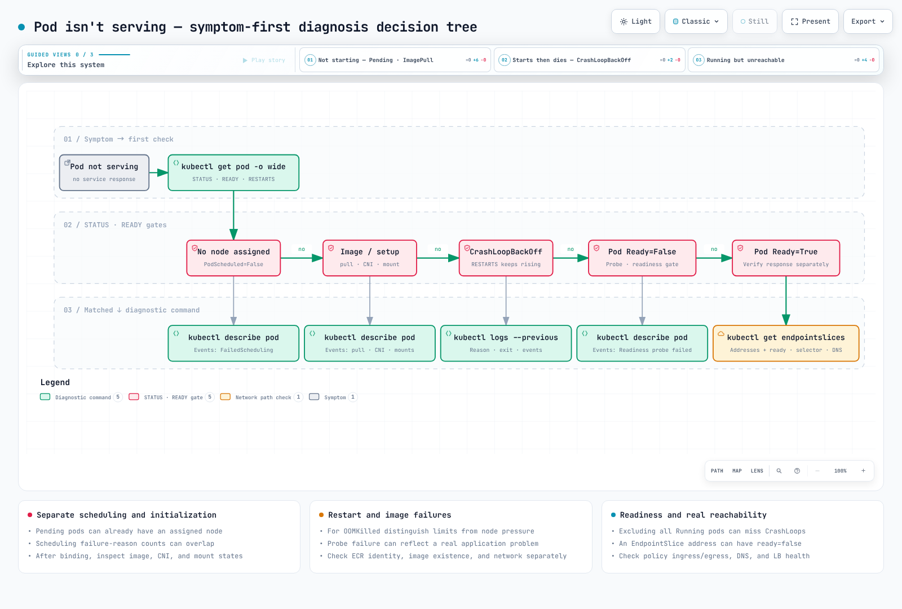

# Kubernetes/EKS 故障排查手册：症状 → 诊断 → 原因 → 修复

> **原始示例记录的版本**：原始 Amazon EKS 1.36 输出示例（控制平面 v1.36.2-eks-bca9cf6，平台版本 eks.9，Karpenter 1.4，VPC CNI v1.21，CoreDNS v1.14）
> **最后更新**：September 11, 2026

< [上一页：可用区集群运维](15-zonal-operations-guide.md) | [目录](./README.md) >

***

凌晨 3 点，寻呼器响起，你打开终端时，你需要的不是概念解释，而是**“根据我现在看到的情况，接下来要输入什么命令。”**本文档从**症状**出发，而不是从概念出发。对于每种症状，它都会在一个区块中汇总“你看到什么 → 运行什么 → 输出是什么样 → 最常见的原因以及如何修复”。

下面的输出展示了原始 September 2, 2026 文档记录的环境，以及来自官方文档的信息。本次审查没有重新运行该集群，也没有独立核实原始捕获日志。特别是，[Karpenter 兼容性矩阵](https://karpenter.sh/docs/upgrading/compatibility/)要求 Kubernetes 1.36 使用 Karpenter 1.13 或更高版本。请勿将记录中的 1.4.0 组合重新用于受支持的部署。

深入的根因分析（控制平面日志、CloudWatch Logs Insights 查询、节点加入失败的八种原因等）已收录在 [EKS 故障排查](../eks/09-eks-troubleshooting.md)和 [EKS 高级调试](../eks/11-eks-advanced-debugging.md)中。本页位于它们之前：它的作用是**在 30 秒内决定要打开哪个页面**，因此会链接到这些文档，而不是重复其中的内容。

## 目录

1. [30 秒速览：症状 → 首条命令 → 最常见原因](#30-second-summary-symptom--first-command--most-common-cause)
2. [诊断决策树](#diagnostic-decision-tree)
3. [按症状分类的故障排查手册](#playbook-by-symptom)
4. [kubectl 诊断速查表](#kubectl-diagnostic-cheat-sheet)
5. [深入了解：相关文档](#going-deeper-related-documents)
6. [参考资料](#references)

***

<span id="30-second-summary-symptom--first-command--most-common-cause"></span>

## 30 秒速览：症状 → 首条命令 → 最常见原因

每个症状单元格都链接到下方相应的故障排查章节。

| 症状（`kubectl get pods`/`nodes` 显示的内容） | 首条命令 | 最常见原因 |
|---|---|---|
| [`Pending`](#1-pod-stuck-in-pending) | `kubectl describe pod <pod>` → Events 中的 `FailedScheduling` 消息 | 资源不足（`Insufficient cpu/memory`）、缺少 toleration、nodeSelector 不匹配、PVC 未绑定 |
| [`ImagePullBackOff` / `ErrImagePull`](#2-imagepullbackoff--errimagepull) | `kubectl describe pod <pod>` → `Failed to pull image` 行 | 标签拼写错误、私有 registry 身份验证失败（imagePullSecrets/节点 IAM）、ECR 区域/账户不匹配 |
| [`CrashLoopBackOff`](#3-crashloopbackoff-exit-137-oomkilled-probe-failures-config-errors) | `kubectl logs <pod> --previous` + 检查 `lastState.terminated` | 应用启动失败（exit 1）、`OOMKilled`（exit 137）、liveness probe 失败、缺少 ConfigMap/Secret |
| [`Running` 但 READY 为 `0/1`](#4-running-but-not-ready--empty-endpoints) | `kubectl describe pod <pod>` → `Readiness probe failed` | readiness 路径/端口错误、等待依赖项、sidecar 未就绪 |
| [请求无法到达 Service](#5-service-is-unreachable) | `kubectl get endpointslices -l kubernetes.io/service-name=<svc>` | Selector 标签不匹配、`targetPort` 错误、NetworkPolicy 拦截、CoreDNS 故障 |
| [节点 `NotReady`](#6-node-notready--kubelet-pressure-diskpressure-memorypressure-pidpressure) | `kubectl describe node <node>` → Conditions | kubelet 已停止/网络分区、`DiskPressure`、`MemoryPressure`、`PIDPressure` |
| [PVC `Pending`](#7-pvc-stuck-in-pending) | `kubectl describe pvc <pvc>` → Events | `WaitForFirstConsumer`（正常等待）、StorageClass 缺失/拼写错误、AZ 不匹配 |
| [应用日志中出现 `AccessDenied`（AWS API）](#8-eks-irsa--pod-identity-accessdenied) | `kubectl get sa <sa> -o yaml` + 检查注入的凭证提供程序字段 | IRSA（IAM Roles for Service Accounts）注解/信任策略错误、缺少 Pod Identity 关联、Pod 未重启 |
| [卡在 `ContainerCreating` + `failed to assign an IP address`](#9-eks-enivpc-cni-ip-exhaustion) | `kubectl describe pod <pod>` → `FailedCreatePodSandBox` | 子网 IP 耗尽、达到节点 max-pods 上限、`aws-node` 状态不健康 |
| [Karpenter 未启动节点](#10-eks-karpenter-does-not-launch-a-node) | `kubectl get events -A --field-selector reason=FailedScheduling` | NodePool `limits` 已达到、requirements/taint 不匹配、实例类型限制 |
| [创建 Service 时因 `failed calling webhook` 被拒绝](#11-no-service-can-be-created-failed-calling-webhook) | `kubectl -n kube-system get endpointslices -l kubernetes.io/service-name=aws-load-balancer-webhook-service` | Webhook Deployment 不健康（CrashLoop），且其 `failurePolicy: Fail` webhook 匹配所有 namespace |

***

## 诊断决策树



[🔍 查看交互式图表](https://www.atomai.click/kubernetes-docs/archmaps/en-ops-16-troubleshooting-playbook-0.html)

首先确认 context 和 namespace。将 `<pod>`、`<ns>` 等占位符替换为实际值。Pod phase 与容器状态不同：排除所有 `Running` Pod 会漏掉一些 CrashLoop 和 readiness 故障。以下查询会排除已完成的 Pod，并包括异常 phase 或 Ready 条件缺失/为 false 的 Pod。

```bash
# Inspect phase and Ready condition together
kubectl get pods -A -o json | jq -r '
  .items[]
  | select(.status.phase != "Succeeded")
  | select(.status.phase != "Running" or
      ([.status.conditions[]? | select(.type == "Ready" and .status == "True")] | length == 0))
  | [.metadata.namespace, .metadata.name, .status.phase,
     ([.status.initContainerStatuses[]?, .status.containerStatuses[]?
       | .state.waiting.reason // empty] | join(","))] | @tsv
'

# Recent Warning events (cluster-wide, sorted by lastTimestamp)
kubectl get events -A --field-selector type=Warning --sort-by=.lastTimestamp | tail -30
```

***

## 按症状分类的故障排查手册

<span id="1-pod-stuck-in-pending"></span>

### 1. Pod 卡在 `Pending`

**症状**：`Pending` 既可能表示等待调度，也可能表示等待镜像下载/容器设置。首先检查 `.spec.nodeName` 和 `PodScheduled` 条件。对于未绑定的 Pod，检查调度事件；对于已绑定的 Pod，检查容器、挂载和 CNI 状态。

**诊断**：对于尚未调度的 Pod，检查 `FailedScheduling`。它会按失败原因汇总节点数量；这些分组可能重叠。

```bash
kubectl describe pod <pod> -n <ns> | sed -n '/^Events:/,$p'
```

```
Warning  FailedScheduling  default-scheduler  0/15 nodes are available: 1 Insufficient cpu, 1 Insufficient memory,
  6 node(s) didn't match Pod's node affinity/selector, 8 node(s) had untolerated taint(s).
  no new claims to deallocate, preemption: 0/15 nodes are available:
  1 No preemption victims found for incoming pod, 14 Preemption is not helpful for scheduling.
```

不要仅凭这条摘要就推断 CPU 和内存不足一定指向同一个节点，也不要推断恰好有一个节点满足所有其他约束。[调度器聚合代码](https://github.com/kubernetes/kubernetes/blob/v1.36.2/pkg/scheduler/framework/types.go)可能会对同一个节点计入多个原因。比较实际的节点标签、taint 和资源分配情况；结合 ResourceClaim 使用情况解读 DRA 消息。

**原因和修复方法**：

| 消息片段 | 原因 | 修复方法 |
|---|---|---|
| `Insufficient cpu` / `Insufficient memory` | Requests 超过节点剩余容量 | 合理调整 requests，检查 autoscaler（→ [10. Karpenter](#10-eks-karpenter-does-not-launch-a-node)），检查 `kubectl describe node` 中的 `Allocated resources` |
| `Too many pods` | 已达到配置的节点 max-pods 上限；另行检查 CNI IP 容量 | → [9. ENI/IP 耗尽](#9-eks-enivpc-cni-ip-exhaustion) |
| `node(s) had untolerated taint(s)` | 没有适用于节点 taint 的 toleration | 使用 `kubectl get nodes -o custom-columns=NAME:.metadata.name,TAINTS:.spec.taints[*].key` 列出 taint，然后添加 toleration 或调整 NodePool |
| `node(s) didn't match Pod's node affinity/selector` | 没有节点带有 nodeSelector/affinity 标签 | 检查 `kubectl get nodes --show-labels`。使用 Karpenter 时，检查 NodePool 模板标签或 requirements 提供的已知键和值 |
| `pod has unbound immediate PersistentVolumeClaims` | PVC 为 `Pending` | → [7. PVC Pending](#7-pvc-stuck-in-pending) |
| `node(s) had volume node affinity conflict` | PV（EBS）所在的 AZ 中没有可调度节点 | 查看 PV 的 `nodeAffinity` 区域，并在该 AZ 中提供容量 |
| `node(s) didn't match pod topology spread constraints` / `pod anti-affinity rules` | 没有节点满足分布约束 | 添加合适的节点。对于 topology spread，只有在检查可用性目标后才考虑使用 ScheduleAnyway；pod anti-affinity 有单独的 required/preferred 规则 |
| 完全没有事件 | 调度器故障，或 `schedulerName` 拼写错误 | 检查 `kubectl get pod <pod> -o jsonpath='{.spec.schedulerName}'` |

<span id="2-imagepullbackoff--errimagepull"></span>

### 2. `ImagePullBackOff` / `ErrImagePull`

**症状**：STATUS 最初为 `ErrImagePull`，重试几次后变为 `ImagePullBackOff`。kubelet 的拉取退避时间会逐渐增长，最高为 5 分钟。

**诊断**：

```bash
kubectl describe pod <pod> -n <ns> | grep -A2 -E "Failed to pull|Back-off pulling"
kubectl get pod <pod> -n <ns> -o jsonpath='{range .spec.containers[*]}{.name}{"\t"}{.image}{"\n"}{end}'
kubectl get pod <pod> -n <ns> -o jsonpath='{.spec.imagePullSecrets}'
```

```
Warning  Failed   kubelet  Failed to pull image "123456789012.dkr.ecr.ap-northeast-2.amazonaws.com/app:v1.2.3": ... not found
Warning  Failed   kubelet  Error: ErrImagePull
Normal   BackOff  kubelet  Back-off pulling image "123456789012.dkr.ecr.ap-northeast-2.amazonaws.com/app:v1.2.3"
Warning  Failed   kubelet  Error: ImagePullBackOff
```

成功拉取时会留下 `Pulling image "..."` → `Successfully pulled image "..." in 4.501s ...` 这一对日志；若镜像已缓存，则会记录 `Container image "..." already present on machine`。成功拉取证明下载成功，但不能排除镜像内容、架构或 entrypoint 存在问题。

**原因和修复方法**：

| `Failed to pull image` 后面的内容 | 原因 | 修复方法 |
|---|---|---|
| `not found` / `manifest unknown` | 标签拼写错误、尚未推送标签、仓库错误 | 使用 `aws ecr describe-images --repository-name <repo> --image-ids imageTag=<tag>` 验证 |
| `401 Unauthorized` / `no basic auth credentials` | 私有 registry 身份验证失败 | 对于 ECR，节点 IAM role 需要 `AmazonEC2ContainerRegistryPullOnly`（或 `ReadOnly`）；对于外部 registry，检查 `imagePullSecrets` |
| 从另一个 ECR Region/账户拉取失败 | 地址不同本身并不代表无效；检查跨账户策略和区域端点访问 | 在 ECR 仓库策略中添加拉取主体 |
| `dial tcp ... i/o timeout` | 私有子网没有 NAT/VPC 端点 | 检查 `com.amazonaws.<region>.ecr.api`、`ecr.dkr` 和 S3 网关端点 |
| `toomanyrequests` | Docker Hub 速率限制 | 通过 ECR pull-through cache 创建镜像副本 |

诊断节点时，首先检查 kubelet 事件/日志，以及用于镜像拉取的凭证提供程序。`crictl pull` 不会自动复用 kubelet 的 ECR 凭证提供程序或 Pod 的 imagePullSecrets，因此无法复现相同的身份验证路径。Fargate 镜像拉取使用 pod execution role，与应用的 IRSA role 分开。

<span id="3-crashloopbackoff-exit-137-oomkilled-probe-failures-config-errors"></span>

### 3. `CrashLoopBackOff`（exit 137 `OOMKilled`、probe 失败、配置错误）

**症状**：容器反复退出，RESTARTS 数量不断增加。通常退避时间会从 10 秒开始翻倍，最高为 300 秒，但 feature gate 和 kubelet 配置可能会改变此行为。检查 [Pod 生命周期](https://kubernetes.io/docs/concepts/workloads/pods/pod-lifecycle/)中的 restart policy。

**诊断**：按顺序查看三项：**终止原因和退出代码**、**上一个容器的日志**、**Events**。

```bash
# (1) Why did it die: lastState.terminated
kubectl get pod <pod> -n <ns> -o jsonpath='{range .status.containerStatuses[*]}{.name}{"\t"}restarts={.restartCount}{"\t"}reason={.lastState.terminated.reason}{"\t"}exit={.lastState.terminated.exitCode}{"\n"}{end}'

# (2) Logs right before death (the previous container, not the current one)
kubectl logs <pod> -n <ns> -c <container> --previous --tail=100

# (3) Probe/kill events
kubectl describe pod <pod> -n <ns> | sed -n '/^Events:/,$p'
```

原始文档中记录的输出，适用于内存限制为 128Mi 的容器：

```
    Last State:     Terminated
      Reason:       OOMKilled
      Exit Code:    137
      Started:      Mon, 31 Aug 2026 08:55:27 +0000
      Finished:     Tue, 01 Sep 2026 21:13:37 +0000
    Restart Count:  3
```

大约 36 小时的运行时长可将这种情况与立即启动失败区分开，但不能证明存在内存泄漏。还应使用内存时间序列和内核/cgroup 事件调查流量激增、批处理作业、节点 OOM 和限制变更。

**解读退出代码**：

| 退出代码 | 原因 | 含义 | 修复方法 |
|---|---|---|---|
| `0` | `Completed` | 进程正常退出；在 Deployment 中，这意味着应用没有以前台方式持续运行 | 以前台方式运行长期运行的 entrypoint，或改用 Job |
| `1` | `Error` | 应用自行退出（配置错误、依赖连接失败） | 堆栈跟踪位于 `logs --previous` 中 |
| `126` | `Error` | shell entrypoint 找到了命令但无法执行：缺少可执行权限，或 shell 报告 `cannot execute binary file: Exec format error`（架构不匹配） | 在 Dockerfile 中运行 `chmod +x`；通过 `kubectl get nodes -L kubernetes.io/arch` 检查 arm64/amd64，并使用多架构镜像 |
| `127` | `Error` | shell entrypoint 找不到命令：路径拼写错误，或最终镜像阶段从未复制该二进制文件 | 将 `command`/`args` 与镜像中的实际内容进行比较（`kubectl debug ... -- ls <path>`） |
| `137` | `OOMKilled` | OOM 终止；区分容器限制和节点内存压力 | 提高限制或修复泄漏。对于 JVM，检查 `-XX:MaxRAMPercentage` → [资源优化](10-resource-optimization.md) |
| `137` | `Error` | 因其他原因收到 SIGKILL：liveness 失败，且容器未能在 `terminationGracePeriodSeconds` 内退出 | 检查 preStop/优雅关闭 |
| `143` | `Error` | 因 SIGTERM 退出（可能是正常 rollout/驱逐） | 如果反复发生，查明 Events 中是谁在终止它 |

- 如果镜像直接执行二进制文件（中间没有 shell），架构不匹配不会产生 exit 126。容器根本不会启动，`lastState.terminated` 会显示 Reason `StartError`，并在消息中包含 `exec format error`。修复方法相同：使用多架构镜像，或在 `kubernetes.io/arch` 上设置 nodeSelector。

**Probe 失败**：这些事件表示 liveness 失败触发了重启。原因可能是路径/端口错误，也可能是真实的应用故障、过载或死锁。在放宽 probe 之前，先检查响应和应用本身。

```
Warning  Unhealthy  kubelet  Liveness probe failed: HTTP probe failed with statuscode: 503
Normal   Killing    kubelet  Container app failed liveness probe, will be restarted
```

- 如果应用启动较慢，添加 **`startupProbe`**，而不是增大 liveness 的 `initialDelaySeconds`（只有 startup probe 成功后，liveness 才会启动）。
- TCP 拒绝连接（例如 `Readiness probe failed: dial tcp 10.0.2.45:8080: connect: connection refused`）意味着首先要检查容器端口和 probe 端口是否不同。

**配置引用错误**：严格来说，这不是 crash loop；Pod 会停在 `CreateContainerConfigError` 状态。

```
Warning  Failed  kubelet  Error: configmap "app-config" not found
Warning  Failed  kubelet  Error: secret "db-credentials" not found
```

使用 `kubectl get cm,secret -n <ns>` 比较名称和 namespace 即可。如果引用的是卷挂载，则会显示为 `FailedMount` 事件（`MountVolume.SetUp failed for volume "cfg" : configmap "app-config" not found`）。

<span id="4-running-but-not-ready--empty-endpoints"></span>

### 4. `Running` 但未 Ready / Endpoints 为空

**症状**：STATUS 为 `Running`，但 READY 为 `0/1`（有 sidecar 时为 `1/2`）。普通 Service 路由会排除未就绪的 endpoint。请单独检查 publishNotReadyAddresses、正在终止的 endpoint 和 LB fail-open 等例外情况；根据代理的行为，客户端可能会看到错误或超时。

**诊断**：

```bash
kubectl describe pod <pod> -n <ns> | grep -E "Ready|Readiness probe"
kubectl get endpointslices -n <ns> -l kubernetes.io/service-name=<svc>
```

**EndpointSlice 地址和就绪状态彼此独立。**匹配的未就绪 Pod 可能会显示地址且 `ready: false`。不要根据 ENDPOINTS 列推断就绪状态；应检查 `ready`、`serving` 和 `terminating`。

```bash
kubectl get endpointslices -n <ns> -l kubernetes.io/service-name=<svc> -o json | jq -r '
  .items[] as $slice | $slice.endpoints[]?
  | [$slice.metadata.name, (.addresses | join(",")), (.conditions | tojson)] | @tsv
'
```

未设置的 `ready` 表示状态未知，消费者必须将其解释为 ready。`publishNotReadyAddresses: true` 会改变就绪状态筛选；代理也可以在 endpoint 终止期间继续处理 serving endpoint。对于没有 selector 的 Service，请检查手动管理的 EndpointSlice。v1 Endpoints API 自 Kubernetes 1.33 起已弃用；新诊断应使用 EndpointSlice。

**原因和修复方法**：

| 观察结果 | 原因 | 修复方法 |
|---|---|---|
| Events 中反复出现 `Readiness probe failed` | Probe 路径/端口错误，或应用仍在等待依赖项（DB 等） | 将 probe 指向应用实际的健康检查端点。依赖等待放在 readiness 中，不要放在 liveness 中 |
| Condition 为 `Ready False`，原因是 `ReadinessGatesNotReady` | 正在等待 Pod readiness gate，通常是 AWS Load Balancer Controller 的 `target-health.elbv2.k8s.aws/*` gate | 查明 Target Group 健康检查失败的原因 → [AWS Load Balancer Controller](../networking/03-aws-lb-controller.md) |
| `1/2` Running，只有应用容器 Ready | Sidecar（istio-proxy 等）未就绪，或 sidecar 在应用启动后才启动，导致初始连接失败 | 检查 sidecar 日志；检查注入器/版本支持的启动顺序和 readiness；仅转换为 native-sidecar 并不能解决就绪问题 |
| Ready，但 EndpointSlice 为空 | Service selector 与 Pod 标签不匹配 | → [5. Service 无法访问](#5-service-is-unreachable) |

<span id="5-service-is-unreachable"></span>

### 5. Service 无法访问

**症状**：容器显示 `1/1 Running`，但 `curl http://<svc>.<ns>.svc.cluster.local` 超时/拒绝连接，或者名称解析失败。

**将诊断拆分为三个层面**：(a) Service → Pod 映射，(b) 网络策略，(c) DNS。

```bash
# (a) Compare the selector with actual labels
kubectl get svc <svc> -n <ns> -o jsonpath='{.spec.selector}{"\n"}{.spec.ports}{"\n"}'
kubectl get pods -n <ns> -l <key>=<value> -o wide
kubectl get endpointslices -n <ns> -l kubernetes.io/service-name=<svc>

# (b) NetworkPolicies applied to the namespace
kubectl get networkpolicies -n <ns>
kubectl describe networkpolicy <policy> -n <ns>

# (c) CoreDNS status and logs
kubectl get pods -n kube-system -l k8s-app=kube-dns
kubectl logs -n kube-system -l k8s-app=kube-dns --tail=50
kubectl get cm -n kube-system coredns -o jsonpath='{.data.Corefile}'
```

**原因和修复方法**：

| 观察结果 | 原因 | 修复方法 |
|---|---|---|
| Selector 为 `{"app":"api"}`，但 Pod 标签为 `app=api-server` | 标签不匹配 → EndpointSlice 为空 | 统一标签/selector。在 Helm chart 中，`selectorLabels` 和 `podLabels` 不一致是常见原因 |
| EndpointSlice 有 IP，但出现 `connection refused` | `targetPort` 与容器实际监听的端口不同 | 使用 `kubectl get pod <pod> -n <ns> -o jsonpath='{.spec.containers[*].ports}'` 进行比较。应用仅绑定到 `127.0.0.1` 时也会出现相同症状 |
| 仅从特定 namespace 访问失败 | 存在 `default-deny` NetworkPolicy，且缺少 ingress allow 规则 | 检查 `podSelector`/`namespaceSelector`。使用 VPC CNI network policy 时，`kubectl get policyendpoints -n <ns>` 会显示实际生效的策略 → [网络策略](../security/04-network-policies.md) |
| `nslookup <svc>` 返回 `NXDOMAIN` | 在其他 namespace 中使用了短名称，或 CoreDNS 故障 | 使用 FQDN（`<svc>.<ns>.svc.cluster.local`）。确认 CoreDNS Pod 为 `Running`，且 `/etc/resolv.conf` 中的 `nameserver` 是 kube-dns ClusterIP（此集群中为 `172.20.0.10`） |
| 外部域名解析缓慢 | 默认 `ndots:5` 下，任何点号少于 5 个的名称都会先针对每个 search domain（`<ns>.svc.cluster.local`、`svc.cluster.local`、`cluster.local`、节点的 VPC 域）进行尝试，然后才作为绝对名称查询 | 在外部名称末尾添加 `.`，或检查 dnsConfig.options 中 name 为 ndots、string value 为 "2" 的条目 |
| NodePort/LB 仅通过部分节点正常工作 | `externalTrafficPolicy: Local`，但该节点上没有 Pod | 这是预期行为。只有在检查客户端 IP 保留和跨节点流量后，才考虑改用 Cluster |

要从 Pod 的角度复现 DNS 查询，请启动一个临时 Pod：`kubectl run -it --rm dns-test --image=busybox:1.36 --restart=Never -- nslookup kubernetes.default.svc.cluster.local`。CoreDNS 概念和 Corefile 见[服务与网络](../core/03-services-networking.md#coredns)。

检查目的端的 ingress 和源端的 egress NetworkPolicy。声明 containerPort 并不会创建监听 socket；请检查应用日志或 socket 状态。使用 NodeLocal DNSCache 时，resolv.conf 使用不同于 kube-dns ClusterIP 的 nameserver 也可能是正确的。

**Auto Mode DNS：**[当前的 Auto Mode](https://docs.aws.amazon.com/eks/latest/userguide/auto-networking.html) 将 CoreDNS 作为节点系统服务运行。在纯 Auto Mode 中，仅缺少 kube-dns Pod/Service 并不能说明故障。混合集群中的普通节点仍需要 CoreDNS Deployment。上述 Pod/ConfigMap 命令用于检查基于 Deployment 的 DNS；对于 Auto Mode，请检查实际 Pod 名称解析、节点 DNS 日志和上游解析器可达性。

<span id="6-node-notready--kubelet-pressure-diskpressure-memorypressure-pidpressure"></span>

### 6. 节点 `NotReady` / kubelet 压力（`DiskPressure`、`MemoryPressure`、`PIDPressure`）

**症状**：`kubectl get nodes` 显示 `NotReady`，或者节点为 `Ready`，但 Pod 被 `Evicted`，或新 Pod 因 `node(s) had untolerated taint(s)` 而避开该节点。

**诊断**：

```bash
# One-line summary of node conditions
kubectl get nodes -o custom-columns='NAME:.metadata.name,READY:.status.conditions[?(@.type=="Ready")].status,MEM:.status.conditions[?(@.type=="MemoryPressure")].status,DISK:.status.conditions[?(@.type=="DiskPressure")].status,PID:.status.conditions[?(@.type=="PIDPressure")].status'

# Conditions with their reason
kubectl get node <node> -o jsonpath='{range .status.conditions[*]}{.type}{"="}{.status}{" ("}{.reason}{")\n"}{end}'

# Taints the node picked up automatically
kubectl get node <node> -o jsonpath='{.spec.taints}'
```

健康节点的输出（安装 EKS Node Monitoring Agent 后，还会看到 `ContainerRuntimeReady`/`NetworkingReady`/`KernelReady`/`StorageReady` 条件）：

```
MemoryPressure=False (KubeletHasSufficientMemory)
DiskPressure=False (KubeletHasNoDiskPressure)
PIDPressure=False (KubeletHasSufficientPID)
Ready=True (KubeletReady)
ContainerRuntimeReady=True (ContainerRuntimeIsReady)
NetworkingReady=True (NetworkingIsReady)
KernelReady=True (KernelIsReady)
StorageReady=True (DiskIsReady)
```

**原因和修复方法**：

| Condition / reason | 自动添加的 taint | 原因 | 修复方法 |
|---|---|---|---|
| `Ready=Unknown`（`NodeStatusUnknown`，"Kubelet stopped posting node status."） | `node.kubernetes.io/unreachable` | kubelet 进程退出、实例停止/网络分区、API server 身份验证失败 | 检查 EC2 实例状态 → 如果节点有响应，使用受支持的日志访问方式；kubelet 已停止的节点可能无法启动 debug Pod |
| `Ready=False` | `node.kubernetes.io/not-ready` | 容器运行时停止、CNI 未初始化（`aws-node` 状态不健康） | 使用 `kubectl get pods -n kube-system -l k8s-app=aws-node -o wide` 查找该节点上的 aws-node |
| `DiskPressure=True`（`KubeletHasDiskPressure`） | `node.kubernetes.io/disk-pressure` | 镜像缓存/容器日志占满根卷 | 运行 `crictl rmi --prune`、轮转日志、扩展根 EBS。Pod 会因 `The node was low on resource: ephemeral-storage` 而被 `Evicted` |
| `MemoryPressure=True`（`KubeletHasInsufficientMemory`） | `node.kubernetes.io/memory-pressure` | 实际使用量超过预留，或系统预留不足；未设置 request 的 limit 可能会使 request 默认等于该 limit | 强制设置 requests（LimitRange），检查 `kube-reserved`/`system-reserved` |
| `PIDPressure=True`（`KubeletHasInsufficientPID`） | `node.kubernetes.io/pid-pressure` | fork 风暴（线程泄漏） | 找出并重启问题 Pod，设置 `podPidsLimit` |

以下命令会创建一个特权 debug Pod，并假设使用传统 Linux worker，且主机上有 shell、journalctl 和 crictl。不要假设相同的 chroot 流程适用于不可变的 Bottlerocket/EKS Auto Mode 主机。请使用 [Auto Mode 故障排查](https://docs.aws.amazon.com/eks/latest/userguide/auto-troubleshoot.html)中的 debug-container 和控制台日志操作流程。

```bash
kubectl debug node/<node> -it --image=busybox --profile=sysadmin -- chroot /host
# once inside
journalctl -u kubelet --since "10 min ago" | tail -50
df -h /var/lib/containerd
crictl ps -a | head
```

如果某个节点**从未出现在** `kubectl get nodes` 中（加入失败：IAM role/access entry、子网路由、安全组、AMI 不匹配），这是另一个主题 → [EKS 高级调试：节点加入失败诊断](../eks/11-eks-advanced-debugging.md#node-join-diagnosis)、[EKS 故障排查：节点和 Pod 问题](../eks/09-eks-troubleshooting.md#node-and-pod-issues)。对于 Karpenter 节点，请从[第 10 节](#10-eks-karpenter-does-not-launch-a-node)中的 NodeClaim 检查开始。

<span id="7-pvc-stuck-in-pending"></span>

### 7. PVC 卡在 `Pending`

**症状**：`kubectl get pvc` 显示 `Pending`，使用该 PVC 的 Pod 也为 `Pending`，并显示 `pod has unbound immediate PersistentVolumeClaims`。

**诊断**：

```bash
kubectl get pvc -n <ns>
kubectl describe pvc <pvc> -n <ns> | sed -n '/^Events:/,$p'
kubectl get storageclass
kubectl get pods -n kube-system -l app=ebs-csi-node -o wide     # is the CSI node plugin on that node?
```

```
NAME   PROVISIONER             RECLAIMPOLICY   VOLUMEBINDINGMODE      ALLOWVOLUMEEXPANSION   AGE
gp2    kubernetes.io/aws-ebs   Delete          WaitForFirstConsumer   false                  145d
gp3    ebs.csi.aws.com         Delete          WaitForFirstConsumer   true                   76d
```

StorageClass 列表是一个环境示例。请区分 Auto Mode 的 ebs.csi.eks.amazonaws.com 与单独安装的 ebs.csi.aws.com 驱动程序。在 Auto Mode 中，缺少普通的 ebs-csi-node DaemonSet 本身并不表示故障。显式设置 storageClassName: "" 表示不使用默认 class；它与省略此字段不同。

**原因和修复方法**：`describe pvc` 中的 Events 消息就是诊断依据。

| Events 消息 | 原因 | 修复方法 |
|---|---|---|
| `WaitForFirstConsumer: waiting for first consumer to be created before binding` | **正常。**`volumeBindingMode: WaitForFirstConsumer` 会将卷创建推迟到 Pod 完成调度后 | 如果它因尚无 Pod 使用而处于 Pending 状态，则保持不变。如果 Pod 也处于 Pending 状态，请查看 Pod 的 `FailedScheduling` |
| `FailedBinding: no persistent volumes available for this claim and no storage class is set` | 未设置 `storageClassName`，且没有默认 StorageClass | 在 PVC 上设置 `storageClassName: gp3`，或为 SC 添加注解 `storageclass.kubernetes.io/is-default-class: "true"` |
| `ProvisioningFailed: storageclass.storage.k8s.io "<name>" not found` | StorageClass 拼写错误，清单从其他集群复制而来 | 使用 `kubectl get sc` 显示的实际名称 |
| `ProvisioningFailed: error generating accessibility requirements: no topology key found for node <node>` | Pod 所在节点上的 EBS CSI 节点插件尚未注册（`CSINode` 中没有驱动程序） | 检查 `kubectl get csinode <node>` 的 DRIVERS 列；确认 `ebs-csi-node` DaemonSet 在该节点上运行 |
| `ProvisioningFailed` + `UnauthorizedOperation`/`AccessDenied` | EBS CSI controller 的 IRSA/Pod Identity 缺少权限 | → [8. IRSA/Pod Identity](#8-eks-irsa--pod-identity-accessdenied)（主体是 `ebs-csi-controller-sa`） |
| Pod 侧出现 `node(s) had volume node affinity conflict` | 现有 PV（EBS）位于 AZ `ap-northeast-2a`，但可调度节点位于其他 AZ | EBS 无法跨 AZ。使用 `kubectl get pv <pv> -o jsonpath='{.spec.nodeAffinity}'` 查看区域，并在那里提供容量（NodePool zone requirement 或 nodeSelector） |
| Pod 侧出现 `FailedAttachVolume: Multi-Attach error for volume` | RWO 卷仍挂载在先前节点上（StatefulSet 在节点故障后重新调度） | 使用 `kubectl get volumeattachments` 检查过期挂载。如果节点已消失，请等待几分钟以便清理 |

`WaitForFirstConsumer`、StorageClass 和动态制备概念见[存储](../core/04-storage.md#storage-classes)；EBS/EFS CSI 错误模式见 [EKS 高级调试：存储故障排查](../eks/11-eks-advanced-debugging.md#6-storage-troubleshooting)。

<span id="8-eks-irsa--pod-identity-accessdenied"></span>

### 8. EKS：IRSA / Pod Identity `AccessDenied`

**症状**：Pod 正常处于 `Running`，但应用日志中出现 AWS SDK 错误。

```
An error occurred (AccessDenied) when calling the AssumeRoleWithWebIdentity operation:
  Not authorized to perform sts:AssumeRoleWithWebIdentity
```

或者 S3/DynamoDB 调用本身被拒绝，并显示 `... is not authorized to perform: s3:GetObject`，其中被拒绝的主体不是 service account role，而是**节点 IAM role**（`assumed-role/<node-role>/i-0abc...`）。这表明 SDK 选择了节点凭证。请检查注入情况、SDK 版本、提供程序优先级和显式凭证；如果 IMDS 访问被阻止，则无法回退到节点 role。

**诊断**：首先确定正在使用哪种机制。Pod 的环境变量会告诉你。

```bash
# Service account annotation (IRSA)
kubectl get sa <sa> -n <ns> -o jsonpath='{.metadata.annotations.eks\.amazonaws\.com/role-arn}{"\n"}'

# Credential-related env injected into the pod
kubectl get pod <pod> -n <ns> -o json | jq -r '
  (.spec.initContainers[]?, .spec.containers[]?) as $container
  | $container.env[]?
  | select(.name == "AWS_ROLE_ARN" or .name == "AWS_WEB_IDENTITY_TOKEN_FILE"
        or .name == "AWS_CONTAINER_CREDENTIALS_FULL_URI"
        or .name == "AWS_CONTAINER_AUTHORIZATION_TOKEN_FILE")
  | [$container.name, .name, (.value // "valueFrom")] | @tsv
'
```

| 注入的环境变量 | 机制 | 含义 |
|---|---|---|
| `AWS_ROLE_ARN=arn:aws:iam::...:role/<role>` + `AWS_WEB_IDENTITY_TOKEN_FILE=/var/run/secrets/eks.amazonaws.com/serviceaccount/token` | **IRSA** | 由 pod-identity-webhook 注入。如果缺少这些变量，说明 SA 注解是在 Pod 创建**之后**添加的，或 SA 名称不同 |
| `AWS_CONTAINER_CREDENTIALS_FULL_URI` + `AWS_CONTAINER_AUTHORIZATION_TOKEN_FILE` | **EKS Pod Identity** | `eks-pod-identity-agent` 在 `169.254.170.23` 提供凭证。只有在存在关联时才会注入 |
| 两者都没有 | 其他提供程序或没有凭证 | 请参阅下表 |

```bash
# Pod Identity: agent and association
kubectl get pods -n kube-system -l app.kubernetes.io/name=eks-pod-identity-agent
aws eks list-pod-identity-associations --cluster-name <cluster> --namespace <ns> --service-account <sa>

# IRSA: OIDC condition in the trust policy
aws eks describe-cluster --name <cluster> --query 'cluster.identity.oidc.issuer' --output text
aws iam get-role --role-name <role> --query 'Role.AssumeRolePolicyDocument'
```

**原因和修复方法**：

| 观察结果 | 原因 | 修复方法 |
|---|---|---|
| 没有环境变量，但 SA 注解存在 | 创建顺序、实际的 serviceAccountName，或 webhook 注入配置 | 验证/修复配置，然后在考虑 rollout 影响后，于正确的 namespace 中重新创建 Pod |
| 没有环境变量，也没有关联 | Pod Identity 关联尚未创建，或关联是为其他 SA/namespace 创建的 | 运行 `aws eks create-pod-identity-association ...`，然后重启 Pod |
| `Not authorized to perform sts:AssumeRoleWithWebIdentity` | IRSA 信任策略：`Federated` OIDC provider ARN 错误，或 `sub`（`system:serviceaccount:<ns>:<sa>`）/`aud`（`sts.amazonaws.com`）条件不匹配 | 修复信任策略。如果集群已重新创建，OIDC issuer 会发生变化，因此 provider 也必须重新创建 |
| Pod Identity，但 `AssumeRole` 被拒绝 | 信任策略主体不是 `pods.eks.amazonaws.com`，或缺少 `sts:TagSession` | 在信任策略中同时允许 `sts:AssumeRole` 和 `sts:TagSession` |
| 环境变量正常，但只有特定 API 出现 `AccessDenied` | 身份/资源策略、SCP、权限边界、会话或 VPC 端点策略拒绝 | 检查调用方/资源和显式 Deny；相关 CloudTrail 数据事件可能需要配置日志记录 |
| 存在 Pod Identity 环境变量，但 SDK 报告 `Unable to locate credentials` | SDK 太旧，不支持容器凭证提供程序（`FULL_URI`） | 升级 SDK（EKS 文档中列出了最低受支持版本） |

IRSA 和 Pod Identity 的工作原理及设置方法见 [EKS 安全最佳实践](../security/06-eks-security-best-practices.md#irsa-iam-roles-for-service-accounts)和 [EKS 安全](../eks/05-eks-security.md#eks-pod-identity)；令牌过期和 webhook 问题见 [EKS 高级调试：控制平面调试](../eks/11-eks-advanced-debugging.md#2-control-plane-debugging)。

<span id="9-eks-enivpc-cni-ip-exhaustion"></span>

### 9. EKS：ENI/VPC CNI IP 耗尽

**症状**：Pod 卡在 `ContainerCreating`，Events 中出现 `FailedCreatePodSandBox`：

```
Warning  FailedCreatePodSandBox  kubelet  Failed to create pod sandbox: rpc error: code = Unknown desc =
  failed to setup network for sandbox "...": plugin type="aws-cni" name="aws-cni" failed (add):
  add cmd: failed to assign an IP address to container
```

在调度时，`Too many pods` 表示已达到 kubelet 的 Pod 数量限制。这可能与 IP 容量有关，但不能证明 IP 已耗尽。CNI `FailedCreatePodSandBox` 会在节点分配后发生。

**诊断**：

```bash
# Read the actual pod ceiling; distinguish secondary-IP defaults from prefix/custom networking configuration
kubectl get node <node> -o jsonpath='{.status.allocatable.pods}{"\n"}'
kubectl get pods -A --field-selector spec.nodeName=<node>,status.phase!=Succeeded,status.phase!=Failed --no-headers | wc -l

# aws-node status and IPAM settings
kubectl get pods -n kube-system -l k8s-app=aws-node -o wide
kubectl get ds -n kube-system aws-node -o jsonpath='{range .spec.template.spec.containers[?(@.name=="aws-node")].env[*]}{.name}={.value}{"\n"}{end}' | grep -E "PREFIX|WARM|MINIMUM|CUSTOM_NETWORK"

# Free IPs in the subnet
aws ec2 describe-subnets --subnet-ids <subnet-id> --query 'Subnets[].{id:SubnetId,az:AvailabilityZone,free:AvailableIpAddressCount}' --output table
```

在 IPv4 secondary-IP 模式下，`WARM_ENI_TARGET=1` 是预留 ENI 容量的默认目标。每个 ENI 还会占用一个主 IP：m5.xlarge 的每个 ENI 有 15 个 IPv4 地址，其中 14 个 secondary 地址供普通 Pod 使用。正值的 WARM_IP_TARGET/MINIMUM_IP_TARGET 会覆盖 warm-ENI 规则。当 warm=3 且 minimum=6 时，使用 1 个 IP 可能需要总计 6 个、预留 5 个；使用 5 个 IP 时，目标是总计 8 个、预留 3 个。预留容量并不总是恰好为 3。IPAM 协调、ENI 限制和前缀分配粒度都会影响实际数量。

**原因和修复方法**：

| 观察结果 | 原因 | 修复方法 |
|---|---|---|
| 子网的 `AvailableIpAddressCount` 只有个位数 | 子网本身已耗尽；warm pool 会预先占用 IP | 使用 `WARM_IP_TARGET`/`MINIMUM_IP_TARGET` 缩小 warm pool（如上述设置），通过**自定义网络**（`ENIConfig`）添加辅助 CIDR（例如 100.64.0.0/16），并从长远考虑采用 IPv6 |
| 节点上的 Pod 数 = allocatable pods | 已达到配置的 Pod 数量上限；另行检查 IP 容量 | 在验证支持情况和子网容量后启用**前缀委派**（`ENABLE_PREFIX_DELEGATION=true`，分配 /28 前缀，要求实例受支持且有连续的 /28 块），并重新计算 max-pods；或者改用更大的实例 |
| 该节点上的 `aws-node` 处于 `CrashLoopBackOff` | CNI 本身故障（缺少 `AmazonEKS_CNI_Policy`、版本不匹配） | 查看 `kubectl logs -n kube-system <aws-node-pod> -c aws-node`，以及节点上的 `/var/log/aws-routed-eni/ipamd.log` |
| 使用 Security Groups for Pods，且 `vpc.amazonaws.com/pod-eni` 不足 | Branch ENI 数量限制 | 改用支持 trunk ENI 的实例；确认 `ENABLE_POD_ENI=true` |

IPAM 行为（warm pool、前缀委派、自定义网络）见 [VPC CNI：IP 地址管理](../networking/01-vpc-cni.md#ip-address-management)；逐步处理 IP 耗尽的方法见 [EKS 高级调试：网络诊断](../eks/11-eks-advanced-debugging.md#5-networking-diagnostics)和 [EKS 故障排查：VPC CNI 问题](../eks/09-eks-troubleshooting.md#networking-issues)。

<span id="10-eks-karpenter-does-not-launch-a-node"></span>

### 10. EKS：Karpenter 未启动节点

**症状**：Pod 处于 `Pending`，并且 `kubectl get nodeclaims` 中没有出现新的 NodeClaim。**除了**默认调度器的 `FailedScheduling` 之外，Karpenter 还会在同一个 Pod 上记录自己的事件原因。

**诊断**：

```bash
# Events emitted by Karpenter (source is karpenter)
kubectl get events -n <ns> --field-selector involvedObject.name=<pod> -o custom-columns=REASON:.reason,SRC:.source.component,MSG:.message

# NodePool limits vs current usage
kubectl get nodepool -o custom-columns='NAME:.metadata.name,CPU_LIMIT:.spec.limits.cpu,CPU_USED:.status.resources.cpu,MEM_LIMIT:.spec.limits.memory,MEM_USED:.status.resources.memory,READY:.status.conditions[?(@.type=="Ready")].status'

# NodeClaim progress
kubectl get nodeclaims -o custom-columns='NAME:.metadata.name,TYPE:.metadata.labels.node\.kubernetes\.io/instance-type,LAUNCHED:.status.conditions[?(@.type=="Launched")].status,REGISTERED:.status.conditions[?(@.type=="Registered")].status,READY:.status.conditions[?(@.type=="Ready")].status'

kubectl logs -n kube-system -l app.kubernetes.io/name=karpenter --tail=100
```

原始文档中记录的一条 Karpenter 事件，列出了被拒绝的 NodePool：

```
FailedScheduling  karpenter  Failed to schedule pod, incompatible with nodepool "system",
  daemonset overhead={"cpu":"821m","memory":"1350Mi","pods":"10"}, incompatible requirements,
  label "nvidia.com/device-plugin.config" does not have known values;
  incompatible with nodepool "runner-arm", ..., did not tolerate workload-type=ci-runner:NoSchedule;
  all available instance types exceed limits for nodepool "graviton";
  incompatible with nodepool "gpu-ner", ..., incompatible requirements, key node.kubernetes.io/instance-type,
  node.kubernetes.io/instance-type In [g6e.4xlarge] not in node.kubernetes.io/instance-type In [g6.2xlarge g6.4xlarge g6.xlarge]
```

记录的示例中 CPU_LIMIT 为 8 / CPU_USED 为 8，但 `exceed limits` 并不要求当前使用量必须等于限制值。即使当前使用量低于限制值，只要所有候选实例都超出剩余容量，也会出现这种情况。`Nominated` 表示调度提名，并不表示已完成；请确认 NodeClaim 的 Launched、Registered、Initialized、Ready 状态，以及 Pod 是否已实际分配节点。

**原因和修复方法**：

| 消息片段 | 原因 | 修复方法 |
|---|---|---|
| `all available instance types exceed limits for nodepool "<np>"` | 添加任何候选实例都会超过 NodePool 限制 | 提高限制，或检查 consolidation 是否正在回收空闲节点 |
| `label "<key>" does not have known values` | NodePool 模板标签/requirements 未提供所请求的自定义标签值 | 将该键（及其值列表）添加到 NodePool 的 `spec.template.spec.requirements` |
| `did not tolerate <key>=<value>:NoSchedule` | 没有适用于 NodePool `taints` 的 toleration | 如果隔离是有意设置的，请使用另一个 NodePool；否则添加 toleration |
| `key node.kubernetes.io/instance-type, ... In [X] not in ... In [Y Z]` | Pod 要求使用 NodePool 不允许的实例类型 | 统一其中一方的设置。通常是 Pod 侧的要求过于狭窄 |
| `daemonset overhead={...}` 较大，且出现 `Insufficient` | 扣除 DaemonSet 预留资源后容量不足 | 在 requirements 中包含更大的实例 |
| NodeClaim `LAUNCHED=True, REGISTERED=False` 持续数分钟 | EC2 已启动，但节点无法加入（EC2NodeClass 子网/SG selector、节点 IAM role access entry、AMI） | 查看 `kubectl describe nodeclaim <name>` 中的 Conditions/Events，以及 EC2 控制台系统日志 |
| Karpenter 日志中出现 `InsufficientInstanceCapacity` | 该 AZ/实例类型没有 EC2 容量（ICE：Insufficient Capacity Error） | 扩大实例类型、AZ 和 capacity-type（spot/on-demand）的范围 |
| 没有事件，Karpenter 日志也很安静 | 该 Pod 不是 Karpenter 候选对象（`nodeSelector` 指向 MNG 标签，或调度约束与 Karpenter 无关） | 重新检查 Pod spec 中所有与节点相关的约束 |

NodePool/EC2NodeClass 结构和详细故障排查见 [Karpenter：故障排查](../autoscaling/02-karpenter.md#troubleshooting)和 [EKS 高级调试：Karpenter 置备问题](../eks/11-eks-advanced-debugging.md#karpenter-provisioning-issues)。

<span id="11-no-service-can-be-created-failed-calling-webhook"></span>

### 11. 无法创建 Service：调用 webhook 失败

**症状**：API server 拒绝任何 Service 的 `kubectl apply`/`create` 操作（适用于任何 namespace，包括与负载均衡器无关的 namespace）。包含 Service 的 Deployment、Helm 安装和 ArgoCD 同步都会卡在这里，但**现有 Service 仍能正常工作**，因此从 Pod 层面看不出任何异常。

```
Internal error occurred: failed calling webhook "mservice.elbv2.k8s.aws": failed to call webhook:
  ... no endpoints available for service "aws-load-balancer-webhook-service"
```

**诊断**：消息中已经指出 webhook 和其后端 Service。沿着 webhook 配置 → webhook Service 的 endpoint → 后端 Deployment 逐层排查。

```bash
# (1) Which webhooks are registered, and what each does on failure (rules, namespaceSelector, objectSelector, failurePolicy)
kubectl get mutatingwebhookconfigurations,validatingwebhookconfigurations
kubectl get mutatingwebhookconfiguration aws-load-balancer-webhook -o jsonpath='{range .webhooks[*]}{.name}{"\t"}failurePolicy={.failurePolicy}{"\t"}ns={.namespaceSelector}{"\t"}obj={.objectSelector}{"\t"}{.rules[*].operations}{" "}{.rules[*].resources}{"\n"}{end}'

# (2) Is there a Ready pod behind the webhook Service?
kubectl -n kube-system get endpointslices -l kubernetes.io/service-name=aws-load-balancer-webhook-service

# (3) Why does that Deployment keep dying?
kubectl -n kube-system get pods -l app.kubernetes.io/name=aws-load-balancer-controller
kubectl -n kube-system logs deploy/aws-load-balancer-controller --previous
```

原始文档记录了 LBC v3.2.1 在 September 2, 2026 反复重启及以下日志。本次审查未独立核实历史重启次数或持续时间，因此不会将其描述为复现结果。可采取行动的证据是已安装 CRD 与 controller 请求的 API 版本不匹配。

```
{"ts":"2026-09-02T07:54:42Z","logger":"setup","msg":"Disabling NLBGatewayAPI: missing required Gateway API CRDs","missing":["TLSRoute","TCPRoute","UDPRoute"]}
{"level":"error","logger":"controller-runtime.source.Kind","msg":"if kind is a CRD, it should be installed before calling Start","kind":"ListenerSet.gateway.networking.k8s.io","error":"no matches for kind \"ListenerSet\" in version \"gateway.networking.k8s.io/v1\""}
{"ts":"2026-09-02T07:57:00Z","level":"error","logger":"setup","msg":"problem running manager","error":"failed to wait for gateway.k8s.aws/alb caches to sync kind source: *v1.ListenerSet: timed out waiting for cache to be synced for Kind *v1.ListenerSet"}
```

这些日志表明，由于找不到 ListenerSet.gateway.networking.k8s.io/v1，缓存同步失败。**Gateway API 1.5.0 的标准通道包含 ListenerSet。**请在 [LBC v3.2.1 指南](https://github.com/kubernetes-sigs/aws-load-balancer-controller/blob/v3.2.1/docs/guide/gateway/gateway.md)中检查版本要求、标准 CRD 和 LBC 专用 CRD。如果需要 TCPRoute/UDPRoute 等其他 API，请查看实验性安装要求。影响取决于实际的 webhook 规则、selector 和 failurePolicy。目标更新和新资源协调可能受影响，而现有 LB 数据路径仍可能继续工作。

**原因和修复方法**：

| 观察结果 | 原因 | 修复方法 |
|---|---|---|
| `no endpoints available for service "aws-load-balancer-webhook-service"` | webhook Deployment 中没有 Ready Pod（CrashLoop、无法调度、replicas 为 0） | **先恢复 controller 的健康状态**（见下一行）。在 EndpointSlice 中确认地址和 ready 条件，并测试实际的 webhook 请求 |
| 日志中出现 `no matches for kind "ListenerSet"` → `timed out waiting for cache to be synced` | 未安装此 controller 版本所需的 Gateway API CRD | (a) 安装该 controller 版本所需的 Gateway API CRD（Gateway API 1.5.0 标准通道包含 ListenerSet），(b) 在 CRD 可用前，通过 Helm feature-gate values 禁用 controller 的 Gateway API 功能（在该版本的 `values.yaml` 中检查确切的 gate 名称），(c) 固定使用与已安装 CRD 匹配的 controller 版本 |
| Endpoint 存在，但出现 `connection refused` / `context deadline exceeded` / `x509` | 到 webhook 端口的路径被阻止（NetworkPolicy/安全组），证书已过期或不匹配 | 检查 API server → Pod webhook 端口的路径、`clientConfig.caBundle` 和证书续订 |
| 现在必须创建 Service | - | **仅在充分了解影响范围后，作为有意识的紧急措施使用**：将 `mservice.elbv2.k8s.aws` 的 `failurePolicy` 修改为 `Ignore`。期间创建的 Service 不会获得 controller 的变更（不会注入默认的 `loadBalancerClass`），因此**故障恢复后应恢复为 `Fail`**，并检查期间创建的 Service |

不要这样做：给 Service 添加 `app.kubernetes.io/name=aws-load-balancer-controller` 标签以绕过 `objectSelector`。这样虽然能通过 webhook，但该 Service **不会应用变更**，而且标签会造成误导。该 selector 的存在只是为了让 controller 自己的 Service 能够创建。

如果决定暂时禁用未使用的 Gateway API 功能，请将以下 v3.2.1 chart values 与现有配置合并，并检查 Helm diff。首先确认现有 Gateway 资源是否依赖这些 controller。

```yaml
controllerConfig:
  featureGates:
    ALBGatewayAPI: false
    NLBGatewayAPI: false
```

**预防措施**：监控 webhook Deployment 的可用副本数和 CrashLoop 状态。例如，可以针对以下 kube-state-metrics 表达式配置一个持续五分钟的告警。

```promql
kube_deployment_status_replicas_available{
  namespace="kube-system", deployment="aws-load-balancer-controller"
} < 1
```

如果指标缺失，此表达式也不会返回序列；请添加单独的 absent_over_time(...[5m]) 或抓取失败监控。Deployment 可用并不能证明 Service selector、证书或网络路径正确：还应检查 EndpointSlice 条件和 webhook 路径。将副本分散到多个 AZ 并设置 PDB 有助于应对节点故障，但无法解决所有副本共有的配置错误。

原始的 [Pod 网络基准测试](../networking/06-pod-network-benchmark.md)说明了其排除 ClusterIP 测量结果的做法。这仍然是已记录基准测试的局限性；本次审查没有复现该事件。

***

## kubectl 诊断速查表

将检查操作与调试操作区分开来：get/describe/logs/top 用于检查资源；kubectl debug 和 kubectl run 会创建容器或 Pod。请确保复制的 debug Pod 标签不会意外匹配 Service selector，并在使用后删除 debug Pod。Ephemeral container 会继续记录在原始 Pod 上。

```bash
# ── Status scan ────────────────────────────────────────────────────────
# Unhealthy pods only
kubectl get pods -A -o json | jq -r '
  .items[]
  | select(.status.phase != "Succeeded")
  | select(.status.phase != "Running" or
      ([.status.conditions[]? | select(.type == "Ready" and .status == "True")] | length == 0))
  | [.metadata.namespace, .metadata.name, .status.phase,
     ([.status.initContainerStatuses[]?, .status.containerStatuses[]?
       | .state.waiting.reason // empty] | join(","))] | @tsv
'
# Restart counts ascending, so the 15 worst pods come LAST (after tail) + last termination reason.
# Reads the first container only ([0]); for multi-container pods check the others separately.
kubectl get pods -A --sort-by='.status.containerStatuses[0].restartCount' \
  -o custom-columns='NS:.metadata.namespace,NAME:.metadata.name,RESTARTS:.status.containerStatuses[0].restartCount,REASON:.status.containerStatuses[0].lastState.terminated.reason' | tail -15
# Pods on a given node
kubectl get pods -A --field-selector spec.nodeName=<node> -o wide
# Node conditions + zone + instance type
kubectl get nodes -o custom-columns='NAME:.metadata.name,READY:.status.conditions[?(@.type=="Ready")].status,DISK:.status.conditions[?(@.type=="DiskPressure")].status,MEM:.status.conditions[?(@.type=="MemoryPressure")].status,ZONE:.metadata.labels.topology\.kubernetes\.io/zone,TYPE:.metadata.labels.node\.kubernetes\.io/instance-type'

# ── Events ─────────────────────────────────────────────────────────────
kubectl get events -A --field-selector type=Warning --sort-by=.lastTimestamp | tail -30
kubectl get events -n <ns> --field-selector involvedObject.name=<pod>,reason=FailedScheduling
kubectl events -n <ns> --for pod/<pod> --watch          # follow one object live
kubectl events -A --types=Warning                       # kubectl events subcommand (1.26+)

# ── jsonpath for exactly the fields you need ──────────────────────────
kubectl get pod <pod> -o jsonpath='{.status.containerStatuses[*].lastState.terminated}'
kubectl get pod <pod> -o jsonpath='{range .spec.containers[*]}{.name}{": "}{.resources}{"\n"}{end}'
kubectl get svc <svc> -o jsonpath='{.spec.selector}'
kubectl get sa <sa> -o jsonpath='{.metadata.annotations.eks\.amazonaws\.com/role-arn}'
kubectl get pv <pv> -o jsonpath='{.spec.nodeAffinity.required.nodeSelectorTerms[0].matchExpressions}'

# ── Logs ───────────────────────────────────────────────────────────────
kubectl logs <pod> -c <container> --previous --tail=100   # logs of the dead container
kubectl logs -n kube-system -l k8s-app=kube-dns --tail=50  # several pods by label
kubectl logs deploy/<name> --all-containers --since=10m

# ── Debug containers ───────────────────────────────────────────────────
# Attach an ephemeral container (target process namespace requires runtime support)
kubectl debug -it <pod> --image=nicolaka/netshoot --target=<container>
# Copy with an approved shell-capable debug-image; review copied labels and volume access
kubectl debug <pod> -it --copy-to=<pod>-debug --container=<container> --set-image=<container>=<debug-image> -- sh
# Node shell without SSH. --profile=sysadmin is a privileged container
kubectl debug node/<node> -it --image=busybox --profile=sysadmin -- chroot /host

# ── Resource usage (requires metrics-server) ───────────────────────────
kubectl top nodes
kubectl top pods -n <ns> --sort-by=memory
# Without metrics-server: "error: Metrics API not available"

# ── Schema lookup ──────────────────────────────────────────────────────
kubectl explain pod.status.containerStatuses.lastState.terminated
kubectl explain nodepool.spec.limits        # works for CRDs too
kubectl api-resources | grep -E "karpenter|k8s.aws"

# ── Rollouts ───────────────────────────────────────────────────────────
kubectl rollout status deploy/<name> -n <ns>
kubectl rollout history deploy/<name> -n <ns>
```

`kubectl debug` 的有效 `--profile` 值包括 `legacy`、`general`、`baseline`、`restricted`、`netadmin` 和 `sysadmin`（默认值为 `legacy` 或 `general`，具体取决于 kubectl 版本；请查看 `kubectl debug --help`）；在受限策略下，请使用与 `--profile=restricted` 兼容的镜像/安全上下文；其他准入策略仍可能拒绝操作。特权节点调试需要单独授权。

***

## 深入了解：相关文档

本故障排查手册是决定“下一步去哪里”的入口。缩小原因范围后，请转到以下文档。

| 缩小后的问题范围 | 概念文档 | 深入故障排查 |
|---|---|---|
| Pod 生命周期、probes、restart policy | [Pod 和工作负载](../core/02-pods-and-workloads.md#pod-lifecycle) | [EKS 高级调试：工作负载调试](../eks/11-eks-advanced-debugging.md#4-workload-debugging) |
| Service、EndpointSlice、CoreDNS、NetworkPolicy | [服务与网络](../core/03-services-networking.md)、[网络策略](../security/04-network-policies.md) | [EKS 故障排查：网络问题](../eks/09-eks-troubleshooting.md#networking-issues) |
| PV/PVC/StorageClass、EBS CSI | [存储](../core/04-storage.md) | [EKS 故障排查：存储问题](../eks/09-eks-troubleshooting.md#storage-issues) |
| 节点加入、kubelet、资源压力 | [集群架构](../core/01-cluster-architecture.md) | [EKS 故障排查：节点和 Pod 问题](../eks/09-eks-troubleshooting.md#node-and-pod-issues) |
| Karpenter NodePool/NodeClaim | [Karpenter](../autoscaling/02-karpenter.md) | [扩展策略](06-scaling-strategies.md) |
| VPC CNI IPAM、前缀委派、自定义网络 | [VPC CNI](../networking/01-vpc-cni.md) | [EKS 网络第 3 部分：故障排查](../eks/03-eks-networking-part3.md) |
| IRSA、Pod Identity、RBAC | [EKS 安全最佳实践](../security/06-eks-security-best-practices.md)、[Kubernetes 身份验证和授权](../security/02-kubernetes-auth-authz.md) | [EKS 故障排查：IAM 和身份验证问题](../eks/09-eks-troubleshooting.md#iam-and-authentication-issues) |
| 日志位置及查找方法 | [日志概览](../observability/logging/README.md) | [可观测性分析](08-observability-analysis.md) |
| requests/limits、OOM、JVM 内存 | [资源优化](10-resource-optimization.md) | [EKS 故障排查：性能问题](../eks/09-eks-troubleshooting.md#performance-issues) |
| 事件响应流程、严重级别、前 5 分钟检查清单 | - | [EKS 高级调试：事件响应框架](../eks/11-eks-advanced-debugging.md#1-incident-response-framework) |

***

## 参考资料

本页引用字符串和经验规则背后的官方文档。

**Kubernetes**

- [Taints 和 Tolerations](https://kubernetes.io/docs/concepts/scheduling-eviction/taint-and-toleration/)：节点控制器自动添加的 `node.kubernetes.io/*` taint（第 6 节）
- [使用 kubectl 调试 Kubernetes 节点](https://kubernetes.io/docs/tasks/debug/debug-cluster/kubectl-node-debug/)和 [`kubectl debug` 参考](https://kubernetes.io/docs/reference/kubectl/generated/kubectl_debug/)：节点 debug Pod 和 `--profile` 值（第 2、6 节及速查表）
- [调试正在运行的 Pod](https://kubernetes.io/docs/tasks/debug/debug-application/debug-running-pod/)：ephemeral container、`--copy-to`、`--target`（速查表）
- [EndpointSlices](https://kubernetes.io/docs/concepts/services-networking/endpoint-slices/)：`v1 Endpoints` 自 1.33 起弃用的原因（第 4 节）
- [调试 Service](https://kubernetes.io/docs/tasks/debug/debug-application/debug-service/)和[调试 DNS 解析](https://kubernetes.io/docs/tasks/administer-cluster/dns-debugging-resolution/)：selector/端口/DNS 检查和 `ndots`（第 5 节）

**Amazon EKS / AWS**

- [Amazon VPC CNI 插件 README](https://github.com/aws/amazon-vpc-cni-k8s/blob/master/README.md)：`WARM_ENI_TARGET`、`WARM_IP_TARGET`、`MINIMUM_IP_TARGET`、`ENABLE_PREFIX_DELEGATION` 的语义和优先级（第 9 节）
- [使用前缀为 Amazon EKS 节点分配更多 IP 地址](https://docs.aws.amazon.com/eks/latest/userguide/cni-increase-ip-addresses.html)：前缀委派和 max-pods 重新计算（第 9 节）
- [EKS Pod Identity](https://docs.aws.amazon.com/eks/latest/userguide/pod-identities.html)和[适用于 service account 的 IAM role](https://docs.aws.amazon.com/eks/latest/userguide/iam-roles-for-service-accounts.html)：信任策略形式和注入的环境变量（第 8 节）
- [检测节点运行状况问题并启用自动节点修复](https://docs.aws.amazon.com/eks/latest/userguide/node-health.html)：第 6 节所示的 Node Monitoring Agent 条件
- [排查 Amazon EKS 集群和节点问题](https://docs.aws.amazon.com/eks/latest/userguide/troubleshooting.html)：节点加入失败、`AccessDenied`、CNI 错误
- [Karpenter：故障排查](https://karpenter.sh/docs/troubleshooting/)：NodePool 限制、requirements 不匹配、NodeClaim 启动/注册失败（第 10 节）

***

< [上一页：可用区集群运维](15-zonal-operations-guide.md) | [目录](./README.md) >
