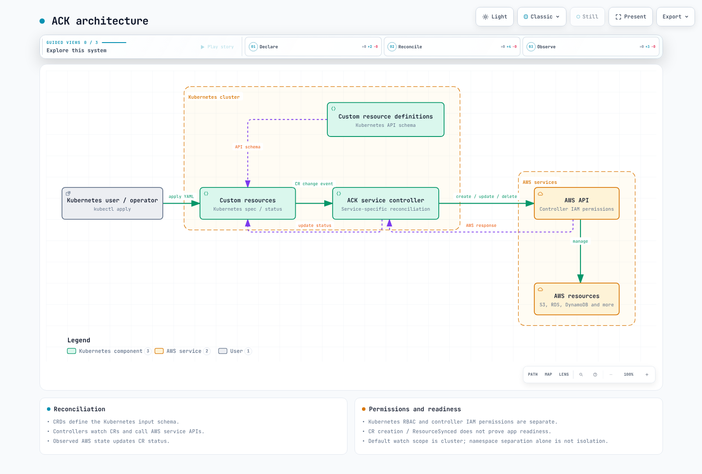

# AWS Controllers for Kubernetes (ACK)

> **最后更新**：2026年10月23日

## 概念与架构

ACK 通过特定服务的控制器，将 Kubernetes 自定义资源连接到 AWS API。CRD 定义输入；控制器会协调期望状态与观测到的 AWS 状态。创建 CR 并不意味着 AWS 资源已就绪。请检查状态以及服务自身的就绪情况。

ACK 复用 Kubernetes API、RBAC 和 GitOps 工具，但 Kubernetes 授权与 AWS IAM 仍彼此独立。用户的 CR 通常会触发控制器使用其 AWS 权限执行操作。因此，允许用户写入 CR，就等于委托其通过该控制器请求执行 AWS 操作的能力。

ACK 并非 CloudFormation 或 Terraform 的强制替代方案；实际资源由 AWS 持有，CR spec/status 则由 Kubernetes 持有。如何处理漂移取决于受支持的字段和控制器逻辑。应指定一个变更所有者，而不要让多个工具或集群协调同一个 AWS 资源。



[交互式图表](https://www.atomai.click/kubernetes-docs/archmaps/en-platform-engineering-02-ack-0.html)

## 版本与支持情况

| 控制器 | 版本 |
| --- | --- |
| s3 | 1.13.1 |
| iam | 1.10.1 |
| sqs | 1.8.2 |
| sns | 1.11.1 |
| elbv2 | 1.8.2 |
| route53 | 1.7.1 |
| rds | 1.13.3 |

这些版本已根据官方发行版本和 OCI Chart 核验。完整的服务覆盖范围以及 Alpha/Beta/GA 状态，请查阅官方服务列表。GA 并不意味着涵盖了所有 AWS API 功能或所有运维要求。CRD 的 v1alpha1 API 字符串与控制器的成熟度是两回事。

历史上的 Kubernetes 1.16 最低版本要求并非当前运维基线。请一并核验受支持的 Kubernetes/EKS 版本、控制器兼容性、Helm 版本和 CRD 升级流程。

## 安装准备与离线检查

请使用以下 OCI Chart 路径，而不是早期的 eks-charts s3-chart 路径。此命令只渲染清单，不会安装到集群中。

```bash
helm template ack-s3 \
  oci://public.ecr.aws/aws-controllers-k8s/s3-chart \
  --version 1.13.1 --namespace infra \
  --set aws.region=us-west-2 \
  --set installScope=namespace --set watchNamespace=infra \
  --set enableCARM=false --set enableCrossNamespace=false \
  --set serviceAccount.create=false \
  --set serviceAccount.name=ack-s3-controller \
  --set metrics.service.create=true --set deletionPolicy=retain
```

在实际安装或升级之前，请准备好 infra 命名空间和控制器 ServiceAccount，然后配置 IRSA 或受支持的 EKS Pod Identity。请核验 IRSA OIDC 信任条件是否适用于该命名空间和 ServiceAccount，或者核验 Pod Identity 代理/SDK 兼容性及关联配置。仅创建 IAM 角色并不会将权限附加到 ServiceAccount。

请针对受管理的资源，检查控制器的读取/创建/更新/删除/标记权限以及任何 PassRole 权限。AmazonS3FullAccess 或 Resource:"*" 都不是最小权限示例。子指南中的数据访问策略并非完整的控制器策略。

渲染成功并不能验证 IAM、AWS API 约束、准入、CRD 安装、端点连接或资源创建。安装控制器和更改 CRD 是彼此独立的运维变更。

## 命名空间与账户隔离

默认的 installScope 是 cluster。仅仅将版本安装到 dev/prod 命名空间，可能导致两个控制器都监视同一批 CR。此示例设置 installScope=namespace 和 watchNamespace=infra，并禁用 CARM 和跨命名空间引用。其他团队应使用各自独立的监视范围、ServiceAccount、IAM 角色和 RBAC。

即使处于命名空间模式，当前 Chart 仍会渲染一个 ClusterRole，授予其命名空间缓存对命名空间执行 get/list/watch 的权限。命名空间模式并不会移除所有集群级权限。请检查渲染出的 Role、ClusterRole、Binding 以及 Secret/FieldExport 访问权限。更改命名空间注解、角色映射和引用目标的权限也会影响隔离。

CARM 是跨账户管理功能，需要目标角色信任、AssumeRole 权限和控制器配置。它不能保证多个集群并发变更时的安全性。应将只读引用与变更所有权分开。

## 创建、引用与状态

各服务的数据模式并不相同。S3 策略应放在 Bucket.spec.policy 中；没有单独的 BucketPolicy CRD。IAM 托管策略通过 Role.policies/policyRefs 附加。子指南展示了 SQS 的 queueName/字符串属性，以及 SNS 专用的 Topic/Subscription 字段。

- [S3 / IAM](ack/01-s3-iam.md)
- [SQS / SNS](ack/02-sqs-sns.md)
- [ELBv2 / Route 53 / Aurora](ack/03-elbv2-route53-rds.md)

```bash
kubectl get buckets.s3.services.k8s.aws -n infra
kubectl get bucket.s3.services.k8s.aws app-data -n infra -o json
kubectl describe bucket.s3.services.k8s.aws app-data -n infra
kubectl logs -n infra \
  -l app.kubernetes.io/instance=ack-s3 --all-containers --tail=100
kubectl get events -n infra \
  --field-selector involvedObject.name=app-data
```

ACK.ResourceSynced=True 表示控制器同步状态，并不代表数据库连接正常或应用已就绪。请检查 ACK.Terminal/ACK.Recoverable 等其他条件以及服务状态。如果资源提供了 ARN，则其值位于 status.ackResourceMetadata.arn 下；NLB 和 TargetGroup ARN 也使用此路径。

受支持的 Ref 字段可连接同一命名空间中的资源。一次应用多个 YAML 文档并不构成覆盖整个 AWS 的事务。请核验被引用资源的就绪状态以及外部标识符/ARN。

## 接管与保留

请使用以下 ResourceAdoption 注解。当前 S3 Chart 已启用此功能门控。接管前，请检查标识符、账户和区域，并规划如何从其他工具转移所有权。

```yaml
apiVersion: s3.services.k8s.aws/v1alpha1
kind: Bucket
metadata:
  name: existing-data
  namespace: infra
  annotations:
    services.k8s.aws/adoption-policy: adopt
    services.k8s.aws/adoption-fields: '{"name":"REPLACE_WITH_EXISTING_BUCKET"}'
    services.k8s.aws/deletion-policy: retain
spec:
  name: REPLACE_WITH_EXISTING_BUCKET
```

运行时接受 adopt 和 adopt-or-create。adopt 会将现有状态读入 spec/status；adopt-or-create 则可以创建缺失的资源。后续的常规协调仍可能变更已接管的资源，因此接管并非只有读取权限。只读行为属于另一项独立功能，具有自己的功能门控和生命周期。先前的 resource-imported:"true" 注解无法配置接管。官方文档也将 AdoptedResource 列为较早期的做法。

保留值是 **retain**。当前运行时不接受 orphan。优先级依次为单个 CR 的 services.k8s.aws/deletion-policy、命名空间的特定服务 deletion-policy，然后是控制器默认值。保留 AWS 资源意味着仍需承担持续费用、所有权和备份责任。

## 可观测性、扩缩容与恢复

请启用 metrics.service.create，并使其与下方的目标命名空间和端口名称一致。Prometheus Operator CRD 和 Prometheus ServiceMonitor 选择器是彼此独立的前置条件。

```yaml
apiVersion: monitoring.coreos.com/v1
kind: ServiceMonitor
metadata:
  name: ack-s3
  namespace: monitoring
spec:
  namespaceSelector:
    matchNames: [infra]
  selector:
    matchLabels:
      app.kubernetes.io/name: s3-chart
      app.kubernetes.io/instance: ack-s3
  endpoints:
    - port: metricsport
      interval: 30s
```

经核验的运行时定义了 ack_outbound_api_requests_total 和 ack_outbound_api_requests_error_total。不要臆造协调成功/失败或 API 延迟的指标名称。请在实际端点核验 controller-runtime 指标名称、标签和版本。CloudTrail 审计取决于服务/API 的日志记录支持情况以及已配置的事件。

副本配置项是 deployment.replicas；运行多个副本时，请检查 leaderElection.enabled。replicaCount 不是此 Chart 的配置项。增加参与领导者选举的副本并不会自动提高并行吞吐量。请根据观测到的配额、限流和资源使用情况，调整协调并发度/重新同步设置。

在 Git 中对环境专用清单和 Chart 进行版本管理，并避免将凭证纳入其中。恢复不仅需要 CR，还需要 AWS 数据/备份、标识符、保留策略和所有权。在另一个区域创建 CR 并不能实现数据复制或恢复。

## EKS 托管 ACK

EKS Capabilities 中的 ACK 功能会在 AWS 拥有的基础设施上，将上游 GA 服务控制器作为一项 Capability 运行。根据 2026 年 10 月的测试，其与上述 Helm 安装方式的区别如下。

- IAM 从单个 Capability 角色开始，集群范围的 `IAMRoleSelector` 会按命名空间扮演不同角色。要让 OSS 控制器实现同样的隔离，需要同时设置 `featureGates.IAMRoleSelector=true` 和 `enableCARM=false`；如果保留 CARM 启用状态，控制器将无法启动。
- AWS 资源标签和会话标签使用 `eks:` 前缀（`eks:eks-capability-arn` 等）。迁移时，请更新基于 OSS `services.k8s.aws/` 标签编写的成本分配规则和 IAM 条件。
- 没有 `FieldExport` CRD，并且无法选择或更改控制器版本和重新同步间隔。在 25 分钟内，无论是托管版还是 OSS，AWS 端的漂移都没有被定期还原。
- 接管（`adopt-or-create`）和 `deletion-policy: retain` 注解在托管 Capability 上同样有效（在托管环境中测得）；删除设置了 RETAIN 的 Capability 后安装 OSS 控制器，也成功接管了现有 CR。

测量结果和选型指南请参阅 [EKS Capabilities](../eks/13-eks-capabilities.md)。

## 故障排查

创建失败时，请检查条件/事件、控制器镜像/日志、账户/区域、IAM 信任关系/策略、引用和服务约束。请区分 Kubernetes RBAC 错误与 AWS IAM 错误。对于处于 Terminating 状态的资源，请找出终结器正在等待的 AWS 删除、依赖项或保留条件。

不要例行清除终结器，否则可能留下未跟踪的 AWS 资源。应先解决问题根源；只有在检查实际资源状态、备份和后续所有权之后，才能将最后手段的恢复流程用于紧急情况。

## 验证与参考资料

已阅读原有的八个指南文件，以及韩文/英文的两份测验，其中包括 56 个不同的代码块。已渲染七个官方 OCI Chart，并根据带版本的 CRD 检查了 18 个资源示例，同时启用了对未知 spec 字段的拒绝检查。未测试 AWS 资源创建、控制器执行、准入/CEL、消息传递或数据库连接。

- [ACK 服务](https://aws-controllers-k8s.github.io/community/docs/community/services/)
- [资源接管](https://aws-controllers-k8s.github.io/community/docs/user-docs/features/#resourceadoption)
- [保留](https://aws-controllers-k8s.github.io/community/docs/user-docs/deletion-policy/)
- [S3 Chart 1.13.1](https://github.com/aws-controllers-k8s/s3-controller/tree/v1.13.1/helm)
- [Runtime 0.66.0](https://github.com/aws-controllers-k8s/runtime/tree/v0.66.0)

[ACK 测验](../quizzes/platform-engineering/02-ack-quiz.md)
