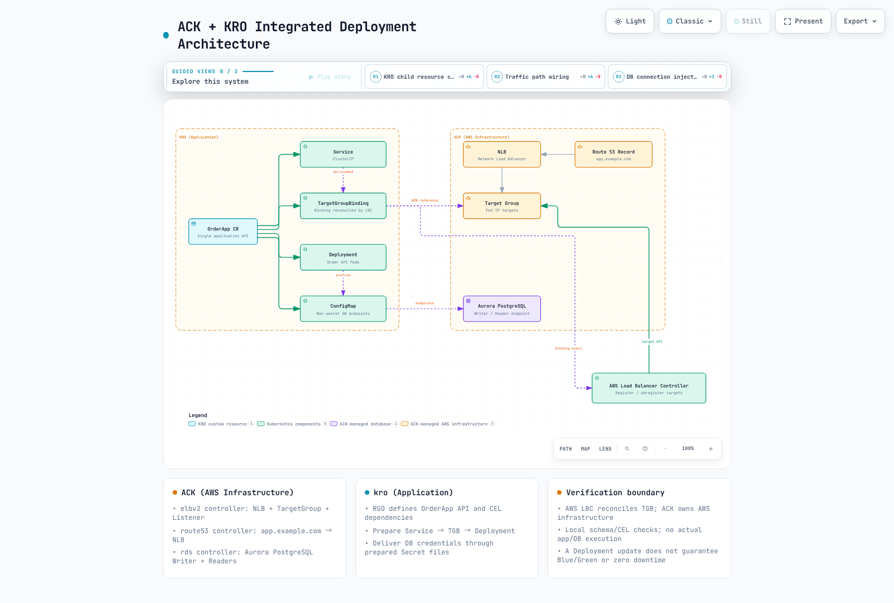

# ExampleCorp 订单系统：ACK + kro 集成

> **最后更新**：October 16, 2026 · kro 0.9.4 / AWS Load Balancer Controller 3.6.0

## 场景和验证范围

ExampleCorp 是虚构的。本指南定义了一个将 kro 应用图连接到 ACK 管理的基础设施的集成契约。它不是一个端到端实验，不会提供可运行的 Order API 或公共应用镜像。此前虚构的 ECR 镜像并未作为可运行镜像提供。

ACK 管理 NLB、TargetGroup、Listener、Route 53 记录和 Aurora。kro 创建 Service、ConfigMap、TargetGroupBinding (TGB) 和 Deployment 资源。**另一个独立的 AWS Load Balancer Controller (LBC) 负责协调 TGB，并注册/注销 Pod IP 目标**。仅安装 ACK 和 kro 并不能实现这种连接。



[交互式图表](https://www.atomai.click/kubernetes-docs/archmaps/en-platform-engineering-05-example-corp-app-0.html)

## 基础设施和应用前提条件

首先查看 [ACK 资源示例](ack/03-elbv2-route53-rds.md)中的当前 schema 和生命周期指南。准备经过批准的 VPC/私有子网/安全组、内部 NLB/Listener、ip TargetGroup、DNS 以及 Aurora 集群/实例。从 `.status.ackResourceMetadata.arn` 读取 TargetGroup ARN，而不是使用此前的 `.status.targetGroupARN`。

单独准备 AWS LBC、其 CRD、IAM/ServiceAccount 和 webhook。本指南检查的是 OSS LBC 3.6.0 的 elbv2.k8s.aws/v1beta1 TGB，而不是 EKS Auto Mode 独有的负载均衡 API。TGB 编写者可以在控制器 IAM 权限范围内引用 TargetGroup，因此应限制允许的 ARN、命名空间和写入权限。

运维人员必须提供符合以下契约的 Order API 镜像：

- 在配置的端口上提供 HTTP 服务，并在 `/readyz` 提供就绪检查。
- 从 ConfigMap 配置读取 DB_WRITER_HOST、DB_READER_HOST、DB_PORT 和 DB_NAME。
- 从 DB_CREDENTIALS_DIR 下的凭证文件读取凭证并进行轮换。不要将密码放入环境变量、ConfigMap 或状态中。
- 能够以 UID 10001 运行，使用只读根文件系统、受限资源和可写的 /tmp 卷。如果实际镜像有所不同，请根据安全策略调整此契约。

通过经过批准的 provider/ESO 流程准备 production 和 order-db-credentials。由 RDS 管理的 Secrets Manager 凭证不会自动创建 Kubernetes Secret。应用数据库/用户、最低限度的 DB 权限、TLS 验证和连接池属于独立要求。在 CR 中指定数据库名称并不会创建该数据库。

## 就绪门控和创建顺序

对于 LBC Pod 就绪门控，必须在创建 Pod **之前**为命名空间添加标签 elbv2.k8s.aws/pod-readiness-gate-inject=enabled。匹配的 Service 及其 ip TGB 必须已存在。该图通过 CEL 强制执行 Service → TGB → Deployment 的顺序；Deployment 注解引用 TGB 名称以建立此依赖关系。

TGB 没有用于等待目标变为健康状态的 readyWhen。若让 Pod 创建等待目标健康，可能会因没有 Pod 可成为健康目标而陷入死锁。TGB 存在、LBC 协调、目标健康和 Pod 就绪是不同的状态。请检查 webhook failurePolicy/注入、滚动更新、关闭宽限期和注销延迟。

## ResourceGraphDefinition

这些文件也位于 examples/platform/examplecorp。请检查并添加聚合 RBAC，涵盖 OrderApp/status/finalizers 以及 Service、ConfigMap、Deployment 和 TGB 资源。创建 RGD 的权限意味着可以使用控制器权限。

```yaml
apiVersion: kro.run/v1alpha1
kind: ResourceGraphDefinition
metadata:
  name: examplecorp-webapps
spec:
  schema:
    apiVersion: v1alpha1
    group: platform.example.com
    kind: OrderApp
    scope: Namespaced
    spec:
      replicas: integer | default=3 minimum=1 maximum=10
      image: string | required=true
      port: integer | default=8080 minimum=1 maximum=65535
      targetGroupARN: string | required=true
      vpcID: string | required=true
      credentialsSecretName: string | required=true
      aurora:
        writerEndpoint: string | required=true
        readerEndpoint: string | required=true
        port: integer | default=5432
        dbName: string | required=true
    status:
      availableReplicas: ${deployment.status.availableReplicas}
      serviceIP: ${service.spec.clusterIP}
  resources:
  - id: service
    template:
      apiVersion: v1
      kind: Service
      metadata:
        name: ${schema.metadata.name}
        namespace: ${schema.metadata.namespace}
        labels:
          app.kubernetes.io/name: ${schema.metadata.name}
      spec:
        type: ClusterIP
        selector:
          app.kubernetes.io/name: ${schema.metadata.name}
        ports:
        - name: http
          port: ${schema.spec.port}
          targetPort: http
  - id: dbConfig
    template:
      apiVersion: v1
      kind: ConfigMap
      metadata:
        name: ${schema.metadata.name + "-db"}
        namespace: ${schema.metadata.namespace}
        labels:
          app.kubernetes.io/name: ${schema.metadata.name}
      data:
        DB_WRITER_HOST: ${schema.spec.aurora.writerEndpoint}
        DB_READER_HOST: ${schema.spec.aurora.readerEndpoint}
        DB_PORT: ${string(schema.spec.aurora.port)}
        DB_NAME: ${schema.spec.aurora.dbName}
  - id: targetGroupBinding
    template:
      apiVersion: elbv2.k8s.aws/v1beta1
      kind: TargetGroupBinding
      metadata:
        name: ${schema.metadata.name + "-tgb"}
        namespace: ${schema.metadata.namespace}
        labels:
          app.kubernetes.io/name: ${schema.metadata.name}
      spec:
        targetGroupARN: ${schema.spec.targetGroupARN}
        targetType: ip
        vpcID: ${schema.spec.vpcID}
        serviceRef:
          name: ${service.metadata.name}
          port: ${schema.spec.port}
  - id: deployment
    readyWhen:
    - ${deployment.status.availableReplicas >= deployment.spec.replicas}
    - ${deployment.status.observedGeneration >= deployment.metadata.generation}
    template:
      apiVersion: apps/v1
      kind: Deployment
      metadata:
        name: ${schema.metadata.name}
        namespace: ${schema.metadata.namespace}
        labels:
          app.kubernetes.io/name: ${schema.metadata.name}
      spec:
        replicas: ${schema.spec.replicas}
        selector:
          matchLabels:
            app.kubernetes.io/name: ${schema.metadata.name}
        template:
          metadata:
            labels:
              app.kubernetes.io/name: ${schema.metadata.name}
            annotations:
              platform.example.com/target-group-binding: ${targetGroupBinding.metadata.name}
          spec:
            automountServiceAccountToken: false
            securityContext:
              runAsNonRoot: true
              runAsUser: 10001
              runAsGroup: 10001
              fsGroup: 10001
              seccompProfile:
                type: RuntimeDefault
            containers:
            - name: order-api
              image: ${schema.spec.image}
              ports:
              - name: http
                containerPort: ${schema.spec.port}
              securityContext:
                allowPrivilegeEscalation: false
                readOnlyRootFilesystem: true
                capabilities:
                  drop:
                  - ALL
              resources:
                requests:
                  cpu: 100m
                  memory: 64Mi
                limits:
                  cpu: 500m
                  memory: 128Mi
              readinessProbe:
                httpGet:
                  path: /readyz
                  port: http
              volumeMounts:
              - name: tmp
                mountPath: /tmp
              - name: db-credentials
                mountPath: /var/run/order-db
                readOnly: true
              envFrom:
              - configMapRef:
                  name: ${dbConfig.metadata.name}
              env:
              - name: DB_CREDENTIALS_DIR
                value: /var/run/order-db
            volumes:
            - name: tmp
              emptyDir:
                sizeLimit: 64Mi
            - name: db-credentials
              secret:
                secretName: ${schema.spec.credentialsSecretName}
```

## 实例输入

下面的 example.invalid 地址/镜像和 ARN/VPC ID 都是占位符。使用前请读取实际的 ACK 端点/ARN，并验证应用镜像摘要和 Secret。手动复制的端点不会自动跟随 ACK 的变更；请提供经过批准的 GitOps 输入更新路径。

```yaml
apiVersion: platform.example.com/v1alpha1
kind: OrderApp
metadata:
  name: order-api
  namespace: production
spec:
  replicas: 3
  image: example.invalid/order-api:replace-with-reviewed-image
  port: 8080
  targetGroupARN: arn:aws:elasticloadbalancing:us-west-2:123456789012:targetgroup/replace-with-approved-tg/0123456789abcdef
  vpcID: vpc-0123456789abcdef0
  credentialsSecretName: order-db-credentials
  aurora:
    writerEndpoint: replace-with-writer-endpoint.example.invalid
    readerEndpoint: replace-with-reader-endpoint.example.invalid
    port: 5432
    dbName: orders
```

## 验证和运维

```bash
kubectl get orderapps.platform.example.com order-api -n production -o yaml
kubectl get deploy,svc,targetgroupbindings.elbv2.k8s.aws,configmap \
  -n production -l app.kubernetes.io/name=order-api
kubectl get pods -n production -l app.kubernetes.io/name=order-api -o wide
```

结合 Pod 就绪门控、EndpointSlices、TGB 状态、AWS 目标健康状态、DNS/HTTP 和数据库 TLS 连接情况，一并检查 CR 条件和 Deployment 状态。就绪检查是否会检查数据库，取决于实际应用。所有生成资源的元数据都带有相同的查询标签。

新增支付服务需要经过审核的镜像、独立的 TargetGroup/Listener 路由方案以及数据库用户/权限/schema 契约。共享 Aurora 并不能保证数据、性能或成本隔离。跨 TGB/集群共享 TargetGroup 需要有意处理 multiClusterTargetGroup 生命周期；忽略默认所有权模型可能会注销其他目标。

使用 ACK DBInstances 添加 Aurora 副本，并采用受支持的实例类别/区域组合；名称/标签无法改变写入器角色。请遵循 [RDS 示例](ack/03-elbv2-route53-rds.md)中的 promotionTier、端点和故障转移指南，然后测试实际负载和恢复能力。

更新 Deployment 镜像通常会执行 RollingUpdate，而不会自动进行 Blue/Green 部署，也无法保证零停机。Blue/Green 需要独立的应用版本、目标/路由切换、验证指标、回滚条件和数据库兼容性。删除/替换 CR 可能会清理子级 TGB/Deployment 和目标关联；这不是无害的版本切换。

## 已执行的检查

已阅读并对照当前 RGD/TGB schema 检查了两份原始指南和所有示例。使用 cel-go 编译/评估了 21 个唯一表达式，以检查四种资源、Service/Pod 选择器、ConfigMap/Service 引用、TGB 在 Deployment 之前的依赖关系以及状态。这些都是使用合成输入进行的本地检查。未执行任何 AWS 资源、应用镜像、数据库、目标健康检查、Pod 变更或流量测试。

- [ACK](02-ack.md)
- [kro](03-kro.md)
- [AWS LBC 3.6.0 TGB](https://github.com/kubernetes-sigs/aws-load-balancer-controller/blob/v3.6.0/docs/guide/targetgroupbinding/targetgroupbinding.md)
- [Pod 就绪门控](https://github.com/kubernetes-sigs/aws-load-balancer-controller/blob/v3.6.0/docs/deploy/pod_readiness_gate.md)
