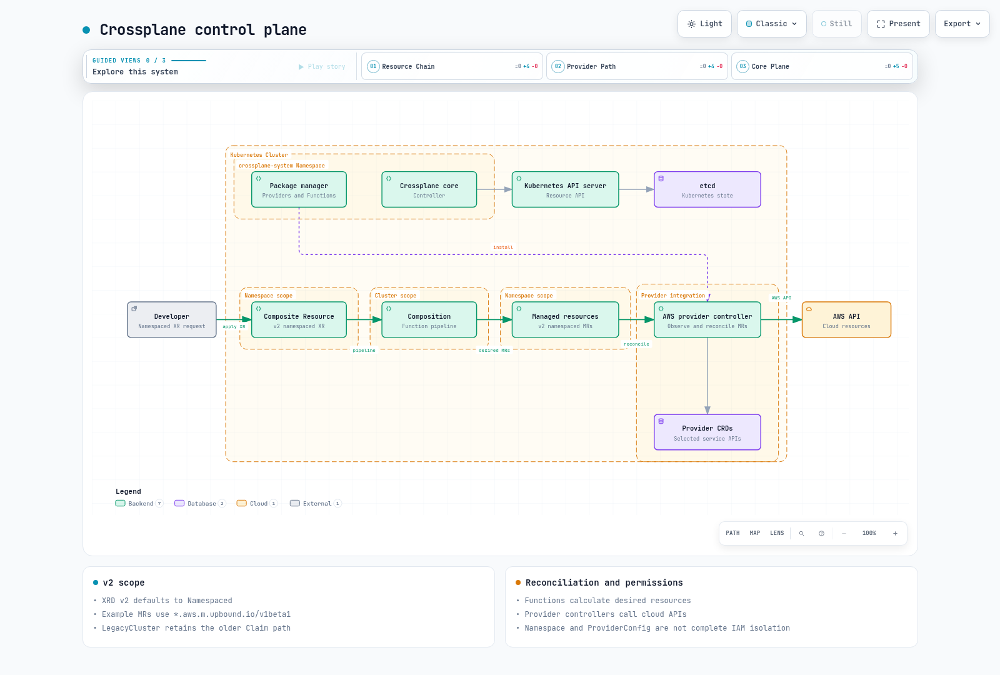
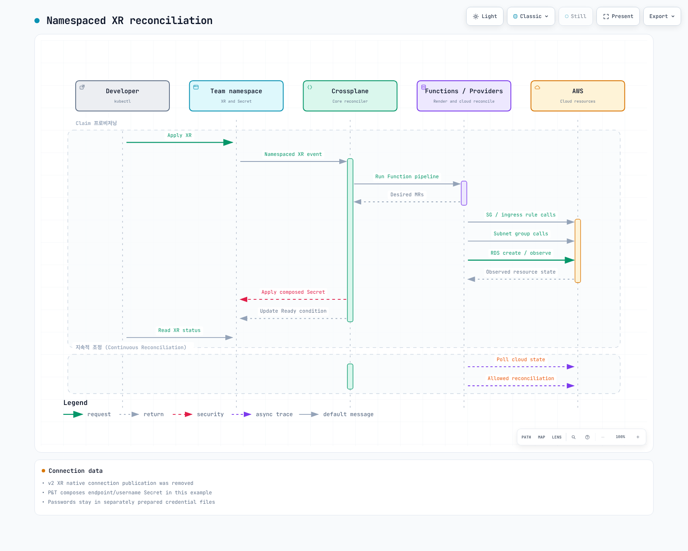

# Crossplane

> **最后更新日期**: 2026 年 10 月 16 日 · Crossplane 2.4.2 / AWS provider 2.9.0

## 概念与 v2 变更

Crossplane 通过 Kubernetes API 和控制器协调基础设施与应用资源。它于 2020 年 6 月 25 日加入 CNCF，2021 年 9 月 14 日成为孵化项目，并于 2025 年 10 月 28 日毕业。此前相互矛盾的 2023/2024 年毕业说法已更正。

| 组件 | 作用和当前范围 |
| --- | --- |
| Provider | 以软件包形式安装 CRD/控制器。选择特定服务的 AWS 软件包；一个软件包不一定涵盖每个 AWS API。 |
| Managed Resource (MR) | 管理外部资源的 Provider API。此处的 v2 示例使用命名空间作用域。 |
| Composite Resource (XR) | 平台 API 的实例。XRD v2 默认使用 Namespaced。 |
| XRD | 定义 XR 架构和作用域；区分 v1 LegacyCluster 与 v2 Namespaced。 |
| Composition | 定义一个 Function 流水线，根据 XR 输入计算期望资源和状态。 |
| Claim | 面向旧版集群作用域 XR 的命名空间接口；对于新的命名空间作用域 XR，它不是必需层。 |


[交互式图表](https://www.atomai.click/kubernetes-docs/archmaps/en-platform-engineering-07-crossplane-0.html)

现有 v1 XRD 可以继续使用 LegacyCluster Claim，旧版集群作用域 MR 也仍受支持。不要只更改核心版本，同时继续保留已移除的 Resources 模式 Composition、ControllerConfig 或 XR 原生连接信息发布。官方 v2 迁移指南介绍了如何从 1.20 进行准备。

Terraform 同样使用声明式期望状态，也可以在 CI 中自动执行 plan/apply。主要区别在于执行工作流与持续的控制器协调。Crossplane 的行为仍取决于 managementPolicies、受支持字段、错误和配额；它不会立即修复每一种漂移。

## 核心、Providers 与权限

经审查的 Helm chart 版本为 2.4.2。此命令可离线检查该 chart，不会安装到集群中。

```bash
helm repo add crossplane-stable https://charts.crossplane.io/stable
helm repo update
helm template crossplane crossplane-stable/crossplane   --version 2.4.2 --namespace crossplane-system   --set metrics.enabled=true
```

当前 provider.defaultActivations 的默认值为 ["*"]。决定要激活哪些 API 时，请检查 MRD、ManagedResourceActivationPolicy 以及已安装的服务范围。已安装的 Provider 并不意味着 AWS 身份验证成功或资源已就绪。

下面的 IAM 角色仅为占位符。应将信任范围限制为确切的 EKS issuer、audience 和 ServiceAccount subject，并限定服务操作和资源范围。给 s3:*/rds:*/ec2:*/iam:* 添加 RequestedRegion 并不能实现最小权限。RDS 和 EC2 Provider 需要各自经过审查的运行时/身份配置。

```yaml
apiVersion: pkg.crossplane.io/v1beta1
kind: DeploymentRuntimeConfig
metadata:
  name: provider-aws-s3-reviewed
spec:
  deploymentTemplate:
    spec:
      selector: {}
      template:
        spec:
          containers:
          - name: package-runtime
            resources:
              requests:
                cpu: 100m
                memory: 256Mi
              limits:
                cpu: 500m
                memory: 512Mi
            ports:
            - name: metrics
              containerPort: 8080
        metadata:
          labels:
            app: provider-aws-s3-reviewed
  serviceAccountTemplate:
    metadata:
      name: provider-aws-s3-reviewed
      annotations:
        eks.amazonaws.com/role-arn: arn:aws:iam::123456789012:role/ReplaceApprovedS3ProviderRole
---
apiVersion: pkg.crossplane.io/v1
kind: Provider
metadata:
  name: provider-aws-s3
spec:
  package: xpkg.crossplane.io/crossplane-contrib/provider-aws-s3:v2.9.0
  packagePullPolicy: IfNotPresent
  revisionActivationPolicy: Manual
  revisionHistoryLimit: 2
  runtimeConfigRef:
    name: provider-aws-s3-reviewed
```

不要将多个 Provider 配置为使用同一个固定的 ServiceAccount。packagePullPolicy 控制拉取；revisionActivationPolicy 控制激活。使用 Manual 时，请检查 ProviderRevisions，并按需显式激活经过审查的版本。

可以从社区和 Upbound 仓库获取 2.9.0 S3 清单，但它们的摘要不同。版本字符串相同并不意味着制品相同。请固定所选发行版、注册表/摘要和支持预期。

此示例使用配有 IRSA 的命名空间作用域 ProviderConfig。2.9.0 架构也支持 PodIdentity，但需要实际的关联/SDK/运行时配置。仅使用按命名空间划分的 ProviderConfig 并不能隔离 AWS 权限；还需约束配置写入、引用和角色代入边界。

```yaml
apiVersion: aws.m.upbound.io/v1beta1
kind: ProviderConfig
metadata:
  name: team-aws
  namespace: team-alpha
spec:
  credentials:
    source: IRSA
```



[交互式图表](https://www.atomai.click/kubernetes-docs/archmaps/en-platform-engineering-07-crossplane-1.html)

## 命名空间作用域 S3 示例

示例使用命名空间作用域的 *.aws.m.upbound.io API，与旧版集群作用域的 *.aws.upbound.io API 不同。providerConfigRef 包含 kind/name。managementPolicies 排除 Delete，以保留外部资源；这些命名空间 API 不提供旧的 deletionPolicy 字段。

先准备实际的存储桶名称、区域和身份。排除 Delete 仍允许更新；保留资源并不是备份或成本清理策略。

```yaml
apiVersion: s3.aws.m.upbound.io/v1beta1
kind: Bucket
metadata:
  name: app-data
  namespace: team-alpha
  annotations:
    crossplane.io/external-name: replace-with-globally-unique-bucket
spec:
  managementPolicies:
  - Observe
  - Create
  - Update
  - LateInitialize
  forProvider:
    region: us-west-2
    forceDestroy: false
    tags:
      Environment: Development
  providerConfigRef:
    kind: ProviderConfig
    name: team-aws
```

```yaml
apiVersion: s3.aws.m.upbound.io/v1beta1
kind: BucketPublicAccessBlock
metadata:
  name: app-data-public-access
  namespace: team-alpha
spec:
  managementPolicies:
  - Observe
  - Create
  - Update
  - LateInitialize
  forProvider:
    region: us-west-2
    bucketRef:
      name: app-data
    blockPublicAcls: true
    blockPublicPolicy: true
    ignorePublicAcls: true
    restrictPublicBuckets: true
  providerConfigRef:
    kind: ProviderConfig
    name: team-aws
```

```yaml
apiVersion: s3.aws.m.upbound.io/v1beta1
kind: BucketVersioning
metadata:
  name: app-data-versioning
  namespace: team-alpha
spec:
  managementPolicies:
  - Observe
  - Create
  - Update
  - LateInitialize
  forProvider:
    region: us-west-2
    bucketRef:
      name: app-data
    versioningConfiguration:
      status: Enabled
  providerConfigRef:
    kind: ProviderConfig
    name: team-aws
```

```yaml
apiVersion: s3.aws.m.upbound.io/v1beta1
kind: BucketServerSideEncryptionConfiguration
metadata:
  name: app-data-encryption
  namespace: team-alpha
spec:
  managementPolicies:
  - Observe
  - Create
  - Update
  - LateInitialize
  forProvider:
    region: us-west-2
    bucketRef:
      name: app-data
    rule:
    - applyServerSideEncryptionByDefault:
        sseAlgorithm: AES256
  providerConfigRef:
    kind: ProviderConfig
    name: team-aws
```

四项 Block Public Access 设置均已启用。在此版本中，versioningConfiguration 和 applyServerSideEncryptionByDefault 是对象，而不是旧版的数组结构。规划删除时，还要考虑存储桶对象/版本以及 forceDestroy=false。

## PostgreSQL 平台 API

此示例使用经过批准的 VPC、位于不同 AZ 的私有子网、客户端 SecurityGroup 和密码 Secret。网络与数据库的预配不是一个事务。如果分别管理 VPC/Subnet MR，请一并验证 CIDR、路由、出口流量、DNS 和 AZ。

直接在其命名空间中创建新的 XR。应单独验证 dbName，而不是尝试使用错误的 Regexp transform 去除 metadata-name 中的连字符。此示例将 ProviderConfig 名称限制为 team-aws。

```yaml
apiVersion: apiextensions.crossplane.io/v2
kind: CompositeResourceDefinition
metadata:
  name: postgresqldatabases.platform.example.com
spec:
  scope: Namespaced
  group: platform.example.com
  names:
    kind: PostgreSQLDatabase
    plural: postgresqldatabases
  versions:
  - name: v1alpha1
    served: true
    referenceable: true
    schema:
      openAPIV3Schema:
        type: object
        required:
        - spec
        properties:
          spec:
            type: object
            required:
            - parameters
            properties:
              parameters:
                type: object
                required:
                - environment
                - dbName
                - vpcID
                - subnetIDs
                - clientSecurityGroupID
                - passwordSecretName
                properties:
                  storageGB:
                    type: integer
                    minimum: 20
                    maximum: 1000
                    default: 50
                  environment:
                    type: string
                    enum:
                    - dev
                    - production
                  dbName:
                    type: string
                    pattern: ^[a-z][a-z0-9]{0,62}$
                  vpcID:
                    type: string
                  subnetIDs:
                    type: array
                    minItems: 2
                    items:
                      type: string
                  clientSecurityGroupID:
                    type: string
                  passwordSecretName:
                    type: string
                  providerConfigName:
                    type: string
                    default: team-aws
                    enum:
                    - team-aws
          status:
            type: object
            properties:
              endpoint:
                type: string
              port:
                type: integer
```

请区分 served 和 referenceable 版本；不要将多个版本标记为 referenceable。实际 CLI xrd convert 检查结果显示，Namespaced 会生成一个 CRD，而 LegacyCluster+claimNames 会生成两个 XR/Claim CRD。转换不等于安装到集群或迁移数据。

### Function 流水线

```yaml
apiVersion: pkg.crossplane.io/v1
kind: Function
metadata:
  name: function-patch-and-transform
spec:
  package: xpkg.crossplane.io/crossplane-contrib/function-patch-and-transform:v0.10.10
---
apiVersion: pkg.crossplane.io/v1
kind: Function
metadata:
  name: function-auto-ready
spec:
  package: xpkg.crossplane.io/crossplane-contrib/function-auto-ready:v0.7.0
```

```yaml
apiVersion: apiextensions.crossplane.io/v1
kind: Composition
metadata:
  name: postgresql-aws-reviewed
spec:
  compositeTypeRef:
    apiVersion: platform.example.com/v1alpha1
    kind: PostgreSQLDatabase
  mode: Pipeline
  pipeline:
  - step: patch-and-transform
    functionRef:
      name: function-patch-and-transform
    input:
      apiVersion: pt.fn.crossplane.io/v1beta1
      kind: Resources
      resources:
      - name: securityGroup
        base:
          apiVersion: ec2.aws.m.upbound.io/v1beta1
          kind: SecurityGroup
          spec:
            managementPolicies:
            - Observe
            - Create
            - Update
            - LateInitialize
            forProvider:
              region: us-west-2
              description: Application database security group
            providerConfigRef:
              kind: ProviderConfig
              name: team-aws
        patches:
        - &id001
          type: FromCompositeFieldPath
          fromFieldPath: spec.parameters.providerConfigName
          toFieldPath: spec.providerConfigRef.name
          policy:
            fromFieldPath: Required
        - &id002
          type: FromCompositeFieldPath
          fromFieldPath: spec.parameters.environment
          toFieldPath: spec.forProvider.tags.Environment
          policy:
            fromFieldPath: Required
        - type: FromCompositeFieldPath
          fromFieldPath: spec.parameters.vpcID
          toFieldPath: spec.forProvider.vpcId
          policy:
            fromFieldPath: Required
      - name: securityGroupRule
        base:
          apiVersion: ec2.aws.m.upbound.io/v1beta1
          kind: SecurityGroupRule
          spec:
            managementPolicies:
            - Observe
            - Create
            - Update
            - LateInitialize
            forProvider:
              region: us-west-2
              type: ingress
              protocol: tcp
              fromPort: 5432
              toPort: 5432
              securityGroupIdSelector:
                matchControllerRef: true
            providerConfigRef:
              kind: ProviderConfig
              name: team-aws
        patches:
        - type: FromCompositeFieldPath
          fromFieldPath: spec.parameters.providerConfigName
          toFieldPath: spec.providerConfigRef.name
          policy:
            fromFieldPath: Required
        - type: FromCompositeFieldPath
          fromFieldPath: spec.parameters.clientSecurityGroupID
          toFieldPath: spec.forProvider.sourceSecurityGroupId
          policy:
            fromFieldPath: Required
      - name: subnetGroup
        base:
          apiVersion: rds.aws.m.upbound.io/v1beta1
          kind: SubnetGroup
          spec:
            managementPolicies:
            - Observe
            - Create
            - Update
            - LateInitialize
            forProvider:
              region: us-west-2
              description: Approved private database subnets
            providerConfigRef:
              kind: ProviderConfig
              name: team-aws
        patches:
        - *id001
        - *id002
        - type: FromCompositeFieldPath
          fromFieldPath: spec.parameters.subnetIDs
          toFieldPath: spec.forProvider.subnetIds
          policy:
            fromFieldPath: Required
      - name: database
        base:
          apiVersion: rds.aws.m.upbound.io/v1beta1
          kind: Instance
          spec:
            managementPolicies:
            - Observe
            - Create
            - Update
            - LateInitialize
            forProvider:
              region: us-west-2
              engine: postgres
              engineVersion: '17.10'
              username: dbadmin
              storageType: gp3
              storageEncrypted: true
              publiclyAccessible: false
              skipFinalSnapshot: false
              dbSubnetGroupNameSelector:
                matchControllerRef: true
              vpcSecurityGroupIdSelector:
                matchControllerRef: true
              passwordSecretRef:
                name: replace-secret
                key: password
              port: 5432
            providerConfigRef:
              kind: ProviderConfig
              name: team-aws
        patches:
        - *id001
        - *id002
        - type: FromCompositeFieldPath
          fromFieldPath: spec.parameters.dbName
          toFieldPath: spec.forProvider.dbName
          policy:
            fromFieldPath: Required
        - type: FromCompositeFieldPath
          fromFieldPath: spec.parameters.storageGB
          toFieldPath: spec.forProvider.allocatedStorage
          policy:
            fromFieldPath: Required
        - type: FromCompositeFieldPath
          fromFieldPath: spec.parameters.passwordSecretName
          toFieldPath: spec.forProvider.passwordSecretRef.name
          policy:
            fromFieldPath: Required
        - type: FromCompositeFieldPath
          fromFieldPath: spec.parameters.environment
          toFieldPath: spec.forProvider.instanceClass
          policy:
            fromFieldPath: Required
          transforms:
          - type: map
            map:
              dev: db.t4g.medium
              production: db.r6g.large
        - type: FromCompositeFieldPath
          fromFieldPath: spec.parameters.environment
          toFieldPath: spec.forProvider.multiAz
          policy:
            fromFieldPath: Required
          transforms:
          - type: map
            map:
              dev: false
              production: true
        - type: FromCompositeFieldPath
          fromFieldPath: spec.parameters.environment
          toFieldPath: spec.forProvider.deletionProtection
          policy:
            fromFieldPath: Required
          transforms:
          - type: map
            map:
              dev: false
              production: true
        - type: FromCompositeFieldPath
          fromFieldPath: spec.parameters.environment
          toFieldPath: spec.forProvider.backupRetentionPeriod
          policy:
            fromFieldPath: Required
          transforms:
          - type: map
            map:
              dev: 7
              production: 30
        - type: FromCompositeFieldPath
          fromFieldPath: metadata.name
          toFieldPath: spec.forProvider.finalSnapshotIdentifier
          policy:
            fromFieldPath: Required
          transforms:
          - type: string
            string:
              type: Format
              fmt: '%s-final-review-before-delete'
        - type: FromCompositeFieldPath
          fromFieldPath: metadata.name
          toFieldPath: spec.writeConnectionSecretToRef.name
          policy:
            fromFieldPath: Required
          transforms:
          - type: string
            string:
              type: Format
              fmt: '%s-mr-connection'
        - type: ToCompositeFieldPath
          fromFieldPath: status.atProvider.address
          toFieldPath: status.endpoint
          policy:
            fromFieldPath: Optional
        - type: ToCompositeFieldPath
          fromFieldPath: status.atProvider.port
          toFieldPath: status.port
          policy:
            fromFieldPath: Optional
        connectionDetails:
        - name: endpoint
          type: FromFieldPath
          fromFieldPath: status.atProvider.address
        - name: username
          type: FromFieldPath
          fromFieldPath: spec.forProvider.username
  - step: readiness
    functionRef:
      name: function-auto-ready
```

此流水线会计算出 SecurityGroup、入站规则、SubnetGroup 和 RDS Instance。matchControllerRef 选择器使用共同的 XR 所有权，而不是错误的 metadata.uid 标签 patch。入站规则仅允许经批准的客户端 SG，而不是整个 VPC CIDR。

环境映射保留布尔值/数值类型。通过原生 Function 运行确认，production 对应 db.r6g.large、Multi-AZ/deletionProtection=true，以及 30 天备份保留期。请在实际 AWS 区域验证 engine 17.10/实例类型的可用性以及存储限制。

passwordSecretRef 指向同一命名空间中预先创建的 rds-master-password/password Secret。不要将实际密码放入文档、CLI 参数或环境变量中。此示例不会同时启用 autoGeneratePassword 或 RDS 托管的主密码。


[交互式图表](https://www.atomai.click/kubernetes-docs/archmaps/en-platform-engineering-07-crossplane-2.html)

### Development 和 Production 输入

```yaml
apiVersion: platform.example.com/v1alpha1
kind: PostgreSQLDatabase
metadata:
  name: orders-db
  namespace: team-alpha
spec:
  crossplane:
    compositionRef:
      name: postgresql-aws-reviewed
  parameters:
    environment: dev
    dbName: orders
    storageGB: 50
    vpcID: vpc-0123456789abcdef0
    subnetIDs:
    - subnet-0123456789abcdef0
    - subnet-0123456789abcdef1
    clientSecurityGroupID: sg-0123456789abcdef0
    passwordSecretName: rds-master-password
    providerConfigName: team-aws
```

```yaml
apiVersion: platform.example.com/v1alpha1
kind: PostgreSQLDatabase
metadata:
  name: orders-db
  namespace: team-alpha
spec:
  crossplane:
    compositionRef:
      name: postgresql-aws-reviewed
  parameters:
    environment: production
    dbName: orders
    storageGB: 200
    vpcID: vpc-0123456789abcdef0
    subnetIDs:
    - subnet-0123456789abcdef0
    - subnet-0123456789abcdef1
    clientSecurityGroupID: sg-0123456789abcdef0
    passwordSecretName: rds-master-password
    providerConfigName: team-aws
```

这些文件是同一个具名 XR 的备选输入。若要同时运行多个环境，请使用不同的真实命名空间/名称/策略。spec.crossplane.compositionRef 是 v2 管理字段，与旧版 Claim 的 spec.compositionRef 不同。

## 连接 Secret 与就绪状态

v2 移除了核心原生的 XR 连接信息发布功能。MR 的 writeConnectionSecretToRef 仍然保留；这些命名空间作用域 MR 只指定其名称。P&T 0.10.10 可以将 connectionDetails 汇总到一个组合 Secret 中。

此示例仅将观测到的 RDS 地址和用户名放入 orders-db-connection。不表示会自动包含密码。应用应将 endpoint 和预先准备的密码 Secret 作为文件挂载，并处理轮换、TLS 和重试。Base64 并不等同于加密。

如需将数据发送到外部 Secrets Manager，请评估适用的 PushSecret/provider 支持。ExternalSecret 通常会将外部值导入 Kubernetes；之前的反向传输示例不正确。



[交互式图表](https://www.atomai.click/kubernetes-docs/archmaps/en-platform-engineering-07-crossplane-3.html)

新资源渲染结果为 Ready=False。使用合成的 Ready=True/address 观测值后，XR 状态和组合 Secret 均已填充。渲染出的日期、名称和状态是模拟输出，并非实际 AWS 预配记录。渲染成功不等于服务已就绪。

## 资源接管、删除与升级

不要为现有资源添加 external-name 后，立即启用完整的创建/更新/删除管理。首先检查受支持的 Observe 行为、标识符、区域和所有权，再审查期望字段后扩展管理范围。应区分 initProvider 与会持续协调的 forProvider。

对于这些命名空间作用域 MR，应从 managementPolicies 中排除 Delete 以保留资源。请将此做法与旧版 deletionPolicy: Orphan 区分开，并确认策略/Provider 支持情况。RDS deletionProtection、最终快照和备份是不同层级的保护措施。实际删除前，请检查 finalSnapshotIdentifier 是否存在冲突。

删除 XR 可能会移除 MR 和组合 Secret，同时保留策略中排除了 Delete 的 AWS 资源。请为保留的数据库规划凭据、备份和后续所有权。请核实当前 protection.crossplane.io Usage/ClusterUsage API 及其作用域，不要默认使用旧版 alpha Usage。

分别固定 core、provider 和 function 版本，并验证 revision、CRD 和 IAM 变更。仅将在线 Composition 更改为命名空间 API 组可能会重新创建资源；请使用新的 Composition 并进行有计划的迁移。没有快照/恢复和数据验证，不要承诺零停机。

## 可观测性与协调

经审查的 AWS provider 默认使用 --poll=10m 和 --sync=1h，并带有 poll jitter。它的 --max-reconcile-rate 同时用于全局速率和并发配置，因此它并非单纯固定的并发数量。这些是运行时设置，不属于 IRSA ProviderConfig 示例。

此示例关联实际的 core/provider Pod 标签和 metrics 端口。请启用 core chart 的 metrics.enabled，并另行准备 Prometheus Operator/抓取配置。

```yaml
apiVersion: monitoring.coreos.com/v1
kind: PodMonitor
metadata:
  name: crossplane
  namespace: crossplane-system
spec:
  jobLabel: app
  selector:
    matchLabels:
      app: crossplane
  podMetricsEndpoints:
  - port: metrics
    interval: 30s
---
apiVersion: monitoring.coreos.com/v1
kind: PodMonitor
metadata:
  name: provider-aws-s3
  namespace: crossplane-system
spec:
  jobLabel: app
  selector:
    matchLabels:
      app: provider-aws-s3-reviewed
  podMetricsEndpoints:
  - port: metrics
    interval: 30s
```

避免在选择器中硬编码不断变化的 ProviderRevision 名称标签。kube_customresource_status_condition 不是 Crossplane 自动提供的指标；它需要 kube-state-metrics 自定义资源指标等配置。使用 rate/increase 处理计数器并计算正确分组的直方图分位数之前，请先验证真实名称/标签。

## ACK、Backstage 与 GitOps

ACK 资源也使用命名空间作用域，并可与 kro 等工具组合使用。声称 ACK 仅提供集群作用域 CR 或属于 CNCF 项目的说法并不正确。Crossplane 命名空间不能取代 IAM 或对 ProviderConfig/Composition 编写权限的控制。对于 ACK、Terraform 和 Crossplane 管理的同一个外部资源，应指定唯一的变更管理方。

使用预先准备的 Backstage skeleton/action 创建 XR YAML、经过审查的 GitOps PR，并通过 ArgoCD 协调。打开 PR 不会创建数据库；尚未合并到主分支的 catalog 文件也无法注册。Git 历史和云 API 审计日志是分开的。请审查 ArgoCD 修剪操作与外部资源删除/保留策略之间的关系。


[交互式图表](https://www.atomai.click/kubernetes-docs/archmaps/en-platform-engineering-07-crossplane-4.html)

## 验证范围

已阅读原始的 1,958 行韩文指南和 1,827 行英文指南、两份各 143 行的测验、83 个不同的围栏代码块以及其他缩进代码块。已验证官方 CLI/core 2.4.0 二进制文件，以及 P&T 0.10.10/auto-ready 0.7.0 源码。

实际运行的本地 Function 和 core 渲染引擎处理了 development、production 和观测状态用例。CLI 的 API-server 验证库检查了 MR、XR、DRC 和 Provider；core Secret 则单独依据官方 Kubernetes OpenAPI 进行检查。无效的数据库名称、Provider 选择和存储输入均被拒绝。之后已停止 Function 进程。

未执行任何 AWS/Kubernetes 资源操作，也未执行实际的 RDS/网络/IAM 身份验证、备份/恢复、高可用性、负载或 Prometheus 抓取。这里不会将本地输出描述为生产部署成功。

- [Crossplane 2.4](https://docs.crossplane.io/v2.4/)
- [升级到 v2](https://docs.crossplane.io/latest/guides/upgrade-to-crossplane-v2/)
- [连接详情](https://docs.crossplane.io/v2.4/guides/connection-details-composition/)
- [AWS provider 2.9.0](https://github.com/crossplane-contrib/provider-upjet-aws/tree/v2.9.0)
- [Patch and Transform 0.10.10](https://github.com/crossplane-contrib/function-patch-and-transform/tree/v0.10.10)
- [CNCF](https://www.cncf.io/projects/crossplane/)

[Crossplane 测验](../quizzes/platform-engineering/07-crossplane-quiz.md)
