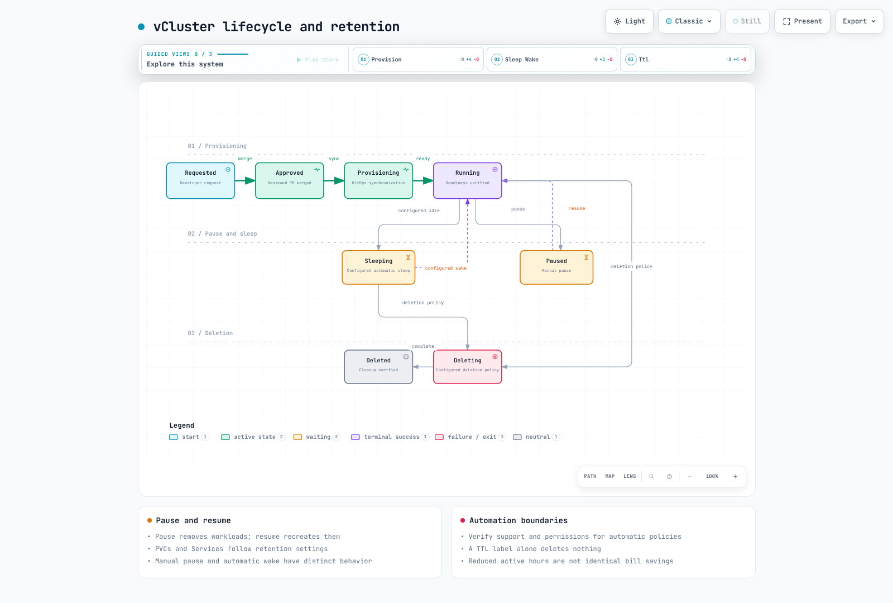
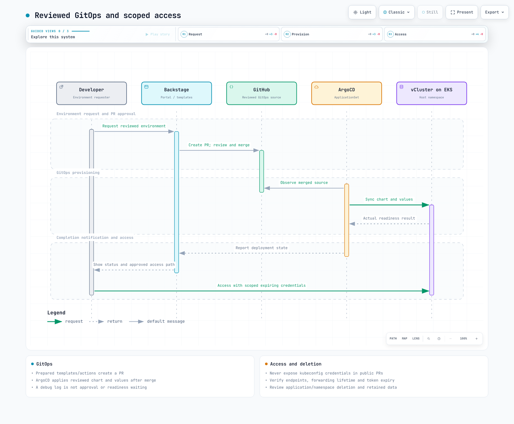

# vCluster

> **最后更新**：2026 年 10 月 16 日 · 已审阅基线：vCluster 0.37.3

## 概念与隔离边界

vCluster 可以为租户提供独立的 Kubernetes API、控制器和数据存储。在此**共享节点**示例中，工作负载运行在宿主集群节点上，共享内核、CNI、CSI 和容量。独立的 API/RBAC 并不能建立完整的硬件、网络或性能隔离。

| 模式 | 需要评估的边界 |
| --- | --- |
| Namespace | 共享 API server、集群资源和节点；需要 RBAC、配额和网络策略。 |
| 共享节点 vCluster | 隔离租户 API，但共享工作负载节点、CNI 和 CSI。 |
| 专用/私有节点 | 验证节点放置以及实际的私有节点 CNI/CSI 边界。 |
| 独立部署 | 在没有宿主控制平面集群的基础设施上采用的另一种部署模式。 |
| 独立 Kubernetes 集群 | 隔离仍取决于共享账户、VPC、管理员和硬件。 |

公开仓库使用 Apache 2.0 许可证。请分别检查发行镜像、Platform 功能、支持和使用授权。官方项目页面无法证实原先“自 2024 年 11 月起成为 CNCF Sandbox”的说法，因此已将其删除。Kubernetes 一致性认证与 CNCF 项目成员身份不同。

不要承诺创建时间少于 30 秒、开销为 100–200MiB、支持数百个集群或节省 60–70%。请根据实际配置、宿主 API 负载、PVC、镜像拉取、工作负载和计费模式进行测量。


[交互式图表](https://www.atomai.click/kubernetes-docs/archmaps/en-platform-engineering-08-vcluster-10.html)

## 当前版本和基线

截至 2026 年 10 月 16 日，GitHub 的 latest 端点返回稳定版 0.37.3，该版本于 2026 年 10 月 5 日发布。因此，此示例针对 CLI/chart 0.37.3 和已验证的 ghcr.io/loft-sh/kubernetes:v1.36.3 镜像。镜像是否能运行以及运行时是否完全兼容，仍需分别检查。

当前 schema 不再包含旧的 k3s/k0s 发行版设置。请区分 k8s 配置、后端存储和确切版本。默认 chart 镜像为 vcluster-pro；仅凭名称无法确定源代码许可或免费使用授权。

此共享节点配置使用一个副本、内嵌数据库和 PVC。运维人员必须准备 gp3 存储/CSI、配额、身份和宿主策略。

```yaml
controlPlane:
  distro:
    k8s:
      enabled: true
      image:
        tag: v1.36.3
  backingStore:
    database:
      embedded:
        enabled: true
  statefulSet:
    highAvailability:
      replicas: 1
    resources:
      requests:
        cpu: 200m
        memory: 512Mi
        ephemeral-storage: 1Gi
      limits:
        cpu: "2"
        memory: 4Gi
        ephemeral-storage: 10Gi
    persistence:
      volumeClaim:
        enabled: true
        storageClass: gp3
        size: 10Gi
        retentionPolicy: Retain
  service:
    spec:
      type: ClusterIP
  ingress:
    enabled: false
sync:
  fromHost:
    nodes:
      enabled: false
    storageClasses:
      enabled: true
  toHost:
    pods:
      enabled: true
    services:
      enabled: true
    configMaps:
      enabled: true
      all: false
    secrets:
      enabled: true
      all: false
    persistentVolumeClaims:
      enabled: true
    ingresses:
      enabled: false
    serviceAccounts:
      enabled: false
    networkPolicies:
      enabled: false
privateNodes:
  enabled: false
policies:
  podSecurityStandard: restricted
telemetry:
  enabled: false
```

该配置通过了实际的 schema 和 Helm 检查。不过，Helm 也会渲染出内嵌数据库与三个副本的组合，而运行时源码会拒绝此配置。高可用需要受支持的存储、仲裁、存储空间和恢复验证；仅增加副本并不足够。

configMaps、serviceAccounts 和 persistentVolumeClaims 等键区分大小写。StorageClass/CSI 的自动默认值取决于部署模式，因此并非总会同步。此配置会明确禁用 Ingress、ServiceAccount 和 NetworkPolicy 同步。


[交互式图表](https://www.atomai.click/kubernetes-docs/archmaps/en-platform-engineering-08-vcluster-11.html)

请区分虚拟 Deployment/ReplicaSet 控制器与实际的宿主 Pods。Syncer 的命名/标签转换取决于模式、长度和版本；不要在 IRSA 信任配置或运维脚本中猜测名称。fromHost.nodes 可见并不会自动实现工作负载节点隔离。

## 安装和访问

请选择适用于正确操作系统/架构的 CLI 构件，并验证官方校验和。以下示例命令可能会影响真实集群；请先确认 HOST_CONTEXT 和 namespace。本次审计未执行创建/删除/快照操作。

```bash
helm repo add loft-sh https://charts.loft.sh
helm repo update
helm template team-alpha loft-sh/vcluster   --version 0.37.3 --namespace vcluster-team-alpha   -f examples/platform/vcluster/vcluster.yaml

# After the reviewed host prerequisites are ready:
vcluster create team-alpha --driver helm --context HOST_CONTEXT   --namespace vcluster-team-alpha --chart-version 0.37.3   --values examples/platform/vcluster/vcluster.yaml --connect=false

# Keep the forwarding lifetime tied to the child command:
vcluster connect team-alpha --driver helm --context HOST_CONTEXT   --namespace vcluster-team-alpha --background-proxy=false --   kubectl get namespaces
```

connect 用于管理访问路径和 kubeconfig。旧的 --update-current/--kube-config 选项是已弃用的别名，并非已移除的标志。--print 可能会输出凭据；请将凭据存放在访问受限的文件中，不要放在聊天、日志或 PR 中。

可复用的外部 kubeconfig 需要可访问的 API 端点、匹配的证书 SAN/CA 以及适当的凭据过期时间。保存 localhost 转发地址并不能在转发停止后继续保持访问。后台代理可能需要 Docker 和另一个镜像。请使用每位用户各自的最小权限 ServiceAccount，并检查 --token-expiration；不要共享管理员凭据。

执行宿主操作时使用 --context HOST_CONTEXT，以免命名空间删除/备份操作意外指向租户上下文。并行配置培训环境时，应收集每项操作的退出状态；有操作失败时，不要报告所有环境都已就绪。

## EKS 存储、Ingress 和 IAM

使用共享节点时，PVC 会同步到宿主，由宿主 CSI 处理卷。请一并检查 StorageClass、volumeBindingMode、拓扑、回收策略和保留策略。当前配置使用 statefulSet.persistence.volumeClaim.storageClass/size。

同步 Ingress 需要真实的宿主 LBC/IngressClass、Service 引用、TLS、安全组和获批的访问路径。将宿主 LBC webhook Service 复制到租户中并不能建立 ALB 集成。请将 Service 注释放在 controlPlane.service.annotations 下；service.spec.annotations 不是 Kubernetes ServiceSpec 字段。

禁用 ServiceAccount 同步时，适用的是宿主工作负载 ServiceAccount 行为；启用时，请验证实际转换和同步行为。仅复制虚拟 Pod 注释并不能配置 IRSA。请检查宿主 ServiceAccount、令牌颁发者/主题/受众、角色信任关系和注入行为。限制租户控制的 IAM 角色注释。

## 隔离与治理

```yaml
apiVersion: v1
kind: Namespace
metadata:
  name: vcluster-team-alpha
  labels:
    platform.example.com/tenant: team-alpha
    pod-security.kubernetes.io/enforce: baseline
    pod-security.kubernetes.io/enforce-version: v1.36
---
apiVersion: v1
kind: ResourceQuota
metadata:
  name: vcluster-budget
  namespace: vcluster-team-alpha
spec:
  hard:
    requests.cpu: "8"
    requests.memory: 16Gi
    limits.cpu: "16"
    limits.memory: 32Gi
    requests.ephemeral-storage: 20Gi
    limits.ephemeral-storage: 80Gi
    pods: "50"
    services: "20"
    services.loadbalancers: "0"
    services.nodeports: "0"
    persistentvolumeclaims: "10"
    requests.storage: 100Gi
---
apiVersion: v1
kind: LimitRange
metadata:
  name: workload-defaults
  namespace: vcluster-team-alpha
spec:
  limits:
    - type: Container
      defaultRequest:
        cpu: 100m
        memory: 128Mi
        ephemeral-storage: 128Mi
      default:
        cpu: "1"
        memory: 512Mi
        ephemeral-storage: 1Gi
```

LimitRange 还会为未设置 ephemeral-storage 请求/限制的普通容器和 init 容器设置默认值。不带此限制的 Pod 可能绕过 ephemeral-storage 配额执行；请检查最终转换后的租户 Pods 和控制平面 init 容器。这些示例值用于配额核算，不代表容量预留或性能保证。

chart 渲染出的控制平面 Syncer UID 为 0。盲目地对宿主命名空间应用 restricted，可能会导致控制平面被拒绝。宿主 baseline 准入策略和配置中的 policies.podSecurityStandard: restricted 作用于不同层：前者针对宿主 Pods，后者针对虚拟工作负载验证。请根据实际宿主策略检查转换后的 Pods。

配额预算包含控制平面、CoreDNS、租户工作负载和存储。配额不会预留任何节点容量，也不保证性能。请检查生成的 Roles/ClusterRoles 和 Secret 访问权限；不要允许租户任意修改宿主 Secret/Role。

如需启用 chart 的网络策略，请使用以下配置进行渲染。

```yaml
policies:
  networkPolicy:
    enabled: true
    workload:
      publicEgress:
        enabled: false
```

实际渲染结果禁用了工作负载的公共出站流量，但保留了控制平面在包括 443/8443/6443 在内端口上的宽泛出站流量。此配置并不声称能完全阻止访问宿主 API。NetworkPolicy 的允许规则是累加的；添加单独的“拒绝”策略无法缩小现有允许规则的范围。

Syncer 需要访问宿主 API。对控制平面应用相同的拒绝出站策略可能会中断同步。请验证 DNS、端点 IP/DNAT、所需的应用程序/数据库/注册表路径以及 CNI 行为。默认拒绝及其例外规则应使用可信的控制平面/工作负载分类。


[交互式图表](https://www.atomai.click/kubernetes-docs/archmaps/en-platform-engineering-08-vcluster-12.html)

## 暂停、休眠、删除和快照

当前 CLI 的 pause 操作会缩减虚拟控制平面，并移除工作负载；恢复时会重新创建这些工作负载。PVC 和 Service 遵循各自的保留行为。这并非保留 Pod 内存的挂起操作，也不是数据备份。请区分手动暂停与自动休眠/唤醒条件。

以下生命周期设置为可选项。请先验证产品使用授权、控制器和工作负载行为。此处未启用自动删除。

```yaml
# Optional configuration: verify product entitlement and workload behavior first.
sleep:
  auto:
    afterInactivity: 30m
    schedule: "0 20 * * 1-5"
    timezone: Etc/UTC
    wakeup:
      schedule: "0 8 * * 1-5"
# No automatic deletion is enabled by this example.
deletion:
  prevent: true
```

当前设置使用 sleep.auto 和 deletion.auto 等路径。此前杜撰的 management.loft.sh/VirtualCluster 字段并非当前配置约定。仅设置 TTL 标签/注释不会触发删除；请使用实际的控制器策略，并检查资源所有权、活动工作负载和备份。

删除命名空间可能会移除 PVC 和剩余工作负载。请区分 vcluster delete、Helm uninstall 和 ArgoCD Application 删除，并考虑 PVC 保留、PV 回收和外部资源。删除防护设置未必能阻止宿主管理员直接删除命名空间。

snapshot create 会提交异步请求。请求成功不代表状态已就绪或恢复成功。PV 名称不是 EBS 卷 ID；对于 EBS，请验证 spec.csi.driver 和 volumeHandle。对运行中的数据库创建快照时，需要保证一致性、静止处理并测试恢复。

Chart 0.37 会拒绝 deploy.volumeSnapshotController，但再次支持成对同步 volumeSnapshots/volumeSnapshotContents。不能将过时的 schema 注释视为所有快照同步都已移除的证据。请准备 CSI 快照控制器/类以及这两个选项，然后单独测试恢复。以明文导出 Secret 并不是完整的备份策略。



[交互式图表](https://www.atomai.click/kubernetes-docs/archmaps/en-platform-engineering-08-vcluster-14.html)

## Backstage、ArgoCD 和临时环境

团队开发、CI、预览、培训和 SaaS 有着不同的信任、性能和生命周期要求。不要假定开发工作负载能容忍任何 Spot 中断，也不要假定 SaaS 租户不会相互影响。

对于 CI，请配置宿主身份、可信事件/分支和 OIDC 权限。不要向不受信任的 fork 代码暴露宿主凭据。创建、连接、测试和清理时都要明确指定 namespace/context，并让转发的生命周期与测试保持一致。独立的清理任务也需要工具和身份；请检查所有退出状态。

此 ApplicationSet 包含先前缺失的 $values sourceRef。将 gitops-config.yaml 存储为 vclusters/team-alpha/config.yaml，并将审阅过的 vcluster.yaml 放在其旁边。请将仓库以及 AppProject/目标权限替换为获批的值。

```yaml
apiVersion: argoproj.io/v1alpha1
kind: ApplicationSet
metadata:
  name: reviewed-vclusters
  namespace: argocd
spec:
  goTemplate: true
  goTemplateOptions: ["missingkey=error"]
  generators:
    - git:
        repoURL: https://github.com/REPLACE_APPROVED_ORG/platform-config
        revision: main
        files:
          - path: vclusters/*/config.yaml
  syncPolicy:
    preserveResourcesOnDeletion: true
  template:
    metadata:
      name: "vcluster-{{ .name }}"
    spec:
      project: vcluster-tenants
      sources:
        - repoURL: https://charts.loft.sh
          chart: vcluster
          targetRevision: "0.37.3"
          helm:
            releaseName: "{{ .name }}"
            valueFiles:
              - "$values/vclusters/{{ .name }}/vcluster.yaml"
        - repoURL: https://github.com/REPLACE_APPROVED_ORG/platform-config
          targetRevision: main
          ref: values
      destination:
        server: https://kubernetes.default.svc
        namespace: "{{ .namespace }}"
      syncPolicy:
        automated:
          selfHeal: true
          prune: false
        syncOptions: [CreateNamespace=true]
```

preserveResourcesOnDeletion 和 prune:false 是有意为之，目的是避免将配置移除视为立即删除数据。请跟踪保留资源的所有权/成本，并设置单独的退役流程。Backstage 的 debug:log action 并不能实现审批或等待部署完成。



[交互式图表](https://www.atomai.click/kubernetes-docs/archmaps/en-platform-engineering-08-vcluster-13.html)

## 可观测性、资源和成本

不要对有意暂停且期望副本数为零的 StatefulSet 自动触发告警。单个汇总的 absent() 可能漏掉某个失败的集群，而其他集群仍然健康。请使用实际的 job/namespace/pod/container 标签、指标端点和期望状态清单。chart 容器名为 syncer；不要杜撰 vcluster_syncer_* 指标。

请求值并非利用率或账单金额。不能将 CPU 1 和 250m，或 memory 1Gi 和 512Mi 当作纯数字字符串相加。examples/platform/vcluster/usage 使用 Kubernetes PodRequests 来正确处理单位、init 容器、开销和 Pod 级请求。

```bash
# Run inside examples/platform/vcluster/usage with the pinned Go dependencies:
kubectl --context HOST_CONTEXT get pods -n vcluster-team-alpha -o json | go run .
```

该工具汇总非终止状态 Pods 的 spec 请求值，不包括实际 RSS/CPU、调整大小状态或 PVC 成本。已测试三个合成案例；此工具未查询任何实时集群。

将活跃时间从 168 小时减少到 50 小时，并不会按比例降低节点、EBS、负载均衡器和许可证成本。请根据账单比较实际的节点缩容、保留的存储、承诺用量和最低容量。Kubernetes 标签不会自动转化为 AWS 成本分配标签。

不要指导 EKS 用户直接调整托管 API server/etcd 的副本数或实例。请检查受支持的托管控制平面设置/配额和请求负载。固定 chart/CLI/Kubernetes/存储组合的版本，验证备份和暂存环境，并考虑不同命名空间中相同的 Helm release 名称。

## 已执行的检查

已阅读韩文指南（1,998 行）、英文指南（2,171 行）、两个 143 行的测验以及 106 个唯一代码块。已验证 0.37.0 schema、Helm 配置、生命周期/网络策略渲染、官方校验和/镜像索引以及 Kubernetes 资源核算。已记录 schema 与运行时验证之间的差异。

两次使用 0.36.1 检查已弃用连接标志的尝试，都以只读方式查询现有集群并因 Unauthorized 失败。未更改任何资源；后续 0.37 检查仅限于版本/帮助信息/源码和离线 chart。未验证 vCluster 创建、镜像运行、休眠/删除/快照/恢复、网络隔离、IAM 身份验证、负载或成本节省。

- [vCluster 0.37.3](https://github.com/loft-sh/vcluster/releases/tag/v0.37.3)
- [指定版本的配置](https://github.com/loft-sh/vcluster/blob/v0.37.3/config/values.yaml)
- [指定版本的 schema](https://github.com/loft-sh/vcluster/blob/v0.37.3/chart/values.schema.json)
- [架构](https://www.vcluster.com/docs/vcluster/introduction/architecture)
- [休眠配置](https://www.vcluster.com/docs/vcluster/configure/vcluster-yaml/sleep)

[Backstage](06-backstage-idp.md) · [Crossplane](07-crossplane.md)

[vCluster 测验](../quizzes/platform-engineering/08-vcluster-quiz.md)
