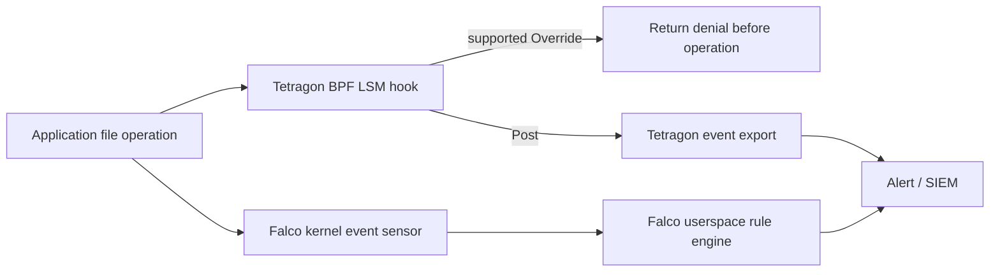

# eBPF 基础知识测验

> **支持版本**：具体功能取决于内核、BTF 和 helper 要求；请对照所用工具和 Kubernetes 的兼容性矩阵
> **最后更新**：2026 年 9 月 11 日

本测验检查你对 eBPF（extended Berkeley Packet Filter，扩展 Berkeley 数据包过滤器）的整体理解，内容从基本概念到它在 Kubernetes 环境中的应用。

## 选择题

1. eBPF verifier 不会检查什么？
   - A) 不存在无限循环
   - B) 不发生越界内存访问
   - C) 程序执行速度
   - D) 不使用未初始化变量

<details>
<summary>查看答案</summary>

**答案：C) 程序执行速度**

**解释：**
eBPF verifier 会检查有界控制流和终止性（包括受支持的有界循环）、越界内存访问、未初始化变量、helper 函数调用是否正确，以及程序能否保证终止，以确保程序安全。verifier 不会把程序执行速度作为验证项目。

</details>

2. 哪个 XDP（eXpress Data Path）程序返回值会将数据包发回同一块 NIC？
   - A) XDP_DROP
   - B) XDP_PASS
   - C) XDP_TX
   - D) XDP_REDIRECT

<details>
<summary>查看答案</summary>

**答案：C) XDP_TX**

**解释：**
XDP 程序返回值的含义如下：
- `XDP_DROP`：丢弃数据包
- `XDP_PASS`：交给内核协议栈
- `XDP_TX`：将数据包发回同一块 NIC
- `XDP_REDIRECT`：转发到另一个接口
- `XDP_ABORTED`：表示发生错误

需要把数据包发回接收它的网络接口时，使用 XDP_TX。

</details>

3. eBPF Maps 的哪项不是其主要作用？
   - A) 在内核与用户空间之间共享数据
   - B) 存储状态
   - C) 编译 eBPF 程序
   - D) 传输事件数据

<details>
<summary>查看答案</summary>

**答案：C) 编译 eBPF 程序**

**解释：**
eBPF map 是用于在内核与用户空间之间共享数据、存储状态的数据结构。Map 还可用于传输事件数据（PERF_EVENT_ARRAY、RINGBUF）、键值存储（HASH）、收集统计信息（PERCPU_ARRAY）等。编译 eBPF 程序由 Clang/LLVM 负责，不属于 map 的用途。

</details>

4. Cilium 替代 kube-proxy 时，eBPF 的主要优势是什么？
   - A) 性能为 O(n)，与 Service 数量成正比
   - B) 仍需逐条评估 iptables 规则
   - C) 使用哈希表查找，平均为常数时间，并避免线性扫描 Service 规则
   - D) 使用 Netfilter

<details>
<summary>查看答案</summary>

**答案：C) 使用哈希表查找，平均为常数时间，并避免线性扫描 Service 规则**

**解释：**
对于新流量，iptables 中线性扫描 Service 规则所需工作量会随规则数量增长；已建立的流量可以使用 conntrack。Cilium 使用 map 避免这类扫描，但复杂度取决于 map 类型。哈希表查找的平均时间通常为常数；端到端延迟、CPU 和吞吐量仍取决于工作负载、map 类型、争用和配置。

</details>

5. bpftrace 的主要用途是什么？
   - A) 将 eBPF 程序编译为 C
   - B) 加载内核模块
   - C) 提供 DTrace 风格的高级跟踪
   - D) 构建容器映像

<details>
<summary>查看答案</summary>

**答案：C) 提供 DTrace 风格的高级跟踪**

**解释：**
bpftrace 是一种 DTrace 风格的高级跟踪语言，可用简单的单行命令跟踪系统。例如，它可以统计系统调用、跟踪每个进程读取的字节数、跟踪文件打开和 TCP 连接。

</details>

6. 在 Tetragon 的 TracingPolicy 中，检测到恶意文件访问后，哪种操作会立即终止进程？
   - A) action: Block
   - B) action: Sigkill
   - C) action: Deny
   - D) action: Terminate

<details>
<summary>查看答案</summary>

**答案：B) action: Sigkill**

**解释：**
在 Tetragon 的 TracingPolicy 中，匹配事件后，`matchActions` 中的 `action: Sigkill` 会向进程发送 SIGKILL 信号并立即终止进程。强制执行指南提醒，SIGKILL 并不总能阻止触发事件的操作先行完成。如果必须拒绝操作本身，应使用受支持的 Override/LSM 机制。

</details>

7. Hubble 的哪项不是主要功能？
   - A) 观察网络流量
   - B) 跟踪 DNS 查询
   - C) 编译 eBPF 程序
   - D) 监控策略判定

<details>
<summary>查看答案</summary>

**答案：C) 编译 eBPF 程序**

**解释：**
Hubble 是内置于 Cilium 的网络可观测性平台，可收集和监控网络流、DNS 查询、HTTP 请求、策略判定等信息。Hubble 用于可观测性，不负责编译 eBPF 程序。

</details>

8. CO-RE（Compile Once, Run Everywhere）解决什么问题？
   - A) 提高 eBPF 程序执行速度
   - B) 让程序能适配不同内核版本
   - C) 降低内存使用量
   - D) 降低网络延迟

<details>
<summary>查看答案</summary>

**答案：B) 让程序能适配不同内核版本**

**解释：**
CO-RE 使用 libbpf 和 BTF（BPF Type Format），使一次编译的 eBPF 程序可在多种内核版本上运行。它减少对内核头文件的依赖，并自动处理结构体重定位，从而减少对兼容内核的重复构建需求。CO-RE 不会补上缺失的 helper 或 hook，也不保证内核行为兼容。

</details>

9. Falco 使用 eBPF 检测什么？
   - A) 网络带宽使用情况
   - B) 运行时异常行为
   - C) 磁盘容量
   - D) CPU 温度

<details>
<summary>查看答案</summary>

**答案：B) 运行时异常行为**

**解释：**
Falco 是 CNCF 项目，使用 eBPF 检测运行时异常行为。它根据规则检测并告警安全威胁，例如读取敏感文件、在容器中启动 shell、尝试提权等。

</details>

10. eBPF 程序的栈大小上限是多少？
    - A) 128 字节
    - B) 256 字节
    - C) 512 字节
    - D) 1024 字节

<details>
<summary>查看答案</summary>

**答案：C) 512 字节**

**解释：**
eBPF 程序的栈大小上限是 512 字节。需要更大缓冲区时，可使用 PERCPU_ARRAY 等 map。此限制旨在确保内核安全。

</details>

## 简答题

11. 将 eBPF 字节码转换为本机机器码的编译器叫什么？

<details>
<summary>查看答案</summary>

**答案：JIT 编译器（Just-In-Time compiler，即时编译器）**

**解释：**
JIT 编译器会将 eBPF 字节码转换为本机机器码，并进行架构特定的优化。本指南没有把原先提到的 4–5 倍提升视为实测结果或普遍保证。在可配置的系统上，bpf_jit_enable=1 可启用 JIT；启用了 CONFIG_BPF_JIT_ALWAYS_ON 的内核可能会强制启用它。

</details>

12. 哪种 eBPF 程序类型可动态跟踪内核函数调用？

<details>
<summary>查看答案</summary>

**答案：Kprobes（或 Kprobe）**

**解释：**
Kprobes 是一种 eBPF 程序类型，可动态跟踪内核函数调用。Uprobes 跟踪用户空间函数，而 Kprobes 跟踪内核中的函数。例如，可以跟踪 `tcp_connect` 函数以收集 TCP 连接信息。

</details>

13. Cilium 内置的网络可观测性平台叫什么？

<details>
<summary>查看答案</summary>

**答案：Hubble**

**解释：**
Hubble 是内置于 Cilium 的网络可观测性平台，可从 eBPF 数据平面收集网络流、DNS 查询、HTTP 请求和策略判定等数据。你可以通过 Hubble CLI、Hubble UI 和 Hubble Relay 实时观察集群网络流量。

</details>

14. Linux 5.8 引入了哪种专用于特权 BPF 操作的 capability？

<details>
<summary>查看答案</summary>

**答案：CAP_BPF**

**解释：**
CAP_BPF 用于授权特权 BPF 操作；CAP_SYS_ADMIN 仍是兼容路径，较新的内核还可能支持委派 BPF token。具体程序或 hook 的检查以及主机安全策略也会生效。在较早版本中需要 `CAP_SYS_ADMIN`。此外，附加性能监控事件需要 `CAP_PERFMON`，附加 XDP/TC 程序需要 `CAP_NET_ADMIN`。

</details>

15. 哪个 CNCF 能源 exporter 过去使用 eBPF，并在 0.10.0 版重写为读取主机 /proc 和 /sys 的资源及功耗数据？

<details>
<summary>查看答案</summary>

**答案：Kepler（Kubernetes-based Efficient Power Level Exporter）**

**解释：**
Kepler 0.10 及更高版本不再需要 CAP_BPF。它使用主机资源数据和硬件传感器归因节点功率与能耗。当前示例指标包括 kepler_container_cpu_joules_total 和 kepler_pod_cpu_watts；硬件支持和实验性 GPU 支持各不相同。旧版 0.9 的指标和部署说明不同。

</details>

## 动手实践题

16. 写出使用 bpftool 列出系统当前已加载 eBPF 程序，并查询特定程序详细信息的命令。

<details>
<summary>查看答案</summary>

**答案：**
```bash
# List loaded eBPF programs
sudo bpftool prog list

# Query detailed information for a specific program (ID: 123)
sudo bpftool prog show id 123

# Dump program bytecode
sudo bpftool prog dump xlated id 123

# Dump JIT compiled code
sudo bpftool prog dump jited id 123
```

**解释：**
`bpftool prog list` 会列出当前已加载的 eBPF 程序。你可以查看每个程序的 ID、类型、名称、附加位置等。使用 `bpftool prog show id <ID>` 查询特定程序的详细信息；`dump xlated` 和 `dump jited` 可分别查看转换后的字节码和 JIT 编译后的本机代码。

</details>

17. 写出一个 bpftrace 单行命令，实时跟踪系统中所有进程的 TCP 连接。

<details>
<summary>查看答案</summary>

**答案：**
```bash
# TCP connection tracing (Method 1: using kprobe)
sudo bpftrace -e 'kprobe:tcp_connect { printf("%s (PID: %d) connecting...\n", comm, pid); }'

# TCP connection tracing (Method 2: using tracepoint, more detailed info)
sudo bpftrace -e '
tracepoint:sock:inet_sock_set_state /args.protocol == 6 && args.newstate == 1/ {
    if (args.family == 2) {
        printf("IPv4 %s:%d -> %s:%d established\n", ntop(args.saddr), args.sport, ntop(args.daddr), args.dport);
    } else if (args.family == 10) {
        printf("IPv6 %s:%d -> %s:%d established\n", ntop(args.saddr_v6), args.sport, ntop(args.daddr_v6), args.dport);
    }
}'

# Count TCP connections by process
sudo bpftrace -e 'kprobe:tcp_connect { @[comm] = count(); }'
```

**解释：**
bpftrace 是一种 DTrace 风格的高级跟踪语言，可用简单的单行命令跟踪系统。`kprobe:tcp_connect` 会在调用内核 `tcp_connect` 函数时触发；`comm` 表示进程名称，`pid` 表示进程 ID。sock:inet_sock_set_state 示例可观察已建立的连接（包括被动连接），但其执行上下文无法可靠地用于判定发起连接的进程。kprobe 示例统计的是连接尝试，不保证握手成功。

</details>

18. 写出使用 Hubble CLI 仅观察特定命名空间中丢弃数据包的命令。

<details>
<summary>查看答案</summary>

**答案：**
```bash
# Observe dropped packets in a specific namespace
hubble observe --namespace production --verdict DROPPED

# Observe dropped packets with real-time streaming
hubble observe --namespace production --verdict DROPPED -f

# Output detailed information of dropped packets in JSON format
hubble observe --namespace production --verdict DROPPED -o json

# Observe dropped packets from a specific Pod
hubble observe --from-pod production/frontend --verdict DROPPED
```

**解释：**
Hubble 是内置于 Cilium 的网络可观测性工具。`--namespace` 按指定命名空间过滤，`--verdict DROPPED` 仅保留被丢弃的流量。`-f` 用于实时流式输出，`-o json` 用于输出 JSON。分析丢弃流量有助于排查问题；但不能据此认定每次丢弃都是 NetworkPolicy 导致的。

</details>

## 进阶题

19. 说明 eBPF 相比内核模块的三个主要优势，并具体描述每项优势在 Kubernetes 环境中的作用。

<details>
<summary>查看答案</summary>

**答案：**

eBPF 相较于内核模块的主要优势及其在 Kubernetes 中的作用如下：

**1. 安全检查（受 verifier 模型约束）**
- **优势**：加载前，eBPF verifier 会检查无限循环、内存访问违规、未初始化变量等。
- **Kubernetes 中的作用**：在经过测试的受支持版本和配置下，这些检查可降低 CNI 和安全工具带来的风险。但 verifier 检查不能保证内核、helper 或 JIT 中没有缺陷，也不能保证错误策略或过高开销不会影响主机。

**2. 可移植性（CO-RE 类型重定位）**
- **优势**：使用 CO-RE（Compile Once, Run Everywhere）和 BTF，一次编译的 eBPF 程序可在不同内核版本上运行，无需针对每个内核版本重新编译。
- **Kubernetes 中的作用**：同一套网络和安全解决方案可部署到内核版本不同的异构节点上，从而减少集群升级或添加节点时的兼容性问题。

**3. 动态加载（无需重启即可加载或卸载程序）**
- **优势**：eBPF 程序可以动态加载和卸载，无需重启系统；运行时可添加或更改功能。
- **Kubernetes 中的作用**：网络策略、安全规则和可观测性设置可以立即应用，无需重启节点。Cilium NetworkPolicy 或 Tetragon TracingPolicy 的变更可实时生效，从而在不中断运维的情况下增强安全性。

**其他优势：**
- **性能**：JIT 编译可生成本机代码；替代 kube-proxy 时，可用 O(1) 查找 Service，但实际性能仍取决于环境。
- **开发难度**：与开发内核模块相比，开发相对容易，有助于更快地开发和部署功能。

</details>

20. 设计一种方案，在 Kubernetes 集群中使用基于 eBPF 的安全解决方案（Tetragon 或 Falco）检测并阻止容器内对敏感文件的访问。请在说明中加入 TracingPolicy 或 Falco 规则示例。

<details>
<summary>查看答案</summary>

**答案：**

**基于 eBPF 的敏感文件访问安全方案**

**1. 定义安全要求**
- 检测目标：`/etc/shadow`、`/etc/passwd`、`/etc/sudoers`、`/var/run/secrets/`（Kubernetes Secret）
- 响应方式：检测到访问时告警；严重情况下终止进程

**2. 实现 Tetragon TracingPolicy**

```yaml
apiVersion: cilium.io/v1alpha1
kind: TracingPolicyNamespaced
metadata:
  name: sensitive-file-protection
  namespace: ebpf-lab
spec:
  kprobes:
  - call: security_file_open
    syscall: false
    args:
    - index: 0
      type: file
    selectors:
    - matchArgs:
      - index: 0
        operator: Prefix
        values:
        - /var/run/secrets/kubernetes.io/
      matchActions:
      - action: Post
    - matchArgs:
      - index: 0
        operator: Prefix
        values:
        - /etc/shadow
        - /etc/sudoers
      matchActions:
      - action: Post
  podSelector:
    matchLabels:
      app: ebpf-demo
```

第一条策略只执行 Post 观察。先创建 ebpf-lab 命名空间以及标签为 app=ebpf-demo 的测试 Pod。TracingPolicyNamespaced 按 Kubernetes 命名空间限定作用范围；matchNamespaces 则筛选 Linux 命名空间 inode。

下面的策略是**可选的测试策略**，用于拒绝操作；它要求 CONFIG_BPF_LSM、已启用的 bpf LSM，以及所选 Tetragon/内核组合支持 LSM Override。应用前应验证允许和拒绝行为，并确认回滚方案。这不是经过验证、可全局部署的生产策略。单独使用 SIGKILL 并不总能阻止触发操作先行完成。

```yaml
apiVersion: cilium.io/v1alpha1
kind: TracingPolicyNamespaced
metadata:
  name: sensitive-file-deny
  namespace: ebpf-lab
spec:
  podSelector:
    matchLabels:
      app: ebpf-demo
  lsmhooks:
  - hook: file_open
    args:
    - index: 0
      type: file
    selectors:
    - matchArgs:
      - index: 0
        operator: Equal
        values:
        - /etc/shadow
        - /etc/sudoers
      matchActions:
      - action: Override
        argError: -13
```

**3. 实现 Falco 规则**

```yaml
# Save locally as ebpf-lab-rules.yaml; the Helm chart mounts it under /etc/falco/rules.d.
- rule: eBPF lab read Kubernetes secrets
  desc: Detect reading of Kubernetes secret files in containers
  condition: >
    open_read and
    container and
    (fd.name startswith /var/run/secrets/kubernetes.io/ or
     fd.name startswith /etc/shadow or
     fd.name startswith /etc/sudoers) and
    not proc.name in (kubelet, containerd)
  output: >
    Sensitive file access detected
    (file=%fd.name user=%user.name process=%proc.name
     container=%container.name namespace=%k8s.ns.name
     pod=%k8s.pod.name)
  priority: WARNING
  tags: [security, filesystem]

- rule: eBPF lab write sensitive files
  desc: Detect writing to sensitive system files
  condition: >
    open_write and
    container and
    fd.name in (/etc/passwd, /etc/shadow, /etc/sudoers)
  output: >
    Attempt to modify sensitive file
    (file=%fd.name user=%user.name process=%proc.name
     container=%container.name)
  priority: CRITICAL
  tags: [security, filesystem]
```

**4. 部署和监控**

```bash
# Install Tetragon and apply policy
helm repo add cilium https://helm.cilium.io
: "${TETRAGON_CHART_VERSION:?Select a compatible reviewed chart version}"
helm install tetragon cilium/tetragon -n kube-system --version "$TETRAGON_CHART_VERSION"
# Apply observation first; keep optional denial in a separate reviewed file.
kubectl apply -f sensitive-file-protection.yaml

# Monitor events
kubectl logs -n kube-system -l app.kubernetes.io/name=tetragon \
  -c export-stdout -f | tetra getevents -o compact

# Install Falco (eBPF driver)
helm repo add falcosecurity https://falcosecurity.github.io/charts
# Save the following Falco rule examples as ./ebpf-lab-rules.yaml before installation.
: "${FALCO_CHART_VERSION:?Select a compatible reviewed chart version}"
helm install falco falcosecurity/falco --version "$FALCO_CHART_VERSION" \
  --namespace falco --create-namespace \
  --set driver.kind=modern_ebpf \
  --set-file 'customRules.ebpf-lab-rules\.yaml=./ebpf-lab-rules.yaml'

# Check Falco alerts
kubectl logs -n falco -l app.kubernetes.io/name=falco -f
```

**5. 架构说明**



此方案利用 eBPF 在内核层的可见性，实时检测并响应敏感文件访问，无需修改应用程序。

</details>

---

[返回学习资料](../../basics/05-ebpf-fundamentals.md) | [下一测验：容器技术](./03-container-technology-quiz.md)
> Falco 示例依赖默认规则集中的 open_read/open_write/spawned_process/container 宏。请通过已安装 chart 的 customRules/falco.rules_files 配置加载额外规则文件。Falco 会检测并告警，这些规则本身不会拒绝访问。容器/Kubernetes 元数据可能延迟到达，合法的 ServiceAccount token 读取也会匹配，因此应测试并设置适当的例外。

## 验证参考资料

- https://www.kernel.org/doc/html/latest/admin-guide/sysctl/kernel.html
- https://www.kernel.org/doc/html/latest/admin-guide/sysctl/net.html
- https://github.com/torvalds/linux/blob/master/include/linux/bpf.h
- https://github.com/torvalds/linux/blob/master/include/linux/filter.h
- https://github.com/torvalds/linux/blob/master/include/uapi/linux/bpf.h
- https://github.com/torvalds/linux/blob/master/kernel/bpf/syscall.c
- https://docs.kernel.org/bpf/prog_lsm.html
- https://docs.kernel.org/userspace-api/seccomp_filter.html
- https://github.com/torvalds/linux/blob/master/include/trace/events/sock.h
- https://github.com/bpftrace/bpftrace/blob/v0.27.0/docs/language.md
- https://github.com/bpftrace/bpftrace/blob/v0.27.0/docs/stdlib.md
- https://packages.debian.org/trixie/arm64/bpfcc-tools/filelist
- https://github.com/iovisor/bcc/blob/master/tools/tcpconnlat.py
- https://github.com/iovisor/bcc/blob/master/tools/gethostlatency.py
- https://github.com/libbpf/bpftool/blob/main/docs/bpftool-map.rst
- https://github.com/cilium/cilium/blob/v1.20.1/Documentation/network/kubernetes/kubeproxy-free.rst
- https://github.com/cilium/cilium/blob/v1.20.1/Documentation/network/lb-ipam.rst
- https://github.com/cilium/cilium/blob/v1.20.1/install/kubernetes/cilium/values.yaml
- https://github.com/cilium/cilium/blob/v1.20.1/hubble/cmd/observe/observe.go
- https://github.com/cilium/cilium/blob/v1.20.1/hubble/pkg/printer/printer_test.go
- https://github.com/cilium/tetragon/blob/main/docs/content/en/docs/concepts/enforcement/_index.md
- https://github.com/cilium/tetragon/blob/main/docs/content/en/docs/concepts/tracing-policy/selectors.md
- https://github.com/cilium/tetragon/blob/main/pkg/k8s/apis/cilium.io/v1alpha1/tracing_policy_types.go
- https://github.com/cilium/tetragon/blob/main/cmd/tetra/getevents/getevents.go
- https://github.com/cilium/tetragon/blob/main/examples/tracingpolicy/lsm_file_open.yaml
- https://github.com/cilium/tetragon/blob/main/install/kubernetes/tetragon/crds-yaml/cilium.io_tracingpoliciesnamespaced.yaml
- https://github.com/sustainable-computing-io/kepler/blob/main/README.md
- https://github.com/sustainable-computing-io/kepler/blob/main/docs/user/metrics.md
- https://github.com/coroot/helm-charts/blob/main/charts/coroot/Chart.yaml
- https://github.com/coroot/helm-charts/blob/main/charts/operator/Chart.yaml
- https://github.com/coroot/helm-charts/blob/main/charts/coroot-ce/Chart.yaml
- https://docs.px.dev/reference/pxl/udf/quantiles/
- https://github.com/pixie-io/pixie/blob/main/src/pixie_cli/pkg/cmd/run.go
- https://github.com/pixie-io/pixie/blob/main/src/pxl_scripts/px/http_data/data.pxl
- https://falco.org/docs/reference/rules/supported-fields/
- https://github.com/falcosecurity/charts/blob/master/charts/falco/values.yaml
- https://github.com/falcosecurity/rules/blob/main/rules/falco_rules.yaml
