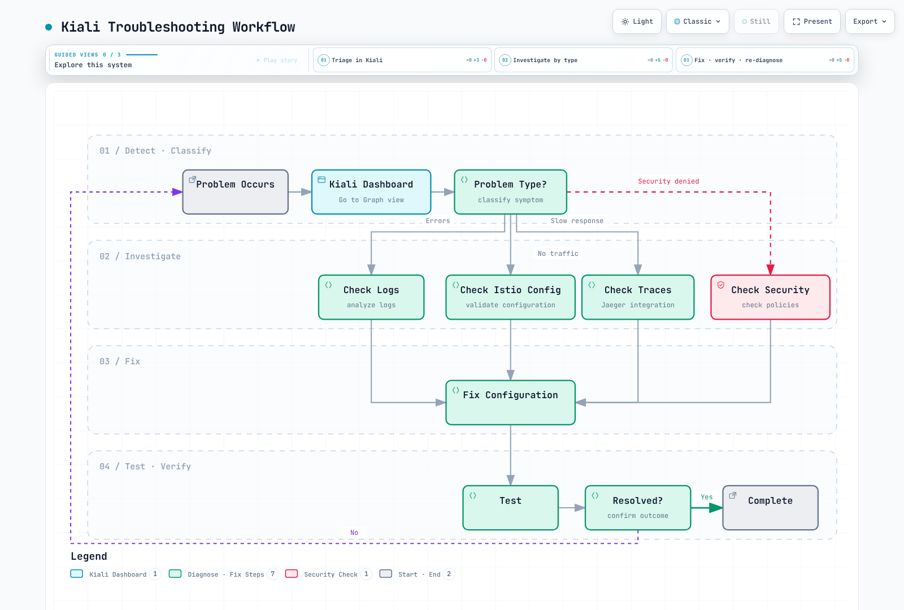

# 可观测性测验

> **最后更新**: October 12, 2026
>
> **版本**: Istio 1.31，支持 Kubernetes 1.32–1.37。
> 请参阅 EKS 和 Kiali 兼容性限制的安装与仪表板章节。

本测验涵盖已配置的 sidecar/waypoint 遥测。每个示例相互独立，并假设指定的后端、Namespace、权限和流量均已存在。YAML/API/查询检查不是生产或实时集群测试；ztunnel L4、原生 sidecar 和 HA 部署需要各自特定的采集配置。

## 选择题（1-5）

### 问题 1：Prometheus 指标

以下哪项**不是 Istio 标准服务指标名称/指标族**？

A. istio\_requests\_total（请求总数）\
B. istio\_request\_duration\_milliseconds（请求延迟）\
C. istio\_request\_bytes（请求大小）\
D. istio\_pod\_cpu\_usage（Pod CPU 使用量）

<details>

<summary>显示答案</summary>

**答案：D**

Istio 标准服务指标描述流量；Envoy 也会公开内部代理统计信息。Prometheus 从 kubelet/cAdvisor（或运行时资源管道）获取容器 CPU 使用量。Metrics Server 为自动扩缩容和 `kubectl top` 提供资源指标；kube-state-metrics 公开对象状态和已配置的 requests/limits，而非测量到的 CPU 消耗量。

**说明：**

**Istio 收集的指标：**

1. **istio\_requests\_total（A - O）**

```promql
# Request rate by service (per second)
sum(rate(istio_requests_total{reporter="destination"}[5m])) by (destination_service_name, destination_service_namespace)
```

2. **istio\_request\_duration\_milliseconds（B - O）**

```promql
# P95 latency
histogram_quantile(0.95,
  sum(rate(istio_request_duration_milliseconds_bucket{reporter="destination"}[5m])) by (le)
)
```

3. **istio\_request\_bytes（C - O）**

```promql
# Request body byte rate (bytes/second), not mean request size
sum(rate(istio_request_bytes_sum{reporter="destination"}[5m])) by (destination_service_name, destination_service_namespace)
```

4. **istio\_pod\_cpu\_usage（D - X）**

* 这不是 Istio 指标
* Kubernetes 指标：`container_cpu_usage_seconds_total`
* 抓取 kubelet/cAdvisor；将使用量与已配置的 limits 比较时，kube-state-metrics 很有用

**Istio 指标类别：**

| 类别     | 示例指标                                | 说明                   |
| ------------ | --------------------------------------------- | ----------------------------- |
| **请求**  | istio\_requests\_total                        | 请求数、响应代码 |
| **时长** | istio\_request\_duration\_milliseconds        | 延迟分布          |
| **大小**     | istio\_request\_bytes, istio\_response\_bytes | 流量大小                  |
| **TCP**      | istio\_tcp\_connections\_opened\_total        | TCP 连接               |

**黄金信号示例：**

```promql
# 1. Latency
histogram_quantile(0.95,
  sum(rate(
    istio_request_duration_milliseconds_bucket{reporter="destination",
      destination_service_name="reviews", destination_service_namespace="default"
    }[5m]
  )) by (le)
)

# 2. Traffic
sum(rate(
  istio_requests_total{reporter="destination",
    destination_service_name="reviews", destination_service_namespace="default"
  }[5m]
))

# 3. Errors (error rate)
sum(rate(
  istio_requests_total{reporter="destination",
    destination_service_name="reviews", destination_service_namespace="default",
    response_code=~"5.."
  }[5m]
))
/
sum(rate(
  istio_requests_total{reporter="destination",
    destination_service_name="reviews", destination_service_namespace="default"
  }[5m]
))

# 4. Saturation - Uses Kubernetes metrics
sum(rate(
  container_cpu_usage_seconds_total{
    namespace="default", container="istio-proxy", pod=~"reviews-.*"
  }[5m]
))
```

**检查指标：**

```bash
# Check metrics via Envoy Admin API
istioctl x envoy-stats <pod-name>.default --output prom

# Check in Prometheus
kubectl port-forward -n istio-system svc/prometheus 9090:9090
# Query at http://localhost:9090
```

**参考资料：**

* [指标](../../../service-mesh/istio/observability/01-metrics.md)

</details>

***

### 问题 2：分布式追踪

当追踪 provider/backend 正常工作时，若要跨服务调用关联代理 span，应用程序必须承担哪项职责？

A. 应用程序必须生成 trace ID\
B. 应用程序必须传播 HTTP header\
C. 所有服务都必须安装 Jaeger client\
D. Envoy 自动处理所有事项

<details>

<summary>显示答案</summary>

**答案：B**

已配置的代理可以生成 span 和 trace ID，但应用程序必须将 trace context 传播到其出站调用。SDK 应注入活动 context，因此子 span ID 可能改变，而 trace ID 保持不变。没有自身 span 的透明应用程序可以转发选定的传播 header。

**说明：**

**分布式追踪的工作方式：**


[🔍 查看交互式图示](https://www.atomai.click/kubernetes-docs/archmaps/en-quizzes-service-mesh-istio-observability-0.html)

该图示展示了到已配置 Jaeger backend 的 B3 传播。也支持 W3C 传播和中间 OpenTelemetry Collector；已插桩的应用程序会注入其活动 span context，而不是逐字不变地复制每个 header。

**要传播的 HTTP Header：**

```text
W3C: traceparent, tracestate
B3 (if configured): b3 OR x-b3-traceid, x-b3-spanid, x-b3-parentspanid, x-b3-sampled
Istio correlation: x-request-id
B3 debug flag: x-b3-flags (do not force debug sampling on ordinary traffic)
```

**应用程序代码示例：**

```python
# Python Flask example
from flask import Flask, request
import requests

app = Flask(__name__)

@app.route('/api/users')
def get_users():
    # 1. Extract received headers
    headers = {}
    for header in ['x-request-id', 'traceparent', 'tracestate', 'b3', 'x-b3-traceid', 'x-b3-spanid',
                   'x-b3-parentspanid', 'x-b3-sampled', 'x-b3-flags']:
        if header in request.headers:
            headers[header] = request.headers[header]

    # 2. Propagate headers when calling next service
    response = requests.get(
        'http://user-service/users',
        headers=headers, timeout=3  # Selected propagation format
    )

    response.raise_for_status()
    return response.json()
```

```javascript
// Node.js Express example
const express = require('express');
const axios = require('axios');
const app = express();

app.get('/api/users', async (req, res) => {
  // 1. Extract received headers
  const tracingHeaders = {};
  ['x-request-id', 'traceparent', 'tracestate', 'b3', 'x-b3-traceid', 'x-b3-spanid',
   'x-b3-parentspanid', 'x-b3-sampled', 'x-b3-flags'].forEach(header => {
    if (req.headers[header]) {
      tracingHeaders[header] = req.headers[header];
    }
  });

  // 2. Propagate headers when calling next service
  try {
    const response = await axios.get('http://user-service/users', {
      headers: tracingHeaders, timeout: 3000
    });
    res.json(response.data);
  } catch (error) {
    res.status(502).json({error: 'Downstream request failed'});
  }
});
```

**各选项分析：**

* **A（X）**：Envoy 自动生成 trace ID
* **B（O）**：应用程序必须传播 HTTP header（必需）
* **C（X）**：不需要 Jaeger client，Envoy 会发送 Span
* **D（X）**：Envoy 创建/发送 Span，但 header 传播是应用程序的职责

**采样配置：**

这假定使用追踪章节中的 `otel-tracing` provider。`1.0` 表示 1%，而非 100%；provider/exporter 设置和 context 传播是独立要求。

```yaml
apiVersion: telemetry.istio.io/v1
kind: Telemetry
metadata:
  name: tracing-sample
  namespace: default
spec:
  tracing:
  - providers:
    - name: otel-tracing
    randomSamplingPercentage: 1.0
```

**访问 Jaeger：**

```bash
kubectl port-forward -n observability svc/jaeger-query 16686:16686
```

**参考资料：**

* [分布式追踪](../../../service-mesh/istio/observability/02-tracing.md)

</details>

***

### 问题 3：Kiali 可视化

Kiali **不**提供以下哪项功能？

A. 服务拓扑可视化\
B. 流量流向分析\
C. 自动执行 Canary 部署\
D. Istio 配置验证

<details>

<summary>显示答案</summary>

**答案：C**

Kiali 是一个**观测和分析工具**，而部署执行由 **Argo Rollouts** 等工具处理。

**说明：**

**Kiali 的主要功能：**

**1. 服务拓扑可视化（A - O）**

```bash
# Open Kiali dashboard
istioctl dashboard kiali

# Features:
# - Real-time service connection display
# - Traffic flow direction display
# - Service status (healthy/error)
# - Response time display
```

**Graph 视图示例：**

```
Frontend → Backend → Database
   ↓
External API

Color codes:
- Green: Normal
- Red: Error
- Gray: No traffic
```

**2. 流量流向分析（B - O）**

Kiali 显示：

* 请求数（RPS）
* 错误率（%）
* P50/P95/P99 延迟
* TCP 连接数

**3. 自动执行 Canary 部署（C - X）**

* Kiali 可以显示流量，并在有权限时编辑 Istio 配置/使用流量向导
* 它不会替代自动化渐进式交付 controller
* 部署执行：Argo Rollouts、Flagger

**4. Istio 配置验证（D - O）**

来自 [Kiali 验证目录](https://kiali.io/docs/features/validations/)的示例：

- VirtualService：未定义的 subset（`KIA1107`）。
- DestinationRule：重叠的 host/subset 定义（`KIA0201`）。
- AuthorizationPolicy：找不到引用的 Namespace（`KIA0101`），或 principal 未关联到已发现 workload 的 ServiceAccount（`KIA0106`）。

检查取决于 Kiali 的版本、发现范围和访问权限。请检查实际的代码/消息和有效代理策略；Kiali 不能证明任意策略发生冲突，或每个证书和运行时 route 都能工作。

**Kiali 安装：**

请遵循[仪表板章节](../../../service-mesh/istio/observability/04-dashboards.md)中固定版本的 operator、认证和当前兼容性限制。Kiali 单独安装；示例 addon 是演示，未配置 backend/RBAC 的 Helm 安装并非生产设置。

**Kiali 主菜单：**

```
1. Overview: Service summary by Namespace
2. Graph: Service topology
3. Applications: Application list
4. Workloads: Deployment, StatefulSet, etc.
5. Services: Kubernetes Service
6. Istio Config: VirtualService, DestinationRule, etc.
```

**Kiali 与其他工具：**

| 工具 | 角色 | 自动化渐进式交付 |
| ----------------- | ----------------------------------- | -------------------- |
| **Kiali**         | 可视化、分析、验证 | 否                   |
| **Argo Rollouts** | 渐进式交付                | 是                  |
| **Flagger**       | 自动 Canary 部署         | 是                  |
| **Grafana**       | 指标仪表板                   | 否                   |
| **Jaeger**        | 分布式追踪                 | 否                   |

**实际使用示例：**

```bash
# 1. Check service topology in Kiali
istioctl dashboard kiali

# 2. Detect anomalies in Graph view
#    - reviews service error rate 5%
#    - productpage → reviews latency increase

# 3. Check details in Workload view
#    - Check reviews-v2 Pod logs
#    - Check Envoy metrics

# 4. Validate configuration in Istio Config view
#    - Found typo in VirtualService
#    - Fix and redeploy
```

**参考资料：**

* [可视化](../../../service-mesh/istio/observability/04-dashboards.md)
* [Kiali 官方文档](https://kiali.io/docs/)

</details>

***

### 问题 4：Access Log 配置

如何在 Istio 中将 Access Log 输出配置为 **JSON 格式**？

A. 在 IstioOperator 中将 meshConfig.accessLogEncoding 设为 JSON\
B. 直接修改 Envoy ConfigMap\
C. 为每个 Pod 添加 annotation\
D. 通过 Prometheus 查询转换为 JSON

<details>

<summary>显示答案</summary>

**答案：A**

A 是一种有效的 MeshConfig 方法：在 `istioctl install -f` 输入中启用 logging，并使用 `accessLogEncoding: JSON`。这不是集群内 operator resource。自定义 `envoyFileAccessLog.logFormat.labels` provider 是另一种受支持的方法，logging 章节对此有所说明。

**说明：**

**JSON 格式 Access Log 配置：**

```yaml
apiVersion: install.istio.io/v1alpha1
kind: IstioOperator
spec:
  meshConfig:
    # Enable Access Log
    accessLogFile: /dev/stdout

    # Output in JSON format
    accessLogEncoding: JSON

    # Define custom JSON format
    accessLogFormat: |
      {
        "log_type": "access",
        "start_time": "%START_TIME%",
        "method": "%REQ(:METHOD)%",
        "path": "%REQ_WITHOUT_QUERY(X-ENVOY-ORIGINAL-PATH?:PATH)%",
        "protocol": "%PROTOCOL%",
        "response_code": "%RESPONSE_CODE%",
        "response_flags": "%RESPONSE_FLAGS%",
        "bytes_received": "%BYTES_RECEIVED%",
        "bytes_sent": "%BYTES_SENT%",
        "duration": "%DURATION%",
        "upstream_service_time": "%RESP(X-ENVOY-UPSTREAM-SERVICE-TIME)%",
        "x_forwarded_for": "%REQ(X-FORWARDED-FOR)%",
        "user_agent": "%REQ(USER-AGENT)%",
        "request_id": "%REQ(X-REQUEST-ID)%",
        "authority": "%REQ(:AUTHORITY)%",
        "upstream_host": "%UPSTREAM_HOST%",
        "upstream_cluster": "%UPSTREAM_CLUSTER%",
        "upstream_local_address": "%UPSTREAM_LOCAL_ADDRESS%",
        "downstream_local_address": "%DOWNSTREAM_LOCAL_ADDRESS%",
        "downstream_remote_address": "%DOWNSTREAM_REMOTE_ADDRESS%",
        "requested_server_name": "%REQUESTED_SERVER_NAME%",
        "route_name": "%ROUTE_NAME%"
      }
```

**输出示例：**

```json
{
  "log_type": "access",
  "start_time": "2025-01-20T10:30:00.123Z",
  "method": "GET",
  "path": "/api/users",
  "protocol": "HTTP/1.1",
  "response_code": 200,
  "response_flags": "-",
  "bytes_received": 0,
  "bytes_sent": 1234,
  "duration": 42,
  "upstream_service_time": "40",
  "x_forwarded_for": "192.168.1.100",
  "user_agent": "Mozilla/5.0",
  "request_id": "abc-123-def",
  "authority": "example.com",
  "upstream_host": "10.0.1.20:8080",
  "upstream_cluster": "outbound|8080||backend.default.svc.cluster.local",
  "upstream_local_address": "10.0.1.10:54321",
  "downstream_local_address": "10.0.1.10:8080",
  "downstream_remote_address": "10.0.1.5:12345",
  "requested_server_name": "-",
  "route_name": "default"
}
```

**按 Namespace 配置：**

对于此替代方案，首先按 logging 章节所述定义 `mesh-json`。Telemetry 选择 provider/scope；它本身不会更改 provider 的格式。

```yaml
apiVersion: telemetry.istio.io/v1
kind: Telemetry
metadata:
  name: access-logging
  namespace: production
spec:
  accessLogging:
  - providers:
    - name: mesh-json
    # Select the already-defined JSON provider
```

**Envoy 格式变量：**

```text
# Key variables:
%START_TIME%: Request start time
%REQ(HEADER)%: Request header
%RESP(HEADER)%: Response header
%RESPONSE_CODE%: HTTP response code
%DURATION%: Total duration (ms)
%BYTES_RECEIVED%: Bytes received
%BYTES_SENT%: Bytes sent
%UPSTREAM_HOST%: Upstream server address
%DOWNSTREAM_REMOTE_ADDRESS%: Client address
```

**CloudWatch Logs 集成：**

这只是已部署 Fluent Bit agent 的输出片段，该 agent 要有匹配的 input tag、CRI/JSON 解析、IAM 凭证和日志挂载。单独一个 ConfigMap 不会采集日志。EKS Fargate 需要其支持的 log-router 配置。

```yaml
apiVersion: v1
kind: ConfigMap
metadata:
  name: fluent-bit-config
  namespace: istio-system
data:
  output.conf: |
    [OUTPUT]
        Name cloudwatch_logs
        Match *
        region us-east-1
        log_group_name /aws/eks/istio/access-logs
        log_stream_prefix istio-
        auto_create_group true
```

**检查日志：**

```bash
# Check Pod's Access Log
kubectl logs <pod-name> -c istio-proxy

# Real-time monitoring
kubectl logs -f <pod-name> -c istio-proxy | jq -R 'fromjson?'

# Filter specific response codes
kubectl logs <pod-name> -c istio-proxy | \
  jq -R 'fromjson? | select((.response_code | tonumber?) == 500)'
```

**TEXT 格式与 JSON 格式：**

| 项目            | TEXT         | JSON            |
| --------------- | ------------ | --------------- |
| **可读性** | 高（人工） | 低（人工）     |
| **解析**     | 困难    | 容易（机器）  |
| **大小**        | 小        | 大           |
| **结构**   | 非结构化 | 结构化      |
| **查询**    | 困难    | 容易（jq 等） |

**TEXT 格式示例：**

```
[2025-01-20T10:30:00.123Z] "GET /api/users HTTP/1.1" 200 - "-" "-" 0 1234 42 40 "192.168.1.100" "Mozilla/5.0" "abc-123-def" "example.com" "10.0.1.20:8080" outbound|8080||backend.default.svc.cluster.local 10.0.1.10:54321 10.0.1.10:8080 10.0.1.5:12345 - default
```

**参考资料：**

* [日志](../../../service-mesh/istio/observability/03-logging.md)
* [Envoy Access Log 格式](https://www.envoyproxy.io/docs/envoy/latest/configuration/observability/access_log/usage)

</details>

***

### 问题 5：Grafana 仪表板

以下哪个仪表板**不**属于 Istio 发布的 Grafana 仪表板集？

A. Istio Service Dashboard\
B. Istio Workload Dashboard\
C. Istio Performance Dashboard\
D. Istio Cost Dashboard

<details>

<summary>显示答案</summary>

**答案：D**

D。Istio 发布流量/control-plane 仪表板，但 Grafana 本身是独立 addon；安装 Istio 不会自动安装这些仪表板。

**说明：**

1.31 目录包括 Service7636、Workload7630、Mesh7639、Performance11829、Control Plane7645、Wasm13277 和 Ztunnel21306。Performance 关注资源/数据使用；xDS/webhook 面板主要属于 Control Plane。Mesh 包括全局流量和组件版本，并不包括此前此处列出的每个延迟面板。请选择与已安装 Istio 版本匹配的 revision。

不能通过将 `istio_requests_total` 乘以 GB 传输价格来计算成本：请求不是字节，且 `source_cluster`/`destination_cluster` 标识 cluster 而非 Availability Zone。代理内存是使用量，不是账单。网络成本需要可计费字节测量以及实际源/目标位置和服务规则；资源成本分摊需要节点价格、时间和明确的分摊模型。应将估算与 AWS billing/CUR 数据和适用定价进行核对，而不是断言固定公式。

请使用[仪表板章节](../../../service-mesh/istio/observability/04-dashboards.md)获取已验证的目录 revision 和完整的自定义 JSON/provisioning 示例。ConfigMap 和 label 本身不会安装 dashboard loader，也不会解析 datasource 输入。

</details>

***

## 简答题（6-10）

### 问题 6：黄金信号监控

说明如何使用 Istio 和 Prometheus 监控 Google SRE 的**黄金信号**（延迟、流量、错误、饱和度）。请为每个信号包含 **Prometheus 查询**和**告警规则**。

<details>

<summary>显示答案</summary>

每次 service-hop 计算使用一个 reporter，并保留服务 Namespace（以及相关时的 cluster）。destination 指标衡量服务收到的请求；对从未到达的上游失败，需要 source 指标。HTTP5xx 只是一个错误定义；gRPC 失败需要 `grpc_response_status` 和特定于应用程序的 SLI 规则。以下延迟单位为毫秒，速率单位为每秒：

```promql
histogram_quantile(0.95, sum by (destination_service_name, destination_service_namespace, le) (rate(istio_request_duration_milliseconds_bucket{reporter="destination"}[5m])))

histogram_quantile(0.99, sum by (destination_service_name, destination_service_namespace, le) (rate(istio_request_duration_milliseconds_bucket{reporter="destination"}[5m])))

sum by (destination_service_name, destination_service_namespace) (rate(istio_requests_total{reporter="destination"}[5m]))

sum by (destination_service_name, destination_service_namespace) (rate(istio_requests_total{reporter="destination",response_code=~"5.."}[5m])) / sum by (destination_service_name, destination_service_namespace) (rate(istio_requests_total{reporter="destination"}[5m]))
```

对于单 cluster 的经典 sidecar 部署，使用量/limit 比率需要 kubelet/cAdvisor 和 kube-state-metrics。排除缺失/为零的 limit。原生 sidecar 可能改为在 init-container 资源 series 中报告声明的 limit；在使用这些表达式前，请确认实际指标族：

```promql
sum by (namespace, pod, container) (rate(container_cpu_usage_seconds_total{container="istio-proxy"}[5m])) / on (namespace, pod, container) (max by (namespace, pod, container) (kube_pod_container_resource_limits{container="istio-proxy",resource="cpu",unit="core"}) > 0)

max by (namespace, pod, container) (container_memory_working_set_bytes{container="istio-proxy"}) / on (namespace, pod, container) (max by (namespace, pod, container) (kube_pod_container_resource_limits{container="istio-proxy",resource="memory",unit="byte"}) > 0)

envoy_cluster_upstream_cx_active
envoy_cluster_upstream_rq_pending_active
envoy_cluster_circuit_breakers_default_cx_open
```

`_cx_open` 指标是 0/1 状态 gauge；将活跃连接除以它并不是利用率。需要容量比率时，请检查已配置 circuit-breaker 阈值。CPU rate 在除法前以 core 为单位；内存 working set 在除法前以字节为单位。方法明细要求先添加有界 `request_method` Telemetry label。

以下 PrometheusRule 必须由已安装的 Prometheus Operator 选中。阈值和比较窗口仅为示例；流量季节性、无数据、抓取失败和最小流量条件需要特定于环境的处理。此前一小时窗口不是学习得出的正常基线。

```yaml
apiVersion: monitoring.coreos.com/v1
kind: PrometheusRule
metadata:
  name: istio-golden-signals
  namespace: monitoring
spec:
  groups:
  - name: golden-signals
    rules:
    - alert: HighLatency
      expr: histogram_quantile(0.95, sum by (destination_service_name, destination_service_namespace,
        le) (rate(istio_request_duration_milliseconds_bucket{reporter="destination"}[5m]))) > 500
      for: 5m
      labels:
        severity: warning
      annotations:
        summary: P95 request duration exceeds500ms
    - alert: TrafficSpike
      expr: sum by (destination_service_name, destination_service_namespace) (rate(istio_requests_total{reporter="destination"}[5m]))
        > 2 * sum by (destination_service_name, destination_service_namespace) (rate(istio_requests_total{reporter="destination"}[1h]
        offset 1h))
      for: 5m
      labels:
        severity: warning
      annotations:
        summary: Traffic exceeds the previous comparison window
    - alert: HighErrorRate
      expr: sum by (destination_service_name, destination_service_namespace) (rate(istio_requests_total{reporter="destination",response_code=~"5.."}[5m]))
        / sum by (destination_service_name, destination_service_namespace) (rate(istio_requests_total{reporter="destination"}[5m]))
        > 0.01
      for: 5m
      labels:
        severity: warning
      annotations:
        summary: HTTP5xx fraction exceeds1%
    - alert: HighEnvoyCPU
      expr: sum by (namespace, pod, container) (rate(container_cpu_usage_seconds_total{container="istio-proxy"}[5m]))
        / on (namespace, pod, container) (max by (namespace, pod, container) (kube_pod_container_resource_limits{container="istio-proxy",resource="cpu",unit="core"})
        > 0) > 0.8
      for: 5m
      labels:
        severity: warning
      annotations:
        summary: Proxy CPU consumption exceeds80% of its configured limit
    - alert: HighEnvoyMemory
      expr: max by (namespace, pod, container) (container_memory_working_set_bytes{container="istio-proxy"})
        / on (namespace, pod, container) (max by (namespace, pod, container) (kube_pod_container_resource_limits{container="istio-proxy",resource="memory",unit="byte"})
        > 0) > 0.8
      for: 5m
      labels:
        severity: warning
      annotations:
        summary: Proxy working set exceeds80% of its configured limit
    - alert: ConnectionBreakerAtCapacity
      expr: envoy_cluster_circuit_breakers_default_cx_open == 1
      for: 5m
      labels:
        severity: warning
      annotations:
        summary: Connection breaker at capacity
```

请使用[已检查的仪表板模板](../../../service-mesh/istio/observability/04-dashboards.md)，为请求速率、错误比例、延迟和资源单位创建单独的面板。不要将 CPU core 和内存字节放在一个未标记的共享刻度上。

</details>

***

### 问题 7：使用 Jaeger 查找性能瓶颈

说明如何使用分布式追踪工具 Jaeger，在微服务架构中查找**性能瓶颈**。请包含 **Trace 分析方法**和**实际调试场景**。

<details>

<summary>显示答案</summary>

从 [Jaeger2/OTLP 追踪设置](../../../service-mesh/istio/observability/02-tracing.md)、已配置的 Telemetry provider 和应用程序 context 传播开始。不要假定旧 Jaeger addon/Zipkin port 或单独一个 sampling 值即可部署追踪。应用程序/database span 需要 SDK 或 agent 插桩；proxy span 无法揭示 database query 的内部细节。

1. 使用限定 Namespace 的 Prometheus 延迟查询定位受影响服务/时间窗口，然后在 Jaeger 中找到具有代表性的慢速和正常 trace。Prometheus histogram 查询返回聚合统计信息，不返回 trace ID。
2. 沿关键路径分析，并区分父级时长和独占时间。长时父级包含其子级；它不一定是原因。
3. 比较错误、重试、连接等待、查询执行和并行性。trace 时序、sampling 和缺失 span 会限制结论。

```promql
histogram_quantile(0.99, sum by (destination_service_name, destination_service_namespace, le) (rate(istio_request_duration_milliseconds_bucket{reporter="destination"}[5m]))) > 2000
```

```bash
kubectl port-forward -n observability svc/jaeger-query 16686:16686
```

这些是假设性的调试场景，而非 benchmark 结果或字面的 Jaeger API 响应：

| 观察结果 | 要验证的内容 | 恰当响应 |
|---|---|---|
|2.1s 请求，包含 1.8s 的已插桩 database operation|区分 pool wait、query 时间、lock 和网络延迟；验证 DB execution plan|修复测量出的原因。名为 `redis.conf` 的 ConfigMap 不会添加应用程序 caching|
|约 10s 请求且发生 connection-pool timeout|检查应用程序的 DB client pool、并发性和 DB capacity|调整应用程序/DB pool 并修复泄漏；Envoy DestinationRule 不会配置应用程序 pool，HTTP pool 设置不会调整 PostgreSQL|
|独立的 2s+2s+1s 调用按顺序运行|确认依赖关系、负载限制和 tracing context|仅使用真正的 async client 或有界 thread 并行化独立 I/O；预期时间可接近最长调用加上开销，而非保证为 2s|

对于现有同步 I/O callback，此 Python3.9+ 片段会保留返回顺序并使用 worker thread。应用程序必须提供 callback 并自行强制其 timeout；取消等待中的 task 不会停止已运行的 thread：

```python
import asyncio

async def get_user_data(user_id):
    # Application-owned synchronous I/O functions; each must enforce its timeout.
    profile, orders, recommendations = await asyncio.gather(
        asyncio.to_thread(call_backend_a, user_id),
        asyncio.to_thread(call_backend_b, user_id),
        asyncio.to_thread(call_backend_c, user_id),
    )
    return merge(profile, orders, recommendations)
```

Timeout 限制等待时间；它们不能修复缓慢的 database，重试可能放大负载。展示 VirtualService timeout 时，应包含实际的 route destination，并仅在考虑幂等性/负载后使用重试。持久 Jaeger dependency map 可能需要额外聚合；单个 trace 瀑布图和全局 dependency map 是不同视图。请用重复流量和指标/trace 验证可疑修复，而不只看一个看似美观的 trace。

</details>

***

### 问题 8：使用 Kiali 排查 Service Mesh 问题

说明如何使用 Kiali 诊断和解决 Istio service mesh 中的**常见问题**（配置错误、流量异常、安全策略冲突）。

<details>

<summary>显示答案</summary>

将 Kiali 的配置检查、观察到的流量、pod log 和 trace 作为证据，然后验证有效 proxy 配置。仪表板章节记录了版本/认证前提条件。不要从 graph 形状臆造 Kiali warning，也不要将绿色图标视为运行时保证。

| 症状 | 正确解释和检查 |
|---|---|
|缺失的 Service/subset|在 `default` 中，`reviews` 和 `reviews.default.svc.cluster.local` 解析为相同 host。缩短名称不会创建缺失的 Service。KIA1107 表示未定义的 subset；检查 Service/EndpointSlice、DestinationRule 和实际 pod label|
|Subset label 不匹配|label 值 `1.0` 本身并没有错；请使预期 Deployment label 与 subset 匹配。编写完整 DestinationRule 时要包含 metadata、host 并记录分隔符|
|观察到 90/10 而不是配置的 50/50|检查有效 weight、匹配规则、connection affinity、重试、endpoint/ejection 状态和时间窗口。仅就绪 replica 较少不会重新定义 VirtualService subset weight，也不保证之后出现 50/50 拆分|
|A↔B cycle|双向 graph 并不能证明递归调用、deadlock 或自动 Kiali alert。在重新设计应用程序之前，使用 trace 识别实际的非预期 cycle|
|HTTP403|检查实施策略的 proxy、identity 和响应详情。空 spec AuthorizationPolicy 是没有匹配规则的 ALLOW 策略；另一个 ALLOW 可以提供例外。它并非覆盖性的 DENY|
|mTLS failure|PeerAuthentication 描述 receiver。针对特定方向检查 sender TLS 设置、receiver 策略、enrollment、certificate/trust 和 port protocol。不同 receiver mode 并不自动构成冲突；全局 STRICT 是迁移决策，不是通用修复方案|

限定范围的默认拒绝基线加上 frontend 例外是有效的，前提是 mTLS 提供指定的 frontend principal，并且没有更早的 CUSTOM/DENY 拒绝该请求：

```yaml
apiVersion: security.istio.io/v1
kind: AuthorizationPolicy
metadata:
  name: backend-default-deny
  namespace: default
spec:
  selector:
    matchLabels:
      app: backend
---
apiVersion: security.istio.io/v1
kind: AuthorizationPolicy
metadata:
  name: backend-allow-frontend
  namespace: default
spec:
  selector:
    matchLabels:
      app: backend
  action: ALLOW
  rules:
  - from:
    - source:
        principals:
        - cluster.local/ns/default/sa/frontend
```

```bash
kubectl get service reviews -n default
kubectl get endpointslice -n default -l kubernetes.io/service-name=reviews
kubectl get pods -n default -l app=reviews --show-labels
istioctl analyze -n default
istioctl proxy-config clusters <source-pod> -n default --fqdn reviews.default.svc.cluster.local -o json
istioctl x authz check <backend-pod>.default
```

流量动画汇总选定窗口；它不是字节精确的 packet inspection。如果假设失败，请重复诊断/配置/测试循环，而不是盲目重启 workload。



[🔍 查看交互式图示](https://www.atomai.click/kubernetes-docs/archmaps/en-quizzes-service-mesh-istio-observability-1.html)

</details>

***

### 问题 9：生产可观测性栈设置

说明如何为生产 Kubernetes cluster 以**高可用性（HA）**配置部署 Istio 可观测性栈（Prometheus、Grafana、Jaeger、Kiali）。请包含**持久存储**、**扩缩容**和**备份**策略。

<details>

<summary>显示答案</summary>

生产 HA 栈是特定于环境的设计和验证任务。以下内容涵盖主要要求；它不是经过生产测试的部署 bundle。在 rollout 前，固定兼容的 Kubernetes/Istio/operator/chart/backend 版本，审查实际使用的 chart value，并验证故障和恢复行为。[仪表板章节](../../../service-mesh/istio/observability/04-dashboards.md)记录了当前 Kiali 兼容性缺口；不要从最新发布版本推断兼容性。

| 组件 | 状态和 HA 要求 |
|---|---|
|Prometheus|运行独立 replica，每个 replica 一个 PVC，该 cluster 的 replica 共享 cluster label 且具有不同的 replica label（其他 label 必须匹配才能去重）。分布到不同故障域，并根据观测到的 ingest 确定 retention 大小。load balancer 不会合并其历史记录|
|Thanos|Sidecar 公开 StoreAPI 并可选择上传 block；Query 发现真实 StoreAPI endpoint 并对配置的 replica label 去重。Store Gateway 读取 object storage；Compactor 以适当的 single-writer/sharding 所有权处理 block compaction/retention|
|Grafana|两个 replica 需要共享的 HA PostgreSQL/MySQL database、一致的 provisioning/plugin/secret 配置和 load balancer。两个 replica 共享 SQLite 或跨 node 共享一个 EBS ReadWriteOnce volume 并非 Grafana HA|
|Alertmanager|Replica 需要 peer/notification 去重配置、持久状态和受保护的 receiver credential；在 chart value 中放置 Slack webhook 并不是完整的 secret/notification 设计|
|Jaeger2/collector|使用无状态 query/collector replica 和受支持的持久 backend 及其自身 HA/TLS/credential。Tail sampler 需要 trace-ID affinity；随机 Service 背后的多个 replica 不会收到完整 trace|
|Kiali|使用兼容的 operator/server、共享的配置/session-secret 行为和适当的 pod placement。保护 backend API 和用户 Namespace 权限。token 策略是单 cluster；需要时请选择有文档记录的 multi-cluster 认证|

**存储和 object-store 连接：**

- 即使有 object storage 也要保留本地 Prometheus 持久化：近期 head/WAL 数据可能尚未上传。对于 sidecar upload，请遵循所安装 Thanos 版本的 local-compaction/block-duration 要求。
- S3 bucket、regional endpoint、encryption、retention 和 IAM 权限必须存在。将含 credential 的 ServiceAccount 绑定到实际运行 sidecar/Store/Compactor 的 pod。写有“IRSA”的 YAML comment 不会创建 credential。当前 Thanos S3 配置可使用 `aws_sdk_auth: true` 和受支持的 AWS SDK credential chain。
- 在当前 kube-prometheus-stack value 中，现有 object-store Secret 在 `prometheus.prometheusSpec.thanos.objectStorageConfig.existingSecret` 下以实际 name/key 选定。挂载 key `thanos.yaml` 不会创建名为 `objstore.yaml` 的文件。验证文件路径、具名 gRPC Service port 和 DNS-SRV target。
- 当前 Thanos Query 使用 `--endpoint` 和 `--query.replica-label` 来配置 endpoint/去重。若未检查所选 release，不要沿用旧的 `--store` 示例。查询 Prometheus-compatible backend 的 Kiali 也可能需要其有文档记录的 `thanos_proxy` 设置。
- 每个 Deployment/StatefulSet 都需要匹配的 selector/pod label 和 Service；原始不完整 resource 无法形成可工作的 StoreAPI 拓扑。在 EKS 上，EBS-backed state 需要受支持的 EC2 placement/CSI 配置；Fargate 不会挂载 EBS 或运行任意 DaemonSet。

**配置、备份和证明：**

1. 配置实际 monitor/rule selector 和 scrape target。在 kube-prometheus-stack 中，`alertmanager.config` 是 `alertmanager.alertmanagerSpec` 的同级项；验证固定 chart schema。将 password/webhook 保留在受支持的 Secret reference 中。
2. 使用 application-consistent procedure 备份 Grafana 的 database/configuration/provisioned dashboard/plugin、所需的 Prometheus state 和 Jaeger storage。仅有 object-store retention 并不是所有组件的 restore 策略。
3. 仅有 Velero PVC/PV manifest 不足以证明 volume data 已被捕获。配置受支持的 CSI snapshot/data-mover 或 filesystem backup 路径、snapshot class/plugin、credential 和恢复 workload 所需 resource。检查 backup status 并执行隔离恢复。
4. 备份 Job 必须具有包含所需 tool 的已测试 image、正确 source URL、限定范围 identity、destination bucket 和 failure handling。旧 AWS CLI image/假定 curl+jq/S3 CronJob 并非已验证的 backup 方案。
5. 监控 receiver/exporter failure、queueing、scrape health 和实际 PVC capacity 指标。`prometheus_tsdb_storage_blocks_bytes_total` 不是有效 capacity denominator。一个栈无法可靠报告自身的完全中断；使用独立 heartbeat/observer，并将 missing-series/no-data 与 `up == 0` 分开处理。
6. 测试 replica/node/zone 丢失、storage 中断、backend/authentication failure、rollout 和 restoration。PDB 有助于计划内中断；它们不会创建 database 或 zone 级 HA。记录 RPO/RTO 和观测到的 capacity，而非根据 replica 数量声称它们。

请参阅 [Grafana HA](https://grafana.com/docs/grafana/latest/setup-grafana/set-up-for-high-availability/)、[Thanos Sidecar](https://thanos.io/tip/components/sidecar.md/)、[Thanos Query](https://thanos.io/tip/components/query.md/)、[Thanos storage](https://thanos.io/tip/thanos/storage.md/) 和 [Velero CSI backup](https://velero.io/docs/main/csi/)。

</details>

***

### 问题 10：自定义指标和仪表板创建

说明如何收集 Istio Envoy 默认收集指标之外的**业务指标**（例如订单数、支付成功率），并创建 Grafana 自定义仪表板。

<details>

<summary>显示答案</summary>

在选择指标前定义业务事件和计数边界。Envoy 知道请求，但不知道订单是否被持久创建或支付是否结算。以下**集成片段统计已完成的处理尝试**，而不是唯一订单或会计收入。应用程序必须提供自己的处理函数/error contract、幂等性和验证。对于真正的支付成功指标，应在支付边界对支付结果插桩，并从结果 counter 派生比率；未维护的 Gauge 不是成功率。

使用有界 category/status label、用于尝试的 Counter 以及用于非负金额/时长的 Histogram。在 `finally` 中观测时长，以便包含失败。不要使用订单 ID、用户 ID 或原始 URL 作为指标 label。这些示例为单进程；multi-worker 聚合需要 client library 支持的设置。

**Python/Flask**（应用程序提供 `process_order` 和 `PaymentException`）：

```python
from flask import Flask, request, jsonify, Response
from prometheus_client import Counter, Histogram, generate_latest, CONTENT_TYPE_LATEST
import time

# Integration fragment: your application supplies process_order and PaymentException.
# process_order returns a validated nonnegative USD amount and category after processing.
app = Flask(__name__)
CATEGORIES = {"books", "electronics", "other"}
STATUSES = ("success", "payment_failed", "error")
orders_total = Counter("orders_total", "Completed order-processing attempts", ["status", "product_category"])
order_amount = Histogram("order_amount_dollars", "Observed amounts of successful attempts in USD",
                         buckets=[10, 50, 100, 500, 1000, 5000])
order_duration = Histogram("order_processing_duration_seconds", "Order attempt duration, including failures",
                           buckets=[0.1, 0.5, 1.0, 2.0, 5.0])
for status in STATUSES:
    for category in CATEGORIES:
        orders_total.labels(status=status, product_category=category).inc(0)

@app.post("/api/orders")
def create_order():
    payload = request.get_json()
    started = time.perf_counter()
    try:
        order = process_order(payload)
        category = order["category"] if order["category"] in CATEGORIES else "other"
        orders_total.labels(status="success", product_category=category).inc()
        order_amount.observe(order["amount"])
        return jsonify(order), 201
    except PaymentException:
        orders_total.labels(status="payment_failed", product_category="other").inc()
        return jsonify({"error": "Payment failed"}), 400
    except Exception:
        orders_total.labels(status="error", product_category="other").inc()
        return jsonify({"error": "Order processing failed"}), 500
    finally:
        order_duration.observe(time.perf_counter() - started)

@app.get("/metrics")
def metrics():
    return Response(generate_latest(), content_type=CONTENT_TYPE_LATEST)

# Use the application's server lifecycle. Do not treat a Flask development server
# or process-local counters as a production accounting system.
```

**Node.js/Express**：维护的 package 是 `@prometheus-io/client`（示例 API 使用 Node 22 上的 0.16.1 验证）。`prom-client` 已被弃用，推荐使用此 package；现有项目必须审查迁移 changelog。配置 JSON middleware 并等待 `register.metrics()`：

```javascript
const express = require('express');
const client = require('@prometheus-io/client'); // Example verified with 0.16.1, Node 22
const app = express();
app.use(express.json());
const register = new client.Registry();
const categories = new Set(['books', 'electronics', 'other']);
const ordersTotal = new client.Counter({
  name: 'orders_total', help: 'Completed order-processing attempts',
  labelNames: ['status', 'product_category'], registers: [register]
});
const orderAmount = new client.Histogram({
  name: 'order_amount_dollars', help: 'Observed successful attempt amounts in USD',
  buckets: [10, 50, 100, 500, 1000, 5000], registers: [register]
});
const orderDuration = new client.Histogram({
  name: 'order_processing_duration_seconds', help: 'Order attempt duration, including failures',
  buckets: [0.1, 0.5, 1, 2, 5], registers: [register]
});
for (const status of ['success', 'payment_failed', 'error']) {
  for (const product_category of categories) ordersTotal.inc({status, product_category}, 0);
}
// The application supplies async processOrder with validated amount/category output.
app.post('/api/orders', async (req, res) => {
  const end = orderDuration.startTimer();
  try {
    const order = await processOrder(req.body);
    const product_category = categories.has(order.category) ? order.category : 'other';
    ordersTotal.inc({status: 'success', product_category});
    orderAmount.observe(order.amount);
    res.status(201).json(order);
  } catch (error) {
    const status = error.code === 'PAYMENT_FAILED' ? 'payment_failed' : 'error';
    ordersTotal.inc({status, product_category: 'other'});
    res.status(status === 'payment_failed' ? 400 : 500).json({error: 'Order processing failed'});
  } finally {
    end();
  }
});
app.get('/metrics', async (req, res) => {
  try {
    res.set('Content-Type', register.contentType);
    res.end(await register.metrics());
  } catch (error) {
    res.status(500).end();
  }
});
// Integrate app.listen/shutdown with the application's server lifecycle.
```

**Kubernetes 采集**：此 sidecar 实验使用 Istio 的合并 endpoint，因此不假定明文应用程序 scrape 可通过 STRICT mTLS。将这些 label/annotation 合并到 `default` 中实际的 `order-service` Deployment；其 image 必须包含应用程序并在 8080 上公开 `/metrics`。mesh 必须启用 Prometheus 合并。agent endpoint15020 为明文，因此请限制网络访问。如果现有 scraper 已采集这些业务指标，请勿添加重复的 monitor。

```yaml
spec:
  template:
    metadata:
      labels:
        app: order-service
      annotations:
        prometheus.io/scrape: 'true'
        prometheus.io/path: /metrics
        prometheus.io/port: '8080'
        prometheus.istio.io/merge-metrics: 'true'
```

```yaml
apiVersion: v1
kind: Service
metadata:
  name: order-service
  namespace: default
  labels:
    app: order-service
spec:
  selector:
    app: order-service
  ports:
  - name: http
    port: 8080
    targetPort: 8080
  - name: merged-metrics
    port: 15020
    targetPort: 15020
---
apiVersion: monitoring.coreos.com/v1
kind: ServiceMonitor
metadata:
  name: order-service-metrics
  namespace: istio-system
spec:
  namespaceSelector:
    matchNames:
    - default
  selector:
    matchLabels:
      app: order-service
  targetLabels:
  - app
  endpoints:
  - port: merged-metrics
    path: /stats/prometheus
    interval: 30s
    metricRelabelings:
    - sourceLabels:
      - __name__
      regex: orders_total|order_amount_dollars_(bucket|sum|count)|order_processing_duration_seconds_(bucket|sum|count)
      action: keep
```

Prometheus resource 必须选中 `istio-system` 中的 ServiceMonitor；它发现 `default` 中的 Service。仅保留业务指标族可避免重复已在其他位置抓取的 proxy 指标。`targetLabels` 显式添加 Service 的 `app` label。这是 sidecar 示例；ambient/direct TLS scraping 需要其自身受支持的设计。

**查询**（依次为：区间尝试数、每秒尝试数、成功比例、观测金额 P95、时长 P99、类别速率、订单尝试中的支付失败比例）：

```promql
sum(increase(orders_total{namespace="default",app="order-service"}[5m]))

sum(rate(orders_total{namespace="default",app="order-service"}[5m]))

sum(rate(orders_total{namespace="default",app="order-service",status="success"}[5m])) / sum(rate(orders_total{namespace="default",app="order-service"}[5m]))

histogram_quantile(0.95, sum by (le) (rate(order_amount_dollars_bucket{namespace="default",app="order-service"}[5m])))

histogram_quantile(0.99, sum by (le) (rate(order_processing_duration_seconds_bucket{namespace="default",app="order-service"}[5m])))

sum by (product_category) (rate(orders_total{namespace="default",app="order-service"}[5m]))

sum(rate(orders_total{namespace="default",app="order-service",status="payment_failed"}[5m])) / sum(rate(orders_total{namespace="default",app="order-service"}[5m]))
```

`increase` 估算区间总数；`rate` 单位为每秒。进程重启、重试和遗漏的 scrape 意味着运营 counter/金额 sum 并非会计总账。对于唯一已提交订单或收入，应与持久业务系统核对，而不要假定遥测恰好一次。

**Grafana**：此完整 dashboard object 需要 datasource UID `prometheus` 和上方 monitor 的 label。保存时不要使用 API wrapper，并使用[有文档记录的 dashboard file provisioning](../../../service-mesh/istio/observability/04-dashboards.md)。单独一个 ConfigMap label 不会配置 provider。

```json
{
  "uid": "order-business-metrics",
  "title": "Order Processing Operational Metrics",
  "timezone": "browser",
  "panels": [
    {
      "id": 1,
      "title": "Completed Attempts per Minute",
      "type": "timeseries",
      "datasource": {
        "type": "prometheus",
        "uid": "prometheus"
      },
      "targets": [
        {
          "expr": "sum(rate(orders_total{namespace=\"default\",app=\"order-service\"}[5m])) * 60",
          "refId": "A"
        }
      ],
      "gridPos": {
        "x": 0,
        "y": 0,
        "w": 12,
        "h": 8
      }
    },
    {
      "id": 2,
      "title": "Attempt Success Fraction",
      "type": "gauge",
      "datasource": {
        "type": "prometheus",
        "uid": "prometheus"
      },
      "targets": [
        {
          "expr": "sum(rate(orders_total{namespace=\"default\",app=\"order-service\",status=\"success\"}[5m])) / sum(rate(orders_total{namespace=\"default\",app=\"order-service\"}[5m]))",
          "refId": "A"
        }
      ],
      "gridPos": {
        "x": 12,
        "y": 0,
        "w": 12,
        "h": 8
      },
      "fieldConfig": {
        "defaults": {
          "unit": "percentunit"
        }
      }
    },
    {
      "id": 3,
      "title": "Processing P95",
      "type": "timeseries",
      "datasource": {
        "type": "prometheus",
        "uid": "prometheus"
      },
      "targets": [
        {
          "expr": "histogram_quantile(0.95, sum by (le) (rate(order_processing_duration_seconds_bucket{namespace=\"default\",app=\"order-service\"}[5m])))",
          "refId": "A"
        }
      ],
      "gridPos": {
        "x": 0,
        "y": 8,
        "w": 12,
        "h": 8
      },
      "fieldConfig": {
        "defaults": {
          "unit": "s"
        }
      }
    },
    {
      "id": 4,
      "title": "Observed Successful Attempt Amount (Last Hour)",
      "type": "stat",
      "datasource": {
        "type": "prometheus",
        "uid": "prometheus"
      },
      "targets": [
        {
          "expr": "sum(increase(order_amount_dollars_sum{namespace=\"default\",app=\"order-service\"}[1h]))",
          "refId": "A"
        }
      ],
      "gridPos": {
        "x": 12,
        "y": 8,
        "w": 12,
        "h": 8
      },
      "fieldConfig": {
        "defaults": {
          "unit": "currencyUSD"
        }
      }
    }
  ],
  "time": {
    "from": "now-1h",
    "to": "now"
  },
  "refresh": "30s"
}
```

**告警：**已安装的 Prometheus Operator 会选中此规则。最小流量阈值避免无流量时触发比例告警；缺失/scrape failure 需要单独信号。阈值仅为示例，不是业务 SLO 保证。

```yaml
apiVersion: monitoring.coreos.com/v1
kind: PrometheusRule
metadata:
  name: business-metrics-alerts
  namespace: istio-system
spec:
  groups:
  - name: business-metrics
    rules:
    - alert: LowOrderAttemptSuccessFraction
      expr: (sum(rate(orders_total{namespace="default",app="order-service",status="success"}[5m])) / sum(rate(orders_total{namespace="default",app="order-service"}[5m]))
        < 0.95) and (sum(rate(orders_total{namespace="default",app="order-service"}[5m])) > 0.1)
      for: 5m
      labels:
        severity: warning
      annotations:
        summary: Order-processing attempt success fraction below95%
    - alert: SlowOrderProcessing
      expr: histogram_quantile(0.95, sum by (le) (rate(order_processing_duration_seconds_bucket{namespace="default",app="order-service"}[5m])))
        > 2
      for: 5m
      labels:
        severity: warning
      annotations:
        summary: P95 processing attempt duration exceeds2s
```

有关指标类型、公开格式和进程模型，请参阅 [Python client](https://prometheus.github.io/client_python/) 和 [JavaScript client](https://github.com/prometheus/client_js) 文档。

</details>

***

## 分数计算

* 选择题 1-5：每题 10 分（共 50 分）
* 简答题 6-10：每题 10 分（共 50 分）
* **总分：100 分**

**评分标准：**

* 90-100 分：对这些主题理解优秀
* 80-89 分：理解良好；部署验证仍需单独进行
* 70-79 分：一般（建议进一步学习）
* 60-69 分：低于一般水平（需要复习基本概念）
* 0-59 分：需要重新学习

## 学习资源

* [指标](../../../service-mesh/istio/observability/01-metrics.md)
* [分布式追踪](../../../service-mesh/istio/observability/02-tracing.md)
* [日志](../../../service-mesh/istio/observability/03-logging.md)
* [可视化](../../../service-mesh/istio/observability/04-dashboards.md)
