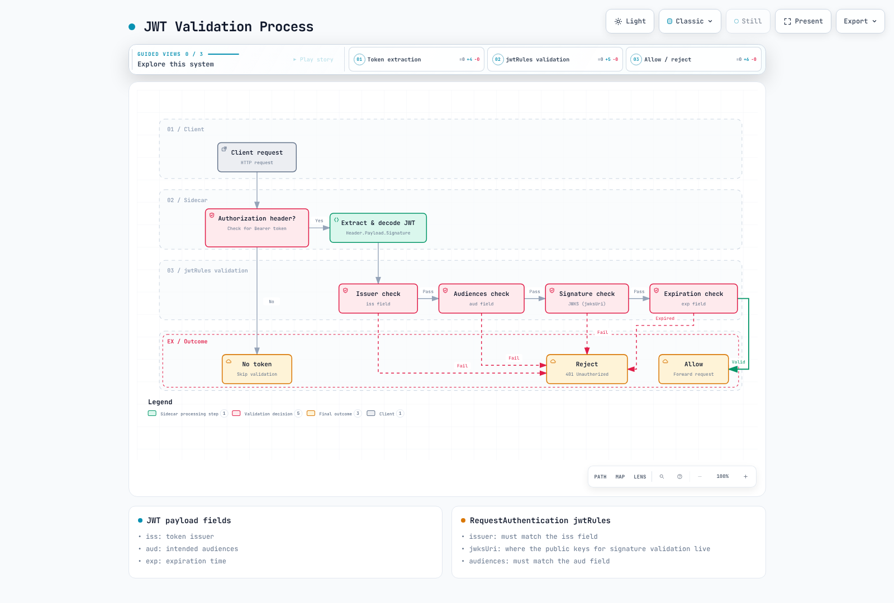

# 安全测验

> **最后更新**: October 12, 2026
>
> **版本**: Istio 1.31，支持 Kubernetes 1.32–1.37（EKS 标准支持：1.34–1.37）。
> 参见[安装矩阵](../../../service-mesh/istio/01-installation.md)。

本测验通过 sidecar 示例测试 Istio 安全性。每道题都是独立场景；请勿将所有 ALLOW policy 合并到同一个 workload 上。Ambient 对 HTTP/JWT policy 需要使用 waypoint `targetRefs`，并且不支持 PeerAuthentication `DISABLE`。命名的 workload、ServiceAccount、端口和身份必须与实际 Deployment 匹配。

## 选择题（1-5）

### 问题 1：PeerAuthentication 模式

以下哪项正确描述了 PeerAuthentication 中的 **PERMISSIVE** mTLS 模式？

A. 它同时允许 mTLS 和明文流量\
B. 它只允许 mTLS 并拒绝明文流量\
C. 它拒绝所有流量\
D. 它禁用 mTLS

<details>

<summary>显示答案</summary>

**答案：A**

PERMISSIVE 模式**同时允许 mTLS 和明文流量**，以支持逐步迁移。

**说明：**

**PeerAuthentication mTLS 模式：**

| 模式           | 描述                    | 使用场景                          |
| -------------- | ------------------------------ | ------------------------------------- |
| **PERMISSIVE** | 同时允许 mTLS + 明文   | 逐步迁移、混合环境 |
| **STRICT**     | 只允许 mTLS               | 生产环境安全加固         |
| **DISABLE**    | 在所选接收端禁用 mesh mTLS | 明确的遗留系统例外             |

**PERMISSIVE 模式示例：**

```yaml
apiVersion: security.istio.io/v1
kind: PeerAuthentication
metadata:
  name: default
  namespace: istio-system
spec:
  mtls:
    mode: PERMISSIVE  # Allows both mTLS + plaintext
```

**行为：**

```
Client A (Istio Sidecar) -> [mTLS] -> Server (PERMISSIVE)  Allowed
Client B (No Sidecar)    -> [Plaintext] -> Server (PERMISSIVE)  Allowed
```

**与 STRICT 模式的比较：**

```yaml
apiVersion: security.istio.io/v1
kind: PeerAuthentication
metadata:
  name: strict-mtls
  namespace: production
spec:
  mtls:
    mode: STRICT  # Only allows mTLS
```

```
Client A (Istio Sidecar) -> [mTLS] -> Server (STRICT)  Allowed
Client B (No Sidecar)    -> [Plaintext] -> Server (STRICT)  Rejected
```

**迁移策略：**

```
Step 1: PERMISSIVE (Allow mixed traffic)
  |
Step 2: Inject Sidecars to all services
  |
Step 3: STRICT (Enforce mTLS)
```

**参考：**

* [PeerAuthentication](../../../service-mesh/istio/security/01-mtls.md)
* [mTLS](../../../service-mesh/istio/security/01-mtls.md)

</details>

***

### 问题 2：AuthorizationPolicy 操作

如果这是选择其 namespace 中 workload 的唯一 AuthorizationPolicy，它表示什么？

```yaml
apiVersion: security.istio.io/v1
kind: AuthorizationPolicy
metadata:
  name: deny-all
spec:
  {}
```

A. 它允许所有请求\
B. 它拒绝所有请求\
C. 它不应用任何 policy\
D. 它只允许 mTLS

<details>

<summary>显示答案</summary>

**答案：B**

空 spec 默认为没有匹配规则的 ALLOW，因此仅此一个 policy 会**拒绝所有请求**。其他匹配的 ALLOW policy 可以提供例外；显式的 DENY-all 无法由 ALLOW 覆盖。

**说明：**

**AuthorizationPolicy 的默认行为：**

1. **不存在 policy**：允许所有请求
2. **空 spec（如示例所示）**：拒绝所有请求
3. **有规则**：根据规则允许/拒绝

**默认拒绝模式：**

```yaml
# Step 1: Deny all requests
apiVersion: security.istio.io/v1
kind: AuthorizationPolicy
metadata:
  name: deny-all
  namespace: default
spec: {}  # Empty spec = deny all requests

---
# Step 2: Selectively allow only what's needed
apiVersion: security.istio.io/v1
kind: AuthorizationPolicy
metadata:
  name: allow-frontend
  namespace: default
spec:
  selector:
    matchLabels:
      app: backend
  action: ALLOW
  rules:
  - from:
    - source:
        principals: ["cluster.local/ns/default/sa/frontend"]
    to:
    - operation:
        methods: ["GET", "POST"]
```

**评估：**CUSTOM → DENY → ALLOW。匹配的 CUSTOM provider 必须允许该请求；随后任何匹配的 DENY 都会拒绝它。如果存在适用的 ALLOW policy，至少必须有一条规则匹配。如果没有适用的 ALLOW policy，此阶段会允许该请求。规则和 ALLOW policy 构成并集，而不是额外限制条件的有序列表。AUDIT 会标记匹配的请求以供已配置的 audit plugin 使用；它不是第四个强制执行阶段，并且本身不会记录日志。

**实际示例：**

```yaml
# Scenario: Restrict HTTP methods
---
# DENY: Prohibit DELETE
apiVersion: security.istio.io/v1
kind: AuthorizationPolicy
metadata:
  name: deny-delete
spec:
  selector:
    matchLabels:
      app: backend
  action: DENY
  rules:
  - to:
    - operation:
        methods: ["DELETE"]

---
# ALLOW: Only allow GET, POST
apiVersion: security.istio.io/v1
kind: AuthorizationPolicy
metadata:
  name: allow-read-write
spec:
  selector:
    matchLabels:
      app: backend
  action: ALLOW
  rules:
  - from:
    - source:
        principals: ["cluster.local/ns/default/sa/frontend"]
    to:
    - operation:
        methods: ["GET", "POST"]
```

**测试：**从已加入 mesh 的 frontend workload 中使用 ServiceAccount `frontend` 运行；配置 backend HTTP protocol/port detection。

```bash
# GET request -> Matches ALLOW policy -> Allowed
curl http://backend/api

# POST request -> Matches ALLOW policy -> Allowed
curl -X POST http://backend/api

# DELETE request -> Matches DENY policy -> Rejected
curl -X DELETE http://backend/api

# PUT request -> No ALLOW policy match -> Rejected
curl -X PUT http://backend/api
```

**参考：**

* [Authorization Policy](../../../service-mesh/istio/security/03-authorization.md)

</details>

***

### 问题 3：JWT 身份验证

RequestAuthentication 使用哪些字段来验证 JWT token？

A. issuer 和 audiences\
B. principals 和 namespaces\
C. methods 和 paths\
D. hosts 和 ports

<details>

<summary>显示答案</summary>

**答案：A**

RequestAuthentication 使用 **issuer** 和 **audiences** 字段来验证 JWT token。

**说明：**

存在 token 时，它必须通过签名、issuer、audience 和时间检查。仅使用 RequestAuthentication 会接受缺失的 token；AuthorizationPolicy 必须要求 `requestPrincipals`。以下时间戳值是已过期的历史示例，不能作为可用 token。

**JWT Token 结构：**

```
Header.Payload.Signature

Payload example:
{
  "iss": "https://auth.example.com",        # issuer
  "sub": "user@example.com",                # subject
  "aud": ["api.example.com"],               # audiences
  "exp": 1735689600,                        # expiration
  "iat": 1735686000                         # issued at
}
```

**RequestAuthentication 配置：**

```yaml
apiVersion: security.istio.io/v1
kind: RequestAuthentication
metadata:
  name: jwt-auth
  namespace: default
spec:
  selector:
    matchLabels:
      app: backend
  jwtRules:
  - issuer: "https://auth.example.com"      # Validate iss field
    jwksUri: "https://auth.example.com/.well-known/jwks.json"
    audiences:
    - "api.example.com"                     # Validate aud field
    forwardOriginalToken: true
```

**JWT 验证过程：**



[🔍 查看交互式图表](https://www.atomai.click/kubernetes-docs/archmaps/en-quizzes-service-mesh-istio-security-0.html)

该图描述的是对存在 token 的验证，而不是授权或缺失 token 的处理。下面的 provider 示例是替代方案；请配置应用程序所期望的 token 类型和 audience。

**与 OIDC Provider 集成：**

```yaml
# Google OAuth2 example
apiVersion: security.istio.io/v1
kind: RequestAuthentication
metadata:
  name: google-jwt
spec:
  jwtRules:
  - issuer: "https://accounts.google.com"
    jwksUri: "https://www.googleapis.com/oauth2/v3/certs"
    audiences:
    - "123456789-abcdefg.apps.googleusercontent.com"

---
# Keycloak example
apiVersion: security.istio.io/v1
kind: RequestAuthentication
metadata:
  name: keycloak-jwt
spec:
  jwtRules:
  - issuer: "https://keycloak.example.com/realms/myrealm"
    jwksUri: "https://keycloak.example.com/realms/myrealm/protocol/openid-connect/certs"
    audiences:
    - "myapp"
```

**与 AuthorizationPolicy 结合使用：**

```yaml
# 1. RequestAuthentication: Validate JWT
apiVersion: security.istio.io/v1
kind: RequestAuthentication
metadata:
  name: jwt-auth
spec:
  selector:
    matchLabels:
      app: backend
  jwtRules:
  - issuer: "https://auth.example.com"
    jwksUri: "https://auth.example.com/.well-known/jwks.json"
    audiences: ["api.example.com"]

---
# 2. AuthorizationPolicy: Only allow authenticated requests
apiVersion: security.istio.io/v1
kind: AuthorizationPolicy
metadata:
  name: require-jwt
spec:
  selector:
    matchLabels:
      app: backend
  action: ALLOW
  rules:
  - from:
    - source:
        requestPrincipals: ["https://auth.example.com/*"]  # Verified issuer + method in the same rule
    to:
    - operation:
        methods: ["GET", "POST"]

```

**测试：**

```bash
# Request without JWT -> Passes RequestAuthentication, denied by AuthorizationPolicy
curl http://backend/api
# 403 Forbidden

# Request with valid JWT
read -rsp "Test access token: " TOKEN; echo
curl -H "Authorization: Bearer $TOKEN" http://backend/api
unset TOKEN
# 200 OK
```

**参考：**

* [Request Authentication](../../../service-mesh/istio/security/02-authentication.md)

</details>

***

### 问题 4：mTLS 证书管理

Istio 中 mTLS 证书的默认有效期是多长？

A. 1 小时\
B. 24 小时\
C. 7 天\
D. 90 天

<details>

<summary>显示答案</summary>

**答案：B**

Istio 中 mTLS 证书的默认有效期是 **24 小时**，并会自动续订。

**说明：**

agent 默认请求 24 小时的 leaf 证书，并在其有效期约过半时续订，同时具有抖动（`SECRET_GRACE_PERIOD_RATIO=0.5`）。Istiod 或选定的外部 CA 对请求进行签名；agent 通过 SDS 将结果交付给 Envoy。根/中间证书的有效期是独立的。默认的自签名根证书直接签发 workload leaf 证书；中间层级是管理员的选择。

检查公有证书时，不要假设存在磁盘上的 `/etc/certs` 文件或固定的 SDS 数组顺序：

```bash
istioctl proxy-config secret <pod-name> -n <namespace> -o json | \
  jq -r '.dynamicActiveSecrets[] | select(.secret.name == "default") | .secret.tlsCertificate.certificateChain.inlineBytes' | \
  base64 -d | openssl x509 -noout -dates -issuer -ext subjectAltName
```

**自定义有效期：**

```yaml
apiVersion: install.istio.io/v1alpha1
kind: IstioOperator
spec:
  meshConfig:
    # Change certificate validity period
    defaultConfig:
      proxyMetadata:
        SECRET_TTL: "48h"  # Extend to 48 hours
```

这是 `istioctl install -f` 输入片段，而不是集群内 operator resource。签发者可能会限制请求的 48 小时 TTL；更改 bootstrap 设置时，应验证已签发的证书并轮换所选 proxy。

续订失败时，在重启 workload 之前检查 agent 和 istiod 日志、CA 连通性、token 身份验证、时钟同步和 trust bundle。仅重启无法修复已过期的 CA。cert-manager 集成需要 **istio-csr** 及其安装前提条件；仅使用 `EXTERNAL_CA=ISTIOD_RA_KUBERNETES_API` 并不是 cert-manager 设置。参见[证书生命周期指南](../../../service-mesh/istio/security/01-mtls.md)。

</details>

***

### 问题 5：基于 Service Account 的身份验证

Istio 中用于服务间身份验证的身份是什么？

A. Pod 名称\
B. Service 名称\
C. Service Account\
D. Namespace 名称

<details>

<summary>显示答案</summary>

**答案：C**

Istio 根据 **Service Account** 管理服务间身份。

**说明：**

**基于 Service Account 的身份：**

```yaml
# 1. Create Service Account
apiVersion: v1
kind: ServiceAccount
metadata:
  name: frontend
  namespace: default

---
# 2. Use Service Account in Deployment
apiVersion: apps/v1
kind: Deployment
metadata:
  name: frontend
  namespace: default
spec:
  selector:
    matchLabels:
      app: frontend
  template:
    metadata:
      labels:
        app: frontend
    spec:
      serviceAccountName: frontend  # Used as identity
      containers:
      - name: frontend
        image: registry.example.com/team/frontend:REPLACE_WITH_TESTED_TAG
```

**SPIFFE ID 格式：**

```
spiffe://<trust-domain>/ns/<namespace>/sa/<service-account>

Examples:
spiffe://cluster.local/ns/default/sa/frontend
spiffe://cluster.local/ns/production/sa/backend
```

**在 AuthorizationPolicy 中使用 Service Account：**

```yaml
apiVersion: security.istio.io/v1
kind: AuthorizationPolicy
metadata:
  name: backend-policy
  namespace: default
spec:
  selector:
    matchLabels:
      app: backend
  action: ALLOW
  rules:
  # Only allow frontend Service Account
  - from:
    - source:
        principals:
        - "cluster.local/ns/default/sa/frontend"
    to:
    - operation:
        methods: ["GET", "POST"]
        paths: ["/api/*"]

  # admin Service Account allowed for all operations
  - from:
    - source:
        principals:
        - "cluster.local/ns/default/sa/admin"
```

上面的 image 是应用程序占位符。Kubernetes RBAC 控制对 Kubernetes API 的访问；它不会自动授予 mesh 流量权限。Istio authorization 单独使用经过身份验证的 ServiceAccount identity。principal 还包括 namespace 和 trust domain。

**Service Account 与 Pod/Service 名称对比：**

| 项目                 | Service Account         | Pod 名称            | Service 名称    |
| -------------------- | ----------------------- | ------------------- | --------------- |
| **稳定性**        | 稳定                  | 动态变化 | 稳定          |
| **安全性**         | 基于证书       | 不可信     | 不可信 |
| **RBAC 集成** | Kubernetes RBAC         | 不可能        | 不可能    |
| **mTLS**             | 包含在证书中 | 不包含        | 不包含    |

**实际示例：三层应用程序：**

```yaml
# Frontend -> Backend only allowed
---
apiVersion: v1
kind: ServiceAccount
metadata:
  name: frontend
  namespace: app

---
apiVersion: v1
kind: ServiceAccount
metadata:
  name: backend
  namespace: app

---
apiVersion: v1
kind: ServiceAccount
metadata:
  name: database
  namespace: app

---
# Backend policy: Only allow Frontend access
apiVersion: security.istio.io/v1
kind: AuthorizationPolicy
metadata:
  name: backend-policy
  namespace: app
spec:
  selector:
    matchLabels:
      app: backend
  action: ALLOW
  rules:
  - from:
    - source:
        principals: ["cluster.local/ns/app/sa/frontend"]

---
# Database policy: Only allow Backend access
apiVersion: security.istio.io/v1
kind: AuthorizationPolicy
metadata:
  name: database-policy
  namespace: app
spec:
  selector:
    matchLabels:
      app: database
  action: ALLOW
  rules:
  - from:
    - source:
        principals: ["cluster.local/ns/app/sa/backend"]
```

**检查 Service Account：**

```bash
# Check pod's Service Account
kubectl get pod <pod-name> -o jsonpath='{.spec.serviceAccountName}'

# Check SPIFFE ID in mTLS certificate
istioctl proxy-config secret <pod-name> -o json | \
  jq -r '.dynamicActiveSecrets[] | select(.secret.name == "default") | .secret.tlsCertificate.certificateChain.inlineBytes' | \
  base64 -d | openssl x509 -text -noout | grep URI

# Output:
# URI:spiffe://cluster.local/ns/default/sa/frontend
```

**跨 Namespace 通信：**

```yaml
# Allow production namespace's frontend -> staging namespace's backend access
apiVersion: security.istio.io/v1
kind: AuthorizationPolicy
metadata:
  name: backend-policy
  namespace: staging
spec:
  selector:
    matchLabels:
      app: backend
  action: ALLOW
  rules:
  - from:
    - source:
        principals:
        - "cluster.local/ns/production/sa/frontend"
        namespaces:
        - "production"
```

**参考：**

* [mTLS](../../../service-mesh/istio/security/01-mtls.md)
* [Authorization Policy](../../../service-mesh/istio/security/03-authorization.md)

</details>

***

## 简答题（6-10）

### 问题 6：实施默认拒绝安全 policy

逐步说明如何使用 Istio 在 Kubernetes cluster 中实施**默认拒绝**安全 policy。包括**必需 resource**（PeerAuthentication、AuthorizationPolicy）以及**例外处理**方法。

<details>

<summary>显示答案</summary>

1. 清查实际调用方、ServiceAccount、workload 端口和应用程序协议。将 workload 加入 mesh，然后在检查兼容性后对 namespace 强制执行 `STRICT`。PeerAuthentication 本身不授权调用方。
2. 将空的 ALLOW policy 应用为 namespace 基线；为所需调用图添加显式规则。预期需要例外时，不要使用带有 `rules: [{}]` 的 `DENY`。
3. 示例假定 namespace 为 `app`，具有标签匹配 `app` 的已加入 mesh 的 frontend/backend/database workload 及 ServiceAccount、HTTP 端口 8080、PostgreSQL 端口 5432，以及 `istio-system` 中的 gateway ServiceAccount `istio-ingressgateway`。请从实际 gateway Pod 验证该 identity。gateway Service 将 HTTPS 443 映射到**workload 端口 8443**，后者是 AuthorizationPolicy 端口。单独为 `myapp.example.com/api/*` 配置 TLS termination 和 VirtualService。

```yaml
apiVersion: security.istio.io/v1
kind: PeerAuthentication
metadata:
  name: default
  namespace: app
spec:
  mtls:
    mode: STRICT
---
apiVersion: security.istio.io/v1
kind: AuthorizationPolicy
metadata:
  name: default-deny
  namespace: app
spec: {}
---
apiVersion: security.istio.io/v1
kind: AuthorizationPolicy
metadata:
  name: ingress-public-api
  namespace: istio-system
spec:
  selector:
    matchLabels:
      istio: ingressgateway
  action: ALLOW
  rules:
  - to:
    - operation:
        ports:
        - '8443'
        hosts:
        - myapp.example.com
        paths:
        - /api/*
        methods:
        - GET
        - POST
---
apiVersion: security.istio.io/v1
kind: AuthorizationPolicy
metadata:
  name: frontend-policy
  namespace: app
spec:
  selector:
    matchLabels:
      app: frontend
  action: ALLOW
  rules:
  - from:
    - source:
        principals:
        - cluster.local/ns/istio-system/sa/istio-ingressgateway
    to:
    - operation:
        ports:
        - '8080'
        paths:
        - /api/*
        methods:
        - GET
        - POST
---
apiVersion: security.istio.io/v1
kind: AuthorizationPolicy
metadata:
  name: backend-policy
  namespace: app
spec:
  selector:
    matchLabels:
      app: backend
  action: ALLOW
  rules:
  - from:
    - source:
        principals:
        - cluster.local/ns/app/sa/frontend
    to:
    - operation:
        ports:
        - '8080'
        paths:
        - /api/*
        methods:
        - GET
        - POST
---
apiVersion: security.istio.io/v1
kind: AuthorizationPolicy
metadata:
  name: database-policy
  namespace: app
spec:
  selector:
    matchLabels:
      app: database
  action: ALLOW
  rules:
  - from:
    - source:
        principals:
        - cluster.local/ns/app/sa/backend
    to:
    - operation:
        ports:
        - '5432'
```

4. 对 sidecar 保留 Istio 的默认 probe rewrite：kubelet HTTP/TCP/gRPC probe 通过 agent（通常为 15020）定向。HTTP ALLOW path 不会让明文通过 STRICT。如果遗留 health endpoint 需要明文例外，`portLevelMtls` 需要 workload selector 和 workload 端口；authorization/network 限制仍必须约束该 endpoint。不要将应用程序端口的 mTLS 禁用作为通用 health 修复方法。
5. Agent/Envoy metrics 端口（15020/15090）不同于被拦截的应用程序 metrics endpoint。对于受保护的应用程序 metrics endpoint，将 ALLOW policy 限定为 workload、实际端口/path 和经 mTLS 身份验证的 Prometheus principal。对于 agent metrics，配置 scraping 和网络访问；应用程序入站流量上的 AuthorizationPolicy 并不足够。
6. 验证生效配置以及允许/拒绝的流量：

```bash
istioctl analyze -n app
istioctl proxy-config secret <backend-pod> -n app
istioctl proxy-config clusters <frontend-pod> -n app -o json
istioctl x authz check <backend-pod>.app
# Run from the indicated application containers with the test clients installed.
kubectl exec <frontend-pod> -n app -c frontend -- curl -i http://backend:8080/api/users
kubectl exec <frontend-pod> -n app -c frontend -- pg_isready -h database -p 5432
kubectl exec <backend-pod> -n app -c backend -- pg_isready -h database -p 5432
```

Frontend → backend 应到达应用程序；frontend → database 应在 TCP 层失败，而不是返回 HTTP 403。Backend → database 应到达 PostgreSQL（数据库凭据是单独检查）。在授权测试到达预期 backend 之前，缺少 routing 可能会产生 404。使用 namespace 限定的 Pod、应用程序 container 和真实测试 client。参见[授权](../../../service-mesh/istio/security/03-authorization.md)和[健康检查](https://istio.io/latest/docs/ops/configuration/mesh/app-health-check/)。

</details>

***

### 问题 7：JWT + mTLS 双重身份验证

实施一个在 Istio 中同时使用**终端用户身份验证（JWT）**和**服务间身份验证（mTLS）**的场景。包括如何与 OAuth2/OIDC provider（例如 Keycloak）集成。

<details>

<summary>显示答案</summary>

配置 Keycloak realm `myrealm`、OIDC client 和显式 API audience `myapp`。使用带 PKCE 的 authorization code flow 和精确的 HTTPS redirect URI。client 类型/身份验证取决于应用程序能否保管 secret。Keycloak role 通常位于 `realm_access.roles`；使用 audience mapper/client scope，以便 API token 具有预期的 `aud`。

每个评估 `requestPrincipals` 或 `request.auth.claims` 的 proxy 都需要自己的 RequestAuthentication。gateway 上已验证的 JWT 不会在 frontend 或 backend 上建立请求 identity。`forwardOriginalToken` 会在该转发请求上保留 token，并且**frontend 应用程序必须在其新建的 backend 请求中传播 Authorization**。

以下内容替换问题 6 中相关的 policy。不要在受 role 限制的 backend 规则旁保留更宽泛的 ALLOW policy：ALLOW policy 构成并集。Deployment 和 HTTPS gateway 前提条件与问题 6 相同。

```yaml
apiVersion: security.istio.io/v1
kind: PeerAuthentication
metadata:
  name: default
  namespace: app
spec:
  mtls:
    mode: STRICT
---
apiVersion: security.istio.io/v1
kind: AuthorizationPolicy
metadata:
  name: default-deny
  namespace: app
spec: {}
---
apiVersion: security.istio.io/v1
kind: RequestAuthentication
metadata:
  name: jwt-ingress
  namespace: istio-system
spec:
  selector:
    matchLabels:
      istio: ingressgateway
  jwtRules:
  - issuer: https://keycloak.example.com/realms/myrealm
    jwksUri: https://keycloak.example.com/realms/myrealm/protocol/openid-connect/certs
    audiences:
    - myapp
    forwardOriginalToken: true
---
apiVersion: security.istio.io/v1
kind: AuthorizationPolicy
metadata:
  name: ingress-public-api
  namespace: istio-system
spec:
  selector:
    matchLabels:
      istio: ingressgateway
  action: ALLOW
  rules:
  - to:
    - operation:
        ports:
        - '8443'
        hosts:
        - myapp.example.com
        paths:
        - /api/*
        methods:
        - GET
        - POST
        - DELETE
    from:
    - source:
        requestPrincipals:
        - https://keycloak.example.com/realms/myrealm/*
---
apiVersion: security.istio.io/v1
kind: RequestAuthentication
metadata:
  name: jwt-frontend
  namespace: app
spec:
  selector:
    matchLabels:
      app: frontend
  jwtRules:
  - issuer: https://keycloak.example.com/realms/myrealm
    jwksUri: https://keycloak.example.com/realms/myrealm/protocol/openid-connect/certs
    audiences:
    - myapp
    forwardOriginalToken: true
---
apiVersion: security.istio.io/v1
kind: AuthorizationPolicy
metadata:
  name: frontend-policy
  namespace: app
spec:
  selector:
    matchLabels:
      app: frontend
  action: ALLOW
  rules:
  - from:
    - source:
        principals:
        - cluster.local/ns/istio-system/sa/istio-ingressgateway
        requestPrincipals:
        - https://keycloak.example.com/realms/myrealm/*
    to:
    - operation:
        ports:
        - '8080'
        paths:
        - /api/*
        methods:
        - GET
        - POST
        - DELETE
---
apiVersion: security.istio.io/v1
kind: RequestAuthentication
metadata:
  name: jwt-backend
  namespace: app
spec:
  selector:
    matchLabels:
      app: backend
  jwtRules:
  - issuer: https://keycloak.example.com/realms/myrealm
    jwksUri: https://keycloak.example.com/realms/myrealm/protocol/openid-connect/certs
    audiences:
    - myapp
    forwardOriginalToken: true
---
apiVersion: security.istio.io/v1
kind: AuthorizationPolicy
metadata:
  name: backend-policy
  namespace: app
spec:
  selector:
    matchLabels:
      app: backend
  action: ALLOW
  rules:
  - from:
    - source:
        principals:
        - cluster.local/ns/app/sa/frontend
        requestPrincipals:
        - https://keycloak.example.com/realms/myrealm/*
    to:
    - operation:
        ports:
        - '8080'
        paths:
        - /api/users/*
        methods:
        - GET
        - POST
    when:
    - key: request.auth.claims[realm_access][roles]
      values:
      - user
      - admin
  - from:
    - source:
        principals:
        - cluster.local/ns/app/sa/frontend
        requestPrincipals:
        - https://keycloak.example.com/realms/myrealm/*
    to:
    - operation:
        ports:
        - '8080'
        methods:
        - DELETE
        paths:
        - /api/admin/*
    when:
    - key: request.auth.claims[realm_access][roles]
      values:
      - admin
```

对于需要将标量 claim 作为 header 的应用程序，RequestAuthentication 支持实验性的 `outputClaimToHeaders` 字段，例如使用 `header: x-user-id` 和 `claim: sub`。使用已验证的 JWT claim 进行 authorization；不要信任调用方提供的 identity header。`outputPayloadToHeader` 包含编码后的 payload，而 Envoy 的 Lua runtime 不包含任意的 `require("json")` module。应将 role 数组作为 claim 匹配，而不是盲目地将其连接到 header 中。

通过已配置的登录流程获取测试 token，然后测试 HTTPS。不要在测验命令中嵌入密码/client secret：

```bash
read -rsp "Test access token: " TOKEN; echo
curl -i -H "Authorization: Bearer $TOKEN" https://myapp.example.com/api/users/test
unset TOKEN
curl -i https://myapp.example.com/api/users/test
# No JWT: 403 from AuthorizationPolicy.
curl -i -H "Authorization: Bearer invalid-token" https://myapp.example.com/api/users/test
# Invalid JWT: 401 from RequestAuthentication.
```

还应测试来自错误 ServiceAccount、错误 audience 及 role 不足的有效 token。JWT role 的更改并不会立即撤销已签发的 token；token 生命周期和签发者/应用程序撤销机制很重要。参见[身份验证](../../../service-mesh/istio/security/02-authentication.md)和[Keycloak grant types](https://www.keycloak.org/securing-apps/oidc-layers)。

</details>

***

### 问题 8：外部 Service 访问控制

说明如何控制 Istio 中的 **Egress 流量**，以便只允许访问特定的外部 Service。包括使用 **ServiceEntry**、**VirtualService** 和 **AuthorizationPolicy** 的完整示例。

<details>

<summary>显示答案</summary>

`ALLOW_ANY` 会转发未知 destination；`REGISTRY_ONLY` 会拒绝 proxy registry 中未知的 destination。registry 包括 Kubernetes service 和 ServiceEntry。两种模式都不是 firewall，并且在没有独立网络限制时，应用程序可以绕过 proxy。通过已有安装 values 应用 mesh 设置；不要用只有一个字段的片段替换整个 `istio` ConfigMap。

AuthorizationPolicy 会评估其所选 proxy 接收到的流量。client sidecar 上的 namespace policy 不是出站 ACL。对于 identity/method/path 控制，通过终止 mesh mTLS 的 egress gateway 路由，在那里进行 authorization，然后向外部 server 发起 TLS。应用程序向 sidecar 发送 HTTP；HTTPS passthrough 会隐藏 HTTP path 和 method。

前提条件：namespace `app` 中已加入 mesh 的 client、带有标签 `istio: egressgateway` 的专用 egress gateway、将 443 映射到 workload 8443 的 Service `istio-egressgateway.istio-system.svc.cluster.local`，以及没有其他宽泛的 gateway ALLOW policy。已安装 proxy 的公有 CA trust 必须验证 GitHub 的证书。

```yaml
apiVersion: networking.istio.io/v1
kind: ServiceEntry
metadata:
  name: github-api
  namespace: app
spec:
  hosts:
  - api.github.com
  location: MESH_EXTERNAL
  resolution: DNS
  ports:
  - number: 80
    targetPort: 443
    name: http
    protocol: HTTP
---
apiVersion: networking.istio.io/v1
kind: Gateway
metadata:
  name: github-egress
  namespace: istio-system
spec:
  selector:
    istio: egressgateway
  servers:
  - port:
      number: 443
      name: https
      protocol: HTTPS
    hosts:
    - api.github.com
    tls:
      mode: ISTIO_MUTUAL
---
apiVersion: networking.istio.io/v1
kind: DestinationRule
metadata:
  name: to-egress
  namespace: app
spec:
  host: istio-egressgateway.istio-system.svc.cluster.local
  trafficPolicy:
    tls:
      mode: ISTIO_MUTUAL
      sni: api.github.com
---
apiVersion: networking.istio.io/v1
kind: VirtualService
metadata:
  name: github-through-egress
  namespace: app
spec:
  hosts:
  - api.github.com
  gateways:
  - mesh
  - istio-system/github-egress
  http:
  - match:
    - gateways:
      - mesh
      port: 80
    route:
    - destination:
        host: istio-egressgateway.istio-system.svc.cluster.local
        port:
          number: 443
  - match:
    - gateways:
      - istio-system/github-egress
      port: 443
    timeout: 10s
    retries:
      attempts: 2
      perTryTimeout: 3s
      retryOn: connect-failure,reset
    route:
    - destination:
        host: api.github.com
        port:
          number: 80
---
apiVersion: networking.istio.io/v1
kind: DestinationRule
metadata:
  name: github-origin-tls
  namespace: istio-system
spec:
  host: api.github.com
  workloadSelector:
    matchLabels:
      istio: egressgateway
  trafficPolicy:
    tls:
      mode: SIMPLE
      sni: api.github.com
      subjectAltNames:
      - api.github.com
---
apiVersion: security.istio.io/v1
kind: AuthorizationPolicy
metadata:
  name: github-egress-allow
  namespace: istio-system
spec:
  selector:
    matchLabels:
      istio: egressgateway
  action: ALLOW
  rules:
  - from:
    - source:
        principals:
        - cluster.local/ns/app/sa/backend
    to:
    - operation:
        hosts:
        - api.github.com
        methods:
        - GET
        paths:
        - /users/*
        ports:
        - '8443'
```

mesh client 调用 `http://api.github.com/users/octocat`。其 sidecar 使用 ISTIO_MUTUAL 连接 gateway。gateway 的 HTTP listener 可以强制执行 backend ServiceAccount 和 GET `/users/*`，然后使用端口 80 → targetPort 443 向 GitHub 发送 HTTPS。所示 retry 用于此幂等 GET 用例，而不是任意具有副作用的 API。

```bash
kubectl exec <backend-pod> -n app -c backend -- curl -i http://api.github.com/users/octocat
kubectl exec <frontend-pod> -n app -c frontend -- curl -i http://api.github.com/users/octocat
# Gateway should reject the second caller with HTTP 403.
istioctl proxy-config clusters <egress-pod> -n istio-system --fqdn api.github.com -o json
istioctl x authz check <egress-pod>.istio-system
```

对于私有外部 database，使用具有显式 endpoint/address 和 TCP 端口 5432 的 STATIC ServiceEntry；必须为该协议设计 TLS/database authentication。仅 HTTP 的 service 可以使用 HTTP ServiceEntry，但敏感数据需要加密。将 API credential 存储在应用程序或受支持的、由 secret 支持的 signing/authentication component 中；VirtualService header literal 是可读配置，而不是 secret storage。

最后，通过 CNI NetworkPolicy/firewall control 强制执行此路径：client 可以访问所需 mesh service、DNS、istiod 和 egress gateway，但不能访问任意互联网 IP；gateway 获得所需的外部访问权限。考虑 IPv4/IPv6、bypass/excluded port 和 privileged workload。标准 NetworkPolicy 不会过滤 DNS 名称；必要时使用受支持的 FQDN-aware control。除了经批准的路径外，也要测试直接 IP/HTTPS bypass。参见[egress control](../../../service-mesh/istio/traffic-management/11-egress-control.md)和[TLS origination](https://istio.io/latest/docs/tasks/traffic-management/egress/egress-gateway-tls-origination/)。

</details>

***

### 问题 9：安全审计和日志记录

说明如何在 Istio 中**审计**和记录安全相关事件。包括 **AuthorizationPolicy 的 AUDIT 操作**和 **Access Log** 配置。

<details>

<summary>显示答案</summary>

`AUDIT` 会标记匹配的请求以供**已安装的 audit plugin**使用。没有该 plugin 时，policy 没有日志记录效果，也不会允许或拒绝流量。此示例审计的是一个合取条件（DELETE 和 admin path），而不是两个有序条件：

```yaml
apiVersion: security.istio.io/v1
kind: AuthorizationPolicy
metadata:
  name: audit-sensitive
  namespace: app
spec:
  selector:
    matchLabels:
      app: backend
  action: AUDIT
  rules:
  - to:
    - operation:
        methods:
        - DELETE
        paths:
        - /api/admin/*
```

Access logging 是独立的。将此 custom provider 合并到现有 Istio 安装配置中，并使用 `istioctl install -f`（保留其他 provider/settings），然后仅为所选 backend 启用它。格式中刻意排除了 query string、bearer token 和完整 JWT payload。

```yaml
apiVersion: install.istio.io/v1alpha1
kind: IstioOperator
spec:
  meshConfig:
    extensionProviders:
    - name: security-json
      envoyFileAccessLog:
        path: /dev/stdout
        logFormat:
          labels:
            start_time: '%START_TIME%'
            method: '%REQ(:METHOD)%'
            path: '%REQ_WITHOUT_QUERY(:PATH)%'
            response_code: '%RESPONSE_CODE%'
            response_code_details: '%RESPONSE_CODE_DETAILS%'
            response_flags: '%RESPONSE_FLAGS%'
            peer: '%DOWNSTREAM_PEER_URI_SAN%'
            request_id: '%REQ(X-REQUEST-ID)%'
```

```yaml
apiVersion: telemetry.istio.io/v1
kind: Telemetry
metadata:
  name: backend-security
  namespace: app
spec:
  selector:
    matchLabels:
      app: backend
  accessLogging:
  - providers:
    - name: security-json
    filter:
      expression: response.code >= 400 || request.method == "DELETE" || request.url_path.startsWith("/api/admin/")
  metrics:
  - providers:
    - name: prometheus
    overrides:
    - match:
        metric: REQUEST_COUNT
        mode: SERVER
      tagOverrides:
        security_operation:
          value: 'request.url_path.startsWith("/api/admin/") ? "admin" : "other"'
```

Telemetry resource 还会向请求计数添加有界的 `security_operation` 维度（`admin`/`other`）。`request_method` 和原始 URL path 不是默认 Istio metric label。避免使用完整 URL label，因为会产生高基数和敏感数据。即使未安装 AUDIT plugin，也会记录 error、DELETE 请求和 admin access。要启用所有请求，请省略 filter；要覆盖一个 namespace，请省略 selector；无 selector 的 root-namespace policy 覆盖整个 mesh。

对于 CloudWatch，部署/配置受支持的 EKS logging agent 或 Fluent Bit DaemonSet，并配备 node log mount、CRI/containerd parsing、`log` 字段的 JSON parsing、IAM credential 和 CloudWatch output。单独的 ConfigMap 不会启动 agent。对于 Elasticsearch/OpenSearch，使用为该 destination 配置了 output 的 collector；使用 provider `envoy` 的 Telemetry 会写入 stdout，而不会配置 Elasticsearch。Fargate 需要其受支持的 logging mechanism，而不是 node DaemonSet。

摄取结构化 JSON 字段后，分别运行每个 CloudWatch Logs Insights query：

```sql
fields @timestamp, method, path, response_code, peer
| filter method = "DELETE"
| sort @timestamp desc
| limit 100
```

```sql
fields @timestamp, path, response_code, response_code_details
| filter path like /^\/api\/admin\//
| filter response_code = "403"
| stats count() by bin(5m), response_code_details
```

403 可能来自应用程序、JWT authorization 或 external provider。在将其归因于 Istio 之前，应检查 `response_code_details`、proxy RBAC log 和生效的 policy。不要假定 `envoy_http_rbac_logged_total` 是内置 AUDIT counter。实际的 RBAC/实验性 dry-run statistic 取决于 proxy 配置和命名；请检查已导出的 series。

Grafana 可以绘制标准 destination-reported 403 rate 和自定义 admin dimension。由已安装 Prometheus Operator 选择的 PrometheusRule 可以针对后者发出告警：

```yaml
apiVersion: monitoring.coreos.com/v1
kind: PrometheusRule
metadata:
  name: istio-security-alerts
  namespace: monitoring
spec:
  groups:
  - name: istio-security
    rules:
    - alert: AdminHTTP403Responses
      expr: sum(rate(istio_requests_total{reporter="destination",security_operation="admin",response_code="403"}[5m]))
        > 0
      for: 5m
      labels:
        severity: warning
      annotations:
        summary: Admin API returned HTTP 403; inspect response_code_details to identify
          the cause
```

在强制执行新 policy 之前，ALLOW/DENY 上实验性的 `istio.io/dry-run: "true"` annotation 可以报告 shadow decision；它不同于 AUDIT，且其诊断输出不是稳定 API。根据实际组织/法律要求设置保留期、访问控制和敏感数据删除；不存在通用的 90 天/一年保留期规定。参见[access logging](https://istio.io/latest/docs/tasks/observability/logs/access-log/)和[authorization dry-run](https://istio.io/latest/docs/tasks/security/authorization/authz-dry-run/)。

</details>

***

### 问题 10：实施零信任网络

说明如何使用 Istio 实施**零信任网络**原则。包括应用 **mTLS STRICT**、**默认拒绝**和**最小权限**原则的完整示例。

<details>

<summary>显示答案</summary>

零信任结合经过身份验证的 identity、明确的最小权限 authorization，以及在 workload 被攻陷时仍然有效的 control。Istio 保护由其 data plane 捕获的流量；它不能替代 Kubernetes RBAC、admission policy、network isolation 或 application authorization。

1. 为 frontend/backend/database 分配不同的 ServiceAccount，并阻止 workload 自由冒用彼此的 account。将 workload 加入 mesh；验证 trust domain、证书签发和续订。
2. 将 STRICT 应用于目标 namespace，并在那里使用空的 ALLOW baseline。`default` 中的 policy 不会自动覆盖 `app`；root-namespace baseline 具有更广泛的影响，需要明确的 gateway/operational exception。
3. 只允许 gateway → frontend → backend → database。对于与问题 6 相同的 Deployment 前提条件，完整的 traffic-policy 集合为：

```yaml
apiVersion: security.istio.io/v1
kind: PeerAuthentication
metadata:
  name: default
  namespace: app
spec:
  mtls:
    mode: STRICT
---
apiVersion: security.istio.io/v1
kind: AuthorizationPolicy
metadata:
  name: default-deny
  namespace: app
spec: {}
---
apiVersion: security.istio.io/v1
kind: AuthorizationPolicy
metadata:
  name: ingress-public-api
  namespace: istio-system
spec:
  selector:
    matchLabels:
      istio: ingressgateway
  action: ALLOW
  rules:
  - to:
    - operation:
        ports:
        - '8443'
        hosts:
        - myapp.example.com
        paths:
        - /api/*
        methods:
        - GET
        - POST
---
apiVersion: security.istio.io/v1
kind: AuthorizationPolicy
metadata:
  name: frontend-policy
  namespace: app
spec:
  selector:
    matchLabels:
      app: frontend
  action: ALLOW
  rules:
  - from:
    - source:
        principals:
        - cluster.local/ns/istio-system/sa/istio-ingressgateway
    to:
    - operation:
        ports:
        - '8080'
        paths:
        - /api/*
        methods:
        - GET
        - POST
---
apiVersion: security.istio.io/v1
kind: AuthorizationPolicy
metadata:
  name: backend-policy
  namespace: app
spec:
  selector:
    matchLabels:
      app: backend
  action: ALLOW
  rules:
  - from:
    - source:
        principals:
        - cluster.local/ns/app/sa/frontend
    to:
    - operation:
        ports:
        - '8080'
        paths:
        - /api/*
        methods:
        - GET
        - POST
---
apiVersion: security.istio.io/v1
kind: AuthorizationPolicy
metadata:
  name: database-policy
  namespace: app
spec:
  selector:
    matchLabels:
      app: database
  action: ALLOW
  rules:
  - from:
    - source:
        principals:
        - cluster.local/ns/app/sa/backend
    to:
    - operation:
        ports:
        - '5432'
```

4. 在需要 namespace isolation 的地方，匹配经过身份验证的 namespace/principal。选择 `production` 且具有 `notNamespaces: [production, istio-system]` 的 DENY 会阻止**其他调用方进入 production**，而不是 production → staging。考虑 gateway 和 operator；DENY 覆盖 ALLOW。
5. 如果访问取决于营业时间，请使用 application authorization 或已配置的 CUSTOM external authorization provider，并指定明确的 timezone、clock source 和 failure policy。插入点/timezone 未指定的 Lua `os.date()` 检查并不是完整的 authorization design。CUSTOM permission 仍必须通过 DENY/ALLOW。
6. 通过问题 8 中的 gateway pattern 加 network control 强制执行 egress；`REGISTRY_ONLY` 和名为 `deny-all-egress` 的 sidecar policy 都不是 firewall。匹配每个 host 的入站 DENY 反而会阻止应用程序流量，且无法由 ALLOW 撤销。
7. 保留 probe rewrite，为正确的 port 设计 scraping，并且仅按问题 6 中的说明添加必要例外。对于终端用户 authorization，使用问题 7 中的 JWT validation 和逐跳 token propagation。使用问题 9 中的方式记录日志和告警，并监控 mTLS 章节中的证书过期。
8. 每次更改后检查实际 policy，并测试预期的 allow/deny matrix、TCP database access 和 egress bypass：

```bash
istioctl analyze -n app
istioctl proxy-config secret <backend-pod> -n app
istioctl proxy-config clusters <frontend-pod> -n app -o json
istioctl x authz check <backend-pod>.app
# Run from the indicated application containers with the test clients installed.
kubectl exec <frontend-pod> -n app -c frontend -- curl -i http://backend:8080/api/users
kubectl exec <frontend-pod> -n app -c frontend -- pg_isready -h database -p 5432
kubectl exec <backend-pod> -n app -c backend -- pg_isready -h database -p 5432
```

测验分数并不能证明生产就绪。针对真实环境，请审查 workload identity 分配、network bypass path、issuer trust、最小权限规则、observability、rollback 以及应用程序自身的 permission。参见[安全概念](https://istio.io/latest/docs/concepts/security/)和[授权](../../../service-mesh/istio/security/03-authorization.md)。

</details>

***

## 分数计算

* 选择题 1-5：每题 10 分（共 50 分）
* 简答题 6-10：每题 10 分（共 50 分）
* **总分：100 分**

**评估标准：**

* 90-100 分：对这些测验主题有出色的理解
* 80-89 分：理解良好；应单独验证真实 Deployment
* 70-79 分：一般（建议进一步学习）
* 60-69 分：低于平均水平（需要复习基本概念）
* 0-59 分：需要重新学习

## 学习资源

* [mTLS](../../../service-mesh/istio/security/01-mtls.md)
* [Authorization Policy](../../../service-mesh/istio/security/03-authorization.md)
* [Request Authentication](../../../service-mesh/istio/security/02-authentication.md)
* [Peer Authentication](../../../service-mesh/istio/security/01-mtls.md)