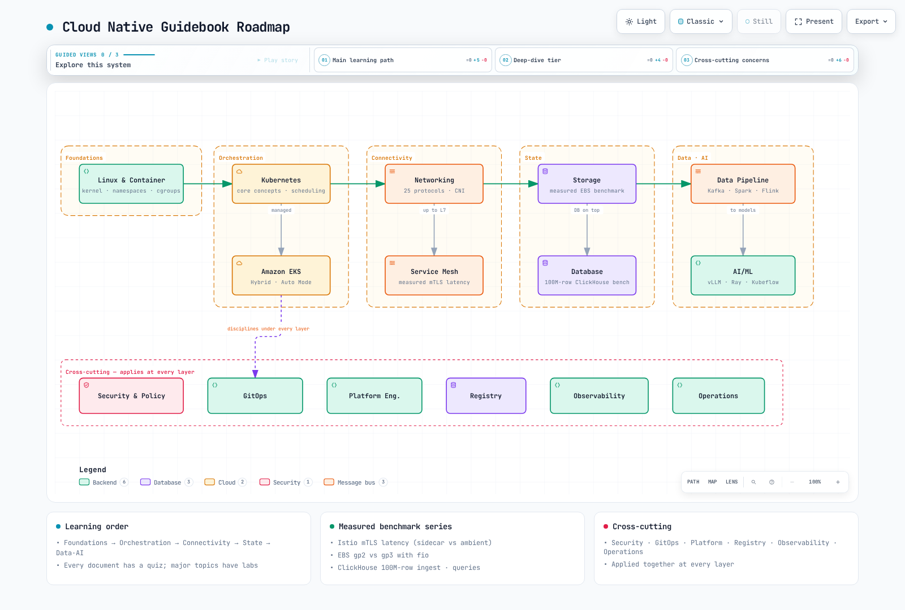

# 指南路线图

> **最后更新**：2026 年 10 月 16 日

本指南讲述一条连贯的学习路径：从 Linux 内核开始，依次介绍容器、Kubernetes、Amazon EKS、网络、服务网格、存储、数据库、数据流水线和 AI/ML，并涵盖安全、GitOps、平台工程、容器镜像仓库、可观测性和运维等横切领域。本页提供领域地图和推荐学习路径。

[🔍 查看交互式图表](https://www.atomai.click/kubernetes-docs/archmaps/en-roadmap-0.html)

## 领域地图

| 层级 | 领域 | 从这里开始 | 简介 |
|-------|--------|-----------|-----------|
| 基础 | Linux 和容器 | [Linux 基础](basics/01-linux-basics.md) | 内核、命名空间、cgroup：容器的实际组成 |
| 编排 | Kubernetes 核心概念 | [Kubernetes 简介](basics/04-kubernetes-introduction.md) | 工作负载、调度和自动扩缩：Kubernetes 本身 |
| 编排 | Amazon EKS | [EKS 简介](eks/01-eks-introduction.md) | 从集群创建到混合节点和 Auto Mode |
| 连接 | 网络 | [网络基础](basics/06-network-fundamentals-part1.md) | 25 种协议，深入至 CNI（Cilium/Calico） |
| 连接 | 服务网格 | [Istio](service-mesh/istio/README.md) | Istio/Linkerd/Cilium Mesh，以及实测 mTLS 延迟 |
| 状态 | 存储 | [存储概览](storage/README.md) | EBS gp2 和 gp3 对比，通过 fio 实测 |
| 状态 | 数据库 | [数据库概览](database/README.md) | Operator 全景和包含 1 亿行数据的 ClickHouse 基准测试 |
| 数据与 AI | 数据流水线 | [EKS 上的数据概览](data-on-eks/README.md) | 深入介绍 Kafka、Spark、Airflow 和 Flink，并提供 Kafka 单次运行基准记录 |
| 数据与 AI | AI/ML | [AI/ML 工作负载](ai-ml/01-ai-ml-workloads.md) | EKS 上的 vLLM、Ray、Kubeflow、MLflow |
| 横切领域 | 安全与策略 | [Kyverno](security/01-kyverno-policy-management.md) | 身份验证/授权、策略、运行时安全、供应链 |
| 横切领域 | GitOps | [GitOps](gitops/README.md) | ArgoCD、Flux、渐进式交付 |
| 横切领域 | 平台工程 | [概览](platform-engineering/00-platform-engineering-overview.md) | ACK、KRO、Crossplane、Backstage |
| 横切领域 | 容器镜像仓库 | [概览](container-registry/README.md) | ECR、Harbor、镜像供应链 |
| 横切领域 | 可观测性 | [概览](observability/README.md) | 指标、日志、跟踪、告警技术栈 |
| 横切领域 | 运维指南 | [运维指南](ops/README.md) | 容量规划、FinOps、升级，以及按症状查找的[故障排查手册](ops/16-troubleshooting-playbook.md) |

## 已测量基准系列

这些文档报告了此前在 AWS 资源上进行的运行结果。请检查环境、重复次数、缓存状态、原始记录是否可用以及结果的限制，然后针对当前容量规划重新测量：

- [Istio sidecar 与 ambient 实测对比](service-mesh/istio/comparison/03-sidecar-vs-ambient.md)：按 mTLS 数据平面测量 P50/P99 延迟，以及发布期间的 503 率
- [EBS gp2 与 gp3 实测基准](storage/01-ebs-gp2-gp3-benchmark.md)：相同的 100 GiB 容量下 IOPS 相差 10 倍，以及 gp2 突发积分耗尽临界点
- [EKS 上 ClickHouse 实测基准](database/01-clickhouse-on-eks.md)：1 亿行数据的摄取吞吐量、压缩率、查询延迟
- [EKS 上 Kafka 实测基准](data-on-eks/kafka/09-kafka-benchmark.md)：单次运行记录显示 RF3/acks=all 时为 134.74 MiB/s，RF1/acks=1 时为 337.81 MiB/s（不能据此确认 RF3 的持续吞吐上限）；记录了不同 acks 设置下的 p99，以及重放消费期间生产者吞吐量下降 44.49%
- [Pod 网络基准测试](networking/06-pod-network-benchmark.md)：RTT 阶梯为 0.040 → 0.339 → 0.544 ms（同节点 → 同 AZ → 跨 AZ）；单流吞吐上限为 4.96 Gbps，与 AZ 无关，8 条流时为 9.94 Gbps；`ndots:5` 会将查询放大为 10 次查询/8 个 NXDOMAIN

## 分享图表：导出到 LinkedIn 和演讲材料

本指南中的交互式图表会打开在 `https://www.atomai.click/kubernetes-docs/archmaps/<name>.html`。查看器工具栏中的 **Export** 按钮（快捷键 `E`）可立即生成适合分享的文件。可用导出项取决于查看器版本、浏览器能力和所选内容。

### Export 菜单提供的选项

| 分组 | 菜单项 | 输出 | 用途 |
|-------|--------|-----------|-----------|
| 分享 | **Share Card** / **Copy Share Card** | 1200×630 PNG（下载/剪贴板） | LinkedIn 和 X 链接预览、README、发布说明 |
| 分享 | **Route Share Card** | 1200×630 PNG（仅下载） | 仅在 Route Probe (`R`) 解析出两个节点间的路径后显示 |
| 分享 | **Reach Share Card** | 1200×630 PNG（仅下载） | 仅在你从节点的 Semantic Passport 跟踪其上游/下游可达性后显示 |
| 分享 | **Copy diagram** | 将完整图表 PNG 复制到剪贴板 | 直接粘贴到幻灯片或文档 |
| 图像 | **PNG** / **JPEG** / **WebP** | 完整图表的栅格图像 | 需要无损格式时用 PNG；关注文件大小时用 JPEG/WebP |
| 矢量与动态 | **SVG** | 双主题（浅色 + 深色）矢量图 | 任意缩放都保持清晰的幻灯片 |
| 矢量与动态 | **WebM** | 6 秒轨迹动画录制 | 让流程在 LinkedIn 动态消息中实际移动的帖子 |

导出文件会移除所有查看器状态（Guide 面板、Lens、finder、focus、route、story、摄像机位置、radar、演示模式和临时叠加层），只保留图表本身。Share Card 会保留当前主题和视觉预设，并始终包含未裁切的完整图表。WebM 录制需要带有轨迹动画的图表，并且浏览器必须支持 MediaRecorder；如果浏览器不支持，菜单会显示相应提示。

### 30 秒 LinkedIn 分享步骤

1. **打开图表**：点击任何嵌入图表下方的“全屏打开 ↗”链接（在 GitBook 上为“🔍 查看交互式图表”）。
2. **确认轨迹正在播放**：工具栏上的 **Live/Still** 切换项应显示 Live。沿箭头流动的动画会被录制。准备演讲？按 **Presentation stage** (`F`)，图表就会占满整个视口。
3. 动态帖子选择 **Export → WebM**，或选择 **Export → Share Card** 生成静态 1200×630 预览。WebM 会显示“正在录制 6 秒动画…”，然后下载文件。
4. **发布**：检查目标平台当前接受的格式；必要时转换 WebM。将 Share Card 作为图像上传，并附上源文档 URL。若要指向特定节点、路径或故事片段，可使用 Semantic Passport 或 Route Probe 中的 **Copy link**，或使用 Story Beat 上的 **Copy moment**（只在定义了故事章节的图表中显示），然后将深层链接放入评论或幻灯片。

### 真实性边界

- 导出内容是**沟通素材**。它不是架构已经过验证的证据，也不能取代已发布的 HTML 或作者自己的验证。Share Card 绝不声称架构已验证。
- Route Share Card 只遵循**作者声明的有向关系**。它不会根据图形布局推断路径，也不会导出过期或不可达的路径。
- Reach Share Card 显示的是*作者声明的可达性*。不要将其表述为影响分析、爆炸半径、故障或运行时因果关系。

## 推荐路径

### ① 基础设施接入：“从容器到 EKS”

Linux 基础 → 容器技术 → Kubernetes 简介 → 核心概念（Pod/Service/存储/配置）→ EKS 集群创建 → 网络基础。通过每篇文档的测验检查理解，同时并行完成[实验](labs/README.md)。

### ② 平台 / SRE：“能够运维的集群”

EKS 运维（升级/故障排查/韧性）→ 网络（VPC CNI、Cilium）→ 服务网格对比指南 → 安全与策略 → 可观测性技术栈 → GitOps → 运维指南中的容量规划和 FinOps。已测量基准系列提供了这条路径所依据的证据。

### ③ 数据与 AI 平台：“有状态的世界”

存储 → 数据库 → 数据流水线（Kafka → Spark → Airflow → Flink）→ AI/ML（vLLM → Ray → Kubeflow）。如果需要 GPU 和调度控制，还应学习 Kubernetes 核心概念下的自定义调度器部分。

## 使用 LLM 阅读

本指南按提议的 llms.txt 格式提供索引和源文本。AI 工具仍需要网页检索或 MCP 连接；仅提供一个 URL 并不能保证它会自动阅读或索引整本书。有关端点和用法示例，请参阅[使用 LLM 阅读](llm-guide.md)。
