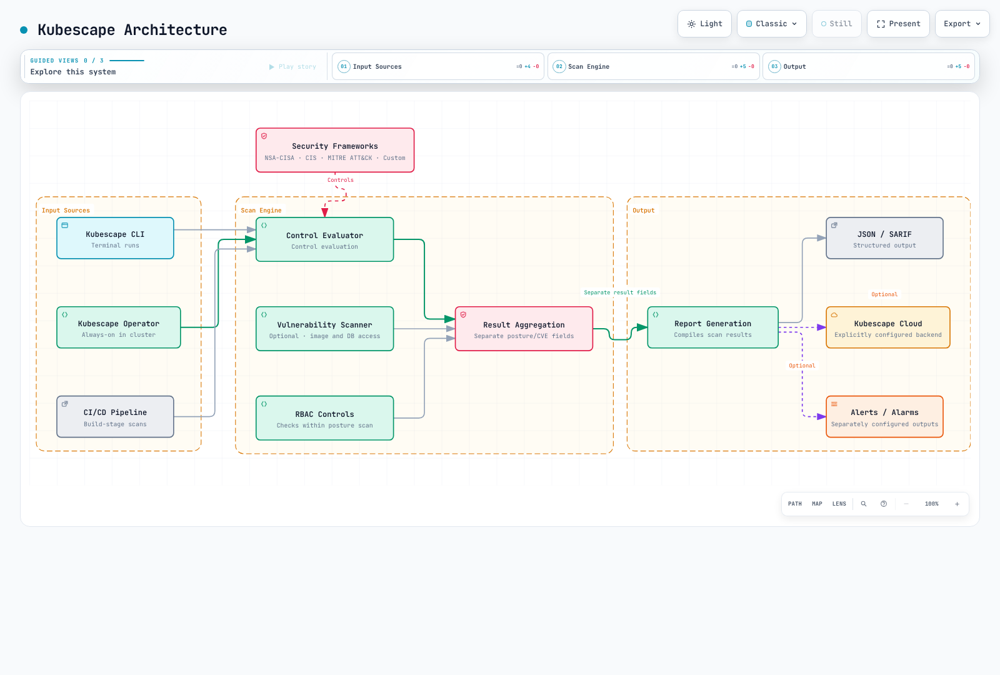
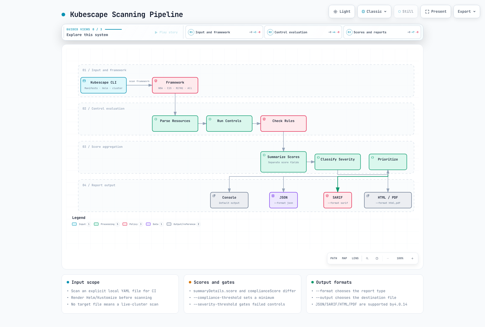
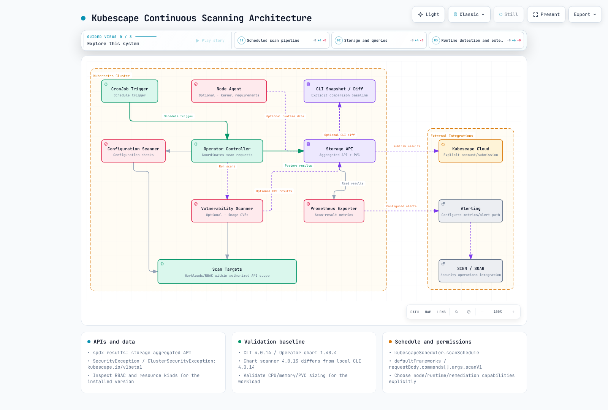
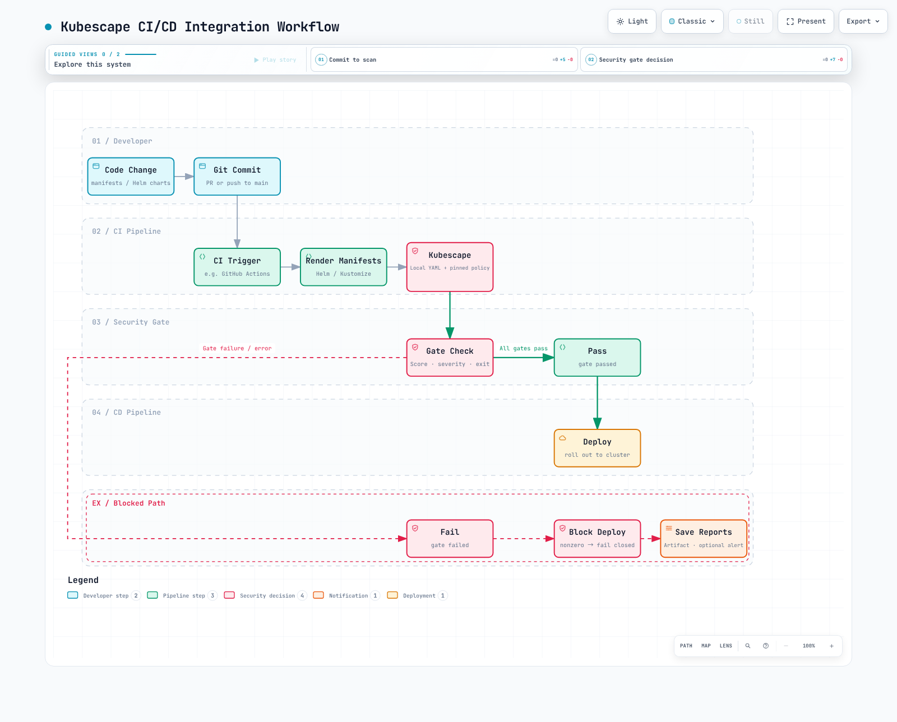
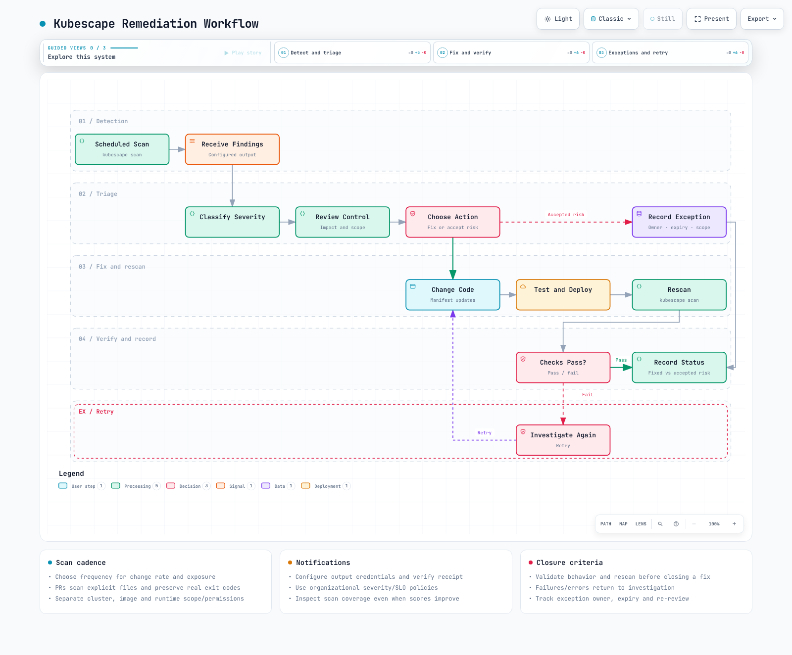

# 使用 Kubescape 进行安全态势管理

> **最后更新**：October 16, 2026
> **验证基线**：CLI 4.0.16 和 Operator chart 1.40.4。该 chart 的扫描器镜像为 4.0.13，与 CLI 分开。策略哈希记录在示例目录中。

Kubescape 会评估 Kubernetes 配置以及选定的镜像/运行时数据。**扫描通过并不意味着安全得到保证或获得合规认证；必须单独标明不可用的覆盖范围**。本指南已使用本地 YAML、策略包、实际 CLI 和 chart 渲染进行检查。未执行实时集群扫描、node-agent 安装、注册表镜像/数据库扫描或 SaaS 提交。

<span id="what-kubescape-solves"></span>
<span id="cncf-sandbox-project"></span>
<span id="comparison-with-similar-tools"></span>
<span id="kubescape-architecture"></span>

## 概述

Kubescape 于 2022 年 12 月 13 日加入 CNCF，并于**2025 年 1 月 13 日进入孵化阶段**。过去的 Sandbox 描述和过时的工具成熟度对比表不再是当前指南。

CLI 可执行明确指定文件或集群的扫描；Operator 则根据启用的功能提供持续/定时行为。配置控制、RBAC 分析、镜像 CVE 和运行时检测的范围各不相同。应根据有版本记录的要求，对比 kube-bench 的节点/CIS 检查、Polaris 工作负载策略和 Trivy 镜像/配置扫描，而不要泛泛宣称某个工具更优。



[查看交互式图表](https://www.atomai.click/kubernetes-docs/archmaps/en-security-11-kubescape-0.html)


<span id="linux-and-macos"></span>
<span id="windows"></span>
<span id="container-image"></span>
<span id="helm-operator-installation-in-cluster"></span>
<span id="operator-configuration-values"></span>
<span id="kubescape-cloud-saas"></span>

## 安装

### 安装 CLI

从[官方 4.0.16 发行版](https://github.com/kubescape/kubescape/releases/tag/v4.0.16)下载匹配操作系统/CPU 的资源，并验证其校验和。以下 Linux AMD64 示例固定使用经过审查的归档文件哈希；ARM64 需要使用不同的归档文件/哈希。

```bash
curl --fail --location \
  https://github.com/kubescape/kubescape/releases/download/v4.0.16/kubescape_4.0.16_linux_amd64.tar.gz \
  --output kubescape.tgz
printf '%s  %s\n' '71ed716b13487a6fa57500af6b191ee7fd51eb0b31809ea5994a696b1f36f874' kubescape.tgz | sha256sum --check
tar -xzf kubescape.tgz kubescape
./kubescape version
./kubescape scan --help
```

使用 Homebrew/Krew 或其他安装程序时，请检查实际软件包版本。将安装程序的执行和 kubeconfig 的暴露范围限制在预期范围内。省略 `kubescape scan` 的文件目标可能会扫描当前集群。

### 使用 Helm 安装 Operator

下载[示例目录](https://github.com/Atom-oh/kubernetes-docs/tree/main/examples/security/kubescape)，并在 `examples/security/kubescape` 目录下运行以下命令。该配置文件侧重于态势检查和指标，并明确禁用节点/镜像/运行时/修复功能。

```bash
helm repo add kubescape https://kubescape.github.io/helm-charts
helm repo update kubescape
helm upgrade --install kubescape kubescape/kubescape-operator \
  --version 1.40.4 --namespace kubescape --create-namespace \
  --values operator-values.yaml
```

```yaml
clusterName: documentation-cluster
defaultFrameworks:
- nsa
- mitre
capabilities:
  continuousScan: enable
  configurationScan: enable
  nodeScan: disable
  nodeSbomGeneration: disable
  vulnerabilityScan: disable
  relevancy: disable
  runtimeObservability: disable
  networkPolicyService: disable
  networkEventsStreaming: disable
  runtimeDetection: disable
  nodeProfileService: disable
  admissionController: disable
  httpDetection: disable
  seccompProfileService: disable
  prometheusExporter: enable
  riskAcceptance: disable
  remediation: disable
  manageWorkloads: disable
global:
  enableClusterWideSecretAccess: false
persistence:
  storageClass: gp3
kubescapeScheduler:
  scanSchedule: 0 8 * * *
```


请准备 gp3 StorageClass/CSI 驱动，并验证命名空间、RBAC、CRD 和聚合 API 是否可用。EKS Auto Mode 和普通 EBS CSI StorageClass 可能使用不同的 provisioner。Helm 渲染并不能证明安装、持久化或扫描成功。

credentials.cloudSecret 是现有 Secret 的名称，不是账户 ID。需要使用 SaaS 时，应明确配置并授权后端/账户/accessKey/data 范围。CLI 的 --submit 会请求提交；本地示例使用 --keep-local 和隔离缓存。启用节点/运行时功能前，应分别检查主机权限、内核/BTF 和受支持的节点类型。

<span id="nsa-cisa-kubernetes-hardening-guide"></span>
<span id="cis-kubernetes-benchmark"></span>
<span id="mitre-att-ck-framework"></span>
<span id="framework-comparison"></span>

## 安全框架

### 框架与控制项

框架名称和控制项数量取决于策略包。经审查的下载内容包含 NSA、MITRE、SOC2、ArmoBest、DevOpsBest、AllControls 以及带版本号的 CIS 框架。NSA 包含 26 个控制项，但并非所有控制项都适用于本地 Pod。

```bash
kubescape list frameworks
kubescape list controls --framework NSA
kubescape list controls --framework NSA --search container
```

经审查的策略包中的示例名称包括 cis-v1.12.0 和 cis-eks-t1.8.0。不要假设 cis-v1.23 或 cis 是通用别名。策略更新会改变覆盖范围/评分；请同时记录二进制版本和策略哈希。

| 控制项 ID | 经审查策略包中的名称 |
|---|---|
| C-0004 | 资源内存限制和请求 |
| C-0009 | 资源限制 |
| C-0013 | 非 root 容器 |
| C-0016 | 允许权限提升 |
| C-0034 | 自动挂载 ServiceAccount |
| C-0035 | 管理角色 |
| C-0036 | 验证准入控制器（验证型） |
| C-0039 | 验证准入控制器（变更型） |
| C-0057 | 特权容器 |

C-0036/0039 并不是通配符 RBAC/高风险 ServiceAccount 控制项。严重性也取决于策略包：经审查的 C-0057 属于 High，并非在所有情况下都是 Critical。

### 自定义框架

--use-from 会加载本地策略对象。仅有 YAML 名称和未解析控制项 ID 列表，并不一定构成可执行框架。示例 policies/nsa.json 是经过测试的策略包，其中包含许可证、来源信息和 SHA 记录。请使用当前 CLI 功能（例如 kubescape policy init 和 kubescape policy test）编写/测试新的 Rego 控制项，然后根据组织要求进行审查。

<span id="scanning-pipeline-flow"></span>
<span id="cluster-scanning"></span>
<span id="specific-control-scanning"></span>
<span id="yaml-and-helm-manifest-scanning-shift-left"></span>
<span id="image-vulnerability-scanning"></span>
<span id="rbac-visualization-and-analysis"></span>

## CLI 扫描



[查看交互式图表](https://www.atomai.click/kubernetes-docs/archmaps/en-security-11-kubescape-1.html)


### 集群输入与本地输入

```bash
# This accesses the current cluster; check authorization and scope first.
kubescape scan framework nsa --include-namespaces production
# Explicit local-file scan:
kubescape scan framework nsa secure-pod.yaml \
  --use-from policies/nsa.json --controls-config policies/controls-inputs.json \
  --exceptions no-exceptions.json --keep-local \
  --format json --output report.json
```

--format/-f 用于选择格式；--output/-o 用于指定文件。`-o json > report.json` 并不会选择 JSON 输出格式。4.0.16 版支持 JSON/SARIF/HTML/PDF/JUnit/gitlab-sast 等格式；请选择接收工具所需的格式。

请先在本地渲染 Helm/Kustomize，使生效的值明确可见。本地检查无法复现 API 默认值设置、准入控制、IAM 授权或网络行为。经审查的 CLI 不识别 --include-api-audit、--custom-framework 和 --sort-by。不要将 scan rbac 描述为当前独立子命令。

### 实际本地结果

insecure-pod.yaml 是**合成扫描测试样例，不是部署配置**。它使用实际存在的 privileged/runAsUser 字段，而不是不存在的 runAsRoot。secure-pod.yaml 也仅用于展示配置；任何实际部署前都应替换其中的应用镜像。

| 本地输入 | 合规度 | 得分 | 结果 |
|---|---:|---:|---|
| 不安全的 Pod | 55 | 62.5 | 存在高严重性失败项 |
| 安全的 Pod | 95 | 6.818182 | 通过 High 阈值；并非所有控制项都通过 |

这些数值适用于所附策略快照和单个本地 Pod。它们不能衡量集群安全性或可利用性。

### 镜像与 RBAC 分析

使用 kubescape scan image IMAGE 明确请求镜像扫描。CLI 4.0.16 在其源代码依赖中使用 Grype 0.104.1 和 Syft 1.42.3；Operator 的 kubevuln 组件版本则单独管理。请验证注册表凭据、平台、数据库新鲜度和扫描错误。主机扫描不同于镜像扫描，并且可能需要额外的主机访问权限/资源创建。

RBAC 控制项会在获授权的 API 范围内评估收集到的 Role/Binding。RoleBinding 授予的是其命名空间内的访问权限，并非所有命名空间。静态分析本身不能确定未使用的权限、外部 IAM 授权或所有有效访问路径。

<span id="continuous-scanning-architecture"></span>
<span id="operator-components"></span>
<span id="scheduled-scanning-configuration"></span>
<span id="vulnerability-scanning-integration"></span>
<span id="runtime-threat-detection-node-agent-with-ebpf"></span>
<span id="kubernetes-api-attack-detection"></span>

## Operator 模式（集群内）



[查看交互式图表](https://www.atomai.click/kubernetes-docs/archmaps/en-security-11-kubescape-2.html)


请使用 chart 的 kubescapeScheduler.scanSchedule 和 requestBody.commands[].args.scanV1 字段。defaultFrameworks 为未指定目标的请求提供默认值；显式指定的 targetNames 优先。任意 ConfigMap 中包含 scanSchedule，并不能证明有控制器会读取它。

spdx.softwarecomposition.kubescape.io/v1beta1 结果由存储组件的**聚合 API**提供，而不是全部作为普通 CRD 提供。单独的 CRD 包括 SecurityException、ClusterSecurityException 和 OperatorCommand。查询结果前，请先发现实际名称/范围。

```bash
kubectl get apiservices v1beta1.spdx.softwarecomposition.kubescape.io
kubectl api-resources --api-group=spdx.softwarecomposition.kubescape.io
kubectl get pods,pvc -n kubescape
```

不要将旧版 ScanSchedule、VulnerabilityScanConfig、ThreatDetectionConfig、AcceptedRisk 和 ScanConfiguration 示例描述为此 chart 安装的 API。节点代理配置文件/检测必须使用所选镜像实际支持的 API/功能。启用配置并不能证明所有节点上的数据收集或检测运行正常。

<span id="risk-score-calculation"></span>
<span id="severity-levels"></span>
<span id="viewing-risk-scores"></span>
<span id="prioritization-strategy"></span>

## 风险评分

summaryDetails.complianceScore 和 summaryDetails.score 是不同的汇总值。合规度越高，表示通过的检查越多；风险评分既不等于该值，也不等于 100-合规度。不要把臆造的严重性权重或响应 SLA 当作 Kubescape 的通用公式。

```bash
jq '{compliance: .summaryDetails.complianceScore, risk: .summaryDetails.score,
     failed: [.summaryDetails.controls[] | select(.status == "failed") | {controlID, name, severity}]}' report.json
```

--compliance-threshold 表示**最低合规度分数**，--severity-threshold 用于失败控制项的严重性阈值。本地分数为 55 时，阈值设为 55 会返回退出码 0，设为 56 则返回退出码 1。--min-severity 会筛选输出，但不会取代当前的门禁计算。

**4.0.16 版接受 --fail-threshold 作为弃用的兼容性标志，但会忽略其值**。测试中，仅提供 --fail-threshold 0 时，即使存在失败项也返回退出码 0。请区分此无效标志与仍会处理的选项（如 --scan-images/--skip-controls）以及真正未知的标志。

<span id="ci-cd-integration-workflow"></span>
<span id="github-actions-workflow"></span>
<span id="gitlab-ci-cd-integration"></span>
<span id="jenkins-pipeline-integration"></span>
<span id="threshold-based-gates"></span>

<span id="cicd-integration"></span>

## CI/CD 集成



[查看交互式图表](https://www.atomai.click/kubernetes-docs/archmaps/en-security-11-kubescape-3.html)


### 通用安全门禁

```bash
#!/usr/bin/env bash
# Scan explicit local manifests with an isolated Kubernetes/client configuration.
set -euo pipefail
if [[ $# -ne 2 ]]; then
  printf 'Usage: %s LOCAL_MANIFEST OUTPUT_JSON\n' "$0" >&2
  exit 2
fi
manifest_path=$1
report_path=$2
if [[ ! -f $manifest_path ]]; then
  printf 'Expected an existing local manifest file: %s\n' "$manifest_path" >&2
  exit 2
fi
# An absolute operand cannot be parsed as a flag such as --help.
manifest_path="$(cd -- "$(dirname -- "$manifest_path")" && pwd)/$(basename -- "$manifest_path")"
script_dir=$(cd -- "$(dirname -- "${BASH_SOURCE[0]}")" && pwd)
: "${KUBESCAPE_BIN:=kubescape}"
: "${COMPLIANCE_MINIMUM:=90}"
: "${SEVERITY_LIMIT:=high}"
umask 077
scan_temp_dir=$(mktemp -d "${TMPDIR:-/tmp}/kubescape-local.XXXXXX")
trap 'rm -rf -- "$scan_temp_dir"' EXIT
mkdir -- "$scan_temp_dir/cache"
cat > "$scan_temp_dir/kubeconfig" <<'YAML'
apiVersion: v1
kind: Config
clusters: []
contexts: []
users: []
current-context: ''
YAML
# Block inherited in-cluster discovery as well as kubeconfig and cached backend state.
env -u KUBERNETES_SERVICE_HOST -u KUBERNETES_SERVICE_PORT -u KUBERNETES_PORT -u KUBERNETES_MASTER \
  KUBECONFIG="$scan_temp_dir/kubeconfig" KS_CACHE_DIR="$scan_temp_dir/cache" \
  "$KUBESCAPE_BIN" --cache-dir "$scan_temp_dir/cache" scan framework nsa "$manifest_path" \
  --kubeconfig "$scan_temp_dir/kubeconfig" --host-scan=false \
  --use-from "$script_dir/policies/nsa.json" \
  --controls-config "$script_dir/policies/controls-inputs.json" \
  --exceptions "$script_dir/no-exceptions.json" \
  --honor-inline-exceptions=false \
  --keep-local \
  --compliance-threshold "$COMPLIANCE_MINIMUM" \
  --severity-threshold "$SEVERITY_LIMIT" \
  --format json --output "$report_path"
```


此 CI 门禁会忽略跳过控制项的注解，使用空 kubeconfig 和全新缓存，并清除继承的集群内发现配置。仅使用 --keep-local 并不能阻止访问 Kubernetes API。使用不可信的 loopback API 上下文进行的五项原生测试均未产生请求，并返回了预期的失败/成功代码。

输入缺失、扫描错误和未通过阈值都会返回非零退出码。不要使用 continue-on-error 或 `|| true` 隐藏这些错误。即使失败，也可以上传报告，但上传结果不决定任务是否成功。排除控制项会改变评估分母，必须记录。

### GitHub Actions

[经过验证的工作流](https://github.com/Atom-oh/kubernetes-docs/blob/main/examples/security/kubescape/github-actions.yaml)固定了二进制文件/校验和，并且只使用本地策略快照扫描 k8s/rendered.yaml。项目必须先生成该文件；文件缺失会导致任务失败。权限为 contents:read，不会发表评论或提交到 SaaS。

### GitLab 和 Jenkins

这两种系统都可以保留同一 scan-manifests.sh 的退出码并存档报告。通用 Kubescape JSON 并不符合 GitLab SAST 或 Code Quality 架构。若要生成集成式 SAST 报告，请根据接收方版本验证当前的 --format gitlab-sast 输出。Jenkins 的 readJSON/publishHTML 需要插件；不要发布流水线从未生成过的 HTML 文件。

<span id="eks-specific-controls"></span>
<span id="aws-auth-configmap-analysis"></span>
<span id="irsa-iam-roles-for-service-accounts-validation"></span>
<span id="eks-security-best-practices-scan"></span>

## EKS 专项指南

Kubernetes 清单扫描无法全面验证 EKS 控制平面配置、IAM、访问条目、Pod Identity/IRSA 或节点策略。aws-auth 是旧版身份验证路径；请检查当前身份验证模式和访问条目。system:masters 或紧急 IAM 用户都不是最小权限示例。

C-0034 检查的是 ServiceAccount 令牌自动挂载，而非完整的 IRSA 信任/aud/sub/IAM 策略。应区分投射的 STS 令牌与自动挂载的 Kubernetes API 令牌。请单独验证实际工作负载身份及其获准执行的 AWS 操作。

启用主机扫描和修复功能前，请审查相关权限和变更操作。示例禁用了集群范围的 Secret 访问和修复，但操作人员仍必须检查安装所需的扫描器/Operator/存储 RBAC。

<span id="exception-policies"></span>
<span id="applying-exceptions-via-cli"></span>
<span id="accepted-risks-documentation"></span>
<span id="inline-resource-exceptions"></span>

## 控制项例外处理

### CLI 例外

```json
[
  {
    "name": "documentation-privileged-exception",
    "policyType": "postureExceptionPolicy",
    "actions": [
      "alertOnly"
    ],
    "resources": [
      {
        "designatorType": "Attributes",
        "attributes": {
          "namespace": "demo-app",
          "kind": "Pod",
          "name": "insecure-example"
        }
      }
    ],
    "posturePolicies": [
      {
        "controlID": "C-0057"
      }
    ]
  }
]
```


这是由 CLI 使用的**JSON 数组**，不是 ConfigMap 包装对象。经过测试的 alertOnly 例外会将 C-0057 标记为已确认，同时保留失败状态和 55 的合规度。--exclude-controls C-0057 会从评估中移除该控制项，从而改变分母和评分。例外并不等于修复。

### 集群内例外

```yaml
apiVersion: kubescape.io/v1beta1
kind: SecurityException
metadata:
  name: documentation-privileged-exception
  namespace: demo-app
spec:
  author: documentation-security-team
  reason: Synthetic scan example; replace with an approved owner and justification.
  expiresAt: '2026-09-30T00:00:00Z'
  match:
    resources:
      - apiGroup: ''
        kind: Pod
        name: insecure-example
  posture:
    - controlID: C-0057
      action: alert_only
```


当前 API 为 kubescape.io/v1beta1 SecurityException/ClusterSecurityException。请根据已批准的策略设置命名空间范围、匹配条件、态势操作、到期时间和负责人。通过架构验证并不能证明控制器会执行、RBAC 已就绪或 CEL 行为符合预期。CLI 的 alertOnly 与 CRD 的 alert_only 不同。不要依赖臆造的 ignore 注解来处理例外。

<span id="periodic-scanning-schedule"></span>
<span id="scanning-configuration"></span>
<span id="compliance-reporting"></span>
<span id="remediation-workflow"></span>
<span id="integration-with-other-security-tools"></span>
<span id="prometheus-metrics-integration"></span>

## 最佳实践



[查看交互式图表](https://www.atomai.click/kubernetes-docs/archmaps/en-security-11-kubescape-4.html)


请记录扫描范围、通过/失败/不可用的检查项、策略哈希、工具镜像、例外负责人和到期日期。仅在输入/策略相同的情况下比较评分。节点扫描、镜像扫描和运行时检测是不同的证据来源。

### Prometheus 集成

```yaml
apiVersion: monitoring.coreos.com/v1
kind: PodMonitor
metadata:
  name: kubescape-posture
  namespace: monitoring
spec:
  namespaceSelector:
    matchNames: [kubescape]
  selector:
    matchLabels:
      app.kubernetes.io/name: kubescape-operator
      app.kubernetes.io/instance: kubescape
      app.kubernetes.io/component: prometheus-exporter
  podMetricsEndpoints:
    - port: metrics
      path: /metrics
      interval: 60s
```


经审查的 exporter Pod 将容器端口 8080 命名为 metrics，而其 Service 端口未命名。因此，此示例使用 PodMonitor 匹配实际的 Pod 标签和命名端口。Prometheus Operator 与 Prometheus 对 PodMonitor 的选择是两个独立的前提条件。

实际 exporter 0.2.23 的 gauge 示例为 kubescape_controls_total_cluster_high 和 kubescape_controls_total_workload_high。名称带有 _total 后缀并不意味着它们是 counter。旧版 kubescape_compliance_score/critical_findings/last_scan_timestamp 这些名称并非已确认的通用指标。请单独监控抓取缺失和数据过期。

<span id="table-of-contents"></span>
<span id="key-takeaways"></span>
<span id="quick-reference-commands"></span>
<span id="references"></span>
<span id="related-documentation"></span>

## 总结与参考资料

本地验证涵盖二进制文件/校验和、策略快照、阈值边界/严重性/已弃用门禁、例外/排除行为、已发布的 shell 门禁、Helm 渲染、SecurityException 架构、PodMonitor 定位、GitHub Actions 语法和三十种图表浏览器情况。未执行任何真实的 AWS/Kubernetes/注册表/通知/SaaS 操作。

- [CNCF Kubescape 历史](https://www.cncf.io/projects/kubescape/)
- [Kubescape 文档](https://kubescape.io/docs/)
- [框架与控制项](https://kubescape.io/docs/frameworks-and-controls/)
- [Operator 文档](https://kubescape.io/docs/operator/)
- [CLI 4.0.16](https://github.com/kubescape/kubescape/releases/tag/v4.0.16)
- [固定版本的 CLI 标志](https://github.com/kubescape/kubescape/blob/v4.0.16/cmd/scan/scan.go)
- [Operator chart 1.40.4](https://github.com/kubescape/helm-charts/releases/tag/kubescape-operator-1.40.4)
- [策略库](https://github.com/kubescape/regolibrary)
- [Exporter 指标 0.2.23](https://github.com/kubescape/prometheus-exporter/blob/v0.2.23/metrics/metrics.go)
- [运行时安全](./08-runtime-security.md)
- [EKS 安全实践](./06-eks-security-best-practices.md)
