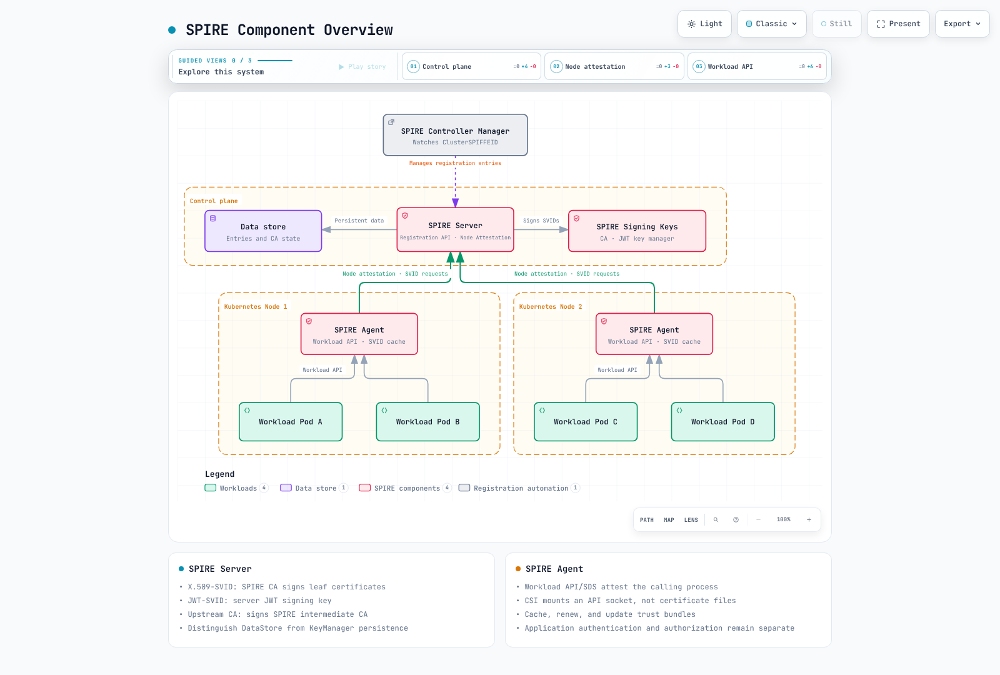
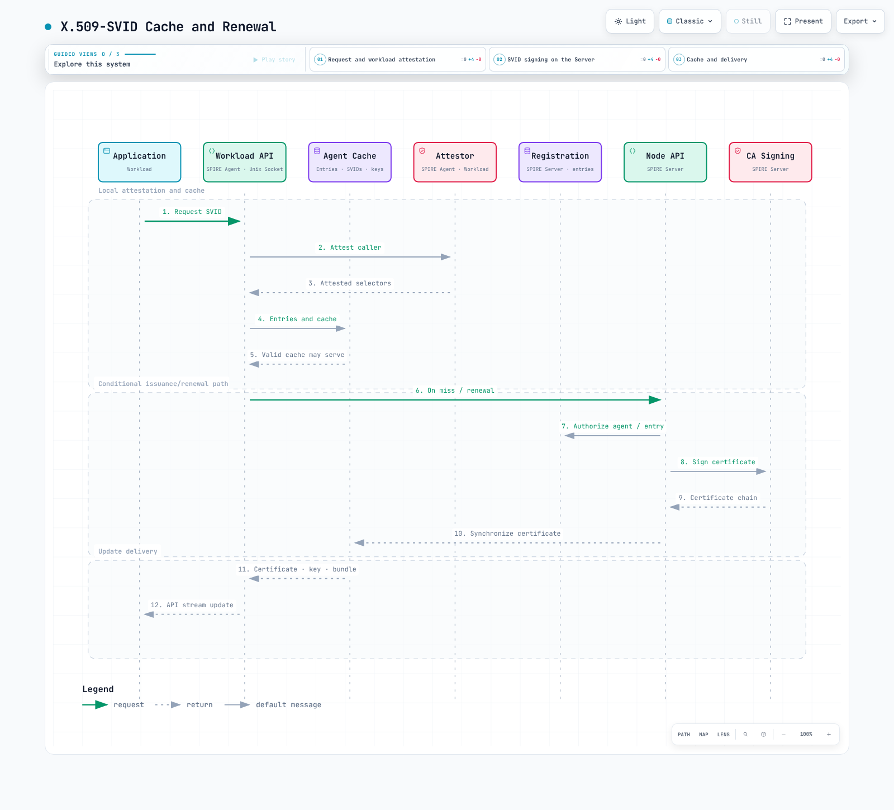
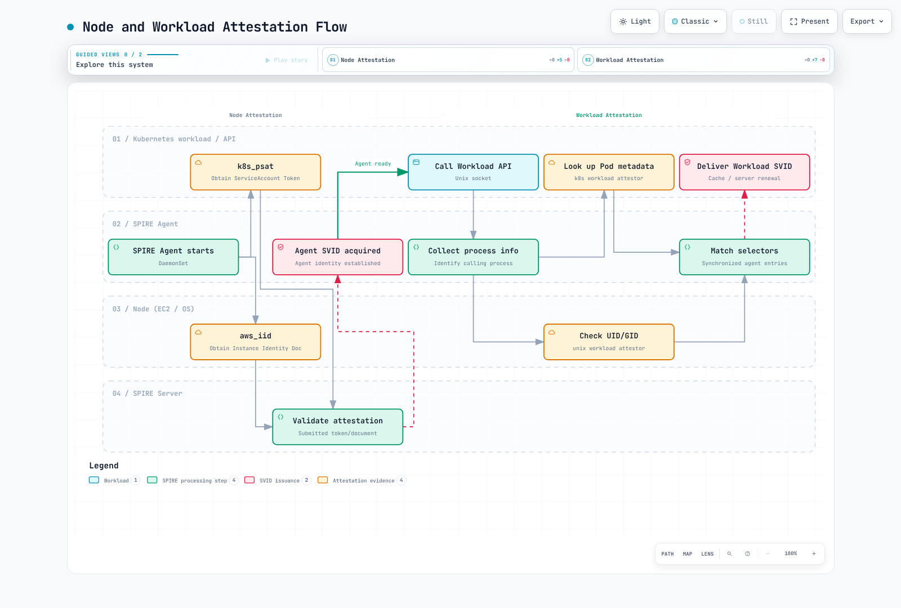
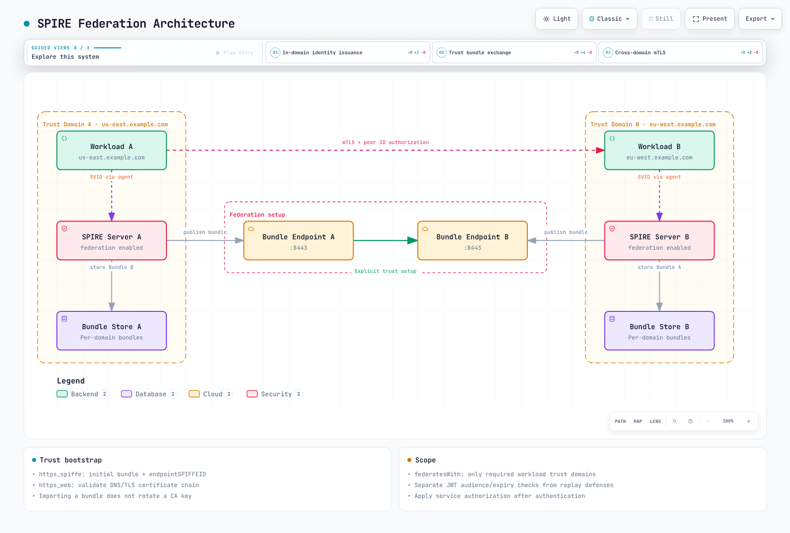

# 使用 SPIFFE/SPIRE 实现工作负载身份

> **最后更新**：October 16, 2026
> **验证基线**：SPIRE 1.15.3、hardened chart 0.30.2 / CRD chart 0.6.1、Controller Manager 0.7.0、chart CSI image 0.2.7（也对照当前 CSI 0.2.13 文档进行了检查）、go-spiffe 2.8.1。请单独检查 chart 渲染出的镜像版本。

SPIFFE 定义工作负载身份、凭证、交付和信任格式；SPIRE 则负责实现这些格式。**签发身份不会自动加密流量或授权服务访问。**本指南验证本地配置、架构、库、chart 和图表。未执行实时集群、AWS CA、SPIRE 证明或网格安装。

## 概述

SPIFFE 和 SPIRE 是 CNCF 毕业项目。它们各自的 CNCF 项目页面记录的毕业日期分别为 2022 年 8 月 23 日和 8 月 22 日。项目成熟度与对单个部署的验证是两回事。

稳定身份有助于应对 IP/Pod 的变化，但应用仍需使用 Workload API 客户端、SDK、代理或显式文件适配器。“每个工作负载都无需更改应用”并非普遍保证。本章侧重于 SPIRE 的 X.509/JWT 路径；单独发布的**孵化中的 WIT-SVID 规范**并不意味着每种部署都支持它。

<span id="svid-spiffe-verifiable-identity-document"></span>
<span id="x-509-svid-vs-jwt-svid-comparison"></span>
<span id="trust-bundle"></span>
<span id="trust-domain"></span>

## 核心概念

### SPIFFE ID

```text
spiffe://example.org/ns/payments/sa/payment-processor
```

ID 包含 scheme、信任域和可选路径。不允许查询、片段、端口、点段和经过百分号编码的路径组件。类似 DNS 的稳定信任域名称很有用，但不必能通过 DNS 解析。IPv4 形式或纯数字名称并非一概无效；应区分语法规则与命名建议。

### SVID 与验证

| 关注点 | X.509-SVID | JWT-SVID |
|---|---|---|
| 身份 | 叶证书中的 SPIFFE URI SAN | sub |
| 验证 | 证书链、有效期、SVID 规则、信任域 | 签名、主题、受众、过期时间 |
| 用途 | TLS 客户端/服务器身份验证 | 接受承载令牌的 API |
| 密钥 | 工作负载/代理私钥路径 | 签发方保留签名私钥 |
| 有效期 | 策略和实际签发情况 | 策略和实际令牌 exp |

CN 并非 SPIFFE 身份。本地 go-spiffe 测试拒绝了仅含 CN、包含多个 SPIFFE URI、已过期以及信任域错误的情况。受众验证可以限制接收方，但不能检测重放：同一个有效承载令牌再次通过了验证。应根据需要采用适当的 TLS/令牌使用策略和重放防护。

信任包包含 X.509 权威机构、JWT 验证密钥和元数据。PEM、SPIFFE bundle JSON 和任意 YAML 不能互换。公共 bundle 不得包含工作负载或 CA 私钥。

<span id="spire-server"></span>
<span id="spire-agent"></span>
<span id="svid-issuance-flow"></span>

## SPIRE 架构



[查看交互式图表](https://www.atomai.click/kubernetes-docs/archmaps/en-security-12-spiffe-spire-0.html)


服务器负责管理 Agent 证明、注册以及 X.509/JWT 签名。DataStore 和 KeyManager 承担不同的持久化职责。AWS Private CA 等 UpstreamAuthority 会为 SPIRE 中间 CA 签名；它不会取代每一次工作负载叶证书签名操作。

Agent 会对调用其 API 的进程进行证明，并使用同步的条目/SVID 缓存。缓存有效时，不需要每次 API 请求都向服务器重新申请签发。使用方必须通过流、SDK 或代理来采用更新后的凭证。



[查看交互式图表](https://www.atomai.click/kubernetes-docs/archmaps/en-security-12-spiffe-spire-1.html)


<span id="prerequisites"></span>
<span id="helm-installation-recommended"></span>
<span id="namespace-layout"></span>
<span id="high-availability-configuration"></span>
<span id="verify-installation"></span>

## 安装

下载[示例目录](https://github.com/Atom-oh/kubernetes-docs/tree/main/examples/security/spiffe)，并在 `examples/security/spiffe` 目录中操作。请检查 hostPath/CSI/内核/kubelet 要求。不能假定这些 DaemonSet 能在无法提供所需访问权限的主机（如 Fargate）上运行。

```bash
helm repo add spiffe https://spiffe.github.io/helm-charts-hardened
helm repo update spiffe
helm upgrade --install spire-crds spiffe/spire-crds \
  --version 0.6.1 --namespace spire-system --create-namespace
helm upgrade --install spire spiffe/spire \
  --version 0.30.2 --namespace spire-system --values lab-values.yaml
```

### 单服务器实验环境

```yaml
global:
  spire:
    trustDomain: example.org
    clusterName: documentation
    caSubject:
      organization: Documentation Lab
      country: KR
    namespaces:
      server:
        name: spire-system
      system:
        name: spire-system
  installAndUpgradeHooks:
    enabled: false
  deleteHooks:
    enabled: false
spire-server:
  replicaCount: 1
  controllerManager:
    enabled: true
    identities:
      clusterSPIFFEIDs:
        default:
          enabled: false
        oidc-discovery-provider:
          enabled: false
        test-keys:
          enabled: false
  externalControllerManagers:
    enabled: false
  persistence:
    enabled: true
    size: 1Gi
spire-agent:
  workloadAttestors:
    k8s:
      verification:
        type: apiServerCA
    unix:
      enabled: true
spiffe-oidc-discovery-provider:
  enabled: false
spiffe-csi-driver:
  enabled: true
```


这是一个使用 SQLite 的单服务器实验环境。默认、测试和未使用的 OIDC 身份均已禁用；由单独的 ClusterSPIFFEID 选择工作负载。chart 默认跳过 kubelet 验证，因此这里显式设置了 apiServerCA。这一设置假定实际的 kubelet 服务证书可由该 CA 验证；对于其他 PKI，应使用适当的 CA/主机证书方法，而不是禁用验证。

此配置中禁用了安装/删除钩子；请另行执行所需的迁移/清理操作。渲染结果包含一个带有 Controller Manager sidecar 的 Server StatefulSet，以及 Agent 和 CSI DaemonSet。请确认对应 release 的资源名称、标签和套接字路径。

### 高可用性

[ha-values.yaml](https://github.com/Atom-oh/kubernetes-docs/blob/main/examples/security/spiffe/ha-values.yaml) 使用三个副本、共享 PostgreSQL、已存在的密码 Secret、使用已挂载 CA 的 verify-full TLS，以及与实际 Pod 标签匹配的反亲和性。三个各自独立的 SQLite 副本并不是共享的高可用数据存储。

请先准备 PostgreSQL/DNS、CA ConfigMap、`spire-database` Secret 的 `password` 键、StorageClass 和网络连接。该示例通过 `extraEnv.valueFrom.secretKeyRef` 使用 `PGPASSWORD` 传递原始密码。它禁用了 chart 的 `dataStore.sql.externalSecret` 插值，并将 `password` 留空，因此生成的连接字符串不包含密码。SPIRE 的 PostgreSQL 驱动会单独读取 `PGPASSWORD`：引号、反斜杠、空格和美元符号不会进入 JSON/DSN 解析器。不要对实际密码预先转义或进行 URI 编码。

原生 SPIRE 1.15.3 配置和 lib/pq 1.12.3 解析检查覆盖了六种合成密码情况，同时保留 `sslmode=verify-full` 和 CA 路径。这些检查没有连接 PostgreSQL，也没有测试故障转移。通过环境变量传入的 Secret 变更需要重启服务器 Pod；应将数据库密码轮换与重启协调进行，并验证服务可用性。高可用还需要密钥持久化、备份、bundle 轮换和恢复测试。

<span id="attestation-flow"></span>
<span id="kubernetes-psat-projected-service-account-token"></span>
<span id="aws-instance-identity-document-iid"></span>
<span id="join-token-bootstrap"></span>
<span id="node-attestor-comparison"></span>

## 节点证明



[查看交互式图表](https://www.atomai.click/kubernetes-docs/archmaps/en-security-12-spiffe-spire-2.html)


k8s_psat 会通过 **Kubernetes TokenReview** 验证 Agent 的投射 ServiceAccount 令牌，然后检查 namespace/SA/Pod/node 数据。这不是 IRSA 使用的 IAM OIDC-provider 流程。请确保逻辑集群名称、令牌 audience、SA 允许列表和 TokenReview 权限相匹配。

默认的 Agent ID 格式为 `spiffe://TRUST_DOMAIN/spire/agent/k8s_psat/CLUSTER/NODE_UID`；当前版本也提供 Pod UID 模式。请先查明已注册的 Agent/别名 ID，而不是自行编造 parentIDs。token generate、entry create 和 bundle set 会修改实际状态。

aws_iid 是使用 EC2 实例身份的另一种方案。它并非在所有情况下都比 PSAT 更安全，也不限于非 EKS 环境。请检查 skip_block_device、本地验证假设、允许的账户和其他选择器。不要将静态 AWS 凭证放入 ConfigMap。

<span id="kubernetes-workload-attestor"></span>
<span id="registration-entry-examples"></span>
<span id="unix-workload-attestor"></span>

## 工作负载证明

Agent 使用调用方 PID/cgroups 和 kubelet 信息。不要默认使用不安全的 kubelet 端口 10255，也不要设置 skip_kubelet_verification=true。安全身份验证、正确的服务 CA 和网络访问都是前提条件。

常见选择器包括 k8s:ns、k8s:sa、k8s:pod-label、k8s:pod-uid 和 k8s:container-name/image。container-image 反映 Kubernetes 报告的标签/摘要；nginx:* 不是 glob 选择器。标签字符串并不等同于供应链验证。必要时应另行使用适当的摘要/签名证明。

能够更改 namespace/Pod 标签，或使用某个 ServiceAccount 创建 Pod 的主体，可能会影响身份资格。应同时管理 namespace/SA/Pod 的创建权限和身份策略的所有权。Unix UID/GID/path/hash 选择器也取决于插件配置和威胁模型。

<span id="spiffe-csi-driver"></span>
<span id="spire-controller-manager"></span>
<span id="envoy-sds-integration"></span>

## Kubernetes 集成

### CSI 挂载 API 套接字

chart 中的 SPIFFE CSI 0.2.7 和当前的 0.2.13 实现会挂载一个**包含 Workload API Unix 套接字的目录**。它不会自动创建 svid.pem、svid.key 或 bundle.pem 文件。基于文件的应用需要单独的适配器，并处理续期/重新加载。

```yaml
apiVersion: v1
kind: Namespace
metadata:
  name: payments
  labels:
    spiffe-enabled: 'true'
---
apiVersion: v1
kind: ServiceAccount
metadata:
  name: payment-processor
  namespace: payments
---
apiVersion: spire.spiffe.io/v1alpha1
kind: ClusterSPIFFEID
metadata:
  name: payments-workload
spec:
  spiffeIDTemplate: spiffe://{{ .TrustDomain }}/ns/{{ .PodMeta.Namespace }}/sa/{{
    .PodSpec.ServiceAccountName }}
  namespaceSelector:
    matchLabels:
      spiffe-enabled: 'true'
  podSelector:
    matchLabels:
      spiffe-managed: 'true'
  workloadSelectorTemplates:
  - k8s:ns:{{ .PodMeta.Namespace }}
  - k8s:sa:{{ .PodSpec.ServiceAccountName }}
  - k8s:container-name:app
  ttl: 1h
  jwtTtl: 5m
---
apiVersion: v1
kind: Pod
metadata:
  name: payment-processor
  namespace: payments
  labels:
    spiffe-managed: 'true'
spec:
  serviceAccountName: payment-processor
  containers:
  - name: app
    image: registry.example.com/team/payment-app:REPLACE_WITH_APPROVED_VERSION
    env:
    - name: SPIFFE_ENDPOINT_SOCKET
      value: unix:///spiffe-workload-api/spire-agent.sock
    volumeMounts:
    - name: spiffe-workload-api
      mountPath: /spiffe-workload-api
      readOnly: true
  volumes:
  - name: spiffe-workload-api
    csi:
      driver: csi.spiffe.io
      readOnly: true
```


请将应用镜像替换为实际的 Workload API 使用方。注意区分 chart 身份的 jwtTTL 和 CRD 的 jwtTtl。显式选择器针对 app 容器；单独的 Envoy 容器需要匹配的代理注册策略。

### Envoy SDS

[完整的启动配置示例](https://github.com/Atom-oh/kubernetes-docs/blob/main/examples/security/spiffe/envoy.yaml)包含 HTTP 过滤器、SDS 集群、require_client_certificate:true，以及精确的允许对端 URI 匹配器。Envoy 进程必须能够通过证明，且必须注册所命名的服务器/客户端身份。

SDS 与 Workload API 共用公开的 Agent 套接字。证书资源名称使用工作负载 SPIFFE ID 或 default；验证上下文使用信任域 ID 或 ROOTCA/ALL。请检查 SPIFFE 证书验证器支持情况，尤其是 ALL。已验证协议架构和 URI 匹配器实现；未运行真实的 Envoy/SDS/mTLS 握手。

<span id="istio-spire-integration"></span>
<span id="cilium-spire-mutual-authentication"></span>
<span id="linkerd-identity-trust-anchors"></span>

## 服务网格集成

### Istio

不要将 Istio 的 CA 地址指向 SPIRE Server 端口 8081，也不要使用虚构的 ENABLE_SPIFFE_IDENTITY/PILOT_ENABLE_SPIRE_INTEGRATION 变量。当前的[官方集成](https://istio.io/latest/docs/ops/integrations/spire/)会配置 CSI 套接字挂载、SPIRE 注册以及 sidecar/gateway 模板。

使用原生 sidecar 时，istio-proxy 是一个 initContainer，必须在该处进行补丁修改。显式禁用原生 sidecar 模式时则使用 containers。请验证已安装的版本、模板、套接字和就绪状态；不要用不完整的片段替换完整的 injector ConfigMap。

### Cilium

Cilium 1.20.3 的双向身份验证为**测试版，且独立于普通连接带外运行**。流量加密需要单独配置 WireGuard/IPsec。任意包含 SPIFFE ID 的标签都不是经过身份验证的身份策略。

官方设置使用 authentication.mutual.spire.enabled；对于其捆绑安装，还需设置 authentication.mutual.spire.install.enabled。请区分捆绑式和外部 SPIRE 配置，并参阅[固定版本的安装源代码](https://github.com/cilium/cilium/blob/v1.20.3/Documentation/network/servicemesh/mutual-authentication/installation.rst)。Endpoint 选择器/身份验证模式、身份签发和加密各自承担不同职责。

### Linkerd

不要将 SPIRE bundle JSON 传给需要 PEM 根证书的 Linkerd，也不要将 SPIRE CA 私钥复制为签发方密钥。Linkerd 需要适当的签发方证书/密钥和受信任根证书，并需要续期和根证书轮换机制。请参阅[已审核的 cert-manager/Linkerd 路径](./10-cert-manager.md#linkerd-and-trust-manager)。仅共享根信任并不能集成 SPIFFE Workload API 或 SDS。

<span id="federation-trust-establishment"></span>
<span id="configuring-federation"></span>
<span id="federated-registration-entries"></span>
<span id="multi-cloud-federation-example"></span>

## 联邦



[查看交互式图表](https://www.atomai.click/kubernetes-docs/archmaps/en-security-12-spiffe-spire-3.html)


请显式配置每个信任方向；联邦不会自动建立相互信任或授权。应管理 bundle 端点的连通性、TLS 验证、刷新失败、过期和轮换。

```yaml
apiVersion: spire.spiffe.io/v1alpha1
kind: ClusterFederatedTrustDomain
metadata:
  name: partner-domain
spec:
  trustDomain: partner.example.org
  bundleEndpointURL: https://bundle.partner.example.org
  bundleEndpointProfile:
    type: https_web
```


此 https_web 示例假定端点真实存在，且具有有效的 Web PKI 证书。https_spiffe 还需要 endpointSPIFFEID 和**通过经身份验证的引导路径获取的初始受信任 bundle**；仅设置 URL 并不足够。在适用的工作负载 federatesWith 列表中，使用 partner.example.org 这样的裸信任域名称。获取信任 bundle 和授权对端工作负载是两回事。

<span id="irsa-vs-spiffe-comparison"></span>
<span id="pod-identity-vs-spire"></span>
<span id="hybrid-use-cases"></span>
<span id="eks-specific-node-attestation"></span>

## EKS 集成

IRSA/Pod Identity 提供 AWS API 凭证路径；SPIFFE/SPIRE 提供工作负载身份路径。两者不能互相替代，并非每种环境都需要同时使用两者。IRSA 支持跨账户设计，并通过兼容的 SDK/投射令牌行为刷新凭证；本身并不要求重启 Pod。不要假定其有效期固定为十二小时。

请在 ServiceAccount 上配置 IRSA，并验证 aud/sub 信任和 AWS 权限。仅有 Pod 注解或 AWS_ROLE_ARN 环境变量并不足够。对于工作负载 mTLS，应用/代理必须使用 SVID，并单独授权对端身份。

### AWS Private CA

请在完整的服务器 plugins 部分中使用[固定版本的插件字段](https://github.com/spiffe/spire/blob/v1.15.3/doc/plugin_server_upstreamauthority_aws_pca.md)。这是插件片段，不是可独立运行的服务器配置。

```hcl
# Merge this plugin into an otherwise complete server configuration.
UpstreamAuthority "aws_pca" {
  plugin_data {
    region = "ap-northeast-2"
    certificate_authority_arn = "arn:aws:acm-pca:ap-northeast-2:111122223333:certificate-authority/REPLACE_CA_ID"
    ca_signing_template_arn = "arn:aws:acm-pca:::template/SubordinateCACertificate_PathLen0/V1"
  }
}
```


SPIRE 管理中间 CA 并为叶证书签名。使用[策略示例](https://github.com/Atom-oh/kubernetes-docs/blob/main/examples/security/spiffe/aws-pca-policy.json)，将 DescribeCertificateAuthority/IssueCertificate/GetCertificate 的权限限定到预期的 CA ARN。请为实际 CA 选择签名算法/模板。supplemental_bundle_path 包含额外的 PEM 权威机构，不是备用区域。请区分 aws_kms KeyManager 和 UpstreamAuthority 插件。

## 最佳实践与故障排除

应根据续期失败、时钟偏差、签发负载和离线时长调整有效期。较短的 TTL 无法解决所有撤销或 JWT 重放问题。bundle set 会更改受信任的 bundle；它不会轮换 CA 私钥。

网络策略除 Server↔Agent 流量外，还必须考虑 DNS、Kubernetes TokenReview/API、数据存储、上游 CA/KMS、联邦和遥测。一个 namespace 中的 Pod 选择器不会选择另一个 namespace 中的 Agent。在声称策略允许所有必要流量之前，请验证实际连通性。

在 Agent Pod 中运行 api fetch，证明的是调用进程，而不是应用的上下文。应在获批流程下，从预期的工作负载上下文进行诊断。日志中应限制敏感选择器、令牌和密钥的记录。

<span id="table-of-contents"></span>
<span id="the-zero-trust-identity-problem"></span>
<span id="spiffe-specification-overview"></span>
<span id="cncf-graduation-status"></span>
<span id="best-practices"></span>
<span id="trust-domain-naming"></span>
<span id="svid-ttl-tuning"></span>
<span id="high-availability-deployment"></span>
<span id="key-rotation"></span>
<span id="security-hardening"></span>
<span id="troubleshooting"></span>
<span id="common-issues"></span>
<span id="health-checks"></span>
<span id="key-takeaways"></span>
<span id="architecture-decision-guide"></span>
<span id="references"></span>

## 总结与参考资料

本地验证覆盖了服务器/Agent 配置、九个 ID 案例、五个 X.509 案例、六个 JWT 案例、实验环境/高可用 Helm、CRD/Pod 架构、Envoy protobuf 架构，以及针对八个图表的二十四个浏览器案例。未执行真实的证明、集群安装、数据库连接、AWS 签发、联邦交换或 mTLS 流量。

- [SPIFFE ID 规范](https://spiffe.io/docs/latest/spiffe-specs/spiffe-id/)
- [X.509-SVID](https://spiffe.io/docs/latest/spiffe-specs/x509-svid/)
- [JWT-SVID](https://spiffe.io/docs/latest/spiffe-specs/jwt-svid/)
- [孵化中的 WIT-SVID](https://spiffe.io/docs/latest/spiffe-specs/wit-svid/)
- [信任域和 bundle](https://spiffe.io/docs/latest/spiffe-specs/spiffe_trust_domain_and_bundle/)
- [联邦规范](https://spiffe.io/docs/latest/spiffe-specs/spiffe_federation/)
- [SPIFFE 的 CNCF 历史](https://www.cncf.io/projects/spiffe/)
- [SPIRE 的 CNCF 历史](https://www.cncf.io/projects/spire/)
- [SPIRE 1.15.3](https://github.com/spiffe/spire/releases/tag/v1.15.3)
- [SPIFFE CSI 0.2.13](https://github.com/spiffe/spiffe-csi/blob/v0.2.13/README.md)
- [Hardened Helm charts](https://github.com/spiffe/helm-charts-hardened)
- [Cilium 1.20.3 双向身份验证](https://github.com/cilium/cilium/blob/v1.20.3/Documentation/network/servicemesh/mutual-authentication/mutual-authentication.rst)
