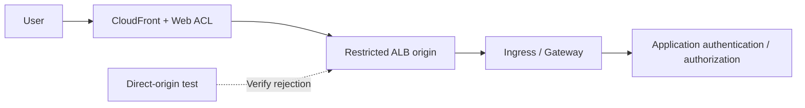

# 使用源站保护实现 WAF、边缘与 API 安全

> **审查依据**：AWS WAF、CloudFront 和 ALB 官方文档。按关联资源区分功能和检查限制。
> **最后更新**：2026 年 10 月 15 日

目标是证明受保护的请求确实经过 WAF，相关人员了解检查限制和例外情况，并且应用能安全地处理请求。下文中的应用、源站和运维标准属于设计建议。

## 1. 区分 WAF、NGFW 和应用授权

AWS WAF 会检查发往已关联的受支持资源的请求，包括 CloudFront、ALB 和 API Gateway **REST API**。不要假设 API Gateway HTTP / WebSocket API 或 NLB 也支持相同的直接关联方式。CloudFront Web ACL 使用 `CLOUDFRONT` scope 和 `us-east-1` API 端点；ALB 等区域资源则在资源所在区域使用 `REGIONAL` scope。[S09]

应区分 VM-Series / FortiGate NGFW 能力与单独的 Palo Alto / Fortinet WAF 产品。应用授权属于另一层。请在应用中检查跨客户对象访问、业务限额、重复支付处理和 LLM 工具权限。

| 流量 | 主要控制 | 仍需验证 |
|---|---|---|
| 公网 HTTP(S) | 关联到 CloudFront / ALB 的 WAF | 直接访问源站、正文限制、例外情况和应用授权 |
| 保留 TLS 的 IP 会话 | NGFW 路径和选定的解密方式 | 实际负载可见性和豁免项 |
| 内部准入 webhook | 访问限制、准入控制和 RBAC | Pod 可达性和控制器权限 |
| 上传 / gRPC / WebSocket | 受支持的路径和应用专属处理 | 初始请求之后的覆盖范围，以及文件处理 |

ingress-nginx 准入 CVE 涉及可从 Pod 网络访问的 webhook；应将其与公网 URL 的 WAF 覆盖范围分开测试。[S01]

## 2. 根据请求路径设计源站保护



这是逻辑设计。请记录只使用 CloudFront WAF，还是 ALB 也配置区域 Web ACL。选择双重检查前，应评估日志、误报和成本。

### 方案 A：公网 ALB 源站

组合控制措施时可参考 AWS 的 CloudFront 到 ALB 限制示例。[S16]

1. 检查 ALB 安全组中的 CloudFront 源站专用托管前缀列表。
2. 将 CloudFront 源站自定义标头与 ALB listener 标头条件结合使用。
3. 设计默认 listener 动作，拒绝批准路径之外的请求。
4. 管理源站 HTTPS、标头密钥轮换和配置读取权限。
5. 测试 ALB DNS 名称、备用域名、地址、监听器、其他负载均衡器和 NodePort。

**CloudFront 地址范围无法识别你的 distribution**。标头可以将该流量与其他 CloudFront 路径区分开来，但其值属于共享密钥，一旦泄露就会失去效果。不要将真实值放入源代码、截图和普通日志中。应用信任转发标头，与 listener 限制源站访问是两回事。[S16]

### 方案 B：CloudFront VPC origin

CloudFront VPC origin 可以将流量转发到私有 VPC 子网中受支持的源站。虽然需要关联 Internet Gateway，但源站本身不需要公网 IP。请检查当前区域、资源和协议限制、子网地址以及由服务管理的安全组配置。对 NLB 源站的支持，与直接将 WAF 关联到 NLB 是两回事。[S17]

无论选择哪种方案，都要检查是否有其他公网 Service、NodePort 和管理端点暴露同一应用。标记为私有源站，并不代表已完整清点所有入口路径。

## 3. 规则顺序与终止动作

AWS WAF 按优先级数值从低到高进行评估。`Allow` 和 `Block` 会终止评估；`Count` 会继续评估。对于 `CAPTCHA` 和 `Challenge`，存在有效 token 时不会终止评估；没有可接受的 token 时则会终止评估。当没有任何终止规则决定请求时，ACL 默认动作生效。[S10]

| 陷阱 | 后果 | 设计建议 |
|---|---|---|
| 过早配置宽泛的 `Allow` | 后续托管规则和速率规则不会被评估 | 缩小允许范围并审查规则顺序 |
| 豁免整个规则组 | 可能移除其他保护措施 | 逐项记录规则、路径、方法、负责人和到期时间 |
| 将 `Count` 当作阻止动作 | 请求只会被监控 | 检查动作、覆盖项和实际结果 |
| 对所有 API 使用 Challenge | 可能与自动化客户端不兼容 | 分别测试浏览器 API 和机器 API |

托管规则的选择和更新需要变更管理。应使用真实业务流量评估相关基线、已知恶意输入和 SQLi 规则组，并检查版本固定 / 变更通知是否受支持。规则组名称本身并不能证明能检测所有攻击。

## 4. 请求正文与超限检查

| 关联资源 | AWS WAF 正文检查大小 |
|---|---|
| ALB、AppSync | 固定为 8 KB |
| CloudFront、API Gateway、Cognito、App Runner、Verified Access、Bedrock AgentCore Gateway | 默认 16 KB；在支持时可配置到最高 64 KB |
| gRPC 请求 | AWS 文档说明正文检查规则不适用 |

这些是检查限制，并非上传允许大小或整个请求的限制。提高限制前应检查功能支持情况和成本。托管规则自身的大小条件，与 ACL 检查大小配置是两回事。[S11]

当正文、标头或 Cookie 超出检查限制时，语句中的超限处理方式很重要。[S12]

- `CONTINUE`：评估可检查的部分。
- `MATCH`：该语句将超限视为匹配。
- `NO_MATCH`：该语句将超限视为不匹配。

**`MATCH` 并不是 Block 命令。最终行为取决于该语句的动作和周围语句**（如 `NOT`）。更早执行的终止性 Allow 规则也可能阻止后续的超限阻止规则运行。[S10] [S12]

请在应用中验证完整正文大小、schema、内容类型、解压缩、文件处理和授权。可考虑为大文件上传设置单独路径，并在存储后进一步检查。比较阈值附近的正常 JSON / multipart 请求，并检查已检查前缀之后的数据。证明限制和请求路径不需要使用攻击负载。

## 5. 客户端 IP 与速率规则

CloudFront → ALB → Ingress → 应用的连接对端地址和转发的客户端地址可能不同。在使用转发 IP 配置之前，先定义可信代理和源站路径。Geo match、ASN match 和速率语句使用第一个地址。IP set match 使用配置的 `FIRST`、`LAST` 或 `ANY` 位置；`ANY` 最多检查 10 个地址，若地址更多则检查最后 10 个。[S13]

如果缺少标头，直接语句会判定为不匹配，且不会触发格式错误值回退。外层 `NOT` 可能会将不匹配反转成匹配，因此除了转发 IP 设置外，还要测试完整语句树。[S13]

建议的 API 滥用控制措施：

| 请求类型 | 聚合 / 应用检查 | 测试场景 |
|---|---|---|
| 登录 / 密码重置 | 客户端 IP、应用账户策略、路径 / 方法范围 | 共享 NAT、正常重试和未知账户 |
| 搜索 / 高成本 API | 支持的自定义聚合和应用配额 | 查询成本、token 签发 / 轮换和客户端类型 |
| 爬虫 / bot | 浏览器 token、受支持的 bot 规则和应用检查 | SDK、移动端和无障碍客户端 |
| 上传 / 支付 | 授权、大小、幂等性和业务限制 | 重复提交和失败后重试 |

速率规则采用近似跟踪，并非精确的每秒请求配额。支持的评估窗口为 60、120、300 和 600 秒。变更限制、窗口、聚合方式或范围会重置计数器，并可能导致执行措施最多暂停一分钟。使用 token 或任意标头作为键时，请测试攻击者操控键值变化和缺失值的情况。[S14] [S37] [S43]

## 6. 验证日志与故障策略

检查 `terminatingRuleId`、`action`、`nonTerminatingMatchingRules`、内部托管规则结果、标签、`ruleMatchDetails`、`oversizeFields`、路径、方法和请求 ID。不能仅通过终止规则找到 Count 匹配项。请使用[官方字段定义][S36]。

限制个人数据、token 和身份验证标头。**日志脱敏不会自动保护请求采样或 Security Lake 收集的数据**。应单独审查采样 / 数据保护设置，并检查实际收集的数据。将监控延迟 / 事件缺失与应用日志进行比较，属于运维建议。[S15]

ALB 的 `waf.fail_open.enabled` 控制请求无法发送给 WAF 时是否仍转发到目标；默认值为 `false`。读取生效中的属性，并记录预期的允许 / 拒绝行为。仅仅完成关联，不能证明所有 WAF 故障都会阻止请求。先通过资源当前的官方属性文档，核实其他拟用故障设置。[S18]

## 7. 安全验证与发布

以下 JSON 是 Web ACL 中的**一条 Rule**，不是完整 ACL、关联或部署命令。它会统计带有唯一标头的获准测试请求，用于验证路径和日志记录。

```json
{
  "Name": "DocumentedCanaryCount",
  "Priority": 0,
  "Statement": {
    "ByteMatchStatement": {
      "SearchString": "security-review",
      "FieldToMatch": { "SingleHeader": { "Name": "x-doc-waf-canary" } },
      "TextTransformations": [{ "Priority": 0, "Type": "NONE" }],
      "PositionalConstraint": "EXACTLY"
    }
  },
  "Action": { "Count": {} },
  "VisibilityConfig": {
    "SampledRequestsEnabled": false,
    "CloudWatchMetricsEnabled": true,
    "MetricName": "DocumentedCanaryCount"
  }
}
```

请协调优先级和指标名称，使其与现有 ACL 一致。此规则无法验证恶意请求检测或误报情况。在 staging 中，接下来使用范围受限的正常 Block canary，并验证请求不会到达应用；再通过真实业务流量回放评估实际保护规则。记录从 Count 改为 Block 的变更、例外到期时间和回滚负责人。

| 验证项 | 预期结果及应保留的证据 |
|---|---|
| 正常业务 / 自动化 API 客户端 | 成功率、错误率、p95 和 token / Challenge 结果 |
| Count / Block canary | 非终止与终止结果；WAF / 应用关联情况 |
| 直接访问源站 / 访问其他 distribution | 在配置好的源站边界处被拒绝 |
| 阈值附近的请求 / 大文件上传 | 超限行为和应用对完整输入的验证 |
| 缺失 / 伪造的转发标头 | 信任边界和规则适用性 |
| 共享 NAT / 分布式键 / 速率规则更新 | 对合法用户的影响、近似限制和重置情况 |
| ACL 移除 / 例外 / WAF 故障 | 变更检测和已记录的故障行为 |

本次文档更新没有部署 WAF / 设备，没有复现攻击，也没有测量流量性能。

## 继续学习

- [纵深防御与事件响应](./13-defense-in-depth-incident-response.md)
- [Palo Alto 与 Fortinet NGFW](./15-ngfw-paloalto-fortinet.md)
- [GWLB 与 GENEVE](./16-gwlb-geneve-inspection.md)
- [本章测验](../quizzes/security/14-waf-edge-api-security-quiz.md)

## 参考资料与研究依据

主要资料于 2026 年 10 月 15 日查阅。变更前应根据所选产品 / 分支重新核对公告和限制。

- [S01：Kubernetes：CVE-2025-1974][S01]
- [S09：AWS WAF：关联 Web ACL][S09]
- [S10：AWS WAF：规则动作][S10]
- [S11：AWS WAF：正文检查大小][S11]
- [S12：AWS WAF：超限请求组件][S12]
- [S13：AWS WAF：转发的 IP 地址][S13]
- [S14：AWS WAF：速率规则][S14]
- [S15：AWS WAF：日志记录][S15]
- [S16：CloudFront：限制访问 ALB 源站][S16]
- [S17：CloudFront：VPC origin][S17]
- [S18：ALB：属性][S18]
- [S36：AWS WAF：日志字段][S36]
- [S37：AWS WAF：速率评估窗口][S37]
- [S43：AWS WAF：速率规则注意事项][S43]

[S01]: https://kubernetes.io/blog/2025/03/24/ingress-nginx-cve-2025-1974/
[S09]: https://docs.aws.amazon.com/waf/latest/developerguide/web-acl-associating-aws-resource.html
[S10]: https://docs.aws.amazon.com/waf/latest/developerguide/waf-rule-action.html
[S11]: https://docs.aws.amazon.com/waf/latest/developerguide/web-acl-setting-body-inspection-limit.html
[S12]: https://docs.aws.amazon.com/waf/latest/developerguide/waf-oversize-request-components.html
[S13]: https://docs.aws.amazon.com/waf/latest/developerguide/waf-rule-statement-forwarded-ip-address.html
[S14]: https://docs.aws.amazon.com/waf/latest/developerguide/waf-rule-statement-type-rate-based.html
[S15]: https://docs.aws.amazon.com/waf/latest/developerguide/logging.html
[S16]: https://docs.aws.amazon.com/AmazonCloudFront/latest/DeveloperGuide/restrict-access-to-load-balancer.html
[S17]: https://docs.aws.amazon.com/AmazonCloudFront/latest/DeveloperGuide/private-content-vpc-origins.html
[S18]: https://docs.aws.amazon.com/elasticloadbalancing/latest/application/application-load-balancers.html
[S36]: https://docs.aws.amazon.com/waf/latest/developerguide/logging-fields.html
[S37]: https://docs.aws.amazon.com/waf/latest/developerguide/waf-rule-statement-type-rate-based-high-level-settings.html
[S43]: https://docs.aws.amazon.com/waf/latest/developerguide/waf-rule-statement-type-rate-based-caveats.html
