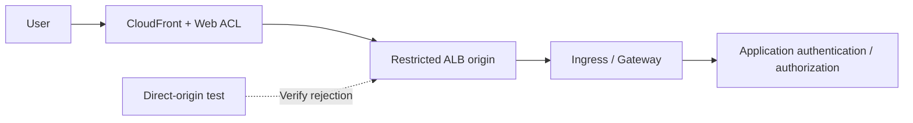

# 使用源站保护实现 WAF、边缘和 API 安全

> **审查依据**：AWS WAF、CloudFront 和 ALB 官方文档。根据关联的资源区分功能和检查限制。
> **最后更新**：2026年10月19日

目标是证明受保护的请求会经过 WAF，确认已理解检查限制和例外情况，并确保应用能够安全地处理请求。以下应用、源站和运维标准均为设计建议。

## 1. 区分 WAF、NGFW 和应用授权

AWS WAF 会检查发送到受支持关联资源的请求，包括 CloudFront、ALB 和 API Gateway **REST API**。不要假设同样的直接关联方式也适用于 API Gateway HTTP/WebSocket API 或 NLB。CloudFront ACL 使用 `CLOUDFRONT` 范围和 `us-east-1` API 端点；ALB 和其他区域资源则使用资源所在区域的 `REGIONAL` 范围。[S09]

请将 VM-Series/FortiGate NGFW 的功能与 Palo Alto/Fortinet 单独提供的 WAF 产品区分开。应用授权仍是另一层防护。应在应用中检查跨客户对象访问、业务限额、重复付款处理以及 LLM 工具权限。

| 流量 | 主要控制措施 | 仍需验证的事项 |
|---|---|---|
| 公网 HTTP(S) | 与 CloudFront/ALB 关联的 WAF | 直接访问源站、请求正文限制、例外情况和应用授权 |
| 保留 TLS 的 IP 会话 | NGFW 路径和选定的解密策略 | 实际有效载荷可见性和豁免项 |
| 内部准入 Webhook | 访问限制、准入控制和 RBAC | Pod 可达性和控制器权限 |
| 上传/gRPC/WebSocket | 受支持的路径和特定于应用的处理方式 | 对初始请求之外的流量及文件处理的覆盖 |

ingress-nginx 准入 CVE 涉及一个可从 Pod 网络访问的 Webhook；应将其与公网 URL 的 WAF 覆盖情况分开测试。[S01]

## 2. 根据请求路径设计源站保护



这是一个逻辑设计。请记录是仅使用 CloudFront WAF，还是 ALB 也配置区域 ACL。在选择双重检查之前，应评估日志记录、误报和成本。

### 选项 A：公网 ALB 源站

结合使用基于 AWS CloudFront 至 ALB 限制示例的控制措施。[S16]

1. 在 ALB 安全组中检查面向源站的 CloudFront 托管前缀列表。
2. 将 CloudFront 源站自定义标头与 ALB 侦听器标头条件结合使用。
3. 设计默认侦听器操作，拒绝不符合批准路径的请求。
4. 管理源站 HTTPS、标头密钥轮换和配置读取权限。
5. 测试 ALB DNS 名称、备用域名、地址、侦听器、其他负载均衡器和 NodePort。

**CloudFront 地址范围无法识别你的分配。** 标头可以将请求与其他 CloudFront 路径区分开来，但其值属于共享密钥，一旦泄露，效果就会减弱。不要在源代码、屏幕截图和常规日志中保留真实值。应用信任转发标头，与侦听器限制源站访问并非一回事。[S16]

### 选项 B：CloudFront VPC 源站

CloudFront VPC 源站可以将流量发送到 VPC 私有子网中受支持的源站。需要附加 Internet Gateway，但这并不意味着源站必须具有公网 IP。请检查当前区域、资源和协议限制、子网地址以及由服务管理的安全组配置。NLB 源站支持与直接将 WAF 关联到 NLB 是两回事。[S17]

#### 2026年10月更新：VPC 源站支持双栈

根据[2026年10月15日公告](https://aws.amazon.com/about-aws/whats-new/2026/10/cloudfront-vpc-origin-dualstack/)，CloudFront VPC 源站现已支持双栈。此前，VPC 源站连接仅支持 IPv4，因此若要提供 IPv6 服务，就必须将源站移至公有子网；现在可以让源站继续留在私有子网，并为其配置 IPv6 传输。该功能在支持 VPC 源站的商业区域提供；迁移到双栈后，仍应执行上述源站绕过检查。

无论采用哪种选项，都应检查是否还有其他公网 Service、NodePort 和管理端点暴露同一应用。将源站标记为私有，并不代表已完成入口路径盘点。

## 3. 规则顺序和终止操作

AWS WAF 会先评估数值较小的优先级。`Allow` 和 `Block` 会终止评估；`Count` 会继续评估。对于带有有效令牌的请求，`CAPTCHA` 和 `Challenge` 不会终止评估；对于没有可接受令牌的请求，则会终止评估。如果没有任何终止规则对请求作出判定，则应用 ACL 默认操作。[S10]

| 陷阱 | 后果 | 设计建议 |
|---|---|---|
| 过早设置范围过广的 `Allow` | 后续托管规则/速率规则不会得到评估 | 缩小放行范围并检查规则顺序 |
| 豁免整个规则组 | 其他防护可能被一并移除 | 记录各个规则、路径、方法、负责人和到期时间 |
| 将 `Count` 视为拦截 | 请求只会被监控 | 检查操作、覆盖设置和实际生效结果 |
| 对所有 API 使用 Challenge | 可能影响自动化客户端的兼容性 | 分别测试浏览器 API 和机器 API |

选择和更新托管规则需要变更控制。应针对合法流量评估相关基准规则组、已知恶意输入规则组和 SQLi 规则组，并检查是否支持固定版本/变更通知。规则组名称本身并不能证明其能完整检测攻击。

## 4. 请求正文和超大内容限制

| 关联资源 | AWS WAF 请求正文检查大小 |
|---|---|
| ALB、AppSync | 固定为 8 KB |
| CloudFront、API Gateway、Cognito、App Runner、Verified Access、Bedrock AgentCore Gateway | 默认 16 KB；在支持的情况下可配置为最高 64 KB |
| gRPC 请求 | AWS 文档说明，正文检查规则不适用 |

这些是检查限制，并非上传限额或整个请求的大小限制。提高限制前，必须审查支持情况和成本。托管规则自身的大小条件与 ACL 的检查大小配置是两回事。[S11]

当正文、标头或 Cookie 超出检查限制时，语句的超大内容处理方式就很重要。[S12]

- `CONTINUE`：评估可供检查的部分。
- `MATCH`：对该语句而言，将超大内容视为匹配。
- `NO_MATCH`：对该语句而言，将超大内容视为不匹配。

**`MATCH` 不是 Block 命令。** 最终行为取决于操作以及 `NOT` 等周边语句。较早触发的终止性放行规则也可能导致后续阻止超大内容的规则无法运行。[S10] [S12]

应在应用中验证完整正文大小、数据模式、内容类型、解压缩、文件处理和授权。可考虑使用单独的大文件上传路径，并在上传后基于存储内容进行后续检查。比较阈值附近的正常 JSON/multipart 请求，以及检查前缀之后的数据。确定限制和路径并不需要使用攻击载荷。

## 5. 客户端 IP 和基于速率的规则

在 CloudFront→ALB→Ingress→应用的路径中，连接对端地址和转发的客户端地址可能不同。使用转发 IP 配置之前，应先定义可信代理和源站路径。Geo match、ASN match 和基于速率的语句使用第一个地址。IP set match 使用配置的 `FIRST`、`LAST` 或 `ANY` 位置；`ANY` 最多检查 10 个地址，若地址更多，则使用最后 10 个。[S13]

缺少标头时，直接语句会判定为不匹配，且不会触发格式错误值的回退处理。外层的 `NOT` 可以将不匹配反转为匹配，因此除了转发 IP 设置之外，还应测试完整的语句树。[S13]

建议用于控制 API 滥用的措施：

| 请求 | 聚合/应用检查 | 测试用例 |
|---|---|---|
| 登录/密码重置 | 客户端 IP、应用账户策略、路径/方法范围 | 共享 NAT、合法重试和未知账户 |
| 搜索/高开销 API | 受支持的自定义聚合和应用配额 | 查询开销、令牌签发/轮换和客户端类型 |
| 爬取/机器人 | 浏览器令牌、受支持的机器人规则和应用检查 | SDK、移动端和无障碍客户端 |
| 上传/付款 | 授权、大小、幂等性和业务限制 | 重复提交和失败后重试 |

速率规则采用近似跟踪，而不是精确的每秒请求配额。支持的评估窗口为 60、120、300 和 600 秒。更改限制、窗口、聚合方式或范围会重置计数器，并可能导致强制执行暂停最多一分钟。将令牌或任意标头用作键时，应测试攻击者可控的键变化和缺失值。[S14] [S37] [S43]

## 6. 验证日志记录和故障策略

检查 `terminatingRuleId`、`action`、`nonTerminatingMatchingRules`、内部托管规则结果、标签、`ruleMatchDetails`、`oversizeFields`、路径、方法和请求 ID。仅通过终止规则无法查到 Count 匹配项。请使用[官方字段定义][S36]。

限制个人数据、令牌和身份验证标头的记录。**日志遮蔽不会自动保护请求采样或 Security Lake 数据收集。** 应分别检查采样/数据保护，并检查收集到的数据。监控延迟或缺失事件并与应用日志进行对照，是一项运维建议。[S15]

ALB 的 `waf.fail_open.enabled` 控制无法将请求发送到 WAF 时是否转发到目标；其默认值为 `false`。读取实际生效的属性，并记录预期的放行/拒绝行为。仅仅建立关联，并不能证明每次 WAF 故障都会阻止请求。针对其他建议的故障设置，应先根据该资源当前的官方属性进行验证。[S18]

## 7. 安全验证和推出

这段 JSON 是 Web ACL **中的一条 Rule**，并非完整 ACL、关联配置或部署命令。它会统计获准测试请求中的唯一标头，以确认请求路径和日志记录情况。

```json
{
  "Name": "DocumentedCanaryCount",
  "Priority": 0,
  "Statement": {
    "ByteMatchStatement": {
      "SearchString": "security-review",
      "FieldToMatch": { "SingleHeader": { "Name": "x-doc-waf-canary" } },
      "TextTransformations": [{ "Priority": 0, "Type": "NONE" }],
      "PositionalConstraint": "EXACTLY"
    }
  },
  "Action": { "Count": {} },
  "VisibilityConfig": {
    "SampledRequestsEnabled": false,
    "CloudWatchMetricsEnabled": true,
    "MetricName": "DocumentedCanaryCount"
  }
}
```

应协调优先级和指标名称，确保与现有 ACL 一致。此操作无法验证对恶意请求的检测能力或误报情况。在暂存环境中，后续可使用范围严格限定的正常 Block 金丝雀测试，并确认请求不会到达应用；通过回放业务流量评估实际防护规则。记录从 Count 改为 Block 的变更、例外到期时间和回滚负责人。

| 验证项 | 预期结果和留存证据 |
|---|---|
| 合法业务/API 自动化客户端 | 成功情况、错误率、p95 以及令牌/Challenge 结果 |
| Count/Block 金丝雀 | 非终止与终止结果；WAF/应用关联信息 |
| 直接访问源站/通过其他分配访问 | 在配置的源站边界处拒绝 |
| 阈值附近的请求/大文件上传 | 超大内容处理行为以及应用对完整输入的验证 |
| 缺失/伪造的转发标头 | 信任边界和规则适用情况 |
| 共享 NAT/分布式键/速率规则更新 | 对合法用户的影响、近似限额和重置情况 |
| ACL 移除/例外/WAF 故障 | 变更检测和记录在案的故障行为 |

本次文档更新未部署 WAF/设备，未复现攻击，也未测量流量性能。

## 继续学习

- [纵深防御和事件响应](./13-defense-in-depth-incident-response.md)
- [Palo Alto 和 Fortinet NGFW](./15-ngfw-paloalto-fortinet.md)
- [GWLB 和 GENEVE](./16-gwlb-geneve-inspection.md)
- [本章测验](../quizzes/security/14-waf-edge-api-security-quiz.md)

## 参考资料和研究依据

主要资料于 2026-10-15 查阅。进行更改前，请重新核对所选产品/分支的公告和限制。

- [S01：Kubernetes：CVE-2025-1974][S01]
- [S09：AWS WAF：关联 Web ACL][S09]
- [S10：AWS WAF：规则操作][S10]
- [S11：AWS WAF：正文检查大小][S11]
- [S12：AWS WAF：超大请求组件][S12]
- [S13：AWS WAF：转发的 IP 地址][S13]
- [S14：AWS WAF：基于速率的规则][S14]
- [S15：AWS WAF：日志记录][S15]
- [S16：CloudFront：限制对 ALB 源站的访问][S16]
- [S17：CloudFront：VPC 源站][S17]
- [S18：ALB：属性][S18]
- [S36：AWS WAF：日志字段][S36]
- [S37：AWS WAF：速率评估窗口][S37]
- [S43：AWS WAF：速率规则注意事项][S43]

[S01]: https://kubernetes.io/blog/2025/03/24/ingress-nginx-cve-2025-1974/
[S09]: https://docs.aws.amazon.com/waf/latest/developerguide/web-acl-associating-aws-resource.html
[S10]: https://docs.aws.amazon.com/waf/latest/developerguide/waf-rule-action.html
[S11]: https://docs.aws.amazon.com/waf/latest/developerguide/web-acl-setting-body-inspection-limit.html
[S12]: https://docs.aws.amazon.com/waf/latest/developerguide/waf-oversize-request-components.html
[S13]: https://docs.aws.amazon.com/waf/latest/developerguide/waf-rule-statement-forwarded-ip-address.html
[S14]: https://docs.aws.amazon.com/waf/latest/developerguide/waf-rule-statement-type-rate-based.html
[S15]: https://docs.aws.amazon.com/waf/latest/developerguide/logging.html
[S16]: https://docs.aws.amazon.com/AmazonCloudFront/latest/DeveloperGuide/restrict-access-to-load-balancer.html
[S17]: https://docs.aws.amazon.com/AmazonCloudFront/latest/DeveloperGuide/private-content-vpc-origins.html
[S18]: https://docs.aws.amazon.com/elasticloadbalancing/latest/application/application-load-balancers.html
[S36]: https://docs.aws.amazon.com/waf/latest/developerguide/logging-fields.html
[S37]: https://docs.aws.amazon.com/waf/latest/developerguide/waf-rule-statement-type-rate-based-high-level-settings.html
[S43]: https://docs.aws.amazon.com/waf/latest/developerguide/waf-rule-statement-type-rate-based-caveats.html
