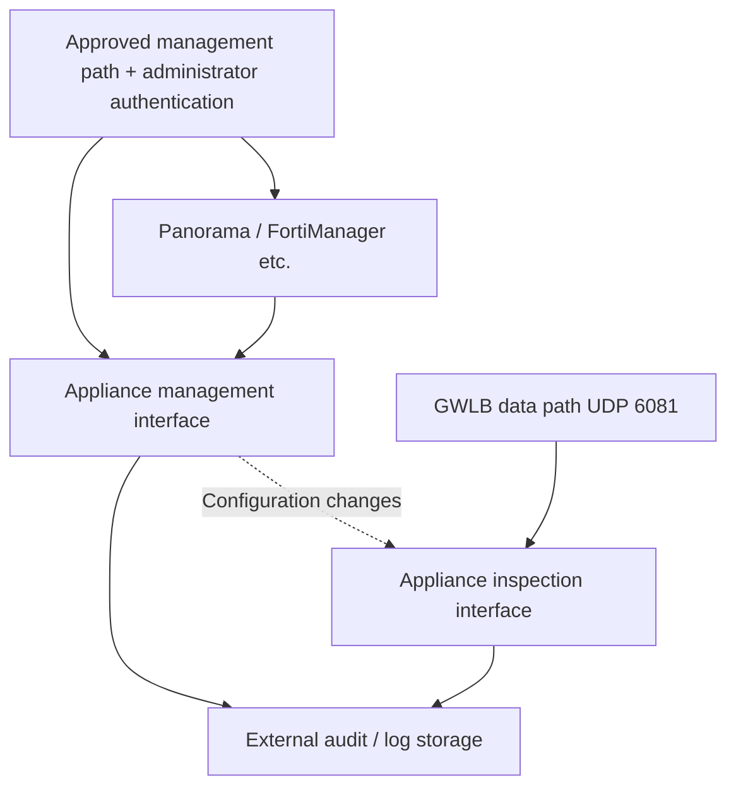

# 在 AWS/EKS 上设计和运维 Palo Alto 与 Fortinet NGFW

> **审查依据**：VM-Series/FortiGate-VM 官方 AWS GWLB 集成指南及厂商安全公告。应根据所选受支持分支和部署模式审查示例。
> **最后更新**：2026 年 10 月 15 日

NGFW 会对经过的会话应用已配置的策略。添加设备本身并不能确保检查所有 VPC 或 Pod 流量。本章比较集成要求、管理、TLS、会话和容量，然后链接到 [GWLB 路径验证](./16-gwlb-geneve-inspection.md)。

## 1. 选择部署模式

| 模式 | 结构 | PoC 证据 |
|---|---|---|
| 分布式检查 | 工作负载 VPC 中的路径和设备 | 验证本地路径、可用区隔离以及各设备群的策略一致性 |
| 中央检查 | 选定的多 VPC 流量经由 TGW/检查 VPC | 验证对称性、TGW appliance mode、NAT 和例外 |
| 插入 GWLB | GWLBE 将流量送往兼容 GENEVE 的设备群 | 验证封装、运行状况、流重新分配和设备策略 |
| 厂商托管服务 | 受支持的托管 NGFW 部署 | 验证特定产品的路由、策略、日志和账户责任 |

中央检查覆盖路由到 TGW 的流量。应分别验证 VPC 本地、节点本地和其他连接。没有设备时，GWLB 端点和 TGW appliance mode 都不会自动提供检查。[S24] [S29] [S30]

VM-Series 与 Palo Alto Cloud NGFW 不同；FortiGate-VM 与 FortiWeb 不同。应根据实际产品匹配支持状态、功能和安全公告。CVE-2026-0322 公告中对 Cloud NGFW 的排除仅适用于该公告。[S03]

## 2. 厂商特定的 GWLB 集成

| 审查项 | Palo Alto VM-Series | Fortinet FortiGate-VM |
|---|---|---|
| 集成方式 | PAN-OS GWLB 集成、厂商模板或手动配置 | GENEVE 接口以及单可用区/多可用区部署指南 |
| 数据路径 | 解封装后按接口/区域/安全策略处理 | 解封装后按接口/策略处理 |
| 封装 | UDP 6081，并使用受支持的版本/模式 | UDP 6081、GWLB 节点的 GENEVE 配置及 AWS TLV 处理 [S42] |
| 策略前提 | 接口、区域、允许规则和安全配置文件 | GENEVE 接口、防火墙策略及 UTM/安全配置文件 |
| 管理 | 适用的 Panorama/管理架构及变更审计 | 适用的 FortiManager/FortiAnalyzer 架构及变更审计 |
| 故障/扩缩容 | GWLB 注册/注销以及设备会话/配置处理 | GWLB 注册/注销以及设备会话/配置处理 |

参考：[VM-Series 概述][S19]、[手动配置][S20]、[启用集成][S21]、[Fortinet 接口配置][S22]和 [FortiGate 部署指南][S23]。AWS 在其[目标组文档][S42]中单独定义了 GWLB GENEVE TLV 格式和 Option Class `0x0108`。引用的 Fortinet 7.0.0 指南说明了部署方法，**并不代表推荐将该版本用于生产环境**。应检查实际选定受支持分支对应的指南、PSIRT 公告和镜像。

### Palo Alto：集成、接口和默认区域策略

应根据实际接口、区域、运行状况检查和策略核对 GWLB 集成支持状态。启用指南介绍了管理/数据接口交换以及如何启用 GWLB 检查。最低功能支持版本并不等于当前安全补丁版本或生产版本建议。[S21]

手动指南指出不能使用 HTTP 运行状况检查，并建议使用 HTTPS/TCP；但后文在管理配置文件步骤中又包含启用 HTTP 的说明。**不要根据这处歧义自动配置。** 应在所选版本/模板中核实支持的协议和响应，并向厂商确认。运行状况检查成功并不能证明签名、许可或检查策略正常工作。[S20]

AWS 还记录了仅支持 TLS 1.3 的目标会导致 HTTPS 运行状况检查失败；运行状况检查端点必须支持较早的版本，例如 TLS 1.2。这项运行状况要求与被检查应用的 TLS 支持是两回事。[S26]

同一指南指出，GWLB 流量会被视为区域内流量，而默认区域内规则允许所有流量。应检查默认操作和已应用的配置文件，确保不在预期策略范围内的流量会被拒绝。仅启用接口并不能完成阻止流量的策略配置。[S20]

### Fortinet：同时验证接口和策略

Fortinet 的部署后指南使用同一可用区内 GWLB 接口的 IPv4 地址作为 GENEVE 对端，并配置流量通过接收该流量的 GENEVE 接口返回。不要将其替换为管理/应用地址。应根据部署文档检查所需封装元数据以及所选模式的支持情况。[S22] [S23]

没有预期的允许/拒绝策略和检查配置文件时，仅配置 GENEVE 接口是不够的。单独的 FGCP HA 设计与独立的 GWLB 目标也不是同一种架构。应选择厂商支持的 HA/会话共享模式并验证其行为。

## 3. 保护设备管理平面

这是逻辑上的责任划分；实际 ENI/子网数量取决于所选厂商模板。

建议的管理标准：

- 将设备/管理器的 HTTPS、SSH 和 API 访问限制在获准的管理路径和来源。
- 使用个人账户、最低权限、受支持的 MFA，并设置单独的恢复账户。
- 审计自动化令牌、SSO 和集中管理带来的管理/配置变更。
- 检查公有 IP、EIP、监听器、备用端口和其他 ENI 是否实际暴露。
- 在外部保存日志/配置修订，并验证时间同步。
- 清点受支持分支、热修复、签名和管理器兼容性。

PAN-OS 安全公告建议将管理访问限制到可信内部地址。2026 年的远程代码执行漏洞也涉及已认证攻击者，因此应同时审查来源限制和管理员身份验证。[S03] [S04]

手动部署指南会给管理 ENI 分配 EIP。应将此视为示例部署步骤，而不是默认暴露要求：生产环境采用前，应根据安全公告对可信内部来源的限制，核对实际访问路径。[S20] [S03] [S04]

FortiCloud SSO 事件涉及跨账户登录以及管理员/VPN 变更。官方更正说明，第三方 SAML 身份提供商和 FortiAuthenticator 不受该问题影响；不要把该结论泛化到所有 SSO 机制。[S05] [S06]

## 4. TLS 可见性

| 检查位置 | 默认可见信息 | 载荷检查审查项 |
|---|---|---|
| HTTPS 终止前的 NGFW | 分组、连接和可见的 TLS 元数据 | 受支持的解密、密钥/证书和客户端兼容性 |
| 与 CloudFront/ALB 关联的 WAF | 资源提供给 WAF 的请求部分 | 请求体/gRPC/超限大小限制 |
| ALB→Pod 重新加密路径上的 NGFW | 该网段上的 TLS 连接 | 单独的解密或端点层检查 |
| Mesh mTLS 网段 | 可观察的对等端/传输元数据 | Mesh 信任、授权和受支持的检查位置 |

GWLB 使用 GENEVE 封装，不会终止 TLS。GENEVE 本身不提供加密。Network Firewall 的 TLS 检查也需要单独配置策略/证书。设备经过流量与成功解密是两回事。[S24] [S31] [S35]

解密 PoC 应覆盖 TLS 版本/密码套件、HTTP/2、gRPC、WebSocket、mTLS、证书固定、客户端 CA 信任和法规例外，并记录例外的补偿性控制。配置名称中出现“SSL 检查”并不能证明所有加密载荷都已被检查。

HTTPS ALB 目标组不能证明后端证书受信任。AWS 指出 ALB 不会验证目标证书；如有服务器身份验证要求，应另行设计。[S38]

## 5. NAT、原始地址和 Pod 归属

针对每个会话关联以下观测信息：

| 网段 | 记录内容 |
|---|---|
| 应用/Pod | 工作负载/命名空间、请求 ID、Pod/节点地址和时间 |
| 节点/CNI | SNAT 行为/模式和生效的 NetworkPolicy |
| 设备 | 观察到的五元组、策略/配置文件、操作和解密结果 |
| NAT/外部 | 转换后的地址、目标、响应和重试 |
| TGW/GWLBE | 连接、可用区、路由表和端点身份 |

节点执行 SNAT 后，设备可能看到的是节点地址而非 Pod 地址。对于默认 VPC CNI 中发往 VPC CIDR 以外目标的 IPv4 出站流量，EKS 文档说明地址会转换为节点的主地址；应核实实际 external-SNAT、操作系统和路由配置，不要将其视为普遍规律。[S44]

即使保留了 Pod 地址，Pod 替换后地址也可能变化。要区分基于 IP 的策略与基于 Kubernetes 标签/身份的策略，并结合 CNI/IPAM 观测信息进行关联。[S33]

请求和响应若到达不同设备，或其元组不兼容，可能破坏有状态检查。应同时验证粘性、NAT 位置、TGW appliance mode 和所选部署模式。TGW appliance mode 要求五元组粘性；不支持二元组/三元组模式。在透明 GWLB 设计中不要随意添加 SNAT。[S25] [S29] [S30]

## 6. 会话、扩缩容、许可和容量

GWLB 提供目标选择、运行状况检查和流故障转移，但不会在互相独立的设备之间自动复制状态。在添加/移除目标、执行 `rebalance`、重启和可用区故障期间，应测试**已有会话和新会话**。如需 HA/会话共享，应核实厂商支持的模式和故障条件。[S25]

建议的测量计划：

| 测量项 | 应保持不变的条件 |
|---|---|
| 吞吐量/分组速率 | 分组大小、双向比例、小分组和大请求体 |
| 连接速率/并发会话 | TCP/UDP、keepalive 和长连接 gRPC/WebSocket |
| 启用检查后的吞吐量 | 实际 IPS、恶意软件、URL、日志和 TLS 解密配置文件 |
| p50/p95/p99/错误 | 应用/设备/TGW/可用区路径和基线 |
| N-1/可用区故障 | 剩余实例/许可容量、CPU/内存和策略就绪情况 |
| 维护/扩缩容 | 注册就绪、连接排空、策略/签名部署和会话中断 |

数据表中的数值不是受控的跨厂商对比。应记录端口、CPU、加密和许可/订阅限制。总成本包括设备 EC2/EBS/许可证、GWLB/GWLBE、TGW、NAT、可用区间传输、日志和运维费用，并按实际区域分别计价。本研究没有提供价格报价或实测性能数据。

## 7. 修补与清除入侵

| 状态 | 必要检查 |
|---|---|
| 已确认是否受影响 | 产品、分支、热修复、功能、暴露情况和公告版本 |
| 已完成修补 | 实际部署了修复版本，并验证管理器/模板/签名兼容性 |
| 已清除入侵 | 管理员/VPN/系统/配置变更以及相关凭证使用情况 |
| 已证明恢复 | 检查/业务功能、受限管理、旧/新会话和外部日志 |

Fortinet 的 2025 年分析描述了早期 SSL-VPN 修补后访问仍然持续的情况。其 2026 年 SSO 分析建议在确认入侵后审计/恢复配置并轮换凭证。仅升级到当前版本并不代表完成清除。[S07] [S05]

针对历史上的符号链接问题，Fortinet 指出升级到 7.6.2、7.4.7、7.2.11、7.0.17 和 6.4.16 会移除该链接，但仍需审查配置。这些是历史修复参考，并非 2026 年的版本建议。[S07]

PAN-OS 的修复版本/预计发布时间表可能按分支变化。不要将本章中的静态版本转化为部署指令；应在变更时重新检查公告。[S03]

## 8. PoC 验收标准

以下是建议采用的通用标准；必须检查项通过后，再比较易用性、运营成本和性能。

1. 受支持的镜像、许可、分支和官方集成相互匹配。
2. 可以观察受限的管理访问以及管理员/配置变更。
3. 可以关联请求/响应元组以及允许和拒绝会话所应用的配置文件。
4. 能说明解密范围/例外以及对合法客户端的兼容性。
5. 使用旧/新会话测试全部目标不健康、单个目标故障、可用区故障、缩容和升级。
6. 测量 N-1 容量以及应用延迟/错误 SLO。
7. 为公告审查、修补、清除和回滚指定责任人并留存证据。

## 继续学习

- [GWLB 与 GENEVE 检查](./16-gwlb-geneve-inspection.md)
- [WAF 与源站保护](./14-waf-edge-api-security.md)
- [事件响应](./13-defense-in-depth-incident-response.md)
- [本章测验](../quizzes/security/15-ngfw-paloalto-fortinet-quiz.md)

## 参考资料与研究依据

主要来源于 2026-10-15 访问的资料。变更前应重新核实所选产品/分支的安全公告和限制。

- [S03：Palo Alto：CVE-2026-0322][S03]
- [S04：Palo Alto：CVE-2025-0108][S04]
- [S05：Fortinet：FortiOS SSO 滥用分析][S05]
- [S06：CISA：已知遭利用漏洞目录][S06]
- [S07：Fortinet：威胁参与者活动分析][S07]
- [S19：VM-Series：GWLB 集成][S19]
- [S20：VM-Series：手动 GWLB 集成][S20]
- [S21：VM-Series：启用 GWLB 集成][S21]
- [S22：FortiGate：GWLB 部署后配置][S22]
- [S23：FortiGate：通过 GWLB 集成进行安全检查][S23]
- [S24：AWS：Gateway Load Balancer][S24]
- [S25：AWS GWLB：目标组属性][S25]
- [S26：AWS GWLB：运行状况检查][S26]
- [S29：AWS：通过 GWLB 和 TGW 进行集中检查][S29]
- [S30：AWS：NAT 网关场景][S30]
- [S31：RFC 8926：GENEVE][S31]
- [S33：EKS：网络安全][S33]
- [S35：AWS Network Firewall：TLS 检查配置][S35]
- [S38：ALB：目标组][S38]
- [S42：AWS GWLB：目标组][S42]
- [S44：EKS：出站互联网访问和 SNAT][S44]

[S03]: https://security.paloaltonetworks.com/CVE-2026-0322
[S04]: https://security.paloaltonetworks.com/CVE-2025-0108
[S05]: https://www.fortinet.com/blog/psirt-blogs/analysis-of-sso-abuse-on-fortios
[S06]: https://www.cisa.gov/sites/default/files/feeds/known_exploited_vulnerabilities.json
[S07]: https://www.fortinet.com/blog/psirt-blogs/analysis-of-threat-actor-activity
[S19]: https://docs.paloaltonetworks.com/vm-series/deployment/public-cloud/set-up-the-vm-series-firewall-on-aws/vm-series-integration-with-gateway-load-balancer
[S20]: https://docs.paloaltonetworks.com/vm-series/deployment/public-cloud/set-up-the-vm-series-firewall-on-aws/vm-series-integration-with-gateway-load-balancer/manually-integrate-the-vm-series-with-a-gateway-load-balancer
[S21]: https://docs.paloaltonetworks.com/vm-series/deployment/public-cloud/set-up-the-vm-series-firewall-on-aws/vm-series-integration-with-gateway-load-balancer/enabling-vm-series-integration-with-a-gwlb
[S22]: https://docs.fortinet.com/document/fortigate-public-cloud/7.0.0/aws-administration-guide/337773/post-deployment-configuration
[S23]: https://docs.fortinet.com/document/fortigate-public-cloud/7.0.0/aws-administration-guide/571235/security-inspection-with-gateway-load-balancer-integration
[S24]: https://docs.aws.amazon.com/elasticloadbalancing/latest/gateway/gateway-load-balancers.html
[S25]: https://docs.aws.amazon.com/elasticloadbalancing/latest/gateway/edit-target-group-attributes.html
[S26]: https://docs.aws.amazon.com/elasticloadbalancing/latest/gateway/health-checks.html
[S29]: https://aws.amazon.com/blogs/networking-and-content-delivery/centralized-inspection-architecture-with-aws-gateway-load-balancer-and-aws-transit-gateway/
[S30]: https://docs.aws.amazon.com/vpc/latest/userguide/nat-gateway-scenarios.html
[S31]: https://www.rfc-editor.org/info/rfc8926/
[S33]: https://docs.aws.amazon.com/eks/latest/best-practices/network-security.html
[S35]: https://docs.aws.amazon.com/network-firewall/latest/developerguide/tls-inspection-configurations.html
[S38]: https://docs.aws.amazon.com/elasticloadbalancing/latest/application/load-balancer-target-groups.html
[S42]: https://docs.aws.amazon.com/elasticloadbalancing/latest/gateway/target-groups.html
[S44]: https://docs.aws.amazon.com/eks/latest/userguide/external-snat.html
