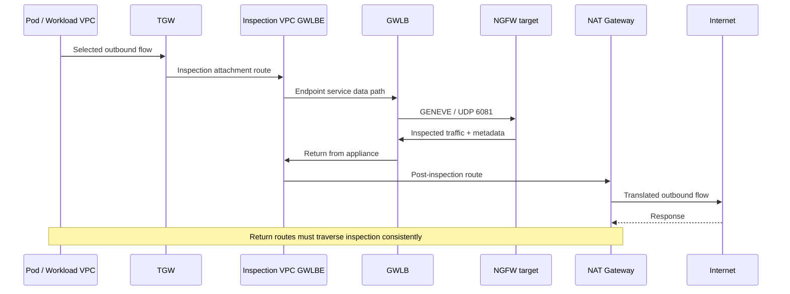

# GWLB 与 GENEVE：对称检查路径和故障验证

> **审查依据**：AWS Gateway Load Balancer、PrivateLink、TGW 和 NAT 官方文档、RFC 8926 以及厂商集成指南。
> **最后更新**：2026 年 10 月 15 日

GWLB 将原始 IP 流分发到兼容 GENEVE 的安全设备。GWLBE 是使用方 VPC 中的路由目标；检查策略配置在设备上。本指南在 [Palo Alto/Fortinet 选型](./15-ngfw-paloalto-fortinet.md)之后，继续验证路径、会话和故障。路由表和验收标准是设计示例，并非完整 IaC 或已部署结果。[S24] [S27]

## 1. 组件与职责

| 组件 | 作用 | 检查项 |
|---|---|---|
| GWLB | 将 IP 流量送往目标 | 可用区、目标组、粘性和故障转移 |
| GENEVE 目标组 | 设备注册、运行状况和属性 | GENEVE 端口 6081 以及受支持的 IP/实例目标 |
| 设备 | 解封装、检查并重新封装 | 策略、会话、许可、元数据和 MTU |
| 端点服务 | 向使用方 VPC 暴露提供方 GWLB | 允许的主体、接受操作和所有权 |
| GWLBE | 使用方 VPC 中的可用区级路由目标 | 子网、可用区、状态和路由 |
| TGW appliance mode | 每条流使用一个检查连接的 ENI/可用区，双向共用 | 检查 VPC 连接上的有效设置 |

端点服务权限/接受操作控制连接建立，不负责应用授权或设备策略。跨账户比较物理可用区时，应使用**可用区 ID**，而不是账户特定的可用区名称。请核对 [PrivateLink 要求][S27]。

GWLB 不会像 ALB 那样接收安全组。**GWLBE 也不支持安全组。** ELB API 的安全组参数适用于 ALB/NLB；端点安全组参数适用于接口端点。应检查设备/工作负载 ENI、NACL、路由和策略。[S39] [S40]

## 2. GENEVE 是检查传输方式，不是加密

```text
Outer IP
  └─ UDP destination port 6081
      └─ GENEVE header + options / AWS metadata
          └─ Original encapsulated traffic
```

RFC 8926 定义了 GENEVE 标头、VNI、可变选项和 UDP 传输。AWS GWLB 使用 Option Class `0x0108` 的 TLV 元数据；设备必须处理 TLV 键值对，GWLB 也使用该元数据选择返回路径上的 GWLBE。应通过受支持的集成保留所需元数据。仅支持通用 GENEVE 并不代表兼容 GWLB。[S31] [S42] [S29]

GENEVE 不像 TLS/IPsec 那样加密载荷。即使使用同一端口，Cilium 覆盖网络与 GWLB 封装的用途和路径也不同。检查 TLS 载荷需要设备解密，或在 TLS 终止点实施控制。[S31] [S24]

## 3. 逻辑上的可用区级出站流量

此顺序图展示了集中式出站流量的**一个方向**。实际 TGW、GWLBE、设备和 NAT 路径由可用区决定；响应必须沿一致的检查路径返回，才能维持会话。



TGW 连接、端点和 NAT 子网路由表承担不同的职责。将每个子网的默认路由都指向 GWLBE，可能导致已检查的流量再次回到检查路径并形成环路。应将 AWS TGW 检查与 NAT 集成文档结合起来审查。[S29] [S30]

## 4. 中央检查路由审查

以下是一种集中式 IPv4 出站和 VPC 间检查模式。应根据实际 CIDR、可用区、端点/连接 ID、前缀优先级和现有路由进行审查。使用方的网络连接本身并不能证明所有方向的流量都经过检查。

| 位置 | 目标 | 示例下一跳/用途 |
|---|---|---|
| Spoke 工作负载子网 | 其他 Spoke CIDR/外部默认路由 | TGW |
| 与 Spoke 关联的 TGW 路由表 | 需要检查的 Spoke/外部流量 | 检查 VPC 连接 |
| 检查 VPC 的 TGW 连接子网 | 需要检查的目标 | 所选可用区内的 GWLBE |
| GWLBE 子网 | Spoke CIDR | TGW |
| GWLBE 子网 | 外部 `0.0.0.0/0` | 该可用区内的 NAT 网关 |
| NAT 子网 | 外部 `0.0.0.0/0` | Internet 网关 |
| NAT 子网 | 返回 Spoke CIDR | 检查 GWLBE |
| 与检查连接关联的 TGW 路由表 | Spoke CIDR | 正确的 Spoke 连接，不能再次指回检查连接 |

请求先经过检查再进行 NAT；响应在反向转换后经过检查，再通过 TGW 返回。遗漏 NAT 子网的返回路由，可能导致只有一个方向被检查或破坏有状态会话。迁移 NAT 时，需要重新检查元组和路由。[S29] [S30]

应在中央检查连接上验证 TGW appliance mode。它会为同一流的双向流量一致地选择一个检查连接 ENI/可用区，取代 TGW 默认优先选择流量来源可用区的行为，并允许跨可用区路由。它不会复制防火墙会话。应将它与 GWLB 目标选择分开验证。[S29] [S25] [S32]

### 互联网入站需要单独设计

对于入站流量插入检查路径，应一并检查 IGW 边缘关联路由、受保护子网路由、GWLBE 子网路由和返回路径。只有 ALB/IGW/GWLBE 的无序示意图并不足够。AWS 记录了 IGW/VGW 网关路由表的限制。应将 ALB 代理的前端和后端连接作为不同的流分别追踪。[S28]

## 5. 中央检查范围以外的路径

| 路径 | 需要单独验证的原因 | 建议的补充控制 |
|---|---|---|
| 同节点 Pod 流量 | 可能不会到达 VPC/TGW | CNI、NetworkPolicy 和服务授权 |
| VPC 本地/其他子网 | 本地前缀比默认路由更具体 | 受支持的本地路由设计，或 CNI/安全组控制 |
| 对等连接/其他 TGW 连接 | 可能使用不同路由 | 有效路由和连接清单 |
| PrivateLink/网关端点 | 与公有默认出站路由不同 | IAM、端点/资源策略和应用授权 |
| IPv6/NAT64/代理 | 单靠 IPv4 `0.0.0.0/0` 不会覆盖 | 服务/设备支持和 `::/0` 路径 |
| 管理/运行状况流量 | 用途不同于受检查的数据流 | 限制来源并留存记录 |

在特定条件下，可以将 VPC 本地路由重定向到设备；“不可能实现”和“会自动集中”都不准确。应核实路由类型、受支持的目标和 CIDR 限制。[S28]

EKS Pod/节点地址、CNI SNAT 和 Security Groups for Pods 模式都会影响可见性和路径。Pod 策略与 VPC 检查路由是不同的配置。[S33] [S34] [S44]

## 6. 粘性和空闲超时

默认粘性使用**五元组**：源/目标地址、源/目标端口和协议。受支持的替代选项使用**三元组**（地址对/协议）或**二元组**（地址对），但**启用 TGW appliance mode 时不支持这些模式**。此中央检查模式使用五元组粘性。元组字段较少的模式可能导致负载集中；请核查其部署限制和容量。[S25]

TCP 空闲超时默认为 350 秒；使用五元组粘性时，可以调整为 60–6000 秒。UDP 超时固定为 120 秒。不要假定 TCP 超时调整适用于二元组/三元组模式。应分别检查设备、NAT、应用、TGW 和目标 ENI 的 `TcpEstablishedTimeout`；较短的 ENI 跟踪超时可能导致连接丢弃，而 GWLB 仍将该连接视为活动连接。[S24]

TCP 空闲超时后，新 SYN 会启动新流，而旧连接上的数据分组会被丢弃。UDP 超时后到达的分组可以形成新流。较长的超时与跨设备状态共享是两回事。应测试 keepalive、空闲后恢复、长连接 gRPC/WebSocket 和 UDP。[S24]

## 7. 运行状况、故障转移与 fail open

| 状态/设置 | AWS 文档说明的行为 | 运维检查项 |
|---|---|---|
| 一个不健康的目标 | 新流使用可用的健康目标 | 已有流的配置行为 |
| `target_failover.on_unhealthy=no_rebalance` | 已有流仍分配给原目标 | 不健康目标可能导致流量黑洞 |
| `target_failover.on_unhealthy=rebalance` | 已有流会被重新分配 | 独立设备上的会话可能丢失 |
| 注销目标 | 行为遵循 `on_deregistration` | 排空连接、缩容和升级 |
| 所有目标都不健康 | GWLB 为每条流随机选择一个不健康目标，并保持该选择直到重置/超时；AWS 说明在目标恢复健康前会丢弃流量 | 验证文档描述的结果；仅运行状况探测故障、但数据面仍转发属于 PoC 假设 |
| 没有已注册目标 | 新流没有目标；应确认流量丢弃行为 | 验证空设备群的恢复；区分已有流的排空 |

`target_failover.on_unhealthy` 和 `target_failover.on_deregistration` 必须设置为相同值。默认值是 `no_rebalance`。运行状况检查支持 TCP、HTTP 和 HTTPS；协议、端口和路径应与设备相匹配。[S25] [S26]

当前文档还提供 `send_tcp_reset.on_unhealthy.enabled` 和 `send_tcp_reset.on_deregistration.enabled`。两者默认均为 `false`，仅适用于 TCP，并且要求使用五元组粘性（`stickiness.enabled=false`）和 `no_rebalance`。它们不能与 `rebalance` 或元组字段较少的粘性模式同时启用。在收到 RST 后应测试重连、重试和业务操作重复执行的情况；这并不代表会话可以无中断迁移。还应检查注销目标时的排空时间。[S25]

**当所有目标都不健康时，GWLB 不会直接绕过设备。** AWS 文档描述的是按流随机选择目标，并在所选目标恢复健康前丢弃流量。不同可用区会分别做出选择；关闭跨可用区负载均衡时，应检查每个可用区内符合条件的目标。跨可用区负载均衡会扩大符合条件的目标范围，但仍需关注已有流/新流的行为。[S26]

较早的部署博客将已有流继续分配给故障目标称作“fail-open mode”。这个术语并不意味着可用性有保证，也不是直接绕过设备的功能；应将其与设备本身的 fail-open 设置区分开。仅运行状况探测出现故障时数据流量是否仍会转发，属于应进行的实验，而非文档承诺的恢复行为。[S32] [S25] [S26]

跨可用区负载均衡可以使用其他可用区中的健康目标，但不会复制状态或修复故障的可用区端点。应检查跨可用区费用、容量和会话中断。要分别测试 GWLBE/可用区故障和目标故障。相较于较早部署博客中“GWLB 永不发送 RST”的说法，应优先采用当前的目标组属性文档。[S24] [S25] [S27] [S32]

## 8. MTU、分片、NACL 和运行状况路径

AWS 文档规定最大分组大小为 8500 字节，GENEVE 开销为 68 字节。GWLB 不会代替路径提供分片或路径 MTU 探测。工作负载使用较大的 MTU，并不意味着该 MTU 同样适用于 TGW、NAT 和设备组成的完整路径。[S24] [S32]

应审查：

- 端到端 MTU、设备 GENEVE 接口余量和 TCP MSS 处理。
- 大分组、UDP 数据报、TLS/HTTP2、上传和分片。
- SG、NACL 和设备策略中外层 UDP 6081 与内层载荷协议的区别。
- 运行状况检查端口的可达性/响应以及真实的检查 canary。
- 无状态 NACL 中的请求/返回端口和实际外层元组。
- 根据产品核对当前 IPv6、封装和 ICMP/ICMPv6 要求。

仅端口开放或目标健康并不能证明流量经过检查。[S26] [S32]

## 9. 在获准环境中执行只读检查

以下 AWS CLI 示例均为只读命令。应将任务专属变量设为自己负责的资源，并明确指定区域。本次研究中没有执行这些命令。

```bash
aws elbv2 describe-load-balancer-attributes \
  --region "$INSPECTION_REGION" --load-balancer-arn "$INSPECTION_GWLB_ARN"

aws elbv2 describe-target-group-attributes \
  --region "$INSPECTION_REGION" --target-group-arn "$INSPECTION_TARGET_GROUP_ARN"

aws elbv2 describe-target-health \
  --region "$INSPECTION_REGION" --target-group-arn "$INSPECTION_TARGET_GROUP_ARN"

aws ec2 describe-vpc-endpoints \
  --region "$INSPECTION_REGION" --vpc-endpoint-ids "$INSPECTION_ENDPOINT_ID"

aws ec2 describe-route-tables \
  --region "$INSPECTION_REGION" --route-table-ids "$INSPECTION_ROUTE_TABLE_ID"

aws ec2 describe-transit-gateway-vpc-attachments \
  --region "$INSPECTION_REGION" \
  --transit-gateway-attachment-ids "$INSPECTION_TGW_ATTACHMENT_ID"
```

应比较跨可用区属性、目标粘性/故障转移、运行状况、端点状态/可用区、路由/关联以及连接上的 `ApplianceModeSupport`。TGW 路由表关联、传播和有效路由需要额外查询；仅执行这六条命令不能证明路径对称。

## 10. 故障实验和验收标准

应在隔离且获准的环境中执行以下计划。

| 实验 | 必须观测的内容 |
|---|---|
| 允许/拒绝的无害 canary | 请求/响应五元组、目标、策略/配置文件和应用结果 |
| 单个目标运行状况故障 | 旧/新会话以及 `no_rebalance` 与 `rebalance` 的区别 |
| 所有目标都不健康 | 是否送达不健康目标、检查/错误；不能假定直接绕过 |
| 空设备群 | 新流丢弃与已有流排空的区别、检测和恢复 |
| TCP RST 功能 | 五元组/no-rebalance 限制、重连和重试 |
| 可用区/端点路径故障 | 区分端点与目标故障，并观测故障转移和恢复 |
| 缩容/滚动升级 | 连接排空、中断、就绪状态和策略一致性 |
| NAT/路由变更 | 变更前后的地址转换、返回路径和环路 |
| MTU/空闲超时/IPv6 | 大分组、长连接和受支持的路径 |
| 中央检查以外的路径 | 使用补充控制检查本地路径、端点、对等连接和 Pod 路径 |

验收标准应综合**业务 SLO、实际观测到的检查/阻止行为、已有/新会话行为、N-1 容量、记录在案的绕行路径以及回滚/恢复责任人**。本次更新没有部署基础设施、注入故障或测量性能。

## 继续学习

- [Palo Alto 与 Fortinet NGFW](./15-ngfw-paloalto-fortinet.md)
- [WAF 与源站保护](./14-waf-edge-api-security.md)
- [基于事件响应的纵深防御](./13-defense-in-depth-incident-response.md)
- [本章测验](../quizzes/security/16-gwlb-geneve-inspection-quiz.md)

## 参考资料与研究依据

主要来源于 2026-10-15 访问的资料。变更前应重新核实所选产品/分支的安全公告和限制。

- [S24：AWS：Gateway Load Balancer][S24]
- [S25：AWS GWLB：目标组属性][S25]
- [S26：AWS GWLB：运行状况检查][S26]
- [S27：AWS PrivateLink：Gateway Load Balancer 端点][S27]
- [S28：AWS VPC：路由表选项][S28]
- [S29：AWS：通过 GWLB 和 TGW 进行集中检查][S29]
- [S30：AWS：NAT 网关场景][S30]
- [S31：RFC 8926：GENEVE][S31]
- [S32：AWS：GWLB 部署最佳实践][S32]
- [S33：EKS：网络安全][S33]
- [S34：Kubernetes：网络策略][S34]
- [S39：AWS ELB API：CreateLoadBalancer 参数][S39]
- [S40：AWS EC2 API：CreateVpcEndpoint 参数][S40]
- [S42：AWS GWLB：目标组][S42]
- [S44：EKS：出站互联网访问和 SNAT][S44]

[S24]: https://docs.aws.amazon.com/elasticloadbalancing/latest/gateway/gateway-load-balancers.html
[S25]: https://docs.aws.amazon.com/elasticloadbalancing/latest/gateway/edit-target-group-attributes.html
[S26]: https://docs.aws.amazon.com/elasticloadbalancing/latest/gateway/health-checks.html
[S27]: https://docs.aws.amazon.com/vpc/latest/privatelink/gateway-load-balancer-endpoints.html
[S28]: https://docs.aws.amazon.com/vpc/latest/userguide/route-table-options.html
[S29]: https://aws.amazon.com/blogs/networking-and-content-delivery/centralized-inspection-architecture-with-aws-gateway-load-balancer-and-aws-transit-gateway/
[S30]: https://docs.aws.amazon.com/vpc/latest/userguide/nat-gateway-scenarios.html
[S31]: https://www.rfc-editor.org/info/rfc8926/
[S32]: https://aws.amazon.com/blogs/networking-and-content-delivery/best-practices-for-deploying-gateway-load-balancer/
[S33]: https://docs.aws.amazon.com/eks/latest/best-practices/network-security.html
[S34]: https://kubernetes.io/docs/concepts/services-networking/network-policies/
[S39]: https://docs.aws.amazon.com/elasticloadbalancing/latest/APIReference/API_CreateLoadBalancer.html
[S40]: https://docs.aws.amazon.com/AWSEC2/latest/APIReference/API_CreateVpcEndpoint.html
[S42]: https://docs.aws.amazon.com/elasticloadbalancing/latest/gateway/target-groups.html
[S44]: https://docs.aws.amazon.com/eks/latest/userguide/external-snat.html
