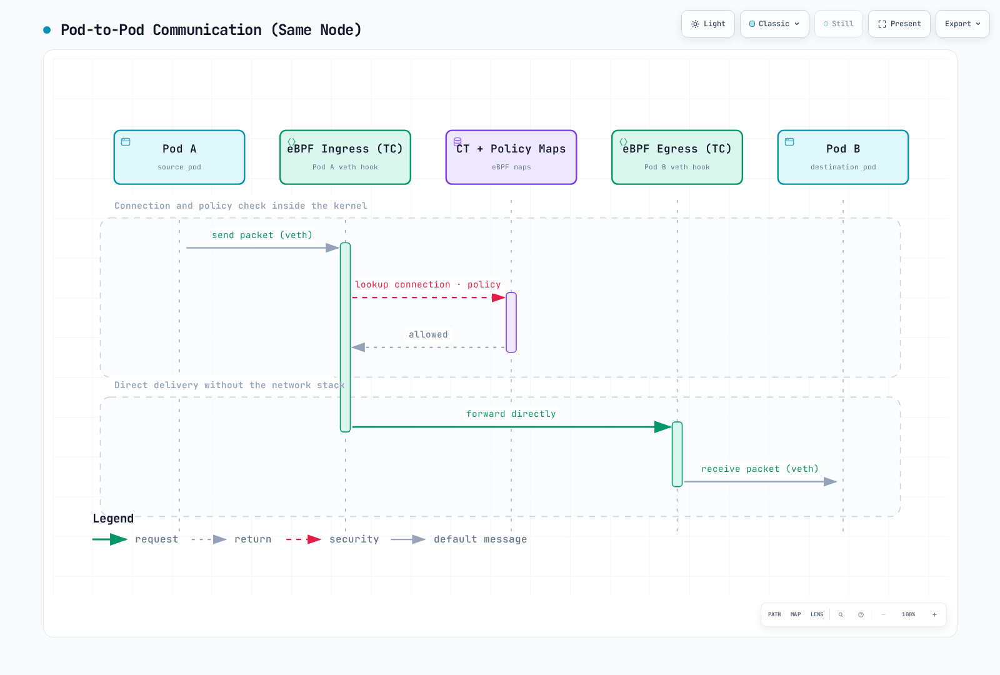

# Cilium Service Mesh 架构

> **评审基线**：Cilium 1.20.3，2026 年 10 月 16 日。其通用 Kubernetes 测试矩阵覆盖 1.33–1.36；已发布的 EKS CI 矩阵覆盖 1.33–1.35。平台、内核和安装模式的要求各不相同；请参阅[概览](./README.md)。

## 概览

Cilium 将 eBPF L3/L4 数据路径与 Envoy 结合，用于 HTTP 和其他受支持的 L7 处理。Envoy 可以作为由 agent 管理的进程运行，也可以运行在独立的 `cilium-envoy` DaemonSet 中。共享代理会改变部署和故障边界；但这并不能确立固定的内存节省幅度或延迟结果。

## 整体架构


[🔍 查看交互式图表](https://www.atomai.click/kubernetes-docs/archmaps/en-service-mesh-cilium-service-mesh-01-architecture-0.html)

顶部方框将控制平面功能归为一组。**Kubernetes API server 和 Cilium Operator 是独立组件**；Operator 是负责集群范围工作的 Deployment，不是每节点 agent，也不能替代 API server。

| 组件 | 职责 |
|---|---|
| Cilium Agent | 管理本地端点、eBPF 程序/映射、策略和 Envoy 配置 |
| Cilium Operator | 执行集群范围的工作，例如身份垃圾回收、CRD 注册，以及适用 IPAM 模式下的 IP 分配 |
| Envoy | 处理重定向的 L7 流量；独立 DaemonSet 可实现代理生命周期的独立管理 |
| Kubernetes API | 存储期望资源，并向控制器报告工作负载/Service 状态 |
| Hubble | 观测受支持的数据路径和代理事件；启用时，Relay/UI 是额外组件 |

## eBPF 数据路径

### 程序和挂载点

eBPF 程序在验证后于指定的内核挂载点运行。它们可以实现数据包过滤、重定向和 Service 转换，而无需为每个 L3/L4 数据包增加一次用户空间代理跳转。


[🔍 查看交互式图表](https://www.atomai.click/kubernetes-docs/archmaps/en-service-mesh-cilium-service-mesh-01-architecture-1.html)

绕行箭头表示一种可能的优化，并不保证 Cilium 会跳过所有 Linux 网络层。Pod socket 栈、路由模式、内核能力和集成要求仍然会产生影响。

| 挂载点或路径 | Cilium 的用途和限定条件 |
|---|---|
| TC/TCX 和端点数据路径 | 数据包级策略、转发和 Service 操作；挂载机制取决于内核/数据路径模式 |
| cgroup socket 挂载点 | socket 级 Service 转换，例如在 TCP `connect()` 时进行；这不同于数据包级 TC 负载均衡 |
| XDP | 可选的早期处理，例如在受支持的设备上加速 NodePort/LoadBalancer；仅安装 Cilium 并不会让所有路径都启用 XDP |
| veth/netkit | 有各自要求的替代端点设备/数据路径选项；它们并不意味着存在一种通用的挂载点顺序 |

### 连接跟踪和策略

Cilium 在 BPF 映射中存储连接状态。这支持有状态处理、回复识别以及 NAT/代理记账。**这并不意味着第一个数据包会永久缓存允许决策并应用于之后的所有数据包**：已发布的端点数据路径会在发起方向同时针对 `CT_NEW` 和 `CT_ESTABLISHED` 检查策略，但存在明确的例外。已识别的回复/相关流量会遵循有状态返回处理。必须根据实际配置评估策略更新、代理重定向和优化路径。

下表是概念性说明，并非 C 结构或映射 ABI：

| 映射信息 | 用途 |
|---|---|
| CT 元组键和连接状态值 | 标识流量/方向，并维护其状态、生命周期和转换元数据 |
| Service 前端和后端映射 | 将 Service 地址/端口/协议信息解析为后端条目 |
| 策略映射 | 表示已编译的身份/方向/端口/协议策略以及相关代理/身份验证元数据 |
| IP 缓存 | 将地址/前缀与安全身份和路由信息关联起来 |

读取原始映射时请使用已发布的 BPF 定义。IPv4/IPv6 的键、值、字节序和布局各不相同；虚构一个同时包含元组和状态的 `ct_entry` 不能作为可靠的解码规范。

### 替代 kube-proxy {#kube-proxy-replacement}

以下是一个**安装模式片段**，不是迁移步骤。请将 API 主机和端口替换为 Service 转换尚不可用时即可访问的端点。端口 6443 仅作示例；EKS API 端点通常使用 HTTPS 端口 443。保留所选平台的 IPAM、路由和 CNI 设置。

```yaml
kubeProxyReplacement: true
k8sServiceHost: <reachable-api-server-host>
k8sServicePort: 6443
loadBalancer:
  algorithm: maglev
```

对于适用的外部南北向流量，`loadBalancer.algorithm: maglev` 可提供一致的后端选择。在此模式下，Cilium 的 socket 级东西向 Service 连接不受 Maglev 影响。Kubernetes 的 `Service.spec.sessionAffinity: ClientIP` 是一项独立功能；Maglev 既不是基于 Cookie 的会话保持，也不保证保留到已移除后端的连接。

| 主题 | 架构区别 |
|---|---|
| Service 转换 | kube-proxy 的实现包括 iptables 和 nftables；Cilium 使用 BPF，并可在启用时使用 socket 级转换 |
| 连接状态 | Linux conntrack 和 Cilium 的 BPF CT 映射是两种独立机制 |
| DSR | `loadBalancer.mode: dsr` 可让后端使用 Service 地址直接回复；必须检查受支持的分发/路由组合、MTU 和云网络 |
| 性能 | 仅凭算法查找特性无法确定整体请求延迟、吞吐量或 CPU 消耗 |

对于 Cilium 1.20.3，DSR 的 option 分发要求使用原生路由；Geneve 分发支持原生路由或 Geneve 隧道路由，而 VXLAN 隧道路由不是受支持的 DSR 组合。AWS 源/目标检查也可能影响 DSR。不要在任意 EKS 安装中直接添加 `mode: dsr`，而不先确认[特定模式的要求](https://github.com/cilium/cilium/blob/v1.20.3/Documentation/network/kubernetes/kubeproxy-free.rst)。

## 共享 Envoy 代理

### 部署和资源配置

此 Helm 覆盖配置为已规划的 Cilium 安装启用独立 Envoy DaemonSet 和直接 CEC 管理。请将其与经过审核的安装 values 合并。资源数值是请求/限制的示例，并非基准测试结果或通用规格建议。

```yaml
l7Proxy: true
envoyConfig:
  enabled: true
envoy:
  enabled: true
  resources:
    requests:
      cpu: 100m
      memory: 256Mi
    limits:
      cpu: 2000m
      memory: 2Gi
```

```bash
kubectl -n kube-system get daemonset cilium cilium-envoy
kubectl -n kube-system get deployment cilium-operator
kubectl -n kube-system get pods -l k8s-app=cilium -o wide
```

期望/就绪计数取决于符合条件的节点。内嵌 Envoy 模式具有不同的进程生命周期，不需要这个独立 DaemonSet。

### L7 处理流程

HTTP L7 网络策略会将相关流量重定向到策略执行代理。CEC Service 负载均衡、Ingress 和 Gateway API 也可能将 Envoy 引入流量路径。因此，“只有使用 L7 网络策略的流量才会经过 Envoy”这种说法过于狭隘。


[🔍 查看交互式图表](https://www.atomai.click/kubernetes-docs/archmaps/en-service-mesh-cilium-service-mesh-01-architecture-12.html)

此图展示的是**出站**策略。入站策略在接收端执行；两者都可以配置。经过代理的 HTTP 响应会通过已建立的代理连接传输。响应不是每次都单独决定是否重定向或绕过。若要检查 HTTP 字段，必须先配置相应的受支持 TLS/L7 功能，以处理经 TLS 加密的应用负载。

### 配置归属

通过安装所用的 values 维护由 Helm 生成的 agent 配置。用简短的手写 ConfigMap 替换 `cilium-config` 可能会遗漏必需的平台设置。

以下命令用于检查现有 release 和 agent；请先按照身份部分的说明设置 `CILIUM_POD`：

```bash
helm get values cilium -n kube-system -a
kubectl -n kube-system get configmap cilium-config -o yaml
kubectl -n kube-system logs "$CILIUM_POD" -c cilium-agent --since=10m
```

Chart 1.20.3 使用 `envoy.connectTimeoutSeconds`、`envoy.clusterMaxConnections`、`envoy.clusterMaxPendingRequests` 和 `envoy.clusterMaxRequests`。诸如 `envoy.connectTimeout`、`maxConnectionsPerHost`、`envoy.cluster.*` 和 `envoy.proxy.protocol.*` 的键并不能实现这些控制。HTTP/2 和 TLS 配置应使用受支持的控制器/Envoy API，而不是臆造的 Helm 开关。

## CRD 模型

| 资源 | 作用范围和职责 |
|---|---|
| `CiliumNetworkPolicy` | 命名空间范围的端点策略，包括受支持的 L7 规则 |
| `CiliumClusterwideNetworkPolicy` | 集群范围的端点策略；仍由选择器决定受影响的端点 |
| `CiliumEnvoyConfig` (CEC) | 命名空间范围的低级 Envoy 资源和 Service 重定向 |
| `CiliumClusterwideEnvoyConfig` (CCEC) | 集群范围的 Envoy 配置；仍需明确标识单个 Service |
| `CiliumEndpoint` | 由 Cilium 维护的命名空间范围端点状态 |
| `CiliumIdentity` | 为一组标签分配集群范围的安全身份 |

这些资源并非都会“解析为 CiliumEndpoint”。常见的 Ingress/路由任务可以使用受支持的 Gateway API 资源；直接管理 CEC/CCEC 是一种更低级的选项，需要具备 Envoy 专业知识。

### CiliumEnvoyConfig

此示例假设已存在由 Cilium 管理的 **`default/my-service` Service，其前端端口为 8080，且有就绪的 HTTP 后端**。它会将该前端重定向到一个 Listener，使用 RDS RouteConfiguration，并定义所引用的 EDS Cluster。这里不会创建所引用的工作负载和 Service，它们是前置条件。

```yaml
apiVersion: cilium.io/v2
kind: CiliumEnvoyConfig
metadata:
  name: http-filter
  namespace: default
spec:
  services:
  - name: my-service
    namespace: default
    ports:
    - 8080
    listener: http-listener
  resources:
  - '@type': type.googleapis.com/envoy.config.listener.v3.Listener
    name: http-listener
    filter_chains:
    - filters:
      - name: envoy.filters.network.http_connection_manager
        typed_config:
          '@type': type.googleapis.com/envoy.extensions.filters.network.http_connection_manager.v3.HttpConnectionManager
          stat_prefix: my-service
          rds:
            route_config_name: http-route
          http_filters:
          - name: envoy.filters.http.router
            typed_config:
              '@type': type.googleapis.com/envoy.extensions.filters.http.router.v3.Router
  - '@type': type.googleapis.com/envoy.config.route.v3.RouteConfiguration
    name: http-route
    virtual_hosts:
    - name: my-service
      domains:
      - '*'
      routes:
      - match:
          prefix: /
        route:
          cluster: default/my-service
  - '@type': type.googleapis.com/envoy.config.cluster.v3.Cluster
    name: default/my-service
    connect_timeout: 5s
    type: EDS
    lb_policy: ROUND_ROBIN
```

`services` 条目还会通过 EDS 安排后端同步。对于其他后端 Service，如果不希望其自身前端流量被重定向，可使用 `backendServices`。CEC 的前端 Service 命名空间必须与 CEC 所在命名空间一致。省略 Listener 的地址是有意为之：Cilium 会分配代理端口并填入其 xDS 来源。这是 Cilium 资源，不是独立的 Envoy bootstrap 文件。

### CiliumClusterwideEnvoyConfig

此独立示例的目标是已存在的 **`default/rate-limited-service:8080`**。它会应用本地令牌桶，初始突发容量为 1,000 个请求，补充速率为每秒 100 个令牌。它明确启用并强制对 100% 的请求应用此过滤器。

```yaml
apiVersion: cilium.io/v2
kind: CiliumClusterwideEnvoyConfig
metadata:
  name: local-rate-limit
spec:
  services:
  - name: rate-limited-service
    namespace: default
    ports:
    - 8080
    listener: http-listener
  resources:
  - '@type': type.googleapis.com/envoy.config.listener.v3.Listener
    name: http-listener
    filter_chains:
    - filters:
      - name: envoy.filters.network.http_connection_manager
        typed_config:
          '@type': type.googleapis.com/envoy.extensions.filters.network.http_connection_manager.v3.HttpConnectionManager
          stat_prefix: rate-limited-service
          rds:
            route_config_name: http-route
          http_filters:
          - name: envoy.filters.http.local_ratelimit
            typed_config:
              '@type': type.googleapis.com/envoy.extensions.filters.http.local_ratelimit.v3.LocalRateLimit
              stat_prefix: http_local_rate_limiter
              token_bucket:
                max_tokens: 1000
                tokens_per_fill: 100
                fill_interval: 1s
              filter_enabled:
                default_value:
                  numerator: 100
                  denominator: HUNDRED
              filter_enforced:
                default_value:
                  numerator: 100
                  denominator: HUNDRED
              local_rate_limit_per_downstream_connection: false
          - name: envoy.filters.http.router
            typed_config:
              '@type': type.googleapis.com/envoy.extensions.filters.http.router.v3.Router
  - '@type': type.googleapis.com/envoy.config.route.v3.RouteConfiguration
    name: http-route
    virtual_hosts:
    - name: rate-limited-service
      domains:
      - '*'
      routes:
      - match:
          prefix: /
        route:
          cluster: default/rate-limited-service
  - '@type': type.googleapis.com/envoy.config.cluster.v3.Cluster
    name: default/rate-limited-service
    connect_timeout: 5s
    type: EDS
    lb_policy: ROUND_ROBIN
```

CCEC 的集群范围并不会让 `"*"` 成为 Service/命名空间通配符。省略 `nodeSelector` 会将此配置分发到所有适用节点；这并不等于选择所有 Service。

上述令牌桶由**每个 Envoy 进程内的工作线程共享**，而非由集群中的所有代理共享。总允许量取决于流量分布和参与处理的进程数量。它不是集群范围的全局配额。`filter_enabled` 和 `filter_enforced` 在其他情况下默认值均为 0%；仅添加令牌桶并不足够。

Kubernetes 会保留 `spec.resources` 中的未知字段；`kubectl apply` 成功并不能证明 Envoy 接受了这些资源。请检查 agent 警告/错误、xDS 接受状态和实际请求。避免与 Ingress/Gateway 控制器所管理的配置及直接配置的 CEC 资源发生冲突。

### 带 HTTP 规则的 CiliumNetworkPolicy

此策略会选择 `default` 命名空间中 `app=backend` 的端点，允许同一命名空间中来自 `app=frontend` 的所列 HTTP 操作，并允许出站数据库流量和 DNS。它假设 `kube-system` 中存在标签为 `k8s-app=kube-dns` 的 CoreDNS 端点；NodeLocal DNS 和其他解析器配置需要各自经过验证的出站规则。

```yaml
apiVersion: cilium.io/v2
kind: CiliumNetworkPolicy
metadata:
  name: l7-policy
  namespace: default
spec:
  endpointSelector:
    matchLabels:
      k8s:app: backend
  ingress:
  - fromEndpoints:
    - matchLabels:
        k8s:app: frontend
        k8s:io.kubernetes.pod.namespace: default
    toPorts:
    - ports:
      - port: '8080'
        protocol: TCP
      rules:
        http:
        - method: ^GET$
          path: ^/api/v1/.*$
          headers:
          - X-Request-ID
        - method: ^POST$
          path: ^/api/v1/users$
        - method: ^DELETE$
          path: ^/api/v1/users/[0-9]+$
  egress:
  - toEndpoints:
    - matchLabels:
        k8s:app: database
        k8s:io.kubernetes.pod.namespace: default
    toPorts:
    - ports:
      - port: '5432'
        protocol: TCP
  - toEndpoints:
    - matchLabels:
        k8s:k8s-app: kube-dns
        k8s:io.kubernetes.pod.namespace: kube-system
    toPorts:
    - ports:
      - port: '53'
        protocol: UDP
      - port: '53'
        protocol: TCP
```

`headers` 是字符串列表。`"X-Request-ID"` 要求该请求头存在；它不能证明身份或授权。`headerMatches` 是用于精确值/密钥的独立结构化 API。HTTP 规则之间是“或”关系，因此上面的请求头要求仅适用于 GET；写入操作仍然需要应用身份验证和授权。

`ingress` 和 `egress` 部分会为所选端点启用相应的默认拒绝行为，但仍受其他适用策略授权的约束。这不是完整的应用依赖策略：必须单独建模运行状况检查、外部服务和其他客户端。

## Agent、身份和 SPIFFE

### Agent 职责


[🔍 查看交互式图表](https://www.atomai.click/kubernetes-docs/archmaps/en-service-mesh-cilium-service-mesh-01-architecture-7.html)

这些分组描述的是职责，并非互不重叠的事件处理流程：可观测性可以暴露来自多个数据路径和代理组件的事件。集群范围的 Operator 职责仍然是独立的。

### 安全身份

Cilium 会为一组与身份相关的标签分配一个数字安全身份。拥有相同标签集的 Pod 可以共享同一个身份。命名空间和 service account 标签可以参与身份计算，但该数字既不是用户计算出的哈希值，也不是永久的 Pod 标识符。端点发生变化时，Cilium 会维护地址与身份之间的关系。

请检查已分配的身份；不要创建猜测的 `CiliumIdentity` 对象来指定 ID：

```bash
kubectl -n default get ciliumendpoints
kubectl get ciliumidentities
CILIUM_POD='<agent-pod-on-the-node-being-inspected>'
kubectl -n kube-system exec "$CILIUM_POD" -c cilium-agent -- cilium-dbg identity list
kubectl -n kube-system exec "$CILIUM_POD" -c cilium-agent -- cilium-dbg status --verbose
```

例如，保留 ID 1、2、3 和 4 分别表示 `host`、`world`、`unmanaged` 和 `health`。双栈部署还具有不同的 world 地址族身份。已分配的工作负载 ID 取决于环境，不应作为固定策略常量复制。

### SPIRE 集成和安全边界

Cilium 的 beta 带外双向身份验证使用 Cilium agent 代表 Cilium 安全身份获取并验证身份。使用默认信任域时，ID 如下：

```text
spiffe://spiffe.cilium/identity/<numeric-security-identity>
```

这不同于 Istio 的命名空间/service account 路径。更改 `authentication.mutual.spire.trustDomain` 会改变信任域部分。

```yaml
authentication:
  enabled: true
  mutual:
    spire:
      enabled: true
      trustDomain: spiffe.cilium
      agentSocketPath: /run/spire/sockets/agent/agent.sock
      install:
        enabled: true
        server:
          dataStorage:
            enabled: true
            size: 1Gi
```

此可选覆盖配置需要适用于 SPIRE 持久存储的 StorageClass/PV，并且需要为所选流量明确配置身份验证策略。仅启用 SPIRE 并不意味着每个连接都需要双向身份验证。

身份验证握手在带外进行。**应用流量加密是独立的 WireGuard/IPsec 配置**，有其自身的平台和路径限制。Cilium 将此双向身份验证功能标记为 beta/尚不完整，其中包括 ClusterMesh 和外部 mTLS 互操作性限制；不应将其描述为等同于普遍应用的 sidecar mTLS。

### 独立的 ztunnel 加密 Beta

Cilium 1.20.3 还提供独立的 [ztunnel 透明加密 beta](https://github.com/cilium/cilium/blob/v1.20.3/Documentation/security/network/encryption-ztunnel.rst)，通过 `encryption.type: ztunnel` 选择。它提供带命名空间注册机制的 TCP 工作负载 mTLS；通信双方都必须完成注册。它不支持 ClusterMesh 和使用 host network 的 Pod；已发布的指南还警告，除非目标为 HBONE 端口 15008，否则普通 L4 策略无法在此路径上工作。这是一种独立的部署选择，有自己的 CA/引导要求。

上文数字形式的 SPIFFE 身份示例属于带外身份验证。ztunnel 集成具有独立的命名空间/service account 工作负载身份模型，并默认使用 Cilium 的内部 CA 选项；此默认配置不需要 SPIRE。

## 按场景分析数据包流

### 同一节点上的 Pod



[🔍 查看交互式图表](https://www.atomai.click/kubernetes-docs/archmaps/en-service-mesh-cilium-service-mesh-01-architecture-10.html)

这是经过简化的 veth 快速路径。满足要求时，BPF 主机路由可以绕过**主机**协议栈的上层部分和 netfilter 挂载点；但 Pod 自身的协议栈仍然存在。传统主机路由、netkit、代理重定向和集成方式都会改变路径。依赖主机 netfilter 挂载点的功能需要特别注意；此图不保证延迟普遍达到 0.1 ms。

### 不同节点上的 Pod

使用隧道路由时，发送节点会通过 VXLAN 或 Geneve 封装流量，接收节点再进行解封装。原生路由使用底层网络路由到 Pod 地址，而无需这种覆盖网络封装。节点可达性、PodCIDR 路由、MTU、防火墙规则和可选加密都会决定该路径是否可用。

### HTTP 策略或 Service 代理

适用的出站/入站策略或 Service 前端可以将流量重定向到 Envoy。代理会解析受支持的协议，并转发获准/已路由的请求；响应通过其已建立的连接返回。这并不意味着每个流都必须同时经过客户端侧和服务器侧的 Envoy。

## 与 Istio 的比较

| 方面 | Cilium Service Mesh | Istio sidecar 模式 |
|---|---|---|
| 代理部署位置 | 由 agent 管理，或针对适用的 L7 流量使用独立的共享节点 Envoy | 与已加入网格的工作负载并行运行的 Envoy |
| L3/L4 数据路径 | eBPF 网络/策略，内核路径取决于模式 | 在网格范围内捕获工作负载流量并由 Envoy 处理 |
| L7 配置 | CNP、受支持的 Gateway API/控制器，或直接使用 CEC/CCEC | Gateway API 和 Istio 流量/安全 API |
| 身份验证和加密 | 带外双向身份验证加 WireGuard/IPsec；独立的 ztunnel mTLS beta | Envoy 工作负载 mTLS |
| 资源核算 | 包括 agent、BPF 映射、Envoy、Operator，以及可选的 Hubble/SPIRE | 包括 sidecar、控制平面，以及可选的网关/遥测组件 |

Istio 也提供 ambient 模式，其中包含 ztunnel 和可选的 waypoint 代理；仅与 sidecar 模式比较无法涵盖 Istio 的全部架构。应在相同的工作负载、流量、安全和可观测性设置下进行比较，并记录版本、节点数、请求速率和延迟百分位数。先前提到的每个 Pod 50 MB、每个节点 100 MB 或固定毫秒总量，均没有可复现的基准测试证据，因此不能作为容量规划依据。

## 可扩展性注意事项

### BPF 映射容量

映射容量取决于并发流量、身份、Service/后端和节点内存，而不仅是集群节点数。以下显式 Helm 值展示了映射控制项；它们并非适用于所有 1,000 节点集群的建议：

```yaml
bpf:
  ctTcpMax: 524288
  ctAnyMax: 262144
  natMax: 524288
  policyMapMax: 16384
```

显式设置 CT/NAT 容量时，NAT 容量不得超过 TCP 和非 TCP CT 容量总和的三分之二；此示例符合该限制。`bpf.mapDynamicSizeRatio` 则会根据节点内存推导若干映射容量；0.0025 表示受影响映射的 0.25%，而非整个 Cilium 堆栈的 0.25%。策略映射按端点划分，需要单独考虑。

调优前请先观察资源压力和分配失败。增加/重建映射可能消耗大量内存并中断现有流量。`cluster.id` 用于集群身份/ClusterMesh 设计，不是通用性能开关。不要复制已过时的 `sockops-enable` 示例，也不要复制不存在的 `hubble-disable` 示例。

### Envoy 容量

使用实际 chart 键的覆盖配置示例：

```yaml
envoy:
  resources:
    requests:
      cpu: 500m
      memory: 512Mi
    limits:
      cpu: 4000m
      memory: 4Gi
  extraArgs:
  - --concurrency 4
  connectTimeoutSeconds: 5
  clusterMaxConnections: 10000
  clusterMaxPendingRequests: 10000
  clusterMaxRequests: 10000
```

请求/限制和四个工作线程均为示例，必须符合节点容量和实测负载。`envoy.extraArgs` 会将 worker 选项传递给独立 Envoy 进程；`envoy.concurrency` 不是 chart 1.20.3 的设置。由 agent 管理的 Envoy 配置具有不同的生命周期。集群连接数/待处理请求数限制是断路器控制项，并非整个网格的全局请求配额。每个 Listener 的缓冲配置属于对应的 Envoy 资源，而非 `envoy.perConnectionBufferLimitBytes`。

## 后续步骤

- [流量管理](./02-traffic-management.md)
- [安全](./03-security.md)
- [可观测性](./04-observability.md)
- [架构测验](../../quizzes/service-mesh/cilium-service-mesh/architecture.md)

## 参考资料

- [Cilium 1.20.3 架构和 Envoy](https://github.com/cilium/cilium/blob/v1.20.3/Documentation/security/network/proxy/envoy.rst)
- [kube-proxy 替代、Maglev、DSR 和 socket LB](https://github.com/cilium/cilium/blob/v1.20.3/Documentation/network/kubernetes/kubeproxy-free.rst)
- [已发布的数据路径策略检查](https://github.com/cilium/cilium/blob/v1.20.3/bpf/bpf_lxc.c)
- [路由和封装](https://github.com/cilium/cilium/blob/v1.20.3/Documentation/network/concepts/routing.rst)
- [eBPF 性能选项和限制](https://github.com/cilium/cilium/blob/v1.20.3/Documentation/operations/performance/tuning.rst)
- [BPF 映射容量](https://github.com/cilium/cilium/blob/v1.20.3/Documentation/network/ebpf/maps.rst)
- [Cilium Operator](https://github.com/cilium/cilium/blob/v1.20.3/Documentation/internals/cilium_operator.rst)
- [Envoy 流量管理示例](https://github.com/cilium/cilium/blob/v1.20.3/examples/kubernetes/servicemesh/envoy/envoy-traffic-management-test.yaml)
- [CEC 资源解析器](https://github.com/cilium/cilium/blob/v1.20.3/pkg/ciliumenvoyconfig/cec_resource_parser.go)
- [CEC schema](https://github.com/cilium/cilium/blob/v1.20.3/pkg/k8s/apis/cilium.io/client/crds/v2/ciliumenvoyconfigs.yaml)
- [CNP schema](https://github.com/cilium/cilium/blob/v1.20.3/pkg/k8s/apis/cilium.io/client/crds/v2/ciliumnetworkpolicies.yaml)
- [Helm 1.20.3 values](https://github.com/cilium/cilium/blob/v1.20.3/install/kubernetes/cilium/values.yaml)
- [基于身份的安全](https://github.com/cilium/cilium/blob/v1.20.3/Documentation/security/network/identity.rst)
- [SPIFFE ID 构造](https://github.com/cilium/cilium/blob/v1.20.3/pkg/auth/spire/certificate_provider.go)
- [双向身份验证的状态和限制](https://github.com/cilium/cilium/blob/v1.20.3/Documentation/network/servicemesh/mutual-authentication/mutual-authentication.rst)
- [Envoy 1.38.6 本地速率限制 API](https://github.com/envoyproxy/envoy/blob/v1.38.6/api/envoy/extensions/filters/http/local_ratelimit/v3/local_rate_limit.proto)
