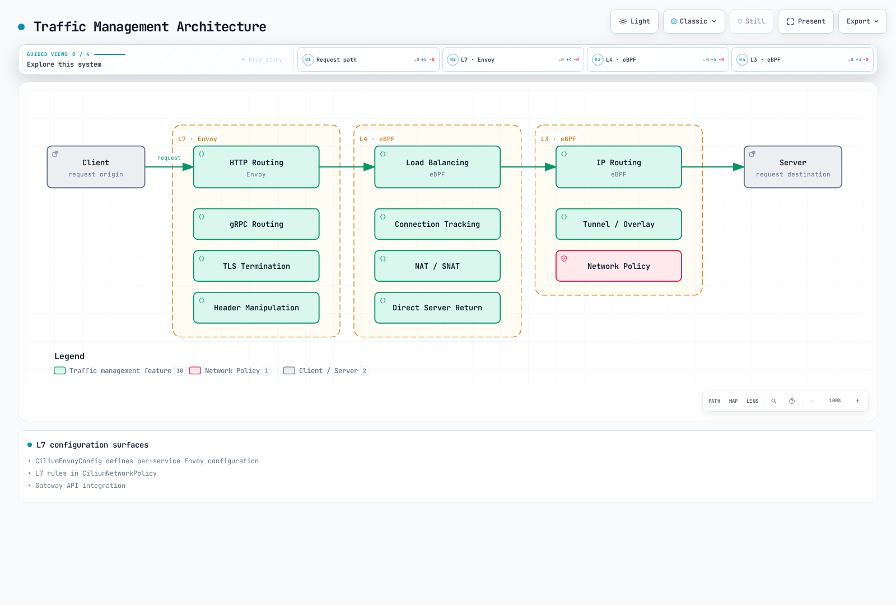

# Cilium Service Mesh 流量管理

> **审查基线**：Cilium 1.20.3 和 Gateway API 1.6.3，2026 年 10 月 16 日。有关 Kubernetes/EKS 测试矩阵和平台要求，请参阅[概述](./README.md)。

## 概述

Cilium Service Mesh 中的流量管理结合了基于 eBPF 的 L4 负载均衡与基于 Envoy 的 L7 路由。本章通过 CiliumEnvoyConfig、CiliumNetworkPolicy 中的 L7 规则以及 Gateway API 集成，介绍高级流量管理功能。

## 流量管理架构



[🔍 查看交互式图表](https://www.atomai.click/kubernetes-docs/archmaps/en-service-mesh-cilium-service-mesh-02-traffic-management-0.html)

图中按层归纳了各项能力。这并非强制的数据包处理顺序：仅使用 L3/L4 的流量可以绕过 Envoy，而实际的出口/入口/Service 路径取决于配置。

## CiliumEnvoyConfig

以下是**相互独立的配置示例**，并非要一起安装的资源。有些示例针对同一个 frontend Service；请选择一个配置所有者，以避免 Listener 冲突。这些示例假定 Cilium 已做好相应准备，包括 `l7Proxy: true`、`envoyConfig.enabled: true`、适当的 kube-proxy 替换/路由设置以及所需 CRD。

每个具名的 frontend 和 backend Service 必须已存在于 `default` 中，端口为 **8080**，并且具有适当的选择器和就绪的 HTTP 端点。Kafka 和 gRPC 部分分别说明了各自的命名空间/端口前提条件。CEC 示例不会创建工作负载、Services 或证书。

`services` 用于选择要重定向到的 frontend，并同步其后端；`backendServices` 用于同步其他后端，但不会重定向它们自身的 frontend 流量。EDS Cluster 资源仍必须存在。Cilium 会有意补充未提供的 Listener 地址/xDS 源。仅 Kubernetes 接受配置还不够：请检查 agent/Envoy 错误并验证实际请求。有关所有权和验证边界，请参阅[架构章节](./01-architecture.md)。

### 基本结构

CiliumEnvoyConfig 为特定服务定义 Envoy 配置：

```yaml
apiVersion: cilium.io/v2
kind: CiliumEnvoyConfig
metadata:
  name: my-service-config
  namespace: default
spec:
  services:
  - name: my-service
    namespace: default
    ports:
    - 8080
  backendServices:
  - name: backend-v1
    namespace: default
  - name: backend-v2
    namespace: default
  resources:
  - '@type': type.googleapis.com/envoy.config.listener.v3.Listener
    name: my-service-listener
    filter_chains:
    - filters:
      - name: envoy.filters.network.http_connection_manager
        typed_config:
          '@type': type.googleapis.com/envoy.extensions.filters.network.http_connection_manager.v3.HttpConnectionManager
          stat_prefix: my-service-listener
          route_config:
            name: my-service-listener-routes
            virtual_hosts:
            - name: api
              domains:
              - '*'
              routes:
              - match:
                  prefix: /
                route:
                  weighted_clusters:
                    clusters:
                    - name: default/backend-v1
                      weight: 50
                    - name: default/backend-v2
                      weight: 50
          http_filters:
          - name: envoy.filters.http.router
            typed_config:
              '@type': type.googleapis.com/envoy.extensions.filters.http.router.v3.Router
  - '@type': type.googleapis.com/envoy.config.cluster.v3.Cluster
    name: default/backend-v1
    connect_timeout: 5s
    type: EDS
    lb_policy: ROUND_ROBIN
  - '@type': type.googleapis.com/envoy.config.cluster.v3.Cluster
    name: default/backend-v2
    connect_timeout: 5s
    type: EDS
    lb_policy: ROUND_ROBIN
```

这个完整示例会将请求分配到两个明确命名的后端。Listener、HTTP 路由和 EDS Cluster 是彼此独立的部分；仅列出 backend Services 并不会定义这些 Cluster。

### HTTP 路由

#### 基于路径的路由

```yaml
apiVersion: cilium.io/v2
kind: CiliumEnvoyConfig
metadata:
  name: path-routing
  namespace: default
spec:
  services:
  - name: api-gateway
    namespace: default
    ports:
    - 8080
  backendServices:
  - name: users-service
    namespace: default
  - name: orders-service
    namespace: default
  - name: products-service
    namespace: default
  resources:
  - '@type': type.googleapis.com/envoy.config.listener.v3.Listener
    name: api-gateway-listener
    filter_chains:
    - filters:
      - name: envoy.filters.network.http_connection_manager
        typed_config:
          '@type': type.googleapis.com/envoy.extensions.filters.network.http_connection_manager.v3.HttpConnectionManager
          stat_prefix: api-gateway
          codec_type: AUTO
          route_config:
            name: api_routes
            virtual_hosts:
            - name: api
              domains:
              - '*'
              routes:
              - match:
                  path_separated_prefix: /users
                route:
                  cluster: default/users-service
              - match:
                  path_separated_prefix: /orders
                route:
                  cluster: default/orders-service
              - match:
                  path_separated_prefix: /products
                route:
                  cluster: default/products-service
              - match:
                  prefix: /
                direct_response:
                  status: 404
                  body:
                    inline_string: Not Found
          http_filters:
          - name: envoy.filters.http.router
            typed_config:
              '@type': type.googleapis.com/envoy.extensions.filters.http.router.v3.Router
  - '@type': type.googleapis.com/envoy.config.cluster.v3.Cluster
    name: default/orders-service
    connect_timeout: 5s
    type: EDS
    lb_policy: ROUND_ROBIN
  - '@type': type.googleapis.com/envoy.config.cluster.v3.Cluster
    name: default/products-service
    connect_timeout: 5s
    type: EDS
    lb_policy: ROUND_ROBIN
  - '@type': type.googleapis.com/envoy.config.cluster.v3.Cluster
    name: default/users-service
    connect_timeout: 5s
    type: EDS
    lb_policy: ROUND_ROBIN
```

Envoy 会按顺序评估这些路由。`path_separated_prefix` 会匹配 `/users` 和 `/users/123`，但不会匹配 `/users-old`；最后的 `/` 规则是回退规则。这与任意字符串前缀匹配不同。

#### 基于请求头的路由

```yaml
apiVersion: cilium.io/v2
kind: CiliumEnvoyConfig
metadata:
  name: header-routing
  namespace: default
spec:
  services:
  - name: api-service
    namespace: default
    ports:
    - 8080
  backendServices:
  - name: api-v1
    namespace: default
  - name: api-v2
    namespace: default
  - name: api-beta
    namespace: default
  resources:
  - '@type': type.googleapis.com/envoy.config.listener.v3.Listener
    name: header-routing-listener
    filter_chains:
    - filters:
      - name: envoy.filters.network.http_connection_manager
        typed_config:
          '@type': type.googleapis.com/envoy.extensions.filters.network.http_connection_manager.v3.HttpConnectionManager
          stat_prefix: api-service
          route_config:
            name: header_routes
            virtual_hosts:
            - name: api
              domains:
              - '*'
              routes:
              - match:
                  prefix: /
                  headers:
                  - name: X-API-Version
                    string_match:
                      exact: v2
                route:
                  cluster: default/api-v2
              - match:
                  prefix: /
                  headers:
                  - name: X-Beta-User
                    string_match:
                      exact: 'true'
                route:
                  cluster: default/api-beta
              - match:
                  prefix: /
                route:
                  cluster: default/api-v1
          http_filters:
          - name: envoy.filters.http.router
            typed_config:
              '@type': type.googleapis.com/envoy.extensions.filters.http.router.v3.Router
  - '@type': type.googleapis.com/envoy.config.cluster.v3.Cluster
    name: default/api-beta
    connect_timeout: 5s
    type: EDS
    lb_policy: ROUND_ROBIN
  - '@type': type.googleapis.com/envoy.config.cluster.v3.Cluster
    name: default/api-v1
    connect_timeout: 5s
    type: EDS
    lb_policy: ROUND_ROBIN
  - '@type': type.googleapis.com/envoy.config.cluster.v3.Cluster
    name: default/api-v2
    connect_timeout: 5s
    type: EDS
    lb_policy: ROUND_ROBIN
```

第一个匹配的规则优先：同时携带两个请求头的请求会选择 v2。由客户端控制的版本/测试版请求头只是路由提示，不能证明用户有权访问相应后端。

#### 基于方法的路由

```yaml
apiVersion: cilium.io/v2
kind: CiliumEnvoyConfig
metadata:
  name: method-routing
  namespace: default
spec:
  services:
  - name: rest-api
    namespace: default
    ports:
    - 8080
  backendServices:
  - name: read-service
    namespace: default
  - name: write-service
    namespace: default
  resources:
  - '@type': type.googleapis.com/envoy.config.listener.v3.Listener
    name: method-routing-listener
    filter_chains:
    - filters:
      - name: envoy.filters.network.http_connection_manager
        typed_config:
          '@type': type.googleapis.com/envoy.extensions.filters.network.http_connection_manager.v3.HttpConnectionManager
          stat_prefix: rest-api
          route_config:
            name: method_routes
            virtual_hosts:
            - name: api
              domains:
              - '*'
              routes:
              - match:
                  prefix: /
                  headers:
                  - name: :method
                    string_match:
                      safe_regex:
                        google_re2: {}
                        regex: ^(GET|HEAD)$
                route:
                  cluster: default/read-service
              - match:
                  prefix: /
                  headers:
                  - name: :method
                    string_match:
                      safe_regex:
                        google_re2: {}
                        regex: ^(POST|PUT|DELETE|PATCH)$
                route:
                  cluster: default/write-service
              - match:
                  prefix: /
                direct_response:
                  status: 405
                response_headers_to_add:
                - header:
                    key: allow
                    value: GET, HEAD, POST, PUT, DELETE, PATCH
                  append_action: OVERWRITE_IF_EXISTS_OR_ADD
          http_filters:
          - name: envoy.filters.http.router
            typed_config:
              '@type': type.googleapis.com/envoy.extensions.filters.http.router.v3.Router
  - '@type': type.googleapis.com/envoy.config.cluster.v3.Cluster
    name: default/read-service
    connect_timeout: 5s
    type: EDS
    lb_policy: ROUND_ROBIN
  - '@type': type.googleapis.com/envoy.config.cluster.v3.Cluster
    name: default/write-service
    connect_timeout: 5s
    type: EDS
    lb_policy: ROUND_ROBIN
```

GET/HEAD 会选择 read Service；POST/PUT/DELETE/PATCH 会选择 write Service。其他方法会收到 405。请有意添加所需的 OPTIONS/CORS 或应用专用行为。将写操作路由到专用后端本身并不会实现授权或幂等性。

## L7 流量策略

### CiliumNetworkPolicy L7 规则

CiliumNetworkPolicy 支持在 L7 层进行精细的流量控制：

```yaml
apiVersion: cilium.io/v2
kind: CiliumNetworkPolicy
metadata:
  name: l7-http-policy
  namespace: default
spec:
  endpointSelector:
    matchLabels:
      k8s:app: backend-api
  ingress:
  - fromEndpoints:
    - matchLabels:
        k8s:app: frontend
        k8s:io.kubernetes.pod.namespace: default
    toPorts:
    - ports:
      - port: '8080'
        protocol: TCP
      rules:
        http:
        - method: ^GET$
          path: ^/api/users/.*$
        - method: ^GET$
          path: ^/api/products/.*$
        - method: ^POST$
          path: ^/api/orders$
        - method: ^GET$
          path: ^/api/admin/.*$
          headerMatches:
          - name: X-API-Version
            value: v1
```

规则之间是“或”的关系；请求头条件仅适用于 admin 路径规则。`X-API-Version: v1` 是精确的路由/版本条件，并非 admin 凭据。请在应用中执行用户身份验证和授权。此策略会筛选来自指定命名空间的入口流量，其他适用策略授予的权限可能会扩大访问范围。

### 各类协议支持

#### Kafka：网络边界和 Broker ACL

```yaml
apiVersion: cilium.io/v2
kind: CiliumNetworkPolicy
metadata:
  name: kafka-l4-policy
  namespace: kafka
spec:
  endpointSelector:
    matchLabels:
      k8s:app: kafka-broker
  ingress:
  - fromEndpoints:
    - matchLabels:
        k8s:app: kafka-producer
        k8s:io.kubernetes.pod.namespace: kafka
    toPorts:
    - ports:
      - port: '9092'
        protocol: TCP
  - fromEndpoints:
    - matchLabels:
        k8s:app: kafka-consumer
        k8s:io.kubernetes.pod.namespace: kafka
    toPorts:
    - ports:
      - port: '9092'
        protocol: TCP
```

Cilium 1.20.3 的 L7 策略 API 支持 HTTP 和 DNS；旧版 `rules.kafka` API 已不存在。已发布的 CRD 会拒绝此 Kafka 规则对象。移除其 L7 规则后只会留下 L4 权限，而不是 topic 级别的授权。此替代方案只允许列出的客户端访问预先配置的 Broker 监听器的 TCP 9092 端口。请另行配置 Kafka TLS/SASL 和 Broker ACL，以控制 topic、消费者组和操作；此处的网络策略无法区分 produce 与 fetch。

#### DNS L7 策略

```yaml
apiVersion: cilium.io/v2
kind: CiliumNetworkPolicy
metadata:
  name: dns-l7-policy
  namespace: default
spec:
  endpointSelector:
    matchLabels:
      k8s:app: web-app
  egress:
  - toEndpoints:
    - matchLabels:
        k8s:io.kubernetes.pod.namespace: kube-system
        k8s:k8s-app: kube-dns
    toPorts:
    - ports:
      - port: '53'
        protocol: UDP
      - port: '53'
        protocol: TCP
      rules:
        dns:
        - matchPattern: '*.example.com'
        - matchPattern: api.external-service.io
        - matchName: database.internal.svc.cluster.local
```

此示例仅允许通过 UDP 和 TCP 向选定的集群解析器发送 **DNS 查询**。它不会允许连接到返回地址的 HTTPS/数据库服务；请为预期目标另行添加 `toFQDNs`/端点和端口规则。`*.example.com` 不包括顶级域名 `example.com` 或任意多层子域名。还必须考虑解析器的搜索列表查询，而 NodeLocal DNS 需要使用经过验证的不同目标规则。限制域名并不能保证不会发生数据外泄、DoH 或对允许域名的滥用。

#### gRPC L7 策略

```yaml
apiVersion: cilium.io/v2
kind: CiliumNetworkPolicy
metadata:
  name: grpc-l7-policy
  namespace: default
spec:
  endpointSelector:
    matchLabels:
      k8s:app: grpc-server
  ingress:
  - fromEndpoints:
    - matchLabels:
        k8s:app: grpc-client
        k8s:io.kubernetes.pod.namespace: default
    toPorts:
    - ports:
      - port: '50051'
        protocol: TCP
      rules:
        http:
        - method: ^POST$
          path: ^/myapp\.UserService/GetUser$
        - method: ^POST$
          path: ^/myapp\.UserService/ListUsers$
        - method: ^POST$
          path: ^/myapp\.OrderService/.*$
```

这些 HTTP/2 规则会匹配 gRPC 的 `POST /package.Service/Method` 路径。package 名称中的点已转义，表达式也设置了锚点。假设 HTTP/2 路径可通过受支持的方式检查；加密的应用流量需要相应的 TLS 配置。健康检查/反射以及其他方法不会被隐式允许，HTTP 策略也无法授权 protobuf 消息内部的字段。

## 负载均衡

### L4 负载均衡（eBPF）

基于 eBPF 的 L4 负载均衡会替代 kube-proxy：

```yaml
kubeProxyReplacement: true
k8sServiceHost: <reachable-api-server-host>
k8sServicePort: 6443
loadBalancer:
  algorithm: maglev
  mode: snat
nodePort:
  enableHealthCheck: true
```

API 端点必须能在引导期间访问；请使用实际端口（EKS 通常为 443）。保留所选平台的 IPAM/路由设置。`nodePort.enableHealthCheck` 是 chart 键；之前的 `loadBalancer.healthCheckNodePort` 并未配置该功能。`loadBalancer.serviceTopology` 涉及拓扑感知路由，而不是 ClientIP 会话亲和性。DSR 分发/路由组合需要单独设计；文档中说明的分发选项是 `opt` 和 `geneve`，不是 `ipip`。请参阅[架构说明](./01-architecture.md#kube-proxy-replacement)。

#### Maglev 哈希

对于适用的外部流量，Maglev 会通过查找表将流键映射到后端。后端集合发生变化时，它能最大限度地减少重新分配；但它不会在某个后端被移除后保持该会话，也不能替代 `Service.spec.sessionAffinity: ClientIP`。

Cilium 1.20.3 的 eBPF Maglev 表默认大小为 **16,381**。支持的大小包括 **65,521**；而 **65,537** 属于下方独立的 Envoy MAGLEV 示例，并非受支持的 Cilium `maglev.tableSize` 值。所有节点都需要采用一致的配置。Socket 级别的东西向 Service 转换不经过此 Maglev 路径。

### L7 负载均衡（Envoy）

L7 负载均衡由 Envoy 提供：

```yaml
apiVersion: cilium.io/v2
kind: CiliumEnvoyConfig
metadata:
  name: l7-load-balancing
  namespace: default
spec:
  services:
  - name: api-service
    namespace: default
    ports:
    - 8080
  backendServices:
  - name: api-backend
    namespace: default
  resources:
  - '@type': type.googleapis.com/envoy.config.listener.v3.Listener
    name: l7-load-balancer
    filter_chains:
    - filters:
      - name: envoy.filters.network.http_connection_manager
        typed_config:
          '@type': type.googleapis.com/envoy.extensions.filters.network.http_connection_manager.v3.HttpConnectionManager
          stat_prefix: l7-load-balancer
          route_config:
            name: l7-load-balancer-routes
            virtual_hosts:
            - name: api
              domains:
              - '*'
              routes:
              - match:
                  prefix: /
                route:
                  cluster: default/api-backend
          http_filters:
          - name: envoy.filters.http.router
            typed_config:
              '@type': type.googleapis.com/envoy.extensions.filters.http.router.v3.Router
  - '@type': type.googleapis.com/envoy.config.cluster.v3.Cluster
    name: default/api-backend
    connect_timeout: 5s
    type: EDS
    lb_policy: ROUND_ROBIN
    outlier_detection:
      consecutive_5xx: 5
      interval: 10s
      base_ejection_time: 30s
      max_ejection_percent: 50
    health_checks:
    - timeout: 5s
      interval: 10s
      unhealthy_threshold: 3
      healthy_threshold: 2
      http_health_check:
        path: /health
        expected_statuses:
        - start: 200
          end: 300
    circuit_breakers:
      thresholds:
      - priority: DEFAULT
        max_connections: 1000
        max_pending_requests: 1000
        max_requests: 1000
        max_retries: 3
```

主动 `/health` 探测、被动异常值检测和断路器容量限制是不同的机制。HTTP 健康检查范围是 `[200, 300)`，因此包含 299。后端必须实现该健康端点，并且策略必须允许探测路径。异常值弹出并不能保证每个请求都避开故障端点。`circuit_breakers.thresholds` 中的 `max_retries` 限制并发重试资源；它不是每个请求的重试次数。

#### 负载均衡算法选项

请从下方选择**一个** Cluster 片段；这些片段是可选方案，不应作为含有重复 `lb_policy` 键的 YAML 映射一起使用。RING_HASH/MAGLEV 还需要适当的路由 `hash_policy`，请求才能一致地使用应用键；若未提供哈希值，则可能回退到随机键。Envoy 的 L7 MAGLEV 表与 Cilium 的 eBPF Maglev 表相互独立。

```yaml
lb_policy: ROUND_ROBIN
```

```yaml
lb_policy: LEAST_REQUEST
least_request_lb_config:
  choice_count: 2
```

```yaml
lb_policy: RANDOM
```

```yaml
lb_policy: RING_HASH
ring_hash_lb_config:
  hash_function: XX_HASH
  minimum_ring_size: 1024
  maximum_ring_size: 8388608
```

```yaml
lb_policy: MAGLEV
maglev_lb_config:
  table_size: 65537
```

## 流量拆分（金丝雀部署）

### 基于权重的流量拆分

```yaml
apiVersion: cilium.io/v2
kind: CiliumEnvoyConfig
metadata:
  name: canary-deployment
  namespace: default
spec:
  services:
  - name: frontend
    namespace: default
    ports:
    - 8080
  backendServices:
  - name: frontend-stable
    namespace: default
  - name: frontend-canary
    namespace: default
  resources:
  - '@type': type.googleapis.com/envoy.config.listener.v3.Listener
    name: canary-listener
    filter_chains:
    - filters:
      - name: envoy.filters.network.http_connection_manager
        typed_config:
          '@type': type.googleapis.com/envoy.extensions.filters.network.http_connection_manager.v3.HttpConnectionManager
          stat_prefix: frontend
          route_config:
            name: canary_routes
            virtual_hosts:
            - name: frontend
              domains:
              - '*'
              routes:
              - match:
                  prefix: /
                route:
                  weighted_clusters:
                    clusters:
                    - name: default/frontend-stable
                      weight: 90
                    - name: default/frontend-canary
                      weight: 10
          http_filters:
          - name: envoy.filters.http.router
            typed_config:
              '@type': type.googleapis.com/envoy.extensions.filters.http.router.v3.Router
  - '@type': type.googleapis.com/envoy.config.cluster.v3.Cluster
    name: default/frontend-canary
    connect_timeout: 5s
    type: EDS
    lb_policy: ROUND_ROBIN
  - '@type': type.googleapis.com/envoy.config.cluster.v3.Cluster
    name: default/frontend-stable
    connect_timeout: 5s
    type: EDS
    lb_policy: ROUND_ROBIN
```

权重 90 和 10 表示相对选取概率，并不意味着每 10 个请求中恰好有相应数量的请求，也不保证按用户/会话分配。当前 Envoy 使用权重总和；此处省略了已弃用的 `total_weight` 字段。这种配置只选择流量，不包含自动健康分析、升级或回滚循环。

### 基于请求头的金丝雀路由

```yaml
apiVersion: cilium.io/v2
kind: CiliumEnvoyConfig
metadata:
  name: header-canary
  namespace: default
spec:
  services:
  - name: api
    namespace: default
    ports:
    - 8080
  backendServices:
  - name: api-stable
    namespace: default
  - name: api-canary
    namespace: default
  resources:
  - '@type': type.googleapis.com/envoy.config.listener.v3.Listener
    name: header-canary-listener
    filter_chains:
    - filters:
      - name: envoy.filters.network.http_connection_manager
        typed_config:
          '@type': type.googleapis.com/envoy.extensions.filters.network.http_connection_manager.v3.HttpConnectionManager
          stat_prefix: api
          route_config:
            name: header_canary_routes
            virtual_hosts:
            - name: api
              domains:
              - '*'
              routes:
              - match:
                  prefix: /
                  headers:
                  - name: X-Canary
                    string_match:
                      exact: 'true'
                route:
                  cluster: default/api-canary
              - match:
                  prefix: /
                route:
                  cluster: default/api-stable
          http_filters:
          - name: envoy.filters.http.router
            typed_config:
              '@type': type.googleapis.com/envoy.extensions.filters.http.router.v3.Router
  - '@type': type.googleapis.com/envoy.config.cluster.v3.Cluster
    name: default/api-canary
    connect_timeout: 5s
    type: EDS
    lb_policy: ROUND_ROBIN
  - '@type': type.googleapis.com/envoy.config.cluster.v3.Cluster
    name: default/api-stable
    connect_timeout: 5s
    type: EDS
    lb_policy: ROUND_ROBIN
```

只有值精确为 `X-Canary: true` 时才会选择 canary；其他请求会选择 stable。除非经过身份验证的边界能够控制此请求头，否则应将其视为不可信。请在发布计划中纳入 stable/canary 应用状态和兼容性要求。

## 重试和超时

### 重试配置 {#retry-configuration}

```yaml
apiVersion: cilium.io/v2
kind: CiliumEnvoyConfig
metadata:
  name: retry-config
  namespace: default
spec:
  services:
  - name: api-service
    namespace: default
    ports:
    - 8080
  backendServices:
  - name: api-backend
    namespace: default
  resources:
  - '@type': type.googleapis.com/envoy.config.listener.v3.Listener
    name: retry-listener
    filter_chains:
    - filters:
      - name: envoy.filters.network.http_connection_manager
        typed_config:
          '@type': type.googleapis.com/envoy.extensions.filters.network.http_connection_manager.v3.HttpConnectionManager
          stat_prefix: api-service
          route_config:
            name: retry_routes
            virtual_hosts:
            - name: api
              domains:
              - '*'
              routes:
              - match:
                  prefix: /
                  headers:
                  - name: :method
                    string_match:
                      exact: GET
                route:
                  cluster: default/api-backend
                  timeout: 7s
                  retry_policy:
                    retry_on: 5xx,reset,connect-failure
                    num_retries: 2
                    per_try_timeout: 2s
                    retry_back_off:
                      base_interval: 0.025s
                      max_interval: 0.25s
                    retriable_request_headers:
                    - name: :method
                      string_match:
                        exact: GET
              - match:
                  prefix: /
                route:
                  cluster: default/api-backend
                  timeout: 7s
                  retry_policy:
                    num_retries: 0
          http_filters:
          - name: envoy.filters.http.router
            typed_config:
              '@type': type.googleapis.com/envoy.extensions.filters.http.router.v3.Router
          early_header_mutation_extensions:
          - name: envoy.http.early_header_mutation.header_mutation
            typed_config:
              '@type': type.googleapis.com/envoy.extensions.http.early_header_mutation.header_mutation.v3.HeaderMutation
              mutations:
              - remove: x-envoy-retry-on
              - remove: x-envoy-retry-grpc-on
              - remove: x-envoy-max-retries
              - remove: x-envoy-hedge-on-per-try-timeout
              - remove: x-envoy-retriable-header-names
              - remove: x-envoy-retriable-status-codes
              - remove: x-envoy-upstream-rq-timeout-ms
              - remove: x-envoy-upstream-rq-per-try-timeout-ms
              - remove: x-envoy-expected-rq-timeout-ms
              - remove: x-envoy-upstream-stream-duration-ms
  - '@type': type.googleapis.com/envoy.config.cluster.v3.Cluster
    name: default/api-backend
    connect_timeout: 5s
    type: EDS
    lb_policy: ROUND_ROBIN
```

只有 GET 请求会重试：最多**额外尝试两次**，每次尝试的超时为 2 秒，路由超时为 7 秒。单次尝试超时包括首次尝试，并非重试之间的延迟。退避时间是单独配置的。非 GET 请求的回退规则明确设置了 `num_retries: 0`。

此 early-header mutation 扩展会在路由和超时计算之前移除 Envoy 重试/超时覆盖请求头。它已编译进 Cilium 1.20.3 proxy 镜像；该构建未启用普通 HTTP `header_mutation` 和 Lua 过滤器。此镜像也不提供以前的 `previous_priorities` 重试优先级扩展。不要假定所有上游 Envoy 扩展都可用。

此示例适用于 GET 操作可安全重复的 HTTP 端点。应用/客户端或其他代理仍可能独立重试。除非应用提供经过审查的幂等机制，否则写操作应保持单次尝试。`retriable_headers` 涉及**上游响应**请求头，并会与 `retry_on: retriable-headers` 一起使用；`retriable_request_headers` 则会限制符合条件的请求。这两个字段不可互换。`retriable-4xx` 并不是对所有 4xx 响应进行无差别重试。

### 超时配置

```yaml
apiVersion: cilium.io/v2
kind: CiliumEnvoyConfig
metadata:
  name: timeout-config
  namespace: default
spec:
  services:
  - name: slow-service
    namespace: default
    ports:
    - 8080
  resources:
  - '@type': type.googleapis.com/envoy.config.listener.v3.Listener
    name: timeout-listener
    filter_chains:
    - filters:
      - name: envoy.filters.network.http_connection_manager
        typed_config:
          '@type': type.googleapis.com/envoy.extensions.filters.network.http_connection_manager.v3.HttpConnectionManager
          stat_prefix: slow-service
          common_http_protocol_options:
            idle_timeout: 300s
            headers_with_underscores_action: REJECT_REQUEST
          stream_idle_timeout: 60s
          request_timeout: 0s
          route_config:
            name: timeout_routes
            virtual_hosts:
            - name: slow-service
              domains:
              - '*'
              routes:
              - match:
                  path_separated_prefix: /long-running
                route:
                  cluster: default/slow-service
                  timeout: 300s
                  idle_timeout: 300s
                  retry_policy:
                    num_retries: 0
              - match:
                  path_separated_prefix: /stream
                route:
                  cluster: default/slow-service
                  timeout: 0s
                  idle_timeout: 60s
                  retry_policy:
                    num_retries: 0
              - match:
                  prefix: /
                route:
                  cluster: default/slow-service
                  timeout: 60s
                  retry_policy:
                    num_retries: 0
          http_filters:
          - name: envoy.filters.http.router
            typed_config:
              '@type': type.googleapis.com/envoy.extensions.filters.http.router.v3.Router
          early_header_mutation_extensions:
          - name: envoy.http.early_header_mutation.header_mutation
            typed_config:
              '@type': type.googleapis.com/envoy.extensions.http.early_header_mutation.header_mutation.v3.HeaderMutation
              mutations:
              - remove: x-envoy-retry-on
              - remove: x-envoy-retry-grpc-on
              - remove: x-envoy-max-retries
              - remove: x-envoy-hedge-on-per-try-timeout
              - remove: x-envoy-retriable-header-names
              - remove: x-envoy-retriable-status-codes
              - remove: x-envoy-upstream-rq-timeout-ms
              - remove: x-envoy-upstream-rq-per-try-timeout-ms
              - remove: x-envoy-expected-rq-timeout-ms
              - remove: x-envoy-upstream-stream-duration-ms
  - '@type': type.googleapis.com/envoy.config.cluster.v3.Cluster
    name: default/slow-service
    connect_timeout: 5s
    type: EDS
    lb_policy: ROUND_ROBIN
```

特定路径规则位于回退规则之前：`/long-running` 的路由/流空闲时限为 300 秒；`/stream` 只停用路由整体响应超时，并保留 60 秒空闲时限；其他路径使用 60 秒路由超时。`/streaming` 不会匹配 `/stream`。

上游 Cluster 的 `connect_timeout` 是建立连接的时限。HCM `common_http_protocol_options.idle_timeout` 是下游连接的空闲时限。HCM `request_timeout` 限制接收客户端请求的时间，而非后端处理时间；此处为流式请求停用了该超时。对外暴露的服务需要配套的边缘/请求头/请求体/连接控制。非零的流空闲超时、客户端截止时间、基础设施限制和连接中断仍可能终止流。`timeout: 0s` 并不保证连接可以无限期保持。

## 速率限制

### 本地速率限制

```yaml
apiVersion: cilium.io/v2
kind: CiliumEnvoyConfig
metadata:
  name: local-ratelimit
  namespace: default
spec:
  services:
  - name: api-service
    namespace: default
    ports:
    - 8080
  resources:
  - '@type': type.googleapis.com/envoy.config.listener.v3.Listener
    name: ratelimit-listener
    filter_chains:
    - filters:
      - name: envoy.filters.network.http_connection_manager
        typed_config:
          '@type': type.googleapis.com/envoy.extensions.filters.network.http_connection_manager.v3.HttpConnectionManager
          stat_prefix: api-service
          route_config:
            name: ratelimit_routes
            virtual_hosts:
            - name: api
              domains:
              - '*'
              routes:
              - match:
                  prefix: /
                route:
                  cluster: default/api-service
          http_filters:
          - name: envoy.filters.http.local_ratelimit
            typed_config:
              '@type': type.googleapis.com/envoy.extensions.filters.http.local_ratelimit.v3.LocalRateLimit
              stat_prefix: http_local_rate_limiter
              token_bucket:
                max_tokens: 1000
                tokens_per_fill: 100
                fill_interval: 1s
              status:
                code: TooManyRequests
              filter_enabled:
                default_value:
                  numerator: 100
                  denominator: HUNDRED
              filter_enforced:
                default_value:
                  numerator: 100
                  denominator: HUNDRED
              enable_x_ratelimit_headers: DRAFT_VERSION_03
              local_rate_limit_per_downstream_connection: false
          - name: envoy.filters.http.router
            typed_config:
              '@type': type.googleapis.com/envoy.extensions.filters.http.router.v3.Router
  - '@type': type.googleapis.com/envoy.config.cluster.v3.Cluster
    name: default/api-service
    connect_timeout: 5s
    type: EDS
    lb_policy: ROUND_ROBIN
```

此令牌桶的突发容量为 1,000，每秒补充 100 个令牌，作用范围是**每个 Envoy 进程**，并由其工作线程共享。它不是整个集群的配额。启用和强制执行的百分比均为显式设置。`enable_x_ratelimit_headers: DRAFT_VERSION_03` 会请求此过滤器实际提供的 limit/remaining/reset 请求头；虚构的动态元数据键无法可靠提供剩余令牌数。

### 按路由进行速率限制

```yaml
apiVersion: cilium.io/v2
kind: CiliumEnvoyConfig
metadata:
  name: per-route-ratelimit
  namespace: default
spec:
  services:
  - name: api-service
    namespace: default
    ports:
    - 8080
  resources:
  - '@type': type.googleapis.com/envoy.config.listener.v3.Listener
    name: per-route-ratelimit-listener
    filter_chains:
    - filters:
      - name: envoy.filters.network.http_connection_manager
        typed_config:
          '@type': type.googleapis.com/envoy.extensions.filters.network.http_connection_manager.v3.HttpConnectionManager
          stat_prefix: api-service
          route_config:
            name: ratelimit_routes
            virtual_hosts:
            - name: api
              domains:
              - '*'
              routes:
              - match:
                  path_separated_prefix: /auth
                route:
                  cluster: default/api-service
                typed_per_filter_config:
                  envoy.filters.http.local_ratelimit:
                    '@type': type.googleapis.com/envoy.extensions.filters.http.local_ratelimit.v3.LocalRateLimit
                    stat_prefix: auth_rate_limiter
                    token_bucket:
                      max_tokens: 10
                      tokens_per_fill: 5
                      fill_interval: 60s
                    filter_enabled:
                      default_value:
                        numerator: 100
                        denominator: HUNDRED
                    filter_enforced:
                      default_value:
                        numerator: 100
                        denominator: HUNDRED
                    local_rate_limit_per_downstream_connection: false
                    enable_x_ratelimit_headers: DRAFT_VERSION_03
              - match:
                  path_separated_prefix: /search
                route:
                  cluster: default/api-service
                typed_per_filter_config:
                  envoy.filters.http.local_ratelimit:
                    '@type': type.googleapis.com/envoy.extensions.filters.http.local_ratelimit.v3.LocalRateLimit
                    stat_prefix: search_rate_limiter
                    token_bucket:
                      max_tokens: 100
                      tokens_per_fill: 50
                      fill_interval: 1s
                    filter_enabled:
                      default_value:
                        numerator: 100
                        denominator: HUNDRED
                    filter_enforced:
                      default_value:
                        numerator: 100
                        denominator: HUNDRED
                    local_rate_limit_per_downstream_connection: false
                    enable_x_ratelimit_headers: DRAFT_VERSION_03
              - match:
                  prefix: /
                route:
                  cluster: default/api-service
                typed_per_filter_config:
                  envoy.filters.http.local_ratelimit:
                    '@type': type.googleapis.com/envoy.extensions.filters.http.local_ratelimit.v3.LocalRateLimit
                    stat_prefix: default_rate_limiter
                    token_bucket:
                      max_tokens: 1000
                      tokens_per_fill: 100
                      fill_interval: 1s
                    filter_enabled:
                      default_value:
                        numerator: 100
                        denominator: HUNDRED
                    filter_enforced:
                      default_value:
                        numerator: 100
                        denominator: HUNDRED
                    local_rate_limit_per_downstream_connection: false
                    enable_x_ratelimit_headers: DRAFT_VERSION_03
          http_filters:
          - name: envoy.filters.http.local_ratelimit
            typed_config:
              '@type': type.googleapis.com/envoy.extensions.filters.http.local_ratelimit.v3.LocalRateLimit
              stat_prefix: http_local_rate_limiter
          - name: envoy.filters.http.router
            typed_config:
              '@type': type.googleapis.com/envoy.extensions.filters.http.router.v3.Router
  - '@type': type.googleapis.com/envoy.config.cluster.v3.Cluster
    name: default/api-service
    connect_timeout: 5s
    type: EDS
    lb_policy: ROUND_ROBIN
```

每条路由都提供完整的本地速率限制覆盖配置，包括启用/强制执行百分比。Auth 的突发容量为 10，每 60 秒补充 5 个令牌；search 的突发容量为 100，每秒补充 50 个令牌；default 的突发容量为 1,000，每秒补充 100 个令牌。这些都是进程本地令牌桶，而非按用户设置的限制。未配置启用/强制执行比例的令牌桶默认不会产生有效限制。

## URL 重写和请求头操作

### URL 重写

```yaml
apiVersion: cilium.io/v2
kind: CiliumEnvoyConfig
metadata:
  name: url-rewrite
  namespace: default
spec:
  services:
  - name: api-gateway
    namespace: default
    ports:
    - 8080
  backendServices:
  - name: users-service
    namespace: default
  resources:
  - '@type': type.googleapis.com/envoy.config.listener.v3.Listener
    name: rewrite-listener
    filter_chains:
    - filters:
      - name: envoy.filters.network.http_connection_manager
        typed_config:
          '@type': type.googleapis.com/envoy.extensions.filters.network.http_connection_manager.v3.HttpConnectionManager
          stat_prefix: api-gateway
          route_config:
            name: rewrite_routes
            virtual_hosts:
            - name: api
              domains:
              - '*'
              routes:
              - match:
                  path_separated_prefix: /api/v1/users
                route:
                  cluster: default/users-service
                  prefix_rewrite: /users
              - match:
                  safe_regex:
                    google_re2: {}
                    regex: ^/v([0-9]+)/(.*)$
                route:
                  cluster: default/users-service
                  regex_rewrite:
                    pattern:
                      google_re2: {}
                      regex: ^/v([0-9]+)/([^?]*)(\?.*)?$
                    substitution: /api/v\1/\2\3
              - match:
                  path: /legacy
                route:
                  cluster: default/users-service
                  host_rewrite_literal: legacy.internal.svc.cluster.local
                  prefix_rewrite: /
              - match:
                  prefix: /legacy/
                route:
                  cluster: default/users-service
                  host_rewrite_literal: legacy.internal.svc.cluster.local
                  prefix_rewrite: /
              - match:
                  prefix: /
                direct_response:
                  status: 404
          http_filters:
          - name: envoy.filters.http.router
            typed_config:
              '@type': type.googleapis.com/envoy.extensions.filters.http.router.v3.Router
  - '@type': type.googleapis.com/envoy.config.cluster.v3.Cluster
    name: default/users-service
    connect_timeout: 5s
    type: EDS
    lb_policy: ROUND_ROBIN
```

`/api/v1/users/123` 会变为 `/users/123`；`/v2/users?active=1` 会变为 `/api/v2/users?active=1`，并保留现有查询字符串。单独匹配 legacy 根路径和子路径，可避免意外出现双斜杠。主机重写会更改发往选定 Cluster 的 HTTP authority；仅靠它本身不会解析到另一个后端 Service。

### 请求头操作

```yaml
apiVersion: cilium.io/v2
kind: CiliumEnvoyConfig
metadata:
  name: header-manipulation
  namespace: default
spec:
  services:
  - name: api-service
    namespace: default
    ports:
    - 8080
  resources:
  - '@type': type.googleapis.com/envoy.config.listener.v3.Listener
    name: header-listener
    filter_chains:
    - filters:
      - name: envoy.filters.network.http_connection_manager
        typed_config:
          '@type': type.googleapis.com/envoy.extensions.filters.network.http_connection_manager.v3.HttpConnectionManager
          stat_prefix: api-service
          route_config:
            name: header_routes
            virtual_hosts:
            - name: api
              domains:
              - '*'
              request_headers_to_add:
              - header:
                  key: X-Forwarded-By
                  value: cilium-envoy
                append_action: OVERWRITE_IF_EXISTS_OR_ADD
              response_headers_to_add:
              - header:
                  key: X-Served-By
                  value: cilium-service-mesh
                append_action: OVERWRITE_IF_EXISTS_OR_ADD
              response_headers_to_remove:
              - server
              - x-powered-by
              routes:
              - match:
                  prefix: /
                route:
                  cluster: default/api-service
                request_headers_to_add:
                - header:
                    key: X-Request-Start
                    value: '%START_TIME(%s.%3f)%'
                  append_action: OVERWRITE_IF_EXISTS_OR_ADD
                - header:
                    key: X-Envoy-Original-Path
                    value: '%REQ(:PATH)%'
                  append_action: OVERWRITE_IF_EXISTS_OR_ADD
                response_headers_to_add:
                - header:
                    key: X-Response-Time
                    value: '%RESPONSE_DURATION%ms'
                  append_action: OVERWRITE_IF_EXISTS_OR_ADD
                - header:
                    key: X-Upstream-Host
                    value: '%UPSTREAM_HOST%'
                  append_action: OVERWRITE_IF_EXISTS_OR_ADD
          http_filters:
          - name: envoy.filters.http.router
            typed_config:
              '@type': type.googleapis.com/envoy.extensions.filters.http.router.v3.Router
  - '@type': type.googleapis.com/envoy.config.cluster.v3.Cluster
    name: default/api-service
    connect_timeout: 5s
    type: EDS
    lb_policy: ROUND_ROBIN
```

路由请求头修改应与 `route` 操作放在同一层级，而不是放在 `RouteAction` 内。响应时间格式器会在创建响应头时计算；它无法报告尚未传输完毕的响应体的完成时间。上游主机诊断信息会暴露内部路由信息，因此这类诊断请求头只应在适当的测试/内部接口中使用。

## Gateway API 集成

### GatewayClass 和 Gateway

```yaml
apiVersion: gateway.networking.k8s.io/v1
kind: GatewayClass
metadata:
  name: cilium
spec:
  controllerName: io.cilium/gateway-controller
---
apiVersion: gateway.networking.k8s.io/v1
kind: Gateway
metadata:
  name: api-gateway
  namespace: default
spec:
  gatewayClassName: cilium
  listeners:
  - name: http
    protocol: HTTP
    port: 80
    allowedRoutes:
      namespaces:
        from: Same
  - name: https
    protocol: HTTPS
    port: 443
    tls:
      mode: Terminate
      certificateRefs:
      - kind: Secret
        name: api-gateway-tls
    allowedRoutes:
      namespaces:
        from: Same
```

前提条件包括 Gateway API 1.6.3 CRD，以及 Cilium 的 `gatewayAPI.enabled: true`、`kubeProxyReplacement: true` 和 `l7Proxy: true`。此处显示的 GatewayClass 描述的是控制器绑定；如果安装工具已经管理 `cilium`，请复用现有对象，不要再创建一个相互竞争的所有者。请在 `default` 中准备有效的 TLS Secret `api-gateway-tls`，并确保证书包含相应主机名。LoadBalancer 的暴露方式/地址配置取决于平台。请验证 GatewayClass/Gateway 的 Accepted/Programmed 条件和 Listener 引用；此清单不会提供完整的 EKS 暴露设计。

### HTTPRoute

```yaml
apiVersion: gateway.networking.k8s.io/v1
kind: HTTPRoute
metadata:
  name: api-routes
  namespace: default
spec:
  parentRefs:
  - name: api-gateway
    namespace: default
    sectionName: https
  hostnames:
  - api.example.com
  rules:
  - matches:
    - path:
        type: PathPrefix
        value: /users
    backendRefs:
    - name: users-service
      port: 8080
  - matches:
    - path:
        type: PathPrefix
        value: /orders
    backendRefs:
    - name: orders-service
      port: 8080
  - matches:
    - path:
        type: PathPrefix
        value: /
      headers:
      - name: X-API-Version
        value: v2
    backendRefs:
    - name: api-v2
      port: 8080
  - matches:
    - path:
        type: PathPrefix
        value: /
    backendRefs:
    - name: api-stable
      port: 8080
      weight: 90
    - name: api-canary
      port: 8080
      weight: 10
```

此路由仅附加到 `https` Listener。前端 Listener 端口 80/443 与后端 Service 端口 8080 相互独立。HTTP Listener 不会自动重定向到 HTTPS；如有需要，请配置单独的 HTTP Listener 路由。Gateway API 会按其规定的优先级进行匹配（例如路径特异性和请求头匹配），不能假定所有规则都只按 YAML 顺序评估。请检查 Accepted/ResolvedRefs 和实际 Listener 状态。

### HTTPRoute 高级功能

```yaml
apiVersion: gateway.networking.k8s.io/v1
kind: HTTPRoute
metadata:
  name: advanced-routes
  namespace: default
spec:
  parentRefs:
  - name: api-gateway
    sectionName: https
  rules:
  - matches:
    - path:
        type: PathPrefix
        value: /api
    filters:
    - type: RequestHeaderModifier
      requestHeaderModifier:
        set:
        - name: X-Doc-Route
          value: api-v1
        remove:
        - X-Internal-Header
    - type: ResponseHeaderModifier
      responseHeaderModifier:
        add:
        - name: X-Frame-Options
          value: DENY
        - name: X-Content-Type-Options
          value: nosniff
    - type: URLRewrite
      urlRewrite:
        path:
          type: ReplacePrefixMatch
          replacePrefixMatch: /v1
    backendRefs:
    - name: api-service
      port: 8080
  - matches:
    - path:
        type: Exact
        value: /old-endpoint
      method: GET
    filters:
    - type: RequestRedirect
      requestRedirect:
        scheme: https
        hostname: new.example.com
        path:
          type: ReplaceFullPath
          replaceFullPath: /new-endpoint
        statusCode: 301
  hostnames:
  - api.example.com
```

此处的请求头值是可移植的 Gateway API 字面配置。该 API 未定义 Envoy `%REQ(...)%` 模板；应在适当的应用/代理层保留或生成请求 ID。不要脱离实际传输而强制设置 `X-Forwarded-Proto: https`。URLRewrite 会更改上游路径，不会重定向客户端。旧端点重定向规则仅匹配 GET：301 可能会使客户端更改请求方法，因此不应在未明确处理的情况下重定向任意写请求。

## 流量镜像

```yaml
apiVersion: cilium.io/v2
kind: CiliumEnvoyConfig
metadata:
  name: traffic-mirror
  namespace: default
spec:
  services:
  - name: production-service
    namespace: default
    ports:
    - 8080
  backendServices:
  - name: production-backend
    namespace: default
  - name: shadow-backend
    namespace: default
  resources:
  - '@type': type.googleapis.com/envoy.config.listener.v3.Listener
    name: mirror-listener
    filter_chains:
    - filters:
      - name: envoy.filters.network.http_connection_manager
        typed_config:
          '@type': type.googleapis.com/envoy.extensions.filters.network.http_connection_manager.v3.HttpConnectionManager
          stat_prefix: production-service
          route_config:
            name: mirror_routes
            virtual_hosts:
            - name: production
              domains:
              - '*'
              routes:
              - match:
                  prefix: /
                  headers:
                  - name: :method
                    string_match:
                      safe_regex:
                        google_re2: {}
                        regex: ^(GET|HEAD)$
                route:
                  cluster: default/production-backend
                  request_mirror_policies:
                  - cluster: default/shadow-backend
                    runtime_fraction:
                      default_value:
                        numerator: 100
                        denominator: HUNDRED
                    trace_sampled: false
              - match:
                  prefix: /
                route:
                  cluster: default/production-backend
          http_filters:
          - name: envoy.filters.http.router
            typed_config:
              '@type': type.googleapis.com/envoy.extensions.filters.http.router.v3.Router
  - '@type': type.googleapis.com/envoy.config.cluster.v3.Cluster
    name: default/production-backend
    connect_timeout: 5s
    type: EDS
    lb_policy: ROUND_ROBIN
  - '@type': type.googleapis.com/envoy.config.cluster.v3.Cluster
    name: default/shadow-backend
    connect_timeout: 5s
    type: EDS
    lb_policy: ROUND_ROBIN
```

镜像会接收 **所选 GET/HEAD 请求**的 100%；其他方法的回退规则没有镜像策略。请使用合成流量或获准的只读流量进行测试，并使用隔离的 shadow 后端，确保其无法更改生产状态或产生外部副作用。镜像会消耗资源、复制请求数据；除非另行配置，authority 可能会追加 `-shadow`。镜像响应不会返回给调用方，但这并不能保证对用户毫无影响。

## 后续步骤

- [安全](./03-security.md)：审查身份验证、加密和 L7 网络策略
- [可观测性](./04-observability.md)：使用 Hubble 监控流量
- [Ingress 和 Gateway](./05-ingress-gateway.md)：外部流量管理

## 参考资料

- [Cilium 1.20.3 L7 策略](https://github.com/cilium/cilium/blob/v1.20.3/Documentation/security/policy/layer7.rst)
- [Cilium L3/FQDN 策略](https://github.com/cilium/cilium/blob/v1.20.3/Documentation/security/policy/layer3.rst)
- [Cilium CEC 示例](https://github.com/cilium/cilium/blob/v1.20.3/examples/kubernetes/servicemesh/envoy/envoy-traffic-management-test.yaml)
- [Cilium Envoy 解析器](https://github.com/cilium/cilium/blob/v1.20.3/pkg/ciliumenvoyconfig/cec_resource_parser.go)
- [Cilium kube-proxy 替换](https://github.com/cilium/cilium/blob/v1.20.3/Documentation/network/kubernetes/kubeproxy-free.rst)
- [Cilium Gateway API 安装](https://github.com/cilium/cilium/blob/v1.20.3/Documentation/network/servicemesh/gateway-api/installation.rst)
- [Cilium 1.20.3 chart 值](https://github.com/cilium/cilium/blob/v1.20.3/install/kubernetes/cilium/values.yaml)
- [Cilium proxy 镜像扩展列表](https://github.com/cilium/proxy/blob/766ccfb37260a43e9d228837aa84ce3faf9f64e7/envoy_build_config/extensions_build_config.bzl)
- [Envoy 1.38.6 路由 API](https://github.com/envoyproxy/envoy/blob/v1.38.6/api/envoy/config/route/v3/route_components.proto)
- [Envoy 重试实现](https://github.com/envoyproxy/envoy/blob/v1.38.6/source/common/router/retry_state_impl.cc)
- [Envoy 路由器计时和请求头处理](https://github.com/envoyproxy/envoy/blob/v1.38.6/source/common/router/router.cc)
- [Envoy early header mutation](https://github.com/envoyproxy/envoy/blob/v1.38.6/api/envoy/extensions/http/early_header_mutation/header_mutation/v3/header_mutation.proto)
- [Envoy 本地速率限制](https://github.com/envoyproxy/envoy/blob/v1.38.6/api/envoy/extensions/filters/http/local_ratelimit/v3/local_rate_limit.proto)
- [Envoy 超时定义](https://github.com/envoyproxy/envoy/blob/v1.38.6/docs/root/faq/configuration/timeouts.rst)
- [Gateway API 1.6.3 HTTPRoute 规范](https://github.com/kubernetes-sigs/gateway-api/blob/v1.6.3/apis/v1/httproute_types.go)
- [Kafka Broker ACL](https://kafka.apache.org/41/security/authorization-and-acls/)
