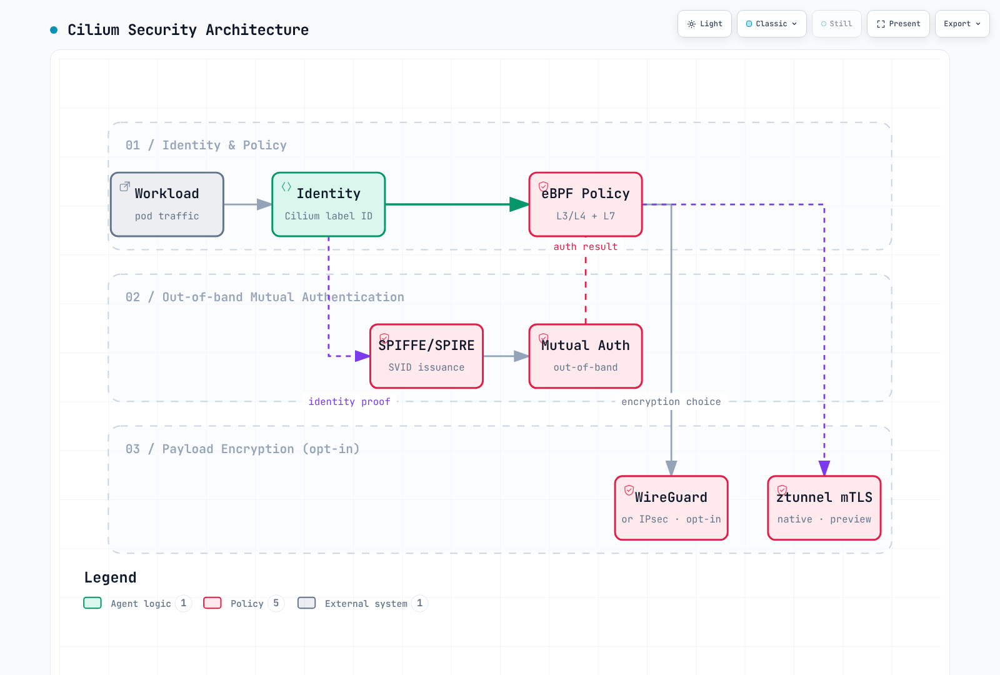
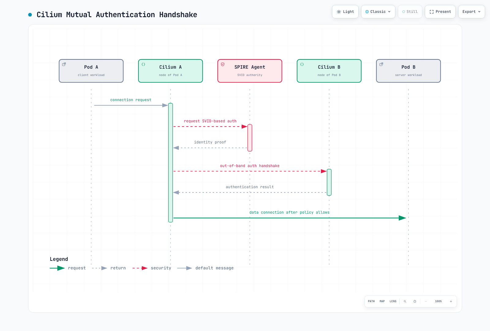
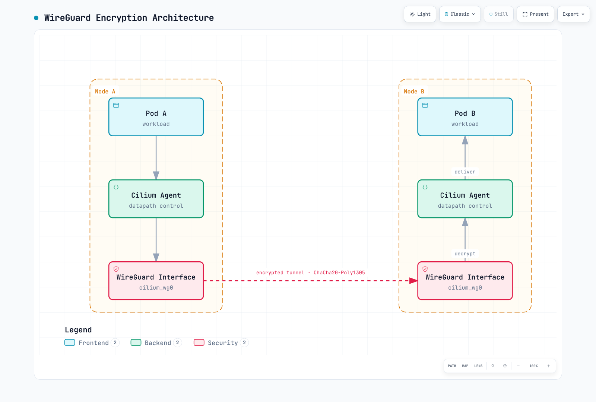
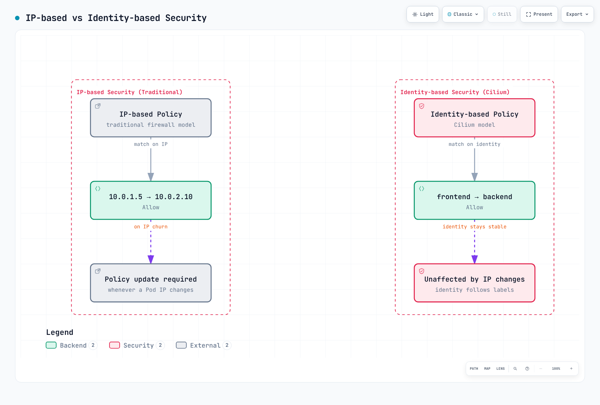

# Cilium Service Mesh 安全

> **最后更新**：October 16, 2026 · Cilium/chart 1.20.3 · bundled SPIRE 1.15.3。有关经过测试的 Kubernetes/EKS 版本和平台要求，请参阅[概览](./README.md)。

## 概览

评估三种独立控制：工作负载授权、对等身份验证和应用数据加密。Cilium 的带外双向身份验证、WireGuard/IPsec 传输加密以及单独的 ztunnel mTLS beta 具有不同的要求和限制。

以下策略示例描述的是常规 Cilium 策略/带外身份验证路径。**启用 ztunnel 加密时，不要假定这些策略仍能保持相同的 L4 强制执行**；下文将说明 beta 版的限制。

## 安全架构



[🔍 查看交互式图表](https://www.atomai.click/kubernetes-docs/archmaps/en-service-mesh-cilium-service-mesh-03-security-0.html)

这些方框用于划分职责，并不代表每种组合都能保留所有策略。特别是，ztunnel beta 使用不同的身份/数据路径，其默认 CA 不需要带外身份验证所示的 SPIRE 集成。

## 双向身份验证和数据加密

### 已建立的 Cilium 双向身份验证

在 Cilium 1.20.3 中，带外机制仍被记录为**beta/不完整**。Cilium agent 使用 SPIRE 提供的 SVID 对 Cilium 安全身份进行身份验证；网络策略规则要求身份验证，并不会因此使应用连接本身变成 TLS。



[🔍 查看交互式图表](https://www.atomai.click/kubernetes-docs/archmaps/en-service-mesh-cilium-service-mesh-03-security-1.html)

身份关系的身份验证记录会被缓存。该图并不表示每个 HTTP 请求或每个应用连接都要重新签发证书/执行握手。除了身份验证要求，还应配置明确的授权规则。

### 通过 ztunnel 实现原生 mTLS（2026 年更新）

Cilium 1.20.3 包含 **Ztunnel 透明加密（Beta）**。准备好所需的引导/CA 材料后，使用以下模式片段选择该功能：

```yaml
encryption:
  enabled: true
  type: ztunnel
  ztunnel:
    ca:
      type: internal
```

发布版本默认使用 Cilium 的内部 CA 选项。`cilium-ztunnel-secrets` Secret 提供 `bootstrap-private.key`、`bootstrap-root.crt`、`ca-private.key` 和 `ca-root.crt`；官方生成脚本只是一个示例，并非完整的生产 PKI/轮换方案。Chart 的 `bootstrapRootCert` 选项只提供公有证书，不会生成内部 CA 所需的私钥。

Cilium agent 会在已加入的 Pod 网络命名空间中配置 iptables 重定向，将工作负载状态发送到节点上的 ztunnel，并提供其控制/证书接口。Chart 会创建 `ztunnel-cilium` DaemonSet。加入命名空间需使用 `io.cilium/mtls-enabled=true`；仅安装该模式不会使所有命名空间自动加入。

已发布的指南规定了以下边界：

- 源工作负载和目标工作负载都必须加入；不支持已加入工作负载与未加入工作负载之间的通信。
- 加入操作以命名空间为单位；不支持按 Pod 加入。使用主机网络的 Pod 不能加入。
- mTLS 仅重定向 TCP；UDP 和其他协议不在此加密路径范围内。
- 不支持 ClusterMesh，且内核必须支持所需的 iptables 操作。
- 加密发生在数据包离开 Pod 之前。因此，普通 L4 策略在此路径上不起作用，直接针对 HBONE 端口 15008 时除外。

此集成使用基于命名空间/ServiceAccount 的工作负载身份模型。它不同于带外身份验证使用的数字 `/identity/<id>` SPIFFE 路径。

对于已准备好的测试安装，可执行以下只读检查：

```bash
kubectl -n kube-system get daemonset ztunnel-cilium
kubectl get namespaces -l io.cilium/mtls-enabled=true
kubectl -n kube-system get configmap cilium-config -o yaml
```

仅有命名空间标签、运行正常的代理，或观察到端口 15008 上有数据包，都不能证明所有预期流量都已加密并获得授权。应检查加入是否成功、所选路径的两端、证书身份/信任，以及不受支持的流量情形。

### mTLS 应选择 Cilium 还是 Istio

应根据所需的身份、授权和流量覆盖范围进行选择。现有 Cilium 部署可以使用身份策略加 WireGuard/IPsec，也可以在其限制范围内评估单独的 ztunnel beta。还应考虑实际启用的额外代理、CA 和运维依赖。

Istio 在 sidecar 和 ambient 模式下提供工作负载代理 mTLS，各自有其功能/平台边界。`PeerAuthentication` 的 `STRICT` 是入站 mTLS 要求；它本身不会签发身份、安装代理或授权所有调用方。不要把比较简化成一个加密开关。[sidecar/ambient 章节](../istio/comparison/03-sidecar-vs-ambient.md)保留了实际测量的版本和场景。

### 基于 SPIRE 的双向身份验证配置

对于**带外**身份验证，将此 overlay 合并到安装经过审核的 values 中：

```yaml
authentication:
  enabled: true
  mutual:
    spire:
      enabled: true
      trustDomain: spiffe.cilium
      agentSocketPath: /run/spire/sockets/agent/agent.sock
      install:
        enabled: true
        server:
          dataStorage:
            enabled: true
            size: 1Gi
```

为 SPIRE StatefulSet 准备适用的 StorageClass/PV。并非每个 EKS 集群都自动存在名为 `gp3` 的 StorageClass。必须设置 `authentication.enabled`；信任域和 agent socket 设置应放在 `authentication.mutual.spire` 下，而不是 `install.server` 或 `install.agent` 下。捆绑的 chart 不实现以前示例中的 `server.replicas`、`server.nodeAttestor`、`agent.workloadAttestor` 或 `server.ca.ttl`。

SPIRE Server 对 agent 进行证明并签署 SVID。Agent 执行工作负载证明；Cilium 集成还会委托检索操作，并为 Cilium 安全身份注册条目。仅启用 SPIRE 不会对所有流量强制执行身份验证，也不会启用 WireGuard/IPsec。

### 双向身份验证策略强制执行

`authentication` 是 **ingress/egress allow 规则内部的对象**。它不是数组，也不是顶层的 `spec.authentication` 开关。此集群范围策略有意只选择一个应用/命名空间：

```yaml
apiVersion: cilium.io/v2
kind: CiliumClusterwideNetworkPolicy
metadata:
  name: production-backend-auth
spec:
  endpointSelector:
    matchLabels:
      k8s:io.kubernetes.pod.namespace: production
      k8s:app: backend
  ingress:
  - fromEndpoints:
    - matchLabels:
        k8s:io.kubernetes.pod.namespace: production
        k8s:app: frontend
    toPorts:
    - ports:
      - port: '8080'
        protocol: TCP
    authentication:
      mode: required
```

### 按命名空间配置双向身份验证

此命名空间级示例选择 `production` 中的工作负载，并允许该命名空间中经过身份验证的对等端通过 TCP 8080 访问：

```yaml
apiVersion: cilium.io/v2
kind: CiliumNetworkPolicy
metadata:
  name: namespace-auth
  namespace: production
spec:
  endpointSelector: {}
  ingress:
  - fromEndpoints:
    - matchLabels:
        k8s:io.kubernetes.pod.namespace: production
    toPorts:
    - ports:
      - port: '8080'
        protocol: TCP
    authentication:
      mode: required
```

这是一个说明性的同命名空间放行示例，并非适用于所有应用的最小权限策略。其他端口、客户端、探针和现有策略授权都必须单独评估。它影响 ingress；不会自动配置完整的 egress 依赖策略。

### 按 Service 配置双向身份验证

```yaml
apiVersion: cilium.io/v2
kind: CiliumNetworkPolicy
metadata:
  name: service-auth
  namespace: default
spec:
  endpointSelector:
    matchLabels:
      k8s:io.kubernetes.pod.namespace: default
      k8s:app: backend
  ingress:
  - fromEndpoints:
    - matchLabels:
        k8s:io.kubernetes.pod.namespace: default
        k8s:app: frontend
    toPorts:
    - ports:
      - port: '8080'
        protocol: TCP
    authentication:
      mode: required
```

这里的源和目标标签描述的是工作负载，而不是最终用户的登录身份。Kubernetes 权限必须控制谁可以创建工作负载、更改这些标签或使用其 ServiceAccount。

## CiliumNetworkPolicy L7 规则

### HTTP L7 安全策略

```yaml
apiVersion: cilium.io/v2
kind: CiliumNetworkPolicy
metadata:
  name: http-security-policy
  namespace: default
spec:
  endpointSelector:
    matchLabels:
      k8s:io.kubernetes.pod.namespace: default
      k8s:app: api-server
  ingress:
  - fromEndpoints:
    - matchLabels:
        k8s:io.kubernetes.pod.namespace: default
        k8s:role: reader
    toPorts:
    - ports:
      - port: '8080'
        protocol: TCP
      rules:
        http:
        - method: ^GET$
          path: ^/api/.*$
  - fromEndpoints:
    - matchLabels:
        k8s:io.kubernetes.pod.namespace: default
        k8s:role: admin
    toPorts:
    - ports:
      - port: '8080'
        protocol: TCP
      rules:
        http:
        - method: ^(GET|POST|PUT|PATCH|DELETE)$
          path: ^/api/.*$
          headers:
          - Authorization
  - fromEndpoints:
    - matchLabels:
        k8s:io.kubernetes.pod.namespace: default
        k8s:app: monitoring
    toPorts:
    - ports:
      - port: '8080'
        protocol: TCP
      rules:
        http:
        - method: ^GET$
          path: ^/health$
        - method: ^GET$
          path: ^/metrics$
```

一条规则内的 HTTP 规则彼此是备选项。`headers: [Authorization]` 只要求该标头存在：它不会验证 bearer token、其签名、过期时间或权限。以前使用的 `Authorization: Bearer .*` 字符串既不是 JWT 验证器，也不是通用的正则表达式值匹配。应独立执行应用身份验证和授权。

HTTP 路径策略要求存在受支持且可检查的 L7 路径。应用 TLS、探针和其他依赖流量需要相应配置；仅有端口号并不会启用 TLS。

### Kafka L7 安全策略

旧版 `rules.kafka` 对象会被 Cilium 1.20.3 的 L7 schema 拒绝。以下替代方案只限制**网络可达性**：

```yaml
apiVersion: cilium.io/v2
kind: CiliumNetworkPolicy
metadata:
  name: kafka-network-boundary
  namespace: kafka
spec:
  endpointSelector:
    matchLabels:
      k8s:io.kubernetes.pod.namespace: kafka
      k8s:app: kafka
  ingress:
  - fromEndpoints:
    - matchLabels:
        k8s:io.kubernetes.pod.namespace: kafka
        k8s:role: producer
    toPorts:
    - ports:
      - port: '9092'
        protocol: TCP
  - fromEndpoints:
    - matchLabels:
        k8s:io.kubernetes.pod.namespace: kafka
        k8s:role: consumer
    toPorts:
    - ports:
      - port: '9092'
        protocol: TCP
```

应为实际 Kafka listener 配置 TLS/SASL 和 broker ACL，以控制 produce/fetch、topic 和 consumer group。删除过时的 L7 规则后，L4 访问仍然存在；这不会保留 topic 级授权。

### DNS L7 安全策略

```yaml
apiVersion: cilium.io/v2
kind: CiliumNetworkPolicy
metadata:
  name: dns-security
  namespace: default
spec:
  endpointSelector:
    matchLabels:
      k8s:io.kubernetes.pod.namespace: default
      k8s:app: web-application
  egress:
  - toEndpoints:
    - matchLabels:
        k8s:io.kubernetes.pod.namespace: kube-system
        k8s:k8s-app: kube-dns
    toPorts:
    - ports:
      - port: '53'
        protocol: UDP
      - port: '53'
        protocol: TCP
      rules:
        dns:
        - matchPattern: '*.*.svc.cluster.local'
        - matchName: api.stripe.com
        - matchName: sts.us-east-1.amazonaws.com
  - toFQDNs:
    - matchName: api.stripe.com
    - matchName: sts.us-east-1.amazonaws.com
    toPorts:
    - ports:
      - port: '443'
        protocol: TCP
```

此示例假设 `kube-system` 中的 CoreDNS endpoint 带有 `k8s-app=kube-dns` 标签，并使用常见的 `cluster.local` DNS 后缀。它允许 UDP 和 TCP DNS。Service FQDN 同时包含 Service 和命名空间标签，因此 `*.*.svc.cluster.local` 与以前的 `*.svc.cluster.local` 不同。

外部 HTTPS 权限与 DNS 查询权限是分开的。`sts.us-east-1.amazonaws.com` 是特定区域的 AWS endpoint；AWS 不会使用以前的 `api.aws.amazon.com` 作为通用 API endpoint。应选择实际 SDK 使用的区域/服务 endpoint，包括任何相关的 IPv6/双栈或私有 endpoint 变体。内部 DNS 应答不会自动授予连接到所有内部 Service 的权限。

如果启用了 resolver 搜索列表行为和 NodeLocal DNS，请一并检查。宽泛的 S3 通配符可能允许访问超出预期单个 bucket 范围的目标；DNS/IP 策略也不能保证阻止通过允许的目标外传数据。

## 双向身份验证

### 身份验证模式

| 模式 | 在带外策略 API 中的含义 |
|---|---|
| `required` | 要求匹配的已允许流量成功通过身份验证 |
| `disabled` | 对匹配规则明确豁免身份验证 |
| `test-always-fail` | 会故意使身份验证失败的测试模式 |

已发布的 schema 中没有 `optional` 模式。在其他规则重叠时，没有明确要求身份验证，与经过仔细限定范围的豁免并不相同；请检查最终策略，不要假定身份验证规则的行为与普通的独立 allow 授权相同。

### 双向身份验证策略示例

豁免应明确、范围狭窄且有充分理由：

```yaml
apiVersion: cilium.io/v2
kind: CiliumNetworkPolicy
metadata:
  name: authentication-exception
  namespace: production
spec:
  endpointSelector:
    matchLabels:
      k8s:io.kubernetes.pod.namespace: production
      k8s:app: secure-service
  ingress:
  - fromEndpoints:
    - matchLabels:
        k8s:io.kubernetes.pod.namespace: production
        k8s:app: trusted-client
    toPorts:
    - ports:
      - port: '443'
        protocol: TCP
    authentication:
      mode: required
  - fromEndpoints:
    - matchLabels:
        k8s:io.kubernetes.pod.namespace: monitoring
        k8s:app: prometheus
    toPorts:
    - ports:
      - port: '9090'
        protocol: TCP
    authentication:
      mode: disabled
```

Prometheus 规则表示**禁用身份验证**，而不是“如果可能则进行身份验证”。它只允许指定的监控工作负载和端口。任一应用监听端口上的 TLS 都是单独的应用配置。

### 基于 SPIFFE ID 的身份验证

对于默认的**带外** SPIRE 信任域，Cilium 安全身份采用以下形式：

```text
spiffe://spiffe.cilium/identity/<numeric-security-identity>
```

通过 endpoint/身份策略选择允许的对等端；`authentication` 对象没有任意 SPIFFE ID allow-list 字段。把注释改成 Istio 风格的 `/ns/.../sa/...` URI 并不会限制访问。上文介绍的 ztunnel beta 使用单独的工作负载身份模型。

## 加密

### WireGuard 透明加密

```yaml
encryption:
  enabled: true
  type: wireguard
```

Cilium 会创建节点密钥对，并通过 CiliumNode 信息分发公钥。Cilium 管理的 Pod 之间在**不同节点**上的受支持流量会加密；同一节点上的流量不会加密。内核必须支持 WireGuard。Chart 没有 `encryption.wireguard.userspaceFallback` 选项。

应允许所需的节点间 UDP 51871 通信路径，并考虑 MTU/封装。AWS VPC CNI chaining 有额外的 MTU 要求，包括文档中说明的 `cni.enableRouteMTUForCNIChaining` 设置；应遵循所选安装模式，而不是不加判断地应用该设置。

#### WireGuard 架构



[🔍 查看交互式图表](https://www.atomai.click/kubernetes-docs/archmaps/en-service-mesh-cilium-service-mesh-03-security-2.html)

Agent 方框表示管理/密钥分发，并不表示每个数据包都要经过用户态中转。WireGuard 接口上的数据包捕获可能会显示明文内部数据包；评估加密时，应验证正确的外部网络路径。

节点间加密覆盖范围是一项单独的 beta 选项：

```yaml
encryption:
  enabled: true
  type: wireguard
  nodeEncryption: true
```

默认情况下，控制平面节点不参与节点加密，以避免密钥更新时引导失败。已发布的流量矩阵还列出了涉及 XDP 加速、非 Geneve DSR 和 egress-gateway 回复的排除情况。外部请求从客户端到集群的路径不会通过节点 WireGuard 加密。

### IPsec 加密

```yaml
encryption:
  enabled: true
  type: ipsec
  ipsec:
    secretName: cilium-ipsec-keys
    keyFile: keys
    keyWatcher: true
    keyRotationDuration: 5m
```

Secret 必须存在于 Cilium 所在的命名空间中。对于文档中的 AES-GCM 示例，其 `keys` 条目格式如下：

```text
3+ rfc4106(gcm(aes)) <fresh-20-byte-random-value-in-hex> 128
```

`+` 表示为每条隧道派生密钥。出于安全原因，旧的无 `+` 全局密钥格式已弃用；不要将其作为当前指南复制使用。应通过文档所述的 CLI/Secret 工作流程生成并保护新密钥材料，而不是重复使用示例密钥。

`keyRotationDuration: 5m` 是密钥更改后的过渡/旧密钥清理宽限期，**不是每五分钟生成新密钥的调度器**。应通过受支持的轮换流程更新密钥 ID 和材料；如果使用 ClusterMesh，应协调所有集群；升级期间节点版本不一致时，不要轮换密钥。

检查 ESP/防火墙支持、实际加密接口和原生路由 CIDR。当前 IPsec 在使用 L7 时要求采用文档所述的透明 DNS 代理行为，不支持 CNI chaining 或 host policy，也不会加密同一节点上的流量。

### 加密方式比较

| 主题 | WireGuard | IPsec | ztunnel beta |
|---|---|---|---|
| 密钥/身份 | 节点生成的密钥对 | 使用逐隧道派生的分发密钥材料 | 工作负载 mTLS 证书和引导/CA 材料 |
| 数据路径 | 内核 WireGuard 接口 | 内核 IPsec/XFRM | 每节点 TLS 代理和 Pod 命名空间重定向 |
| 同节点/覆盖范围 | 同节点流量不加密；请参阅已发布的流量矩阵 | 同节点流量不加密；受模式限制 | 两端都必须加入；仅限 TCP；受策略限制 |
| 密码套件配置 | WireGuard 协议的 ChaCha20-Poly1305 套件 | 内核支持的已配置算法，例如 AES-GCM | 由受支持的代理协商 TLS |
| 性能 | 针对实际 CPU、MTU 和流量组合进行测量 | 测量算法/硬件、隧道和单隧道解密约束 | 测量代理、TLS 和工作负载开销；不属于旧版比较基准 |

透明加密还可能存在 endpoint 发现窗口，在此期间，允许的未知目标会被视为外部目标。Cilium 将受限 egress 和严格加密模式列为缓解措施，但它们有具体限制：严格 egress 依赖 IPv4/CIDR；严格 ingress 要求 WireGuard 和受管接口，且不支持 CNI chaining。不要将“已启用加密”理解为每条路径都能获得故障关闭保护。

## 基于身份的安全

### Cilium 身份

Cilium 会根据与身份相关的标签集合分配数字身份；多个 Pod 可以共享同一身份。这既不是用户计算出的哈希值，也不是永久的 Pod 标识符。

### 身份组件

```bash
kubectl -n kube-system get pods -l k8s-app=cilium -o wide
CILIUM_POD='<agent-on-the-workload-node>'
kubectl -n default get ciliumendpoints
kubectl get ciliumidentities
kubectl -n kube-system exec "$CILIUM_POD" -c cilium-agent -- cilium-dbg identity list
kubectl -n kube-system exec "$CILIUM_POD" -c cilium-agent -- cilium-dbg status --verbose
kubectl -n kube-system exec "$CILIUM_POD" -c cilium-agent -- cilium-dbg encrypt status
```

命名空间、ServiceAccount 和选定的工作负载标签都可能参与身份构成。ID 1–6 分别对应 host、world、unmanaged、health、init 和 remote-node；分配给工作负载的 ID 取决于安装情况。应检查相关节点上的 agent，并保留完整的命令失败信息/状态。

### 基于身份的策略

```yaml
apiVersion: cilium.io/v2
kind: CiliumNetworkPolicy
metadata:
  name: identity-based-policy
  namespace: default
spec:
  endpointSelector:
    matchLabels:
      k8s:io.kubernetes.pod.namespace: default
      k8s:app: backend
  ingress:
  - fromEndpoints:
    - matchLabels:
        k8s:io.kubernetes.pod.namespace: default
        k8s:app: frontend
        k8s:environment: production
    toPorts:
    - ports:
      - port: '8080'
        protocol: TCP
  - fromEndpoints:
    - matchLabels:
        k8s:io.kubernetes.pod.namespace: monitoring
        k8s:app: prometheus
    toPorts:
    - ports:
      - port: '9090'
        protocol: TCP
```

### IP 与身份比较



[🔍 查看交互式图表](https://www.atomai.click/kubernetes-docs/archmaps/en-service-mesh-cilium-service-mesh-03-security-4.html)

即使 IP 不断变化，策略选择器也可以保持稳定。Cilium 仍必须更新 endpoint/IP 缓存状态，而且身份可能被垃圾回收后重新分配；该图并不保证每次重启后数字 ID 都不变。

## 外部 PKI 集成

### cert-manager 集成

这些对象示例展示了如何生成上游 CA Secret。**它们本身不会将该 Secret 连接到 SPIRE**：

```yaml
apiVersion: cert-manager.io/v1
kind: ClusterIssuer
metadata:
  name: cilium-ca-issuer
spec:
  ca:
    secretName: cilium-ca-secret
---
apiVersion: cert-manager.io/v1
kind: Certificate
metadata:
  name: cilium-spire-ca
  namespace: cilium-spire
spec:
  secretName: spire-ca-secret
  duration: 8760h
  renewBefore: 720h
  isCA: true
  privateKey:
    algorithm: ECDSA
    size: 256
    rotationPolicy: Always
  usages:
  - cert sign
  - crl sign
  subject:
    organizations:
    - Cilium
  commonName: SPIRE upstream CA
  issuerRef:
    name: cilium-ca-issuer
    kind: ClusterIssuer
    group: cert-manager.io
```

在 cert-manager 配置的集群资源命名空间中的 `cilium-ca-secret` 内，准备有效的签名 CA/密钥，并确保其剩余有效期充足。验证 CA 约束、签名用途和信任链。一年的有效期是从属 CA 有效期示例，并非普遍适用的建议。

外部管理的 SPIRE Server 必须使用受支持的 UpstreamAuthority，并能够访问所需的挂载材料或签发方 API。对于接入现有 PKI 的磁盘 authority，SPIRE 需要 `cert_file_path`、`key_file_path` 和受信任根证书 `bundle_file_path`；应规划重新加载/轮换和信任重叠。仅更新 Kubernetes Secret 并不能证明所有证书使用方都已采用新 CA。

不要用不相关的不完整文件替换捆绑的 SPIRE ConfigMap。对于外部运行的 SPIRE，应分别审核 Cilium 的外部 server 地址、信任域、委托身份注册和身份验证前提。

### Vault 集成

以下内容只是独立配置的 SPIRE 1.15.4 Server 的**插件片段**，不是完整的 Server 配置或 Kubernetes Deployment：

```hcl
plugins {
  UpstreamAuthority "vault" {
    plugin_data {
      vault_addr = "https://vault.vault.svc:8200"
      pki_mount_point = "pki"
      ca_cert_path = "/vault/ca/ca.crt"
      k8s_auth {
        k8s_auth_mount_point = "kubernetes"
        k8s_auth_role_name = "spire-upstream"
        token_path = "/var/run/secrets/vault/token"
      }
    }
  }
}
```

插件应放在顶层 `plugins` 中，而不是 `server` 内部。字段名是 `pki_mount_point`；此处的 `token_path` 应放在 `k8s_auth` 内。该 token 是为配置的 Vault auth role 投射的 Kubernetes ServiceAccount token，不是通用 Vault token 文件。

应准备 token 投射/audience 和 Vault Kubernetes auth 配置，将该 role 绑定到预期的 SPIRE 工作负载，挂载用于验证 Vault 的 TLS CA，并授予所需的 PKI 签发中间证书操作权限。协调 SPIRE `ca_ttl`、Vault PKI TTL、工作负载信任和轮换。本指南不声称这些外部依赖已经部署或经过测试。

## 零信任网络

### 默认拒绝策略

此集群范围资源有意仅面向隔离的 `policy-lab` 命名空间：

```yaml
apiVersion: cilium.io/v2
kind: CiliumClusterwideNetworkPolicy
metadata:
  name: policy-lab-default-deny
spec:
  endpointSelector:
    matchLabels:
      k8s:io.kubernetes.pod.namespace: policy-lab
  enableDefaultDeny:
    ingress: true
    egress: true
  ingress: []
  egress: []
```

`enableDefaultDeny` 标志是明确设置的：仅有空的 Cilium ingress/egress 数组，并不会提供用于启用默认拒绝的规则。不要将 Kubernetes NetworkPolicy 示例中的假设照搬过来。

应将 DNS 等特定依赖作为单独的 allow 规则添加：

```yaml
apiVersion: cilium.io/v2
kind: CiliumNetworkPolicy
metadata:
  name: policy-lab-dns
  namespace: policy-lab
spec:
  endpointSelector: {}
  egress:
  - toEndpoints:
    - matchLabels:
        k8s:io.kubernetes.pod.namespace: kube-system
        k8s:k8s-app: kube-dns
    toPorts:
    - ports:
      - port: '53'
        protocol: UDP
      - port: '53'
        protocol: TCP
```

并非普遍都需要允许每一种 host-network 流量。应评估实际的 kubelet/探针、resolver 和 host-policy 行为。这些示例不会改变 Cilium 对 host 的处理方式，也不能防御已被入侵的特权节点。

### 最小权限访问

此示例假设在 `edge` 中有带 `app=ingress-gateway` 标签且由 Cilium 管理的 gateway 工作负载、在 `production` 中有 frontend/database 工作负载，并且 SPIRE 集成可正常工作：

```yaml
apiVersion: cilium.io/v2
kind: CiliumNetworkPolicy
metadata:
  name: production-security
  namespace: production
spec:
  endpointSelector:
    matchLabels:
      k8s:io.kubernetes.pod.namespace: production
      k8s:app: api
  ingress:
  - fromEndpoints:
    - matchLabels:
        k8s:io.kubernetes.pod.namespace: production
        k8s:app: frontend
    toPorts:
    - ports:
      - port: '8080'
        protocol: TCP
    authentication:
      mode: required
  - fromEndpoints:
    - matchLabels:
        k8s:io.kubernetes.pod.namespace: edge
        k8s:app: ingress-gateway
    toPorts:
    - ports:
      - port: '8080'
        protocol: TCP
  egress:
  - toEndpoints:
    - matchLabels:
        k8s:io.kubernetes.pod.namespace: kube-system
        k8s:k8s-app: kube-dns
    toPorts:
    - ports:
      - port: '53'
        protocol: UDP
      - port: '53'
        protocol: TCP
  - toEndpoints:
    - matchLabels:
        k8s:io.kubernetes.pod.namespace: production
        k8s:app: database
    toPorts:
    - ports:
      - port: '5432'
        protocol: TCP
    authentication:
      mode: required
```

使用所选 gateway 实现中实际观察到的标签和身份。Cilium 自身的节点 Envoy ingress/Gateway 路径和外部负载均衡器可能呈现不同的身份；任意 Pod 标签不能与 `reserved:ingress` 或外部客户端地址互换。以前已退役的 ingress-nginx 示例并非必要依赖。

### 微分段

这些应用层级策略为发起 Service 查询的层保留了显式 DNS 访问。它们假设使用相同的 gateway 模型和所述监听端口：

```yaml
apiVersion: cilium.io/v2
kind: CiliumNetworkPolicy
metadata:
  name: frontend-policy
  namespace: app
spec:
  endpointSelector:
    matchLabels:
      k8s:io.kubernetes.pod.namespace: app
      k8s:tier: frontend
  ingress:
  - fromEndpoints:
    - matchLabels:
        k8s:io.kubernetes.pod.namespace: edge
        k8s:app: ingress-gateway
    toPorts:
    - ports:
      - port: '443'
        protocol: TCP
  egress:
  - toEndpoints:
    - matchLabels:
        k8s:io.kubernetes.pod.namespace: kube-system
        k8s:k8s-app: kube-dns
    toPorts:
    - ports:
      - port: '53'
        protocol: UDP
      - port: '53'
        protocol: TCP
  - toEndpoints:
    - matchLabels:
        k8s:io.kubernetes.pod.namespace: app
        k8s:tier: backend
    toPorts:
    - ports:
      - port: '8080'
        protocol: TCP
    authentication:
      mode: required
---
apiVersion: cilium.io/v2
kind: CiliumNetworkPolicy
metadata:
  name: backend-policy
  namespace: app
spec:
  endpointSelector:
    matchLabels:
      k8s:io.kubernetes.pod.namespace: app
      k8s:tier: backend
  ingress:
  - fromEndpoints:
    - matchLabels:
        k8s:io.kubernetes.pod.namespace: app
        k8s:tier: frontend
    toPorts:
    - ports:
      - port: '8080'
        protocol: TCP
    authentication:
      mode: required
  egress:
  - toEndpoints:
    - matchLabels:
        k8s:io.kubernetes.pod.namespace: kube-system
        k8s:k8s-app: kube-dns
    toPorts:
    - ports:
      - port: '53'
        protocol: UDP
      - port: '53'
        protocol: TCP
  - toEndpoints:
    - matchLabels:
        k8s:io.kubernetes.pod.namespace: app
        k8s:tier: database
    toPorts:
    - ports:
      - port: '5432'
        protocol: TCP
    authentication:
      mode: required
---
apiVersion: cilium.io/v2
kind: CiliumNetworkPolicy
metadata:
  name: database-policy
  namespace: app
spec:
  endpointSelector:
    matchLabels:
      k8s:io.kubernetes.pod.namespace: app
      k8s:tier: database
  enableDefaultDeny:
    egress: true
  ingress:
  - fromEndpoints:
    - matchLabels:
        k8s:io.kubernetes.pod.namespace: app
        k8s:tier: backend
    toPorts:
    - ports:
      - port: '5432'
        protocol: TCP
    authentication:
      mode: required
  egress: []
```

数据库显式启用了 egress 默认拒绝，且没有 egress allow 规则；但仍允许已允许连接的有状态回复。应有意添加实际的备份、复制、身份验证或其他依赖。限制网络路径并不能完全阻止通过其他已授权的数据库/应用请求提取数据。

## 安全审计与监控

### 策略审计模式

`cilium.io/audit-mode: "true"` 不是受支持的单策略审计开关。带有此任意注解的策略仍可能正常强制执行。

对于**隔离 endpoint 测试**，实际可变的 endpoint 选项是 `PolicyAuditMode`。检查本地 endpoint，临时启用该选项，并在受控观察后恢复强制执行：

```bash
kubectl -n kube-system exec "$CILIUM_POD" -c cilium-agent -- cilium-dbg endpoint list
ENDPOINT_ID='<local-endpoint-id-in-the-isolated-test>'
kubectl -n kube-system exec "$CILIUM_POD" -c cilium-agent -- cilium-dbg endpoint config "$ENDPOINT_ID"
kubectl -n kube-system exec "$CILIUM_POD" -c cilium-agent -- cilium-dbg endpoint config "$ENDPOINT_ID" PolicyAuditMode=true
# Observe the controlled test, then restore enforcement.
kubectl -n kube-system exec "$CILIUM_POD" -c cilium-agent -- cilium-dbg endpoint config "$ENDPOINT_ID" PolicyAuditMode=false
```

此操作会更改该 endpoint 上的强制执行行为，而不是将审计行为附加到某个策略对象。不要推断所有 L7 拒绝或所有安全故障都会变成允许通过的审计事件；应验证具体的数据路径/代理行为。`enableDefaultDeny: false` 也不等同于 L7 审计模式。

### 策略违规监控

```bash
# Terminal 1
cilium hubble port-forward --port-forward 4245
# Terminal 2
hubble observe --server localhost:4245 --namespace production --verdict DROPPED --last 100
hubble observe --server localhost:4245 --namespace production --verdict DROPPED --drop-reason-desc POLICY_DENIED --last 100
hubble observe --server localhost:4245 --namespace policy-lab --verdict AUDIT --last 100
```

`DROPPED` 还包括策略拒绝以外的原因。按原因筛选的查询重点关注报告为策略拒绝的数据包丢弃；L7/应用授权失败需要单独观察。`AUDIT` 与 `DROPPED` 不同。`--last 100` 表示有限的历史记录，Relay 可能会针对每个已连接的 Hubble 实例分别返回该数量；它不是完整的集群流量计数器。只有在需要流式观察时才添加 `--follow`。

### Prometheus 指标

```yaml
prometheus:
  enabled: true
hubble:
  enabled: true
  metrics:
    enabled:
    - dns
    - drop
    - flow
    - httpV2
    - icmp
    - port-distribution
    - tcp
```

除这些启用标志外，agent 和 Hubble exporter 还需要 Prometheus 服务发现/抓取配置。`httpV2` 会取代已弃用的 `http`；不要同时启用两者。HTTP 指标需要相应的 L7 可见性。

- `cilium_drop_count_total` 按原因/方向统计被丢弃的数据包，并非只统计策略违规。
- `cilium_forward_count_total` 统计转发的数据包，并非成功的应用请求。
- Hubble 的 `drop` exporter 通过 `hubble_drop_total` 提供流量丢弃信息；其计量单位与 agent 数据包计数器不同。
- 以前的 `cilium_policy_verdict` 指标名称不是文档中记录的指标。请改用实际策略 verdict 事件或所选 exporter 暴露的指标。

## 后续步骤

- [可观测性](./04-observability.md)
- [Ingress 与 Gateway](./05-ingress-gateway.md)
- [最佳实践](./06-best-practices.md)
- [安全测验](../../quizzes/service-mesh/cilium-service-mesh/security.md)

## 参考资料

- [Cilium 1.20.3 双向身份验证](https://github.com/cilium/cilium/blob/v1.20.3/Documentation/network/servicemesh/mutual-authentication/mutual-authentication.rst)
- [身份验证示例/API 结构](https://github.com/cilium/cilium/blob/v1.20.3/Documentation/network/servicemesh/mutual-authentication/mutual-authentication-example.rst)
- [Cilium 1.20.3 CNP schema](https://github.com/cilium/cilium/blob/v1.20.3/pkg/k8s/apis/cilium.io/client/crds/v2/ciliumnetworkpolicies.yaml)
- [Cilium 1.20.3 ztunnel beta](https://github.com/cilium/cilium/blob/v1.20.3/Documentation/security/network/encryption-ztunnel.rst)
- [Ztunnel CA 实现](https://github.com/cilium/cilium/blob/v1.20.3/pkg/ztunnel/ca/ca_server.go)
- [Ztunnel 引导示例](https://github.com/cilium/cilium/blob/v1.20.3/examples/kubernetes-ztunnel/generate-secrets.sh)
- [加密范围/严格模式](https://github.com/cilium/cilium/blob/v1.20.3/Documentation/security/network/encryption.rst)
- [WireGuard](https://github.com/cilium/cilium/blob/v1.20.3/Documentation/security/network/encryption-wireguard.rst)
- [IPsec 和密钥轮换](https://github.com/cilium/cilium/blob/v1.20.3/Documentation/security/network/encryption-ipsec.rst)
- [Helm values](https://github.com/cilium/cilium/blob/v1.20.3/install/kubernetes/cilium/values.yaml)
- [HTTP/DNS 策略](https://github.com/cilium/cilium/blob/v1.20.3/Documentation/security/policy/layer7.rst)
- [默认拒绝行为](https://github.com/cilium/cilium/blob/v1.20.3/Documentation/security/policy/intro.rst)
- [显式默认拒绝 API](https://github.com/cilium/cilium/blob/v1.20.3/pkg/policy/api/rule.go)
- [可变 endpoint 审计选项](https://github.com/cilium/cilium/blob/v1.20.3/pkg/option/endpoint.go)
- [Endpoint 配置 CLI](https://github.com/cilium/cilium/blob/v1.20.3/Documentation/cmdref/cilium-dbg_endpoint_config.md)
- [指标](https://github.com/cilium/cilium/blob/v1.20.3/Documentation/observability/metrics.rst)
- [SPIRE 1.15.4 Server 配置](https://github.com/spiffe/spire/blob/v1.15.4/doc/spire_server.md)
- [SPIRE Vault authority](https://github.com/spiffe/spire/blob/v1.15.4/doc/plugin_server_upstreamauthority_vault.md)
- [SPIRE 磁盘 authority](https://github.com/spiffe/spire/blob/v1.15.4/doc/plugin_server_upstreamauthority_disk.md)
- [Kafka ACL](https://kafka.apache.org/41/security/authorization-and-acls/)
- [AWS STS endpoint](https://docs.aws.amazon.com/general/latest/gr/sts.html)
- [WireGuard 协议](https://www.wireguard.com/protocol/)
- [NIST 零信任架构（延伸阅读）](https://www.nist.gov/publications/zero-trust-architecture)
