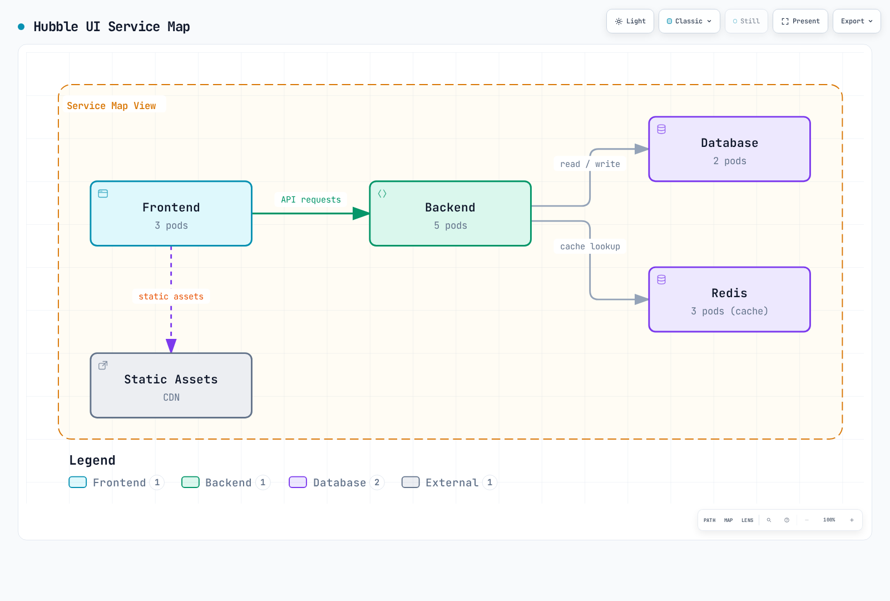

# Cilium Service Mesh 可观测性

> **最后更新**：2026年10月16日 · Cilium/chart 1.20.3 · Hubble CLI 1.20.2 · Collector Contrib 0.162.0 · Loki 3.7.8。Kubernetes/EKS 和平台要求请参阅[概述](./README.md)。

## 概述

Hubble 会公开由 Cilium 处理的流量观测信息。L3/L4 事件来自数据路径；要获得 HTTP 可见性，还需要受支持的 L7 代理/策略路径。仅启用 Hubble 并不会解密任意应用 TLS、发现所有依赖项或生成分布式应用跟踪。

这些示例假设 `production` 中已准备好工作负载，并且 Cilium Deployment 已正确安装。在解读可观测内容时，请考虑[安全章节](./03-security.md)中关于加密/ztunnel 的限制。

## Hubble 架构


[🔍 查看交互式图表](https://www.atomai.click/kubernetes-docs/archmaps/en-service-mesh-cilium-service-mesh-04-observability-0.html)

该图展示了各组件的分组关系。配置后，Envoy 也会提供 L7 事件；eBPF 并非 HTTP 观测的唯一输入。Prometheus 会独立于 Relay 的流 API 抓取指标。

| 组件 | 作用 |
|---|---|
| Cilium Agent 中的 Observer | 存储并提供每个节点上有界的流历史记录 |
| Hubble Relay | 汇总来自已连接 Hubble 服务器的观测信息 |
| Hubble UI | 显示观测到的关系和流详情 |
| Hubble CLI | 查询 API 或读取导出的 JSON 记录 |
| Hubble 指标处理程序 | 将符合条件的观测信息转换为 Prometheus 指标 |

观测缓冲区不是长期日志存储。缓冲区已满、节点缺失、导出器故障和事件丢失等情况，必须与应用健康状况分开解读。

## Hubble 安装与配置

### 通过 Helm 安装

将此覆盖配置与经过审核的 Cilium 1.20.3 安装配置合并。它会公开指标，并启用 Relay/UI，通过端口转发访问。它不会安装 Prometheus、Grafana、Collector 或 Loki：

```yaml
prometheus:
  enabled: true
hubble:
  enabled: true
  relay:
    enabled: true
    replicas: 1
    resources:
      requests:
        cpu: 100m
        memory: 128Mi
      limits:
        cpu: 1000m
        memory: 1024Mi
  ui:
    enabled: true
    replicas: 1
    ingress:
      enabled: false
  metrics:
    enabled:
    - dns
    - drop
    - tcp
    - flow
    - icmp
    - port-distribution
    - httpV2:labelsContext=source_namespace,source_workload,destination_namespace,destination_workload
  tls:
    enabled: true
    auto:
      enabled: true
      method: cronJob
      certValidityDuration: 365
      schedule: 0 0 1 */4 *
```

资源配额只是示例，并非容量估算结果。某些 Agent 配置更改需要受控滚动更新；应用更改之前，请检查渲染后的工作负载和安装流程。

Hubble 服务器到 Relay 的 mTLS 可保护观测信息传输。UI Ingress、面向客户端的 Relay API、指标端点和应用流量有各自独立的 TLS/身份验证设置。公开可访问的 UI 需要适当的访问控制边界；仅有 TLS Secret 并不等于用户身份验证。

此覆盖配置选择了 `cronJob` 证书续期方式。所选 chart 的默认有效期为 365 天；TLS 指南还展示了显式配置为 1,095 天的示例。`method: helm` 可以生成证书，但不会安排续期。请检查证书任务、有效期和信任配置；Hubble 支持重新加载证书，但这不能替代证书续期流程的运维工作。

### 安装 Hubble CLI

此 Unix 示例固定了发行版本，选择 Linux/macOS 和 amd64/arm64，并在下载失败或校验和不匹配时停止：

```bash
set -eu
HUBBLE_VERSION=v1.20.2
case "$(uname -s)" in
  Linux) HUBBLE_RELEASE_OS=linux ;;
  Darwin) HUBBLE_RELEASE_OS=darwin ;;
  *) echo "Use the matching release archive for this operating system." >&2; exit 1 ;;
esac
case "$(uname -m)" in
  x86_64|amd64) HUBBLE_RELEASE_ARCH=amd64 ;;
  aarch64|arm64) HUBBLE_RELEASE_ARCH=arm64 ;;
  *) echo "Unsupported architecture for this example." >&2; exit 1 ;;
esac
HUBBLE_ARCHIVE="hubble-${HUBBLE_RELEASE_OS}-${HUBBLE_RELEASE_ARCH}.tar.gz"
HUBBLE_RELEASE_BASE="https://github.com/cilium/hubble/releases/download/${HUBBLE_VERSION}"
curl -fSLO "${HUBBLE_RELEASE_BASE}/${HUBBLE_ARCHIVE}"
curl -fSLO "${HUBBLE_RELEASE_BASE}/${HUBBLE_ARCHIVE}.sha256sum"
if command -v sha256sum >/dev/null 2>&1; then
  sha256sum --check "${HUBBLE_ARCHIVE}.sha256sum"
else
  shasum -a 256 -c "${HUBBLE_ARCHIVE}.sha256sum"
fi
tar -xzf "$HUBBLE_ARCHIVE" hubble
sudo install -m 0755 hubble /usr/local/bin/hubble
hubble version
```

请在适合下载操作的工作目录中执行。官方发行包还提供 Windows amd64/arm64 压缩包；请验证其公布的 SHA-256 值，并遵循该平台的安装流程。CLI 支持某个平台，并不代表支持在该操作系统上运行 Cilium 的 Linux 数据路径。

### 连接到 Relay

```bash
# Terminal 1
cilium hubble port-forward --port-forward 4245
# Terminal 2
hubble status --server localhost:4245
hubble observe --server localhost:4245 --namespace production --last 100
hubble observe --server localhost:4245 --namespace production --follow
```

请保留完整的状态和错误信息。成功 grep 出“Hubble”，或显示三个已连接节点的示例输出，都不能证明此安装运行正常。

## Hubble CLI

### 基本用法和筛选

`hubble observe` 通常会返回近期缓冲的观测信息。除非使用 `--follow`，否则它不是持续流。`--last` 会限制历史记录数量，Relay 可以针对每个已连接的 Hubble 实例返回该数量的记录。

```bash
hubble observe --pod production/frontend --last 100
hubble observe --from-ip 10.0.1.5 --to-ip 10.0.2.10
hubble observe --to-port 8080
hubble observe --protocol http --http-status '5+'
hubble observe --protocol http --http-status '2+'
hubble observe --http-method POST --http-method PUT
hubble observe --http-path '^/api/v1/users/.*$'
hubble observe --to-label 'k8s:app=backend,k8s:version=v2'
hubble observe --from-namespace production --to-namespace production --from-workload frontend --to-workload backend
hubble observe --to-service production/backend
hubble observe --namespace production --verdict DROPPED --drop-reason-desc POLICY_DENIED
```

重要匹配规则：

- Pod 和 Service 名称按**前缀**匹配；省略 namespace 时使用 `default`。
- 请使用 `--from-ip` 和 `--to-ip`；旧的 `--ip-source`/`--ip-destination` 标志无效。
- HTTP 状态支持精确代码和 `5+` 等前缀；不接受 `500-599`。
- HTTP method 值必须是精确的方法选项。针对 POST 或 PUT 重复使用该标志；`"POST|PUT"` 是字面方法值，不是正则表达式。
- 单个以逗号分隔条件的标签选择器字符串表示 AND；重复指定标签选择器表示 OR。
- Service 筛选使用从 Service/ClusterIP 派生的元数据。`--from-service frontend` 并不是对属于 frontend Service 的 Pod 进行通用筛选的方式。请使用 workload/Pod/label 筛选器指定调用方工作负载。
- 带 namespace 的 `--to-service production/backend` 可单独使用；CLI 会拒绝将 `--to-service` 与 `--namespace` 组合使用。

### 输出格式和保留的数据

`json` 和 `jsonpb` 是同一 protobuf JSON 映射的别名。还支持 `dict`、`compact` 和 `table` 显示格式。

```bash
hubble observe --namespace production --last 100 -o json
hubble observe --input-file flows.jsonl --last 100 -o json
hubble observe --since 5m
```

绝对 RFC3339 `--since`/`--until` 时间戳只能查询当前可用的数据。内存缓冲区无法提供数年的流历史记录；需要进行历史调查时，请保留导出数据。

## Hubble UI

### Service Map



[🔍 查看交互式图表](https://www.atomai.click/kubernetes-docs/archmaps/en-service-mesh-cilium-service-mesh-04-observability-1.html)

UI 中的关系来自观测到的流量。流量稀少的工作负载、不受支持的路径、外部浏览器/CDN 流量以及缺失的端点元数据都可能不会显示。缺少一条边并不能证明依赖关系不存在。

### UI 功能和访问

UI 提供 namespace/verdict 筛选、近期流详情和观测到的 Service Map。L7 详情需要具备 L7 可见性。

```bash
kubectl -n kube-system port-forward --address 127.0.0.1 service/hubble-ui 12000:80
# Open http://localhost:12000
```

## L7 流可见性

### HTTP、gRPC 和 DNS

```bash
hubble observe --protocol http --last 100 -o json |
  jq 'select(.flow.l7.type == "RESPONSE") | .flow.l7.http'
hubble observe --protocol http --last 100 -o json |
  jq 'select(.flow.l7.type == "RESPONSE") |
      select((.flow.l7.latency_ns // "0" | tonumber) > 1000000000)'
hubble observe --protocol dns --last 100 -o json |
  jq 'select(.flow.l7.dns.rcode == 3)'
hubble observe --protocol http --http-path '^/myapp[.]UserService/GetUser$'
hubble observe --port 9092
```

JSON 映射会将 64 位 `latency_ns` 值编码为**字符串**。进行数值比较之前，请使用 `tonumber` 转换；直接将字符串与 JSON 数字比较会导致慢请求结果不正确。

HTTP 响应记录包含响应状态，而请求记录可能尚无状态。可以通过 HTTP path 选择 gRPC 方法，但 HTTP 200 并不意味着应用层 gRPC 成功。必要时，请单独收集 RPC 结果。

所选 CLI 中没有 `--dns-rcode` 标志。请在 JSON 中检查数字格式的 DNS 响应代码；3 表示 NXDOMAIN。`kafka` CLI 筛选器可以读取兼容的历史数据，但无法恢复 Cilium 1.20 中已移除的 Kafka L7 处理。按端口 9092 筛选只能提供 L4 观测信息，不能检查 topic/操作。

## Prometheus 指标

### 启用采集

每个处理程序只启用一次。例如，`dns` 会生成其 DNS 指标系列；`dns:query` 会添加查询名称上下文，而不是启用单独的查询计数器。将 `dns` 或 `http` 处理程序分别作为 query/response/duration 条目重复配置，会尝试注册重叠的指标系列。

`httpV2` 取代了已弃用的 `http` 处理程序，二者不能同时启用。它的 `hubble_http_requests_total` 计数器使用**响应事件**，包含 `status`，并以请求方向呈现源/目标上下文。它不会生成旧版 `hubble_http_responses_total` 系列。

基础覆盖配置会显式请求 namespace/workload 上下文标签。`destination_service` 并非受支持的 `labelsContext` 名称。只有在安装 Prometheus Operator CRD/控制器并检查其选择器之后，才添加实际的 Prometheus 采集配置：

```yaml
prometheus:
  serviceMonitor:
    enabled: true
    labels:
      release: prometheus
    relabelings:
    - sourceLabels:
      - __meta_kubernetes_pod_node_name
      targetLabel: node
      action: replace
      replacement: ${1}
    - targetLabel: cluster
      replacement: example-cluster
      action: replace
hubble:
  metrics:
    serviceMonitor:
      enabled: true
      labels:
        release: prometheus
      relabelings:
      - sourceLabels:
        - __meta_kubernetes_pod_node_name
        targetLabel: node
        action: replace
        replacement: ${1}
      - targetLabel: cluster
        replacement: example-cluster
        action: replace
```

将 `example-cluster` 替换为预期的唯一指标标签，将 `release: prometheus` 替换为与已安装 Prometheus 选择器匹配的标签。自定义列表时，请保留 node relabeling。以下规则还要求 `ruleSelector`/namespace 选择配置相匹配。

这种 relabeling 会将 `cluster` 添加到抓取目标和样本中。仅设置 Prometheus `external_labels` 并不会将该标签添加到本地查询样本。请检查实际的目标标签；使用 `job="hubble-metrics"` 或 `job="cilium-agent"` 的示例假设常见的、从 Service 派生的 job 名称。

### 记录规则和告警规则

Prometheus 会评估这些规则；Alertmanager 负责处理通知路由。使用依赖这些规则的查询/仪表板之前，必须先加载记录规则。

```yaml
apiVersion: monitoring.coreos.com/v1
kind: PrometheusRule
metadata:
  name: cilium-hubble-observation
  namespace: monitoring
  labels:
    release: prometheus
spec:
  groups:
  - name: cilium.hubble.httpv2
    rules:
    - record: cilium_hubble:http_responses:rate5m
      expr: sum by (cluster, destination_namespace, destination_workload) (rate(hubble_http_requests_total{reporter="server",cluster!="",destination_namespace!="",destination_workload!=""}[5m]))
    - record: cilium_hubble:http_5xx:rate5m
      expr: 'sum by (cluster, destination_namespace, destination_workload) (rate(hubble_http_requests_total{reporter="server",cluster!="",destination_namespace!="",destination_workload!="",status=~"5.."}[5m]))

        or on (cluster, destination_namespace, destination_workload) (0 * cilium_hubble:http_responses:rate5m)'
    - record: cilium_hubble:http_5xx_percent:rate5m
      expr: '(100 * cilium_hubble:http_5xx:rate5m / cilium_hubble:http_responses:rate5m)

        and on (cluster, destination_namespace, destination_workload) (cilium_hubble:http_responses:rate5m
        > 0)'
    - record: cilium_hubble:http_latency_bucket:rate5m
      expr: sum by (le, cluster, destination_namespace, destination_workload) (rate(hubble_http_request_duration_seconds_bucket{reporter="server",cluster!="",destination_namespace!="",destination_workload!=""}[5m]))
    - alert: HighObservedHTTP5xx
      expr: (cilium_hubble:http_5xx_percent:rate5m > 5) and on (cluster, destination_namespace,
        destination_workload) (cilium_hubble:http_responses:rate5m > 1)
      for: 5m
      labels:
        severity: warning
      annotations:
        summary: High observed HTTP 5xx ratio
        description: '{{ $labels.cluster }}/{{ $labels.destination_namespace }}/{{
          $labels.destination_workload }}: {{ $value }}%'
    - alert: HighObservedHTTPP99
      expr: (histogram_quantile(0.99, cilium_hubble:http_latency_bucket:rate5m) >
        1) and on (cluster, destination_namespace, destination_workload) (cilium_hubble:http_responses:rate5m
        > 1)
      for: 5m
      labels:
        severity: warning
      annotations:
        summary: High observed HTTP latency
        description: '{{ $labels.cluster }}/{{ $labels.destination_namespace }}/{{
          $labels.destination_workload }}: {{ $value }}s'
    - alert: HubbleMetricsScrapeFailed
      expr: up{job="hubble-metrics"} == 0
      for: 5m
      labels:
        severity: warning
      annotations:
        summary: Known Hubble metrics target cannot be scraped
    - alert: CiliumBPFMapPressure
      expr: cilium_bpf_map_pressure > 0.9
      for: 5m
      labels:
        severity: warning
      annotations:
        summary: High pressure in an instrumented BPF map
        description: '{{ $labels.cluster }}/{{ $labels.node }} {{ $labels.map_name
          }}: {{ $value }}'
```

此示例选择了**服务器/入口观测边界**。客户端/出口观测也可能描述同一次交换；混用边界可能会重复计数。在涉及多个网关或 L7 策略时，请验证实际的代理路径。

只有存在匹配的观测总数时，缺失的 5xx 系列才会变为零。空闲的总数不会被用于计算一个虚假的健康百分比，缺失的观测仍会缺失。这些比例不涵盖所有 TCP 故障、被拒绝的请求、缺失的响应或应用层故障。

阈值、每秒至少一条响应的下限以及五分钟持续时间都只是示例，应根据工作负载的错误预算进行调整。`up == 0` 可以检测已知的抓取目标故障；缺失的目标需要通过单独的清单/就绪状态检查来发现。Map 压力指标只涵盖已检测的 map；当压力低于报告阈值时，策略 map 的压力指标可能不存在。

### 关键查询

前三个查询使用上述记录规则。指标的含义包括其单位和观测范围。

### 观测到的服务器 HTTP 响应数/秒

```promql
cilium_hubble:http_responses:rate5m
```

### 观测到的 HTTP5xx 百分比

```promql
cilium_hubble:http_5xx_percent:rate5m
```

### 观测到的 HTTP P99 秒数

```promql
histogram_quantile(0.99, cilium_hubble:http_latency_bucket:rate5m)
```

### Hubble 流丢弃事件数/秒

```promql
sum by (cluster, reason) (rate(hubble_drop_total[5m]))
```

### 观测到的 DNS 查询数/秒

```promql
sum by (cluster) (rate(hubble_dns_queries_total[5m]))
```

### 观测到的 SYN 标志出现次数/秒

```promql
sum by (cluster) (rate(hubble_tcp_flags_total{flag="SYN"}[5m]))
```

### 观测到的流事件数/秒

```promql
sum by (cluster) (rate(hubble_flows_processed_total[5m]))
```

### Cilium 转发字节数/秒

```promql
sum by (cluster, node, direction) (rate(cilium_forward_bytes_total[5m]))
```

### Prometheus 抓取成功状态

```promql
up{job=~"cilium-agent|hubble-metrics"}
```

### 托管端点数量

```promql
cilium_endpoint
```

### 已加载策略数量

```promql
cilium_policy
```

### 已检测的 BPF map 压力

```promql
cilium_bpf_map_pressure
```

### 最近一次垃圾回收时的 CT 条目数

```promql
cilium_datapath_conntrack_gc_entries
```

### 已安装的端点代理重定向数

```promql
cilium_proxy_redirects
```

`hubble_flows_processed_total` 统计流事件，而不是字节数。Hubble 丢弃事件与 Agent 的数据包计数器不同。SYN 出现次数包括重传，不是活动连接数仪表。

Agent 导出的是 `cilium_endpoint` 和 `cilium_policy`，而不是以前的 `*_count` 名称。`cilium_datapath_conntrack_gc_entries` 描述垃圾回收运行时观测到的条目数；以前的 `cilium_datapath_conntrack_active`/`max` 比值并非文档所述的当前指标对。`cilium_proxy_redirects` 统计已安装的重定向，而不是请求数。BPF 压力和容量指标有各自的 map 标签和报告行为；不要臆造无关的利用率分母。

## Grafana 仪表板

### 已发布的仪表板

Cilium 在所选发行版中包含仪表板 JSON。请根据已启用的指标和目标标签检查每个仪表板：通用 Hubble 仪表板仍包含旧版 HTTP 响应查询，而 HTTP workload 仪表板使用 HTTPv2 风格的数据和 cluster/workload 变量。如果不存在成功系列，其成功率面板也需要特别注意。

旧版 v1.12 仪表板 ID 列表并非适用于本指南的、与版本匹配的安装流程。以下自定义仪表板使用了已修正的记录规则、明确的数据源输入、布局和单位。请将其导入现有 Grafana 实例，并选择匹配的 Prometheus 数据源。

### 自定义仪表板示例

```json
{
  "__inputs": [
    {
      "name": "DS_PROMETHEUS",
      "label": "Prometheus",
      "type": "datasource",
      "pluginId": "prometheus",
      "pluginName": "Prometheus"
    }
  ],
  "id": null,
  "uid": "cilium-hubble-observed",
  "title": "Cilium Hubble Observations",
  "tags": [
    "cilium",
    "hubble"
  ],
  "schemaVersion": 38,
  "version": 1,
  "timezone": "browser",
  "time": {
    "from": "now-1h",
    "to": "now"
  },
  "refresh": "30s",
  "panels": [
    {
      "id": 1,
      "title": "Observed HTTP responses/s",
      "type": "timeseries",
      "gridPos": {
        "x": 0,
        "y": 0,
        "w": 12,
        "h": 8
      },
      "datasource": {
        "type": "prometheus",
        "uid": "${DS_PROMETHEUS}"
      },
      "targets": [
        {
          "refId": "A",
          "expr": "cilium_hubble:http_responses:rate5m",
          "legendFormat": "{{cluster}} / {{destination_namespace}} / {{destination_workload}}"
        }
      ],
      "fieldConfig": {
        "defaults": {
          "unit": "reqps"
        },
        "overrides": []
      }
    },
    {
      "id": 2,
      "title": "Observed HTTP5xx (%)",
      "type": "timeseries",
      "gridPos": {
        "x": 12,
        "y": 0,
        "w": 12,
        "h": 8
      },
      "datasource": {
        "type": "prometheus",
        "uid": "${DS_PROMETHEUS}"
      },
      "targets": [
        {
          "refId": "A",
          "expr": "cilium_hubble:http_5xx_percent:rate5m",
          "legendFormat": "{{cluster}} / {{destination_namespace}} / {{destination_workload}}"
        }
      ],
      "fieldConfig": {
        "defaults": {
          "unit": "percent"
        },
        "overrides": []
      }
    },
    {
      "id": 3,
      "title": "Observed HTTP P99",
      "type": "timeseries",
      "gridPos": {
        "x": 0,
        "y": 8,
        "w": 12,
        "h": 8
      },
      "datasource": {
        "type": "prometheus",
        "uid": "${DS_PROMETHEUS}"
      },
      "targets": [
        {
          "refId": "A",
          "expr": "histogram_quantile(0.99, cilium_hubble:http_latency_bucket:rate5m)",
          "legendFormat": "{{cluster}} / {{destination_namespace}} / {{destination_workload}}"
        }
      ],
      "fieldConfig": {
        "defaults": {
          "unit": "s"
        },
        "overrides": []
      }
    },
    {
      "id": 4,
      "title": "Observed flow drops/s",
      "type": "timeseries",
      "gridPos": {
        "x": 12,
        "y": 8,
        "w": 12,
        "h": 8
      },
      "datasource": {
        "type": "prometheus",
        "uid": "${DS_PROMETHEUS}"
      },
      "targets": [
        {
          "refId": "A",
          "expr": "sum by (cluster, reason) (rate(hubble_drop_total[5m]))",
          "legendFormat": "{{cluster}} / {{reason}}"
        }
      ],
      "fieldConfig": {
        "defaults": {
          "unit": "ops"
        },
        "overrides": []
      }
    }
  ]
}
```

此仪表板报告的是观测结果，并非有保证的端到端应用 SLI。数据缺失时，应检查流量、L7 可见性和抓取情况。

## Service 依赖关系图

### 提取依赖关系

此示例按**入口边界观测到的 HTTP 请求**分组，保留流量方向，并避免在工作负载元数据缺失时发生错误：

```bash
hubble observe --namespace production --protocol http --traffic-direction ingress --last 1000 -o json |
  jq -r 'select(.flow.l7.type == "REQUEST") |
    [.flow.source.namespace,
     (.flow.source.workloads[0].name // .flow.source.pod_name // "unknown"),
     .flow.destination.namespace,
     (.flow.destination.workloads[0].name // .flow.destination.pod_name // "unknown")] |
    @tsv' |
  sort | uniq -c | sort -rn
```

计数是所选观测信息的数量，并不会自动成为请求速率或完整的依赖关系清单。未知端点和观测路径之外的依赖项需要通过其他证据确认。

### Service Map 示例


[🔍 查看交互式图表](https://www.atomai.click/kubernetes-docs/archmaps/en-service-mesh-cilium-service-mesh-04-observability-2.html)

此图中的数字在此处没有测量依据。请用它来说明关系，不要用它来选择容量或 SLO 阈值。Cilium 可以观测到发往 Kafka 的 L4 流量，但无法提供 Kafka topic 级别的可见性。

## 黄金信号监控


[🔍 查看交互式图表](https://www.atomai.click/kubernetes-docs/archmaps/en-service-mesh-cilium-service-mesh-04-observability-3.html)

请根据服务的实际定义使用这些信号。可用性不是这四项信号之一，但仍需定义明确的 SLI；观测到的 HTTP 5xx 比率并非完整的可用性测量。直方图分位数必须在保留 `le` 的同时聚合兼容的桶，而不是对各实例的百分位数取平均值。

## OpenTelemetry 集成

### Hubble 流导出

所选 chart 支持静态/动态**文件导出**。以前的 `hubble.export.opentelemetry` 和 `fileOutput` 设置并不能配置 OTLP 发送器。

此示例会为涉及 `production` 的观测信息启用动态导出器，并配置有界的文件轮转和所选字段：

```yaml
hubble:
  export:
    static:
      enabled: false
    dynamic:
      enabled: true
      config:
        createConfigMap: true
        configMapName: cilium-flowlog-config
        content:
        - name: production
          filePath: /var/run/cilium/hubble/events.log
          fileMaxSizeMb: 10
          fileMaxBackups: 5
          fileCompress: false
          includeFilters:
          - source_pod:
            - production/
          - destination_pod:
            - production/
          excludeFilters: []
          fieldMask:
          - time
          - node_name
          - source.namespace
          - source.pod_name
          - source.workloads
          - destination.namespace
          - destination.pod_name
          - destination.workloads
          - IP
          - l4
          - verdict
          - drop_reason_desc
          - l7.type
          - l7.latency_ns
          - l7.http.code
          - l7.http.method
          - l7.http.protocol
          - l7.dns.rcode
```

这两个 include filter 是 OR 关系：源或目标位于该 namespace 中。此掩码省略了 HTTP URL/标头和工作负载标签；请谨慎选择其他要添加的字段。启用导出器后，可以应用动态配置更新而无需重启 Agent，但首次启用/安装变更仍需执行适当的滚动更新。

轮转只能在本地保留文件，并不等于持久化的集中存储。请确认文件写入了预期节点，并安排适当的日志读取器。

### Collector 配置

以下内容是 Collector Contrib 0.162.0 的**配置**，并非 Deployment。必须提供一个节点本地的 Collector DaemonSet，使其可以读取对应的主机日志目录，具备可写的持久化检查点存储，并通过 downward API 获取 `K8S_NODE_NAME`。

```yaml
extensions:
  file_storage:
    directory: /var/lib/otelcol/file_storage
    create_directory: true
receivers:
  filelog/hubble:
    include:
    - /var/run/cilium/hubble/events*.log
    start_at: end
    storage: file_storage
    operators:
    - type: json_parser
      parse_from: body
      parse_to: body
      timestamp:
        parse_from: body.time
        layout_type: gotime
        layout: 2006-01-02T15:04:05.999999999Z07:00
processors:
  memory_limiter:
    check_interval: 1s
    limit_mib: 128
    spike_limit_mib: 32
  resource/hubble:
    attributes:
    - key: service.name
      value: hubble-flow-logs
      action: upsert
    - key: k8s.node.name
      value: ${env:K8S_NODE_NAME}
      action: upsert
  batch:
    timeout: 5s
exporters:
  otlphttp/loki:
    endpoint: https://logs.example.com/otlp
    headers:
      X-Scope-OrgID: example-tenant
    tls:
      ca_file: /etc/otel/tls/backend-ca.crt
service:
  extensions:
  - file_storage
  pipelines:
    logs:
      receivers:
      - filelog/hubble
      processors:
      - memory_limiter
      - resource/hubble
      - batch
      exporters:
      - otlphttp/loki
```

请将示例后端地址、租户和 CA 路径替换为实际的 Loki OTLP 端点和信任配置。请提供所选网关所需的身份验证；`X-Scope-OrgID` 用于标识租户，并非身份验证信息。

filelog receiver 会解析 JSON 日志正文和时间戳。持久化的 `file_storage` 检查点会保留读取偏移量；临时检查点卷可能会改变重启后的行为。没有已保存位置时，`start_at: end` 会跳过现有内容。它不是用于重放/导入的设置。

Loki 3.7.8 可在 `/otlp/v1/logs` 接收 OTLP/HTTP 日志；exporter 会在 `/otlp` 基础端点后追加 `/v1/logs`。Loki 必须支持/启用结构化元数据和兼容的存储设置。不要使用已移除的 Collector `loki` exporter。资源属性 `service.name` 会成为 Loki 标签 `service_name`；结构化正文仍作为日志内容保留。

流日志、Prometheus 指标和应用跟踪是不同的信号：

| 信号 | 本指南中的路径 |
|---|---|
| Hubble 流记录 | 文件导出器 → 节点 filelog receiver → OTLP/HTTP 日志后端 |
| Hubble/Agent 指标 | 指标端点 → Prometheus 采集 |
| 应用/Envoy 跟踪 | 独立的检测和适当的跟踪流水线/后端 |

所选发行版中也没有以前的 Collector `jaeger` exporter。当前 Jaeger 可以通过正确配置的跟踪流水线接收 OTLP 跟踪；将流日志发送到跟踪 exporter 并不会生成分布式跟踪。本章的 Collector 流水线**只导出日志**。

## 故障排查

### 状态和配置

```bash
cilium status
hubble status --server localhost:4245
kubectl -n kube-system get daemonset cilium
kubectl -n kube-system get deployment hubble-relay hubble-ui
kubectl -n kube-system get configmap cilium-config -o yaml
kubectl -n kube-system get pods -l k8s-app=cilium -o wide
CILIUM_POD='<agent-on-the-node-being-inspected>'
kubectl -n kube-system exec "$CILIUM_POD" -c cilium-agent -- cilium-dbg status --verbose
kubectl -n kube-system exec "$CILIUM_POD" -c cilium-agent -- cilium-dbg bpf ct list global
kubectl -n kube-system logs deployment/hubble-relay --since=10m
```

请使用相关节点上的 Agent。客户端侧的 `cilium` CLI 与 Agent 容器内的 `cilium-dbg` 接口不同。请保留错误和完整状态；grep 输出不能作为就绪状态的断言。

### 没有流或缺少指标

在断定数据路径出现故障之前，请先检查流量生成、保留时间窗口和筛选条件。验证已连接的 Hubble 实例以及 TLS/证书续期，然后区分以下情况：

- 因 namespace、前缀、方向或协议筛选条件错误而没有匹配的观测信息。
- 没有配置受支持的 L7 可见性，或者负载仍处于加密状态，因此没有 HTTP 观测信息。
- Relay/服务器不可用，或无法访问指标目标。
- ServiceMonitor/PrometheusRule 未被已安装的 Prometheus 资源选中。
- 上下文/cluster 标签缺失，或查询使用了错误的指标处理程序。
- 导出/读取器错误、轮转/保留缺口或观测信息丢失。

不要运行无界的连通性测试循环来填充图表。请对已准备好的工作负载使用受控流量，并验证每条观测信息代表什么。

## 后续步骤

- [Ingress 和 Gateway](./05-ingress-gateway.md)
- [最佳实践](./06-best-practices.md)
- [可观测性测验](../../quizzes/service-mesh/cilium-service-mesh/observability.md)

## 参考资料

- [Cilium 1.20.3 Hubble 设置](https://github.com/cilium/cilium/blob/v1.20.3/Documentation/observability/hubble/setup.rst)
- [Hubble TLS 和续期](https://github.com/cilium/cilium/blob/v1.20.3/Documentation/observability/hubble/configuration/tls.rst)
- [Hubble 导出](https://github.com/cilium/cilium/blob/v1.20.3/Documentation/observability/hubble/configuration/export.rst)
- [Hubble CLI](https://github.com/cilium/cilium/blob/v1.20.3/Documentation/observability/hubble/hubble-cli.rst)
- [Hubble CLI 1.20.2 发行版](https://github.com/cilium/hubble/releases/tag/v1.20.2)
- [Hubble UI](https://github.com/cilium/cilium/blob/v1.20.3/Documentation/observability/hubble/hubble-ui.rst)
- [指标定义](https://github.com/cilium/cilium/blob/v1.20.3/Documentation/observability/metrics.rst)
- [HTTP 指标实现](https://github.com/cilium/cilium/blob/v1.20.3/pkg/hubble/metrics/http/handler.go)
- [指标上下文标签](https://github.com/cilium/cilium/blob/v1.20.3/pkg/hubble/metrics/api/context.go)
- [已发布的 HTTP workload 仪表板](https://github.com/cilium/cilium/blob/v1.20.3/install/kubernetes/cilium/files/hubble/dashboards/hubble-l7-http-metrics-by-workload.json)
- [已发布的通用 Hubble 仪表板](https://github.com/cilium/cilium/blob/v1.20.3/install/kubernetes/cilium/files/hubble/dashboards/hubble-dashboard.json)
- [Collector 0.162 filelog receiver](https://github.com/open-telemetry/opentelemetry-collector-contrib/blob/v0.162.0/receiver/filelogreceiver/README.md)
- [Loki 3.7.8 OTLP 摄取](https://github.com/grafana/loki/blob/v3.7.8/docs/sources/send-data/otel/_index.md)
- [Loki 3.7.8 OTLP 映射和端点](https://github.com/grafana/loki/blob/v3.7.8/docs/sources/shared/otel.md)
- [Collector JSON parser](https://github.com/open-telemetry/opentelemetry-collector-contrib/blob/v0.162.0/pkg/stanza/docs/operators/json_parser.md)
- [Google SRE 黄金信号](https://sre.google/sre-book/monitoring-distributed-systems/)
