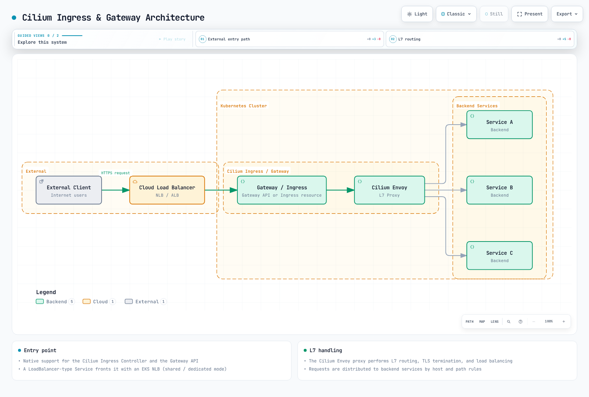

# Cilium Service Mesh Ingress 与 Gateway

> **审查基线**：Cilium 1.20.3；Gateway API 1.6.3；AWS Load Balancer Controller 3.6.0。
> **最后审阅日期**：October 16, 2026。Kubernetes/EKS 版本矩阵请参阅[安装前提条件](./README.md)；仅有较新的版本并不能证明兼容性。

## 概述

Cilium 使用 Kubernetes Ingress 和 Gateway API 资源配置其数据平面。eBPF 负责 Service 转发，并将 L7 流量重定向到节点本地的 Envoy。Envoy 提供 HTTP 路由和 TLS 终止；不透明的 TCP/TLS 路径具有不同的能力。以下示例介绍的是可选入口点，并非完整的应用部署。

## 架构



[🔍 查看交互式图表](https://www.atomai.click/kubernetes-docs/archmaps/en-service-mesh-cilium-service-mesh-05-ingress-gateway-0.html)

Gateway/Ingress 方框表示配置，而不是接收数据包的进程。对于 L7 流量，实际路径为负载均衡器 → Service/NodePort 前端 → eBPF/TPROXY → Envoy → 后端。Cilium 在外部 `world` → `ingress` 边界以及 `ingress` → 后端的路径上分别应用策略。策略必须允许这两个流量段。云负载均衡器可用性和目标注册是彼此独立的前提条件。

## Cilium Ingress Controller

### 安装与启用

```yaml
kubeProxyReplacement: true
l7Proxy: true
envoy:
  enabled: true
ingressController:
  enabled: true
  loadbalancerMode: shared
  default: false
  service:
    type: LoadBalancer
```

这些是针对已规划好的 Cilium 安装的 Helm **覆盖项**。请将它们与安装指南中的平台特定 CNI/IPAM 和可访问的 API server 设置合并。在运行中的集群中更改 kube-proxy 替换模式属于迁移，而不是日常的功能开关。应用更改前，请渲染并审查固定为 1.20.3 版本的 chart。

`ingressController.default` 会将 `cilium` **IngressClass 设为默认值**；它不会配置回退后端。Chart 会创建名为 `cilium` 的 class；`ingressController.ingressClassName` 不是受支持的值。显式设置 `spec.ingressClassName` 可避免依赖集群默认值。

在 shared 模式下，由 Cilium 管理的 Ingress 资源会使用 Helm release 命名空间中的共享 `cilium-ingress` Service（此处为 `kube-system`）。每个 Ingress 的模式注解可以选择 dedicated 模式；其他控制器和 Gateway API 资源不会自动共享此入口。更改模式可能会改变地址并中断连接。`LoadBalancer` 需要能够创建和协调该资源的实现；如果 AWS LBC 管理此 Service，请使用下面的 EKS 覆盖配置。

### Ingress 资源示例

```yaml
apiVersion: networking.k8s.io/v1
kind: Ingress
metadata:
  name: app-ingress
  namespace: default
  annotations:
    ingress.cilium.io/loadbalancer-mode: shared
    ingress.cilium.io/tls-passthrough: 'false'
spec:
  ingressClassName: cilium
  tls:
  - hosts:
    - app.example.com
    secretName: app-tls-secret
  rules:
  - host: app.example.com
    http:
      paths:
      - path: /api
        pathType: Prefix
        backend:
          service:
            name: api-service
            port:
              number: 80
      - path: /
        pathType: Prefix
        backend:
          service:
            name: frontend-service
            port:
              number: 80
```

在 `default` 中创建指定名称的 Services 和就绪端点，每个 Service 都要暴露 Service 端口 80。提供一个包含覆盖 `app.example.com` 的证书的 `app-tls-secret`，并将 DNS 指向此入口。TLS 部分会在 Envoy 终止客户端 TLS；示例中显示的后端端口使用明文 HTTP。对于启用了 TLS 的主机，Cilium 默认的 `enforceHttps: true` 会将 HTTP 重定向到 HTTPS。这并不意味着工作负载之间已建立 mTLS。

### 基于路径的路由

```yaml
apiVersion: networking.k8s.io/v1
kind: Ingress
metadata:
  name: path-routing
  namespace: default
spec:
  ingressClassName: cilium
  rules:
  - host: api.example.com
    http:
      paths:
      - path: /users
        pathType: Prefix
        backend:
          service:
            name: users-service
            port:
              number: 80
      - path: /orders
        pathType: Prefix
        backend:
          service:
            name: orders-service
            port:
              number: 80
      - path: /products
        pathType: Prefix
        backend:
          service:
            name: products-service
            port:
              number: 80
      - path: /health
        pathType: Exact
        backend:
          service:
            name: health-service
            port:
              number: 80
```

`Prefix` 按路径元素匹配：`/users` 和 `/users/42` 会匹配，但 `/users-old` 不会。`Exact` 只匹配 `/health`。Cilium Ingress 的排序顺序为 Exact、ImplementationSpecific/regex，然后是 Prefix；在这些组内，较长的匹配优先。Gateway API 有自己的优先级规则；YAML 列表顺序并不是通用的路由优先级机制。

### TLS 终止

```yaml
apiVersion: networking.k8s.io/v1
kind: Ingress
metadata:
  name: tls-ingress
  namespace: default
spec:
  ingressClassName: cilium
  tls:
  - hosts:
    - secure.example.com
    secretName: app-tls-secret
  rules:
  - host: secure.example.com
    http:
      paths:
      - path: /
        pathType: Prefix
        backend:
          service:
            name: secure-app
            port:
              number: 80
```

请使用**真实 PEM 文件**生成 Secret，而不要应用占位用的 Base64 内容。两个示例使用的同一个 Secret 必须包含 SAN 覆盖 `app.example.com` 和 `secure.example.com` 的证书；否则请使用单独的 Secret。通过 PKI 配置受公开信任或明确受信任的私有证书，并规划好续期。

```bash
openssl x509 -in ./tls.crt -noout -dates -ext subjectAltName
kubectl -n default create secret tls app-tls-secret \
  --cert=./tls.crt --key=./tls.key --dry-run=client -o yaml
```

最后一条命令只会渲染 Secret。请审查该 Secret，并通过选定的 Secret 管理工作流应用；避免将私钥内容写入共享日志。

### TLS 透传

```yaml
apiVersion: networking.k8s.io/v1
kind: Ingress
metadata:
  name: tls-passthrough
  namespace: default
  annotations:
    ingress.cilium.io/tls-passthrough: 'true'
spec:
  ingressClassName: cilium
  rules:
  - host: backend.example.com
    http:
      paths:
      - path: /
        pathType: Prefix
        backend:
          service:
            name: tls-backend
            port:
              number: 443
```

后端负责终止 TLS，并持有适用于 `backend.example.com` 的证书。Cilium 会匹配 TLS SNI；TLS 透传 Ingress 必须指定主机名和路径 `/`。加密流量中无法进行 HTTP 路径/标头改写。后端看到的是来自 Envoy/节点的新连接，而不是原始客户端的套接字地址；Envoy 也无法在此流中插入 HTTP 转发标头。

## Gateway API

### 启用 Gateway API

```yaml
gatewayAPI:
  enabled: true
  gatewayClass:
    create: true
  secretsNamespace:
    create: true
    name: cilium-secrets
    sync: true
```

启用控制器前，请先安装 **Gateway API 1.6.3 Standard CRD**；这是 Cilium 1.20.3 安装参考中使用的版本。请审查 CRD 升级对共享集群的所有控制器造成的影响。不要用此片段替换整个 Cilium values 文件：它是对上述 kube-proxy 替换/L7 前提条件的补充。

受支持的键为 `gatewayAPI.gatewayClass.create` 和 `gatewayAPI.secretsNamespace`。先前位置中的 `secretNamespace` 和 `gatewayClassName` 会被忽略。默认情况下，证书引用仍指向 Gateway 所在命名空间中的 Secret；控制器同步 Secret 的命名空间不会改变用户的引用位置。

### GatewayClass

使用前述 chart 设置时，Cilium 会使用控制器名称 `io.cilium/gateway-controller` 管理 `cilium` GatewayClass。使用 `kubectl get gatewayclass cilium -o yaml` 检查它；不要为同一个对象创建第二个所有者。GatewayClass 用于选择控制器和参数，而不是共享的实体负载均衡器。

### Gateway

```yaml
apiVersion: gateway.networking.k8s.io/v1
kind: Gateway
metadata:
  name: main-gateway
  namespace: default
spec:
  gatewayClassName: cilium
  listeners:
  - name: http
    protocol: HTTP
    port: 80
    hostname: '*.example.com'
    allowedRoutes:
      namespaces:
        from: Same
  - name: https
    protocol: HTTPS
    port: 443
    hostname: '*.example.com'
    tls:
      mode: Terminate
      certificateRefs:
      - kind: Secret
        name: wildcard-tls
        namespace: default
    allowedRoutes:
      namespaces:
        from: Same
```

使用 HTTPS 前，请先在 `default` 中创建 `wildcard-tls`，并确保其中的证书覆盖 listener 主机名。`*.example.com` 不覆盖裸域名 `example.com`，也不覆盖 `a.b.example.com` 这样的更深层级名称。这些 listener 用于终止 HTTP/HTTPS；后续的 TCP 和 TLS 透传示例使用独立的 Gateway，以明确区分协议和所有权。每个生成的 Gateway Service 都可能需要单独的云负载均衡器。

### HTTPRoute

```yaml
apiVersion: gateway.networking.k8s.io/v1
kind: HTTPRoute
metadata:
  name: api-routes
  namespace: default
spec:
  parentRefs:
  - name: main-gateway
    namespace: default
    sectionName: https
  hostnames:
  - api.example.com
  rules:
  - matches:
    - path:
        type: PathPrefix
        value: /v1/users
    backendRefs:
    - name: users-v1
      port: 80
  - matches:
    - path:
        type: PathPrefix
        value: /v2/users
    backendRefs:
    - name: users-v2
      port: 80
  - matches:
    - path:
        type: PathPrefix
        value: /api
      headers:
      - name: X-API-Version
        value: '2'
    backendRefs:
    - name: api-v2
      port: 80
  - matches:
    - path:
        type: PathPrefix
        value: /
    backendRefs:
    - name: api-v1
      port: 80
```

每个后端都是 Route 命名空间中已存在的 Service，端口为 80，且具有就绪端点。`sectionName: https` 特意将此 Route 限定为 HTTPS listener。请检查正确的 `status.parents` 条目中的 `Accepted` 和 `ResolvedRefs`，并检查 Gateway/listener 的 `Programmed`/`Accepted` 条件及最新的 `observedGeneration`。配置被接受并不能证明 DNS、证书信任、目标运行状况或应用可达性正常。

### 基于权重的流量分割

```yaml
apiVersion: gateway.networking.k8s.io/v1
kind: HTTPRoute
metadata:
  name: canary-route
  namespace: default
spec:
  parentRefs:
  - name: main-gateway
    sectionName: https
  hostnames:
  - app.example.com
  rules:
  - matches:
    - path:
        type: PathPrefix
        value: /
    backendRefs:
    - name: app-stable
      port: 80
      weight: 90
    - name: app-canary
      port: 80
      weight: 10
```

权重表示相对选择概率，而不保证每十个请求中恰好有九个请求发往 stable 版本。连接、重试和采样都会影响观测到的计数。此示例仅关联 HTTPS，并且使用了与 API 示例不同的主机名。

### 请求/响应转换

```yaml
apiVersion: gateway.networking.k8s.io/v1
kind: HTTPRoute
metadata:
  name: transform-route
  namespace: default
spec:
  parentRefs:
  - name: main-gateway
    sectionName: https
  rules:
  - matches:
    - path:
        type: PathPrefix
        value: /api
    filters:
    - type: RequestHeaderModifier
      requestHeaderModifier:
        set:
        - name: X-Doc-Route
          value: api-v2
        remove:
        - X-Internal-Header
    - type: URLRewrite
      urlRewrite:
        hostname: internal-api.default.svc
        path:
          type: ReplacePrefixMatch
          replacePrefixMatch: /v2/api
    - type: ResponseHeaderModifier
      responseHeaderModifier:
        set:
        - name: X-Doc-Gateway
          value: cilium
    backendRefs:
    - name: api-service
      port: 80
  hostnames:
  - transform.example.com
```

标头值是**字面字符串**。`X-Doc-Route` 和 `X-Doc-Gateway` 是诊断标记，不是自动生成的请求 ID，也不是测得的响应时间。主机名改写使用 `URLRewrite.hostname`；不会重复设置为 `Host` 标头变更。这些标头不能验证调用方身份。响应 `Server` 标头的处理也会受到控制器的 Envoy server-header 转换设置影响；如果要更改此行为，请使用经过验证的 `CiliumGatewayClassConfig`。

### 重定向

```yaml
apiVersion: gateway.networking.k8s.io/v1
kind: HTTPRoute
metadata:
  name: redirect-http
  namespace: default
spec:
  parentRefs:
  - name: main-gateway
    sectionName: http
  hostnames:
  - '*.example.com'
  rules:
  - matches:
    - path:
        type: PathPrefix
        value: /
    filters:
    - type: RequestRedirect
      requestRedirect:
        scheme: https
        port: 443
        statusCode: 308
---
apiVersion: gateway.networking.k8s.io/v1
kind: HTTPRoute
metadata:
  name: redirect-path
  namespace: default
spec:
  parentRefs:
  - name: main-gateway
    sectionName: https
  hostnames:
  - old.example.com
  rules:
  - matches:
    - path:
        type: Exact
        value: /old-path
    filters:
    - type: RequestRedirect
      requestRedirect:
        path:
          type: ReplaceFullPath
          replaceFullPath: /new-path
        statusCode: 308
---
apiVersion: gateway.networking.k8s.io/v1
kind: HTTPRoute
metadata:
  name: redirect-host
  namespace: default
spec:
  parentRefs:
  - name: main-gateway
    sectionName: https
  hostnames:
  - old.example.com
  rules:
  - matches:
    - path:
        type: PathPrefix
        value: /legacy
    filters:
    - type: RequestRedirect
      requestRedirect:
        hostname: legacy.example.com
        statusCode: 307
```

协议重定向**仅关联 `http`**，因此 HTTPS 请求不会被重定向回同一个 URL，造成无限循环。其余两个 Route 仅关联 `https` 和范围较窄的源主机名。永久重定向 308 和临时重定向 307 会保留请求方法/请求正文；301/302 对客户端的行为不同，不应一概建议用于写请求。重定向初始 HTTP 请求无法撤回客户端已经发送的明文数据。RequestRedirect 和 URLRewrite 是不同的 filter，不能在同一条规则中组合使用。

### TCPRoute

```yaml
apiVersion: gateway.networking.k8s.io/v1
kind: Gateway
metadata:
  name: tcp-gateway
  namespace: default
spec:
  gatewayClassName: cilium
  listeners:
  - name: tcp
    protocol: TCP
    port: 9000
    allowedRoutes:
      namespaces:
        from: Same
      kinds:
      - kind: TCPRoute
---
apiVersion: gateway.networking.k8s.io/v1
kind: TCPRoute
metadata:
  name: tcp-route
  namespace: default
spec:
  parentRefs:
  - name: tcp-gateway
    sectionName: tcp
  rules:
  - backendRefs:
    - name: tcp-service
      port: 9000
```

Gateway API 1.6.3 通过 **v1** 提供 TCPRoute；旧版 `v1alpha2` 不再提供。TCPRoute 会转发不透明的 TCP 流，不会检查 HTTP 路径。TCP 可以承载 HTTP 或 TLS，但这并不意味着此 Route 具有 HTTP 路由或 TLS 终止语义。Cilium 1.20.3 的 L4 Gateway 转换使用后端 EndpointSlices；不要认为它与 L7 Envoy 前端的端点实现相同。

### TLSRoute

```yaml
apiVersion: gateway.networking.k8s.io/v1
kind: Gateway
metadata:
  name: tls-gateway
  namespace: default
spec:
  gatewayClassName: cilium
  listeners:
  - name: tls
    protocol: TLS
    port: 443
    hostname: secure.example.com
    tls:
      mode: Passthrough
    allowedRoutes:
      namespaces:
        from: Same
      kinds:
      - kind: TLSRoute
---
apiVersion: gateway.networking.k8s.io/v1
kind: TLSRoute
metadata:
  name: tls-route
  namespace: default
spec:
  parentRefs:
  - name: tls-gateway
    sectionName: tls
  hostnames:
  - secure.example.com
  rules:
  - backendRefs:
    - name: tls-backend
      port: 443
```

在此基线中，TLSRoute 也通过 **v1** 提供。它要求兼容的 `TLS` listener，并且 `mode: Passthrough`，而不是上面的 HTTPS 终止 listener。后端负责持有适用于 `secure.example.com` 的证书；SNI 用于选择后端，而 HTTP 内容仍保持加密。请验证生成的 Service、listener 状态和端到端 TLS 信任。

## EKS 集成模式

### NLB + Cilium Ingress

```yaml
ingressController:
  enabled: true
  loadbalancerMode: shared
  enableProxyProtocol: false
  service:
    type: LoadBalancer
    loadBalancerClass: service.k8s.aws/nlb
    allocateLoadBalancerNodePorts: true
    externalTrafficPolicy: Cluster
    annotations:
      service.beta.kubernetes.io/aws-load-balancer-scheme: internal
      service.beta.kubernetes.io/aws-load-balancer-nlb-target-type: instance
      service.beta.kubernetes.io/aws-load-balancer-attributes: load_balancing.cross_zone.enabled=true
      service.beta.kubernetes.io/aws-load-balancer-healthcheck-protocol: TCP
      service.beta.kubernetes.io/aws-load-balancer-healthcheck-port: traffic-port
```

此 NLB 按设计设为**内部负载均衡器**：唯一的公网入口是 CloudFront，后者通过 CloudFront VPC origin 访问此 NLB。其安全组必须只允许来自 VPC origin 安全组（或 CloudFront 托管前缀列表）的流量，绝不能允许公网 CIDR。

此覆盖配置描述的是 **AWS LBC 管理的 NLB → EC2 NodePort → Cilium Ingress Envoy**。它要求 AWS LBC 3.6.0、对应的 IAM/子网/安全组前提条件、符合条件的 EC2 节点、受 Cilium 支持的 EKS/CNI 配置以及已分配的 NodePort。这不是 EKS Auto Mode 或 Fargate 上安装 Cilium 的操作指南。`service.k8s.aws/nlb` 会明确选择 AWS LBC；旧版 `aws-load-balancer-type: nlb` 注解无法表达这一所有权关系。

对此 L7 前端，请使用 instance targets。Cilium 1.20.3 的共享 Ingress Service 使用合成的 EndpointSlice（`192.192.192.192:9999`，不带 Pod 目标引用）。AWS LBC 的 IP 目标解析器需要 Pod 目标引用，因此会跳过这些端点。仅将此 Service 切换为 `ip` **不会**发现节点本地的 Envoy 进程。这是 Cilium L7 前端的特有情况；普通工作负载 Service 和当前的 L4 Gateway EndpointSlices 则有所不同。

TCP 健康检查只检查 NodePort 的传输层可达性，不检查应用的 `/healthz`、TLS 有效性或特定主机的 HTTP 路由。跨可用区负载均衡使用当前的负载均衡器属性注解，需要评估成本和流量。不要假定可以在原地更改现有 Service 的控制器所有权或 LB 类型而实现零停机迁移。

**客户端身份和可选的 PROXY protocol：**在 HTTP Envoy 处理过程中，无论外部流量策略为 `Cluster` 还是 `Local`，Cilium 都会保留其前端可见的源地址。该地址是否为原始客户端地址，首先取决于上游 NLB 和目标组属性。Instance TCP targets 通常会保留客户端 IP；并非所有场景都需要 PROXY protocol。如果你的拓扑确实需要它，请将此附加覆盖配置与 NLB 设置协同部署：

```yaml
ingressController:
  enableProxyProtocol: true
  service:
    annotations:
      service.beta.kubernetes.io/aws-load-balancer-proxy-protocol: '*'
```

这会在 NLB 启用 PPv2，并在 Cilium Ingress 启用其解析器。这需要协调部署：只启用一侧会导致流量中断。解析器要求存在 PROXY header，因此不带该 header 的直接 HTTP/TLS 探测会失败。AWS LBC 警告不要将 PPv2 与 instance targets 及 `externalTrafficPolicy: Local` 组合使用；此示例保留 `Cluster`。HTTP/HTTPS 健康检查也需要兼容的解析器。请限制对受信任代理路径的直接访问：PP 元数据和转发的 HTTP 标头都不是经过身份验证的身份信息。`gatewayAPI.enableProxyProtocol` 是 Gateway API 的独立设置；Ingress 标志不会配置它。

### ALB + Cilium

ALB → Cilium Envoy 可以组合使用，但必须针对实际环境设计并测试以下前提条件。对于上文所述的合成 L7 EndpointSlices，不存在普遍适用的 `target-type: ip` 快捷方式。

| 边界 | 必须做出的决定 |
|---|---|
| 控制器和命名空间 | ALB Ingress 使用 `spec.ingressClassName: alb`。其后端 Service 必须位于**同一命名空间**；共享的 `cilium-ingress` Service 通常位于 `kube-system`，而不是 `default`。 |
| 目标 | 对于基于节点的路径，请使用经过明确规划的 NodePort Service 和 ALB `target-type: instance`；验证符合条件的节点、NodePort 分配情况和安全组。不要擅自将已拥有 NLB 的 Service 转换为其他类型。 |
| TLS | 决定由 ALB 终止 TLS 并转发 HTTP 还是 HTTPS。关联 ACM 服务器证书不等于客户端 mTLS。如果 ALB 转发 HTTP，除非协调好 listener/重定向行为，否则 Cilium 的 HTTPS 重定向可能造成循环。 |
| 健康检查 | ALB 健康检查使用自己的 Host header，不会自动使用 `app.example.com`；特定主机的应用路由可能返回 404。请定义并测试适用的健康检查路由/端口。 |
| 客户端归属 | 针对实际代理链配置 Cilium 受信任的 XFF 跳数，清理不可信标头，并阻止绕过 ALB 直接访问后端。 |

此前的示例引用了错误的命名空间和 IP targets，也遗漏了这些决策；现已将其替换为这些实施要求。本指南未部署或进行过此组合的负载测试。

### 混合架构


[🔍 查看交互式图表](https://www.atomai.click/kubernetes-docs/archmaps/en-service-mesh-cilium-service-mesh-05-ingress-gateway-1.html)

这是一张逻辑组合图，不是经过验证的部署清单。ALB 路径需要满足上述有关命名空间/目标/TLS/健康检查/信任的要求。NLB L4 路径可以承载 gRPC 流，而无需了解单个 RPC 方法。在 ALB 后面添加 Cilium 并不会免除 ALB 费用，也不会使 ALB 的功能成为 Cilium 原生功能。

## 多租户 Gateway

### 每个命名空间一个 Gateway

```yaml
apiVersion: gateway.networking.k8s.io/v1
kind: GatewayClass
metadata:
  name: cilium-shared
spec:
  controllerName: io.cilium/gateway-controller
---
apiVersion: gateway.networking.k8s.io/v1
kind: Gateway
metadata:
  name: team-a-gateway
  namespace: team-a
spec:
  gatewayClassName: cilium-shared
  listeners:
  - name: https
    protocol: HTTPS
    port: 443
    hostname: '*.team-a.example.com'
    tls:
      mode: Terminate
      certificateRefs:
      - kind: Secret
        name: team-a-tls
    allowedRoutes:
      namespaces:
        from: Same
---
apiVersion: gateway.networking.k8s.io/v1
kind: Gateway
metadata:
  name: team-b-gateway
  namespace: team-b
spec:
  gatewayClassName: cilium-shared
  listeners:
  - name: https
    protocol: HTTPS
    port: 443
    hostname: '*.team-b.example.com'
    tls:
      mode: Terminate
      certificateRefs:
      - kind: Secret
        name: team-b-tls
    allowedRoutes:
      namespaces:
        from: Same
```

请先创建每个命名空间及其各自有效的 TLS Secret。共享 GatewayClass `cilium-shared` **并不**意味着两个 Gateway 共享一个 Service/负载均衡器。`from: Same` 会将 Route 关联范围限制在各自的 Gateway 命名空间内；RBAC 还必须分别控制谁可以更改 Gateway、Secret、Route 和命名空间标签。

### 跨命名空间路由

```yaml
apiVersion: gateway.networking.k8s.io/v1
kind: Gateway
metadata:
  name: shared-gateway
  namespace: gateway-system
spec:
  gatewayClassName: cilium
  listeners:
  - name: https
    protocol: HTTPS
    port: 443
    hostname: '*.example.com'
    allowedRoutes:
      namespaces:
        from: Selector
        selector:
          matchLabels:
            gateway-access: 'true'
    tls:
      mode: Terminate
      certificateRefs:
      - kind: Secret
        name: shared-tls
---
apiVersion: v1
kind: Namespace
metadata:
  name: app-team
  labels:
    gateway-access: 'true'
---
apiVersion: gateway.networking.k8s.io/v1
kind: HTTPRoute
metadata:
  name: app-route
  namespace: app-team
spec:
  parentRefs:
  - name: shared-gateway
    namespace: gateway-system
    sectionName: https
  hostnames:
  - app.example.com
  rules:
  - matches:
    - path:
        type: PathPrefix
        value: /
    backendRefs:
    - name: app-service
      port: 80
```

创建 `gateway-system` 及其 `shared-tls` Secret，并确保证书覆盖允许的主机名。命名空间选择器授权 Route 关联；它不会验证用户身份，也不会授权应用请求。管理员必须控制 `gateway-access` 标签。

所示的 `app-service` 后端位于 `app-team` 本地，因此不需要 ReferenceGrant。如果 Route 改为引用 `backend-team/shared-api`，后端命名空间必须明确授权此引用：

```yaml
apiVersion: gateway.networking.k8s.io/v1
kind: ReferenceGrant
metadata:
  name: allow-app-team
  namespace: backend-team
spec:
  from:
  - group: gateway.networking.k8s.io
    kind: HTTPRoute
    namespace: app-team
  to:
  - group: ''
    kind: Service
    name: shared-api
---
apiVersion: gateway.networking.k8s.io/v1
kind: HTTPRoute
metadata:
  name: shared-api-route
  namespace: app-team
spec:
  parentRefs:
  - name: shared-gateway
    namespace: gateway-system
    sectionName: https
  hostnames:
  - shared-api.example.com
  rules:
  - backendRefs:
    - name: shared-api
      namespace: backend-team
      port: 80
```

使用此替代方案前，请创建 `backend-team/shared-api`，并确保其 Service 端口为 80。Route → Gateway 的跨命名空间关联使用 `allowedRoutes`；Route → 后端 Service 的跨命名空间引用使用 `ReferenceGrant`。这是两项不同的权限检查。ReferenceGrant v1 已在 1.6.3 中提供；v1beta1 也仍然提供。

## 高级负载均衡配置

### Service 健康检查

```yaml
apiVersion: cilium.io/v2
kind: CiliumEnvoyConfig
metadata:
  name: health-check-config
  namespace: default
spec:
  services:
  - name: my-service
    namespace: default
    ports:
    - 80
    listener: health-check-config-listener
  resources:
  - '@type': type.googleapis.com/envoy.config.listener.v3.Listener
    name: health-check-config-listener
    filter_chains:
    - filters:
      - name: envoy.filters.network.http_connection_manager
        typed_config:
          '@type': type.googleapis.com/envoy.extensions.filters.network.http_connection_manager.v3.HttpConnectionManager
          stat_prefix: health-check-config
          route_config:
            name: health-check-config-routes
            virtual_hosts:
            - name: app
              domains:
              - '*'
              routes:
              - match:
                  prefix: /
                route:
                  cluster: default/my-service
                  retry_policy:
                    num_retries: 0
          http_filters:
          - name: envoy.filters.http.router
            typed_config:
              '@type': type.googleapis.com/envoy.extensions.filters.http.router.v3.Router
  - '@type': type.googleapis.com/envoy.config.cluster.v3.Cluster
    name: default/my-service
    connect_timeout: 5s
    type: EDS
    health_checks:
    - timeout: 5s
      interval: 10s
      unhealthy_threshold: 3
      healthy_threshold: 2
      http_health_check:
        path: /health
        host: health-check.local
        expected_statuses:
        - start: 200
          end: 300
    outlier_detection:
      consecutive_5xx: 5
      interval: 10s
      base_ejection_time: 30s
      max_ejection_percent: 50
      enforcing_consecutive_5xx: 100
```

这是一个完整且独立的 CEC 链：Service 端口 80 → 命名 Listener → HTTP 路由 → EDS Cluster。Cilium 会为引用的 Service 提供 xDS 端点配置。在 `default` 中创建 `my-service`，并确保其后端已就绪；不要再将其分配给其他 CEC 或生成的 Ingress/Gateway 配置。CEC 定制不是修改控制器所拥有资源的补丁机制。

每个后端都必须实际接受 `Host: health-check.local` 和 `/health`。Envoy 状态码范围不包括上限，因此 `[200, 300)` 覆盖所有 2xx 响应。主动健康检查和被动异常检测是不同的机制；弹出限制和 panic 行为无法保证排除所有故障端点。请根据后端数量和故障模型进行验证。

### 连接池配置 {#connection-pool-configuration}

```yaml
apiVersion: cilium.io/v2
kind: CiliumEnvoyConfig
metadata:
  name: connection-pool
  namespace: default
spec:
  services:
  - name: high-traffic-service
    namespace: default
    ports:
    - 80
    listener: connection-pool-listener
  resources:
  - '@type': type.googleapis.com/envoy.config.listener.v3.Listener
    name: connection-pool-listener
    filter_chains:
    - filters:
      - name: envoy.filters.network.http_connection_manager
        typed_config:
          '@type': type.googleapis.com/envoy.extensions.filters.network.http_connection_manager.v3.HttpConnectionManager
          stat_prefix: connection-pool
          route_config:
            name: connection-pool-routes
            virtual_hosts:
            - name: app
              domains:
              - '*'
              routes:
              - match:
                  prefix: /
                route:
                  cluster: default/high-traffic-service
                  retry_policy:
                    num_retries: 0
          http_filters:
          - name: envoy.filters.http.router
            typed_config:
              '@type': type.googleapis.com/envoy.extensions.filters.http.router.v3.Router
  - '@type': type.googleapis.com/envoy.config.cluster.v3.Cluster
    name: default/high-traffic-service
    connect_timeout: 5s
    type: EDS
    typed_extension_protocol_options:
      envoy.extensions.upstreams.http.v3.HttpProtocolOptions:
        '@type': type.googleapis.com/envoy.extensions.upstreams.http.v3.HttpProtocolOptions
        explicit_http_config:
          http2_protocol_options:
            max_concurrent_streams: 1000
            initial_stream_window_size: 65536
            initial_connection_window_size: 1048576
    circuit_breakers:
      thresholds:
      - priority: DEFAULT
        max_connections: 10000
        max_pending_requests: 10000
        max_requests: 10000
        max_retries: 5
```

在端口 80 上创建 `default/high-traffic-service`，并确保其后端明确支持明文 HTTP/2（h2c）。此类型化协议选项会选择上游 HTTP/2；它不会自动进行协议协商。`accept_http_10` 只会接受 HTTP/1.0，并不是 HTTP/1.1 连接池设置。对于 HTTP/1 后端，请改为选择相应的显式 HTTP/1 配置。

熔断器阈值按 Envoy cluster/priority 设置，不是整个集群范围内的配额，也不是容量建议。`max_retries` 限制的是并发重试数，不是每个请求的重试次数。此处的路由设置为 `num_retries: 0`。提高连接/流数量限制前，需要进行资源和后端测试；示例数值仅供说明。

## 与 AWS Load Balancer Controller 的比较

| 能力 | Cilium Ingress/Gateway | AWS Load Balancer Controller 3.6 |
|---|---|---|
| 数据平面 | eBPF Service/L4 转发；HTTP/TLS 功能由 Envoy 提供 | AWS ALB 或 NLB |
| Gateway API | 请查看固定版本的 Cilium 功能/一致性表 | HTTPRoute/GRPCRoute 映射到 ALB；TCPRoute/UDPRoute/TLSRoute 映射到 NLB；不支持在同一个 Gateway 上混合 L4/L7 |
| TLS 与身份 | Ingress TLS 终止/透传；工作负载加密/身份验证是独立的[安全配置](./03-security.md) | ACM 服务器证书；ALB 客户端 mTLS 需要使用其双向认证模式/信任存储 |
| 成本 | 节点/代理资源**加上任何已配置的云 LB 和网络费用** | 已配置的 ALB/NLB、容量/用量及网络费用 |
| 定制 | 受支持的 Gateway API 功能以及单独管理的 CEC；生成的对象仍由控制器拥有 | 通过 LBC API/注解公开的 AWS listener/rule/target group 功能 |
| 性能 | 根据实际拓扑、加密方式和工作负载进行测量 | 使用相同的工作负载和服务限制进行测量；没有通用的延迟排名 |

LBC 3.6 将 Gateway API **1.6.0** 记录为其测试基线；Cilium 的安装参考使用 **1.6.3**。共享这些 CRD 的集群需要进行兼容性测试，不应假定最新目录条目受每个控制器支持。

如果需要 AWS L7 集成，请选择 ALB；如果需要特定的传输/目标行为，请选择 NLB；如果有集群内路由/策略需求，则根据 Cilium 功能作出选择。NLB 目前支持新建流使用权重 **0–999** 的加权目标组；控制器是否公开该功能，以及特定 Route 的语义，是两个不同的问题。普通权重更改会保留现有连接，但根据 AWS 文档，将目标组权重设为 **0** 后，其现有连接会在短时间后关闭。不要将此操作描述为保留连接的排空过程。

旧版决策图重复了不受支持的成本、延迟、mTLS 和 Gateway API 说法。上表取代了这些断言；但它并未移除任何一种集成方案。

## 监控

### Gateway 指标

```bash
kubectl get gatewayclass cilium -o yaml
kubectl get gateway,httproute,tcproute,tlsroute -A
kubectl -n default describe gateway main-gateway
kubectl -n default get httproute api-routes -o yaml
kubectl -n kube-system exec ds/cilium -- cilium-dbg status --verbose
kubectl -n kube-system exec ds/cilium -- cilium-dbg envoy admin metrics -f downstream_rq
```

### Prometheus 指标

首先按照[可观测性指南](./04-observability.md)启用并抓取 Cilium Envoy Prometheus 端点。多个集群将数据发送到同一个 Prometheus 时，请配置稳定的 `cluster` 目标标签。原生 Cilium Envoy 镜像会公开 `envoy_http_conn_manager_prefix`，其生成值可能是 `listener-insecure`、`listener-secure` 和特定端口的变体，而不是固定的 `cilium-gateway` 值。同一个 Envoy 上的多个 Gateway 可能会重复使用这些前缀；以下示例描述的是**被抓取的代理/HCM**，不保证能按 Gateway 单独计量。构建仪表板前，请检查实际标签。

以下三个查询分别显示已启动请求速率、被归类为 5xx 的已完成响应计数百分比，以及以**秒**为单位的 p99 持续时间。只有在匹配的观测分母中才会用 0 补全缺失的 5xx 分子；没有流量/遥测数据时不会将其当作正常的零值。大于零的分母筛选器会省略空闲序列。Envoy 的 `downstream_rq_time` 直方图以**毫秒**为单位，因此需要除以 1000。计算分位数前，请在保留 `le` 标签的同时聚合直方图桶。仍需单独监控低样本数量、抓取间隔缺失和直方图缺失等情况。

```promql
sum by (cluster, instance, envoy_http_conn_manager_prefix) (
  rate(envoy_http_downstream_rq_total[5m])
)
```

```promql
100 *
(
  sum by (cluster, instance, envoy_http_conn_manager_prefix) (
    rate(envoy_http_downstream_rq_xx{envoy_response_code_class="5"}[5m])
  )
  or
  0 * sum by (cluster, instance, envoy_http_conn_manager_prefix) (
    rate(envoy_http_downstream_rq_xx[5m])
  )
)
/
(
  sum by (cluster, instance, envoy_http_conn_manager_prefix) (
    rate(envoy_http_downstream_rq_xx[5m])
  ) > 0
)
```

```promql
histogram_quantile(
  0.99,
  sum by (cluster, instance, envoy_http_conn_manager_prefix, le) (
    rate(envoy_http_downstream_rq_time_bucket[5m])
  )
) / 1000
```

## 后续步骤

- [最佳实践](./06-best-practices.md)：运维前提条件和限制

## 参考资料

- [Cilium 1.20.3 Ingress](https://github.com/cilium/cilium/blob/v1.20.3/Documentation/network/servicemesh/ingress.rst)
- [Cilium 流量、源 IP 和策略](https://github.com/cilium/cilium/blob/v1.20.3/Documentation/network/servicemesh/ingress-reference.rst)
- [Cilium Gateway API 安装](https://github.com/cilium/cilium/blob/v1.20.3/Documentation/network/servicemesh/gateway-api/gateway-api.rst)
- [Cilium 1.20.3 Helm values](https://github.com/cilium/cilium/blob/v1.20.3/install/kubernetes/cilium/values.yaml)
- [Gateway API 1.6.3 CRD](https://github.com/kubernetes-sigs/gateway-api/tree/v1.6.3/config/crd/standard)
- [AWS LBC 3.6 NLB 配置](https://github.com/kubernetes-sigs/aws-load-balancer-controller/blob/v3.6.0/docs/guide/service/nlb.md)
- [AWS LBC 3.6 注解](https://github.com/kubernetes-sigs/aws-load-balancer-controller/blob/v3.6.0/docs/guide/service/annotations.md)
- [AWS LBC 3.6 Gateway API](https://github.com/kubernetes-sigs/aws-load-balancer-controller/blob/v3.6.0/docs/guide/gateway/gateway.md)
- [NLB 目标组属性](https://docs.aws.amazon.com/elasticloadbalancing/latest/network/edit-target-group-attributes.html)
- [NLB listener 权重](https://docs.aws.amazon.com/elasticloadbalancing/latest/network/load-balancer-listeners.html)
- [Envoy 1.38 请求统计信息](https://www.envoyproxy.io/docs/envoy/v1.38.6/configuration/http/http_conn_man/stats)
