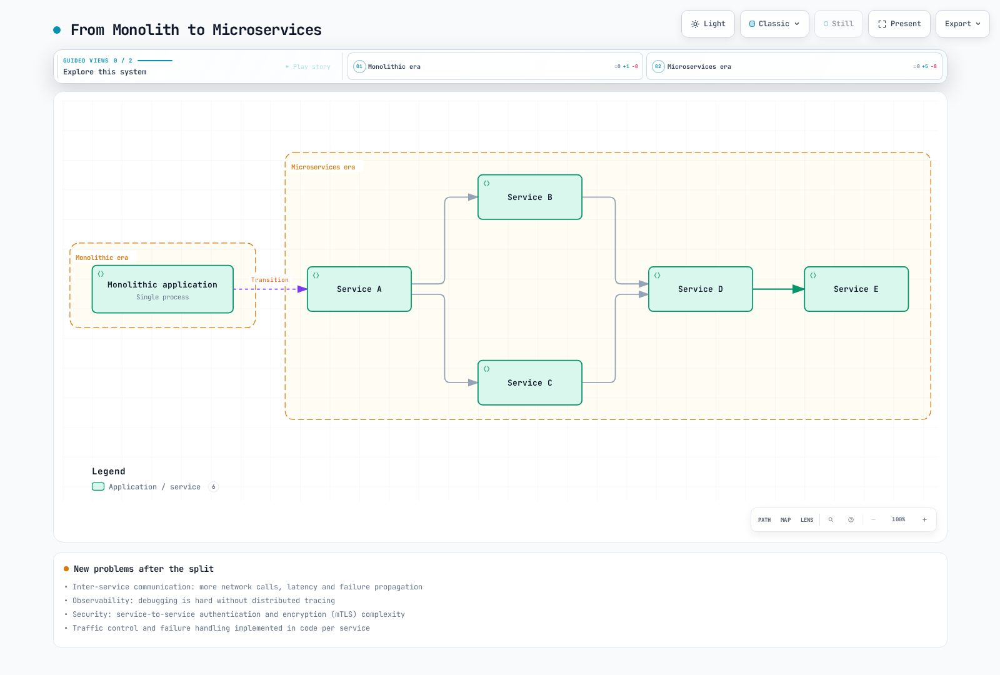
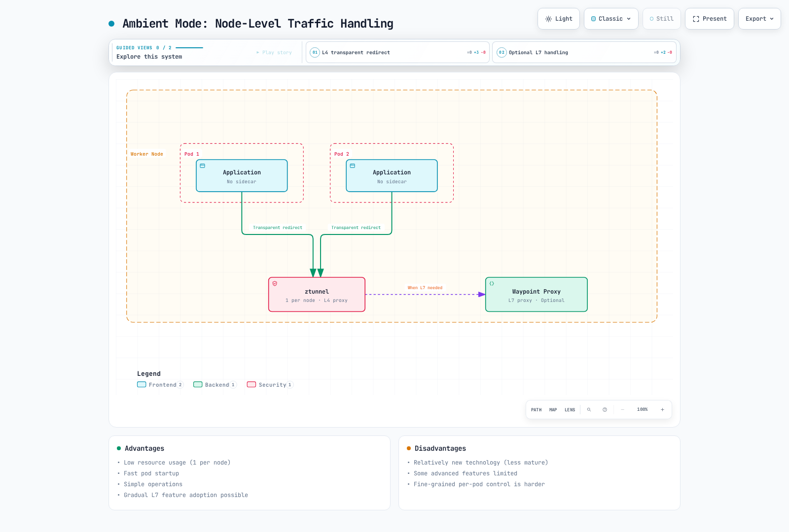
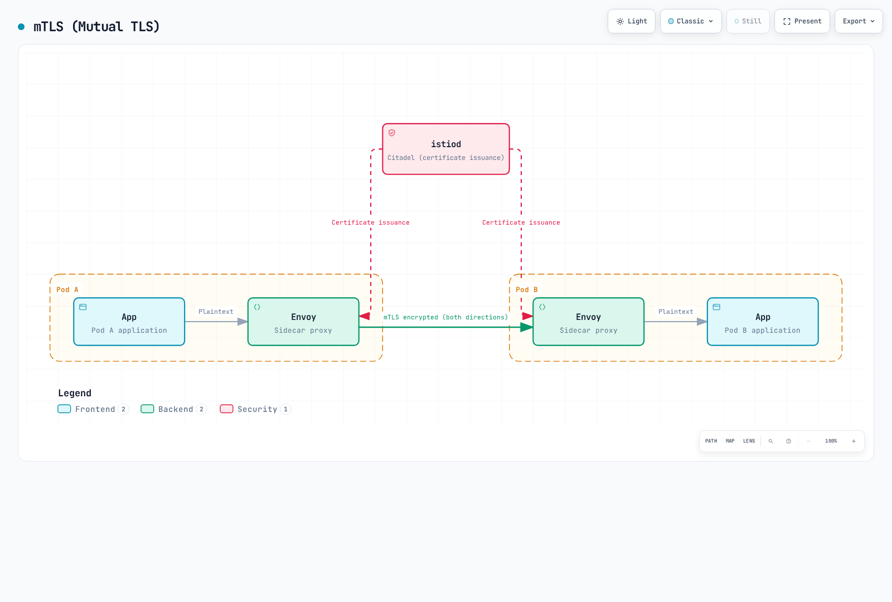
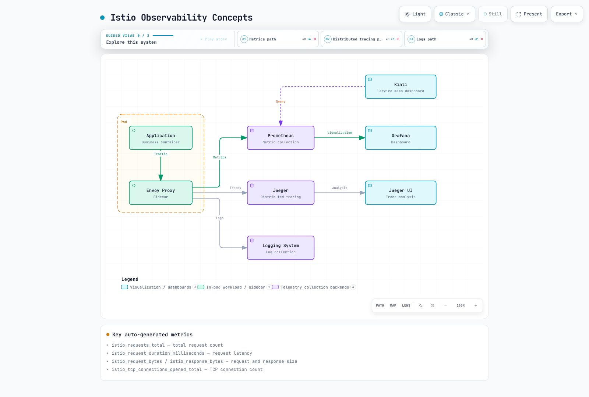

# 基本概念

本文介绍 Istio 的核心概念和架构。理解这些基础概念有助于有效使用 Istio。

## 目录

1. [背景与历史](02-basic-concepts.md#background-and-history)
2. [为什么选择 Istio？](02-basic-concepts.md#why-istio)
3. [Istio 架构](02-basic-concepts.md#istio-architecture)
4. [部署模式：Sidecar 与 Ambient](02-basic-concepts.md#deployment-modes-sidecar-vs-ambient)
5. [核心资源](02-basic-concepts.md#core-resources)
6. [流量管理概念](02-basic-concepts.md#traffic-management-concepts)
7. [安全概念](02-basic-concepts.md#security-concepts)
8. [可观测性概念](02-basic-concepts.md#observability-concepts)
9. [命名空间与服务网格](02-basic-concepts.md#namespaces-and-service-mesh)
10. [后续步骤](02-basic-concepts.md#next-steps)

## 背景与历史 {#background-and-history}

### 服务网格的诞生

#### 微服务的挑战

2010 年代初，企业开始将单体应用拆分为微服务。



[🔍 查看交互式图表](https://www.atomai.click/kubernetes-docs/archmaps/en-service-mesh-istio-02-basic-concepts-0.html)

**新问题**：

| 问题 | 说明 | 影响 |
| --- | --- | --- |
| **服务间通信** | 网络调用增加 | 延迟、故障传播 |
| **可观测性** | 需要分布式追踪 | 调试困难 |
| **安全性** | 服务间身份验证/加密 | mTLS 实现复杂 |
| **流量控制** | 金丝雀部署、A/B 测试 | 需要修改应用代码 |
| **故障处理** | 熔断器、重试 | 每个服务都要分别实现 |

#### 早期解决方案：库

**问题**：

* 每种语言都需要开发相应的库（例如 Java 的 Hystrix、单独的 Go 库等）
* 与应用代码紧密耦合
* 更新时需要重新部署所有服务
* 版本管理复杂


[🔍 查看交互式图表](https://www.atomai.click/kubernetes-docs/archmaps/en-service-mesh-istio-02-basic-concepts-1.html)

**服务网格理念**：将网络逻辑从应用中移出，放到基础设施层处理。

### Envoy Proxy 的诞生

#### Lyft 面临的问题

**2015 年，Lyft** 面临以下问题：

* 运营着 200 多个微服务
* 使用多种语言和框架（Python、Go、Java 等）
* 现有代理（HAProxy、NGINX）无法满足需求
  * 难以动态更改配置
  * 缺乏可观测性
  * 高级路由功能有限

#### Matt Klein 与 Envoy

Lyft 工程师 **Matt Klein** 于 2016 年将 Envoy 开源。

**Envoy 解决的问题**：


[🔍 查看交互式图表](https://www.atomai.click/kubernetes-docs/archmaps/en-service-mesh-istio-02-basic-concepts-2.html)

**Envoy 的主要功能**：

1. **进程外架构**：与应用分离，作为独立进程运行
2. **xDS API**：动态更新配置
3. **L7 代理**：支持 HTTP/2、gRPC、WebSocket
4. **可观测性**：提供详细的指标、追踪和日志
5. **性能**：使用 C++ 编写，性能高

#### CNCF 采纳

**时间线**：

* **2016 年 9 月**：Envoy 开源
* **2017 年 9 月**：被接纳为 CNCF 项目（Incubating）
* **2018 年 11 月**：晋升为 CNCF Graduated 项目

### Istio 的诞生与历史

#### Google、IBM 与 Lyft 合作

**2017 年 5 月**，Google、IBM 和 Lyft 合作宣布推出 Istio。


[🔍 查看交互式图表](https://www.atomai.click/kubernetes-docs/archmaps/en-service-mesh-istio-02-basic-concepts-3.html)

**各公司的贡献**：

| 公司 | 主要贡献 | 原因 |
| --- | --- | --- |
| **Google** | 控制平面设计 | Borg、Kubernetes 方面的经验 |
| **IBM** | 企业级功能 | 企业客户的需求 |
| **Lyft** | Envoy Proxy | 经生产环境验证的代理 |

#### Istio 版本历史

**重要里程碑**：


[🔍 查看交互式图表](https://www.atomai.click/kubernetes-docs/archmaps/en-service-mesh-istio-02-basic-concepts-4.html)

**1.5 版（2020 年 3 月）——重要转折点**：

此前的架构（Istio 1.4 及更早版本）：

```
Separated into individual components:
- Mixer (policy/telemetry)
- Pilot (traffic management)
- Citadel (certificate management)
- Galley (configuration validation)
```

新架构（Istio 1.5 及更高版本）：

```
Istiod (consolidated into single binary)
├── Pilot functionality (Service Discovery, Traffic Management)
├── Citadel functionality (Certificate Authority, Identity)
└── Galley functionality (Configuration Validation)

Mixer was deprecated during this transition; telemetry moved into the proxies
```

**变更原因**：

* 降低复杂性（从 4 个组件减少为 1 个）
* 减少遥测路径开销（实际改善程度取决于工作负载）
* 简化运维（只需管理单个进程）
* 提高资源效率（减少内存和 CPU 使用量）

## 为什么选择 Istio？ {#why-istio}

Kubernetes 提供容器编排，但在管理微服务间的复杂通信方面有局限。Istio 是一种服务网格解决方案，用于应对这些问题。

### 微服务的挑战


[🔍 查看交互式图表](https://www.atomai.click/kubernetes-docs/archmaps/en-service-mesh-istio-02-basic-concepts-5.html)

### Istio 提供的核心价值

#### 1. 流量管理

**问题**：部署新版本时，需要安全地切换流量。

**Istio 解决方案**：

```yaml
# Canary deployment without code changes
apiVersion: networking.istio.io/v1
kind: VirtualService
metadata:
  name: reviews
spec:
  hosts:
  - reviews
  http:
  - route:
    - destination:
        host: reviews
        subset: v1
      weight: 90  # Existing version 90%
    - destination:
        host: reviews
        subset: v2
      weight: 10  # New version 10%
```

**优势**：

* 无需修改应用代码
* 可实时调整流量拆分
* 回滚可由发布控制器自动执行；Istio 负责应用路由权重
* 支持 A/B 测试和蓝绿部署

#### 2. 安全性

**问题**：需要加密并验证服务间通信。

**Istio 解决方案**：

```yaml
# Automatic mTLS enablement
apiVersion: security.istio.io/v1
kind: PeerAuthentication
metadata:
  name: default
  namespace: istio-system
spec:
  mtls:
    mode: STRICT  # Require mTLS on enrolled inbound workloads
```

**优势**：

* 自动签发和续订证书
* 自动验证服务身份
* 细粒度权限控制
* 实现零信任网络

#### 3. 可观测性

**问题**：难以追踪跨越数十个微服务的请求流。

**Istio 解决方案**：

* 自动生成指标（延迟、流量、错误、饱和度）
* 分布式追踪
* 服务拓扑可视化

**优势**：

* 自动识别瓶颈
* 快速定位错误根因
* 实时监控服务状态

#### 4. 弹性

**问题**：一个服务发生故障后，故障可能传播到整个系统。

**Istio 解决方案**：

```yaml
# Automatic Circuit Breaker configuration
apiVersion: networking.istio.io/v1
kind: DestinationRule
metadata:
  name: reviews
spec:
  host: reviews
  trafficPolicy:
    outlierDetection:
      consecutive5xxErrors: 5
      interval: 30s
      baseEjectionTime: 30s
```

**优势**：

* 故障隔离（熔断器）
* 自动重试和超时
* 自动移除不健康实例
* 流量限制

### 何时使用 Istio

以下服务数量仅为示例；是否适用应由安全和运维要求决定。

**✅ 适合使用 Istio 的情况：**

1. **微服务架构**
   * 服务数量达到 10 个或更多
   * 服务间依赖关系复杂
   * 部署频繁
2. **需要高级流量管理**
   * 金丝雀部署、A/B 测试
   * 细粒度路由控制
   * 流量镜像
3. **安全要求高**
   * 必须加密服务间通信
   * 需要细粒度访问控制
   * 有监管合规要求
4. **可观测性和调试**
   * 需要排查复杂的服务间问题
   * 需要识别性能瓶颈
   * 需要监控 SLO/SLA

**❌ Istio 可能用力过猛的情况：**

1. **简单应用**
   * 服务较少（少于 5 个）
   * 需求简单
   * Kubernetes Ingress 已足够
2. **资源受限**
   * 集群规模较小
   * 无法承担额外资源开销
   * Sidecar 的内存成本难以接受
3. **缺乏运维能力**
   * 没有足够时间学习
   * 没有专门的平台团队
   * 更倾向于简单的解决方案

### 替代方案对比

#### Kubernetes Ingress 与 Istio

| 功能 | Kubernetes Ingress | Istio |
| --- | --- | --- |
| **范围** | 外部到集群 | 外部流量及服务间流量 |
| **路由** | 基础路由（路径、主机） | 高级路由（请求头、Cookie 等） |
| **mTLS** | 手动配置 | 自动处理 |
| **可观测性** | 有限 | 丰富 |
| **复杂性** | 低 | 高 |
| **适用场景** | 简单应用 | 微服务 |

#### AWS VPC Lattice 与 Istio

详细比较请参阅 [AWS 集成](04-aws-integration.md#istio-vs-other-solutions-comparison)文档。

**简要总结：**

* **VPC Lattice**：由 AWS 托管，使用简单，适合跨 VPC/账户通信
* **Istio**：开源、功能强大，支持 Kubernetes 和 VM 工作负载及细粒度控制

#### Linkerd 与 Istio

| 属性 | Istio | Linkerd |
| --- | --- | --- |
| **复杂性** | 高 | 低 |
| **功能** | 丰富 | 仅提供核心功能 |
| **资源使用** | 高 | 低 |
| **学习曲线** | 陡峭 | 平缓 |
| **社区规模** | 大 | 小 |

**选择指南：**

* 需要高级功能和灵活性 → **Istio**
* 需要简单、轻量的网格 → **Linkerd**

## 部署模式：Sidecar 与 Ambient {#deployment-modes-sidecar-vs-ambient}

Istio 支持两种部署模式：**Sidecar Mode** 和 **Ambient Mode**。

### Sidecar Mode（默认）

Istio 会向每个应用 Pod 注入一个 Envoy 代理 sidecar 容器。


[🔍 查看交互式图表](https://www.atomai.click/kubernetes-docs/archmaps/en-service-mesh-istio-02-basic-concepts-6.html)

**优点：**

* 成熟稳定
* L4/L7 功能集成熟；实际支持情况取决于数据平面模式
* 可对每个 Pod 进行细粒度控制

**缺点：**

* 资源开销较高（每个 Pod 一个 Envoy）
* 启动时间增加（需要 Init Container）
* 权限配置复杂（iptables）

### Ambient Mode（自 Istio 1.24 起正式发布）

Ambient Mode 在节点级处理流量，无需 sidecar。



[🔍 查看交互式图表](https://www.atomai.click/kubernetes-docs/archmaps/en-service-mesh-istio-02-basic-concepts-7.html)

**优点：**

* 资源使用量低（每个节点部署一个）
* Pod 启动快
* 运维简单
* 可以逐步启用 L7 功能

**缺点：**

* 必须根据所选发行版和拓扑检查功能是否齐全
* 部分高级功能受限
* 难以对每个 Pod 进行细粒度控制

### 对比表

| 属性 | Sidecar Mode | Ambient Mode |
| --- | --- | --- |
| **资源使用量** | 高（每个 Pod） | 低（每个节点） |
| **启动时间** | 慢（Init Container） | 快 |
| **运维复杂性** | 高 | 低 |
| **L4 功能** | 支持 | 支持 |
| **L7 功能** | 完整支持 | 可选（使用 Waypoint） |
| **成熟度** | 稳定 | 核心功能自 1.24 起正式发布 |
| **迁移** | — | 可从现有 Sidecar 模式迁移 |
| **推荐用途** | 需要高级 L7 功能 | 优先考虑资源效率 |

### 选择指南

**选择 Sidecar Mode：**

* 需要 Sidecar 专有功能，例如 VM 集成
* 需要针对每个 Pod 进行细粒度策略控制
* 需要经过生产环境验证的稳定性

**选择 Ambient Mode：**

* 重视资源效率
* 只需要简单的 L4 功能
* 计划逐步添加 L7 功能

**详情**请参阅[进阶：Ambient Mode](advanced/01-ambient-mode.md)文档。

## Istio 架构 {#istio-architecture}

Istio 由两个主要组件组成：**控制平面**和**数据平面**。

| 组件 | 说明 |
| --- | --- |
| **控制平面（istiod）** | 负责服务发现、配置分发和证书管理的中央控制系统 |
| **数据平面（Envoy Proxy）** | 包含 Envoy sidecar，或 Ambient 模式下的 ztunnel 及可选 Waypoint，用于处理网格流量 |

**详细了解架构组成、内部工作原理和流量拦截机制**，请参阅[架构文档](03-architecture.md)。

## 核心资源 {#core-resources}

以下示例使用 Sidecar API。不要同时应用彼此重叠的全部路由/策略示例。Gateway 需要匹配的 Gateway Pod 和位于其命名空间中的 TLS Secret。Ambient 模式使用 Gateway API 路由和面向 Waypoint 的 L7 策略；Sidecar 资源不会配置 ztunnel。

Istio 使用 Kubernetes 自定义资源定义（CRD）管理配置。

<span id="1-virtualservice"></span>

### 1. VirtualService

VirtualService 定义如何将请求路由到服务。

```yaml
apiVersion: networking.istio.io/v1
kind: VirtualService
metadata:
  name: reviews-route
spec:
  hosts:
  - reviews  # Target service
  http:
  - match:
    - headers:
        end-user:
          exact: jason
    route:
    - destination:
        host: reviews
        subset: v2  # Route specific user to v2
  - route:
    - destination:
        host: reviews
        subset: v1  # Route to v1 by default
```

**主要功能**：

* 基于路径的路由（路径、请求头、查询参数）
* 流量拆分（金丝雀、A/B 测试）
* 重试、超时、故障注入
* URL 重写、请求头操作

### 2. DestinationRule

DestinationRule 定义服务子集（版本），并应用流量策略。

```yaml
apiVersion: networking.istio.io/v1
kind: DestinationRule
metadata:
  name: reviews-destination
spec:
  host: reviews
  trafficPolicy:
    loadBalancer:
      simple: LEAST_REQUEST  # Load balancing algorithm
    connectionPool:
      tcp:
        maxConnections: 100
      http:
        http1MaxPendingRequests: 50
        maxRequestsPerConnection: 2
    outlierDetection:
      consecutive5xxErrors: 5
      interval: 30s
      baseEjectionTime: 30s
  subsets:
  - name: v1
    labels:
      version: v1
  - name: v2
    labels:
      version: v2
  - name: v3
    labels:
      version: v3
```

**主要功能**：

* 定义服务版本（子集）
* 负载均衡算法
* 连接池设置
* 连接池熔断和异常实例检测
* TLS 设置

### 3. Gateway

Gateway 管理进入网格的外部流量。

```yaml
apiVersion: networking.istio.io/v1
kind: Gateway
metadata:
  name: bookinfo-gateway
spec:
  selector:
    istio: ingressgateway  # Select Ingress Gateway pod
  servers:
  - port:
      number: 80
      name: http
      protocol: HTTP
    hosts:
    - "bookinfo.example.com"
  - port:
      number: 443
      name: https
      protocol: HTTPS
    tls:
      mode: SIMPLE
      credentialName: bookinfo-credential  # TLS certificate
    hosts:
    - "bookinfo.example.com"
```

**主要功能**：

* 定义外部流量入口
* 设置主机、端口和协议
* TLS 终止
* SNI 路由

### 4. ServiceEntry

ServiceEntry 允许像使用内部服务一样使用网格外部的服务。

```yaml
apiVersion: networking.istio.io/v1
kind: ServiceEntry
metadata:
  name: external-api
spec:
  hosts:
  - api.external.com
  ports:
  - number: 443
    name: https
    protocol: HTTPS
  location: MESH_EXTERNAL
  resolution: DNS
```

**主要功能**：

* 注册外部服务
* 控制外部服务流量
* 管理出站流量

### 5. PeerAuthentication

PeerAuthentication 定义服务之间的身份验证策略。

```yaml
apiVersion: security.istio.io/v1
kind: PeerAuthentication
metadata:
  name: default
  namespace: default
spec:
  mtls:
    mode: STRICT  # STRICT, PERMISSIVE, DISABLE
```

### 6. AuthorizationPolicy

AuthorizationPolicy 定义服务访问权限。

```yaml
apiVersion: security.istio.io/v1
kind: AuthorizationPolicy
metadata:
  name: allow-ratings
  namespace: default
spec:
  selector:
    matchLabels:
      app: ratings
  action: ALLOW
  rules:
  - from:
    - source:
        principals: ["cluster.local/ns/default/sa/reviews"]
    to:
    - operation:
        methods: ["GET"]
```

## 流量管理概念 {#traffic-management-concepts}

### 流量路由流程

图中展示的是配置对象之间的关系。Gateway、VirtualService 和 DestinationRule 是 API 对象，并非依次经过的网络跳点；Envoy 通常通过 EDS 选择 Pod 端点。


[🔍 查看交互式图表](https://www.atomai.click/kubernetes-docs/archmaps/en-service-mesh-istio-02-basic-concepts-8.html)

### 流量拆分（金丝雀部署）

```yaml
apiVersion: networking.istio.io/v1
kind: VirtualService
metadata:
  name: reviews-canary
spec:
  hosts:
  - reviews
  http:
  - route:
    - destination:
        host: reviews
        subset: v1
      weight: 90  # 90% of traffic
    - destination:
        host: reviews
        subset: v2
      weight: 10  # 10% of traffic (canary)
```

### 熔断器

```yaml
apiVersion: networking.istio.io/v1
kind: DestinationRule
metadata:
  name: reviews-circuit-breaker
spec:
  host: reviews
  trafficPolicy:
    connectionPool:
      tcp:
        maxConnections: 100
      http:
        http1MaxPendingRequests: 10
        maxRequestsPerConnection: 2
    outlierDetection:
      consecutive5xxErrors: 5
      interval: 30s
      baseEjectionTime: 30s
      maxEjectionPercent: 50
```

## 安全概念 {#security-concepts}

### mTLS（双向 TLS）

Auto mTLS 会加密已加入网格的工作负载之间的流量。设置 STRICT 可拒绝入站明文流量；网格外部的流量不会自动受到保护。



[🔍 查看交互式图表](https://www.atomai.click/kubernetes-docs/archmaps/en-service-mesh-istio-02-basic-concepts-9.html)

**mTLS 模式**：

* **STRICT**：只允许 mTLS
* **PERMISSIVE**：允许 mTLS 和明文流量（用于迁移）
* **DISABLE**：禁用 mTLS

Ambient 模式不支持 PeerAuthentication 的 `DISABLE`；STRICT 也会阻止绕过网格的流量。

### 身份验证与授权

```yaml
# JWT Authentication
apiVersion: security.istio.io/v1
kind: RequestAuthentication
metadata:
  name: jwt-auth
spec:
  jwtRules:
  - issuer: "https://accounts.google.com"
    jwksUri: "https://www.googleapis.com/oauth2/v3/certs"
---
# Authorization Policy
apiVersion: security.istio.io/v1
kind: AuthorizationPolicy
metadata:
  name: require-jwt
spec:
  action: DENY
  rules:
  - from:
    - source:
        notRequestPrincipals: ["*"]
```

## 可观测性概念 {#observability-concepts}

Istio 会公开代理指标；访问日志、追踪提供程序和收集器需要配置。应用必须传播追踪上下文。Ambient 模式下的 L7 指标和追踪需要 Waypoint。

### 自动生成的指标



[🔍 查看交互式图表](https://www.atomai.click/kubernetes-docs/archmaps/en-service-mesh-istio-02-basic-concepts-10.html)

### 关键指标

| 指标 | 说明 |
| --- | --- |
| `istio_requests_total` | 请求总数 |
| `istio_request_duration_milliseconds` | 请求延迟 |
| `istio_request_bytes` | 请求大小 |
| `istio_response_bytes` | 响应大小 |
| `istio_tcp_connections_opened_total` | TCP 连接数 |

### 分布式追踪

```yaml
# tracing-install.yaml: merge into the existing istioctl installation file
apiVersion: install.istio.io/v1alpha1
kind: IstioOperator
spec:
  meshConfig:
    enableTracing: true
    extensionProviders:
    - name: otel-tracing
      opentelemetry:
        service: opentelemetry-collector.observability.svc.cluster.local
        port: 4317
```

使用 `istioctl install -f <merged-install-file>` 或相应的 Helm values 应用安装设置。请单独部署此处指定的 OTLP 收集器。然后使用 kubectl 应用以下 Telemetry 资源；1% 仅为示例，应根据实际情况调整。

```yaml
apiVersion: telemetry.istio.io/v1
kind: Telemetry
metadata:
  name: mesh-tracing
  namespace: istio-system
spec:
  tracing:
  - providers:
    - name: otel-tracing
    randomSamplingPercentage: 1
```

## 命名空间与服务网格 {#namespaces-and-service-mesh}

### 命名空间隔离

此 DENY-all 策略有意完全阻断流量。若要建立默认拒绝并选择性放行的基线，应使用不含规则的 ALLOW 策略：DENY 的优先级高于所有 ALLOW。

```yaml
# Per-namespace mTLS policy
apiVersion: security.istio.io/v1
kind: PeerAuthentication
metadata:
  name: default
  namespace: production
spec:
  mtls:
    mode: STRICT
---
# Per-namespace authorization policy
apiVersion: security.istio.io/v1
kind: AuthorizationPolicy
metadata:
  name: deny-all
  namespace: production
spec:
  action: DENY
  rules:
  - {}
```

### 服务网格范围

```bash
# Include only specific namespaces in the mesh
kubectl label namespace default istio-injection=enabled
kubectl label namespace staging istio-injection=enabled

# Exclude specific namespace
kubectl label namespace kube-system istio-injection=disabled
```

### 多租户

`Sidecar.egress.hosts` 限制导入代理配置的范围，并不限制网络访问。应使用 AuthorizationPolicy 和具备强制执行能力的 NetworkPolicy 实现来隔离租户。

```yaml
# Restrict mesh scope with Sidecar resource
apiVersion: networking.istio.io/v1
kind: Sidecar
metadata:
  name: default
  namespace: production
spec:
  egress:
  - hosts:
    - "production/*"  # Import production configuration; not an access-control boundary
    - "istio-system/*"
```

## VM 工作负载注册 {#vm-workload-registration}

Istio 不仅可以将 Kubernetes Pod 注册到服务网格中，也可以注册**虚拟机（VM）工作负载**。这样，传统应用或集群外部的服务也能使用 Istio 的流量管理、安全和可观测性功能。

### 为什么需要 VM 工作负载


[🔍 查看交互式图表](https://www.atomai.click/kubernetes-docs/archmaps/en-service-mesh-istio-02-basic-concepts-11.html)

**使用场景**：

* 逐步迁移传统应用
* 将数据库服务器纳入网格
* 集成集群外部的服务
* 配置混合云环境

### VM 注册架构


[🔍 查看交互式图表](https://www.atomai.click/kubernetes-docs/archmaps/en-service-mesh-istio-02-basic-concepts-12.html)

### WorkloadEntry 资源

以下内容只是注册配置示例。单独的 WorkloadEntry 不会安装代理或启用 mTLS：首先按照 [VM 安装指南](https://istio.io/latest/docs/setup/install/virtual-machine/)配置 WorkloadGroup、服务账户、引导令牌/CA、agent 和网络可达性。还需为 ServiceEntry 主机名配置 DNS 捕获或 DNS 记录；ServiceEntry 不会创建 CoreDNS 记录。

VM 工作负载通过 **WorkloadEntry** 资源注册。

```yaml
apiVersion: networking.istio.io/v1
kind: WorkloadEntry
metadata:
  name: legacy-database
  namespace: default
spec:
  address: 192.168.1.100  # VM IP address
  labels:
    app: mysql
    version: v5.7
  serviceAccount: database-sa
  ports:
    mysql: 3306
```

**WorkloadEntry 的关键字段**：

* `address`：VM 的 IP 地址
* `labels`：与服务选择器匹配的标签
* `serviceAccount`：用于 mTLS 身份验证的服务账户
* `ports`：对外提供的端口定义

### 与 ServiceEntry 集成

WorkloadEntry 与 ServiceEntry 配合使用，可将 VM 服务注册到网格中。

```yaml
# Define service with ServiceEntry
apiVersion: networking.istio.io/v1
kind: ServiceEntry
metadata:
  name: legacy-database
spec:
  hosts:
  - database.legacy.com
  ports:
  - number: 3306
    name: mysql
    protocol: TCP
  location: MESH_INTERNAL  # Register as internal mesh service
  resolution: STATIC
  workloadSelector:
    labels:
      app: mysql
---
# Register VM instance with WorkloadEntry
apiVersion: networking.istio.io/v1
kind: WorkloadEntry
metadata:
  name: mysql-vm-1
  namespace: default
spec:
  address: 192.168.1.100
  labels:
    app: mysql
    version: v5.7
  serviceAccount: mysql-sa
```

### VM 注册与多集群对比

| 功能 | VM 工作负载注册 | 多集群 | Kubernetes Pod |
| --- | --- | --- | --- |
| **工作负载位置** | 集群外部的 VM | 其他 Kubernetes 集群 | 集群内部 |
| **Envoy 安装** | 手动安装 | 自动（sidecar） | 自动（sidecar） |
| **注册方式** | WorkloadEntry | 远程 Kubernetes 服务发现 | Service + Pod |
| **mTLS** | 支持 | 支持 | 支持 |
| **服务发现** | 手动指定 IP | 自动 | 自动 |
| **适用场景** | 传统应用、数据库 | 多云、灾难恢复 | 云原生应用 |
| **运维复杂性** | 高 | 中 | 低 |

### VM 注册的优势

#### 1. 渐进式迁移


[🔍 查看交互式图表](https://www.atomai.click/kubernetes-docs/archmaps/en-service-mesh-istio-02-basic-concepts-13.html)

**优势**：

* 无需修改现有 VM 应用，即可将其接入网格
* 分阶段迁移到 Kubernetes
* 迁移期间保持一致的安全和可观测性

#### 2. 统一安全策略

```yaml
# mTLS policy applied to both VMs and pods
apiVersion: security.istio.io/v1
kind: PeerAuthentication
metadata:
  name: default
  namespace: default
spec:
  mtls:
    mode: STRICT  # Enforce mTLS for both VMs and pods
---
# VM database access control
apiVersion: security.istio.io/v1
kind: AuthorizationPolicy
metadata:
  name: database-access
  namespace: default
spec:
  selector:
    matchLabels:
      app: mysql  # WorkloadEntry label
  action: ALLOW
  rules:
  - from:
    - source:
        principals: ["cluster.local/ns/default/sa/app-sa"]
    to:
    - operation:
        ports: ["3306"]
```

#### 3. 一致的可观测性

与 Pod 一样，VM 遥测取决于所用协议。MySQL 示例使用 TCP，因此没有 HTTP 响应代码或 HTTP 请求 span。

```promql
# TCP bytes received per second; verify the actual workload label in your metrics
sum(rate(istio_tcp_received_bytes_total{destination_workload="mysql-vm-1"}[5m]))

# TCP connections opened per second
sum(rate(istio_tcp_connections_opened_total{destination_workload="mysql-vm-1"}[5m]))
```

### VM 注册的限制

1. **手动安装 Envoy**：必须在 VM 上手动安装并配置 Envoy 代理
2. **网络连接**：VM 与 Kubernetes 集群之间必须具备网络连通性
3. **引导身份**：安全地配置根 CA 和服务账户令牌；Istio agent 会获取并轮换工作负载证书
4. **运维负担**：需要管理和更新 VM 上的 Envoy 版本
5. **自动扩缩限制**：不像 Kubernetes HPA 那样具备自动扩缩能力

### 实际使用示例

#### 场景：传统数据库集成

```yaml
# 1. Define database service with ServiceEntry
apiVersion: networking.istio.io/v1
kind: ServiceEntry
metadata:
  name: legacy-postgres
  namespace: production
spec:
  hosts:
  - postgres.production.svc.cluster.local
  addresses:
  - 240.240.1.10  # Virtual IP
  ports:
  - number: 5432
    name: postgresql
    protocol: TCP
  location: MESH_INTERNAL
  resolution: STATIC
  workloadSelector:
    labels:
      app: postgres
      tier: database
---
# 2. Register VM instance with WorkloadEntry
apiVersion: networking.istio.io/v1
kind: WorkloadEntry
metadata:
  name: postgres-vm-1
  namespace: production
spec:
  address: 10.0.1.100  # Actual VM IP
  labels:
    app: postgres
    tier: database
    version: v13
  serviceAccount: postgres-sa
  ports:
    postgresql: 5432
---
# 3. Access control policy
apiVersion: security.istio.io/v1
kind: AuthorizationPolicy
metadata:
  name: postgres-access-control
  namespace: production
spec:
  selector:
    matchLabels:
      app: postgres
  action: ALLOW
  rules:
  - from:
    - source:
        namespaces: ["production"]
        principals: ["cluster.local/ns/production/sa/api-service"]
    to:
    - operation:
        ports: ["5432"]
```

**结果**：

* Kubernetes Pod 通过 `postgres.production.svc.cluster.local` 访问数据库
* VM 与 Pod 之间的流量自动通过 mTLS 加密
* 应用访问控制策略
* 此数据库使用 TCP 指标；只有 HTTP 工作负载传播追踪上下文后，才能进行 HTTP 追踪

### 工作负载注册方式对比总结


[🔍 查看交互式图表](https://www.atomai.click/kubernetes-docs/archmaps/en-service-mesh-istio-02-basic-concepts-14.html)

Istio 灵活的工作负载注册能力包括：

* **Kubernetes Pod**：云原生应用
* **多集群**：多云、跨区域部署、灾难恢复
* **虚拟机**：传统应用、数据库、混合环境

所有工作负载都能获得一致的安全、流量管理和可观测性功能。

## 后续步骤 {#next-steps}

现在你已了解 Istio 的基本概念。请通过以下文档学习如何在实践中使用这些功能：

### 核心功能

1. [**流量管理**](traffic-management/README.md)
   * Gateway 和 VirtualService 的使用
   * DestinationRule 和子集定义
   * ServiceEntry 和 WorkloadEntry（VM 注册）
   * 高级路由模式（金丝雀、A/B 测试）
   * 流量镜像和影子流量
2. [**安全性**](security/README.md)
   * mTLS 配置和 PeerAuthentication
   * 身份验证（RequestAuthentication、JWT）
   * 授权（AuthorizationPolicy）
   * 安全策略管理
   * 外部身份验证集成
3. [**可观测性**](observability/README.md)
   * 指标收集（Prometheus）
   * 分布式追踪（Jaeger、Zipkin）
   * 日志配置
   * Kiali 服务网格可视化
   * Grafana 面板
4. [**弹性**](resilience/README.md)
   * 熔断器模式
   * 重试和超时设置
   * 速率限制
   * 异常实例检测
   * 故障注入测试

### 高级主题

5. [**进阶主题**](advanced/README.md)
   * Ambient Mode（无 sidecar 的网格）
   * 多集群配置
   * EnvoyFilter 自定义
   * DNS 代理和缓存
   * VM 工作负载的详细配置
   * WASM 插件开发

## 参考资料

* [Istio 官方文档 - 概念](https://istio.io/latest/docs/concepts/)
* [Istio 官方文档 - 流量管理](https://istio.io/latest/docs/concepts/traffic-management/)
* [Istio 官方文档 - 安全](https://istio.io/latest/docs/concepts/security/)
* [Istio 官方文档 - 可观测性](https://istio.io/latest/docs/concepts/observability/)
* [Envoy Proxy 官方文档](https://www.envoyproxy.io/docs/envoy/latest/)

* [DestinationRule](https://istio.io/latest/docs/reference/config/networking/destination-rule/)
* [Sidecar](https://istio.io/latest/docs/reference/config/networking/sidecar/)
* [AuthorizationPolicy](https://istio.io/latest/docs/reference/config/security/authorization-policy/)
* [PeerAuthentication](https://istio.io/latest/docs/reference/config/security/peer_authentication/)
* [虚拟机安装](https://istio.io/latest/docs/setup/install/virtual-machine/)
* [OpenTelemetry](https://istio.io/latest/docs/tasks/observability/distributed-tracing/opentelemetry/)
* [Sidecar 还是 Ambient？](https://istio.io/latest/docs/overview/dataplane-modes/)
* [Introducing istiod: simplifying the control plane](https://istio.io/latest/blog/2020/istiod/)
* [云原生高性能边缘/中间层/服务代理](https://www.cncf.io/projects/envoy/)
