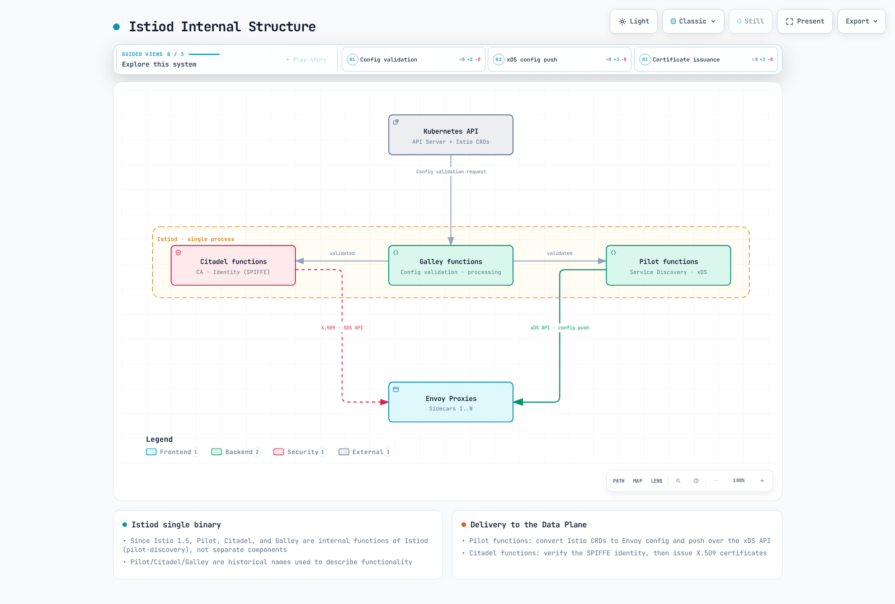
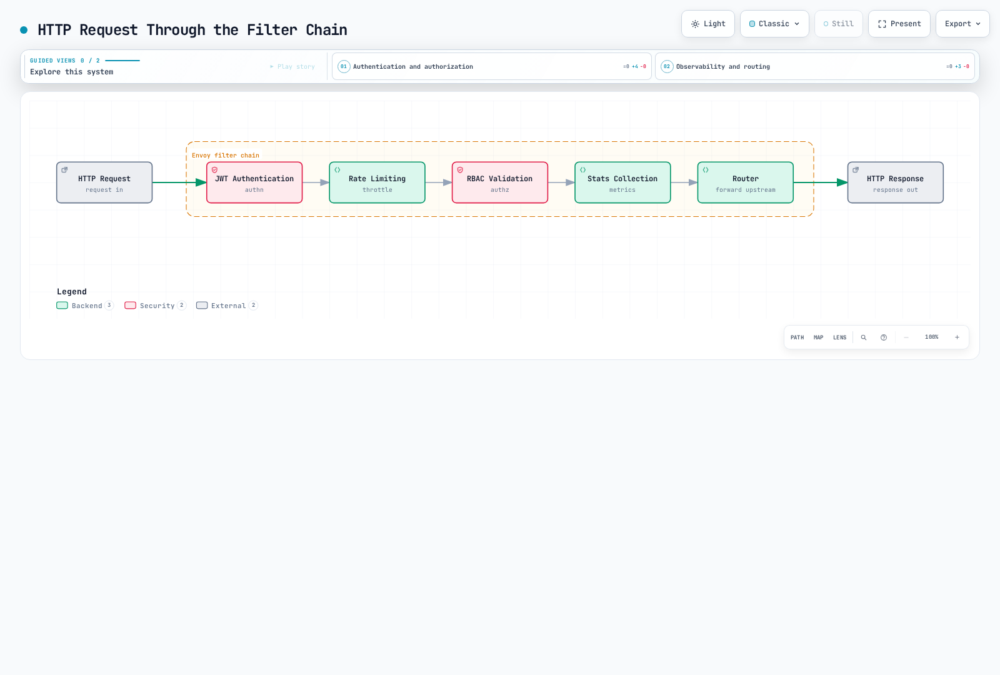
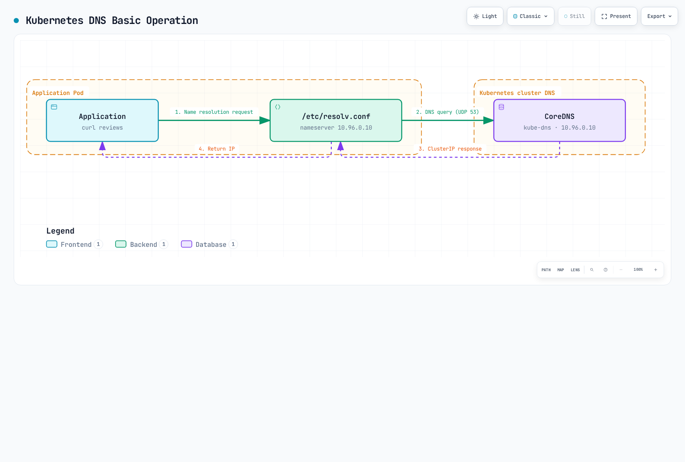

# 架构

> **审阅版本**: Istio 1.31.0 **API 版本**: `networking.istio.io/v1`, `security.istio.io/v1` **最后更新**: September 11, 2026

本文深入介绍 Istio 的内部架构和网络机制。

**背景和历史**请参阅[基本概念](02-basic-concepts.md#background-and-history)文档。

**重要变更（Istio 1.5+）**：

* Pilot、Citadel、Galley **不再是独立组件**
* 它们整合为一个名为 Istiod (`pilot-discovery`) 的**单一二进制文件**
* Pilot/Citadel/Galley 这些术语是描述功能的**历史名称**

## 目录

本章主要介绍 sidecar 模式。Ambient 模式使用基于 Rust 的 ztunnel（每个节点一个），并可选用 L7 waypoint 代理；其流量拦截和 DNS 路径有所不同。Mixer 已退役，遥测功能已迁移到代理中，而非整合进 istiod。下方的 JSON 和注入后 Pod 示例仅用于示意，并非完整、可部署的清单。

1. [Istio 架构概览](03-architecture.md#istio-architecture-overview)
2. [控制平面：Istiod](03-architecture.md#control-plane-istiod)
3. [数据平面：Envoy 代理](03-architecture.md#data-plane-envoy-proxy)
4. [Sidecar 注入机制](03-architecture.md#sidecar-injection-mechanism)
5. [iptables 与流量拦截](03-architecture.md#iptables-and-traffic-interception)
6. [DNS 处理机制](03-architecture.md#dns-processing-mechanism)
7. [xDS API 通信](03-architecture.md#xds-api-communication)
8. [使用 Sidecar 资源进行优化](03-architecture.md#optimization-with-sidecar-resource)

## Istio 架构概览

### 整体结构


[🔍 查看交互式图示](https://www.atomai.click/kubernetes-docs/archmaps/en-service-mesh-istio-03-architecture-0.html)

### 控制平面与数据平面

| 类别           | 控制平面（Istiod）                   | 数据平面（Envoy） |
| -------------- | ------------------------------------ | ----------------- |
| **职责**       | 策略管理、配置分发                   | 实际流量处理      |
| **位置**       | 独立的 Pod（通常为 1-3 个）          | 所有应用 Pod      |
| **语言**       | Go                                   | C++               |
| **负载**       | 低                                   | 高（处理所有流量）|
| **可扩展性**   | 水平扩展（高可用）                   | 自动扩展（每个 Pod 一个） |

## 控制平面：Istiod

### Istiod 内部结构

**重要提示**：从 Istio 1.5 开始，Pilot、Citadel 和 Galley 是 Istiod 的**内部功能，而非独立组件**。



[🔍 查看交互式图示](https://www.atomai.click/kubernetes-docs/archmaps/en-service-mesh-istio-03-architecture-10.html)

### Istiod 的主要功能

**注意**：以下功能已整合在 Istio 1.31 的 Istiod 中。Pilot、Citadel 和 Galley 是描述功能的历史名称。

#### 1. 服务发现（Pilot 功能）

```yaml
# Kubernetes Service detection
apiVersion: v1
kind: Service
metadata:
  name: reviews
spec:
  selector:
    app: reviews
  ports:
  - port: 9080
```

Istiod 会跟踪：

* Kubernetes Services
* EndpointSlices（Pod IP）
* Pod 状态变化
* 外部服务（ServiceEntry）

#### 2. 流量管理（Pilot 功能）

将 Istio CRD 转换为 Envoy 配置：

```yaml
# VirtualService (user-defined)
apiVersion: networking.istio.io/v1
kind: VirtualService
metadata:
  name: reviews
spec:
  hosts:
  - reviews
  http:
  - route:
    - destination:
        host: reviews
        subset: v1
      weight: 90
    - destination:
        host: reviews
        subset: v2
      weight: 10
```

↓ Istiod 转换为 Envoy 配置 ↓

```json
{
  "match": {"prefix": "/"},
  "route": {
    "weighted_clusters": {
      "clusters": [
        {"name": "outbound|9080|v1|reviews.default.svc.cluster.local", "weight": 90},
        {"name": "outbound|9080|v2|reviews.default.svc.cluster.local", "weight": 10}
      ]
    }
  }
}
```

<span id="3-certificate-management-citadel-functionality"></span>

#### 3. 证书管理（Citadel 功能）

Istio agent 创建密钥和 CSR，向 istiod 进行身份验证，并接收签名后的证书。Envoy 通过 SDS 从本地 agent 获取该证书和密钥。证书有效期可配置；证书会在到期前轮换。

**SPIFFE ID 格式**：

```
spiffe://cluster.local/ns/default/sa/reviews
```

#### 4. 配置验证（Galley 功能）

准入验证会检查架构和本地配置约束。跨资源是否存在由 `istioctl analyze` 检查；准入 Webhook 不一定会拒绝不存在的目标。以下示例引用了一个不存在的 Gateway：

```yaml
# invalid-vs.yaml
apiVersion: networking.istio.io/v1
kind: VirtualService
metadata:
  name: invalid
spec:
  hosts:
  - reviews
  gateways:
  - missing-gateway
  http:
  - route:
    - destination:
        host: reviews
```

```bash
istioctl analyze invalid-vs.yaml --use-kube=false
# IST0101: Referenced gateway not found: "missing-gateway"
```

### Istiod 进程结构

**Istio 1.31 中的实际实现**：

```bash
# Inspect the configured binary arguments; no shell in the image is required
kubectl get deployment istiod -n istio-system   -o jsonpath='{.spec.template.spec.containers[?(@.name=="discovery")].args}'
# The discovery container runs pilot-discovery discovery.
```

**要点**：

* Istiod 以名为 `pilot-discovery` 的**单一 Go 二进制文件**运行
* Pilot、Citadel 和 Galley 是历史上的角色名称，并不保证是当前的软件包名称
* 所有功能都作为 goroutine 在单个进程中运行

**Istiod 提供的主要端口**：

| 端口      | 协议  | 用途             | 功能             |
| --------- | ----- | ---------------- | ---------------- |
| **15010** | gRPC  | xDS（旧版）      | 向后兼容         |
| **15012** | gRPC  | 基于 TLS 的 xDS  | 主要 xDS API 端点 |
| **15014** | HTTP  | 控制平面监控     | 指标和运行状况检查 |
| **15017** | HTTPS | Webhook          | 注入和验证       |
| **8080**  | HTTP  | 调试             | 调试接口         |

### Istiod 部署

**高可用配置**：

```yaml
# Merge into the existing istioctl install file; do not replace a managed Deployment
apiVersion: install.istio.io/v1alpha1
kind: IstioOperator
spec:
  components:
    pilot:
      k8s:
        hpaSpec:
          minReplicas: 3
          maxReplicas: 5
        resources:
          requests:
            cpu: 500m
            memory: 2Gi
```

**典型资源用量**：

* CPU：0.5 - 2 核
* 内存：2 - 4 GB
* 可处理数千个服务和 Pod

## 数据平面：Envoy 代理

### Envoy 架构


[🔍 查看交互式图示](https://www.atomai.click/kubernetes-docs/archmaps/en-service-mesh-istio-03-architecture-2.html)

### Envoy 的主要组件

#### 1. 监听器

**在以下端口接收连接**：

```json
{
  "name": "0.0.0.0_15001",
  "address": {
    "socket_address": {
      "address": "0.0.0.0",
      "port_value": 15001
    }
  },
  "filter_chains": [...]
}
```

**Istio 默认监听器**：

* `0.0.0.0:15001`：所有出站 TCP 流量
* `0.0.0.0:15006`：所有入站 TCP 流量
* `0.0.0.0:15021`：运行状况检查
* `0.0.0.0:15090`：Prometheus 指标

#### 2. 过滤器

**用于处理请求/响应的插件**：



[🔍 查看交互式图示](https://www.atomai.click/kubernetes-docs/archmaps/en-service-mesh-istio-03-architecture-3.html)

#### 3. 集群

**上游服务的逻辑分组**：

```json
{
  "name": "outbound|9080|v1|reviews.default.svc.cluster.local",
  "type": "EDS",
  "eds_cluster_config": {
    "service_name": "outbound|9080|v1|reviews.default.svc.cluster.local"
  },
  "circuit_breakers": {...},
  "outlier_detection": {...}
}
```

#### 4. 端点

**实际 Pod IP 列表**：

```json
{
  "cluster_name": "outbound|9080|v1|reviews",
  "endpoints": [
    {
      "lb_endpoints": [
        {"endpoint": {"address": {"socket_address": {"address": "10.244.1.5", "port_value": 9080}}}},
        {"endpoint": {"address": {"socket_address": {"address": "10.244.2.8", "port_value": 9080}}}}
      ]
    }
  ]
}
```

### Envoy 性能

请根据实际流量模式、配置大小和遥测设置进行测量。[官方基准测试](https://istio.io/latest/docs/ops/deployment/performance-and-scalability/)明确针对 Istio 1.24；不存在适用于所有情况的每核 RPS、亚毫秒 P99 或内存保证。还应根据服务/代理数量和配置变化频率来规划 istiod 的资源。

## Sidecar 注入机制

### 注入流程


[🔍 查看交互式图示](https://www.atomai.click/kubernetes-docs/archmaps/en-service-mesh-istio-03-architecture-4.html)

Webhook 会修改 Pod 创建请求，而不是 Deployment 本身。启用注入后，需要重新创建现有 Pod。使用 Istio CNI 时，网络配置不再由每个 Pod 中的特权 init 容器完成；原生 sidecar 也可能改变生成的 Pod 布局。

### 注入前与注入后

**原始 Deployment**：

```yaml
apiVersion: apps/v1
kind: Deployment
metadata:
  name: reviews
spec:
  selector:
    matchLabels:
      app: reviews
  template:
    metadata:
      labels:
        app: reviews
    spec:
      containers:
      - name: reviews
        image: reviews:v1
        ports:
        - containerPort: 9080
```

**注入后**：

```yaml
apiVersion: v1
kind: Pod
metadata:
  annotations:
    sidecar.istio.io/status: '{"initContainers":["istio-init"],"containers":["istio-proxy"]}'
spec:
  initContainers:
  - name: istio-init
    image: istio/proxyv2:1.31.0
    command: ['istio-iptables', ...]
    securityContext:
      capabilities:
        add: [NET_ADMIN, NET_RAW]
  containers:
  - name: reviews
    image: reviews:v1
    ports:
    - containerPort: 9080
  - name: istio-proxy
    image: istio/proxyv2:1.31.0
    args: ['proxy', 'sidecar', ...]
```

### 启用 Sidecar 注入

#### 自动注入（推荐）

**命名空间级别**：

```bash
# Add label to namespace
kubectl label namespace default istio-injection=enabled

# All pods deployed to this namespace will automatically have sidecar injected
kubectl apply -f deployment.yaml
```

**Pod 级别**（标签）：

```yaml
apiVersion: v1
kind: Pod
metadata:
  name: example-app
  labels:
    sidecar.istio.io/inject: "true"  # Enable injection per pod
spec:
  containers:
  - name: app
    image: myapp:v1
```

#### 手动注入

使用 `istioctl kube-inject` 命令直接将 sidecar 注入 YAML 文件。

```bash
# Inject sidecar into YAML file and deploy
istioctl kube-inject -f deployment.yaml | kubectl apply -f -

# Or save to file
istioctl kube-inject -f deployment.yaml -o deployment-injected.yaml
kubectl apply -f deployment-injected.yaml
```

**手动注入的场景**：

* 无法使用自动注入的环境
* 需要在 CI/CD 流水线中进行显式控制时
* 希望检查注入后的 YAML 以便调试时

## iptables 与流量拦截

### istio-init 容器

**作用**：配置 iptables 规则，将 Pod 网络流量重定向到 Envoy 代理


[🔍 查看交互式图示](https://www.atomai.click/kubernetes-docs/archmaps/en-service-mesh-istio-03-architecture-5.html)

### iptables 规则详解

**简化的规则示意（不可作为脚本执行）**：

```bash
#!/bin/bash
# istio-iptables script (simplified)

# 1. OUTPUT chain: Application outbound traffic
iptables -t nat -A OUTPUT -p tcp \
  -m owner ! --uid-owner 1337 \
  -j REDIRECT --to-port 15001     # Envoy outbound port

# 2. PREROUTING chain: Inbound traffic to pod
iptables -t nat -A PREROUTING -p tcp \
  -j REDIRECT --to-port 15006     # Envoy inbound port

# 3. Exclusion rules
# - localhost traffic
iptables -t nat -I OUTPUT -d 127.0.0.1/32 -j RETURN

# - Istiod communication (15012)
iptables -t nat -I OUTPUT -p tcp --dport 15012 -j RETURN

# - DNS (53)
iptables -t nat -I OUTPUT -p udp --dport 53 -j RETURN
```

### 流量路径（应用 iptables 后）


[🔍 查看交互式图示](https://www.atomai.click/kubernetes-docs/archmaps/en-service-mesh-istio-03-architecture-6.html)

### 检查 iptables 规则

**在 Pod 内检查**：

普通的 istio-proxy 容器可能基于 distroless 镜像，也不具备 NET_ADMIN 权限。只有在获批的节点/Pod 网络命名空间调试会话中，并具备必要工具和权限时，才能检查规则。以下是 `iptables -t nat -L -n -v` 的示意输出：

```text
# OUTPUT chain
Chain OUTPUT (policy ACCEPT)
target     prot opt source     destination
ISTIO_OUTPUT  tcp  --  0.0.0.0/0  0.0.0.0/0

# ISTIO_OUTPUT detail
Chain ISTIO_OUTPUT (1 references)
RETURN     all  --  0.0.0.0/0  127.0.0.1           # Exclude localhost
RETURN     all  --  0.0.0.0/0  0.0.0.0/0           owner UID match 1337  # Exclude Envoy
REDIRECT   tcp  --  0.0.0.0/0  0.0.0.0/0           redir ports 15001  # Redirect rest

# PREROUTING chain
Chain PREROUTING (policy ACCEPT)
ISTIO_INBOUND  tcp  --  0.0.0.0/0  0.0.0.0/0

# ISTIO_INBOUND detail
Chain ISTIO_INBOUND (1 references)
REDIRECT   tcp  --  0.0.0.0/0  0.0.0.0/0           redir ports 15006
```

### Init 容器与 Istio CNI

两种方式都会配置流量重定向。Istio CNI 是一个特权节点 DaemonSet，与主要 CNI（例如 AWS VPC CNI）串联；它并非该 CNI 的 eBPF 替代方案。它可用于 sidecar 模式，在 ambient 模式下则是必需的。

## DNS 处理机制

### Kubernetes DNS 基本运行方式



[🔍 查看交互式图示](https://www.atomai.click/kubernetes-docs/archmaps/en-service-mesh-istio-03-architecture-7.html)

**/etc/resolv.conf**（Pod 内）：

```bash
nameserver 10.96.0.10  # kube-dns ClusterIP
search default.svc.cluster.local svc.cluster.local cluster.local
options ndots:5
```

### Envoy 的 DNS 处理

**应用程序 DNS 解析与 Envoy 端点发现是不同的操作**：

应用程序首先解析服务名称。随后，Envoy 使用路由配置和 EDS 端点数据选择上游；EDS 不会取代应用程序的 DNS 查询。

**优点**：

* EDS 将端点分发给 Envoy；除非 DNS 捕获在本地响应，否则应用程序仍使用其配置的解析器进行 DNS 查询
* 动态端点更新
* 高级路由（版本、权重等）

### DNS 代理（sidecar 模式下可选）

**DNS 代理功能在 Istio 1.8+ 中引入**：

sidecar DNS 代理运行于 Istio agent 中，并根据 istiod 提供的本地缓存名称表进行响应。它不会针对每个 DNS 请求都查询 istiod。未知名称会转发到 `/etc/resolv.conf` 中的解析器。从 Istio 1.25 开始，Ambient DNS 捕获默认启用。请将以下内容合并到安装文件中，并重启受影响的 sidecar 工作负载。

```yaml
apiVersion: install.istio.io/v1alpha1
kind: IstioOperator
spec:
  meshConfig:
    defaultConfig:
      proxyMetadata:
        ISTIO_META_DNS_CAPTURE: "true"  # Enable DNS Proxy
```

**运行方式**：

启用 DNS 捕获后：应用程序 → Istio agent DNS 代理 → 本地名称表；若名称未知，则转发给上游解析器。

**DNS 代理 iptables 规则**：

```bash
# Redirect UDP port 53 to Istio agent DNS proxy
iptables -t nat -A OUTPUT -p udp --dport 53 \
  -m owner ! --uid-owner 1337 \
  -j REDIRECT --to-port 15053
```

## xDS API 通信

### xDS 协议概览

**xDS**：即 Discovery Service，是 Envoy 的动态配置协议。

LDS、RDS、CDS 和 EDS 是逻辑资源类型，通常通过聚合发现流（ADS）复用。sidecar SDS 由本地 Istio agent 提供服务，而不是通过与 istiod 建立的第五条直接流提供。

### xDS API 类型

| API     | 名称           | 作用               | 示例              |
| ------- | -------------- | ------------------ | ----------------- |
| **LDS** | 监听器发现     | 接收端口配置       | 15001, 15006      |
| **RDS** | 路由发现       | HTTP 路由规则      | VirtualService    |
| **CDS** | 集群发现       | 上游服务           | DestinationRule   |
| **EDS** | 端点发现       | Pod IP 列表        | 服务端点          |
| **SDS** | 密钥发现       | TLS 证书           | mTLS 证书         |

### xDS 通信流程

启动时，agent 会建立身份并将发现连接代理到 istiod。Envoy 会确认已接受的配置；当配置或端点发生变化时，istiod 会推送更新。SDS 则通过本地 agent 单独提供证书。

### 验证 xDS 通信

**使用 Envoy Admin API 检查**：

```bash
# Export via istioctl; no curl or shell is required inside the proxy image
istioctl proxy-config all <pod-name> -n default -o json > config-dump.json
jq '.configs[] | select(."@type" | endswith("ListenersConfigDump")) | .dynamic_listeners' config-dump.json
jq '.configs[] | select(."@type" | endswith("ClustersConfigDump")) | .dynamic_active_clusters' config-dump.json
jq '.configs[] | select(."@type" | endswith("RoutesConfigDump")) | .dynamic_route_configs' config-dump.json
```

**使用 istioctl 检查**：

```bash
# Listener configuration
istioctl proxy-config listeners <pod-name> -n default

# Cluster configuration
istioctl proxy-config clusters <pod-name> -n default

# Endpoint configuration
istioctl proxy-config endpoints <pod-name> -n default

# Route configuration
istioctl proxy-config routes <pod-name> -n default
```

## 使用 Sidecar 资源进行优化

### 问题：接收所有服务信息

默认情况下，每个 Envoy 都会接收**整个网格中所有服务的信息**：


[🔍 查看交互式图示](https://www.atomai.click/kubernetes-docs/archmaps/en-service-mesh-istio-03-architecture-13.html)

**问题**：

* 内存用量增加
* CPU 用量增加（配置处理）
* 浪费网络带宽
* istiod 负载增加

### 解决方案：Sidecar 资源

使用 **Sidecar 资源**限制接收的服务，仅保留必要的服务：

```yaml
apiVersion: networking.istio.io/v1
kind: Sidecar
metadata:
  name: default
  namespace: default
spec:
  egress:
  - hosts:
    - "./*"  # All services in same namespace
    - "istio-system/*"  # All services in istio-system
    - "production/reviews.production.svc.cluster.local"  # Only reviews in production namespace
```

配置范围限定和 REGISTRY_ONLY 并非出站防火墙。请使用 AuthorizationPolicy 和网络层强制机制实现隔离。Sidecar 资源不会配置 ambient 代理。

### Sidecar 资源示例

#### 1. 限定命名空间配置范围

```yaml
apiVersion: networking.istio.io/v1
kind: Sidecar
metadata:
  name: default
  namespace: team-a
spec:
  egress:
  - hosts:
    - "team-a/*"  # Own namespace only
    - "istio-system/*"  # System services
    - "shared/*"  # Shared services
```

#### 2. 导入指定服务

```yaml
apiVersion: networking.istio.io/v1
kind: Sidecar
metadata:
  name: frontend
  namespace: default
spec:
  workloadSelector:
    labels:
      app: frontend
  egress:
  - port:
      number: 443
      name: https
      protocol: HTTPS
    hosts:
    - "external/*"
  - hosts:
    - "default/reviews.default.svc.cluster.local"
    - "default/ratings.default.svc.cluster.local"
    - "default/details.default.svc.cluster.local"
```

#### 3. 检测未注册的目标

```yaml
apiVersion: networking.istio.io/v1
kind: Sidecar
metadata:
  name: external-only
  namespace: default
spec:
  workloadSelector:
    labels:
      app: batch-job
  egress:
  - hosts:
    - "./*"  # Same namespace
  outboundTrafficPolicy:
    mode: REGISTRY_ONLY  # Known Kubernetes services and ServiceEntry destinations
```

### Sidecar 资源的影响

导入较少的服务可以缩小配置，并可能减少代理内存用量和推送工作量。集群数量还取决于端口和子集，因此一个服务并不总是对应一个 Envoy 集群。请测量实际效果；无法保证固定的内存节省或推送时间缩短。

### DNS 与 Sidecar 集成

```yaml
apiVersion: networking.istio.io/v1
kind: Sidecar
metadata:
  name: dns-optimized
  namespace: default
spec:
  egress:
  - hosts:
    - "default/reviews.default.svc.cluster.local"
    - "default/ratings.default.svc.cluster.local"
  # Scope imported service configuration
  # DNS capture is configured separately
```

**结果**：

* 代理会导入所选服务的配置；这并非 DNS 允许列表
* `google.com` 等外部域名会转发给 CoreDNS
* 节省内存和 CPU

## 参考资料

### 官方文档

* [Istio 架构](https://istio.io/latest/docs/ops/deployment/architecture/)
* [Envoy 代理](https://www.envoyproxy.io/docs/envoy/latest/intro/intro)
* [xDS 协议](https://www.envoyproxy.io/docs/envoy/latest/api-docs/xds_protocol)
* [SPIFFE](https://spiffe.io/)

### 历史与背景

* [Envoy 项目里程碑（CNCF）](https://www.cncf.io/projects/envoy/)
* [Istio 公告 - Google Cloud 博客](https://cloud.google.com/blog/products/gcp/istio-service-mesh-for-microservices)
* [服务网格历史](https://www.nginx.com/blog/what-is-a-service-mesh/)

### 进阶学习

* [Envoy 架构概览](https://www.envoyproxy.io/docs/envoy/latest/intro/arch_overview/arch_overview)
* [Istio 性能与可扩展性](https://istio.io/latest/docs/ops/deployment/performance-and-scalability/)
* [iptables 教程](https://www.frozentux.net/iptables-tutorial/iptables-tutorial.html)

* [架构](https://istio.io/latest/docs/ops/deployment/architecture/)
* [DNS 代理](https://istio.io/latest/docs/ops/configuration/traffic-management/dns-proxy/)
* [安装 Istio CNI 节点代理](https://istio.io/latest/docs/setup/additional-setup/cni/)
* [安全性](https://istio.io/latest/docs/concepts/security/)
* [ReferencedResourceNotFound](https://istio.io/latest/docs/reference/config/analysis/ist0101/)
* [安装 Sidecar](https://istio.io/latest/docs/setup/additional-setup/sidecar-injection/)
* [Sidecar](https://istio.io/latest/docs/reference/config/networking/sidecar/)
* [配置范围限定](https://istio.io/latest/docs/ops/configuration/mesh/configuration-scoping/)
* [性能与可扩展性](https://istio.io/latest/docs/ops/deployment/performance-and-scalability/)
