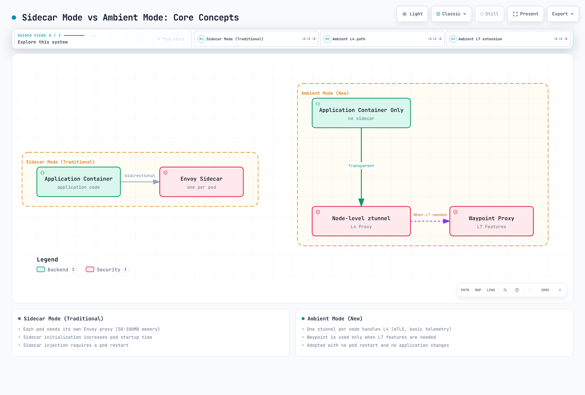
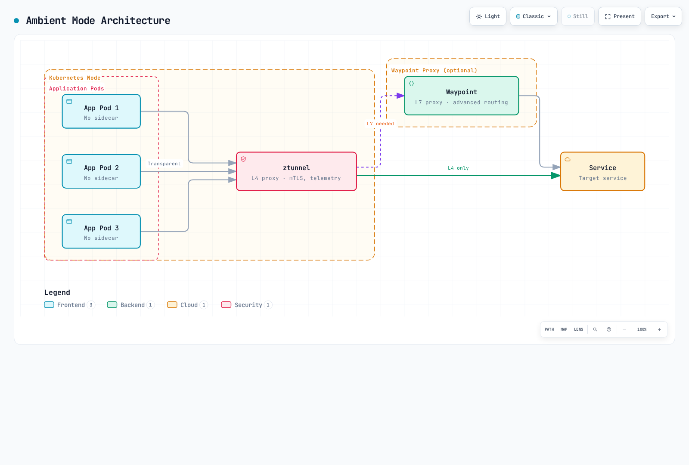

# Ambient Mode

> **最后更新**: October 12, 2026 · Istio 1.31。本实验假设使用兼容的 Linux 节点、具备 node-agent/CNI 所需权限，并使用全新的 demo 命名空间。本次审计未运行任何部署命令。

Ambient 最初于 2022 年作为实验性预览版推出，在 Istio 1.18 中首次以 Alpha 形式发布，在 1.22 中达到 Beta，并在 1.24 中实现核心 GA。该预览版并非主线 1.15 版本正式提供的功能。资源节省和迁移安全性取决于实际拓扑、策略和流量。

## 目录

1. [概述](#overview)
2. [Sidecar Mode 与 Ambient Mode](#sidecar-mode-vs-ambient-mode)
3. [架构](#architecture)
4. [安装和配置](#installation-and-configuration)
5. [迁移](#migration)
6. [性能比较](#performance-comparison)
7. [使用场景](#use-cases)
8. [故障排查](#troubleshooting)

## 概述


Ambient Mode 是一种新方法，无需向应用 Pod 注入 Sidecar 代理即可提供 Service Mesh 功能。Ambient Mode 由**分层架构**组成：

1. **安全覆盖层（L4）**：通过 ztunnel 提供 mTLS 和基础遥测
2. **L7 处理层**：通过 Waypoint Proxy 实现高级流量管理

### 为什么需要 Ambient Mode？

传统 Sidecar 模型的局限性：
- **资源开销高**：每个 Pod 都需要一个 Envoy 代理（应测量代理的实际资源占用）
- **运维复杂**：Pod 重启、版本管理和滚动更新都很复杂
- **启动协调**：必须协调代理和应用的就绪状态
- **功能过剩**：有些工作负载只需要 L4 网格功能

Ambient Mode 的解决方案：
- 共享节点代理以及所需的 waypoint：测量总资源用量
- 接入网格可避免重启尚未接入网格的 Pod；移除 Sidecar 和更改策略需要受控的滚动操作
- 渐进式采用：根据需要从 L4 扩展到 L7
- L4 传输可以透明进行；跟踪上下文以及应用超时/幂等性约定仍然很重要

### 核心概念

这些图中的可选 waypoint 由配置/接入网格来选择。Ztunnel 不会解析每个 HTTP 请求并据此决定是否绕行至 L7。仍需验证现有连接、就绪状态和策略转换。




[🔍 查看交互式图表](https://www.atomai.click/kubernetes-docs/archmaps/en-service-mesh-istio-advanced-01-ambient-mode-0.html)

### Ambient Mode 的优势

1. **共享资源模型**：节点代理加上所需的 waypoint 副本
2. **部署简单**：接入网格不会要求重启尚未接入网格的 Pod；移除 Sidecar 则需要重启
3. **透明的 L4 传输**：应用的跟踪/截止时间/幂等性要求仍然存在
4. **灵活的 L7 功能**：只在需要时使用 waypoint

## Sidecar Mode 与 Ambient Mode

### 架构对比

#### Sidecar Mode


[🔍 查看交互式图表](https://www.atomai.click/kubernetes-docs/archmaps/en-service-mesh-istio-advanced-01-ambient-mode-1.html)

**特点**：
- 每个 Pod 都注入 Envoy 代理
- L4/L7 功能成熟；请确认所选版本
- 资源使用量高
- 需要重启 Pod

#### Ambient Mode



[🔍 查看交互式图表](https://www.atomai.click/kubernetes-docs/archmaps/en-service-mesh-istio-advanced-01-ambient-mode-2.html)

**特点**：
- 每个节点运行一个 ztunnel
- 默认提供 L4 功能
- L7 功能需要 waypoint
- 接入网格不会要求重启尚未接入网格的 Pod；移除 Sidecar 则需要重启

### 详细对比表

| 项目 | Sidecar Mode | Ambient Mode |
|------|-------------|--------------|
| **部署方式** | 向 Pod 注入 Sidecar | 节点级 ztunnel + 可选 waypoint |
| **资源核算** | 每个 Pod 的 Envoy + 控制平面 | 节点 ztunnel + 所有 waypoint 副本 + 控制平面；在负载下测量 |
| **Pod 重建** | 添加/移除已注入的代理时需要 | 尚未接入网格时通常不需要；移除 Sidecar 时需要 |
| **启动协调** | 代理/应用生命周期和就绪状态 | CNI 流量捕获和 ztunnel 就绪状态 |
| **L4 功能** | 支持 | 支持 |
| **L7 功能** | 支持情况取决于版本 | 需要 Waypoint 和受支持的 API；并非所有扩展都已 GA |
| **mTLS** | 自动 | 自动 |
| **遥测** | 详细 | 基础（L4）；详细（通过 waypoint 实现 L7） |
| **熔断器** | 支持 | 需要 Waypoint |
| **重试/超时** | 支持 | 需要 Waypoint |
| **Header 操作** | 支持 | 需要 Waypoint |
| **性能开销** | 取决于工作负载/配置 | 取决于路径/身份/waypoint/负载；应比较等效策略 |
| **运维范围** | 每个工作负载的代理生命周期 | 节点/CNI 和共享 waypoint 生命周期 |
| **生产就绪状态** | 成熟 | GA（Istio 1.24+） |

### 资源使用量比较

下面的 100-Pod 计算只是一个假设的规划示例，并非官方基准测试。在估算资源或账单节省之前，应统计所有节点/waypoint 副本，并比较等效的安全、遥测和路由需求。

## 架构


Ambient Mode 数据平面由两个核心组件构成：**ztunnel** 和 **Waypoint Proxy**。

### ztunnel（零信任隧道）


ztunnel 是 Ambient Mode 的核心组件，是一种**在节点级运行的轻量级 L4 代理**。它以 DaemonSet 形式运行在符合条件的 Linux 节点上，并处理已接入网格工作负载的受支持流量。这并不意味着所有 Pod 的所有流量都会经过它；对于 host-network/排除的工作负载以及非 TCP 应用协议，需要核实当前的支持情况。

#### ztunnel 的工作方式

1. **流量捕获**：通过 Istio CNI 在 Pod 内的 netfilter/iptables 规则和网络命名空间交接，透明拦截 Pod 网络流量
2. **应用 mTLS**：使用基于 SPIFFE 的 Identity 自动应用 mTLS 加密
3. **负载均衡**：在端点之间执行 L4 负载均衡
4. **遥测收集**：收集连接指标和日志
5. **转发**：将流量转发到目标 ztunnel 或 Waypoint

**ztunnel 技术栈**：
- **语言**：Rust（高性能、低内存占用）
- **协议**：HBONE（基于 HTTP 的覆盖网络环境）
- **身份**：SPIFFE 工作负载身份；默认使用 Istiod CA，SPIRE 需要单独集成
- **CNI**：与 Istio CNI 插件紧密集成

#### ztunnel 的作用


[🔍 查看交互式图表](https://www.atomai.click/kubernetes-docs/archmaps/en-service-mesh-istio-advanced-01-ambient-mode-3.html)

**ztunnel 特点**：
- 使用 Rust 编写（针对性能进行了优化）
- 以 DaemonSet 形式部署
- 与 CNI 插件集成
- 通过 Istio CNI 协调 Pod 内的 netfilter/iptables 重定向

#### ztunnel 部署

使用已发布的 ambient 安装包/Chart。最初的精简 DaemonSet 缺少 token/CA/socket 挂载，并且 hostNetwork/privileged 设置不正确。1.31 Chart 提供了特定能力和 Pod 内命名空间访问权限；它不会设置 `hostNetwork: true` 或 `privileged: true`。如果不了解完整的 Chart/平台上下文，请勿复制或降低权限。

```bash
# Offline inspection; use the same reviewed values as the actual installation
istioctl manifest generate --set profile=ambient > ambient-rendered.yaml
# Inspect a deployed resource if a mesh already exists
kubectl get daemonset ztunnel -n istio-system -o yaml
```

### Waypoint Proxy


Waypoint 是一种**在需要 L7 功能时使用的可选代理**。配置好的 waypoint 会置于已接入网格资源的流量路径中，以提供高级流量管理功能。

#### Waypoint 的主要特点

1. **选择性部署**：仅供需要 L7 功能的 Service 使用，而非所有 Service
2. **共享代理**：多个工作负载共享一个 Waypoint（具体取决于命名空间/Service/Pod 接入范围）
3. **基于 Envoy**：使用与传统 Sidecar 相同的 Envoy 代理，L7 API 支持情况取决于版本
4. **按需使用**：可在运行时动态添加/移除

#### Waypoint 部署单元

ServiceAccount 提供工作负载身份；为它添加标签**不会**选择 waypoint。应在 Namespace、Service 或 Pod 上使用 `istio.io/use-waypoint`，并确保 Gateway 的 `istio.io/waypoint-for` 流量类型与预期流量相匹配。

| 接入范围 | 范围说明 |
|---|---|
|Namespace|为该命名空间中符合条件的资源选择默认 waypoint|
|Service|发往该 Service 的流量；默认 waypoint 类型为 `service`|
|Pod|使用 `workload` 或 `all` waypoint 处理直接发往工作负载/Pod-IP 的流量|

仅添加 Deployment 标签不会给现有 Pod 添加标签；应使用 Pod 模板标签接入工作负载。`service` waypoint 不会自动覆盖直接发往 Pod-IP 的流量。

#### Waypoint 的作用


**Waypoint 特点**：
- 以 Gateway 形式部署，然后由受支持的资源接入配置选择
- 基于 Envoy 代理
- 应逐个 API 验证支持情况；任意 EnvoyFilter 补丁都不是受支持的 waypoint API
- 仅对确有需要的 Service 选择性使用

#### Waypoint 部署

```yaml
apiVersion: gateway.networking.k8s.io/v1
kind: Gateway
metadata:
  name: reviews-waypoint
  namespace: ambient-demo
  labels:
    istio.io/waypoint-for: service
spec:
  gatewayClassName: istio-waypoint
  listeners:
  - name: mesh
    port: 15008
    protocol: HBONE
```

默认的 `istio-waypoint` 类使用 Envoy。核心 ambient GA 并不意味着所有 API 都已 GA：当前文档将 ambient VirtualService 标记为 Alpha，并禁止将其与 Gateway API 路由混用。此处请使用 HTTPRoute。EnvoyFilter 不是受支持的 waypoint 扩展。L7 策略仅保护到达 waypoint 的流量；若要强制流量经过 waypoint，还需要使用文档所述的 ztunnel 授权保护措施，并正确配置接入范围和就绪状态。

### 完整流量路径

以下综合示意图展示了**不使用 Sidecar** 时 Ambient Mode 中的流量路径：


[🔍 查看交互式图表](https://www.atomai.click/kubernetes-docs/archmaps/en-service-mesh-istio-advanced-01-ambient-mode-6.html)

**流量路径分析**：

1. **仅 L4 路径**（仅使用 ztunnel）：
   - 在有代表性的负载下测量路径延迟
   - 自动应用 mTLS
   - 基础遥测
   - 适用于实际需求仅限于 L4 的场景

2. **L7 路径**（ztunnel + Waypoint）：
   - 基于 Header 的路由
   - 熔断
   - 重试/超时
   - 适用于需要复杂流量策略的场景

### HBONE 协议


**HBONE（基于 HTTP 的覆盖网络环境）**是 Ambient Mode 使用的隧道协议：

- **基于 HTTP/2**：兼容现有基础设施
- **内置 mTLS**：安全通信
- **多路复用**：相同源/目标身份对的 TCP 流共享隧道
- **网络策略**：HBONE 通常使用 TCP15008；应明确允许所需的网格路径


[🔍 查看交互式图表](https://www.atomai.click/kubernetes-docs/archmaps/en-service-mesh-istio-advanced-01-ambient-mode-7.html)

本指南中的 HBONE 用于传输 TCP 流。应用 UDP 不会通过该隧道传输；DNS 捕获/代理是单独的功能。本地应用流可以保持明文，而代理之间的网格传输则经过加密。

## 安装和配置

本实验需要兼容的 Linux 节点以及所需的 Istio CNI/ztunnel DaemonSet。EKS Fargate 无法运行这些节点 DaemonSet；应使用受支持的 EC2 后端节点，并检查实际节点/CNI 平台。[平台先决条件](https://istio.io/latest/docs/ambient/install/platform-prerequisites/)涵盖 CNI 路径、权限和健康探针。使用 SecurityGroupPolicy 的 VPC CNI Pod ENI trunking 可能需要标准强制模式或适当的 exec 探针；应评估其策略影响。GKE、OpenShift、k3s 和其他平台可能需要不同设置。

Istio1.31 支持 Kubernetes1.32–1.37；EKS 兼容性请参阅[安装指南](../01-installation.md)。下文的 Gateway API1.6.0 与 Istio1.31 的依赖项以及官方 ambient 教程相匹配。请检查现有软件包的兼容性；不要仅为了照搬示例而将较新的兼容软件包降级。

### 1. 安装 Istio（Ambient Mode）

只有在检查安装程序和平台设置后，才能在全新的实验网格中使用此安装命令。对于现有网格，请按照迁移流程保留其安装方法/值。

```bash
curl -fsSL https://istio.io/downloadIstio -o download-istio.sh
ISTIO_VERSION=1.31.0 sh download-istio.sh
cd istio-1.31.0
export PATH="$PWD/bin:$PATH"

# Fresh cluster without Gateway API; review an existing bundle separately
if ! kubectl get crd gateways.gateway.networking.k8s.io >/dev/null 2>&1; then
  kubectl apply --server-side -f https://github.com/kubernetes-sigs/gateway-api/releases/download/v1.6.0/experimental-install.yaml
fi
kubectl wait --for=condition=Established crd/gateways.gateway.networking.k8s.io --timeout=60s
kubectl get crd httproutes.gateway.networking.k8s.io

# Fresh lab mesh only; include required platform-specific values
istioctl install --set profile=ambient -y
kubectl get pods,daemonsets -n istio-system
```

### 2. 启用 Ambient Mode 并部署应用

请使用全新、可随时销毁的命名空间，不要设置 Sidecar 注入/修订版本覆盖。为命名空间添加 ambient 标签不会将现有 Sidecar Pod 转换为 ambient Pod。1.31 发行版中的完整 Bookinfo 清单提供了旧的单 Deployment 示例所缺少的 reviews Service、版本标签、ServiceAccount 和 ratings 依赖；该清单使用 Bookinfo1.20.3 镜像。

```bash
kubectl create namespace ambient-demo
kubectl label namespace ambient-demo istio.io/dataplane-mode=ambient
kubectl get namespace ambient-demo -L istio-injection,istio.io/rev,istio.io/dataplane-mode
kubectl apply -n ambient-demo -f samples/bookinfo/platform/kube/bookinfo.yaml
kubectl apply -n ambient-demo -f samples/curl/curl.yaml
for deployment in reviews-v1 reviews-v2 ratings-v1 curl; do
  kubectl rollout status "deployment/$deployment" -n ambient-demo --timeout=120s
done
istioctl ztunnel-config workloads --workload-namespace ambient-demo
```

### 3. 部署并选择 Waypoint

当前 CLI 接受 waypoint 名称和流量类型，不接受 ServiceAccount 接入标志。请等待其就绪，并显式将 Service 接入网格。

```bash
istioctl waypoint apply --name reviews-waypoint --for service -n ambient-demo --wait
kubectl label service reviews -n ambient-demo istio.io/use-waypoint=reviews-waypoint --overwrite
kubectl get gateways.gateway.networking.k8s.io reviews-waypoint -n ambient-demo
kubectl get service reviews -n ambient-demo --show-labels
```

### 4. 使用 L7 功能

创建特定版本的后端 Service，并将 HTTPRoute 附加到已接入网格的 reviews Service。此示例演示 GET/Header 路由；该 Header 并非经过身份验证的身份。不要将旧的 VirtualService 与此 Gateway API 路由结合使用。直接调用其他 Service/Pod IP 属于单独的流量路径。

```yaml
apiVersion: v1
kind: Service
metadata:
  name: reviews-v1
  namespace: ambient-demo
spec:
  selector:
    app: reviews
    version: v1
  ports:
  - name: http
    port: 9080
    targetPort: 9080
---
apiVersion: v1
kind: Service
metadata:
  name: reviews-v2
  namespace: ambient-demo
spec:
  selector:
    app: reviews
    version: v2
  ports:
  - name: http
    port: 9080
    targetPort: 9080
---
apiVersion: gateway.networking.k8s.io/v1
kind: HTTPRoute
metadata:
  name: reviews
  namespace: ambient-demo
spec:
  parentRefs:
  - group: ''
    kind: Service
    name: reviews
    port: 9080
  rules:
  - matches:
    - method: GET
      headers:
      - name: end-user
        type: Exact
        value: jason
    backendRefs:
    - name: reviews-v2
      port: 9080
  - matches:
    - method: GET
    backendRefs:
    - name: reviews-v1
      port: 9080
```

```bash
kubectl describe httproutes.gateway.networking.k8s.io reviews -n ambient-demo
kubectl exec -n ambient-demo deploy/curl -c curl -- \
  curl -sS --max-time 5 -H "end-user: jason" http://reviews:9080/reviews/0
```

检查 Accepted/ResolvedRefs 条件，并通过日志/遥测确认所选后端。HTTP 请求成功本身既不能证明 mTLS 已启用，也不能证明流量必须经过 waypoint。L7 授权需要适当的 `targetRefs`；强制流量经过 waypoint 还需要文档所述的 ztunnel 授权保护措施。请参阅 [waypoint 策略附加](https://istio.io/latest/docs/ambient/usage/l7-features/)。

## 迁移

### 从 Sidecar Mode 迁移到 Ambient Mode

迁移属于策略/工作负载滚动操作，而不是只改标签。应保留已安装的修订版本、CA/信任配置、网关、CNI 选项和声明式工作负载配置。现有 Sidecar 的优先级高于 ambient 接入配置。在移除需要这些策略的工作负载中的 Sidecar 之前，应先准备兼容的 L7 路由/授权配置和已就绪的 waypoint。

#### 步骤 1：安装 Ambient 组件

使用现有安装方法和经过审核的值，以兼容版本添加 ambient 支持。不要用无关的 `istioctl install --set profile=ambient` 命令覆盖由 Helm 管理的网格。应渲染并比较预期配置，并验证 CNI/ztunnel 节点代理。

#### 步骤 2：应用于测试命名空间

此独立 ambient 测试使用 1.31 发行版部署客户端和服务器。httpbin Service 暴露端口8000，并将流量转发到端口8080。

```bash
kubectl create namespace test-ambient
kubectl label namespace test-ambient istio.io/dataplane-mode=ambient
kubectl apply -n test-ambient -f samples/curl/curl.yaml
kubectl apply -n test-ambient -f samples/httpbin/httpbin.yaml
kubectl rollout status deployment/curl -n test-ambient --timeout=120s
kubectl rollout status deployment/httpbin -n test-ambient --timeout=120s
kubectl exec -n test-ambient deploy/curl -c curl -- \
  curl -sS --max-time 5 http://httpbin:8000/headers
```

#### 步骤 3：验证

HBONE 工作负载列显示预期的传输方式。对于实际流量，应检查正确节点上 ztunnel 日志中的预期源/目标身份，或检查 `connection_security_policy="mutual_tls"` 的 TCP 指标。HTTP 请求成功本身不能证明 mTLS 已启用。接入 HBONE 并不会拒绝所有明文客户端；如有需要，请使用 PeerAuthentication STRICT。请参阅 [mTLS 验证](https://istio.io/latest/docs/ambient/usage/verify-mtls-enabled/)。

```bash
istioctl ztunnel-config workloads --workload-namespace test-ambient
source_pod=$(kubectl get pod -n test-ambient -l app=curl -o jsonpath='{.items[0].metadata.name}')
source_node=$(kubectl get pod "$source_pod" -n test-ambient -o jsonpath='{.spec.nodeName}')
ztunnel_pod=$(kubectl get pod -n istio-system -l app=ztunnel \
  --field-selector "spec.nodeName=$source_node" -o jsonpath='{.items[0].metadata.name}')
kubectl logs "$ztunnel_pod" -n istio-system --since=5m
```

#### 步骤 4：切换选定的工作负载

下一个示例假设存在单独的 `migration-demo` 命名空间，其中只有经过审核、通过命名空间注入的 curl/httpbin Deployments，且它们只需要 L4 功能。请检查 Pod 模板注入覆盖或手动注入的代理；这些命令不会移除它们。对于 L7 工作负载，应先验证 waypoint 接入和策略转换，包括 `targetRefs` 及任何强制流量经过 waypoint 的保护措施。迁移期间应规划好策略共存方式；由 ztunnel 强制执行的基于选择器的 L7 策略可能会因默认拒绝而导致失败。

```bash
# Reference snapshots, not manifests to blindly reapply with stale server metadata
kubectl get namespace migration-demo -o json > migration-namespace-before.json
kubectl get deployment curl httpbin -n migration-demo -o yaml > migration-workloads-before.yaml

kubectl label namespace migration-demo istio.io/dataplane-mode=ambient --overwrite
kubectl label namespace migration-demo istio-injection- istio.io/rev-
kubectl get namespace migration-demo -L istio-injection,istio.io/rev,istio.io/dataplane-mode
for deployment in curl httpbin; do
  kubectl rollout restart "deployment/$deployment" -n migration-demo
  kubectl rollout status "deployment/$deployment" -n migration-demo --timeout=120s
done

# Check both classic containers and native-sidecar initContainers
kubectl get pods -n migration-demo -o json | jq -r '
  .items[] | [.metadata.name,
    any((.spec.containers + (.spec.initContainers // []))[]; .name == "istio-proxy")] | @tsv'
istioctl ztunnel-config workloads --workload-namespace migration-demo
```

#### 步骤 5：验证所选数据路径

对指定工作负载重复执行就绪状态、连通性、身份和策略测试。对于 L7 工作负载组，应检查实际的 Namespace/Service/Pod 接入配置、Gateway 流量类型/就绪状态以及路由/策略附加情况；不要为每个 ServiceAccount 创建一个 waypoint。使用针对具体工作负载制定的停止/回滚标准。此实验流程不保证生产环境零停机。

### 回滚策略

恢复记录的注入模式以及原始 Pod 模板/策略配置。以下代码仅处理上述命名空间注入场景；旧修订版本仍必须存在且运行正常。包含 waypoint 的工作负载组还需要在经过审核的回滚流程中恢复其接入/路由策略。仅删除专门为该工作负载组创建且已确认没有引用的 waypoint；绝不要删除命名空间中的所有 Gateway。

```bash
original_revision=$(jq -r '.metadata.labels["istio.io/rev"] // ""' migration-namespace-before.json)
original_injection=$(jq -r '.metadata.labels["istio-injection"] // ""' migration-namespace-before.json)

# Restore the recorded namespace-injection mode; do not invent a revision
if [ "$original_injection" = "enabled" ]; then
  kubectl label namespace migration-demo istio-injection=enabled --overwrite
elif [ -n "$original_revision" ]; then
  kubectl label namespace migration-demo "istio.io/rev=$original_revision" --overwrite
else
  echo "No supported namespace-injection mode recorded; restore the original workload configuration." >&2
  exit 1
fi
kubectl label namespace migration-demo istio.io/dataplane-mode-
for deployment in curl httpbin; do
  kubectl rollout restart "deployment/$deployment" -n migration-demo
  kubectl rollout status "deployment/$deployment" -n migration-demo --timeout=120s
done
```

## 性能比较

### 基准测试结果

已移除的 `perf.png` URL 返回404，无法佐证旧的“官方基准测试”表格。没有资料证明其中按 Pod 计算的 CPU/内存、延迟或吞吐量百分比。请使用[已发布的性能结果](https://istio.io/latest/docs/ops/deployment/performance-and-scalability/)，并遵循其原始版本、负载、有效负载、硬件和策略条件；不要将历史测量结果标记为当前版本的测试结果。

| 指标 | 应保持可比的条件 |
|---|---|
|内存/CPU|应用数量、身份/连接数、节点数、所有 waypoint 副本以及等效策略|
|P50/P99 延迟|请求大小/速率、连接复用、mTLS、L7 策略、遥测和过载条件|
|吞吐量|相同的应用/后端容量和错误定义|
|成本|实际预配容量、利用率和计费情况；仅请求量/用量降低并不意味着账单减少|

### 资源节省计算

以下仅将原始的100-Pod 算术作为**假设预算模型**保留下来。其50MB/0.1CPU 和 waypoint 数值都是假设输入，并非建议的 requests/limits 或实测成本。实际比较时，应纳入每个 waypoint/ztunnel 副本、高可用部署和控制平面资源。增加 waypoint 副本会改变结果。

```python
# Hypothetical planning inputs, not measured resource consumption or billing
sidecar_memory = 100 * 50       # MB, decimal
sidecar_cpu = 100 * 0.1        # vCPU
ambient_memory = 10 * 50 + 200  # 10 ztunnels + one assumed waypoint budget
ambient_cpu = 10 * 0.1 + 0.5

memory_saved = sidecar_memory - ambient_memory  # 4300 MB, 86% of assumed baseline
cpu_saved = sidecar_cpu - ambient_cpu           # 8.5 vCPU, 85% of assumed baseline
```

## 使用场景

### 何时应选择 Ambient Mode？


**推荐使用 Ambient Mode 的场景**：
- 拥有数百个或更多微服务
- 资源成本优化非常重要
- 大多数 Service 只需要简单通信
- 只有部分 Service 需要高级路由
- 希望尽量降低运维复杂度

**推荐使用 Sidecar Mode 的场景**：
- 所需 API/扩展或平台行为仅由所选 Sidecar 配置支持
- 需要成熟且经过验证的解决方案
- 需要针对每个 Service 进行精细控制
- 需要为每个 Pod 独立管理代理版本

### 1. 只需要 L4 功能时

对于兼容的现有 TCP 工作负载，在验证平台、策略和流量捕获先决条件后，可将其所在命名空间接入网格。此 Namespace 并非完整的数据库部署；数据库复制/存储/高可用必须单独设计。

```yaml
apiVersion: v1
kind: Namespace
metadata:
  name: backend
  labels:
    istio.io/dataplane-mode: ambient
```

### 2. 选择性使用 L7 功能

此示例在 Service 级别选择已就绪的 reviews waypoint。Namespace 和直接工作负载接入是分别受支持的范围；ServiceAccount 标签不是选择器。

```bash
kubectl label service reviews -n ambient-demo istio.io/use-waypoint=reviews-waypoint --overwrite
```

L7 需求并不意味着必须自动使用 Sidecar：应将受支持的 waypoint API 和扩展与应用的实际需求进行比较。反过来说，核心 GA 也不代表所有高级 API 都具有功能对等性。

### 3. 渐进式迁移

首先清点注入和接入情况，然后依据明确的就绪状态/安全/回滚标准迁移经过审核的工作负载组。不要不加区分地为所有开发/预发布/生产命名空间添加标签，也不要假设此更改会转换现有 Sidecar。

```bash
kubectl get namespaces -L istio-injection,istio.io/rev,istio.io/dataplane-mode,istio.io/use-waypoint
```

## 故障排查

### ztunnel 无法正常工作

```bash
# Check ztunnel status
kubectl get daemonset -n istio-system ztunnel
kubectl logs -n istio-system -l app=ztunnel

# Check CNI
kubectl get daemonset -n istio-system istio-cni-node
kubectl logs -n istio-system -l k8s-app=istio-cni-node
```

### 流量未到达 Waypoint

```bash
# Check Waypoint status
kubectl get gateways.gateway.networking.k8s.io -n <namespace>

# Check supported enrollment scopes and Gateway readiness
kubectl get namespace <namespace> -L istio.io/use-waypoint
kubectl get services -n <namespace> -L istio.io/use-waypoint
istioctl waypoint list -n <namespace>
istioctl ztunnel-config services

# Check Envoy configuration
istioctl proxy-config clusters <waypoint-pod> -n <namespace>
```

## 参考资料

### 当前官方文档

- [Ambient 概述](https://istio.io/latest/docs/ambient/overview/)
- [快速入门](https://istio.io/latest/docs/ambient/getting-started/)
- [Pod 内流量重定向](https://istio.io/latest/docs/ambient/architecture/traffic-redirection/)
- [HBONE](https://istio.io/latest/docs/ambient/architecture/hbone/)
- [Waypoint 接入](https://istio.io/latest/docs/ambient/usage/waypoint/)
- [L7 API 支持和策略附加](https://istio.io/latest/docs/ambient/usage/l7-features/)
- [性能方法和结果](https://istio.io/latest/docs/ops/deployment/performance-and-scalability/)
- [ztunnel 源代码](https://github.com/istio/ztunnel)
- [Istio 社区和 Slack 访问](https://istio.io/latest/get-involved/)

### 历史介绍

这几篇2022 年的文章介绍的是实验性预览版，不适用于当前的安装或 ServiceAccount-waypoint 命令。

- [介绍 ambient mesh（2022）](https://istio.io/latest/blog/2022/introducing-ambient-mesh/)
- [实验性安全架构（2022）](https://istio.io/latest/blog/2022/ambient-security/)
- [实验性快速入门（2022）](https://istio.io/latest/blog/2022/get-started-ambient/)

### 已验证的里程碑和当前限制

| 里程碑 | 依据 |
|---|---|
|2022 年预览版|宣布推出实验性实现；并非主线1.15 功能版本|
|1.18 Alpha（2023）|首次在 Istio 版本中发布 ambient|
|1.22 Beta（2024）|Beta 里程碑|
|1.24 核心 GA（2024）|核心 ztunnel/waypoint/API 里程碑；各项功能仍保留各自的状态|

当前的 [ambient 多集群文档](https://istio.io/latest/docs/ambient/install/multicluster/)说明，**多主、多网络**支持处于 Beta 阶段。Primary/remote 不受支持，单网络部署未经测试；必须在集群间协调 waypoint 命名/配置和 Service 范围。旧的1.26/1.27 路线图以及未注明来源的企业节省数据，都不能作为行为受支持或保证降低成本的依据。

## 总结

Ambient 将共享的 L4 传输与选择性启用的 L7 waypoint 处理分开。它可以简化尚未接入网格工作负载的接入和代理生命周期管理，但资源节省、策略保留和可用性仍需要通过等效策略测量，并制定经过验证的迁移计划。还应考虑 Linux/CNI/平台限制、TCP15008 连通性以及各 API 的功能状态。
