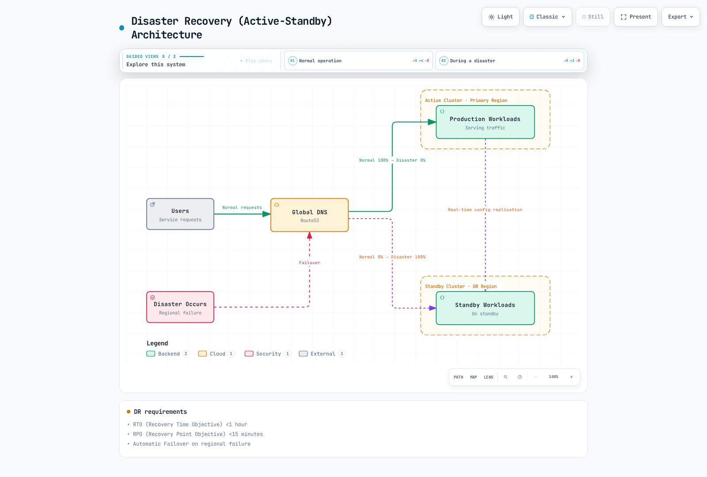
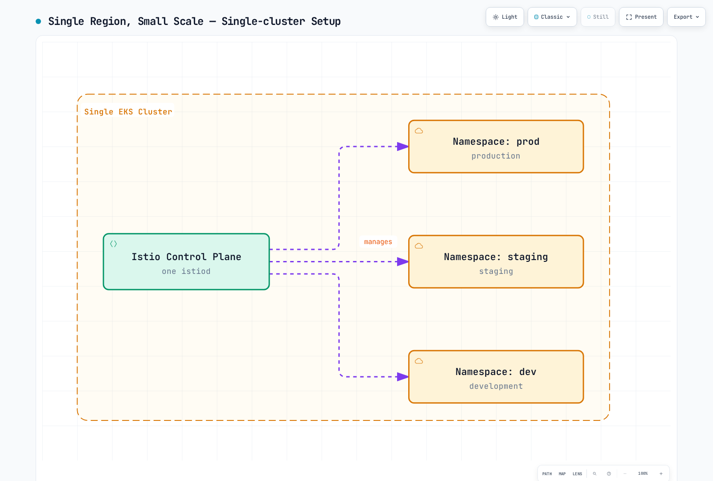
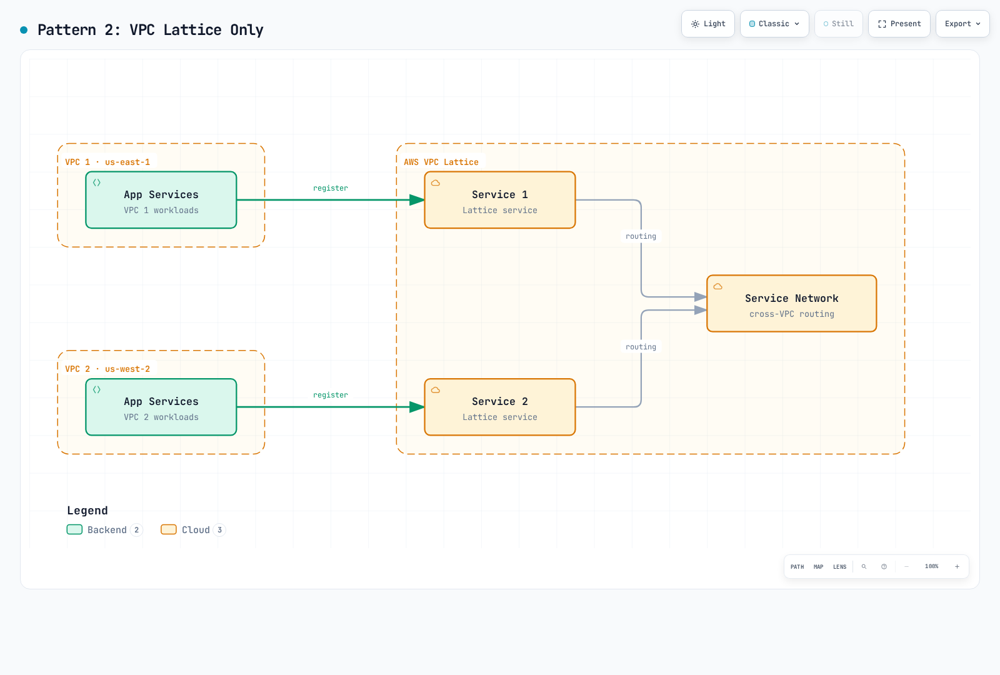
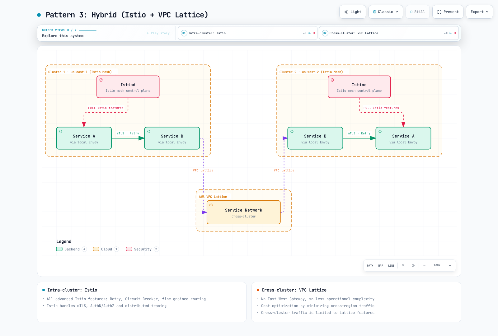

# 多集群

> **最后更新**：2026年10月16日 · Istio 1.31 · Kubernetes1.32–1.37。以下安装示例描述的是 **sidecar** 拓扑，彼此为独立的替代方案。Ambient 的支持限制有所不同。本次审计未执行任何集群、AWS 或生产负载部署。

多集群 Service Mesh 将多个 Kubernetes 集群连接为一个统一的服务网格。

## 目录

1. [你真的需要多集群吗？](02-multi-cluster.md#do-you-really-need-multi-cluster)
2. [架构选择指南](02-multi-cluster.md#architecture-selection-guide)
3. [Istio 与 AWS VPC Lattice](02-multi-cluster.md#istio-vs-aws-vpc-lattice)
4. [拓扑](02-multi-cluster.md#topology)
5. [主集群-远程集群设置](02-multi-cluster.md#primary-remote-setup)
6. [多主集群设置](02-multi-cluster.md#multi-primary-setup)
7. [跨集群通信](02-multi-cluster.md#cross-cluster-communication)
8. [与 VPC Lattice 配合使用](02-multi-cluster.md#using-with-vpc-lattice)
9. [实用示例](02-multi-cluster.md#practical-examples)
10. [性能与成本比较](02-multi-cluster.md#performance-and-cost-comparison)
11. [故障排查](02-multi-cluster.md#troubleshooting)

## 你真的需要多集群吗？ {#do-you-really-need-multi-cluster}

多集群 Service Mesh 功能强大，但会增加复杂性和成本。采用之前需要仔细考虑。

### 决策流程

请将以下要求作为约束条件；清单得分并不能让某种架构在所有情况下都更可取。


### 何时需要多集群

#### 1. 地理分布和延迟优化


[🔍 查看交互式示意图](https://www.atomai.click/kubernetes-docs/archmaps/en-service-mesh-istio-advanced-02-multi-cluster-1.html)

**适用场景**：

* 面向全球用户的服务（延迟目标 <100ms）
* 工作负载特定的数据放置义务；网格本身并不能确保合规
* 区域流量路由和故障隔离

#### 2. 灾难恢复（DR）



[🔍 查看交互式示意图](https://www.atomai.click/kubernetes-docs/archmaps/en-service-mesh-istio-advanced-02-multi-cluster-2.html)

**适用场景**：

* RTO（恢复时间目标）<1 小时
* RPO（恢复点目标）<15 分钟
* 区域故障时自动故障转移

上述 RTO/RPO 数值是示例要求，并非网格保证的结果。DR 示意图假设部署/数据复制和 DNS 健康路由已单独实现；客户端、缓存和现有连接都会影响切换过程。

#### 3. 环境隔离和分阶段部署

**适用场景**：

* 通过统一管理实现 Dev/Staging/Prod 集群隔离
* 在集群级别进行蓝绿部署
* 逐步扩展到更多区域的金丝雀部署

#### 4. 组织边界和安全隔离

**适用场景**：

* 各团队/部门独立运营集群
* 增强多租户能力
* 明确评估隔离边界；共享网格信任是另一项独立决策

### 何时不需要多集群

#### 1. 单一区域、小规模服务



[🔍 查看交互式示意图](https://www.atomai.click/kubernetes-docs/archmaps/en-service-mesh-istio-advanced-02-multi-cluster-3.html)

**可改用**：

* Kubernetes Namespace 隔离
* 使用 NetworkPolicy 实现网络隔离
* 使用 RBAC 控制访问

#### 2. 无法应对运维复杂性的情况

**多集群运维要求**：

* 有负责团队能够运维网络、PKI、升级和跨集群事件
* 管理和监控 East-West Gateway
* 跨集群证书管理
* 跨集群调试能力

**如果团队规模较小**：

* 使用单集群 Istio，或
* 使用 AWS VPC Lattice（托管服务）

#### 3. 成本是关键考量时

**多集群的额外成本**：

* 所选平台的东西向负载均衡器运行时长/容量及处理费用
* 按量计费的跨区域流量字节数，以及因流向/区域而异的费率
* 控制平面/网关副本，以及可观测性/存储容量

### 检查清单

采用之前请回答以下问题：

**架构**：

* [ ] 是否已在运行 2 个或更多集群？
* [ ] 是否需要多区域部署？
* [ ] 跨集群服务调用是否频繁？

**业务要求**：

* [ ] 是否面向全球用户？
* [ ] 灾难恢复（DR）是否至关重要？
* [ ] RTO/RPO 要求是否严格？

**安全与合规**：

* [ ] 是否需要数据本地化？
* [ ] 是否需要强跨集群隔离？

**运维能力**：

* [ ] 是否有 Istio 专家？
* [ ] 是否能调试复杂的网络问题？
* [ ] 是否能承担额外成本？

**结果**：

请将答案作为设计输入，而不是数值化的推荐评分。无论勾选了多少项，区域、信任、API、恢复和运维约束都可能排除某个选项。

## 架构选择指南 {#architecture-selection-guide}

| 决策 | 所需证据 |
|---|---|
|区域 HA 与区域灾难恢复|控制平面/工作负载放置、复制的数据和经过测试的恢复流程|
|跨集群网格|可访问的 API/网关、共同的信任设计、命名空间/服务身份以及独立分发的配置|
|区域 Lattice 连接|区域服务网络、VPC 关联/端点、监听器/身份验证模式和目标可达性|
|跨区域连接|明确的全局网络/端点和应用/数据设计；直接的区域 VPC 关联并非全球网络架构|
|成本与人员配置|已测量的工作负载、相同的流量假设、实际账单和运维投入|

### 各方案对比

#### 单集群 Istio

**优点**：

* 管理最简单
* 组件较少可能简化成本模型；应测量实际工作负载
* 调试快捷
* 可使用所有 Istio 功能

**缺点**：

* 集群故障域共享；仍可配置区域 HA
* 如果没有单独的恢复架构，则依赖单一区域
* 单个 EKS 控制平面属于区域级；要分散到更广的故障域，需要额外设计

**适用场景**：

* 单区域服务
* 区域可靠性目标符合此运维范围的团队
* 无需跨区域 DR 即可实现区域 HA

#### 多集群 Istio

**优点**：

* 完整的地理分布
* 可作为明确设计流量故障转移的基础；应用/数据 DR 仍需单独处理
* 所有 L7 功能（Retry、Timeout、Circuit Breaker）
* 精细化流量控制
* 统一可观测性

**缺点**：

* 运维复杂度高
* 需要管理 East-West Gateway
* 跨区域数据传输成本
* 调试困难

**适用场景**：

* 全球服务
* 需要强大的 DR
* 必须具备精细化 L7 控制

#### AWS VPC Lattice

**优点**：

* AWS 全托管
* 设置简单
* 运维负担低
* 通过明确的关联和访问策略实现跨 VPC 连接
* 根据实际工作负载对服务/请求/数据和运维成本建模

**缺点**：

* 弹性控制方式不同；监听器规则 API 中没有与逐跳重试/异常检测配置等效的功能
* 存在 AWS 厂商锁定问题
* 支持 Header/方法/路径和加权目标路由，但匹配类型和限制与 Istio 不同
* 指标/日志接口不同；完整链路追踪需要应用集成

**适用场景**：

* 以 AWS 为中心的架构
* 只需要简单的服务连接
* 优先简化运维

## Istio 与 AWS VPC Lattice {#istio-vs-aws-vpc-lattice}

### 功能对比

| 领域 | Istio sidecar 网格 | VPC Lattice 服务 |
|---|---|---|
|路由|VirtualService/DestinationRule 策略|HTTP Header 精确匹配/前缀匹配/包含匹配、路径精确匹配/前缀匹配、方法和加权目标组规则|
|弹性|逐跳重试/超时、连接池熔断和异常检测|托管服务/连接限制；并非相同的可配置逐跳重试/异常检测 API|
|TLS 身份|使用兼容网格信任的工作负载 mTLS|HTTPS 在 Lattice 终止；TLS 透传可以承载应用 mTLS，但不管理 SPIFFE 身份|
|授权|Istio/应用策略|需要时使用 HTTP(S) 身份验证策略和 IAM/SigV4；仅允许 SourceVpc 的规则可能包含匿名调用方|
|TLS 透传限制|取决于配置的网关|仅支持自定义域名 SNI、TCP 目标组和默认规则；使用匿名主体身份验证策略，不支持 HTTP Header IAM 身份验证|
|可观测性|配置的代理/应用指标、日志和链路追踪|CloudWatch 指标和访问日志；应用链路追踪/上下文仍需单独集成|
|成本|计算、网关、数据传输和运维|服务运行时长、请求/数据处理和适用的资源/端点费用；没有普遍更便宜的赢家|

Lattice 服务、资源配置和服务网络均为区域级。跨区域/本地客户端需要明确且受支持的网络/端点路径；对等连接/传输流量需要相应的服务网络 VPC 端点，不能仅靠关联。TLS 透传和 HTTPS 终止具有不同的路由/身份验证约定。混合架构必须说明每个 TLS 和身份边界。

### 架构模式对比

#### 模式 1：仅使用 Istio 多集群


**优点**：

* 完整的 Istio 功能
* 统一可观测性
* 精细化控制

**缺点**：

* 需要管理 East-West Gateway
* 复杂度高
* 跨区域数据传输成本

#### 模式 2：仅使用 VPC Lattice



[🔍 查看交互式示意图](https://www.atomai.click/kubernetes-docs/archmaps/en-service-mesh-istio-advanced-02-multi-cluster-5.html)

**优点**：

* AWS 全托管
* 设置简单
* 运维负担低

**缺点**：

* 无法使用 Istio 功能
* 流量控制有限
* Kubernetes 集成需要 AWS Gateway API Controller 及其支持的 API

#### 模式 3：混合架构（区域连接方案）



[🔍 查看交互式示意图](https://www.atomai.click/kubernetes-docs/archmaps/en-service-mesh-istio-advanced-02-multi-cluster-6.html)

**优点**：

* 集群内：所有高级 Istio 功能（Retry、Circuit Breaker、精细化路由）
* 跨集群：VPC Lattice 管理简单、稳定
* 降低运维复杂性（无需 East-West Gateway）
* 必须测量成本；选择 Lattice 本身并不会减少所需的跨区域传输字节数

**缺点**：

* 需要了解两套技术栈
* 跨集群功能受限于 Lattice

**适用场景**：

* AWS 环境
* 集群内需要复杂流量控制
* 跨集群只需要简单连接

## 多集群概览

通过多集群 Service Mesh，您可以实现：

* 多区域部署
* 灾难恢复（DR）
* 环境隔离（dev/staging/prod）
* 跨集群服务发现和通信

## 拓扑 {#topology}

以下均为 sidecar 拓扑。目前 Ambient 多集群支持 Beta 版多主集群/多网络，但有单独的限制；不要将主集群/远程集群的操作说明用于 Ambient。每个主集群都会读取已授权的 Kubernetes API。Istiod 不会将其他 Istio CRD、应用配置或数据库复制到另一个主集群；这些内容需要单独分发。共享信任域会使不同集群中相同命名空间/ServiceAccount 具有相同身份，因此仅靠集群隔离并不能实现授权隔离。

一个主集群安装可以有多个副本。主集群故障会影响服务发现、注入和证书操作；现有代理可以保留配置，因此不会立即导致所有流量中断。多主集群可以减少这种依赖，但并不能消除所有共享故障模式。


### 主集群-远程集群


[🔍 查看交互式示意图](https://www.atomai.click/kubernetes-docs/archmaps/en-service-mesh-istio-advanced-02-multi-cluster-7.html)

**特点**：

* 单个控制平面（主集群）
* 多个数据平面（远程集群）
* 管理简单
* 服务发现/注入/证书操作共同依赖主集群部署

### 多主集群


**特点**：

* 多个控制平面
* 高可用性
* 管理复杂
* 区域自治

### 共同前提条件

请在 Istio 1.31 发行版目录中操作，并准备好两个现有的兼容集群以及已审核的 kubeconfig 上下文。这些示例假设使用默认 revision；如果实际安装使用了其他 revision，请在命名空间标签和网关生成时保留该 revision。两个 Kubernetes API 以及所需的数据/控制平面路径都必须可访问。安装前规划共享信任：多主集群签发者必须链接到受信任的共同根证书（或明确支持的信任设计）；meshID 字符串相同并不能建立证书信任。请遵循[官方前提条件和 CA 准备说明](https://istio.io/latest/docs/setup/install/multicluster/before-you-begin/)，并妥善保护私有 CA 材料。请单独分发应用/网格配置；远程 Secret 不会复制这些配置。

```bash
export CTX_CLUSTER1=cluster1
export CTX_CLUSTER2=cluster2
kubectl --context="$CTX_CLUSTER1" get nodes
kubectl --context="$CTX_CLUSTER2" get nodes
```

## 主集群-远程集群设置 {#primary-remote-setup}

这是官方的 **基于 IP、同网络的 sidecar** 拓扑：Pod 必须能够跨集群直接访问，且远程 API 必须可从主集群访问。这不是 EKS NLB 主机名配置方案。1.31 chart 可以使用 ExternalName Service 表示 DNS 值的 remotePilotAddress；本指南中的 IP 查找并非完整的基于 DNS 的 EKS 设计。请使用[外部控制平面指南](https://istio.io/latest/docs/setup/install/external-controlplane/)配置注入 URL、签名 DNS 证书和实际控制平面可达性。渲染 DNS 值并不能验证该部署。下面的 IstioOperator 是 istioctl 的输入，而不是集群内的 operator 资源。

### 1. 设置主集群

```bash
# Context setup
export CTX_CLUSTER1=cluster1

# Install Istio
istioctl install --context="${CTX_CLUSTER1}" -f - <<EOF
apiVersion: install.istio.io/v1alpha1
kind: IstioOperator
spec:
  values:
    global:
      meshID: mesh1
      externalIstiod: true
      multiCluster:
        clusterName: cluster1
      network: network1
EOF

# Install East-West Gateway
samples/multicluster/gen-eastwest-gateway.sh --network network1 > primary-eastwest.yaml
# Review platform-specific L4 load balancer and access settings before applying
istioctl install --context="${CTX_CLUSTER1}" -f primary-eastwest.yaml

# Expose Gateway
kubectl apply --context="${CTX_CLUSTER1}" -f \
  samples/multicluster/expose-istiod.yaml
```

### 2. 设置远程集群

```bash
# Context setup
export CTX_CLUSTER2=cluster2

# Prepare the remote namespace and identify its managing primary
kubectl --context="$CTX_CLUSTER2" create namespace istio-system --dry-run=client -o yaml | kubectl --context="$CTX_CLUSTER2" apply -f -
kubectl --context="$CTX_CLUSTER2" annotate namespace istio-system topology.istio.io/controlPlaneClusters=cluster1 --overwrite
DISCOVERY_ADDRESS=$(kubectl --context="$CTX_CLUSTER1" -n istio-system get svc istio-eastwestgateway -o jsonpath='{.status.loadBalancer.ingress[0].ip}')
if [ -z "$DISCOVERY_ADDRESS" ]; then
  echo "This IP-based lab requires a reachable LB IP; DNS-based EKS endpoints need the external-control-plane design." >&2
  exit 1
fi


# Install Istio with Remote configuration
istioctl install --context="${CTX_CLUSTER2}" -f - <<EOF
apiVersion: install.istio.io/v1alpha1
kind: IstioOperator
spec:
  profile: remote
  values:
    istiodRemote:
      injectionPath: /inject/cluster/cluster2/net/network1
    global:
      meshID: mesh1
      multiCluster:
        clusterName: cluster2
      network: network1
      remotePilotAddress: ${DISCOVERY_ADDRESS}
EOF

# Give the primary access to the REMOTE API after remote components are configured
istioctl create-remote-secret \
  --context="${CTX_CLUSTER2}" \
  --name=cluster2 | \
  kubectl apply -f - --context="${CTX_CLUSTER1}"
```

## 多主集群设置 {#multi-primary-setup}

对于这种独立网络拓扑，每个主集群都必须能够访问对等集群的 API 和 East-West Gateway。安装 Istiod 前，请配置符合该拓扑要求的 CA Secret。请为实际平台配置 L4 负载均衡器、网关可达性和范围受限的访问；ALB 或其他会终止 TLS 的 L7 跳点与 AUTO_PASSTHROUGH 不兼容。有关 EKS 负载均衡器前提条件，请参阅 [AWS 集成](../04-aws-integration.md)。

### 1. 将两个集群都设为主集群

```bash
# Cluster 1
istioctl install --context="${CTX_CLUSTER1}" -f - <<EOF
apiVersion: install.istio.io/v1alpha1
kind: IstioOperator
spec:
  values:
    global:
      meshID: mesh1
      multiCluster:
        clusterName: cluster1
      network: network1
EOF

# Cluster 2
istioctl install --context="${CTX_CLUSTER2}" -f - <<EOF
apiVersion: install.istio.io/v1alpha1
kind: IstioOperator
spec:
  values:
    global:
      meshID: mesh1
      multiCluster:
        clusterName: cluster2
      network: network2
EOF
```

```bash
# Both networks need their own gateway and service exposure
kubectl --context="$CTX_CLUSTER1" label namespace istio-system topology.istio.io/network=network1 --overwrite
kubectl --context="$CTX_CLUSTER2" label namespace istio-system topology.istio.io/network=network2 --overwrite
samples/multicluster/gen-eastwest-gateway.sh --network network1 > eastwest-cluster1.yaml
samples/multicluster/gen-eastwest-gateway.sh --network network2 > eastwest-cluster2.yaml
# Review platform-specific LB/access settings in these generated inputs before installing
istioctl install --context="$CTX_CLUSTER1" -f eastwest-cluster1.yaml
istioctl install --context="$CTX_CLUSTER2" -f eastwest-cluster2.yaml
kubectl --context="$CTX_CLUSTER1" apply -n istio-system -f samples/multicluster/expose-services.yaml
kubectl --context="$CTX_CLUSTER2" apply -n istio-system -f samples/multicluster/expose-services.yaml
```

### 2. 交叉注册远程 Secret

```bash
# Cluster 1's Secret to Cluster 2
istioctl create-remote-secret \
  --context="${CTX_CLUSTER1}" \
  --name=cluster1 | \
  kubectl apply -f - --context="${CTX_CLUSTER2}"

# Cluster 2's Secret to Cluster 1
istioctl create-remote-secret \
  --context="${CTX_CLUSTER2}" \
  --name=cluster2 | \
  kubectl apply -f - --context="${CTX_CLUSTER1}"
```

## 跨集群通信 {#cross-cluster-communication}

使用远程发现，并确保 Service/命名空间名称匹配且 DNS 可见性符合要求。Istiod 不会在集群之间复制 Service 对象或 Deployment。本实验在两个集群中都定义 Service，只在 cluster2 中部署后端，并从 cluster1 中注入的客户端调用它。在不同网络中，Istio 会选择 East-West Gateway 和 SNI/mTLS 路径；不要将其替换为指向 port 15443 的 HTTP ServiceEntry。

将以下内容保存为 `shared-httpbin-service.yaml`：

```yaml
apiVersion: v1
kind: Service
metadata:
  name: httpbin
  namespace: multicluster-demo
spec:
  selector:
    app: httpbin
  ports:
  - name: http
    port: 8000
    targetPort: 8080
```

```bash
for context in "$CTX_CLUSTER1" "$CTX_CLUSTER2"; do
  kubectl --context="$context" create namespace multicluster-demo --dry-run=client -o yaml | kubectl --context="$context" apply -f -
  # Default revision lab; use the recorded revision label if installed differently
  kubectl --context="$context" label namespace multicluster-demo istio-injection=enabled --overwrite
  kubectl --context="$context" apply -f shared-httpbin-service.yaml
done
kubectl --context="$CTX_CLUSTER2" apply -n multicluster-demo -f samples/httpbin/httpbin.yaml
kubectl --context="$CTX_CLUSTER1" apply -n multicluster-demo -f samples/curl/curl.yaml
kubectl --context="$CTX_CLUSTER2" rollout status deployment/httpbin -n multicluster-demo --timeout=120s
kubectl --context="$CTX_CLUSTER1" rollout status deployment/curl -n multicluster-demo --timeout=120s
istioctl proxy-config endpoints deployment/curl --context="$CTX_CLUSTER1" -n multicluster-demo --cluster 'outbound|8000||httpbin.multicluster-demo.svc.cluster.local'
kubectl --context="$CTX_CLUSTER1" exec -n multicluster-demo deploy/curl -c curl -- curl -sS --max-time 5 http://httpbin:8000/headers
```

HTTP 响应测试的是应用路径，本身不能证明证书信任。请按照安全章节中的说明检查调用方/接收方 TLS 配置和身份凭据。[官方多集群验证指南](https://istio.io/latest/docs/setup/install/multicluster/verify/)提供了其他场景。这些命令假设信任、网络、策略和服务发现前提条件均已满足。

## 与 VPC Lattice 配合使用 {#using-with-vpc-lattice}

### 混合架构约定和配置片段

此替代方案从相互独立的 Istio 网格和区域 Lattice 服务路径开始。更改 `meshID` 或设置所谓的 `multiCluster.enabled` 开关，都不是安全断开现有已加入网格的方法。更改拓扑时，请遵循安装指南，并采用经过审核的信任/远程 Secret/策略迁移方案。

以下命令是配置示例，并非端到端的生产部署。这些示例假设已经具备经授权的管理身份、实际 VPC/安全组 ID、已安装的 AWS Gateway API Controller/CRD，以及可正常工作的 HTTPS Lattice 服务。这些命令使用的管理凭证与应用调用方角色分开；应用调用方角色只需要预期的数据平面权限。Lattice 服务/网络是区域级的；通过对等连接/传输到达的客户端需要使用受支持的服务网络端点/网络路径。直接关联两个同一区域的 VPC 并不会创建跨三个区域的网络。

#### 1. 创建或选择区域服务网络

创建新网络时，请记录返回的 ID，而不是查找含义不明确的名称。如果网络已存在，请使用经过验证的 ID，而不是再创建一个。VPC 关联会启用客户端路径；但不会发布 Kubernetes Service，也不会自动授权所有请求。

```bash
# Both VPCs below are in this Region; use real reviewed VPC/security-group IDs
LATTICE_REGION=us-east-1
: "${VPC1_ID:?Set cluster1 VPC ID}"
: "${VPC2_ID:?Set cluster2 VPC ID}"
: "${LATTICE_SG1_ID:?Set cluster1 association security group}"
: "${LATTICE_SG2_ID:?Set cluster2 association security group}"
SERVICE_NETWORK_ID=$(aws vpc-lattice create-service-network   --region "$LATTICE_REGION" --name my-service-network --auth-type AWS_IAM   --query id --output text)
aws vpc-lattice create-service-network-vpc-association --region "$LATTICE_REGION"   --service-network-identifier "$SERVICE_NETWORK_ID" --vpc-identifier "$VPC1_ID"   --security-group-ids "$LATTICE_SG1_ID"
aws vpc-lattice create-service-network-vpc-association --region "$LATTICE_REGION"   --service-network-identifier "$SERVICE_NETWORK_ID" --vpc-identifier "$VPC2_ID"   --security-group-ids "$LATTICE_SG2_ID"
```

#### 2. 通过 Controller 发布，并定义入口边界

Controller 的 `amazon-vpc-lattice` GatewayClass 和 Gateway 通过名称引用服务网络。名为 `my-service-network` 的 Gateway 可以引用上面单独管理的网络。受支持的 HTTPRoute/GRPCRoute 会提供服务/监听器/目标路由，并分配各自的端点；Gateway 并不是一个通用的服务 DNS 端点。

`ServiceExport` 是有效的 Controller 专用 API，但它创建的是**目标组**，而不是完整的 Lattice 服务/网络关联。旧的 `lattice-service-network` 注释并未提供该工作流。下面的可选导出假设 istio-system 中已存在一个端口为80的 `lattice-entry` 入口 Service；仅创建它并不能提供完整路由：

```yaml
# Optional target-group export only; assumes this ingress Service already exists
apiVersion: application-networking.k8s.aws/v1alpha1
kind: ServiceExport
metadata:
  name: lattice-entry
  namespace: istio-system
spec:
  exportedPorts:
  - port: 80
    routeType: HTTP
```

要实际发布服务，请完成 [Gateway](https://www.gateway-api-controller.eks.aws.dev/latest/api-types/gateway/)、[HTTPRoute](https://www.gateway-api-controller.eks.aws.dev/latest/api-types/http-route/)以及适用情况下的 ServiceImport 配置。请确保与已安装的 Controller/CRD 版本相匹配；已对照 v2.1.3 检查 exportedPorts。

Lattice 不会为 STRICT 后端发起 Istio SPIFFE mTLS。请单独配置入口边界，以接受预期的 Lattice 流量、限制绕过入口的访问，并向后端发起网格 mTLS；也可以明确设计另一种受支持的后端安全约定。不要默默削弱后端策略。后端看到的身份可能是入口身份，而不是原始 IAM 调用方；可信身份传递需要单独设计。本文档不会配置该边界、IAM 角色、ACM 证书或 DNS。

#### 3. 发现并调用实际 HTTPS 端点

提供方路由和服务网络关联就绪后，获取服务的实际 DNS 名称。应用必须使用 HTTPS、验证匹配的证书，并在需要经过身份验证的访问时，对实际主机/路径/负载进行签名。不要虚构 `.lattice.svc.cluster.local` 名称，也不要在应用 TLS 外再添加 SIMPLE TLS。

```bash
# Obtain the real service ID from the reconciled provider configuration
: "${LATTICE_SERVICE_ID:?Set the created and associated HTTPS Lattice service ID}"
aws vpc-lattice get-service --region "$LATTICE_REGION"   --service-identifier "$LATTICE_SERVICE_ID" > lattice-service.json
LATTICE_SERVICE_DNS=$(jq -er '.dnsEntry.domainName' lattice-service.json)
LATTICE_SERVICE_ARN=$(jq -er '.arn' lattice-service.json)

# JSON is also a valid Kubernetes manifest; this explicitly renders the hostname
jq -n --arg host "$LATTICE_SERVICE_DNS" '{
  apiVersion:"networking.istio.io/v1",kind:"ServiceEntry",
  metadata:{name:"remote-service-via-lattice",namespace:"default"},
  spec:{hosts:[$host],location:"MESH_EXTERNAL",resolution:"DNS",
        ports:[{number:443,name:"https",protocol:"HTTPS"}]}
}' > lattice-service-entry.json
kubectl --context="$CTX_CLUSTER1" apply -f lattice-service-entry.json
```

此 ServiceEntry 只会将外部服务加入调用方的 Istio 注册表；它不会配置 Lattice 连接、策略或签名程序。应用发起的 HTTPS 对 sidecar 来说是不透明的，因此如果需要 HTTP 层的代理路由/指标，就必须明确设计另一种 TLS 终止路径。

#### 4. 要求使用预期的 IAM 调用方

`AWS_IAM` 会启用策略评估。只包含 SourceVpc 条件的通配符 Principal 可能允许匿名请求；这并不能证明请求经过了 IAM 身份验证。此示例会指定一个 IAM 角色，并将访问范围限定到一个服务和两个直接关联的 VPC。

```bash
: "${CALLER_ROLE_ARN:?Set the explicitly authorized caller IAM role ARN}"
# Compact resource policy; explicit role requires an authenticated caller
jq -cn --arg role "$CALLER_ROLE_ARN" --arg service "$LATTICE_SERVICE_ARN"   --arg vpc1 "$VPC1_ID" --arg vpc2 "$VPC2_ID" '{
  Version:"2012-10-17",Statement:[{
    Effect:"Allow",Principal:{AWS:$role},Action:"vpc-lattice-svcs:Invoke",
    Resource:($service+"/*"),
    Condition:{StringEquals:{"vpc-lattice-svcs:SourceVpc":[$vpc1,$vpc2]}}
  }]
}' > lattice-auth-policy.json
aws vpc-lattice put-auth-policy --region "$LATTICE_REGION"   --resource-identifier "$SERVICE_NETWORK_ID" --policy file://lattice-auth-policy.json
```

调用方角色还需要相应的基于身份的 Invoke 权限。每个已启用的服务网络/服务身份验证策略都必须允许该请求，并且显式拒绝优先级最高。如果启用了服务级身份验证，也要管理相应策略；避免同时由 CLI/Controller 管理策略。请使用受支持的应用 SDK/签名程序，或使用带工作负载凭证且经过验证的签名代理。Istio TLS 设置不会生成 SigV4 签名；签名后更改主机/路径/请求体可能导致签名失效。

### 流量流向和可观测性

预期流量路径为：调用方签名并建立 HTTPS → Lattice 授权并终止 HTTPS → 配置好的入口边界进入后端网格 → 应用接收请求。TLS 透传属于另一种约定：使用自定义域名 SNI/TCP 目标、仅有默认规则和匿名主体身份验证策略；它可以承载应用 mTLS，但不提供 HTTP Header IAM 身份验证。

确保各应用的链路追踪上下文和 Collector/后端配置兼容。跨越集群或 Lattice 边界本身并不会拆分链路追踪。请验证实际身份、TLS 和遥测路径，不要假设原来的双集群示意图就代表完整部署。

## 实用示例 {#practical-examples}

### 示例 1：全球电子商务（多主集群 + VPC Lattice）

全球应用可以部署区域网格和区域 Lattice 服务网络。在某个区域内，本地 Order 服务可以通过定义好的 Lattice/入口约定调用本地 Payment 服务。跨区域调用需要单独设计受支持的网络/端点；已删除的示意图并未因为把三个区域放在一个服务网络周围就建立了这条路径。数据复制和区域故障转移仍由应用/基础设施负责。

以下集群内示例假设实际存在 cart Service，并且 v1/v2 Pod 标签匹配。user-type Header 用于选择路由，不代表身份验证。由于 cart 操作可能产生副作用，网格重试已禁用。

#### 配置示例

**Cluster 1/2：Frontend -> Cart（Istio）**

```yaml
apiVersion: networking.istio.io/v1
kind: VirtualService
metadata:
  name: cart-service
  namespace: default
spec:
  hosts:
  - cart.default.svc.cluster.local
  http:
  - match:
    - headers:
        user-type:
          exact: premium
    route:
    - destination:
        host: cart.default.svc.cluster.local
        subset: v2
      weight: 100
    retries:
      attempts: 0
  - route:
    - destination:
        host: cart.default.svc.cluster.local
        subset: v1
      weight: 100
    retries:
      attempts: 0
---
apiVersion: networking.istio.io/v1
kind: DestinationRule
metadata:
  name: cart-service
  namespace: default
spec:
  host: cart.default.svc.cluster.local
  trafficPolicy:
    connectionPool:
      tcp:
        maxConnections: 100
      http:
        http1MaxPendingRequests: 1024
        maxRequestsPerConnection: 10
    outlierDetection:
      interval: 10s
      baseEjectionTime: 30s
      consecutive5xxErrors: 5
      minHealthPercent: 0
  subsets:
  - name: v1
    labels:
      version: v1
  - name: v2
    labels:
      version: v2
```

**通过 Lattice 访问区域 Order → Payment**

使用混合架构章节中的实际 HTTPS DNS 和已渲染的 ServiceEntry，并确保提供方路由可用、入口边界兼容且 SigV4 调用方已配置。不要在应用 HTTPS 流外再添加 SIMPLE TLS，也不要虚构 Kubernetes `.svc.cluster.local` 别名。区域 Lattice 路径本身无法解决全局路由或数据恢复问题。

### 示例 2：灾难恢复（DR）场景

这是针对两个现有区域 NLB 的**手动 Route53 别名故障转移配置**。它不会部署工作负载、负载均衡器、TLS 监听器、复制机制或健康服务。请先为每个目标组配置实际的应用就绪/健康检查。不要将此记录所有者与前面不完整的 ExternalDNS 注释结合，也不要虚构健康检查 ID。

此示例对 NLB 别名使用 `EvaluateTargetHealth`，不另配公共 HTTPS 健康检查。如果需要更深入的应用/数据健康检查，请设计合适的端点/告警健康信号；旧的 HTTP 80 Service 与 HTTPS 443 探测并不匹配。仅限私有网络的端点不能简单地由公共 Route53 HTTP 检查器进行检测。

```bash
# Existing, healthy NLBs and a DNS zone controlled by this workflow
PRIMARY_REGION=us-east-1
STANDBY_REGION=us-west-2
RECORD_NAME=api.example.com
: "${PRIMARY_LB_ARN:?Set the primary NLB ARN}"
: "${STANDBY_LB_ARN:?Set the standby NLB ARN}"
: "${ZONE_ID:?Set the Route53 hosted zone ID}"
aws elbv2 describe-load-balancers --region "$PRIMARY_REGION" \
  --load-balancer-arns "$PRIMARY_LB_ARN" > primary-nlb.json
aws elbv2 describe-load-balancers --region "$STANDBY_REGION" \
  --load-balancer-arns "$STANDBY_LB_ARN" > standby-nlb.json

# Each regional load balancer supplies its own canonical hosted-zone ID
jq -n --arg name "$RECORD_NAME" \
  --slurpfile primary primary-nlb.json --slurpfile standby standby-nlb.json '
  def record($id; $mode; $lb):
    {Action:"UPSERT",ResourceRecordSet:{
      Name:$name,Type:"A",SetIdentifier:$id,Failover:$mode,
      AliasTarget:{HostedZoneId:$lb.CanonicalHostedZoneId,
                   DNSName:$lb.DNSName,EvaluateTargetHealth:true}
    }};
  {Changes:[
    record("primary";"PRIMARY";$primary[0].LoadBalancers[0]),
    record("secondary";"SECONDARY";$standby[0].LoadBalancers[0])
  ]}
' > failover-config.json

# Review the records/zone before applying; do not give another DNS controller ownership
aws route53 change-resource-record-sets --hosted-zone-id "$ZONE_ID" \
  --change-batch file://failover-config.json
```

更改 DNS 前，请检查现有记录以及恢复/回滚计划。别名 A 记录并不构成完整的 IPv6 配置；使用 dualstack 还需要适当的 AAAA 记录和可达性。DNS 缓存、连接复用、目标组健康语义以及所有目标均不健康时的行为都会影响故障转移。请与应用/数据恢复一并测试。DNS 或 Istio 本身都无法单独保证15 分钟 RPO 或1 小时 RTO。

## 性能与成本比较 {#performance-and-cost-comparison}

旧版延迟/RPS/CPU/内存表没有可复现的基准测试来源、发行版本、硬件或负载条件。成本表还比较了不同的流量规模（10 TB 对比 5 TB）和随意设定的人员预算。因此这些表无法证明哪种架构更便宜/更快，也不能通过修改标签冒充最新测量结果。

| 组件 | 明确测量或定价 |
|---|---|
|应用延迟/吞吐量|区域、负载、并发、TLS、策略、应用容量和百分位定义相同|
|网格计算资源|实际 Istiod/代理/网关/遥测副本和资源消耗；单独计入 Kubernetes/EKS 成本|
|网络|相同的计费字节数/流向、区域传输、LB/端点/TGW/对等连接处理和容量|
|Lattice 服务|预置服务时长、请求数和数据处理量；资源配置/端点有各自的计费模型|
|运维/DR|实际工程投入、事件/恢复演练以及业务影响假设|

请使用 [Lattice 定价](https://aws.amazon.com/vpc/lattice/pricing/)和实际账单数据。VPC 对等连接不会自动免除跨区域传输费用。Lattice 文档说明其服务内不会额外收取跨 AZ 数据传输费，但这不等于没有数据处理成本。Ambient 并不保证节省90% 的资源；请使用相同策略进行测量。固定的人员数量或每小时 1,000 美元的停机损失门槛都不能决定架构选择。

## 故障排查 {#troubleshooting}

```bash
# Verify cross-cluster connectivity
istioctl ps --context="${CTX_CLUSTER1}"
istioctl ps --context="${CTX_CLUSTER2}"

# Check Remote Secret
kubectl get secrets -n istio-system --context="${CTX_CLUSTER1}"

# Verify cross-cluster traffic
kubectl logs -n istio-system -l app=istiod --context="${CTX_CLUSTER1}"
```

## 参考资料

### 官方文档

* [Istio 多集群](https://istio.io/latest/docs/setup/install/multicluster/)
* [多主集群](https://istio.io/latest/docs/setup/install/multicluster/multi-primary/)
* [主集群-远程集群](https://istio.io/latest/docs/setup/install/multicluster/primary-remote/)
* [AWS VPC Lattice](https://docs.aws.amazon.com/vpc-lattice/latest/ug/what-is-vpc-lattice.html)
* [AWS Gateway API Controller](https://www.gateway-api-controller.eks.aws.dev/latest/)

* [Lattice 区域组件和跨区域模式](https://aws.amazon.com/vpc/lattice/faqs/)
* [Lattice 身份验证策略和匿名调用方](https://docs.aws.amazon.com/vpc-lattice/latest/ug/auth-policies.html)
* [Lattice SigV4 请求](https://docs.aws.amazon.com/vpc-lattice/latest/ug/sigv4-authenticated-requests.html)
* [Lattice TLS 透传](https://docs.aws.amazon.com/vpc-lattice/latest/ug/tls-listeners.html)
* [Route53 故障转移别名](https://docs.aws.amazon.com/Route53/latest/DeveloperGuide/resource-record-sets-values-failover-alias.html)

### 博客和案例研究

* [Tetrate - 多集群 Istio](https://tetrate.io/blog/multicluster-istio/)

### 相关文档

* [Ambient 模式](01-ambient-mode.md) - 资源优化
* [mTLS](../security/01-mtls.md) - 安全的跨集群通信
* [VPC Lattice](../../../networking/02-vpc-lattice.md) - AWS 托管服务网络

## 总结

请根据实际的信任、网络、API 和恢复要求选择拓扑。单个区域集群可以提供多 AZ HA。满足前提条件时，sidecar 多集群可以扩展服务发现和网格 mTLS，但不会复制应用状态。Lattice 是托管式区域应用网络，其 TLS/身份验证约定因监听器而异。混合架构必须定义每个身份/终止边界及任何跨区域路径。推荐方案前，请验证实际行为并比较相同工作负载下的成本。
