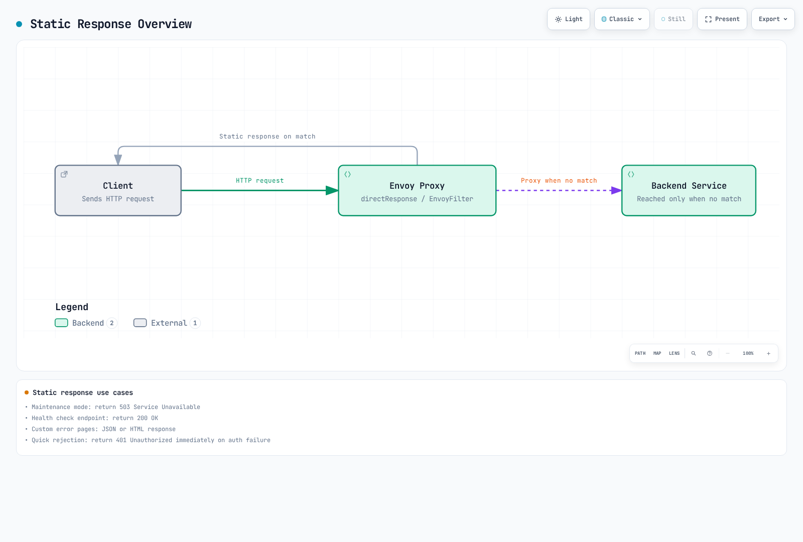

# EnvoyFilter

> **验证基线**：Istio 1.31.0、Kubernetes 1.32–1.37；sidecar 和 Istio Envoy 网关
> **最后审阅**：2026年10月16日

EnvoyFilter 是一项高级功能，可直接自定义 Envoy 代理配置。

## 目录

1. [概述](#overview)
2. [结构](#structure)
3. [主要使用场景](#main-use-cases)
4. [X-Forwarded-For 与跳数设置](#x-forwarded-for-and-hop-settings)
5. [静态响应配置](#static-response-configuration)
6. [实践示例](#practical-examples)
7. [最佳实践](#best-practices)
8. [故障排除](#troubleshooting)

## 概述 {#overview}

以下示例是彼此独立的替代方案。将它们全部应用于同一工作负载会叠加过滤器、路由和策略。请确认实际的命名空间、标签和监听器，将配置合并到现有设置中，并在测试环境中验证生成的 Envoy 配置和请求行为。EnvoyFilter 依赖 Envoy 内部 API，每次升级 Istio 都需要重新验证；它不受 ambient waypoint 支持。

使用 EnvoyFilter 可以：
- 添加、修改或删除自定义请求头
- 配置速率限制
- 集成外部授权
- 集成 WASM 插件

## 结构 {#structure}

```yaml
apiVersion: networking.istio.io/v1alpha3
kind: EnvoyFilter
metadata:
  name: custom-filter
  namespace: default
spec:
  workloadSelector:
    labels:
      app: myapp
  configPatches:
  - applyTo: HTTP_FILTER
    match:
      context: SIDECAR_OUTBOUND
      listener:
        filterChain:
          filter:
            name: "envoy.filters.network.http_connection_manager"
            subFilter:
              name: envoy.filters.http.router
    patch:
      operation: INSERT_BEFORE
      value:
        name: envoy.filters.http.lua
        typed_config:
          "@type": type.googleapis.com/envoy.extensions.filters.http.lua.v3.Lua
          default_source_code:
            inline_string: |
              function envoy_on_request(request_handle)
                request_handle:headers():replace("x-custom-header", "value")
              end
```

## 主要使用场景 {#main-use-cases}

### 1. 添加自定义请求头

```yaml
apiVersion: networking.istio.io/v1alpha3
kind: EnvoyFilter
metadata:
  name: add-header
  namespace: default
spec:
  workloadSelector:
    labels:
      app: myapp
  configPatches:
  - applyTo: HTTP_FILTER
    match:
      context: SIDECAR_OUTBOUND
      listener:
        filterChain:
          filter:
            name: envoy.filters.network.http_connection_manager
            subFilter:
              name: envoy.filters.http.router
    patch:
      operation: INSERT_BEFORE
      value:
        name: envoy.filters.http.lua
        typed_config:
          "@type": type.googleapis.com/envoy.extensions.filters.http.lua.v3.Lua
          default_source_code:
            inline_string: |
              function envoy_on_request(request_handle)
                request_handle:headers():replace("x-client-service", "myapp")
              end
```

### 2. 速率限制

```yaml
apiVersion: networking.istio.io/v1alpha3
kind: EnvoyFilter
metadata:
  name: ratelimit
  namespace: default
spec:
  workloadSelector:
    labels:
      app: api-service
  configPatches:
  - applyTo: HTTP_FILTER
    match:
      context: SIDECAR_INBOUND
      listener:
        filterChain:
          filter:
            name: envoy.filters.network.http_connection_manager
            subFilter:
              name: envoy.filters.http.router
    patch:
      operation: INSERT_BEFORE
      value:
        name: envoy.filters.http.local_ratelimit
        typed_config:
          "@type": type.googleapis.com/envoy.extensions.filters.http.local_ratelimit.v3.LocalRateLimit
          stat_prefix: http_local_rate_limiter
          token_bucket:
            max_tokens: 100
            tokens_per_fill: 10
            fill_interval: 1s
          filter_enabled:
            default_value: {numerator: 100, denominator: HUNDRED}
          filter_enforced:
            default_value: {numerator: 100, denominator: HUNDRED}
```

这是**每个代理进程**独立的令牌桶，初始突发容量为 100 个令牌，每秒补充 10 个令牌，并非跨副本的全局限制。显式启用 enable 和 enforce 比例后，才会触发拒绝。

### 3. WASM 插件

```yaml
apiVersion: networking.istio.io/v1alpha3
kind: EnvoyFilter
metadata:
  name: wasm-filter
  namespace: default
spec:
  workloadSelector:
    labels:
      app: myapp
  configPatches:
  - applyTo: HTTP_FILTER
    match:
      context: SIDECAR_INBOUND
      listener:
        filterChain:
          filter:
            name: envoy.filters.network.http_connection_manager
            subFilter:
              name: envoy.filters.http.router
    patch:
      operation: INSERT_BEFORE
      value:
        name: envoy.filters.http.wasm
        typed_config:
          "@type": type.googleapis.com/envoy.extensions.filters.http.wasm.v3.Wasm
          config:
            vm_config:
              runtime: "envoy.wasm.runtime.v8"
              code:
                local:
                  filename: "/var/local/lib/wasm-filters/my_plugin.wasm"
```

本地 Wasm 示例假定代理容器中的该路径已通过只读卷挂载了兼容模块。应用容器中的文件不会自动对代理可见，此 YAML 也不会下载模块。请验证模块、ABI、运行时及故障行为；分发模块时优先考虑 [WasmPlugin API](https://istio.io/latest/docs/reference/config/proxy_extensions/wasm-plugin/)。

## X-Forwarded-For 与跳数设置 {#x-forwarded-for-and-hop-settings}

### X-Forwarded-For 概述

HTTP 代理通常会将**与它建立连接的客户端地址**追加到 XFF，而不是追加自身地址。使用 ALB 默认的 `append` 模式时，直接连接的客户端会使 Gateway 收到 `203.0.113.5`；经 CloudFront 转发时，Gateway 会收到 `203.0.113.5, 192.0.2.20`。Gateway 的直接对端是 ALB。这些文档示例地址不是真实的 CloudFront IP 范围。

### XFF 配置选项

优先使用官方的[网关拓扑配置](https://istio.io/latest/docs/ops/configuration/traffic-management/network-topologies/)和 `gatewayTopology.numTrustedProxies`。将下列 **Pod 模板片段**合并到现有 ingress Deployment，重启受影响的 Gateway Pod，并检查生效配置。

```yaml
# Existing ingress Deployment: spec.template fragment, not a complete Deployment
metadata:
  annotations:
    proxy.istio.io/config: |
      gatewayTopology:
        numTrustedProxies: 1
```

较底层的替代方案是使用 EnvoyFilter。不要通过两种机制配置互相冲突的值。请核实实际 ingress 命名空间以及 `istio: ingressgateway` Pod 标签。

```yaml
apiVersion: networking.istio.io/v1alpha3
kind: EnvoyFilter
metadata:
  name: gateway-xff-config
  namespace: istio-system
spec:
  workloadSelector:
    labels:
      istio: ingressgateway
  configPatches:
  - applyTo: NETWORK_FILTER
    match:
      context: GATEWAY
      listener:
        filterChain:
          filter:
            name: envoy.filters.network.http_connection_manager
    patch:
      operation: MERGE
      value:
        name: envoy.filters.network.http_connection_manager
        typed_config:
          "@type": type.googleapis.com/envoy.extensions.filters.network.http_connection_manager.v3.HttpConnectionManager
          use_remote_address: true
          xff_num_trusted_hops: 1
          skip_xff_append: false
          via: istio-gateway
```

| 选项 | 含义 |
|---|---|
| `use_remote_address: true`，跳数为 0 | 使用直接连接的对端 |
| `true`，跳数为 N（N>0） | 使用收到的 XFF 中从右侧数第 N 个地址 |
| `false`，跳数为 N | 使用从右侧数第 N+1 个地址 |
| XFF 地址数量不足 | 回退到直接对端；这不代表允许访问 |
| `skip_xff_append: true` | 在此处跳过向 XFF 追加地址；这与地址选择相互独立 |
| `via` | 向请求或响应添加 Via 标识；它不是身份验证机制 |

不要仅因为服务位于内部就设置 `use_remote_address: false`：这样可能会信任调用方提供的 XFF。应先检查实际连接和请求头转换。Gateway 的判定是**针对它自身请求流的属性**，不会自动成为后端 Envoy 信任的 `remote.ip`。

### 按场景设置

以下值假设 `use_remote_address: true`、每个 HTTP 代理都会追加其连接对端，并且绕过路径已被阻断。

| 路径 | Gateway 收到的 XFF | 直接对端 | 受信任跳数 |
|---|---|---|---|
| 客户端 → ALB → Gateway | `203.0.113.5` | ALB | 1 |
| 客户端 → CloudFront → ALB → Gateway | `203.0.113.5, 192.0.2.20` | ALB | 2 |
| 客户端 → CloudFront → NLB → ALB → Gateway | 当 NLB 的 ALB 目标配置保留客户端地址时为上述值 | ALB | 2 |
| 客户端直接连接 Gateway | 调用方可任意提供的值 | 客户端 | 0 |

NLB 工作在 L4 层，不会修改 XFF。这并不表示所有 NLB 配置都会保留原始套接字地址。请核实目标类型、受支持的监听器和目标端口、地址保留行为以及实际收到的请求头。ALB 的 `preserve`/`remove` 模式、额外 CDN、PROXY protocol 或其他路径都需要单独分析。

### 提取真实客户端 IP 的示例

不要把 XFF 最左侧的值当作可信地址。在完成上述信任边界配置的 Gateway 上，可使用 Envoy 计算出的地址进行诊断。Lua API 返回的是**字符串**，可能包含 IPv6/端口格式，而不是地址对象。

```yaml
apiVersion: networking.istio.io/v1alpha3
kind: EnvoyFilter
metadata:
  name: gateway-client-address
  namespace: istio-system
spec:
  workloadSelector:
    labels:
      istio: ingressgateway
  configPatches:
  - applyTo: HTTP_FILTER
    match:
      context: GATEWAY
      listener:
        filterChain:
          filter:
            name: envoy.filters.network.http_connection_manager
            subFilter:
              name: envoy.filters.http.router
    patch:
      operation: INSERT_BEFORE
      value:
        name: envoy.filters.http.lua
        typed_config:
          "@type": type.googleapis.com/envoy.extensions.filters.http.lua.v3.Lua
          default_source_code:
            inline_string: |
              function envoy_on_request(handle)
                local address = handle:streamInfo():downstreamRemoteAddress()
                handle:headers():replace("x-client-address", address)
              end
```

`x-client-address` 不能用于应用身份验证。只有在可信 Gateway 会覆盖该请求头且后端无法被直接访问时，才将其用于诊断。请为地址和请求头日志设定隐私及保留期限。

### 按应用选择性限制 IP（Gateway + AuthorizationPolicy）

应在**能够确定原始 IP 的 Gateway**上执行外部 IP 限制，并按 HTTP Host 限定到应用 F/G。应用 A–E 不匹配此 DENY 规则。现有 mesh、命名空间、Gateway 策略以及应用身份验证仍然适用；没有针对应用的策略文件，并不保证请求可以访问。

```yaml
apiVersion: security.istio.io/v1
kind: AuthorizationPolicy
metadata:
  name: restricted-app-ingress
  namespace: istio-system
spec:
  selector:
    matchLabels:
      istio: ingressgateway
  action: DENY
  rules:
  - from:
    - source:
        notRemoteIpBlocks: ["203.0.113.0/24"]
    to:
    - operation:
        hosts:
        - "app-f.example.com"
        - "app-f.example.com:*"
        - "app-g.example.com"
        - "app-g.example.com:*"
```

Gateway 必须终止 HTTP，并将每个 Host 路由到预期应用。请使用专门终止 HTTP 的 Gateway。对于混合 TCP 透传监听器，应将策略限制到已核实的工作负载端口；缺失的 HTTP 属性可能匹配 DENY 规则。检查别名、通配 Host 和其他可能暴露 F/G 的路由。还应单独保护后端，避免绕过 Gateway，例如配置 mTLS，并使用 AuthorizationPolicy 允许实际 Gateway service account。IP 限制不能替代用户身份验证。

### 基于 XFF 的 IP 访问控制

以下示例是面向**专用 API Gateway**的独立替代方案。任一 ALLOW 策略选中了某工作负载后，请求就需要匹配某条 ALLOW 规则。多条 ALLOW 策略的效果是累加的；在共享 Gateway 上组合这些示例前，必须考虑其承载的其他应用。

#### 1. IP 允许列表和拒绝列表

```yaml
apiVersion: security.istio.io/v1
kind: AuthorizationPolicy
metadata:
  name: api-ip-allowlist
  namespace: istio-system
spec:
  selector:
    matchLabels:
      istio: ingressgateway
  action: ALLOW
  rules:
  - from:
    - source:
        remoteIpBlocks: ["203.0.113.10/32", "203.0.113.11/32", "2001:db8:1234::/48"]
    to:
    - operation:
        hosts: ["api.example.com", "api.example.com:*"]
---
apiVersion: security.istio.io/v1
kind: AuthorizationPolicy
metadata:
  name: api-ip-denylist
  namespace: istio-system
spec:
  selector:
    matchLabels:
      istio: ingressgateway
  action: DENY
  rules:
  - from:
    - source:
        remoteIpBlocks: ["203.0.113.11/32"]
    to:
    - operation:
        hosts: ["api.example.com", "api.example.com:*"]
```

允许地址 `203.0.113.11` 仍会被 DENY 拒绝。Istio 按 CUSTOM、DENY、再 ALLOW 的顺序评估；AUDIT 不改变判定。根据实际连接，使用 `remoteIpBlocks` 匹配由可信 XFF/PROXY protocol 推导的原始地址，使用 `ipBlocks` 匹配收到的数据包源地址。

#### 2. IP + 路径 + 方法

```yaml
apiVersion: security.istio.io/v1
kind: AuthorizationPolicy
metadata:
  name: api-path-ip-policy
  namespace: istio-system
spec:
  selector:
    matchLabels:
      istio: ingressgateway
  action: ALLOW
  rules:
  - from:
    - source:
        remoteIpBlocks: ["203.0.113.10/32"]
    to:
    - operation:
        hosts: ["api.example.com", "api.example.com:*"]
        paths: ["/admin", "/admin/*"]
  - from:
    - source:
        remoteIpBlocks: ["10.0.0.0/8"]
    to:
    - operation:
        hosts: ["api.example.com", "api.example.com:*"]
        paths: ["/api/v1/*"]
        methods: ["GET"]
  - to:
    - operation:
        hosts: ["api.example.com", "api.example.com:*"]
        paths: ["/api/v1/public/*"]
        methods: ["GET", "POST"]
```

同时保护 `/admin` 和 `/admin/*`。在公共路由上省略源地址条件会同时覆盖 IPv6 和 IPv4。只有在私有客户端路径实际观察到 `10.0.0.0/8` 地址时，这条规则才有意义；它无法还原被互联网 NAT 隐藏的地址。

### 验证和排查 XFF

```bash
# Local CLI reads the effective gateway configuration; no curl binary in proxy required.
istioctl proxy-config listeners <gateway-pod> -n istio-system -o json |
  jq '.. | objects |
      select(.["@type"]? == "type.googleapis.com/envoy.extensions.filters.network.http_connection_manager.v3.HttpConnectionManager") |
      {useRemoteAddress, xffNumTrustedHops, skipXffAppend}'

# Through the real ALB/CDN path, from a source outside the allowed NAT range:
curl -i https://app-f.example.com/
curl -i -H "X-Forwarded-For: 203.0.113.10" https://app-f.example.com/
# Both must be denied. A user-supplied header must not grant access.

# Run this separately from the real approved NAT egress:
curl -i https://app-f.example.com/

kubectl get authorizationpolicy -n istio-system
kubectl logs -n istio-system <gateway-pod> -c istio-proxy
```

从不允许的来源向 XFF 前置一个允许的 IP，仍必须访问失败。应从实际获准的 NAT 出口测试允许的访问。若直接访问 Gateway 并伪造请求头后成功，说明存在绕过路径，而非验证成功。还要测试 IPv6、缺失或过短的 XFF、直接访问 Gateway、Host 别名以及其他路由。

区分访问日志中的 `%DOWNSTREAM_DIRECT_REMOTE_ADDRESS%`（套接字对端）、`%DOWNSTREAM_REMOTE_ADDRESS%`（计算所得地址）、`%REQ(X-FORWARDED-FOR)%` 和 `%RESPONSE_CODE_DETAILS%`。通过 Telemetry 启用日志，并在所选 mesh access-log provider 中配置格式；参见 [ProxyConfig 和可观测性设置](#envoy-configuration-with-proxyconfig)。

### 安全注意事项

应将每个下游跳数限制为**实际可信代理**，例如 ALB → Gateway 以及 CloudFront → ALB，并结合安全组、网络控制和源站访问控制。跳数不会验证发送方身份；仅设置 `use_remote_address: true` 也不能防止伪造。稍后用 Lua 删除请求头，无法撤销已计算出的地址或已经作出的授权判定。

## 静态响应配置 {#static-response-configuration}

对于特定请求，可以直接返回静态响应，而不经过后端服务。这适用于维护模式、错误页面、健康检查响应等场景。

### 静态响应概述



[🔍 查看交互式图示](https://www.atomai.click/kubernetes-docs/archmaps/en-service-mesh-istio-advanced-03-envoy-filter-7.html)

### 使用场景

1. **维护模式**：返回 503 Service Unavailable
2. **健康检查端点**：返回 200 OK
3. **自定义错误页面**：返回 JSON 或 HTML 错误响应
4. **测试/模拟响应**：针对特定路径返回预定义响应
5. **快速拒绝**：身份验证失败时立即返回 401 Unauthorized

### 实现方法选择指南

Istio 提供了多种实现静态响应的方式：

| 方法 | 使用时机 | 优点 | 缺点 |
|------|----------|------|------|
| **VirtualService** | 简单静态响应，与路由规则集成 | 声明式，易于理解 | 自定义能力有限 |
| **AuthorizationPolicy** | 基于 IP/请求头进行访问控制 | 与安全策略集成 | 不仅用于静态响应 |
| **EnvoyFilter** | 仅在上述方法无法满足需求时 | 灵活性最高 | 复杂，升级风险高 |

**建议**：条件允许时优先使用 **VirtualService** 和 **AuthorizationPolicy**，仅在必要时使用 EnvoyFilter。

### 使用 VirtualService 实现静态响应

#### 1. 基本静态响应（directResponse）

时间戳是固定示例字符串，不是当前时间。请检查生成路由配置中的响应体大小限制。Istio 1.31 为这些出站 VirtualService 路由设置了 1 MiB 上限；未经修改的 Envoy 默认上限为 4 KiB。较大的静态响应体会占用代理内存。这些 mesh 出站 VirtualService 是彼此独立的替代方案；不要在同一主机上叠加使用。

```yaml
apiVersion: networking.istio.io/v1
kind: VirtualService
metadata:
  name: api-service
  namespace: default
spec:
  hosts:
  - api-service
  http:
  # Maintenance mode
  - match:
    - uri:
        exact: "/api/v1"
    - uri:
        prefix: "/api/v1/"
    directResponse:
      status: 503
      body:
        string: |
          {
            "error": {
              "code": "SERVICE_UNAVAILABLE",
              "message": "The service is currently under maintenance",
              "timestamp": "2025-11-26T10:00:00Z",
              "retry_after": 3600
            }
          }
    headers:
      response:
        set:
          content-type: "application/json"
          retry-after: "3600"
```

**结果**：
```text
$ curl -i http://api-service/api/v1/users
HTTP/1.1 503 Service Unavailable
content-type: application/json
retry-after: 3600

{
  "error": {
    "code": "SERVICE_UNAVAILABLE",
    "message": "The service is currently under maintenance",
    "timestamp": "2025-11-26T10:00:00Z",
    "retry_after": 3600
  }
}
```

#### 2. 健康检查端点

静态返回 200 只能检查代理路由。若 Kubernetes readiness 或 ALB 目标健康状况必须反映应用健康状态，应使用真实的后端探测。

```yaml
apiVersion: networking.istio.io/v1
kind: VirtualService
metadata:
  name: api-service-health
  namespace: default
spec:
  hosts:
  - api-service
  http:
  # Health check path
  - match:
    - uri:
        exact: "/health"
    directResponse:
      status: 200
      body:
        string: "OK"

  # Normal traffic
  - route:
    - destination:
        host: api-service
    retries:
      attempts: 0
```

#### 3. 阻止特定路径

```yaml
apiVersion: networking.istio.io/v1
kind: VirtualService
metadata:
  name: block-admin
  namespace: default
spec:
  hosts:
  - api-service
  http:
  # Block Admin paths
  - match:
    - uri:
        exact: "/admin"
    - uri:
        prefix: "/admin/"
    directResponse:
      status: 403
      body:
        string: |
          {
            "error": "Access to admin endpoints is forbidden"
          }
    headers:
      response:
        set:
          content-type: "application/json"

  # Normal traffic
  - route:
    - destination:
        host: api-service
    retries:
      attempts: 0
```

#### 4. 使用故障注入模拟错误

```yaml
apiVersion: networking.istio.io/v1
kind: VirtualService
metadata:
  name: fault-injection
  namespace: default
spec:
  hosts:
  - api-service
  http:
  - fault:
      abort:
        httpStatus: 503
        percentage:
          value: 100  # Apply to 100% traffic
    route:
    - destination:
        host: api-service
    retries:
      attempts: 0
```

### 使用 AuthorizationPolicy 进行访问控制

`ipBlocks` 会检查收到的数据包源地址。若入口使用保留源地址的 L4 模式，该地址可能是原始客户端地址；经 ALB 或其他中间代理时，它也可能是代理或 NAT 地址。对于从 XFF 推导的地址，请使用上文 Gateway `remoteIpBlocks` 示例。已选中的 ALLOW 策略本身就会拒绝不匹配的请求，无需再添加重复的补充 DENY。

#### 自定义拒绝响应

此配置会统一**此 Gateway 本地生成的所有 HTTP 403 响应**。它不会改写后端返回的 403，也不会改写所有 TCP 拒绝。请使用通用的 `FORBIDDEN` 代码，不要根据响应正文推断是 IP 拒绝。若较早执行的 RBAC 过滤器拒绝了请求，后续 Lua 过滤器可能根本不会运行；合并已有映射器时，应使用 HCM `local_reply_config` 并检查顺序和作用范围。

```yaml
apiVersion: networking.istio.io/v1alpha3
kind: EnvoyFilter
metadata:
  name: custom-local-forbidden
  namespace: istio-system
spec:
  workloadSelector:
    labels:
      istio: ingressgateway
  configPatches:
  - applyTo: NETWORK_FILTER
    match:
      context: GATEWAY
      listener:
        filterChain:
          filter:
            name: envoy.filters.network.http_connection_manager
    patch:
      operation: MERGE
      value:
        name: envoy.filters.network.http_connection_manager
        typed_config:
          "@type": type.googleapis.com/envoy.extensions.filters.network.http_connection_manager.v3.HttpConnectionManager
          local_reply_config:
            mappers:
            - filter:
                status_code_filter:
                  comparison:
                    op: EQ
                    value:
                      default_value: 403
                      runtime_key: local_reply_403
              body_format_override:
                json_format:
                  error: "Access denied"
                  code: "FORBIDDEN"
```

### 使用 ProxyConfig 配置 Envoy {#envoy-configuration-with-proxyconfig}

`networking.istio.io` 的 ProxyConfig 资源字段与 mesh `ProxyConfig` 消息不同。该资源提供 `concurrency`、`environmentVariables` 和 `image` 等选项；任意日志、跟踪和连接池字段都无效。变更后必须重启受影响的 Pod。

#### 工作负载线程与可观测性

```yaml
apiVersion: networking.istio.io/v1beta1
kind: ProxyConfig
metadata:
  name: api-service-config
  namespace: default
spec:
  selector:
    matchLabels:
      app: api-service
  concurrency: 4
---
apiVersion: telemetry.istio.io/v1
kind: Telemetry
metadata:
  name: api-observability
  namespace: default
spec:
  selector:
    matchLabels:
      app: api-service
  accessLogging:
  - providers:
    - name: envoy
  tracing:
  - providers:
    - name: otel-tracing
    randomSamplingPercentage: 1
```

mesh extensionProviders 中必须已定义 `envoy` access-log 和 `otel-tracing` trace provider。应在那里配置日志格式/输出以及 OTLP 端点/TLS。`concurrency: 4` 表示请求使用 4 个工作线程；请核对 CPU 容量和负载。1% 的头部采样设置不保证完整保留跟踪数据。

#### 统计信息与关闭宽限期

```yaml
# Existing application Deployment: spec.template fragment
metadata:
  annotations:
    proxy.istio.io/config: |
      terminationDrainDuration: 5s
      proxyStatsMatcher:
        inclusionRegexps:
        - ".*outlier_detection.*"
        - ".*upstream_rq_retry.*"
        inclusionSuffixes:
        - upstream_rq_timeout
```

将其合并到现有应用 Deployment 的 Pod 模板，并重启受影响的 Pod。Kubernetes 终止宽限期必须足以容纳应用关闭和代理排空。额外的 Envoy 统计信息会增加时间序列数量和内存开销。

#### 目标连接池

```yaml
apiVersion: networking.istio.io/v1
kind: DestinationRule
metadata:
  name: api-outbound-pool
  namespace: default
spec:
  host: api-service.default.svc.cluster.local
  trafficPolicy:
    connectionPool:
      tcp:
        connectTimeout: 10s
        maxConnections: 10000
```

这些是针对该目标的、每个代理各自的出站连接设置，不是整个 Gateway 的并发请求限制，也不是应用超时。请在负载下验证示例中的限制。

### 集成示例：VirtualService + AuthorizationPolicy

这是一个独立的**HTTP 实验室片段**。它要求现有 ingress Gateway Deployment/Service 暴露 80 端口，`default/api-service` 在 Service 端口 8080 上具有健康端点，DNS/ALB 路由正常，并已验证上文的 XFF 信任配置。对外使用还需要经过评审的 TLS 边界以及后端绕过防护。该片段尚未部署，也未进行生产负载测试。

授权和路由都在同一个 Gateway 上评估。公共路径、健康检查路径和已停用路径会被明确允许；其他未匹配路径会被拒绝。`/health` 只能证明代理路由可达，不能证明应用或数据库健康。通用路由上的 mesh 重试次数为 0，且该路由可能承载写操作。

```yaml
apiVersion: networking.istio.io/v1
kind: Gateway
metadata:
  name: api-lab
  namespace: istio-system
spec:
  selector:
    istio: ingressgateway
  servers:
  - port:
      number: 80
      name: http
      protocol: HTTP
    hosts: ["api.example.com"]
---
apiVersion: security.istio.io/v1
kind: AuthorizationPolicy
metadata:
  name: api-access-control
  namespace: istio-system
spec:
  selector:
    matchLabels:
      istio: ingressgateway
  action: ALLOW
  rules:
  - from:
    - source:
        remoteIpBlocks: ["203.0.113.10/32"]
    to:
    - operation:
        hosts: ["api.example.com", "api.example.com:*"]
        paths: ["/api/v1/admin", "/api/v1/admin/*"]
  - to:
    - operation:
        hosts: ["api.example.com", "api.example.com:*"]
        paths: ["/health", "/api/v0/*", "/api/v1/public/*"]
---
apiVersion: networking.istio.io/v1
kind: VirtualService
metadata:
  name: api-service-routes
  namespace: default
spec:
  hosts: ["api.example.com"]
  gateways: ["istio-system/api-lab"]
  http:
  - match:
    - uri:
        exact: /health
    directResponse:
      status: 200
      body:
        string: '{"status":"proxy-route-reachable"}'
    headers:
      response:
        set:
          content-type: application/json
          cache-control: no-store
  - match:
    - uri:
        prefix: /api/v0/
    directResponse:
      status: 410
      body:
        string: '{"error":"API v0 is retired","supported_versions":["v1","v2"]}'
    headers:
      response:
        set:
          content-type: application/json
          cache-control: no-store
  - route:
    - destination:
        host: api-service.default.svc.cluster.local
        port:
          number: 8080
    timeout: 30s
    retries:
      attempts: 0
```

### 使用 Lua 动态生成静态响应

Lua 脚本可以根据条件动态生成静态响应。

#### 自动检测维护窗口

```yaml
apiVersion: networking.istio.io/v1alpha3
kind: EnvoyFilter
metadata:
  name: maintenance-window
  namespace: default
spec:
  workloadSelector:
    labels:
      app: api-service
  configPatches:
  - applyTo: HTTP_FILTER
    match:
      context: SIDECAR_INBOUND
      listener:
        filterChain:
          filter:
            name: "envoy.filters.network.http_connection_manager"
            subFilter:
              name: "envoy.filters.http.router"
    patch:
      operation: INSERT_BEFORE
      value:
        name: envoy.filters.http.lua
        typed_config:
          "@type": type.googleapis.com/envoy.extensions.filters.http.lua.v3.Lua
          default_source_code:
            inline_string: |
              local function is_maintenance(hour)
                return hour >= 2 and hour < 4
              end

              function envoy_on_request(request_handle)
                -- Current time (UTC)
                local current_hour = tonumber(os.date("!%H"))

                -- Daily maintenance window 2-4 AM
                if is_maintenance(current_hour) then
                  request_handle:respond(
                    {[":status"] = "503",
                     ["content-type"] = "application/json",
                     ["retry-after"] = "60",
                     ["cache-control"] = "no-store"},
                    '{"error": "Maintenance in progress", "window": "02:00-04:00 UTC"}'
                  )
                end
              end
```

#### 根据请求头返回响应

```yaml
apiVersion: networking.istio.io/v1alpha3
kind: EnvoyFilter
metadata:
  name: header-based-response
  namespace: default
spec:
  workloadSelector:
    labels:
      app: api-service
  configPatches:
  - applyTo: HTTP_FILTER
    match:
      context: SIDECAR_INBOUND
      listener:
        filterChain:
          filter:
            name: "envoy.filters.network.http_connection_manager"
            subFilter:
              name: "envoy.filters.http.router"
    patch:
      operation: INSERT_BEFORE
      value:
        name: envoy.filters.http.lua
        typed_config:
          "@type": type.googleapis.com/envoy.extensions.filters.http.lua.v3.Lua
          default_source_code:
            inline_string: |
              function envoy_on_request(request_handle)
                local api_version = request_handle:headers():get("x-api-version")

                -- Unsupported API version
                if api_version and api_version == "v1" then
                  request_handle:respond(
                    {[":status"] = "410",
                     ["content-type"] = "application/json"},
                    '{"error": "API v1 is deprecated", "supported_versions": ["v2", "v3"]}'
                  )
                end
              end
```

### 与 VirtualService 集成

单个 `directResponse` 可以设置维护状态和正文。目标侧 Lua 过滤器无法改写源侧 VirtualService 已生成的故障响应；响应请求头中也不包含请求 `:path`。这是独立的 mesh 出站示例，不提供授权功能。对于 ingress，请像上一个示例那样显式绑定 Gateway 和外部主机。

```yaml
apiVersion: networking.istio.io/v1
kind: VirtualService
metadata:
  name: maintenance-response
  namespace: default
spec:
  hosts: ["api-service"]
  http:
  - match:
    - uri:
        exact: /maintenance
    - uri:
        prefix: /maintenance/
    directResponse:
      status: 503
      body:
        string: '{"message":"Service under maintenance"}'
    headers:
      response:
        set:
          content-type: application/json
          cache-control: no-store
          retry-after: "60"
  - route:
    - destination:
        host: api-service
    retries:
      attempts: 0
```

### 实践场景

#### 场景 1：蓝绿部署期间阻断流量

此配置会将所选 v1 工作负载的每条入站 HTTP 路由都改为返回 503。它不实现零停机切换，也不负责连接排空。Protobuf `MERGE` 会将 Route action oneof 改为 direct_response；它无法控制更早的过滤器拒绝或 TCP 路径。cutoff_date 是固定示例值，应替换为实际部署计划。

```yaml
apiVersion: networking.istio.io/v1alpha3
kind: EnvoyFilter
metadata:
  name: deployment-block
  namespace: production
spec:
  workloadSelector:
    labels:
      app: api-service
      version: v1  # Block only old version
  configPatches:
  - applyTo: HTTP_ROUTE
    match:
      context: SIDECAR_INBOUND
    patch:
      operation: MERGE
      value:
        direct_response:
          status: 503
          body:
            inline_string: |
              {
                "message": "This version is being deprecated",
                "migration": {
                  "new_endpoint": "https://api-v2.example.com",
                  "cutoff_date": "2025-12-31"
                }
              }
        response_headers_to_add:
        - header:
            key: "Content-Type"
            value: "application/json"
        - header:
            key: "X-Migration-Required"
            value: "true"
```

#### 场景 2：超过速率限制时返回 429

```yaml
apiVersion: networking.istio.io/v1alpha3
kind: EnvoyFilter
metadata:
  name: ratelimit-response
  namespace: default
spec:
  workloadSelector:
    labels:
      app: api-service
  configPatches:
  # Rate Limit filter
  - applyTo: HTTP_FILTER
    match:
      context: SIDECAR_INBOUND
      listener:
        filterChain:
          filter:
            name: "envoy.filters.network.http_connection_manager"
            subFilter:
              name: "envoy.filters.http.router"
    patch:
      operation: INSERT_BEFORE
      value:
        name: envoy.filters.http.local_ratelimit
        typed_config:
          "@type": type.googleapis.com/envoy.extensions.filters.http.local_ratelimit.v3.LocalRateLimit
          stat_prefix: http_local_rate_limiter
          token_bucket:
            max_tokens: 100
            tokens_per_fill: 10
            fill_interval: 1s
          filter_enabled:
            runtime_key: local_rate_limit_enabled
            default_value:
              numerator: 100
              denominator: HUNDRED
          filter_enforced:
            runtime_key: local_rate_limit_enforced
            default_value:
              numerator: 100
              denominator: HUNDRED
          local_rate_limit_per_downstream_connection: false
          # Custom 429 response
          status:
            code: 429
          response_headers_to_add:
          - header:
              key: x-local-rate-limit
              value: "true"
            append_action: OVERWRITE_IF_EXISTS_OR_ADD
```

```yaml
apiVersion: networking.istio.io/v1alpha3
kind: EnvoyFilter
metadata:
  name: local-rate-limit-json
  namespace: default
spec:
  workloadSelector:
    labels:
      app: api-service
  configPatches:
  - applyTo: NETWORK_FILTER
    match:
      context: SIDECAR_INBOUND
      listener:
        filterChain:
          filter:
            name: envoy.filters.network.http_connection_manager
    patch:
      operation: MERGE
      value:
        name: envoy.filters.network.http_connection_manager
        typed_config:
          "@type": type.googleapis.com/envoy.extensions.filters.network.http_connection_manager.v3.HttpConnectionManager
          local_reply_config:
            mappers:
            - filter:
                status_code_filter:
                  comparison:
                    op: EQ
                    value:
                      default_value: 429
                      runtime_key: local_reply_429
              body_format_override:
                json_format:
                  error: "Too many requests"
                  code: "RATE_LIMIT_EXCEEDED"
```

两个资源会选择同一工作负载。mapper 会将本地生成的 429 响应格式化为 JSON；上游返回的 429 不会改变。令牌补充并不保证每个调用者何时能重试成功，因此不会随意发送 `Retry-After: 60`。

#### 场景 3：Canary 部署测试响应

仅在隔离的测试工作负载上使用。调用方可以自行提供此请求头；由此得到的 200 响应既不能证明已完成身份验证，也不能证明请求访问了后端或版本健康。任何运维暴露都需要单独验证授权和请求头信任。

```yaml
apiVersion: networking.istio.io/v1alpha3
kind: EnvoyFilter
metadata:
  name: canary-test-response
  namespace: default
spec:
  workloadSelector:
    labels:
      app: api-service
      version: canary
  configPatches:
  - applyTo: HTTP_FILTER
    match:
      context: SIDECAR_INBOUND
      listener:
        filterChain:
          filter:
            name: "envoy.filters.network.http_connection_manager"
            subFilter:
              name: "envoy.filters.http.router"
    patch:
      operation: INSERT_BEFORE
      value:
        name: envoy.filters.http.lua
        typed_config:
          "@type": type.googleapis.com/envoy.extensions.filters.http.lua.v3.Lua
          default_source_code:
            inline_string: |
              function envoy_on_request(request_handle)
                local test_header = request_handle:headers():get("x-canary-test")

                -- Return predefined response if canary test header present
                if test_header == "dry-run" then
                  request_handle:respond(
                    {[":status"] = "200",
                     ["content-type"] = "application/json",
                     ["x-canary-version"] = "v2.0.0"},
                    '{"message": "Canary version response", "version": "v2.0.0"}'
                  )
                end
              end
```

### 测试与验证

#### 静态响应测试

应使用请求流量确实经过所选示例代理的测试客户端。仅检查 `/health` 或信息性请求头，不能验证身份验证/授权。

```bash
curl -i http://api-service:8080/api/v1
curl -i http://api-service:8080/health
curl -i http://api-service:8080/admin
curl -i http://api-service:8080/admin/users
```

在隔离的 Lua 测试环境中，使用 UTC 小时 1、2、3、4 测试维护条件，预期结果依次为 false、true、true、false。不要修改 Pod 或节点时钟。若要进行真实过滤器集成测试，应使用受控测试时间输入，或在隔离环境中临时部署经评审的函数，然后恢复正常函数。

对于速率限制，应针对一个已知代理，同时测量初始 100 个令牌、每秒补充 10 个令牌、经过时间以及实际 429 数量。顺序执行 150 次 curl 请求不保证会收到 429。副本数和负载分布需要单独测试。

#### 验证 Envoy 配置

```bash
# 1. Verify static response route
istioctl proxy-config routes <pod-name> -n default -o json | \
  jq '.[] | .virtualHosts[]? | .routes[]? | select(.directResponse != null)'

# 2. Check full route configuration
istioctl proxy-config routes <pod-name> -n default

# 3. Verify EnvoyFilter applied
kubectl get envoyfilter -n default maintenance-window -o yaml

# 4. Verify via Envoy Admin API
kubectl port-forward -n default <pod-name> 15000:15000
# Run in a second local terminal while port-forward is active:
curl http://127.0.0.1:15000/config_dump | jq '.configs[] | select(.["@type"] == "type.googleapis.com/envoy.admin.v3.RoutesConfigDump")'
```

### 最佳实践 {#best-practices}

1. **提供清晰的错误消息**：
   - 向用户说明原因和解决方法
   - 使用 `Retry-After` 请求头说明重试时间

2. **保持错误格式一致**：
   - 所有错误响应使用相同的 JSON schema
   - 保持 HTTP 状态码与错误代码一致

3. **记录日志并监控**：
   - 返回静态响应时记录日志
   - 使用指标跟踪静态响应频率

4. **逐步应用变更**：
   - 切换到维护模式时逐步应用
   - 全量应用前先使用 canary 部署测试

5. **制定回滚计划**：
   - 恢复已评审的配置，然后验证 xDS 接受情况、路由和请求
   - 为紧急情况准备自动回滚脚本

### 注意事项

1. **优先级**：响应行为取决于处理请求的代理、过滤器顺序和生成的路由
2. **性能**：Lua 脚本会在每个请求上执行，请考虑性能影响
3. **安全性**：不要在错误消息中泄露敏感信息
4. **缓存**：静态响应也需要配置 `Cache-Control` 请求头
5. **指标**：请检查 response_code/details/flags 和 reporter；静态回复未必会生成单独的指标族

## 实践示例 {#practical-examples}

### 示例 1：请求/响应日志

```yaml
apiVersion: networking.istio.io/v1alpha3
kind: EnvoyFilter
metadata:
  name: request-response-logging
  namespace: default
spec:
  workloadSelector:
    labels:
      app: api-service
  configPatches:
  - applyTo: HTTP_FILTER
    match:
      context: SIDECAR_INBOUND
      listener:
        filterChain:
          filter:
            name: envoy.filters.network.http_connection_manager
            subFilter:
              name: envoy.filters.http.router
    patch:
      operation: INSERT_BEFORE
      value:
        name: envoy.filters.http.lua
        typed_config:
          "@type": type.googleapis.com/envoy.extensions.filters.http.lua.v3.Lua
          default_source_code:
            inline_string: |
              function envoy_on_request(request_handle)
                request_handle:logInfo("Request method: " .. (request_handle:headers():get(":method") or "unknown"))
              end

              function envoy_on_response(response_handle)
                response_handle:logInfo("Response: " .. (response_handle:headers():get(":status") or "unknown"))
              end
```

### 示例 2：JWT 验证

使用 Istio RequestAuthentication 配合 AuthorizationPolicy。请将示例 issuer/audience/JWKS URL 替换为实际提供方的值，并验证 verifier 的 DNS/TLS/JWKS 可达性。RequestAuthentication 本身允许缺少令牌；ALLOW 策略则要求已验证的 principal。请检查此工作负载上的其他 ALLOW 策略没有授予更宽泛的访问权限。

```yaml
apiVersion: security.istio.io/v1
kind: RequestAuthentication
metadata:
  name: api-jwt
  namespace: default
spec:
  selector:
    matchLabels:
      app: api-service
  jwtRules:
  - issuer: https://issuer.example.com/
    audiences: ["api.example.com"]
    jwksUri: https://issuer.example.com/.well-known/jwks.json
---
apiVersion: security.istio.io/v1
kind: AuthorizationPolicy
metadata:
  name: api-require-jwt
  namespace: default
spec:
  selector:
    matchLabels:
      app: api-service
  action: ALLOW
  rules:
  - from:
    - source:
        requestPrincipals: ["*"]
```

## 最佳实践

1. **使用 workloadSelector**：仅应用到指定工作负载
2. **先在测试环境验证**：在生产环境使用前充分测试
3. **核对 Istio 版本兼容性**：检查各版本的 API
4. **监控性能**：添加 EnvoyFilter 后持续监控性能

## 故障排除 {#troubleshooting}

```bash
# Check EnvoyFilter
kubectl get envoyfilter -A

# Verify Envoy configuration
istioctl proxy-config listeners <pod-name> -n <namespace> -o json

# Check logs
kubectl logs -n <namespace> <pod-name> -c istio-proxy
```

## 参考资料

- [EnvoyFilter 参考](https://istio.io/latest/docs/reference/config/networking/envoy-filter/)
- [Envoy 文档](https://www.envoyproxy.io/docs/envoy/latest/)
- [WASM 插件](https://istio.io/latest/docs/concepts/wasm/)
- [XFF / 可信地址](https://www.envoyproxy.io/docs/envoy/latest/configuration/http/http_conn_man/headers)
- [Istio ingress 授权](https://istio.io/latest/docs/tasks/security/authorization/authz-ingress/)
- [ALB X-Forwarded 请求头](https://docs.aws.amazon.com/elasticloadbalancing/latest/application/x-forwarded-headers.html)
- [CloudFront 请求行为](https://docs.aws.amazon.com/AmazonCloudFront/latest/DeveloperGuide/RequestAndResponseBehaviorCustomOrigin.html)
- [NLB 应用负载均衡器目标](https://docs.aws.amazon.com/elasticloadbalancing/latest/network/application-load-balancer-target.html)
- [Lua 过滤器 API](https://www.envoyproxy.io/docs/envoy/latest/configuration/http/http_filters/lua_filter)
- [本地响应配置](https://www.envoyproxy.io/docs/envoy/latest/configuration/http/http_conn_man/local_reply)
- [ProxyConfig 资源](https://istio.io/latest/docs/reference/config/networking/proxy-config/)
- [Telemetry API](https://istio.io/latest/docs/reference/config/telemetry/)
- [Mesh ProxyConfig 和统计信息](https://istio.io/latest/docs/reference/config/istio.mesh.v1alpha1/)
- [RequestAuthentication](https://istio.io/latest/docs/reference/config/security/request_authentication/)
- [Istio 1.31 direct-response 响应大小限制](https://raw.githubusercontent.com/istio/istio/1.31.0/pilot/pkg/networking/core/route/route.go)
