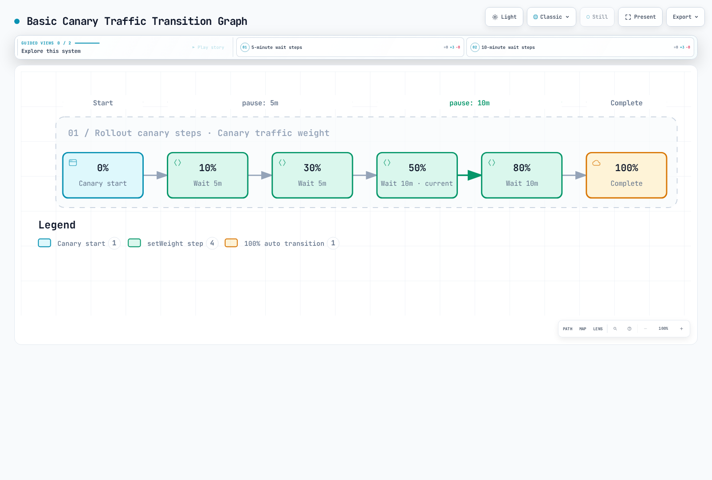
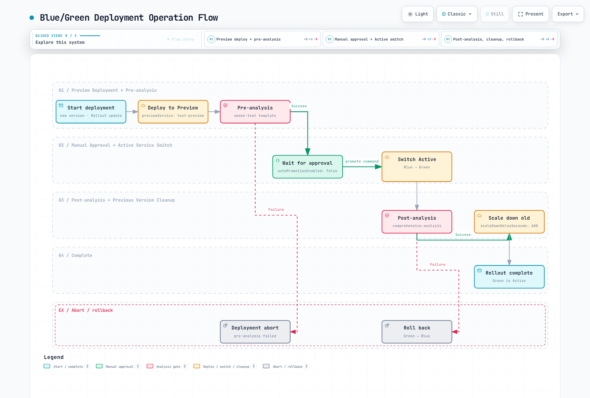

# Argo Rollouts 与 Istio 集成

> **验证基线**：Argo Rollouts 1.10.1、Istio 1.31.0、Kubernetes 1.32–1.37
> **最近审阅**：2026 年 10 月 16 日
> **难度**：高级

在渐进式交付过程中，Argo Rollouts 协调副本选择和 Istio 流量权重。必须配置分析并提供可信的观测数据；仅安装这两个控制器并不会建立自动质量门禁，也不能保证可用性。

## 目录

1. [概述](#overview)
2. [架构](#architecture)
3. [核心概念](#core-concepts)
4. [安装与配置](#setup-and-configuration)
5. [流量路由策略](#traffic-routing-strategies)
6. [分析与指标](#analysis-and-metrics)
7. [高级部署模式](#advanced-deployment-patterns)
8. [故障排除](#troubleshooting)
9. [最佳实践](#best-practices)

## 概述 {#overview}

Canary 逐步转移符合路由条件的流量；蓝绿部署则更改活动 Service 的选择器。已配置的分析可以让更新继续、终止或暂停。流量规则传播、就绪状态、额外副本容量、长连接以及应用与数据的兼容性，仍然决定用户实际感受到的结果。


[查看交互式图表](https://www.atomai.click/kubernetes-docs/archmaps/en-service-mesh-istio-advanced-08-argo-rollouts-0.html)

图表以已配置分析为前提。更新期间，终止操作可以将受管理的流量转回稳定版本，但不会回退 Git 中期望使用的镜像。Argo Rollouts 也支持其他流量路由器集成；每种集成都有各自的实现方式和维护状态。

## 架构 {#architecture}

Argo CD/GitOps 是可选组件。Rollouts 控制器读取 Rollout/Analysis 资源，并更新已配置的 Service 或 DestinationRule 子集标签以及 VirtualService 权重。Istiod 将这些资源转换为代理配置。请求先经过 Envoy，再到达应用端点；VirtualService 和 DestinationRule 对象是配置，并非网络路径上的转发节点。

Prometheus 抓取相关代理的指标，分析提供程序则查询 Prometheus。控制器根据返回的 AnalysisRun 阶段采取行动。只有经过已配置的网格代理或网关的流量才遵循 Istio 流量拆分。网格外的客户端，或直接访问 Pod、使用端口转发的连接，都可能绕过拆分规则。

## 核心概念 {#core-concepts}

### 1. Rollout 资源

Rollout 通过 Canary 或蓝绿策略管理 ReplicaSet。它拥有独立于 Deployment 的 API，并不是将带有 `strategy: RollingUpdate` 的 Deployment 简单改名。迁移现有 Deployment 需要经过审查的迁移或 workloadRef 方案；不要让两个控制器管理同一组 Pod。

### 2. VirtualService 的管理权限

Rollouts 协调已配置的命名路由权重，并可能添加或移除由它管理的实验目标。它会保留受支持的路由字段，而不是直接覆盖整个目标数组。额外的子集目标需要配置 `additionalSubsetNames`，且总权重必须有效；未受管理的目标可能被移除。每条受管理路由应只由一个 Rollout 管理，并与 GitOps 协调字段的管理权限。

### 3. 主机级与子集级流量拆分

| 方式 | 用户创建的资源 | Rollouts 协调的字段 |
|---|---|---|
| 主实验采用的主机级方式 | Rollout、stable/canary Service、VirtualService | Service 的哈希选择器和命名路由权重 |
| 可替代的子集级方式 | Rollout、一个 Service、VirtualService、DestinationRule | stable/canary 子集的哈希标签和命名路由权重 |

不要手动填入 ReplicaSet 哈希占位值。在主机级拆分中，控制器向两个 Service 的选择器添加 `rollouts-pod-template-hash`。在子集级拆分中，控制器向指定的 DestinationRule 子集标签添加哈希；单个 Service 则继续选择整个工作负载。

以下是**独立的子集级替代方案**，不是主机级实验的附加配置。它的 Service 和 VirtualService 都使用 `test`：

```yaml
apiVersion: v1
kind: Service
metadata:
  name: test
  namespace: rollouts-demo
spec:
  selector:
    app: test
  ports:
  - name: http
    port: 8080
    targetPort: http
---
apiVersion: networking.istio.io/v1
kind: VirtualService
metadata:
  name: test-subsets
  namespace: rollouts-demo
spec:
  hosts:
  - test
  - test.rollouts-demo.svc.cluster.local
  http:
  - name: primary
    route:
    - destination:
        host: test
        port:
          number: 8080
        subset: stable
      weight: 100
    - destination:
        host: test
        port:
          number: 8080
        subset: canary
      weight: 0
    retries:
      attempts: 0
---
apiVersion: networking.istio.io/v1
kind: DestinationRule
metadata:
  name: test-subsets
  namespace: rollouts-demo
spec:
  host: test
  subsets:
  - name: stable
    labels:
      app: test
  - name: canary
    labels:
      app: test
```

使用以下片段替换主 Rollout 的 Canary 策略，保留实际工作负载和 Pod 模板。采用这一替代方案时，应省略主机级配置中的 `stableService`/`canaryService` 字段：

```yaml
spec:
  strategy:
    canary:
      trafficRouting:
        istio:
          virtualService:
            name: test-subsets
            routes:
            - primary
          destinationRule:
            name: test-subsets
            canarySubsetName: canary
            stableSubsetName: stable
      steps:
      - setWeight: 10
      - pause: {}
```

控制器写入不同哈希之前，两个相同或为空的子集选择器无法隔离不同版本。发送测试流量前，应确认控制器更新后的标签和就绪状态。子集不会自动对应一个独立的 `destination_service_name`；此方案的分析需要经过验证的版本或工作负载遥测数据。 `destination_workload_label_rollouts_pod_template_hash` **不是 Istio 默认的指标标签**。

### 4. 分析结果

Prometheus 返回一个向量。访问 `result[0]` 之前，应检查向量长度及其值是否有限。仅设置 `successCondition` 时，条件为假代表本次测量失败；提供程序或表达式报错属于另外的错误。如果同时设置成功和失败条件，但两者均未匹配，则本次测量的结果为无法判定。

`failureLimit: 2` 允许两次测量失败，并在第三次失败时判定失败（`failed > failureLimit`）。因此，配合该上限设置 `count: 5` 并不要求五次测量全部成功。主示例使用 `failureLimit: 0`，缺失或非有限数据也会导致失败，同时还要求最低观测流量。下文的阈值和采样次数仅为示例，不代表统计置信度，也不保证生产环境的 SLO。

## 安装与配置 {#setup-and-configuration}

### 前提条件与适用范围

安装匹配的 Rollouts 控制器、CRD 和 CLI 插件，兼容的 Istio Sidecar 数据平面，以及可正常抓取指标的 Prometheus 配置；分析提供程序还必须具备所需的 DNS、RBAC 和网络访问权限。参阅[可观测性指南](../observability/README.md)和[注入指南](07-sidecar-injection.md)。启用分析前，应验证实际指标。

这个隔离的 HTTP 演示使用按摘要固定的官方蓝绿演示镜像。已验证的镜像**仅支持 Linux amd64**，因此 Pod 模板选择该架构。若使用 Arm64/Graviton，应提供经过独立测试的 Arm64 或多平台应用镜像。本次审查未测试集群、镜像运行情况、生产负载或实际发布过程。

示例创建一个新的 `rollouts-demo` 命名空间，并使用默认的传统 Sidecar 注入方式。若 Istio 按修订版本安装，应改为选择实际安装的修订版本或标签，同时遵循链接指南中的注入规则。

### 1. 命名空间与 Rollout

```yaml
apiVersion: v1
kind: Namespace
metadata:
  name: rollouts-demo
  labels:
    istio-injection: enabled
---
apiVersion: argoproj.io/v1alpha1
kind: Rollout
metadata:
  name: test
  namespace: rollouts-demo
spec:
  replicas: 3
  revisionHistoryLimit: 2
  selector:
    matchLabels:
      app: test
  template:
    metadata:
      labels:
        app: test
    spec:
      nodeSelector:
        kubernetes.io/os: linux
        kubernetes.io/arch: amd64
      terminationGracePeriodSeconds: 45
      containers:
      - name: app
        image: argoproj/rollouts-demo@sha256:3225193a6415b14b3fcdd160c40248b2bfd62f8c77326480559b91a41ced6e20
        ports:
        - name: http
          containerPort: 8080
        readinessProbe:
          httpGet:
            path: /
            port: http
          initialDelaySeconds: 3
          periodSeconds: 5
          timeoutSeconds: 1
        resources:
          requests:
            cpu: 100m
            memory: 128Mi
          limits:
            cpu: 200m
            memory: 256Mi
  strategy:
    canary:
      stableService: test-stable
      canaryService: test-canary
      maxSurge: 1
      maxUnavailable: 0
      trafficRouting:
        istio:
          virtualService:
            name: test
            routes:
            - primary
      steps:
      - setWeight: 10
      - pause:
          duration: 5m
      - analysis:
          templates:
          - templateName: success-rate
          args:
          - name: service-name
            value: test-canary
          - name: namespace
            value: rollouts-demo
      - setWeight: 50
      - pause:
          duration: 5m
      - analysis:
          templates:
          - templateName: success-rate
          args:
          - name: service-name
            value: test-canary
          - name: namespace
            value: rollouts-demo
      - setWeight: 80
      - pause:
          duration: 5m
      - analysis:
          templates:
          - templateName: success-rate
          args:
          - name: service-name
            value: test-canary
          - name: namespace
            value: rollouts-demo
```

镜像、CPU/内存设置及副本数都是演示输入。45 秒的终止宽限期用于容纳演示应用文档中描述的关闭延迟；实际发布时，应验证应用自身的生命周期。该策略有意在主 VirtualService 路由上禁用网格重试，并在预热暂停之后执行内联分析。

### 2. Stable/Canary Service

```yaml
apiVersion: v1
kind: Service
metadata:
  name: test-stable
  namespace: rollouts-demo
spec:
  selector:
    app: test
  ports:
  - name: http
    port: 8080
    targetPort: http
---
apiVersion: v1
kind: Service
metadata:
  name: test-canary
  namespace: rollouts-demo
spec:
  selector:
    app: test
  ports:
  - name: http
    port: 8080
    targetPort: http
```

Rollouts 管理其添加到各个 Service 的哈希选择器。不要额外设置固定的 `version: v1` 选择器，否则 stable Service 将无法选择新晋升的版本。

### 3. VirtualService

```yaml
apiVersion: networking.istio.io/v1
kind: VirtualService
metadata:
  name: test
  namespace: rollouts-demo
spec:
  hosts:
  - test-stable
  - test-stable.rollouts-demo.svc.cluster.local
  http:
  - name: primary
    route:
    - destination:
        host: test-stable
        port:
          number: 8080
      weight: 100
    - destination:
        host: test-canary
        port:
          number: 8080
      weight: 0
    retries:
      attempts: 0
```

这里采用**网格内 HTTP 路由**，不假设存在入口 Gateway。应从已注入 Sidecar 的客户端持续向 `http://test-stable.rollouts-demo.svc.cluster.local:8080/color` 发送测试流量。直接调用 canary Service、转发 Pod 端口或使用网格外的客户端，都无法验证加权路由。

### 4. AnalysisTemplate 与数据约定

示例使用 `reporter="source"` 和目标 Service 的命名空间查询标准的 Service 级指标。其前提是：对于该数据集，源代理只被抓取一次，且实际指标标签值与选择条件匹配。

整个发布过程中都应持续发送真实测试流量。五分钟的预热时间长于两分钟的回看窗口，避免上一组选择器的数据混入第一个分析门禁。最低流量检查通过计数器增量估算请求量，不能证明统计显著性。流量不足或遥测数据缺失时，不应在没有提示的情况下晋升版本。

```yaml
apiVersion: argoproj.io/v1alpha1
kind: AnalysisTemplate
metadata:
  name: success-rate
  namespace: rollouts-demo
spec:
  args:
  - name: service-name
  - name: namespace
  metrics:
  - name: request-volume
    interval: 30s
    successCondition: len(result) == 1 && !isNaN(result[0]) && !isInf(result[0]) && result[0] >= 20
    failureLimit: 0
    provider:
      prometheus:
        address: http://prometheus.istio-system.svc.cluster.local:9090
        query: sum(increase(istio_requests_total{reporter="source",destination_service_name="{{args.service-name}}",destination_service_namespace="{{args.namespace}}"}[2m]))
    count: 5
  - name: http-availability
    interval: 30s
    successCondition: len(result) == 1 && !isNaN(result[0]) && !isInf(result[0]) && result[0] >= 0.95
    failureLimit: 0
    provider:
      prometheus:
        address: http://prometheus.istio-system.svc.cluster.local:9090
        query: |-
          (sum(rate(istio_requests_total{reporter="source",destination_service_name="{{args.service-name}}",destination_service_namespace="{{args.namespace}}",response_code!~"5..|0"}[2m])) or vector(0))
          /
          sum(rate(istio_requests_total{reporter="source",destination_service_name="{{args.service-name}}",destination_service_namespace="{{args.namespace}}"}[2m]))
    count: 5
```

可用性计算计入非 5xx、非零的 HTTP 响应，包括 4xx；它不能证明业务请求成功。这里是 HTTP 演示，并非基于 gRPC 状态的 SLO。解读结果时，还应考虑重复抓取、延迟、计数器重置以及时间窗口重叠。

### 部署流程

将审查后的资源保存为独立文件，并在创建 Rollout 之前创建其依赖资源：

```bash
kubectl argo rollouts lint -f rollout.yaml
kubectl apply -f namespace.yaml
kubectl apply -f analysis-templates.yaml -f services.yaml -f virtualservice.yaml
kubectl apply -f rollout.yaml

kubectl argo rollouts get rollout test -n rollouts-demo --watch
```

首次创建会建立稳定版本；在持续发送测试流量时，通过随后更换镜像来验证 Canary 策略。在 GitOps 管理的环境中，应在 Git 中修改期望镜像。以下直接执行 CLI 的命令是实验环境中的替代操作：

```bash
kubectl argo rollouts set image test app=argoproj/rollouts-demo@sha256:e32df3d15f759d36c323b3dccb7003d38df1a4274d37217715151f085c24c58f -n rollouts-demo
kubectl argo rollouts get rollout test -n rollouts-demo --watch

# Choose the action appropriate to the observed state; do not run these as a sequence.
kubectl argo rollouts promote test -n rollouts-demo
kubectl argo rollouts abort test -n rollouts-demo
kubectl argo rollouts retry rollout test -n rollouts-demo
```

Promote 用于恢复预期的暂停，不能替代对分析失败原因的调查。Abort 不会更改期望的 Pod 模板。执行 retry/undo 前，应先协调期望版本，尤其是另一个 GitOps 控制器可能将它恢复时。

## 流量路由策略 {#traffic-routing-strategies}

本节中的所有片段都是**主 Canary 策略的替代方案**。应将其与现有 Service、流量路由引用和工作负载模板合并；不要将这些片段作为独立资源应用。

### 1. 基于权重的 Canary

`setWeight` 和 `pause` 应放在不同的步骤对象中。百分比是路由目标，并不保证小样本中出现精确比例。会话亲和性和长时间请求也可能改变观测到的分布。



[查看交互式图表](https://www.atomai.click/kubernetes-docs/archmaps/en-service-mesh-istio-advanced-08-argo-rollouts-4.html)

### 2. 受管理的请求头路由

使用 `managedRoutes`/`setHeaderRoute`，让 Rollouts 可以调整其生成路由的顺序并移除这些路由。在仅按请求头路由的阶段，先提供一个 Canary 副本，再将副本扩缩容交回流量权重控制：

```yaml
spec:
  strategy:
    canary:
      trafficRouting:
        managedRoutes:
        - name: beta-header
        istio:
          virtualService:
            name: test
            routes:
            - primary
      steps:
      - setCanaryScale:
          replicas: 1
      - setWeight: 0
      - setHeaderRoute:
          name: beta-header
          match:
          - headerName: x-beta-user
            headerValue:
              exact: 'true'
      - pause:
          duration: 5m
      - setHeaderRoute:
          name: beta-header
      - setCanaryScale:
          matchTrafficWeight: true
      - setWeight: 10
      - pause: {}
```

1.10 版本生成此请求头路由时，不会复制主路由的重试策略。此片段仅适用于幂等的演示请求，并且应检查实际生成的路由；它不会强制使用只读方法，也不保证写入请求不会重试。处理写入的部署需要单独设计、控制并验证重试和授权机制。

`x-beta-user` 请求头不代表经过身份验证的测试人员身份。如果必须限制访问范围，应使用可信的身份验证边界。手动创建、未列入 Rollouts 受管理路由列表的请求头路由，不会在终止或完成发布时自动消失，仍可能继续将流量送到 Canary 端点。

### 3. 受管理的镜像流量

示例仅镜像 GET 请求，在影子测试阶段仍由稳定路由返回用户响应，并在开始常规 Canary 流量之前移除镜像：

```yaml
spec:
  strategy:
    canary:
      trafficRouting:
        managedRoutes:
        - name: shadow-read
        istio:
          virtualService:
            name: test
            routes:
            - primary
      steps:
      - setCanaryScale:
          replicas: 1
      - setWeight: 0
      - setMirrorRoute:
          name: shadow-read
          percentage: 10
          match:
          - method:
              exact: GET
      - pause:
          duration: 5m
      - setMirrorRoute:
          name: shadow-read
      - setCanaryScale:
          matchTrafficWeight: true
      - setWeight: 10
      - pause: {}
```

生成的镜像路由同样不会继承主路由的重试策略；应检查实际生效的网格默认值。镜像响应虽被丢弃，请求仍会执行。即使是 GET 也可能在应用中产生副作用；应验证其语义，并按需隔离数据和依赖。镜像会增加资源与网络负载，不能保证对用户完全没有影响。应确认镜像请求实际使用的 Host，以及应用是否接受这些请求。

### 4. 多个命名路由

```yaml
apiVersion: networking.istio.io/v1
kind: VirtualService
metadata:
  name: test
  namespace: rollouts-demo
spec:
  hosts:
  - test-stable
  - test-stable.rollouts-demo.svc.cluster.local
  http:
  - name: api-route
    match:
    - uri:
        exact: /api
    - uri:
        prefix: /api/
    route:
    - destination:
        host: test-stable
        port:
          number: 8080
      weight: 100
    - destination:
        host: test-canary
        port:
          number: 8080
      weight: 0
    retries:
      attempts: 0
  - name: web-route
    match:
    - uri:
        exact: /web
    - uri:
        prefix: /web/
    route:
    - destination:
        host: test-stable
        port:
          number: 8080
      weight: 100
    - destination:
        host: test-canary
        port:
          number: 8080
      weight: 0
    retries:
      attempts: 0
---
spec:
  strategy:
    canary:
      trafficRouting:
        istio:
          virtualService:
            name: test
            routes:
            - api-route
            - web-route
      steps:
      - setWeight: 10
      - pause: {}
```

两个命名路由采用相同的 Canary 目标权重。匹配边界分别覆盖 `/api` 和 `/api/…`，避免匹配无关前缀。对于这些路径以外的请求，需要显式设计路由。

## 分析与指标 {#analysis-and-metrics}

以下上游历史截图展示 Service 级指标的区分，并非集成架构图，也不是当前性能基准：


### 1. 内联分析

主 Rollout 将 `success-rate` 作为内联步骤运行，并等待分析完成。每次调用都会传入两个必需参数。分析失败会终止发布；无法判定的结果可能让发布暂停。分析提供程序无法补足应用流量，也无法纠正错误的指标选择条件。

### 2. 持续后台分析

设置 `count: 5` 的后台模板完成有限次数的测量后就会停止。若需要持续运行的后台门禁，应省略 count：

```yaml
apiVersion: argoproj.io/v1alpha1
kind: AnalysisTemplate
metadata:
  name: success-rate-continuous
  namespace: rollouts-demo
spec:
  args:
  - name: service-name
  - name: namespace
  metrics:
  - name: request-volume
    interval: 30s
    successCondition: len(result) == 1 && !isNaN(result[0]) && !isInf(result[0]) && result[0] >= 20
    failureLimit: 0
    provider:
      prometheus:
        address: http://prometheus.istio-system.svc.cluster.local:9090
        query: sum(increase(istio_requests_total{reporter="source",destination_service_name="{{args.service-name}}",destination_service_namespace="{{args.namespace}}"}[2m]))
  - name: http-availability
    interval: 30s
    successCondition: len(result) == 1 && !isNaN(result[0]) && !isInf(result[0]) && result[0] >= 0.95
    failureLimit: 0
    provider:
      prometheus:
        address: http://prometheus.istio-system.svc.cluster.local:9090
        query: |-
          (sum(rate(istio_requests_total{reporter="source",destination_service_name="{{args.service-name}}",destination_service_namespace="{{args.namespace}}",response_code!~"5..|0"}[2m])) or vector(0))
          /
          sum(rate(istio_requests_total{reporter="source",destination_service_name="{{args.service-name}}",destination_service_namespace="{{args.namespace}}"}[2m]))
---
spec:
  strategy:
    canary:
      analysis:
        templates:
        - templateName: success-rate-continuous
        startingStep: 2
        args:
        - name: service-name
          value: test-canary
        - name: namespace
          value: rollouts-demo
      steps:
      - setWeight: 10
      - pause:
          duration: 5m
      - setWeight: 30
      - pause:
          duration: 5m
      - setWeight: 50
      - pause: {}
```

`startingStep: 2` 从零开始计数，对应此片段的第三个步骤（`setWeight: 30`）。前面的暂停用于预热两分钟的数据窗口。分析与后续步骤并行运行，直到发布过程将其终止或完成，或触发失败条件。它并不保证即时完成端到端回滚。

### 3. 复合指标

这个更严格的替代方案要求满足请求量条件、非 5xx/非零响应可用性达到 99%、p95 不超过 0.5 秒且错误率不超过 1%。此处的可用性与错误率检查相互补充；这些示例值仍需根据具体工作负载说明其合理性。

```yaml
apiVersion: argoproj.io/v1alpha1
kind: AnalysisTemplate
metadata:
  name: comprehensive-analysis
  namespace: rollouts-demo
spec:
  args:
  - name: service-name
  - name: namespace
  metrics:
  - name: request-volume
    interval: 30s
    successCondition: len(result) == 1 && !isNaN(result[0]) && !isInf(result[0]) && result[0] >= 20
    failureLimit: 0
    provider:
      prometheus:
        address: http://prometheus.istio-system.svc.cluster.local:9090
        query: sum(increase(istio_requests_total{reporter="source",destination_service_name="{{args.service-name}}",destination_service_namespace="{{args.namespace}}"}[2m]))
    count: 5
  - name: http-availability
    interval: 30s
    successCondition: len(result) == 1 && !isNaN(result[0]) && !isInf(result[0]) && result[0] >= 0.99
    failureLimit: 0
    provider:
      prometheus:
        address: http://prometheus.istio-system.svc.cluster.local:9090
        query: |-
          (sum(rate(istio_requests_total{reporter="source",destination_service_name="{{args.service-name}}",destination_service_namespace="{{args.namespace}}",response_code!~"5..|0"}[2m])) or vector(0))
          /
          sum(rate(istio_requests_total{reporter="source",destination_service_name="{{args.service-name}}",destination_service_namespace="{{args.namespace}}"}[2m]))
    count: 5
  - name: latency-p95
    interval: 30s
    successCondition: len(result) == 1 && !isNaN(result[0]) && !isInf(result[0]) && result[0] <= 0.5
    failureLimit: 0
    provider:
      prometheus:
        address: http://prometheus.istio-system.svc.cluster.local:9090
        query: |-
          histogram_quantile(0.95,
            sum by (le) (rate(istio_request_duration_milliseconds_bucket{reporter="source",destination_service_name="{{args.service-name}}",destination_service_namespace="{{args.namespace}}"}[2m]))
          ) / 1000
    count: 5
  - name: http-error-rate
    interval: 30s
    successCondition: len(result) == 1 && !isNaN(result[0]) && !isInf(result[0]) && result[0] <= 0.01
    failureLimit: 0
    provider:
      prometheus:
        address: http://prometheus.istio-system.svc.cluster.local:9090
        query: |-
          (sum(rate(istio_requests_total{reporter="source",destination_service_name="{{args.service-name}}",destination_service_namespace="{{args.namespace}}",response_code=~"5..|0"}[2m])) or vector(0))
          /
          sum(rate(istio_requests_total{reporter="source",destination_service_name="{{args.service-name}}",destination_service_namespace="{{args.namespace}}"}[2m]))
    count: 5
```

Istio 的请求时长直方图以毫秒为单位，因此查询在与秒比较前除以 1000。表达式会检查即时向量是否为空、是否包含多个值，以及是否存在 NaN/Inf。相互重叠的回看窗口并不会形成独立的统计样本。

### 4. 部署前后检查

Canary 只有一个后台 `analysis` 字段。在同一个 YAML 对象中写入两个 `analysis` 键，不能实现部署前后检查。应在预期位置使用显式内联分析步骤，并满足相应的流量与前提条件；也可以使用下方蓝绿策略的 `prePromotionAnalysis` 和 `postPromotionAnalysis` 钩子。

## 高级部署模式 {#advanced-deployment-patterns}

### 1. 蓝绿部署

这是**独立的策略蓝图**。复用已审查的工作负载模板，但替换 Canary 策略和面向客户端的 Service 引用。运行之前，应创建 active 和 preview Service：

```yaml
apiVersion: v1
kind: Service
metadata:
  name: test-active
  namespace: rollouts-demo
spec:
  selector:
    app: test
  ports:
  - name: http
    port: 8080
    targetPort: http
---
apiVersion: v1
kind: Service
metadata:
  name: test-preview
  namespace: rollouts-demo
spec:
  selector:
    app: test
  ports:
  - name: http
    port: 8080
    targetPort: http
---
spec:
  strategy:
    blueGreen:
      activeService: test-active
      previewService: test-preview
      autoPromotionEnabled: false
      prePromotionAnalysis:
        templates:
        - templateName: smoke-test
        args:
        - name: service-name
          value: test-preview
        - name: namespace
          value: rollouts-demo
      postPromotionAnalysis:
        templates:
        - templateName: post-promotion-analysis
        args:
        - name: service-name
          value: test-active
        - name: namespace
          value: rollouts-demo
      scaleDownDelaySeconds: 600
---
apiVersion: networking.istio.io/v1
kind: VirtualService
metadata:
  name: test-bluegreen
  namespace: rollouts-demo
spec:
  hosts:
  - test-active
  - test-active.rollouts-demo.svc.cluster.local
  http:
  - name: active
    route:
    - destination:
        host: test-active
        port:
          number: 8080
      weight: 100
    retries:
      attempts: 0
---
apiVersion: argoproj.io/v1alpha1
kind: AnalysisTemplate
metadata:
  name: post-promotion-analysis
  namespace: rollouts-demo
spec:
  args:
  - name: service-name
  - name: namespace
  metrics:
  - name: request-volume
    interval: 30s
    successCondition: len(result) == 1 && !isNaN(result[0]) && !isInf(result[0]) && result[0] >= 20
    failureLimit: 0
    provider:
      prometheus:
        address: http://prometheus.istio-system.svc.cluster.local:9090
        query: sum(increase(istio_requests_total{reporter="source",destination_service_name="{{args.service-name}}",destination_service_namespace="{{args.namespace}}"}[2m]))
    count: 5
    initialDelay: 5m
  - name: http-availability
    interval: 30s
    successCondition: len(result) == 1 && !isNaN(result[0]) && !isInf(result[0]) && result[0] >= 0.99
    failureLimit: 0
    provider:
      prometheus:
        address: http://prometheus.istio-system.svc.cluster.local:9090
        query: |-
          (sum(rate(istio_requests_total{reporter="source",destination_service_name="{{args.service-name}}",destination_service_namespace="{{args.namespace}}",response_code!~"5..|0"}[2m])) or vector(0))
          /
          sum(rate(istio_requests_total{reporter="source",destination_service_name="{{args.service-name}}",destination_service_namespace="{{args.namespace}}"}[2m]))
    count: 5
    initialDelay: 5m
  - name: latency-p95
    interval: 30s
    successCondition: len(result) == 1 && !isNaN(result[0]) && !isInf(result[0]) && result[0] <= 0.5
    failureLimit: 0
    provider:
      prometheus:
        address: http://prometheus.istio-system.svc.cluster.local:9090
        query: |-
          histogram_quantile(0.95,
            sum by (le) (rate(istio_request_duration_milliseconds_bucket{reporter="source",destination_service_name="{{args.service-name}}",destination_service_namespace="{{args.namespace}}"}[2m]))
          ) / 1000
    count: 5
    initialDelay: 5m
  - name: http-error-rate
    interval: 30s
    successCondition: len(result) == 1 && !isNaN(result[0]) && !isInf(result[0]) && result[0] <= 0.01
    failureLimit: 0
    provider:
      prometheus:
        address: http://prometheus.istio-system.svc.cluster.local:9090
        query: |-
          (sum(rate(istio_requests_total{reporter="source",destination_service_name="{{args.service-name}}",destination_service_namespace="{{args.namespace}}",response_code=~"5..|0"}[2m])) or vector(0))
          /
          sum(rate(istio_requests_total{reporter="source",destination_service_name="{{args.service-name}}",destination_service_namespace="{{args.namespace}}"}[2m]))
    count: 5
    initialDelay: 5m
```

应用自身的 `smoke-test` AnalysisTemplate 是必须实现并验证的前提，本指南未提供该模板。它必须声明 `service-name`/`namespace` 参数，并使用合适的身份、网络访问权限和功能断言测试预览版本。晋升后的模板先等待五分钟，再查询两分钟窗口；应验证规则传播情况，并持续向 `test-active` 发送流量，不要假设旧连接和旧数据会立即消失。不要将此片段视为完整、可直接运行的冒烟测试部署。

`autoPromotionEnabled` 默认值为 true；示例显式将其禁用。 `scaleDownDelaySeconds` 用于延迟缩减旧 ReplicaSet，而不是删除全部修订历史或迁移现有连接。Service/端点传播及上游负载均衡器的行为仍可能造成中断。



[查看交互式图表](https://www.atomai.click/kubernetes-docs/archmaps/en-service-mesh-istio-advanced-08-argo-rollouts-6.html)

### 2. 加权实验

Istio 支持带流量路由的实验。这里有效的 `specRef` 值为 `stable` 和 `canary`；不存在 `experimental` 源版本：

```yaml
spec:
  strategy:
    canary:
      steps:
      - experiment:
          duration: 10m
          templates:
          - name: baseline
            specRef: stable
            weight: 5
          - name: candidate
            specRef: canary
            weight: 5
      - setWeight: 10
      - pause: {}
```

在第一个实验步骤中，控制器创建实验用的 ReplicaSet 和 Service，并分别向它们分配 5% 的流量，其余 90% 仍发送到稳定目标。实验 Pod 的哈希与父 Rollout 的哈希不同。此片段安排十分钟的流量暴露，但单凭它无法进行统计上有效的比较。应添加实际的比较 AnalysisTemplate，并在参数中使用实验自身生成的标识和 Service。

### 3. 缓慢的渐进式发布

```yaml
spec:
  strategy:
    canary:
      steps:
      - setWeight: 1
      - pause:
          duration: 1h
      - setWeight: 5
      - pause:
          duration: 1h
      - setWeight: 10
      - pause:
          duration: 2h
      - setWeight: 25
      - pause:
          duration: 4h
      - setWeight: 50
      - pause:
          duration: 8h
      - setWeight: 75
      - pause:
          duration: 8h
      analysis:
        templates:
        - templateName: success-rate-continuous
        startingStep: 2
        args:
        - name: service-name
          value: test-canary
        - name: namespace
          value: rollouts-demo
```

列出的暂停合计 24 小时，另需加上就绪等待、分析和规则传播时间。较长的时间表不能替代有代表性的流量、故障检测、容量以及经过审查的恢复流程。

## 故障排除 {#troubleshooting}

检查对应命名空间的资源以及实际代理路由：

```bash
kubectl argo rollouts get rollout test -n rollouts-demo
kubectl describe rollout test -n rollouts-demo
kubectl get virtualservice test -n rollouts-demo -o yaml
kubectl get services test-stable test-canary -n rollouts-demo -o yaml
kubectl get pods -n rollouts-demo -l app=test --show-labels
kubectl get endpointslices -n rollouts-demo -l kubernetes.io/service-name=test-canary
istioctl proxy-config routes <client-pod> -n rollouts-demo
istioctl proxy-config clusters <client-pod> -n rollouts-demo
kubectl get analysisruns -n rollouts-demo
kubectl logs -n argo-rollouts deployment/argo-rollouts
```

如果权重没有更新，应检查 RBAC、引用的路由名称、控制器事件，以及相互竞争的 GitOps 写入。如果 Canary 没有收到流量，应确认 Service/子集哈希选择器、已就绪的 EndpointSlice、客户端或网关实际经过的网格路径，以及样本量。

分析失败时，应查看 AnalysisRun 的测量值和消息，并对同一个 Prometheus 数据源运行完全相同的查询。应验证源端 reporter、命名空间与 Service 标签、流量、回看窗口，以及提供程序的身份验证和网络访问。还应区分阈值未满足、结果无法判定以及提供程序报错。

发布完成后，abort 不是用于回退历史版本的通用命令。应检查历史记录并恢复期望的模板和版本：

```bash
kubectl argo rollouts get rollout test -n rollouts-demo
kubectl argo rollouts undo test --to-revision=<reviewed-revision> -n rollouts-demo
```

采用 GitOps 时，也应在 Git 中更改并协调期望版本。保留的 ReplicaSet，以及数据库和 API 的兼容性，会限制 undo 能安全恢复的内容。

## 最佳实践 {#best-practices}

### GitOps 字段管理权限

Argo CD Application 可以仅忽略 Rollouts 管理的运行时字段，并在同步时遵循这些排除规则：

```yaml
spec:
  ignoreDifferences:
  - group: networking.istio.io
    kind: VirtualService
    name: test
    namespace: rollouts-demo
    jqPathExpressions:
    - .spec.http[] | select(.name == "primary") | .route[].weight
  - group: ''
    kind: Service
    name: test-stable
    namespace: rollouts-demo
    jqPathExpressions:
    - .spec.selector["rollouts-pod-template-hash"]
  - group: ''
    kind: Service
    name: test-canary
    namespace: rollouts-demo
    jqPathExpressions:
    - .spec.selector["rollouts-pod-template-hash"]
  syncPolicy:
    syncOptions:
    - RespectIgnoreDifferences=true
```

这是 Application 的 `spec` 片段，不是独立的 Application。首次创建资源时，权重和选择器仍须正确。采用子集路由时，还应将忽略的哈希标签限定到受管理的 DestinationRule 子集。对于受管理的请求头或镜像路由，应单独处理那些具有特定名称的运行时条目。不要忽略整个 VirtualService spec；主机、目标以及与安全相关的路由必须仍可供审查。

### 步骤、测量与容量

应根据请求量、风险和恢复时间选择百分比及暂停时长。不存在通用的 30 秒最小间隔、五次采样置信度标准，也没有要求最后一部分流量必须快速晋升的规则。每个 CanaryStep 只保留一个操作，并协调重试以及 schema/数据兼容性。

```yaml
spec:
  revisionHistoryLimit: 2
  progressDeadlineSeconds: 600
  progressDeadlineAbort: false
  template:
    spec:
      containers:
      - name: app
        resources:
          requests:
            cpu: 100m
            memory: 128Mi
          limits:
            cpu: 200m
            memory: 256Mi
```

`revisionHistoryLimit` 是历史保留设置，并非统一要求至少为二。 `progressDeadlineSeconds` 关注的是缺乏进展；暂停与分析生命周期需要分别理解。显式设置为 false 的 `progressDeadlineAbort` 不会在进展期限到期时自动终止发布。请求与限制之间的 2× 比例只是原示例的输入。

三个副本并不意味着每个可用区都有一个副本。如果需要按可用区分布，应使用经过审查的拓扑约束并提供相应容量；参阅[按可用区感知的 Argo Rollouts](09-zone-aware-argo-rollouts.md)。流量路由可能需要额外的 stable/canary 容量，不能只依赖简单的 surge 估算。PDB 影响主动驱逐，但不会涵盖所有故障或控制器驱动的缩容：

```yaml
apiVersion: policy/v1
kind: PodDisruptionBudget
metadata:
  name: test-pdb
  namespace: rollouts-demo
spec:
  minAvailable: 2
  selector:
    matchLabels:
      app: test
```

更新前，应检查控制器与 CRD、注入、DNS、镜像平台、Service 与路由、提供程序访问、指标标签以及持续测试流量。更新期间，应检查实际端点选择和 AnalysisRun 结果。晋升后，应验证期望镜像、受管理的权重、端点就绪状态，以及旧 ReplicaSet 的缩容和保留行为，不要预期每个旧 ReplicaSet 都会被删除。

## 参考资料

- [Argo Rollouts 与 Istio 集成](https://argoproj.github.io/argo-rollouts/features/traffic-management/istio/)
- [分析生命周期](https://argoproj.github.io/argo-rollouts/features/analysis/)
- [Prometheus 提供程序](https://argoproj.github.io/argo-rollouts/analysis/prometheus/)
- [流量路由与受管理的路由](https://argoproj.github.io/argo-rollouts/features/traffic-management/)
- [蓝绿部署](https://argoproj.github.io/argo-rollouts/features/bluegreen/)
- [实验](https://argoproj.github.io/argo-rollouts/features/experiment/)
- [Rollout 规范](https://argoproj.github.io/argo-rollouts/features/specification/)
- [Rollouts 常见问题](https://argoproj.github.io/argo-rollouts/FAQ/)
- [已发布的 1.10 版 Istio 协调器](https://raw.githubusercontent.com/argoproj/argo-rollouts/v1.10.1/rollout/trafficrouting/istio/istio.go)
- [已发布的 1.10 版分析失败判定代码](https://raw.githubusercontent.com/argoproj/argo-rollouts/v1.10.1/analysis/analysis.go)
- [Argo CD 同步选项源码](https://raw.githubusercontent.com/argoproj/argo-cd/master/docs/user-guide/sync-options.md)
- [流量拆分](../traffic-management/04-traffic-splitting.md)
- [VirtualService](../traffic-management/01-gateway-virtualservice.md)
- [DestinationRule](../traffic-management/03-destination-rule.md)
