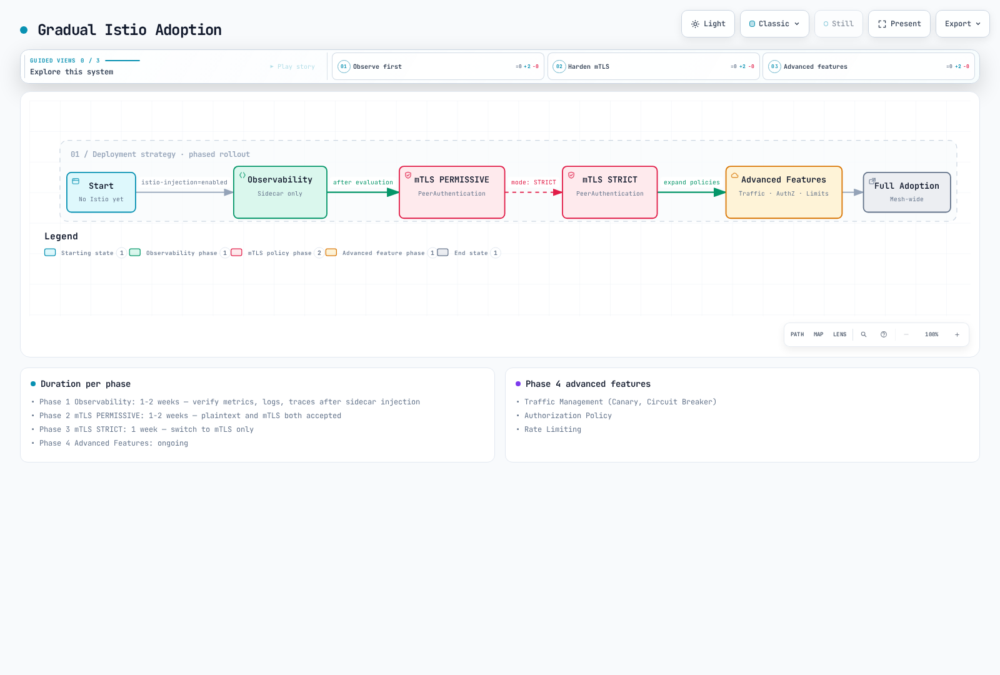

# Istio 最佳实践

本文档涵盖在生产环境中成功运行 Istio 的最佳实践和建议。

## 目录

1. [性能优化](#performance-optimization)
2. [安全加固](#security-hardening)
3. [运维指南](#operations-guide)
4. [监控与可观测性](#monitoring-and-observability)
5. [生产检查清单](#production-checklist)

已于 2026 年 9 月 11 日针对 Istio 1.31 进行审核。`IstioOperator` 摘录是 `istioctl install -f` 的输入，而不是可使用 kubectl 应用的 Kubernetes 资源。请将其合并到现有安装配置中；对于 Helm，请使用等效的 chart 值。大多数示例描述 Sidecar；对于 ambient，请使用 waypoint/Gateway API 策略。资源设置和滚动更新时间是应在负载下验证的起点。

## 性能优化

### 1. Control Plane 资源优化

```yaml
apiVersion: install.istio.io/v1alpha1
kind: IstioOperator
spec:
  components:
    pilot:
      k8s:
        resources:
          requests:
            cpu: 500m
            memory: 2Gi
          limits:
            cpu: 1000m
            memory: 4Gi
        hpaSpec:
          minReplicas: 2
          maxReplicas: 5
          metrics:
          - type: Resource
            resource:
              name: cpu
              target:
                type: Utilization
                averageUtilization: 80
```

**建议**：
- Istiod 至少应具有 2 个副本
- CPU：根据集群规模调整
- Memory：衡量 Service/Proxy 数量、配置大小和更新速率；没有固定的每 Service 计算公式

### 2. Data Plane 资源优化

```yaml
apiVersion: v1
kind: Pod
metadata:
  name: myapp
  labels:
    sidecar.istio.io/inject: "true"
  annotations:
    # Sidecar resource optimization
    sidecar.istio.io/proxyCPU: "100m"
    sidecar.istio.io/proxyMemory: "128Mi"
    sidecar.istio.io/proxyCPULimit: "200m"
    sidecar.istio.io/proxyMemoryLimit: "256Mi"
spec:
  containers:
  - name: myapp
    image: myapp:latest
```

**建议**：
- 常规工作负载：CPU 100m，Memory 128Mi
- 高流量工作负载：CPU 500m，Memory 512Mi
- Sidecar 并发：通常保持未设置，以便 Istio 从 CPU requests/limits 推导工作线程

### 3. 连接池优化

```yaml
apiVersion: networking.istio.io/v1
kind: DestinationRule
metadata:
  name: optimized-pool
spec:
  host: myapp
  trafficPolicy:
    connectionPool:
      tcp:
        maxConnections: 100
        connectTimeout: 30ms
      http:
        http1MaxPendingRequests: 50
        http2MaxRequests: 100
        maxRequestsPerConnection: 0
        idleTimeout: 300s
```

**建议**：
- `maxConnections`：考虑工作负载的并发连接数
- `maxRequestsPerConnection`：0 表示无限制；较小的值会增加连接流失和 TLS 握手
- `idleTimeout`：若需要长生命周期连接，请增大此值

### 4. 本地性负载均衡

```yaml
apiVersion: networking.istio.io/v1
kind: DestinationRule
metadata:
  name: locality-lb
spec:
  host: myapp
  trafficPolicy:
    loadBalancer:
      localityLbSetting:
        enabled: true
        distribute:
        - from: us-east-1/us-east-1a/*
          to:
            "us-east-1/us-east-1a/*": 80  # Same AZ priority
            "us-east-1/us-east-1b/*": 20
    outlierDetection:
      consecutive5xxErrors: 5
      interval: 5s
      baseEjectionTime: 30s
```

**优势**：
- 有可能减少跨 AZ 流量；节省程度取决于流量分布和计费
- 降低网络延迟
- 使用异常检测及其他可用区中的健康容量验证故障转移

### 5. Sidecar 作用域限制

```yaml
apiVersion: networking.istio.io/v1
kind: Sidecar
metadata:
  name: default
  namespace: default
spec:
  egress:
  - hosts:
    - "default/*"
    - "istio-system/*"
```

**优势**：
- 减少 Envoy 配置大小
- 减少内存使用
- 加快配置推送

## 安全加固

### 1. 应用严格 mTLS

```yaml
apiVersion: security.istio.io/v1
kind: PeerAuthentication
metadata:
  name: default
  namespace: istio-system
spec:
  mtls:
    mode: STRICT  # STRICT recommended for production
```

**检查清单**：
- 对所有 Service 应用 STRICT mTLS
- 仅在迁移期间使用 PERMISSIVE
- PeerAuthentication 控制入站工作负载 mTLS。在 ServiceEntry 以及需要时在 DestinationRule 中配置外部 HTTPS/TLS；请勿全局禁用 mesh mTLS。

### 2. 授权策略

```yaml
# Deny by default
apiVersion: security.istio.io/v1
kind: AuthorizationPolicy
metadata:
  name: deny-all
  namespace: default
spec: {}  # Deny all requests
---
# Allow specific
apiVersion: security.istio.io/v1
kind: AuthorizationPolicy
metadata:
  name: allow-frontend
  namespace: default
spec:
  selector:
    matchLabels:
      app: backend
  action: ALLOW
  rules:
  - from:
    - source:
        principals: ["cluster.local/ns/default/sa/frontend"]
```

**最佳实践**：
- 使用默认拒绝策略
- 应用最小权限原则
- 基于 Service Account 的身份验证
- Namespace 隔离

### 3. 出站流量控制

```yaml
# Detect unregistered destinations; not an egress firewall
apiVersion: install.istio.io/v1alpha1
kind: IstioOperator
spec:
  meshConfig:
    outboundTrafficPolicy:
      mode: REGISTRY_ONLY  # Known Kubernetes services and ServiceEntries
```

使用 kubectl 单独应用此 ServiceEntry。使用网络控制实施出站隔离；REGISTRY_ONLY 不是安全边界。

```yaml
# Allowed external services
apiVersion: networking.istio.io/v1
kind: ServiceEntry
metadata:
  name: external-api
spec:
  hosts:
  - api.external.com
  ports:
  - number: 443
    name: https
    protocol: HTTPS
  location: MESH_EXTERNAL
  resolution: DNS
```

### 4. JWT 身份验证

```yaml
apiVersion: security.istio.io/v1
kind: RequestAuthentication
metadata:
  name: jwt-auth
spec:
  selector:
    matchLabels:
      app: api-service
  jwtRules:
  - issuer: "https://auth.example.com"
    jwksUri: "https://auth.example.com/.well-known/jwks.json"
---
apiVersion: security.istio.io/v1
kind: AuthorizationPolicy
metadata:
  name: require-jwt
spec:
  selector:
    matchLabels:
      app: api-service
  action: ALLOW
  rules:
  - when:
    - key: request.auth.claims[iss]
      values: ["https://auth.example.com"]
```

## 运维指南

### 1. 部署策略

#### 渐进式采用 Istio



[🔍 查看交互式图表](https://www.atomai.click/kubernetes-docs/archmaps/en-service-mesh-istio-best-practices-0.html)

**阶段 1：可观测性（1-2 周）**
```bash
# Enable sidecar injection only
kubectl label namespace default istio-injection=enabled --overwrite
kubectl rollout restart deployment -n default

# Verify metrics, logs, traces
# Evaluate performance impact
```

**阶段 2：mTLS PERMISSIVE（1-2 周）**
```yaml
# Enable PERMISSIVE mode
apiVersion: security.istio.io/v1
kind: PeerAuthentication
metadata:
  name: default
spec:
  mtls:
    mode: PERMISSIVE
```

**阶段 3：mTLS STRICT（1 周）**
```yaml
# Switch to STRICT mode
apiVersion: security.istio.io/v1
kind: PeerAuthentication
metadata:
  name: default
spec:
  mtls:
    mode: STRICT
```

**阶段 4：高级功能（持续进行）**
- 流量管理（Canary、Circuit Breaker）
- 授权策略
- 速率限制

### 2. 升级策略

#### Canary 升级

使用安装指南中的目标 1.31.0 istioctl 二进制文件；设置 revision 名称不会选择镜像版本。此示例从 1.30.4 升级，保留现有安装设置，并要求验证每个阶段。Gateway 可以通过默认 profile 原地升级；请明确规划其滚动更新。由 Helm 管理的安装必须使用 Helm 升级工作流。

```bash
# 1. Install new version Control Plane
istioctl install --set revision=1-31-0 -f existing-install.yaml

# 2. Move test namespace
kubectl label namespace test istio-injection- istio.io/rev=1-31-0 --overwrite
kubectl rollout restart deployment -n test

# 3. Move production after verification
kubectl label namespace prod istio-injection- istio.io/rev=1-31-0 --overwrite
kubectl rollout restart deployment -n prod

# 4. Remove previous version
istioctl proxy-status
# Only after every proxy/gateway has migrated; substitute the actual old revision
istioctl uninstall --revision=1-30-4
```

### 3. 高可用性

```yaml
# Control Plane HA
apiVersion: install.istio.io/v1alpha1
kind: IstioOperator
spec:
  components:
    pilot:
      k8s:
        hpaSpec:
          minReplicas: 3
          maxReplicas: 5
        affinity:
          podAntiAffinity:
            preferredDuringSchedulingIgnoredDuringExecution:
            - weight: 100
              podAffinityTerm:
                labelSelector:
                  matchLabels:
                    app: istiod
                topologyKey: topology.kubernetes.io/zone
```

**建议**：
- Istiod：至少 3 个副本
- 在各 AZ 间均匀分布
- 设置 PodDisruptionBudget

### 4. 备份与恢复

```bash
# Preserve the versioned installation input in source control
cp existing-install.yaml istio-install-backup.yaml
# Snapshot mesh configuration; this does not include Secrets or Gateway API resources
kubectl get virtualservices.networking.istio.io,destinationrules.networking.istio.io,gateways.networking.istio.io,serviceentries.networking.istio.io,sidecars.networking.istio.io,workloadentries.networking.istio.io,workloadgroups.networking.istio.io,peerauthentications.security.istio.io,requestauthentications.security.istio.io,authorizationpolicies.security.istio.io,telemetries.telemetry.istio.io -A -o yaml > istio-config-backup.yaml

# Restore the matching Istio version and CRDs first, then declarative resources
istioctl install -f istio-install-backup.yaml
kubectl apply -f istio-config-backup.yaml
```

对于 Helm 安装，请改为保留 chart 版本和 `helm get values <release> -n <namespace> -o yaml`。请安全备份 CA/TLS Secrets，并纳入正在使用的所有 Gateway API、EnvoyFilter 或 WasmPlugin 资源。重新创建必需的 Namespace，并在恢复前审查生成的快照。

## 监控与可观测性

### 1. 黄金信号

```promql
# 1. Latency (P50, P95, P99)
histogram_quantile(0.95,
  sum(rate(istio_request_duration_milliseconds_bucket{reporter="destination"}[5m])) by (le)
)

# 2. Traffic (Request count)
sum(rate(istio_requests_total{reporter="destination"}[5m]))

# 3. Errors (Error rate)
sum(rate(istio_requests_total{reporter="destination",response_code=~"5.."}[5m]))
/
sum(rate(istio_requests_total{reporter="destination"}[5m]))

# 4. Saturation (Resource utilization)
sum(rate(container_cpu_usage_seconds_total{container="istio-proxy"}[5m]))
```

### 2. Control Plane 监控

```promql
# Pilot configuration push time
histogram_quantile(0.95, sum(rate(pilot_proxy_convergence_time_bucket[5m])) by (le))

# xDS connection count
pilot_xds

# Memory usage
process_resident_memory_bytes{job="istiod"}
```

### 3. Data Plane 监控

确认已在 Proxy stats matcher 中启用这些 Envoy 统计指标。抓取作业标签取决于配置；示例假定 `job="istiod"`。`up` 告警检测抓取可用性，而非所有就绪失败。

```promql
# Envoy connection count
envoy_cluster_upstream_cx_active

# Circuit Breaker open
envoy_cluster_circuit_breakers_default_rq_open

# Outlier Detection
envoy_cluster_outlier_detection_ejections_active
```

### 4. 告警规则

```yaml
groups:
- name: istio
  rules:
  # High error rate
  - alert: HighErrorRate
    expr: |
      (sum(rate(istio_requests_total{reporter="destination",response_code=~"5.."}[5m]))
      /
      sum(rate(istio_requests_total{reporter="destination"}[5m]))) > 0.05
    for: 5m
    labels:
      severity: warning
    annotations:
      summary: "High error rate detected"

  # High latency
  - alert: HighLatency
    expr: |
      histogram_quantile(0.95,
        sum(rate(istio_request_duration_milliseconds_bucket{reporter="destination"}[5m])) by (le)
      ) > 1000
    for: 5m
    labels:
      severity: warning
    annotations:
      summary: "High latency detected (P95 > 1s)"

  # Pilot not ready
  - alert: IstiodScrapeUnavailable
    expr: up{job="istiod"} == 0 or absent(up{job="istiod"})
    for: 5m
    labels:
      severity: critical
    annotations:
      summary: "Istiod scrape target is unavailable"
```

## 生产检查清单

### 安装前

- [ ] 验证 Istio/Kubernetes/EKS 支持范围的重叠部分（1.31 示例：EKS 1.34–1.37）
- [ ] 选择 Istio 版本（建议使用稳定版本）
- [ ] 计算资源需求
- [ ] 审查网络策略
- [ ] 制定备份与恢复计划

### 安装

- [ ] 使用生产 profile
- [ ] 配置 Control Plane HA（副本数 >= 3）
- [ ] 设置资源限制
- [ ] 设置 PodDisruptionBudget
- [ ] 准备监控栈

### 安全

- [ ] 启用 mTLS STRICT 模式
- [ ] 应用 Authorization Policy
- [ ] 控制出站流量
- [ ] 配置 JWT 身份验证（如需要）
- [ ] 集成 Network Policy

### 流量管理

- [ ] 配置 VirtualService
- [ ] 配置 DestinationRule
- [ ] 设置 Circuit Breaker
- [ ] 设置 Retry/Timeout
- [ ] 配置 Rate Limiting

### 可观测性

- [ ] 集成 Prometheus
- [ ] 设置 Grafana 仪表板
- [ ] 设置 Jaeger/Zipkin 追踪
- [ ] 安装 Kiali
- [ ] 设置告警规则

### 运维

- [ ] 制定升级计划
- [ ] 自动化备份
- [ ] 文档
- [ ] 编写值班指南
- [ ] 准备 Runbook

### 性能

- [ ] 优化 Sidecar 资源
- [ ] 调优 Connection Pool
- [ ] 配置本地性负载均衡
- [ ] 限制 Sidecar 作用域
- [ ] 执行性能测试

### 测试

- [ ] 功能测试
- [ ] 性能测试
- [ ] 灾难恢复测试
- [ ] 混沌工程
- [ ] 升级场景测试

## 常见反模式

### 应避免的事项

1. **一次性采用所有功能**
   ```
   Don't enable all Istio features on Day 1
   Do add features gradually (Observability -> Security -> Traffic Management)
   ```

2. **没有资源限制**
   ```yaml
   Don't leave Sidecar without resource limits
   Do set appropriate requests/limits
   ```

3. **长期使用 PERMISSIVE 模式**
   ```
   Don't keep using PERMISSIVE
   Do transition to STRICT quickly
   ```

4. **滥用通配符匹配**
   ```yaml
   Don't: hosts: ["*"]  # All services
   Do: hosts: ["myapp.default.svc.cluster.local"]  # Explicit
   ```

5. **未进行监控便部署**
   ```
   Don't deploy to production without checking metrics
   Do require Golden Signals monitoring
   ```

## 成本优化

- 将测得的 Sidecar 资源 requests 与 ztunnel 及所需的 waypoint 容量进行比较。仅凭 Pod 数量无法确定固定的节省百分比。
- 测量跨 AZ 字节数，并针对实际路径使用当前 AWS 区域定价；本地性权重并不直接等同于通用计费降幅。
- 限制不必要的 Proxy 配置，并在具有代表性的负载下测量内存/推送时间的变化。

## 参考资料

### 官方文档
- [Istio 最佳实践](https://istio.io/latest/docs/ops/best-practices/)
- [性能与可扩展性](https://istio.io/latest/docs/ops/deployment/performance-and-scalability/)
- [安全最佳实践](https://istio.io/latest/docs/ops/best-practices/security/)

### 社区
- [Istio 社区](https://istio.io/latest/get-involved/)
- [Istio Slack](https://slack.istio.io/)
- [GitHub Issues](https://github.com/istio/istio/issues)

### 其他资源
- [Istio 部署最佳实践](https://istio.io/latest/docs/ops/best-practices/deployment/)
- [Istio 流量管理最佳实践](https://istio.io/latest/docs/ops/best-practices/traffic-management/)

- [Canary 升级](https://istio.io/latest/docs/setup/upgrade/canary/)
- [IstioOperator 选项](https://istio.io/latest/docs/reference/config/istio.operator.v1alpha1/)
- [全局 Mesh 选项](https://istio.io/latest/docs/reference/config/istio.mesh.v1alpha1/)
- [Istio xDS 指标定义 (1.31.0)](https://raw.githubusercontent.com/istio/istio/1.31.0/pilot/pkg/xds/monitoring.go)
- [本地性故障转移](https://istio.io/latest/docs/tasks/traffic-management/locality-load-balancing/failover/)
- [Envoy 统计指标](https://istio.io/latest/docs/ops/configuration/telemetry/envoy-stats/)
- [Sidecar](https://istio.io/latest/docs/reference/config/networking/sidecar/)
- [支持的版本](https://istio.io/latest/docs/releases/supported-releases/)
