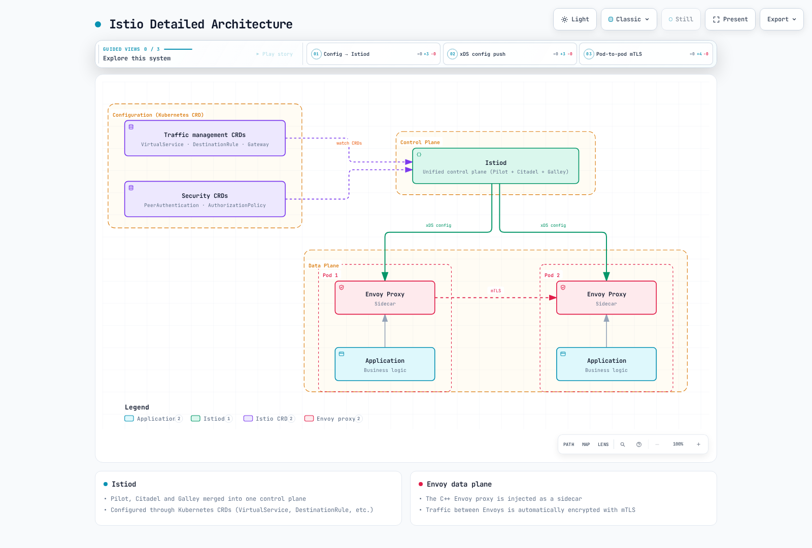
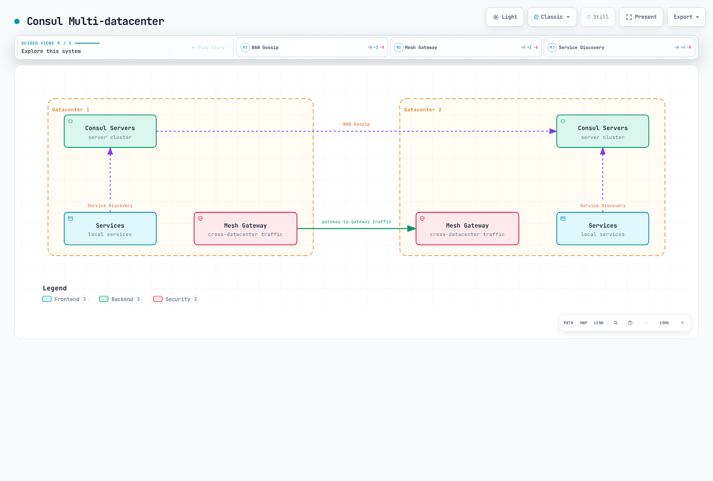

# 服务网格解决方案比较

> **最后审阅**：September 11, 2026
> **API/制品检查**：Istio 1.31.0；Linkerd edge-26.9.1；Kong Mesh/Kuma 2.14.4；Consul/chart 2.0.4

这些制品版本标识了用于检查示例的来源。它们**不是共用的 Kubernetes 兼容性矩阵**，也不能证明存在已部署的生产系统。下文保留了原始 Istio 1.24/Linkerd 2.15/Kong Mesh 2.8/Consul 1.19 性能数据，并注明其历史且未经验证的状态。

## 目录

1. [架构](#architecture)
2. [性能证据](#performance-evidence)
3. [流量管理](#traffic-management)
4. [安全性](#security)
5. [可观测性](#observability)
6. [多集群](#multicluster)
7. [安装与运维](#installation-and-operations)
8. [成本与许可](#cost-and-licensing)
9. [选择与验证](#selection-and-validation)

## 架构

服务网格将选定的通信功能转移到基础设施组件中。流量拦截可以对应用代码透明，但协议选择、流量所有权、工作负载身份和策略仍需配置。分布式追踪也需要上下文传播/插桩。服务网格不会让任意应用重试变得安全。


[查看交互式图表](https://www.atomai.click/kubernetes-docs/archmaps/en-service-mesh-istio-comparison-01-service-mesh-comparison-0.html)

该图示说明的是已配置的 sidecar 部署；它并不声称每项功能默认都已启用，也不表示 ambient/Cilium 使用相同的逐 Pod 拓扑。

### Istio



[查看交互式图表](https://www.atomai.click/kubernetes-docs/archmaps/en-service-mesh-istio-comparison-01-service-mesh-comparison-2.html)

Istiod 整合了过去分别由 Pilot、Citadel 和 Galley 承担的配置/发现及身份管理功能；这些名称不代表还需要额外部署三个当前组件。Sidecar 数据平面使用 Envoy。Ambient 使用逐节点的 ztunnel 处理 L4 流量，并使用独立的 Envoy waypoint 处理受支持的 L7 流量。Ingress/egress 网关用于实现明确选择的边界路径。

Istio 支持 Kubernetes 和有文档说明的 VM 集成，但需要满足网络/信任方面的前提条件。Ambient 核心功能达到 GA，并不意味着与 sidecar 功能完全一致：waypoint 策略关联、EnvoyFilter 支持和多集群成熟度都存在差异。估算资源或复杂度前，应先选定模式和所需的 API 行为。

### Linkerd


[查看交互式图表](https://www.atomai.click/kubernetes-docs/archmaps/en-service-mesh-istio-comparison-01-service-mesh-comparison-3.html)

Linkerd 使用专门打造的 Rust 代理，以及 Kubernetes 资源、注解和 CRD。当前功能包括 Gateway API 请求路由、超时/重试、逐路由授权和本地速率限制。将其称为仅依赖注解或“只有基本功能”的服务网格并不准确。

Linkerd 记录了扩展到非 Kubernetes 环境的方法：使用 ExternalWorkload、在外部机器上运行代理、兼容 SPIFFE/SPIRE 的身份、DNS 和网络访问。这并非“不支持 VM”，注册外部 IP 也不会自动安装或验证代理身份。

### Kong Mesh 和 Kuma


[查看交互式图表](https://www.atomai.click/kubernetes-docs/archmaps/en-service-mesh-istio-comparison-01-service-mesh-comparison-4.html)

Kong Mesh 基于 Kuma 构建。Kubernetes 模式使用 Kubernetes 资源/存储；Universal 模式支持 VM/裸金属环境，并使用其配置的数据库。Kong 提供自托管和托管式全局控制平面选项；必须将不同版本的功能和支持条款与上游 Kuma 分开核实。

在多区域部署中，全局控制平面和区域控制平面通过 KDS 交换资源，而每个区域会向本地代理提供 xDS。跨区域数据流量通过目标区域的 ingress，以及（若已配置）本地区域的 egress。全局控制平面并不是自动提供的 Prometheus/追踪聚合后端。

服务发现本身并不意味着流量会按 80% 本地/20% 远端分配。旧版端点加权与当前 MeshLoadBalancingStrategy 本地性设置的默认值不同。应检查所选策略、符合条件的端点以及跨区域/故障转移设置，而不要将图表中的权重视为固有行为。

适当情况下，应使用 MeshHTTPRoute、MeshTrafficPermission、MeshRetry、MeshTimeout、MeshMetric、MeshTrace 和 MeshAccessLog 等当前策略。TrafficRoute 和 TrafficPermission 是旧版/已弃用接口，并不一定已从所检查的版本中移除 API。应一并迁移相互依赖的策略；不要将旧版 TrafficPermission 与 MeshTrafficPermission 混用。仅凭策略类型无法确定其所有权或传播范围是“全局”还是“仅限区域”。

全局控制平面发生故障时，现有数据流量可能仍能运行，但策略和远端服务变更将停止传播。区域控制平面发生故障时，可能无法创建新代理、更新配置或刷新证书。保留的配置不代表可无限期保证可用。应在实际故障条件下验证注册、更新、连接排空和证书过期行为。

### Consul Service Mesh

Consul 提供服务发现、配置和身份功能，并原生支持 Envoy。当前 Kubernetes 集成通常使用 consul-dataplane 管理 sidecar；旧有的“每个节点一个客户端代理”架构图并不是唯一或默认的 Kubernetes 架构。

官方代理概述还介绍了一个用于开发/测试的内置 L4 代理，并建议不要用于生产环境。不应将其描述为等同于 Envoy 的生产级 L7 功能集，也不应在缺乏版本证据的情况下错误地声称它已被移除。Consul 除 Kubernetes 外，还支持有文档说明的 VM 和其他运行时集成。

### 在同一决策中考虑 Cilium

Cilium 将 eBPF 网络数据平面与 Envoy 等代理结合，用于 L7 解析/策略。因此，Cilium 并非完全无需代理的 L7 网络方案。Cilium 1.20.1 带外双向认证功能处于 Beta 阶段，并使用带外握手；WireGuard/IPsec 加密是另一项独立要求。有关其实际功能和 Cluster Mesh 限制，请参阅 [Cilium 服务网格指南](../../cilium-service-mesh/README.md)。

Cilium 1.20.1 还提供了独立的 [ztunnel 透明加密 Beta 功能](https://github.com/cilium/cilium/blob/v1.20.1/Documentation/security/network/encryption-ztunnel.rst)，通过 `encryption.type: ztunnel` 选择。它为启用了命名空间的工作负载提供 TCP mTLS；通信两端都必须启用。它不支持 ClusterMesh 和使用 host-network 的 Pod，且发布版指南警告：在此路径上，普通 L4 策略不起作用，除非目标是 HBONE 端口 15008。这是另一种部署选择，有其独立的 CA/引导要求。

## 性能证据

### 原始数据：历史数据，未经验证

原文描述的是一次针对 **三节点 EKS 1.28、m5.xlarge、100 个服务、1,000 RPS** 的测试，并列出 Istio 1.24、Linkerd 2.15、Kong Mesh 2.8 和 Consul 1.19。原文没有提供原始样本、可复现的测试工具、确切的补丁/代理版本或基准测试来源。这些数字无法证明当前产品排名：

| 原始条目 | p50 | p95 | p99 | CPU 声明 | 内存声明 |
|---|---:|---:|---:|---:|---:|
| 基线 |0.1 ms|0.2 ms|0.3 ms|-|-|
| Linkerd |+0.5 ms|+0.8 ms|+1.2 ms|+3–8%|+20–50 MB|
| Istio |+1.0 ms|+2.5 ms|+3.5 ms|+5–15%|+50–150 MB|
| Kong Mesh |+0.8 ms|+2.0 ms|+3.0 ms|+5–12%|+40–120 MB|
| Consul |+1.0 ms|+2.5 ms|+3.5 ms|+6–14%|+50–140 MB|

原始控制平面估算为：Istio 0.5–1 CPU/1–2 GB，Linkerd 0.1–0.3 CPU/200–500 MB，Kong 0.2–0.5 CPU/500 MB–1 GB，Consul 0.5–1 CPU/1–2 GB。每个代理的 CPU 估算范围从 Linkerd 的 20–100m 到 Istio/Consul 的 100–500m。这些是未经验证的输入，不是默认值、测量结果或容量建议。将 Linkerd 的不同组件数量相加，也不等同于计算某个单一组件的副本数。

已删除的吞吐量图声称 Linkerd 保留了基线吞吐量的 95–98%，Kong 保留了 90–95%，Istio/Consul 保留了 85–92%，但没有提供支持数据。这些数据无法证明“Linkerd 速度最快”、固定的资源百分比或最小集群规模。

### 可复现的比较

应将实际产品/代理/Kubernetes 版本、硬件和完整配置与结果一并记录。应统一流量协议/负载/并发量、TLS/身份验证、策略、遥测和资源限制。报告绝对基线和启用服务网格后的延迟分布、在明确的错误率/SLO 限制下测得的吞吐量、各组件的 CPU/内存，以及多次运行的差异。

比较同等的高可用和故障行为，包括滚动更新、连接排空、连接复用、遥测缺失和控制平面丢失。应将原始错误与重试后客户端可见的结果分开测量。未经重新运行并保留实验记录，不要将历史版本标签更新为当前版本。

## 流量管理

| 能力 | 具体比较内容 |
|---|---|
| 加权/请求头路由 | Istio VirtualService、Linkerd HTTPRoute、Kong MeshHTTPRoute、Consul router/splitter/resolver 行为 |
| 蓝绿部署或金丝雀发布 | 路由只是其中一部分；发布控制器或部署工作流还必须管理版本、分析和回滚 |
| 重试/超时 | 支持的请求/协议范围、默认策略、预算和应用幂等性 |
| 速率限制 | 本地计数器还是共享计数器、身份、故障策略和实际副本范围 |
| 故障注入/流量镜像 | 支持的 API/过滤器和实际生成的配置；镜像写入可能产生副作用 |

Linkerd 确实通过 HTTPLocalRateLimitPolicy 支持本地速率限制，包括按身份限制，以及按请求属性进行动态路由。逐代理的本地限制不是全局服务配额。Consul 和 Kong 的功能可能取决于所选版本/API；用粗略的“基本/企业版/无”表格来概括并不充分。

### 独立的只读路由示例

请将这些示例作为**适用于相应服务网格的替代方案**，不要让多个控制器同时作用于同一个工作负载。示例假设 `mesh-demo` 中已有 `reviews` Pod、实际版本标签、9080 上的 HTTP 侦听器，并且工作负载已加入相应服务网格。此 Service 结构显式声明了端口，但不会创建应用：

```yaml
apiVersion: v1
kind: Service
metadata:
  name: reviews
  namespace: mesh-demo
spec:
  selector:
    app: reviews
  ports:
  - name: http
    port: 9080
    targetPort: 9080
    appProtocol: http
---
apiVersion: v1
kind: Service
metadata:
  name: reviews-v1
  namespace: mesh-demo
spec:
  selector:
    app: reviews
    version: v1
  ports:
  - name: http
    port: 9080
    targetPort: 9080
    appProtocol: http
---
apiVersion: v1
kind: Service
metadata:
  name: reviews-v2
  namespace: mesh-demo
spec:
  selector:
    app: reviews
    version: v2
  ports:
  - name: http
    port: 9080
    targetPort: 9080
    appProtocol: http
```

以下比较仅针对只读的 review 请求。路由写入请求前，应另外审查继承自服务网格/客户端的重试行为和幂等性。路由请求头是客户端可控的输入，不是身份验证。

#### Istio

```yaml
apiVersion: networking.istio.io/v1
kind: VirtualService
metadata:
  name: reviews
  namespace: mesh-demo
spec:
  hosts:
  - reviews
  http:
  - name: canary-header
    match:
    - headers:
        x-release:
          exact: canary
    route:
    - destination:
        host: reviews
        subset: v2
        port:
          number: 9080
      weight: 100
    retries:
      attempts: 0
  - name: weighted
    route:
    - destination:
        host: reviews
        subset: v1
        port:
          number: 9080
      weight: 90
    - destination:
        host: reviews
        subset: v2
        port:
          number: 9080
      weight: 10
    retries:
      attempts: 0
---
apiVersion: networking.istio.io/v1
kind: DestinationRule
metadata:
  name: reviews
  namespace: mesh-demo
spec:
  host: reviews
  subsets:
  - name: v1
    labels:
      version: v1
  - name: v2
    labels:
      version: v2
```

两个路由都显式禁用了服务网格重试。子集标签必须与实际端点匹配；流量权重不会创建版本或扩展版本规模。如需通过网关公开服务，必须单独配置主机/TLS 绑定。

#### Linkerd

```yaml
apiVersion: gateway.networking.k8s.io/v1
kind: HTTPRoute
metadata:
  name: reviews-outbound
  namespace: mesh-demo
spec:
  parentRefs:
  - group: ''
    kind: Service
    name: reviews
    port: 9080
  rules:
  - matches:
    - headers:
      - name: x-release
        type: Exact
        value: canary
    backendRefs:
    - group: ''
      kind: Service
      name: reviews-v2
      port: 9080
      weight: 100
  - backendRefs:
    - group: ''
      kind: Service
      name: reviews-v1
      port: 9080
      weight: 90
    - group: ''
      kind: Service
      name: reviews-v2
      port: 9080
      weight: 10
```

这个 Gateway API 生产者路由会关联到 Service，并配置已加入服务网格的**客户端**。核心 Service 组是空字符串。此示例不需要已弃用的 SMI TrafficSplit 扩展。对于同一 Service，现有 ServiceProfile 的优先级高于出站 HTTPRoute；应有意识地处理这种配置归属关系。依赖此路由前，应检查 Accepted/ResolvedRefs 状态和实际路由行为。

#### Kong Mesh

```yaml
apiVersion: kuma.io/v1alpha1
kind: MeshHTTPRoute
metadata:
  name: reviews-weighted
  namespace: mesh-demo
  labels:
    kuma.io/mesh: default
spec:
  targetRef:
    kind: Dataplane
    labels:
      app: productpage
  to:
  - targetRef:
      kind: MeshService
      name: reviews
      sectionName: http
    rules:
    - matches:
      - path:
          type: PathPrefix
          value: /
      default:
        backendRefs:
        - kind: MeshService
          name: reviews-v1
          port: 9080
          weight: 90
        - kind: MeshService
          name: reviews-v2
          port: 9080
          weight: 10
```

此处的 `reviews`、`reviews-v1` 和 `reviews-v2` 指的是**实际的 MeshService 资源名称**，不能假设生成的所有名称都等于 Kubernetes Service 名称。应在已安装的环境中解析其名称、命名空间/端口分段和后端就绪状态。所选调用方 Dataplane 必须带有 app 标签，并且 HTTP Service 端口必须声明受支持的协议。此示例调整的是权重，而不是本地性优先级或容量。

#### Consul

```yaml
apiVersion: consul.hashicorp.com/v1alpha1
kind: ServiceDefaults
metadata:
  name: reviews
  namespace: mesh-demo
spec:
  protocol: http
---
apiVersion: consul.hashicorp.com/v1alpha1
kind: ServiceResolver
metadata:
  name: reviews
  namespace: mesh-demo
spec:
  subsets:
    v1:
      filter: Service.Meta.version == v1
      onlyPassing: true
    v2:
      filter: Service.Meta.version == v2
      onlyPassing: true
---
apiVersion: consul.hashicorp.com/v1alpha1
kind: ServiceSplitter
metadata:
  name: reviews
  namespace: mesh-demo
spec:
  splits:
  - weight: 90
    service: reviews
    serviceSubset: v1
  - weight: 10
    service: reviews
    serviceSubset: v2
```

这些是 Consul 配置条目的 Kubernetes CRD 形式，需要配置好 Consul 控制器/RBAC。Consul catalog 中的服务元数据必须实际包含 `version=v1/v2`；仅凭 Kubernetes Pod 标签不能证明 catalog 中存在相应元数据。HTTP 协议和 resolver 子集共同构成完整的流量拆分定义。应用多个配置所有者到同一个配置条目前，应检查 Kubernetes 到 Consul 的命名空间/服务映射和健康端点。

## 安全性

加密、对等身份、调用方授权和应用身份验证是彼此独立的控制措施。已加入服务网格的代理之间自动进行 mTLS，并不意味着所有未加入服务网格的流量都会被拒绝，也不意味着每个调用方都获得授权。

### Istio：入站 mTLS 和请求授权

```yaml
apiVersion: security.istio.io/v1
kind: PeerAuthentication
metadata:
  name: reviews-strict
  namespace: mesh-demo
spec:
  selector:
    matchLabels:
      app: reviews
  mtls:
    mode: STRICT
---
apiVersion: security.istio.io/v1
kind: AuthorizationPolicy
metadata:
  name: reviews-read
  namespace: mesh-demo
spec:
  selector:
    matchLabels:
      app: reviews
  action: ALLOW
  rules:
  - from:
    - source:
        principals:
        - cluster.local/ns/mesh-demo/sa/productpage
    to:
    - operation:
        methods:
        - GET
        paths:
        - /reviews/*
```

此 sidecar 示例要求实际存在 productpage ServiceAccount 身份和 reviews 工作负载。自动 mTLS 可以选择适当的出站传输；不需要对 `*.local` 设置一条一刀切的 ISTIO_MUTUAL DestinationRule，这样做还可能破坏其他不相关的/明文目标。STRICT 用于实施入站要求，而 ALLOW 策略用于控制示例中指定的身份/方法/路径。

AuthorizationPolicy 的字符串匹配方式包括完全匹配、前缀匹配、后缀匹配或存在性匹配；`*Mobile*` 并不是通用的子字符串正则表达式匹配。User-Agent 也不是工作负载身份。Ambient 的 L7 策略关联需要使用受支持的 waypoint 策略模型，而不是直接照搬 sidecar 选择器。

### Linkerd：显式入站策略

```yaml
apiVersion: policy.linkerd.io/v1beta3
kind: Server
metadata:
  name: reviews-http
  namespace: mesh-demo
spec:
  podSelector:
    matchLabels:
      app: reviews
  port: 9080
  proxyProtocol: HTTP/1
  accessPolicy: deny
---
apiVersion: gateway.networking.k8s.io/v1
kind: HTTPRoute
metadata:
  name: reviews-read
  namespace: mesh-demo
spec:
  parentRefs:
  - group: policy.linkerd.io
    kind: Server
    name: reviews-http
  rules:
  - matches:
    - method: GET
      path:
        type: PathPrefix
        value: /reviews/
---
apiVersion: policy.linkerd.io/v1alpha1
kind: AuthorizationPolicy
metadata:
  name: reviews-read
  namespace: mesh-demo
spec:
  targetRef:
    group: gateway.networking.k8s.io
    kind: HTTPRoute
    name: reviews-read
  requiredAuthenticationRefs:
  - kind: ServiceAccount
    name: productpage
```

Server 会选择实际声明的 Pod 端口，并在此处默认拒绝访问。入站 HTTPRoute 选择 `/reviews/` 下的 GET 请求；AuthorizationPolicy 要求调用方使用 productpage ServiceAccount。目标 API 组已显式指定：省略 group 表示核心组，不会推断为 Linkerd Server。引用缺失或错误并不会创建授权许可。

所检查的 edge CRD 提供 Server v1beta3 及更早的版本，包括 v1beta1；并未声称旧版 API 已被移除。应使用所选制品支持的 API 版本。命名空间/Pod 的默认 `all-unauthenticated` 策略与已加入服务网格的对等端之间的自动加密不同，也与此处明确配置的 Server 策略不同。

### Kong Mesh：在明确权限后启用 mTLS

基本安装不会自动加密所有服务流量。对现有工作负载启用 mTLS 前，应先规划权限，因为没有匹配权限的通信可能会被阻断。最小 Mesh 配置如下：

```yaml
apiVersion: kuma.io/v1alpha1
kind: Mesh
metadata:
  name: default
spec:
  mtls:
    enabledBackend: ca-1
    backends:
    - name: ca-1
      type: builtin
```

受限的服务级示例如下：

```yaml
apiVersion: kuma.io/v1alpha1
kind: MeshTrafficPermission
metadata:
  name: productpage-to-reviews
  namespace: mesh-demo
  labels:
    kuma.io/mesh: default
spec:
  targetRef:
    kind: Dataplane
    labels:
      app: reviews
  from:
  - targetRef:
      kind: MeshSubset
      tags:
        kuma.io/service: productpage
    default:
      action: Allow
```

将 `productpage` 替换为实际的来源 `kuma.io/service` 身份标签，并验证目标 Dataplane 标签/命名空间。它不一定等于简单的 Kubernetes Service 名称。此权限是服务级授权，并不等同于上文 Istio/Linkerd 的 GET/路径规则。不要将它与旧版 TrafficPermission 混用。更改生产环境的执行策略前，必须确保所需的传输、身份和策略资源已就绪。

### Consul：L7 意图

```yaml
apiVersion: consul.hashicorp.com/v1alpha1
kind: ServiceIntentions
metadata:
  name: reviews
  namespace: mesh-demo
spec:
  destination:
    name: reviews
  sources:
  - name: productpage
    permissions:
    - action: allow
      http:
        methods:
        - GET
        pathPrefix: /reviews/
```

Consul 服务身份和 HTTP 协议配置必须与 catalog 和实际代理相匹配。L7 权限表明，“Consul 只有基本的服务级授权”这种说法并不准确。不要将某个来源的 L4 action 与其 L7 permissions 混在一起，误认为两者会独立生效。应检查其他 intentions/默认策略、命名空间/分区以及控制器映射。

网格配置条目的 TLS 最低版本设置只会更改 TLS 设置；它不会纳管应用、安装代理或创建完整的 CA/ACL 配置。Envoy 扩展和逃生通道 API 也需要符合实际 Consul 版本的权限要求；2.0.4 版本加强了代码执行型扩展的 mesh:write 权限要求。

## 可观测性

指标数量不是有意义的固定排名：启用的统计信息、维度、策略、抓取配置和应用插桩都会影响信号和开销。EnvoyFilter 并不是不受限制的遥测扩展 API，而且并非所有追踪后端都能在没有兼容协议/导出器的情况下互换。

| 服务网格 | 配置与验证内容 |
|---|---|
| Istio | Telemetry API、实际代理/控制平面指标、访问日志格式、追踪提供程序和后端；可选的 Kiali/Grafana 集成 |
| Linkerd | 代理黄金指标/逐路由指标、选定的 viz 或外部监控设置，以及已配置的代理/应用追踪 |
| Kong Mesh | 使用受支持的后端配置 MeshMetric、MeshTrace 和 MeshAccessLog；GUI/控制平面的可用性和访问权限需另行配置 |
| Consul | 代理/代理程序指标、已配置的追踪，以及使用真实端点/身份验证设置的 UI 指标提供程序 |

要实现端到端追踪，必须在应用调用之间传播上下文，按需启动/采样追踪，并配置 Collector/后端的传递方式。Linkerd 明确记录了这些要求；单个代理 span 并不构成完整的应用追踪。OpenTelemetry Collector 可以桥接受支持的协议，但它的存在不能证明每种产品/后端组合都受支持。

在相关组件已安装且已授权的情况下，可使用以下检查命令：

```bash
istioctl dashboard kiali -n istio-system
linkerd viz check
linkerd viz stat deploy -n mesh-demo
linkerd viz dashboard
```

这些命令不会安装仪表板或后端。应另行检查 Kiali 的当前配置和兼容性；旧版 accessible_namespaces 示例和 Istio 旧版捆绑式插件的 values 并不是当前安装指南。有关受维护的配置和验证限制，请参阅[可观测性指南](../observability/README.md)。即使 Mesh 指标后端为空，也不会启用 Kong GUI；Consul UI 的指标 URL 必须能从实际服务器环境访问。

## 多集群

| 系统 | 发现/数据路径 | 重要边界 |
|---|---|---|
| Istio | 每个主集群读取已授权的 Kubernetes API；跨网络流量使用已配置的东西向网关 | Remote secret 不会复制 CRD，也不会建立网络/信任。Sidecar 和 ambient 支持不同的拓扑。 |
| Linkerd | 本地镜像 Service 描述远端服务；分层模式使用**目标端**网关，扁平模式支持直接的 Pod 路径 | 镜像位于源集群中。源端并非天然需要网关。Federated Service 使用扁平模型，且不支持无头成员。 |
| Kong Mesh | KDS 交换区域/服务资源；目标区域 ingress 和可选的源区域 egress 承载跨区域流量 | 本地性/故障转移行为取决于适用的策略和符合条件的端点；没有固有的 80/20 拆分或无条件故障转移。 |
| Consul | 使用受支持的集群对等或 WAN 联邦模型，配合服务发现和网格网关路径 | 应选择实际拓扑，并配置信任、导出服务、授权和路由；仅靠名称无法加入集群。 |



[查看交互式图表](https://www.atomai.click/kubernetes-docs/archmaps/en-service-mesh-istio-comparison-01-service-mesh-comparison-16.html)

原文中“Linkerd 最多约十个集群”和笼统的“几十个”限制均无配额/负载测试来源。容量取决于实际控制平面/数据平面拓扑、服务/端点数量、更新速率和资源。自动服务发现不等于自动复制策略，也不等于应用/数据灾难恢复。

应检查远程 API/网关可达性、证书信任、DNS、命名空间/服务身份、导出服务以及双向故障行为。应优先参考[维护中的 Istio 多集群指南](../advanced/02-multi-cluster.md)，而不是原来仅使用 meshID 标签和一个 secret 的两条安装命令：那些命令并不是完整的服务网格配置。

## 安装与运维

### 版本是相互独立的输入

| 检查的来源/制品 | 兼容性证据和限制 |
|---|---|
| Istio 1.31.0 | 支持 Kubernetes 1.32–1.37；遵循实际升级/版本偏差规则和平台要求 |
| Linkerd edge-26.9.1 CLI/CRD | Edge 指南适用于该制品。另行发布的 **2.20** 表格列出了 Kubernetes 1.31–1.35 和 Gateway API 1.2.1–1.5.1；不要将这些范围自动视为每个后续 edge/供应商构建版本的适用范围。 |
| Kong Mesh/chart 2.14.4 | 于 9 月 3 日发布，包含 Kuma 2.14.4。当前发布的 Kubernetes 验证表截至 2.13；不能仅凭 chart 渲染结果推断 2.14 已通过兼容性认证。支持表另行列出了 2.13 LTS。 |
| Consul/chart 2.0.4 | 分别检查了发布的应用和 Helm 制品。Chart 的 Kubernetes 最低版本是元数据，并非完整的支持版本矩阵或升级评估。 |

Gateway API CRD 是集群范围内、由多个控制器共享的依赖项。不要盲目安装目录中最新的版本，也不要在未检查所有使用方的情况下回退现有版本包。

### Istio 版本修订交接

使用与已安装版本相匹配的 CLI，并采用受支持的升级路径。本文中的历史 1.24 标签并不意味着可以直接升级到 1.31。保留经审查的安装 values、网关/CNI 设置和版本修订所有权。

以下示例展示了使用 default profile 输入设置控制平面资源/HPA 范围：

```yaml
apiVersion: install.istio.io/v1alpha1
kind: IstioOperator
spec:
  profile: default
  components:
    pilot:
      k8s:
        hpaSpec:
          minReplicas: 3
          maxReplicas: 10
        resources:
          requests:
            cpu: 2000m
            memory: 4Gi
```

Istio 没有内置的 `production` profile。这些 CPU/内存/副本数量只是容量估算输入，并不保证生产环境容量。仅安装另一个版本修订不会升级现有代理：

```bash
istioctl install -f reviewed-istio.yaml --revision 1-31-0
kubectl label namespace mesh-demo istio-injection-
kubectl label namespace mesh-demo istio.io/rev=1-31-0 --overwrite
: "${DEPLOYMENT:?Set the actual staged Deployment name}"
kubectl rollout restart deployment/"$DEPLOYMENT" -n mesh-demo
kubectl rollout status deployment/"$DEPLOYMENT" -n mesh-demo
```

交接前应检查现有命名空间和 Pod 覆盖设置。旧版注入标签可能优先于版本修订选择。只重启目标工作负载批次；网关和 ambient 组件有各自的升级流程。金丝雀版本修订无法保证每次应用滚动更新都不会出现错误。

### Linkerd 安装与升级

首先选择明确的 edge 或供应商制品及其兼容的 Gateway API。当前上游 CLI 工作流如下：

```bash
linkerd check --pre
linkerd install --crds > linkerd-crds.yaml
kubectl apply -f linkerd-crds.yaml
linkerd install > linkerd-control-plane.yaml
kubectl apply -f linkerd-control-plane.yaml
linkerd check
```

这是面向实验环境的 CLI 流程；生产环境安装指南建议使用 Helm，以便实现可重复部署并审查身份设置。为命名空间添加注解只会为新建的 Pod 启用注入，不会立即向运行中的 Pod 插入代理。应按照所选版本的流程升级 CRD/控制平面，然后有计划地滚动更新工作负载，以更新数据平面代理；这并不意味着工作负载会自动滚动更新。

### Kong 和 Consul Chart 检查

以下命令会获取并渲染确切的已检查 chart 以供审查；它们不会部署生产系统：

```bash
helm repo add kong-mesh https://kong.github.io/kong-mesh-charts
helm repo add hashicorp https://helm.releases.hashicorp.com
helm repo update kong-mesh hashicorp
helm show values kong-mesh/kong-mesh --version 2.14.4 > kong-values.reference.yaml
helm show values hashicorp/consul --version 2.0.4 > consul-values.reference.yaml
helm template kong-mesh kong-mesh/kong-mesh --version 2.14.4   --namespace kong-mesh-system --include-crds --values reviewed-kong-values.yaml
helm template consul hashicorp/consul --version 2.0.4   --namespace consul --include-crds --values reviewed-consul-values.yaml
```

经审查的 values 文件是特定于环境的输入，并非本文比较提供的文件。遵循各产品安装指南之前，应先确认 Kubernetes 支持、版本/许可、CA/ACL/引导身份、存储、高可用性、注入器/控制器设置和升级说明。Helm 成功渲染既不能证明运行时已就绪，也不能证明原地升级是安全的。

### 故障排除

```bash
istioctl proxy-status
istioctl analyze -n mesh-demo
istioctl proxy-config clusters "$POD" -n mesh-demo
linkerd check
linkerd viz stat deploy -n mesh-demo
kubectl get meshhttproutes,meshtrafficpermissions -n mesh-demo
kubectl get servicedefaults,serviceresolvers,servicesplitters -n mesh-demo
```

仅在预期的已安装环境中运行特定产品的命令。应检查实际组件名称和日志，而不要假定每个 Consul sidecar 都使用某个固定的历史容器名称。Tap/调试日志可能会暴露请求信息；应限定诊断设置的范围，并在完成后恢复。应根据团队在实际工作流中的表现进行测量，而不是声称所有组织都能在八小时或五分钟内完成安装。

## 成本与许可

### 原始成本输入不是报价

原始的 100 个 Pod/m5.xlarge 表格将基线成本定为 $300，并列出以下额外月度金额：

| 原始产品输入 | 控制平面 CPU/内存 | 代理总计 CPU/内存 | 原文中的额外月度金额 |
|---|---|---|---:|
| Linkerd |300m / 500 MB|2 vCPU / 5 GB|$50|
| Istio |1 vCPU / 2 GB|10 vCPU / 15 GB|$150|
| Kong Mesh |500m / 1 GB|8 vCPU / 12 GB|$120|
| Consul |1 vCPU / 2 GB|10 vCPU / 14 GB|$145|

没有任何区域、节点数量、运行时长、购买模式、分摊公式或账单数据能够支持这些价格。资源请求不会自动购买小数个 EC2 节点，释放出的余量也不一定会降低账单。仅将这些数据作为过去的假设输入保留；不要用它们来选择最便宜的产品。

原文中的人员投入假设为：Istio/Linkerd/Kong/Consul 的初始设置分别为 40/8/20/24 小时，每月运维分别为 20/5/10/12 小时，每月故障排除分别为 15/3/8/10 小时，每季度升级分别为 8/2/4/5 小时。这些并非经过测量的团队效率，而且初始设置不是每月重复发生的费用。

有意义的成本模型应使用实际保留的容量、高可用性和自动扩缩容约束、负载均衡器/数据传输、存储/遥测、平台费用、支持订阅和实际观测到的工程投入。应在相同的工作负载、安全和可用性要求下进行比较，并注明所有单位/费率/日期。只有基于有依据的差异和迁移成本，才能计算 ROI。

### 制品与产品许可

| 组件 | 需要区分的内容 |
|---|---|
| Istio | 上游项目采用 Apache 许可；托管/商业发行版有各自的条款和费用 |
| Linkerd | 上游项目采用 Apache 许可；上游 edge 制品与供应商稳定版发行版是不同的版本/支持选择 |
| Kuma / Kong Mesh | 上游 Kuma 与商业产品 Kong Mesh 各不相同；应核实所选版本及支持合同 |
| Consul | 所检查的 **Consul 2.0.4 应用程序**采用 Business Source License 1.1，具有其规定的使用授权和后续 MPL 变更条件，并非简单地采用当前 MPL-2.0 |

Consul Helm chart 将该制品标注为采用 MPL 许可；这不会覆盖应用二进制文件的许可。应审查确切制品/版本的条款。Linkerd 的高可用控制平面配置并非天然仅限企业版；必须区分付费支持/SLA、产品功能和上游能力。不要根据某个供应商名称或美元符号排名推断支持情况。

## 选择与验证

| 场景 | 决定选择的问题 |
|---|---|
| 大规模部署 | 需要哪些确切的路由/安全 API、端点/更新规模和高可用行为？ |
| 小型团队或快速启动 | 团队能够运维哪种生命周期和故障排除工作流，包括身份管理和升级？ |
| 资源受限 | 使用等效策略的工作负载实际消耗多少资源，包括所有代理、waypoint、网关和遥测组件？ |
| VM 或旧版工作负载 | 有文档说明的身份/网络/运行时集成是否适用？Istio 和 Linkerd 也有 VM 集成路径。 |
| 多云或多集群 | 需要哪些信任、API、数据平面、策略分发和灾难恢复边界？ |
| 强可观测性需求 | 需要哪些应用/代理信号、Collector/导出器路径、保留策略和访问控制？ |

单独使用 Service ExternalName 不会将 VM 纳入服务网格，也不会创建代理身份。数据平面二进制文件还需要受支持的注册流程、凭据、网络重定向以及实际可用的控制平面连接。同样，仅在两个 Istio 安装中设置 meshID/network 字符串，并不构成完整的多集群设计。

应使用实际工作负载和所需策略开展范围有限的概念验证，保留可复现的测量结果，并测试故障/恢复。可在[比较索引](README.md)和 [Istio 与 VPC Lattice 对比指南](02-istio-vs-lattice.md)中查阅相关的决策标准。产品选择不能仅由服务数量、笼统的“功能最多”标签或没有依据的快速 ROI 声明来决定。

## 官方参考资料

- [Istio 架构](https://istio.io/latest/docs/ops/deployment/architecture/)和[受支持的版本](https://istio.io/latest/docs/releases/supported-releases/)
- [Istio VM 集成](https://istio.io/latest/docs/setup/install/virtual-machine/)和[多集群](https://istio.io/latest/docs/setup/install/multicluster/)
- [Linkerd 发行版](https://linkerd.io/releases/)、[Kubernetes 兼容性](https://linkerd.io/docs/reference/k8s-versions/)和[Gateway API 兼容性](https://linkerd.io/docs/features/gateway-api/)
- [Linkerd 请求路由](https://linkerd.io/docs/features/request-routing/)、[HTTPRoute](https://linkerd.io/docs/reference/httproute/)、[授权](https://linkerd.io/docs/reference/authorization-policy/)和[速率限制](https://linkerd.io/docs/features/rate-limiting/)
- [Linkerd 多集群](https://linkerd.io/docs/features/multicluster/)、[VM 扩展](https://linkerd.io/docs/tasks/adding-non-kubernetes-workloads/)和[追踪](https://linkerd.io/docs/features/distributed-tracing/)
- [Kong Mesh 更新日志](https://developer.konghq.com/mesh/changelog/)、[支持政策](https://developer.konghq.com/mesh/support-policy/)和[验证过的版本](https://developer.konghq.com/mesh/version-compatibility/)
- [Kong MeshHTTPRoute](https://developer.konghq.com/mesh/policies/meshhttproute/)、[MeshTrafficPermission](https://developer.konghq.com/mesh/policies/meshtrafficpermission/)和[负载均衡策略](https://developer.konghq.com/mesh/policies/meshloadbalancingstrategy/)
- [Kong 多区域部署](https://developer.konghq.com/mesh/mesh-multizone-service-deployment/)和[安装](https://developer.konghq.com/mesh/deploy-mesh-self-managed/)
- [Consul 代理](https://developer.hashicorp.com/consul/docs/connect/proxy)、[服务默认值](https://developer.hashicorp.com/consul/docs/reference/config-entry/service-defaults)、[resolver](https://developer.hashicorp.com/consul/docs/reference/config-entry/service-resolver)、[splitter](https://developer.hashicorp.com/consul/docs/reference/config-entry/service-splitter)和[intentions](https://developer.hashicorp.com/consul/docs/reference/config-entry/service-intentions)
- [Consul 2.0.4 应用程序许可](https://raw.githubusercontent.com/hashicorp/consul/v2.0.4/LICENSE)
- [本指南中的 Istio 架构](../03-architecture.md)
