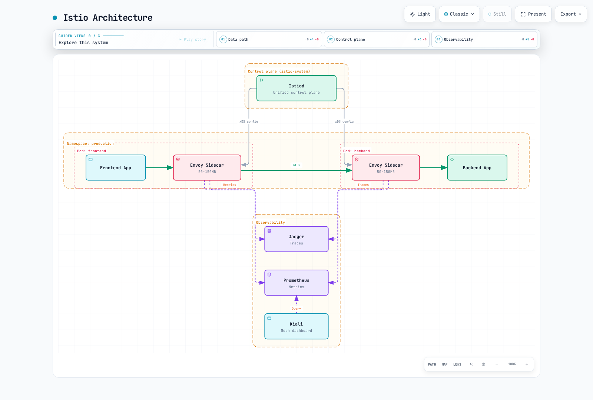

# Istio 与 VPC Lattice

> **最后审阅**：2026 年 9 月 11 日
> **Istio API 基线**：1.31.0；必须另行检查 Kubernetes 兼容性

请比较应用程序的通信、身份、协议和运维要求。Istio 与 VPC Lattice 具有不同的部署和安全边界；功能对照表或不受支持的“零开销”说法不能决定正确的架构。

配置示例假定现有、已获授权的资源和真实应用程序端点。它们是适合相应环境的替代方案，而非一个组合式生产部署。必须审慎替换标识符、角色、命名空间和身份提供商 URL。审计验证了本地配置/输入形状和计算，但未部署 AWS 或集群资源。

## 目录

1. [架构与平台](#architecture-and-platforms)
2. [流量管理](#traffic-management)
3. [安全与身份](#security-and-identity)
4. [可观测性](#observability)
5. [安装与运维](#installation-and-operations)
6. [成本与历史证据](#cost-and-historical-evidence)
7. [混合与多云设计](#hybrid-and-multicloud-design)
8. [选择标准](#selection-criteria)

## 架构与平台 {#architecture-and-platforms}

### Istio

Istio 提供可部署的控制/数据平面，并支持 Kubernetes 和有文档说明的 VM 集成。sidecar 模式在已纳入的工作负载 Pod 中使用 Envoy proxy；ambient 使用每节点 ztunnel 以及为受支持 L7 处理单独纳入的 waypoint。添加 sidecar 会添加一个**容器**，而不是另一个应用程序 Pod。



[查看交互式图表](https://www.atomai.click/kubernetes-docs/archmaps/en-service-mesh-istio-comparison-02-istio-vs-lattice-0.html)

保留的图表描述 sidecar 模式。其资源标注是旧的说明性估算，并非实测默认值或当前容量建议。Kiali 查询遥测/后端；它本身不是 trace 收集器。

Ambient 捕获使用有文档说明的 Linux network-namespace/iptables 机制，而不是 eBPF 捕获层。核心 ambient 功能在 1.24 中成为 GA，而各个功能和多集群拓扑具有各自的状态。移除 sidecar、纳入工作负载和要求经过 waypoint 是不同的操作；单独的命名空间 label 无法安全迁移每个工作负载，也不保证节省 97–98%。

### VPC Lattice

VPC Lattice 是 AWS 托管的、面向**服务和资源**的应用程序网络。其服务模型包含面向受支持 IP/instance、Lambda 和 ALB target 的 listener、rule 和 target group；ECS/EKS 集成管理适用的 target。资源配置/resource gateway 提供不同的私有资源访问模型，包括 TCP 连接。

service network 是逻辑关联/访问边界，而不是 sidecar 或 Pod 级身份。客户端可以使用 service-network VPC association 或 service-network VPC endpoint。endpoint 路径由 PrivateLink 提供支持；将每个 Lattice 数据路径或整个数据平面简单描述为“AWS PrivateLink”并不准确。

VPC association 和 endpoint association 具有不同的寻址/连接行为。service-network endpoint 可接受通过 peering、Transit Gateway、Direct Connect 或 VPN 到达的受支持流量，包括 AWS 外部的客户端。AWS 服务仍在 AWS 中运行；这不是将 Lattice 部署到其他云中。

| 维度 | Istio | VPC Lattice |
|---|---|---|
| 数据平面 | Sidecar 或 ambient 组件，加上所选 gateway | 托管的服务/资源网络以及配置的 target/endpoint |
| 身份 | 工作负载 mesh 身份和配置的应用程序/JWT policy | 启用时的服务 IAM/SigV4 授权；资源访问具有单独的控制措施 |
| 运维 | 控制/proxy 生命周期、证书、容量、policy 和遥测 | AWS 运行该服务；用户仍管理 IAM、DNS、association、target、controller、quota 和应用程序 |
| 平台 | 支持的 Kubernetes/VM 部署及模式特定要求 | 支持的 AWS target 类型和有文档说明的客户端/网络路径 |
| 成本 | 实际基础设施、遥测、支持和工程成本 | 适用的服务/资源/流量费用，加上应用程序基础设施、日志和工程成本 |

“不要求 sidecar”是部署属性，而非零延迟、CPU、签名/controller 工作或总基础设施成本的证明。

## 流量管理 {#traffic-management}

### 加权与条件路由

Istio 可以匹配 HTTP 请求属性并将请求路由到带 label 的 subset。后端 Service 以及匹配的 v1/v2 工作负载必须已存在于 `mesh-demo` 中：

```yaml
apiVersion: networking.istio.io/v1
kind: VirtualService
metadata:
  name: backend-canary
  namespace: mesh-demo
spec:
  hosts:
  - backend
  http:
  - match:
    - headers:
        x-release:
          exact: canary
    route:
    - destination:
        host: backend
        port:
          number: 8080
        subset: v2
      weight: 100
    retries:
      attempts: 0
  - route:
    - destination:
        host: backend
        port:
          number: 8080
        subset: v1
      weight: 90
    - destination:
        host: backend
        port:
          number: 8080
        subset: v2
      weight: 10
    retries:
      attempts: 0
---
apiVersion: networking.istio.io/v1
kind: DestinationRule
metadata:
  name: backend
  namespace: mesh-demo
spec:
  host: backend
  trafficPolicy:
    loadBalancer:
      simple: LEAST_REQUEST
    connectionPool:
      tcp:
        maxConnections: 100
      http:
        http1MaxPendingRequests: 50
        http2MaxRequests: 100
        maxRequestsPerConnection: 2
    outlierDetection:
      consecutive5xxErrors: 5
      interval: 30s
      baseEjectionTime: 60s
      maxEjectionPercent: 50
      minHealthPercent: 50
  subsets:
  - name: v1
    labels:
      version: v1
  - name: v2
    labels:
      version: v2
```

这些 route 显式禁用了 mesh retry。资源限制仅作说明；`maxRequestsPerConnection: 2` 有意限制复用，并非通用性能建议。outlier detection 由 proxy 针对其上游 endpoint 评估。`minHealthPercent` 是 panic/fail-open 阈值，而不是至少该百分比保持健康的保证。

Lattice HTTP/HTTPS listener rule 支持 method、header 和 path 匹配。这个完整的 **CreateRule input** 替换了以前缺少 service/name 且 pathMatch 格式错误的示例：

```json
{
  "serviceIdentifier": "svc-0123456789abcdef0",
  "listenerIdentifier": "listener-0123456789abcdef0",
  "name": "api-canary",
  "priority": 10,
  "match": {
    "httpMatch": {
      "method": "GET",
      "pathMatch": {
        "caseSensitive": true,
        "match": {
          "prefix": "/api/v1/"
        }
      }
    }
  },
  "action": {
    "forward": {
      "targetGroups": [
        {
          "targetGroupIdentifier": "tg-0123456789abcdef0",
          "weight": 90
        },
        {
          "targetGroupIdentifier": "tg-0123456789abcdef1",
          "weight": 10
        }
      ]
    }
  }
}
```

保存为 `rule.json`，将标识符替换为现有的 service/listener 和两个符合条件的 target group，并在创建前验证 rule 名称和 priority 尚未使用：

```bash
AWS_REGION=us-east-1
aws vpc-lattice create-rule --region "$AWS_REGION" --cli-input-json file://rule.json
```

较小的数值 priority 会先评估。需要嵌套的 `pathMatch.match.prefix` 形状。所示 rule 匹配 `/api/v1/` 下的 GET；它并非每种 Istio 匹配或 authentication policy 的完整等价物。weight 不会部署或扩缩版本。不要让 AWS controller 和此 CLI 示例对同一 rule/target 争夺所有权。

Lattice 有文档说明 round-robin target 选择；这与 target group 间的 weight 是分开的。API 没有公开本示例原先声称的“least connections”选择。

### 镜像与故障

对于隔离的只读镜像实验，请使用单独的替代 VirtualService：

```yaml
apiVersion: networking.istio.io/v1
kind: VirtualService
metadata:
  name: backend-mirror
  namespace: mesh-demo
spec:
  hosts:
  - backend
  http:
  - match:
    - method:
        exact: GET
      uri:
        prefix: /api/v1/
    route:
    - destination:
        host: backend
        port:
          number: 8080
        subset: v1
      weight: 100
    mirror:
      host: backend
      port:
        number: 8080
      subset: v2
    mirrorPercentage:
      value: 10
    retries:
      attempts: 0
  - route:
    - destination:
        host: backend
        port:
          number: 8080
        subset: v1
      weight: 100
    retries:
      attempts: 0
```

只有匹配的 GET 请求会被镜像；其他请求会在不镜像的情况下转到 v1。shadow response 不是主客户端响应，如果 endpoint 并非真正只读，重复请求仍可能产生副作用。目标版本和容量必须存在。

隔离的故障实验可以使用刻意设置的请求 marker：

```yaml
apiVersion: networking.istio.io/v1
kind: VirtualService
metadata:
  name: backend-fault-lab
  namespace: mesh-demo
spec:
  hosts:
  - backend
  http:
  - match:
    - method:
        exact: GET
      headers:
        x-fault-lab:
          exact: enabled
    fault:
      delay:
        percentage:
          value: 10
        fixedDelay: 5s
      abort:
        percentage:
          value: 5
        httpStatus: 503
    route:
    - destination:
        host: backend
        port:
          number: 8080
        subset: v1
      weight: 100
  - route:
    - destination:
        host: backend
        port:
          number: 8080
        subset: v1
      weight: 100
    retries:
      attempts: 0
```

该 marker 不是授权；请限定测试工作负载和调用者。相同 route 上的 fault injection 与 retry/timeout 行为并非可互换的测试。观察哪个 proxy 生成错误，并分别测量原始结果与重试后的结果。

经检查的 Lattice RuleAction API 提供 forwarding 或 fixed response，而不提供等同于 Istio 的 mirror 或按百分比 delay/abort 操作。fixed response rule 不等于按百分比进行 fault injection。应用程序/proxy 测试机制或受支持的 AWS FIS 操作需要各自的显式设计。“ALB + Lambda@Edge”不是有效的内置 mirror 功能：Lambda@Edge 在 CloudFront event 上运行。

### 健康检查与故障处理

此 **CreateTargetGroup input** 假定指定 VPC 中存在非 mesh HTTP backend 和真实的 `/health` endpoint。它不是安全示例中的 STRICT Istio backend：

```json
{
  "name": "backend-v1",
  "type": "IP",
  "config": {
    "port": 8080,
    "protocol": "HTTP",
    "protocolVersion": "HTTP1",
    "vpcIdentifier": "vpc-0123456789abcdef0",
    "ipAddressType": "IPV4",
    "healthCheck": {
      "enabled": true,
      "protocol": "HTTP",
      "protocolVersion": "HTTP1",
      "port": 8080,
      "path": "/health",
      "healthCheckIntervalSeconds": 30,
      "healthCheckTimeoutSeconds": 5,
      "healthyThresholdCount": 2,
      "unhealthyThresholdCount": 3,
      "matcher": {
        "httpCode": "200"
      }
    }
  }
}
```

```bash
aws vpc-lattice create-target-group --region "$AWS_REGION"   --cli-input-json file://target-group.json
```

该文件必须包含所示完整 input 及真实值。health check 属于 config 内部，包含 healthCheckIntervalSeconds 和 healthCheckTimeoutSeconds。此操作没有顶层 `--health-check` flag。创建后注册实际受支持的 target；EKS Pod IP 生命周期通常应通过适当的 AWS Gateway API Controller 管理，而不是永久手写的 Pod IP。

Lattice 自动使用健康的 target。如果 group 中所有 target 都不健康，它会**fail open**并路由到它们；不会只是等待手动移除。health check 不会修复应用程序。Lattice health routing 不同于 Istio 每 proxy 的 connection-pool 和 outlier 控制。

Service idleTimeoutSeconds 可在 60 至 600 秒间配置。它不是与每 route request timeout 或 retry budget 相同的控制措施。应测试所选 HTTP、gRPC 或 TLS 路径的连接/request 限制和故障行为，而不是指定笼统的胜者。

## 安全与身份 {#security-and-identity}

### Istio：共同要求预期条件

```yaml
apiVersion: security.istio.io/v1
kind: PeerAuthentication
metadata:
  name: backend-strict
  namespace: mesh-demo
spec:
  selector:
    matchLabels:
      app: backend
  mtls:
    mode: STRICT
---
apiVersion: security.istio.io/v1
kind: RequestAuthentication
metadata:
  name: backend-jwt
  namespace: mesh-demo
spec:
  selector:
    matchLabels:
      app: backend
  jwtRules:
  - issuer: https://issuer.example.com
    jwksUri: https://issuer.example.com/.well-known/jwks.json
    audiences:
    - api.example.com
---
apiVersion: security.istio.io/v1
kind: AuthorizationPolicy
metadata:
  name: backend-access
  namespace: mesh-demo
spec:
  selector:
    matchLabels:
      app: backend
  action: ALLOW
  rules:
  - from:
    - source:
        principals:
        - cluster.local/ns/mesh-demo/sa/frontend
        requestPrincipals:
        - https://issuer.example.com/*
    to:
    - operation:
        methods:
        - GET
        - POST
        paths:
        - /api/v1/*
        ports:
        - '8080'
    when:
    - key: request.auth.claims[role]
      values:
      - admin
```

issuer/JWKS/audience 是显式的身份提供商占位符，调用者必须具有真实的 frontend ServiceAccount 身份。**同一条 ALLOW rule**要求 mesh principal、来自该 issuer 的 JWT principal、允许的 method/path/port 和 admin claim。单独的 ALLOW policy 以 OR 关系组合，因此不会要求同时通过两项检查。仅有 RequestAuthentication 不要求 JWT，原始 user-role header 也不是经验证的身份。请审查面向该工作负载的其他 ALLOW policy，因为单独匹配的 grant 仍可增加访问权限。

证书轮换遵循 issuer 生命周期和 proxy/CA 配置；不存在通用的 15 分钟续订间隔。外部 CA 集成需要其实际受支持的 issuer path。端口级 mTLS 设置指向工作负载端口，且因 proxy 模式而异；将主应用程序端口 8080 标记为明文“metrics exception”可能破坏此安全契约。

### Lattice：TLS 边界与服务授权

此 **CreateListener input** 为现有就绪 service 和 target group 创建 HTTPS termination：

```json
{
  "serviceIdentifier": "svc-0123456789abcdef0",
  "name": "https-main",
  "protocol": "HTTPS",
  "port": 443,
  "defaultAction": {
    "forward": {
      "targetGroups": [
        {
          "targetGroupIdentifier": "tg-0123456789abcdef0",
          "weight": 100
        }
      ]
    }
  }
}
```

```bash
aws vpc-lattice create-listener --region "$AWS_REGION" --cli-input-json file://listener.json
```

生成的 service DNS 名称带有 AWS 托管证书；自定义域名需要有文档说明的证书/域名设置。前端 HTTPS 不代表后端 HTTPS 或 Istio SPIFFE mTLS。target-group protocol 是单独的选择。当 Lattice 对 target 建立 HTTPS 时，有文档说明的行为**不会验证 target 证书**；不要将此描述为应用程序级 peer-certificate authentication。

TLS_PASSTHROUGH 也可携带应用程序自身的 TLS/mTLS，而不在 Lattice 中终止。它要求 custom-domain/SNI 和 TCP-target 配置，只允许默认 forwarding rule，将连接限制为十分钟，并且仅支持 anonymous auth-policy principal。该路径不支持 Lambda target。它不会对加密流提供 HTTP IAM/header policy 检查。

### 正确的 IAM Auth Policy

使用 `vpc-lattice-svcs:Invoke`、service ARN 加 path 以及显式选择的 role。service/network auth policy 示例为：

```json
{
  "Version": "2012-10-17",
  "Statement": [
    {
      "Effect": "Allow",
      "Principal": {
        "AWS": "arn:aws:iam::123456789012:role/LatticeClient"
      },
      "Action": "vpc-lattice-svcs:Invoke",
      "Resource": "arn:aws:vpc-lattice:us-east-1:123456789012:service/svc-0123456789abcdef0/api/v1/*",
      "Condition": {
        "StringEquals": {
          "vpc-lattice-svcs:RequestMethod": [
            "GET",
            "POST"
          ]
        }
      }
    }
  ]
}
```

替换示例 ARN 后，将 auth policy 保存为 auth-policy.json。调用者 role 还需要相应的基于身份的 permission：

```json
{
  "Version": "2012-10-17",
  "Statement": [
    {
      "Effect": "Allow",
      "Action": "vpc-lattice-svcs:Invoke",
      "Resource": "arn:aws:vpc-lattice:us-east-1:123456789012:service/svc-0123456789abcdef0/api/v1/*",
      "Condition": {
        "StringEquals": {
          "vpc-lattice-svcs:RequestMethod": [
            "GET",
            "POST"
          ]
        }
      }
    }
  ]
}
```

替换示例 ARN，并确保每个启用的 service-network 和 service auth policy 都允许该请求。任何位置的显式 deny 都会获胜。AWS_IAM 激活评估；当 authType 为 NONE 时，附加的 policy 不生效。仅含 SourceVpc 的 wildcard Principal 可允许匿名流量，因此这不是 IAM authentication 的证明。

API 操作是 **PutAuthPolicy**。要在完整 CLI input 中保留紧凑的 policy string 且不嵌入换行符：

```bash
: "${SERVICE_ID:?Set the actual service ID}"
jq -n --arg resource "$SERVICE_ID" --slurpfile policy auth-policy.json   '{resourceIdentifier:$resource, policy:($policy[0] | tojson)}' > put-auth-policy.json
aws vpc-lattice put-auth-policy --region "$AWS_REGION"   --cli-input-json file://put-auth-policy.json
```

这替换了不存在的 create-auth-policy/allowedPrincipals syntax。应用配置的 management role 不同于调用 service 的 workload role。应用程序或受支持的 signing component 必须使用有文档说明的 SigV4 path 和 workload credential 对实际请求签名；仅 TLS 设置不会产生签名。对已签名 request component 的 forwarding 更改可能使其无效；请保留它们，或在预期转换后签名。

Lattice authorization 不限于 L4/service name。有文档说明的 condition 除 principal/VPC/service context 外，还包括 method、path、header 和 query string。它们的协议和 anonymous-caller 可用性有所不同。这些 service auth policy 不覆盖 service network 中的 resource configuration。

当前 WAF AssociateWebACL resource list 不包含 Lattice service/network。受支持的 WAF component 可以是单独设计路径的一部分，但旧图中直接的“Lattice WAF integration”说法没有依据。IAM、WAF、network isolation 和 application authorization 仍然是不同的控制措施。


## 可观测性 {#observability}

### Istio 指标与 Trace

使用实际的 metric family、label 和一个 reporter。对于示例 backend，可以分别查询总 RPS、5xx/zero-status 比例以及以毫秒计的 p95 latency：

```promql
sum(rate(istio_requests_total{reporter="source",destination_service_name="backend",destination_service_namespace="mesh-demo"}[5m]))

(sum(rate(istio_requests_total{reporter="source",destination_service_name="backend",destination_service_namespace="mesh-demo",response_code=~"5..|0"}[5m])) or vector(0))
/
sum(rate(istio_requests_total{reporter="source",destination_service_name="backend",destination_service_namespace="mesh-demo"}[5m]))

histogram_quantile(0.95, sum by (le) (rate(istio_request_duration_milliseconds_bucket{reporter="source",destination_service_name="backend",destination_service_namespace="mesh-demo"}[5m])))
```

当真实流量存在时，numerator fallback 会处理不存在的 5xx series；不存在的 denominator 仍不存在，空闲流量并不会成为健康证据。请确认 metric label 和 scrape scope。proxy connection/outlier gauge 和 counter 属于单独的 Envoy family；不要编造固定的“50 个默认指标”计数或通用 cache/retry 解释。

当前 Telemetry 配置使用 metric override/tagOverride 和已声明的 tracing provider：

```yaml
apiVersion: install.istio.io/v1alpha1
kind: IstioOperator
spec:
  meshConfig:
    enableTracing: true
    extensionProviders:
    - name: otel-tracing
      opentelemetry:
        service: otel-collector.observability.svc.cluster.local
        port: 4317
---
apiVersion: telemetry.istio.io/v1
kind: Telemetry
metadata:
  name: backend-observability
  namespace: mesh-demo
spec:
  selector:
    matchLabels:
      app: backend
  metrics:
  - providers:
    - name: prometheus
    overrides:
    - match:
        metric: REQUEST_COUNT
      tagOverrides:
        request_method:
          value: request.method
  tracing:
  - providers:
    - name: otel-tracing
    randomSamplingPercentage: 10
    customTags:
      environment:
        literal:
          value: lab
```

IstioOperator object 是 **istioctl 的 input**，应与经审查的现有安装设置合并。不要覆盖在线 Istio ConfigMap 或丢弃其他 extension provider。Collector Service 必须实际在 4317 接受 OTLP gRPC，并具有正常工作的 backend/exporter pipeline；这些 object 不会安装它。Telemetry 中的 provider 名称必须匹配 MeshConfig。

添加一个 metric dimension 不等于产生任意 business metric。限制 cardinality，必要时收集 application metric，并配置兼容的 exemplar/tracing 支持。端到端 trace 需要 application context propagation、sampling 和 collector/backend delivery；安装 Istio 并不能保证“所有 backend”或自动 baggage propagation。

### VPC Lattice 指标

有文档说明的 CloudWatch namespace 是 **AWS/VpcLattice**，且大小写必须完全一致。service dimension 包括 Service 和 AvailabilityZone；target-group dimension 包括 TargetGroup 和 AvailabilityZone。发现实际发出的 metric/dimension 组合：

```bash
aws cloudwatch list-metrics --region "$AWS_REGION"   --namespace AWS/VpcLattice --metric-name TotalRequestCount
```

| 有文档说明的信号 | 含义 |
|---|---|
| TotalRequestCount | 请求计数；Sum 很有用 |
| RequestTime | 毫秒；Average 或 percentile，遵循有文档说明的 service/target-group 测量边界 |
| HTTPCode_2XX_Count through HTTPCode_5XX_Count | 聚合 HTTP response |
| HTTPCode_VpcLattice_403_Count and other documented granular codes | Lattice 生成的 response，与 access-log reason 一并使用时很有用 |
| Target-group connection metrics | 协议特定的 connection count/error/byte；与 application request metric 不同 |

这些 metric 在资源收到流量后每分钟发布一次。五分钟 query period 是聚合选择。请使用 list-targets 和 health-check 信息判断 target health，而不要假定此 namespace 中存在 HealthyTargetCount 或 TargetResponseTime 等 ALB metric 名称。

对于当前一小时的 query，只生成一次 UTC timestamp。此 Bash/Python snippet 不调用 AWS：

```bash
read -r START_TIME END_TIME START_EPOCH END_EPOCH < <(python3 - <<'PYTIME'
from datetime import datetime, timedelta, timezone
end = datetime.now(timezone.utc).replace(microsecond=0)
start = end - timedelta(hours=1)
print(start.strftime('%Y-%m-%dT%H:%M:%SZ'),
      end.strftime('%Y-%m-%dT%H:%M:%SZ'),
      int(start.timestamp()), int(end.timestamp()))
PYTIME
)
```

从 list-metrics 选择仅 Service 的 metric，并复制其确切的 Service dimension value。如果选择 AZ 特定的 metric，请包含返回的完整 dimension set，而不是丢弃 AZ：

```bash
: "${SERVICE_DIMENSION:?Copy the exact Service dimension value from list-metrics}"
aws cloudwatch get-metric-statistics --region "$AWS_REGION"   --namespace AWS/VpcLattice --metric-name TotalRequestCount   --dimensions "Name=Service,Value=$SERVICE_DIMENSION"   --start-time "$START_TIME" --end-time "$END_TIME"   --period 60 --statistics Sum
```

缺失的 metric 不会自动表示零流量或健康服务。Lattice 的 AWS namespace 包含其发布的 service metric；应用程序可以单独发布 custom metric 或派生 log metric。因此，“custom metric 不可能”不是有用的通用说法。

### Access Log 与请求关联

Lattice 可以将 access log 传送到 CloudWatch Logs、S3 或 Data Firehose。必须配置传送 permission、destination policy、retention 和费用；传送延迟尽力而为。这是有文档说明字段的**示例**，而非捕获的生产 log：

```json
{
  "startTime": "2025-01-15T12:34:56Z",
  "serviceArn": "arn:aws:vpc-lattice:us-east-1:123456789012:service/svc-0123456789abcdef0",
  "requestMethod": "GET",
  "requestPath": "/api/v1/items",
  "protocol": "HTTP/1.1",
  "responseCode": 200,
  "duration": 12,
  "requestId": "example-request-001"
}
```

其他有文档说明的字段包括 authDeniedReason、failureReason、callerPrincipal/resolvedUser 和 target/source 信息。请使用实际 log type：resource-access log 描述不同的 TCP/resource path。不要假定存在通用的 timestamp/requestProtocol/responseCodeDetails/requestHeaders/traceparent 字段。

requestId 与客户端可提供的 x-amzn-requestid 相关联；它不是经过验证的身份。由应用程序传播的 W3C trace header 不同于有保证的原生日志字段或自动生成的 distributed trace。应用程序 instrumentation 可使用适合的 tracing backend，而不仅限于 X-Ray。

对于已配置的 log group，请同时使用两个时间边界并检查 query status/result：

```bash
: "${LATTICE_LOG_GROUP:?Set the configured CloudWatch log group}"
QUERY_ID=$(aws logs start-query --region "$AWS_REGION"   --log-group-name "$LATTICE_LOG_GROUP"   --start-time "$START_EPOCH" --end-time "$END_EPOCH"   --query-string 'fields @timestamp, requestId, requestMethod, requestPath, responseCode, authDeniedReason, failureReason | filter responseCode >= 500 | sort @timestamp desc | limit 20'   --query queryId --output text)
aws logs get-query-results --region "$AWS_REGION" --query-id "$QUERY_ID"
```

query 可能仍处于 Scheduled 或 Running；立即得到空结果并不能证明没有发生错误。请将访问权限和时间范围缩小到调查范围。Kiali/Grafana 或 CloudWatch dashboard 需要其真实的数据源和访问配置；dashboard 名称不能证明等价的可见性。

## 安装与运维 {#installation-and-operations}

### 选择并验证平台

Istio 1.31 支持 Kubernetes 1.32–1.37；请使用与实际托管平台和所需 proxy mode 的交集。不存在内置 production profile，旧的 istio.io/injection label 也不会启用 sidecar injection。请按照[安装指南](../01-installation.md)获取当前 artifact、revision label 和前提条件。Demo addon 不是生产 monitoring/HA stack。

对于 Lattice，请定义 service/resource model、实际 client association 或 endpoint path、target lifecycle、listener protocol 和 authentication boundary。service 不必是 Lambda function，并且 mesh EKS application 可以通过单独受支持的 integration 调用 Lambda。Lambda 本身无法托管 Istio sidecar；这不同于宣称每种 EKS-plus-Lambda 架构都与 Istio 不兼容。

完整的 service setup 按照适合所有者的顺序需要：

1. 现有的 network connectivity、DNS、security group 和已获授权的 management/client role。
2. service network 以及预期的 client VPC association 或 service-network endpoint。
3. service 和 network/service association，并使用预期 authentication mode。
4. target group、受支持的 target registration 和经验证的 health behavior。
5. listener/rule 以及 domain/certificate 配置。
6. 每个必需的 auth policy 和 caller identity permission，外加用于 authenticated request 的正常 signer。
7. log/metric、实际 request/denial test 以及 resource lifecycle/cleanup plan。

上述 operation input 覆盖了该工作流的一部分。它们不会创建其前提条件或证明就绪。请在后续操作前检查 asynchronous resource status 和现有所有权。对于 Kubernetes，请使用适当的 controller，而不是维护陈旧的 Pod-IP registration。托管服务更新并不会免除对 controller、SDK、IAM、DNS 或 application compatibility 的责任。

### Istio 升级与 Ambient 纳入

请使用从已安装 release 开始的受支持 upgrade path，并保留完整且经审查的 value、trust 和 policy 配置。旧的 1.23→1.24 图是历史记录，而非当前目标。revision handoff 并不能证明可以跳过任意 minor version。

备份权威 installation/GitOps 配置和相关 custom resource。`kubectl get all` 不包含所有 object，也不是完整可恢复的备份。检查实际 namespace/revision/Pod override，分阶段处理一组工作负载，检查 readiness、traffic、certificate 和 telemetry，并在转换被接受前保留 rollback capacity。

不要例行强制重启每个工作负载、为每个 certificate error 重新颁发 CA，或手动删除硬编码的共享 webhook 名称。只有在确认所有依赖 proxy/gateway 都已迁移后，才使用 release 的受支持 retirement procedure。移除 control plane 会改变恢复选项；它不是 rollback 永远不可能的通用证明。

Ambient 纳入可以添加无需 sidecar 的工作负载而不重启应用程序，而移除现有 sidecar 需要替换工作负载。ambient/CNI/ztunnel 前提条件和 waypoint enrollment/security control 仍然适用。Pod Ready 计数并非普遍为 2/2，native sidecar 可能表示在 initContainers 下。

### 诊断实际故障边界

| 层 | 与所选设计相关的检查 |
|---|---|
| Application/target | 监听 protocol/port、readiness、replica/endpoint、dependency 和 error |
| Mesh 或 Lattice routing | 有效 route、subset/target group、health/fail-open、timeout 和 resource status |
| Identity 与 policy | certificate lifetime/trust、JWT 或 SigV4、每个适用 auth policy 和 IAM denial |
| Network/DNS | 正确的 association/endpoint、route、security group/NetworkPolicy 和实际 resolver path |
| Control/telemetry | Revision/controller state、API/config propagation、真实 metric 和已传送的 log |

对于 Istio，proxy-status/config command 和实际 workload log 很有用。不要假定 proxy image 包含 curl、tcpdump 或 shell；请使用具有所需 permission 的受支持 debugging method。保护 diagnostic archive，并恢复临时 debug setting。零 replica backend 是 Deployment/endpoint 事实，而不是 Service.spec.replicas field。

对于 Lattice，以下 read operation 检查实际 resource：

```bash
: "${SERVICE_NETWORK_ID:?Set the actual service-network ID}"
: "${TG_ID:?Set the actual target-group ID}"
aws vpc-lattice get-service --region "$AWS_REGION" --service-identifier "$SERVICE_ID"
aws vpc-lattice list-service-network-service-associations --region "$AWS_REGION"   --service-network-identifier "$SERVICE_NETWORK_ID"
aws vpc-lattice get-target-group --region "$AWS_REGION" --target-group-identifier "$TG_ID"
aws vpc-lattice list-targets --region "$AWS_REGION" --target-group-identifier "$TG_ID"
```

list-services 不接受 service-network filter。network analysis tool 检查其受支持的 network resource；将 Lattice service ID 作为 EC2 network-insights destination 传入，并不是完整的 application/IAM 诊断。没有任何固定的三层流程、五分钟修复时间或托管“auto healing”保证源自这些 command。


## 成本与历史证据 {#cost-and-historical-evidence}

### 比较相同的成本边界

两边都应纳入相同的 application、availability requirement、network traffic、logging/metrics retention 和 engineering scope。Lattice 不会为应用程序的 EC2/EKS/ECS/Lambda compute 付款或消除它。仅比较托管网络账单与整个 Istio application fleet 加员工成本不可取。

先前示例包含几个不同问题：

- 它总共建模了 24.5 vCPU：application 10 + sidecar 10 + Istiod 1 + Prometheus 2 + Jaeger 1 + Kiali 0.5。五个四 vCPU 的 m5.xlarge node 在 reservation 前只能提供 20 vCPU。即使理想 CPU 下限也需要七个 node，尚未考虑其他约束。
- 英文 line item 合计为 $850 compute + $15 storage = **$865**，而韩文文本添加了没有依据的 $10“latency/network”费用以达到 $875。latency 本身不是 AWS billing unit。
- 原始 Lattice 算术为 $209 ×12 + $300 ×12 + $1,000 = **$7,108**，而不是 $7,608。其 setup-plus-operations 金额为 $4,600，而不是 $5,100。
- 只使用这些旧假设时，五年的每月 $209 infrastructure 和 $300 operations，加一次 setup，应为 **$31,540**，而不是包含 setup 的年度数字的五倍。
- 韩文 Istio 五年数字仅在该侧添加了 $50,000 contingency，并重复计算 initial setup。这是成本边界不一致，而不是内在产品价格差异的证据。

旧的 $140/node-month、resource quantity 和 staffing estimate 是没有可靠 quote 或 workload measurement 的假设输入。Mi 和 MB 也被混用：100 × 128 Mi 为 12,800 Mi = 12.5 Gi，而不是 12.8 decimal GB。sidecar 不会使 Pod count 翻倍，释放的 resource headroom 也不会自动移除计费的 node。

### 当前带日期的服务定价示例

官方于 2026 年 9 月 11 日核查的美国东部（北弗吉尼亚）服务定价示例使用每 service-hour $0.025、每处理 GB $0.025，以及在有文档说明的每 service hourly allowance 后的 request/connection 费用。service-network VPC association 和 service-network endpoint 被列为无额外费用。resource configuration/resource endpoint 有**不同的**定价模型；其 $0.01/GB tier 不是 service data-processing rate。不要将旧的单独 service-network-hour fee 添加到此 service-pricing model。

对于明确假设的 HTTP/HTTPS service workload：

| 输入 | 计算 | 每月网络费用 |
|---|---|---:|
| 五个 service，每个 730 小时 |5 ×730 ×$0.025|$91.25|
|这些 service 共 10,000 个应计费 GB，包括 request 和 response |10,000 ×$0.025|$250.00|
| 每个 service 在每小时内均不超过 300,000 request |没有超过每小时 allowance 的 request|$0.00|
| 这些既定输入的总计 |$91.25 +$250.00|**$341.25**|

超过该 allowance 时，请按每 service、每小时使用已发布的 $0.10/million rate 计算 request charge；不要使用每月平均 RPS 消除 burst-hour charge。TLS-passthrough connection billing 是不同的 counter。纳入每个 billable service hop、实际 Region、application infrastructure、log 和其他相关费用。这些是带日期的说明性输入，并非 quote、未来价格保证或相对于未经测量 Istio fleet 的节省声明。

将一次性 setup/migration 与 recurring operation 分开建模。discounting、purchase commitment、预期增长、不确定性和相同 HA/support requirement 对多年比较很重要。先前的表未确立通用的 $42,000/year 或 $260,000/five-year saving。

### 诚实地保留历史测量结果

先前性能部分声称进行了**两 node EKS、m5.xlarge、1,000-RPS**测试，采用 Istio 1.24 context，但未提供 harness、raw sample、确切 EKS/patch/proxy version 或匹配配置：

| 原始未验证结果 | Baseline | Istio total | Lattice total |
|---|---:|---:|---:|
| p50 |1.0 ms|2.0 ms|1.5 ms|
| p95 |2.5 ms|5.0 ms|3.7 ms|
| p99 |5.0 ms|8.5 ms|7.0 ms|
| Maximum RPS |10,000|8,500|9,200|
| CPU claim |100%|115%|102%|
| Memory claim |1 GB|1.5 GB|1.05 GB|

这些数值仍是历史、未经验证的说法，而非新的 1.31 measurement。它们不能证明移除 sidecar 会导致整个 latency/throughput 差异。有意义的测试需要匹配 protocol、payload、TLS/authorization、placement、load、telemetry 和 failure behavior，并将原始 failure 与被 retry 掩盖的结果分开。

原始匿名 customer story 和所谓 re:Invent satisfaction survey 没有可追溯的 publication 或 methodology。它们可以提示关于 migration、staffing 和 hybrid ownership 的问题，但不能证明测量的 success rate。已确定的 **CNCF 2024 Annual Survey** 询问 container challenge、project usage 和 service-mesh usage；它无法证实声称的“40% Istio adoption failure”或列出的 failure-cause percentage。引用 survey 时请使用实际 question、sample 和含义。

## 混合与多云设计 {#hybrid-and-multicloud-design}


[查看交互式图表](https://www.atomai.click/kubernetes-docs/archmaps/en-service-mesh-istio-comparison-02-istio-vs-lattice-17.html)

该图是高级选项，而非完整 egress configuration。请决定流量使用直接 sidecar path 还是显式配置的 egress gateway，并定义每个 TLS/identity boundary。Lattice 不会自动向 STRICT backend 发起 Istio SPIFFE mTLS。经过审慎设计的 ingress boundary 可以验证预期 external path 并在下游使用 mesh mTLS；backend 随后可能看到 gateway identity，而非原始 IAM caller。

对于对 HTTPS 进行签名和发起的 application，请发现**实际的** Lattice service DNS name，而不是虚构 payment.vpclattice.aws：

```bash
aws vpc-lattice get-service --region "$AWS_REGION"   --service-identifier "$SERVICE_ID" > lattice-service.json
LATTICE_HOST=$(jq -er '.dnsEntry.domainName | select(type == "string" and length > 0)' lattice-service.json) || exit 1
jq -n --arg host "$LATTICE_HOST" '{
  apiVersion:"networking.istio.io/v1",kind:"ServiceEntry",
  metadata:{name:"payment-lattice",namespace:"mesh-demo"},
  spec:{hosts:[$host],location:"MESH_EXTERNAL",resolution:"DNS",
        ports:[{number:443,name:"https",protocol:"HTTPS"}]}
}' > lattice-service-entry.json
```

这只会产生一个 registry entry，供通过工作负载正常 configuration owner 审查/应用。它既不预配 Lattice，也不强制经过 egress-gateway、签署请求或绕过 IAM。application HTTPS 对 sidecar 是 opaque 的，因此 HTTP VirtualService 无法如先前不完整 egress 示例所示检查其 path。不要在已加密的 application stream 外再添加一层 SIMPLE TLS。

service-network endpoint 可以从 on-premises 或其他已连接 network 提供受支持的 entry path。这需要 routing、DNS、security group 和适用的 service authorization；“AWS-operated”并不表示 AWS 外部客户端绝对不可能。它也不会创建 global service network 或跨 Region/cloud 复制 application data。

对于 migration，请映射 API、identity、certificate trust、route、telemetry 和 recovery ownership。移动 namespace label 并不是从 Lattice IAM 到 mesh identity 的完整变更。有关其特定契约，请参阅 [VPC Lattice 指南](../../../networking/02-vpc-lattice.md)、[AWS 集成](../04-aws-integration.md)和[多集群指南](../advanced/02-multi-cluster.md)。

## 选择标准 {#selection-criteria}

| 要求 | 决策证据 |
|---|---|
| Kubernetes/VM workload mesh | 所需 sidecar/ambient feature、platform support、identity lifecycle 和测量的 operating capacity |
| AWS service/resource connectivity | 支持的 target/resource type、实际 client path、auth/TLS model 和 owner responsibility |
| 细粒度流量行为 | 精确的 rule/filter API、protocol limit、retry、health 和 failure behavior，而非 feature-star score |
| 强安全性 | 跨每个 termination point（包括 bypass path）的端到端 identity/encryption 和 application authorization |
| 小团队或快速交付 | 实际团队可重复的 workflow 和 support plan，而不编造 minimum staffing 或固定 install-time threshold |
| 成本与性能 | 同范围 bill、可重现的 load/failure measurement 和明确带日期的假设 |
| 混合/多云 | 经测试的 network 和 identity boundary，以及 application/data recovery，而不只是产品名称 |

使用真实工作负载评估有范围的 proof of concept，并保留证据。仅从架构不能得出“Istio 总是昂贵/复杂”或“Lattice 总是更便宜/安全”。

## 官方参考资料

- [Istio 支持的版本](https://istio.io/latest/docs/releases/supported-releases/)、[ambient](https://istio.io/latest/docs/ambient/overview/)、[安全](https://istio.io/latest/docs/concepts/security/)和 [Telemetry API](https://istio.io/latest/docs/reference/config/telemetry/)
- [VPC Lattice 组件与责任](https://docs.aws.amazon.com/vpc-lattice/latest/ug/what-is-vpc-lattice.html)和[网络 association/endpoint](https://docs.aws.amazon.com/vpc-lattice/latest/ug/service-network-associations.html)
- [CreateRule](https://docs.aws.amazon.com/vpc-lattice/latest/APIReference/API_CreateRule.html)、[RuleAction](https://docs.aws.amazon.com/vpc-lattice/latest/APIReference/API_RuleAction.html)、[CreateListener](https://docs.aws.amazon.com/vpc-lattice/latest/APIReference/API_CreateListener.html)和 [CreateTargetGroup](https://docs.aws.amazon.com/vpc-lattice/latest/APIReference/API_CreateTargetGroup.html)
- [Target group](https://docs.aws.amazon.com/vpc-lattice/latest/ug/target-groups.html)和[health check](https://docs.aws.amazon.com/vpc-lattice/latest/ug/target-group-health-checks.html)
- [HTTPS listener](https://docs.aws.amazon.com/vpc-lattice/latest/ug/https-listeners.html)和[TLS passthrough](https://docs.aws.amazon.com/vpc-lattice/latest/ug/tls-listeners.html)
- [Auth policy](https://docs.aws.amazon.com/vpc-lattice/latest/ug/auth-policies.html)、[PutAuthPolicy](https://docs.aws.amazon.com/vpc-lattice/latest/APIReference/API_PutAuthPolicy.html)和[SigV4 request](https://docs.aws.amazon.com/vpc-lattice/latest/ug/sigv4-authenticated-requests.html)
- [Lattice metric](https://docs.aws.amazon.com/vpc-lattice/latest/ug/monitoring-cloudwatch.html)和[access log](https://docs.aws.amazon.com/vpc-lattice/latest/ug/monitoring-access-logs.html)
- [Lattice 定价](https://aws.amazon.com/vpc/lattice/pricing/)、[WAF association API](https://docs.aws.amazon.com/waf/latest/APIReference/API_AssociateWebACL.html)和[Lambda@Edge](https://docs.aws.amazon.com/AmazonCloudFront/latest/DeveloperGuide/lambda-at-the-edge.html)
- [CNCF 2024 调查](https://www.cncf.io/reports/cncf-annual-survey-2024/)和[原始报告](https://www.cncf.io/wp-content/uploads/2025/04/cncf_annual_survey24_031225a.pdf)，尤其是问题 22、32、47（第 12、16、22 页）
- [Service mesh 对比](01-service-mesh-comparison.md)、[Istio 架构](../03-architecture.md)和[ambient 指南](../advanced/01-ambient-mode.md)
