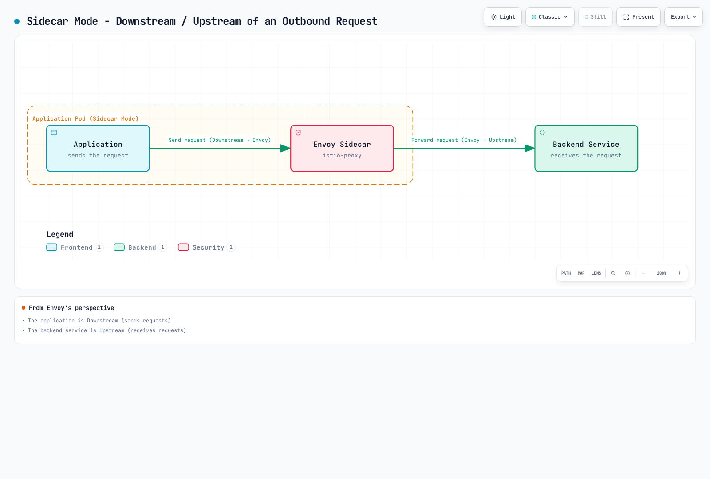

# Istio 术语表

> **已审阅版本**: Istio 1.31.0
> **最后更新**: October 12, 2026

本术语表按分组参考章节整理了与 Istio 和 Service Mesh 相关的关键术语。

> **参考语言**：下方的 Architecture 和 DestinationRule 章节链接使用维护中的英文指南。在本地化译文尚未同步时，这些链接可提供当前参考内容。

## 目录

- [A-C](#a-c)
- [D-F](#d-f)
- [G-I](#g-i)
- [J-L](#j-l)
- [M-O](#m-o)
- [P-R](#p-r)
- [S-U](#s-u)
- [V-Z](#v-z)

---

## A-C

### AuthorizationPolicy

一种 Istio 安全策略，为选定的工作负载或目标资源定义 ALLOW、DENY、CUSTOM 或 AUDIT 行为。身份验证和授权是独立的；waypoint 策略使用 targetRefs。

### Control Plane

由 istiod 实现的配置、发现和身份管理层。应用程序有效负载通过数据平面代理流动，而不经过 istiod。

### Ambient Mode

一种数据平面模式，最初在 Istio 1.18 中作为 alpha 版本发布，自 Istio 1.24 起正式可用，可在没有 Sidecar Proxy 的情况下提供服务网格功能。

**功能**：
- 不需要 Sidecar 容器
- 在节点级别使用 ztunnel
- 提升资源效率
- 分离 L4 和 L7 功能

**相关文档**：[Ambient Mode](advanced/01-ambient-mode.md)

---

### Certificate Authority (CA)

为服务间 mTLS 通信签发和管理证书的机构。

**在 Istio 中的作用**：
- Istiod 的 Citadel 功能承担 CA 角色
- 基于 SPIFFE ID 签发证书
- 自动续订证书（默认 TTL：24 小时）

**相关术语**：[Citadel](#citadel)、[SPIFFE](#spiffe-secure-production-identity-framework-for-everyone)、[mTLS](#mtls-mutual-tls)

---

### Circuit Breaker

一种阻止向故障服务发送请求的模式，以防止故障传播到整个系统。

**工作原理**：
1. **Closed**：正常运行
2. **Open**：连续故障后阻止请求
3. **Half-Open**：经过一段时间后允许部分请求

**Istio 实现**：连接池熔断和每个端点的异常值驱逐不会公开这个字面上的三状态机。
```yaml
apiVersion: networking.istio.io/v1
kind: DestinationRule
metadata:
  name: glossary-example-1
spec:
  host: reviews
  trafficPolicy:
    outlierDetection:
      consecutive5xxErrors: 5
      interval: 30s
      baseEjectionTime: 30s
```

**相关文档**：[Circuit Breaker](traffic-management/07-circuit-breaker.md)

---

### Citadel

一个曾在 Istio 1.4 之前独立存在的安全组件。现已集成到 Istiod 中。

**主要功能**：
- Certificate Authority (CA) 管理
- SPIFFE ID 签发和管理
- X.509 证书生成和续订

**当前状态**：在 Istio 1.5+ 中作为 Istiod 内部功能存在

**相关术语**：[Istiod](#istiod)、[Certificate Authority](#certificate-authority-ca)

---

### CDS (Cluster Discovery Service)

xDS API 之一，允许 Envoy 动态接收上游服务（集群）的配置。

**提供的信息**：
- 集群名称和类型
- 负载均衡策略
- 健康检查设置
- 熔断器设置
- TLS 设置

**相关术语**：[xDS](#xds-discovery-service)、[Envoy](#envoy-proxy)

---

## D-F

### Data Plane

服务网格中处理实际流量的层。

**Istio 的数据平面**：
- Envoy sidecar，或 ambient ztunnel 加可选的 L7 waypoint
- 处理已加入网格的流量；存在排除项和协议限制
- mTLS 加密/解密
- 指标收集

**相关术语**：[Control Plane](#control-plane)、[Envoy](#envoy-proxy)

---

### DestinationRule

一种 Istio CRD，用于定义由 VirtualService 路由流量的策略。

**主要功能**：
- Subset 定义（版本、区域等）
- 负载均衡策略
- Connection Pool 设置
- Circuit Breaker 设置
- TLS 设置

```yaml
apiVersion: networking.istio.io/v1
kind: DestinationRule
metadata:
  name: reviews
spec:
  host: reviews
  subsets:
  - name: v1
    labels:
      version: v1
  - name: v2
    labels:
      version: v2
```

**相关文档**：[DestinationRule](traffic-management/03-destination-rule.md)

---

### eBPF (Extended Berkeley Packet Filter)

一种允许程序在 Linux 内核中安全运行的技术。

Istio 可以与诸如 Cilium 的基于 eBPF 的主 CNI 共存。Istio CNI 是一个独立的链式插件/节点代理，用于配置流量重定向；ambient 不需要 eBPF，也不会替代主 CNI。

**优势**：
- 低开销
- 内核级处理
- 动态编程能力

**相关术语**：[Ambient Mode](#ambient-mode)、[iptables](#iptables)

---

### EDS (Endpoint Discovery Service)

xDS API 之一，用于动态提供集群内的实际端点（Pod IP）。

**提供的信息**：
- 端点 IP 地址和端口
- 健康状态
- 负载均衡权重
- 本地性信息

**示例**：
```json
{
  "cluster_name": "outbound|9080||reviews",
  "endpoints": [
    {
      "lb_endpoints": [
        {"endpoint": {"address": {"socket_address": {"address": "10.244.1.5", "port_value": 9080}}}},
        {"endpoint": {"address": {"socket_address": {"address": "10.244.2.8", "port_value": 9080}}}}
      ]
    }
  ]
}
```

**相关术语**：[xDS](#xds-discovery-service)、[CDS](#cds-cluster-discovery-service)

---

### Envoy Proxy

构成 Istio 数据平面的高性能 L7 代理。

**历史**：
- 由 Matt Klein 于 2016 年在 Lyft 开发
- 2017 年成为 CNCF Incubating 项目
- 2018 年成为 CNCF Graduated 项目

**主要特性**：
- 使用 C++ 编写的高性能代理
- 通过 xDS API 实现动态配置
- 支持 HTTP/1.1、HTTP/2、gRPC
- 丰富的可观测性

**组件**：
- Listeners：端口监听
- Filters：请求/响应处理
- Routers：路由决策
- Clusters：上游服务

**相关文档**：[Architecture - Envoy Proxy](https://www.atomai.click/kubernetes-docs/en/service-mesh/istio/03-architecture#data-plane-envoy-proxy)

---

## G-I

### Galley

一个曾在 Istio 1.4 之前独立存在的配置验证组件。现已集成到 Istiod 中。

**主要功能**：
- Istio 配置验证
- Kubernetes 资源处理
- 配置部署前的错误检查

**当前状态**：在 Istio 1.5+ 中作为 Istiod 内部功能存在

**相关术语**：[Istiod](#istiod)

---

### Gateway

一种 Istio CRD，用于定义外部流量进入 Service Mesh 的入口点。

**类型**：
1. **Ingress Gateway**：外部到内部的流量
2. **Egress Gateway**：内部到外部的流量

```yaml
apiVersion: networking.istio.io/v1
kind: Gateway
metadata:
  name: my-gateway
spec:
  selector:
    istio: ingressgateway
  servers:
  - port:
      number: 80
      name: http
      protocol: HTTP
    hosts:
    - "example.com"
```

**相关文档**：[Gateway and VirtualService](traffic-management/01-gateway-virtualservice.md)

---

### gRPC

由 Google 开发的高性能 RPC（Remote Procedure Call）框架。

**与 Istio 的关系**：
- xDS API 基于 gRPC
- 用于 Istiod 到 Envoy 的通信
- 基于 HTTP/2（支持多路复用）

**优势**：
- 双向流
- 低延迟
- 使用 Protocol Buffers

**相关术语**：[xDS](#xds-discovery-service)

---

### Identity

表示 Service Mesh 内工作负载的身份。

**Istio 的 Identity**：
- 使用 SPIFFE ID 格式
- 基于 Kubernetes ServiceAccount
- 由 X.509 证书证明

**示例**：
```
spiffe://cluster.local/ns/default/sa/reviews
```

**相关术语**：[SPIFFE](#spiffe-secure-production-identity-framework-for-everyone)、[mTLS](#mtls-mutual-tls)

---

### iptables

一种在 Linux 中控制网络流量的防火墙工具。

**在 Istio 中的作用**：
- istio-init 或 Istio CNI 节点代理配置流量重定向
- 将所有 Pod 流量重定向到 Envoy
- 使用 NAT 表（PREROUTING、OUTPUT 链）

**简化规则（说明性示例，而非安装脚本）**：
```bash
# Outbound: All traffic except Envoy -> 15001
iptables -t nat -A OUTPUT -p tcp -m owner ! --uid-owner 1337 -j REDIRECT --to-port 15001

# Inbound: All traffic -> 15006
iptables -t nat -A PREROUTING -p tcp -j REDIRECT --to-port 15006
```

**设置替代方案**：Istio CNI 在节点级别执行特权网络设置。

**相关文档**：[Architecture - iptables](https://www.atomai.click/kubernetes-docs/en/service-mesh/istio/03-architecture#iptables-and-traffic-interception)

---

### Istiod

Istio 1.5+ 中统一的 Control Plane 组件。

**集成功能**：
- **Pilot**：Service Discovery、Traffic Management
- **Citadel**：Certificate Authority、Identity
- **Galley**：Configuration Validation

**执行方式**：
- 单个 Go 二进制文件：`pilot-discovery`
- 所有功能在单个进程中运行
- 默认端口：15012 (xDS)、15017 (Webhook)

**优势**：
- 降低复杂性
- 简化运维
- 资源效率

**相关文档**：[Architecture - Istiod](https://www.atomai.click/kubernetes-docs/en/service-mesh/istio/03-architecture#control-plane-istiod)

---

## J-L

### LDS (Listener Discovery Service)

xDS API 之一，允许 Envoy 动态接收要监听的端口和过滤器链。

**提供的信息**：
- Listener 地址和端口
- 协议（HTTP、TCP）
- Filter chain 配置
- TLS 设置

**Istio 的默认 Listeners**：
- `0.0.0.0:15001`：出站 TCP
- `0.0.0.0:15006`：入站 TCP
- `0.0.0.0:15021`：健康检查
- `0.0.0.0:15090`：Prometheus 指标

**相关术语**：[xDS](#xds-discovery-service)、[Envoy](#envoy-proxy)

---

### Locality-aware Load Balancing

一种考虑本地性（Region、Zone）信息的负载均衡方法。

**优先级**：
1. 同一 Zone 中的端点
2. 同一 Region 中的不同 Zone
3. 不同 Region

**配置示例**：
```yaml
apiVersion: networking.istio.io/v1
kind: DestinationRule
metadata:
  name: glossary-example-2
spec:
  host: reviews
  trafficPolicy:
    loadBalancer:
      localityLbSetting:
        enabled: true
        distribute:
        - from: us-west/zone-1a/*
          to:
            "us-west/zone-1a/*": 80
            "us-west/zone-1b/*": 20
```

**相关文档**：[Zone Aware Routing](resilience/03-zone-aware-routing.md)

---

## M-O

### Mixer

一个曾存在至 Istio 1.4 的策略和遥测组件。

**主要功能**：
- 策略执行（Rate Limiting、Access Control）
- 遥测收集

**移除原因**：
- 性能开销（每个请求都调用 Mixer）
- 架构复杂

**当前状态**：在 1.5 过渡期间弃用；剩余的 Mixer 功能在 1.8 中移除

**相关术语**：[Istiod](#istiod)

---

### mTLS (Mutual TLS)

一种客户端和服务器相互进行身份验证的双向 TLS 通信方法。

**Istio 的 mTLS**：
- 自动签发和续订证书
- 基于 SPIFFE ID 的身份验证
- TLS 密码套件通过协商确定；并非固定为 AES-256-GCM

**模式**：
1. **STRICT**：仅允许 mTLS
2. **PERMISSIVE**：允许 mTLS + 明文（用于迁移）
3. **DISABLE**：在 sidecar 模式中禁用 Istio 传输 mTLS；ambient 不支持

```yaml
apiVersion: security.istio.io/v1
kind: PeerAuthentication
metadata:
  name: default
spec:
  mtls:
    mode: STRICT
```

**相关文档**：[mTLS](security/01-mtls.md)

---

### Outlier Detection

一种自动排除表现异常端点的功能。

**检测条件**：
- 连续错误计数
- 错误率
- 连接失败/超时；仅延迟不是异常值驱逐阈值

```yaml
apiVersion: networking.istio.io/v1
kind: DestinationRule
metadata:
  name: glossary-example-3
spec:
  host: reviews
  trafficPolicy:
    outlierDetection:
      consecutive5xxErrors: 5
      interval: 30s
      baseEjectionTime: 30s
      maxEjectionPercent: 50
```

**相关文档**：[Outlier Detection](resilience/01-outlier-detection.md)

---

## P-R

### Downstream

从 Envoy 的角度看，指的是**发送请求的一方**。即发起到 Envoy 连接的客户端。

**Envoy 的 Downstream**：
- 进入 Envoy 的连接（Inbound）
- 发送请求的客户端
- Listener 接收的连接

**流量流向**：
```
Downstream (Client)  ->  Envoy Proxy  ->  Upstream (Backend)
```

**示例场景**：

#### 1. Sidecar Mode - Outbound Request



[🔍 查看交互式图表](https://www.atomai.click/kubernetes-docs/archmaps/en-service-mesh-istio-glossary-0.html)

**视角**：
- **从 Envoy 的视角**：应用程序是 Downstream（发送请求）
- **从 Envoy 的视角**：后端服务是 Upstream（接收请求）

#### 2. Ingress Gateway - External Request


[🔍 查看交互式图表](https://www.atomai.click/kubernetes-docs/archmaps/en-service-mesh-istio-glossary-1.html)

**与 Downstream 相关的 Envoy 配置**：

```yaml
# Listener - Receive Downstream connections
apiVersion: networking.istio.io/v1alpha3
kind: EnvoyFilter
metadata:
  name: downstream-config
  namespace: default
spec:
  workloadSelector:
    labels:
      app: reviews
  configPatches:
  - applyTo: LISTENER
    match:
      context: SIDECAR_INBOUND
    patch:
      operation: MERGE
      value:
        per_connection_buffer_limit_bytes: 32768  # Downstream buffer
```

**Downstream 指标**：
```bash
# Downstream connection count
envoy_listener_downstream_cx_active

# Downstream request count
envoy_http_downstream_rq_total

# Downstream response time
envoy_http_downstream_rq_time
```

**相关术语**：[Upstream](#upstream)、[Envoy](#envoy-proxy)、[Listener](#lds-listener-discovery-service)

---

### Upstream

从 Envoy 的角度看，指的是**接收请求的一方**。即 Envoy 发起连接的后端服务。

**Envoy 的 Upstream**：
- 从 Envoy 发出的连接（Outbound）
- 处理请求的后端服务
- 由 Cluster 管理的端点

**流量流向**：
```
Downstream (Client)  ->  Envoy Proxy  ->  Upstream (Backend)
```

**Upstream 组件**：

#### 1. Cluster (Upstream Group)

```yaml
# Define Upstream Cluster with DestinationRule
apiVersion: networking.istio.io/v1
kind: DestinationRule
metadata:
  name: reviews
spec:
  host: reviews  # Upstream service
  trafficPolicy:
    loadBalancer:
      simple: ROUND_ROBIN
    connectionPool:
      tcp:
        maxConnections: 100      # Upstream connection limit
      http:
        http1MaxPendingRequests: 50
        http2MaxRequests: 100
    outlierDetection:
      consecutive5xxErrors: 5        # Upstream failure detection
      interval: 30s
```

#### 2. Endpoint (Actual Upstream Instance)

```bash
# Check upstream endpoints
istioctl proxy-config endpoints <pod-name> | grep reviews

# Example output:
# ENDPOINT              STATUS      CLUSTER
# 10.244.1.5:9080       HEALTHY     outbound|9080||reviews.default.svc.cluster.local
# 10.244.2.8:9080       HEALTHY     outbound|9080||reviews.default.svc.cluster.local
# 10.244.3.12:9080      UNHEALTHY   outbound|9080||reviews.default.svc.cluster.local
```

**Upstream 流量策略**：

```yaml
apiVersion: networking.istio.io/v1
kind: DestinationRule
metadata:
  name: glossary-example-4
spec:
  host: reviews
  trafficPolicy:
    # Upstream load balancing
    loadBalancer:
      consistentHash:
        httpHeaderName: "x-user-id"

    # Upstream connection pool
    connectionPool:
      tcp:
        maxConnections: 100
        connectTimeout: 30s
      http:
        h2UpgradePolicy: UPGRADE

    # Upstream TLS
    tls:
      mode: ISTIO_MUTUAL

    # Upstream Circuit Breaker
    outlierDetection:
      consecutive5xxErrors: 5
      interval: 10s
      baseEjectionTime: 30s
```

**Upstream 与 Downstream 对比**：

| 项目 | Downstream | Upstream |
|------|-----------|----------|
| **方向** | 进入 Envoy（Inbound） | 从 Envoy 发出（Outbound） |
| **角色** | 发送请求（Client） | 接收请求（Server） |
| **Envoy 配置** | Listener、Filter Chain | Cluster、Endpoint |
| **示例** | 外部用户、其他服务 | 后端 API、Database |
| **指标** | `downstream_cx_*`、`downstream_rq_*` | `upstream_cx_*`、`upstream_rq_*` |

**真实案例**：

#### 场景 1：Service A -> Service B 调用

```
+---------------------------------------------------------+
| Service A Pod                                           |
|                                                         |
|  App --> Envoy Sidecar                                 |
|          |                                              |
|          | Downstream: App                              |
|          | Upstream: Service B                          |
+----------|-------------------------------------------------+
           |
           v
+---------------------------------------------------------+
| Service B Pod                                           |
|                                                         |
|          Envoy Sidecar --> App                          |
|          |                                              |
|          | Downstream: Service A Envoy                  |
|          | Upstream: Local App (Service B)              |
+---------------------------------------------------------+
```

**Service A 的 Envoy 视角**：
- Downstream：Service A 的应用程序
- Upstream：Service B

**Service B 的 Envoy 视角**：
- Downstream：Service A 的 Envoy
- Upstream：Service B 的应用程序（本地）

#### 场景 2：Ingress Gateway

```
External Client (Downstream)
        |
Ingress Gateway (Envoy)
        |
Internal Service (Upstream)
```

**Upstream 指标**：

```bash
# Upstream connection count
envoy_cluster_upstream_cx_active

# Upstream request counter; derive success/error rates from response-class counters
envoy_cluster_upstream_rq_total

# Upstream response time
envoy_cluster_upstream_rq_time

# Upstream health check
envoy_cluster_health_check_success

# Upstream Circuit Breaker
envoy_cluster_circuit_breakers_default_remaining_rq
```

**被动 Upstream 健康检测**：主动健康检查统计信息需要单独配置。

```yaml
apiVersion: networking.istio.io/v1
kind: DestinationRule
metadata:
  name: glossary-example-5
spec:
  host: reviews
  trafficPolicy:
    outlierDetection:
      # Upstream health detection
      consecutiveGatewayErrors: 5
      consecutive5xxErrors: 5
      interval: 10s
      baseEjectionTime: 30s
      maxEjectionPercent: 50
```

**调试**：

```bash
# 1. Check upstream cluster
istioctl proxy-config clusters <pod-name> --fqdn reviews.default.svc.cluster.local

# 2. Check upstream endpoint status
istioctl proxy-config endpoints <pod-name> --cluster "outbound|9080||reviews.default.svc.cluster.local"

# 3. Check upstream metrics
kubectl exec <pod-name> -c istio-proxy -- \
  curl -s localhost:15000/stats/prometheus | grep upstream

# 4. Check upstream connections
istioctl proxy-config all <pod-name> -o json | \
  jq '.configs[] | select(.["@type"] | contains("ClustersConfigDump"))'
```

**相关术语**：[Downstream](#downstream)、[Envoy](#envoy-proxy)、[Cluster](#cds-cluster-discovery-service)、[Endpoint](#eds-endpoint-discovery-service)

---

### Pilot

一个曾在 Istio 1.4 之前独立存在的流量管理组件。现已集成到 Istiod 中。

**主要功能**：
- Service Discovery
- Traffic Management（VirtualService、DestinationRule 处理）
- xDS Server

**当前状态**：在 Istio 1.5+ 中作为 Istiod 内部功能存在

**相关术语**：[Istiod](#istiod)、[xDS](#xds-discovery-service)

---

### RDS (Route Discovery Service)

xDS API 之一，用于动态提供 HTTP 路由规则。

**提供的信息**：
- 路由匹配规则（路径、headers 等）
- 基于权重的路由
- 重定向和重写规则
- Timeout 和 Retry 设置

**与 VirtualService 的关系**：
- VirtualService -> 由 Istiod 转换 -> RDS 配置

**相关术语**：[xDS](#xds-discovery-service)、[VirtualService](#virtualservice)

---

### Rate Limiting

一种限制每个时间单位内允许请求数量的功能。

**实现方法**：
1. **Local Rate Limiting**：由 Envoy 在本地处理
2. **Global Rate Limiting**：使用外部 Rate Limit 服务

```yaml
apiVersion: networking.istio.io/v1alpha3
kind: EnvoyFilter
metadata:
  name: filter-local-ratelimit
  namespace: default
spec:
  workloadSelector:
    labels:
      app: reviews
  configPatches:
  - applyTo: HTTP_FILTER
    match:
      context: SIDECAR_INBOUND
      listener:
        filterChain:
          filter:
            name: envoy.filters.network.http_connection_manager
            subFilter:
              name: envoy.filters.http.router
    patch:
      operation: INSERT_BEFORE
      value:
        name: envoy.filters.http.local_ratelimit
        typed_config:
          "@type": type.googleapis.com/envoy.extensions.filters.http.local_ratelimit.v3.LocalRateLimit
          stat_prefix: http_local_rate_limiter
          token_bucket:
            max_tokens: 100
            tokens_per_fill: 100
            fill_interval: 1s
          filter_enabled:
            default_value:
              numerator: 100
              denominator: HUNDRED
          filter_enforced:
            default_value:
              numerator: 100
              denominator: HUNDRED
```

**相关文档**：[Rate Limiting](resilience/02-rate-limiting.md)

---

## S-U

### SDS (Secret Discovery Service)

xDS API 之一，用于动态提供 TLS 证书和密钥。

**提供的信息**：
- X.509 证书
- 私钥
- CA 根证书

**优势**：
- 无需文件系统
- 自动续订证书
- 零停机续订

**相关术语**：[xDS](#xds-discovery-service)、[mTLS](#mtls-mutual-tls)

---

### Service Entry

一种 Istio CRD，用于将 Service Mesh 外部的服务注册到网格中。

**用例**：
- 外部 API 访问控制
- 将 Istio 功能应用于外部服务（Retry、Timeout 等）
- Egress Gateway 集成

```yaml
apiVersion: networking.istio.io/v1
kind: ServiceEntry
metadata:
  name: external-api
spec:
  hosts:
  - api.external.com
  ports:
  - number: 443
    name: https
    protocol: HTTPS
  location: MESH_EXTERNAL
  resolution: DNS
```

**相关文档**：[ServiceEntry](traffic-management/12-service-entry.md)

---

### Service Mesh

一种管理微服务间通信的基础设施层。

**核心功能**：
- 流量管理（路由、负载均衡）
- 安全性（mTLS、身份验证/授权）
- 可观测性（指标、日志、追踪）
- 弹性（Retry、Circuit Breaker）

**主要实现**：
- Istio
- Linkerd
- Consul Connect
- AWS App Mesh（[支持于 2026 年 9 月 30 日结束](https://docs.aws.amazon.com/app-mesh/latest/userguide/what-is-app-mesh.html)）

---

### SigV4 (AWS Signature Version 4)

一种用于验证 AWS API 请求的签名协议。

**工作原理**：


[🔍 查看交互式图表](https://www.atomai.click/kubernetes-docs/archmaps/en-service-mesh-istio-glossary-2.html)

**签名组件**：

1. **Canonical Request**：请求的标准化格式
   - HTTP 方法
   - URI 路径
   - 查询字符串
   - Headers
   - 有效负载哈希

2. **String to Sign**：待签名字符串
   - 算法：`AWS4-HMAC-SHA256`
   - 时间戳
   - Credential Scope
   - Canonical Request 哈希

3. **Signing Key**：签名密钥计算
   ```
   HMAC(HMAC(HMAC(HMAC("AWS4" + SecretKey, Date), Region), Service), "aws4_request")
   ```

4. **Signature**：最终签名
   ```
   HMAC(SigningKey, StringToSign)
   ```

**与 Istio 集成**：

AWS SDK 和 AWS CLI 使用由 IRSA 或 EKS Pod Identity 提供的临时凭证对 HTTPS 请求签名。这使签名与工作负载的 AWS 权限关联。Istio mTLS Identity 和 AWS IAM Identity 是独立的。

Envoy 的 `aws_request_signing` HTTP filter 是一种高级替代方案。它需要包含该扩展的 Envoy 构建版本、**proxy container** 可用的凭证、正确的 AWS service/region，以及仅限于目标 AWS 目的地的 filter 匹配。应将其插入到 router 之前，并位于会影响签名的任何 header/path 重写之后。来自应用程序的 HTTPS 是此 HTTP filter 无法解析的：Envoy 无法在加密的 TLS 内部添加签名。proxy-signing 设计必须向 signing proxy 提供 HTTP，并在上游发起经过验证的 TLS；避免双重 TLS 发起，或将未签名的 HTTP 暴露到预期本地代理路径之外。

上图描述的是这个显式配置的 signing-proxy 路径，而非 Istio 的默认功能。仅在应用程序 ServiceAccount 上使用 IRSA annotation，并不能证明 gateway 或 sidecar 具有所需的凭证环境和 token mount。

**身份验证不是 JWT 验证**：

SigV4 是 HMAC 请求签名，而不是 JWT。`https://sts.amazonaws.com/.well-known/jwks` 不是用于验证 AWS API 签名的 JWT issuer endpoint。Istio RequestAuthentication 会验证来自真实 OIDC issuer 的 JWT。CUSTOM AuthorizationPolicy 还需要配置实现外部授权的 `extensionProviders` 服务；没有该实现，它无法验证 SigV4。对于 AWS API 访问，应优先使用经 IAM 身份验证的 AWS endpoints 或 AWS SDK。

**只读验证示例**（工作负载中已安装 AWS CLI，并具有预期的 IAM role）：

```bash
aws sts get-caller-identity
aws s3api head-object --bucket my-bucket --key object.txt --region us-west-2
```

**运维注意事项**：

- 仅向工作负载授予所需的 AWS actions 和 resources。避免依赖共享的节点 instance role。
- 确认所选 credential provider 支持临时凭证和刷新。会话持续时间可配置，并非普遍为一小时。
- CloudTrail management events 和 data events 具有不同的覆盖范围；S3 对象访问需要适当的 data-event 配置。
- 检查 proxy 配置以确认 filter 位置。config dump 不会显示每个实时请求的 Authorization header，且通过 HTTPS 的未签名 curl 并非 SigV4 测试。
- 针对实际请求大小测量 signing/buffering/credential-fetch 开销；不保证固定的毫秒级开销。

**相关术语**：[AuthorizationPolicy](#authorizationpolicy)、[ServiceEntry](#service-entry)、[EnvoyFilter](advanced/03-envoy-filter.md)

**参考资料**：
- [AWS Signature Version 4](https://docs.aws.amazon.com/general/latest/gr/signature-version-4.html)
- [Envoy AWS Request Signing](https://www.envoyproxy.io/docs/envoy/latest/configuration/http/http_filters/aws_request_signing_filter)
- [AWS Integration](04-aws-integration.md)

---

### Sidecar

一种与应用程序容器一同部署的辅助容器模式。

**Istio 的 Sidecar**：
- 容器名称：`istio-proxy`
- 镜像：`istio/proxyv2`
- 运行 Envoy Proxy
- 通过 init-container 或 Istio CNI 重定向拦截已配置的流量

**注入方法**：
1. **自动**：Namespace label
2. **手动**：`istioctl kube-inject`

```yaml
apiVersion: v1
kind: Namespace
metadata:
  name: example-mesh
  labels:
    istio-injection: enabled  # Automatic injection
```

**相关文档**：[Sidecar Injection](advanced/07-sidecar-injection.md)

---

### Sidecar Resource

一种 Istio CRD，用于限制 Envoy 接收的服务信息。

**目的**：
- 减少内存使用
- 缩短配置推送时间
- 配置作用域，而非网络安全边界

```yaml
apiVersion: networking.istio.io/v1
kind: Sidecar
metadata:
  name: default
  namespace: default
spec:
  egress:
  - hosts:
    - "./*"  # Same namespace only
    - "istio-system/*"
```

**效果**：
- 导入较少的服务可减少内存和配置工作；应测量实际节省量。

**相关文档**：[Architecture - Sidecar Resource](https://www.atomai.click/kubernetes-docs/en/service-mesh/istio/03-architecture#optimization-with-sidecar-resource)

---

### SPIFFE (Secure Production Identity Framework for Everyone)

一种用于在云原生环境中证明工作负载 Identity 的标准。

**SPIFFE ID 格式**：
```
spiffe://trust-domain/path
```

**Istio 示例**：
```
spiffe://cluster.local/ns/default/sa/reviews
  |         |           |     |      |    |
  |         |           |     |      |    +- ServiceAccount name
  |         |           |     |      +----- "sa" (ServiceAccount)
  |         |           |     +------------ Namespace name
  |         |           +------------------ "ns" (Namespace)
  |         +------------------------------ Trust Domain
  +---------------------------------------- Protocol
```

**组件**：
- **SPIFFE ID**：工作负载标识符
- **SVID (SPIFFE Verifiable Identity Document)**：X.509-SVID 或 JWT-SVID；Istio mTLS 使用 X.509-SVID

**相关术语**：[Identity](#identity)、[mTLS](#mtls-mutual-tls)

---

### Subset

在 DestinationRule 中定义的服务逻辑分组。

**常见用途**：
- 按版本：`v1`、`v2`、`v3`
- 按部署阶段：`stable`、`canary`、`test`
- 按区域：`us-west`、`us-east`、`eu-central`

```yaml
apiVersion: networking.istio.io/v1
kind: DestinationRule
metadata:
  name: glossary-example-6
spec:
  host: reviews
  subsets:
  - name: v1
    labels:
      version: v1
  - name: v2
    labels:
      version: v2
```

**相关文档**：[DestinationRule - Subset Concept](https://www.atomai.click/kubernetes-docs/en/service-mesh/istio/traffic-management/03-destination-rule#subset-concept)

---

## V-Z

### Waypoint Proxy

一种可选代理，可在 Ambient Mode 中提供 L7 功能。

**作用**：
- 通过 namespace、Service 或 Pod labels 选择；不会自动按 ServiceAccount 选择
- 基于 Envoy Proxy
- 专用于 L7 流量管理功能
- 与 ztunnel 协同工作

**提供的功能**：
- L7 路由（基于 Path、Header）
- Retry 和 Timeout
- Circuit Breaker
- Fault Injection
- Header 操作

**部署示例**：
```yaml
apiVersion: gateway.networking.k8s.io/v1
kind: Gateway
metadata:
  name: reviews-waypoint
  namespace: default
spec:
  gatewayClassName: istio-waypoint
  listeners:
  - name: mesh
    port: 15008
    protocol: HBONE
```

**特性**：
- ztunnel 仅处理 L4，waypoint 处理 L7
- 仅选择性用于需要它的服务
- 比 Sidecar 更具资源效率（共享方式）
- 通过 namespace、Service 或 Pod labels 选择；不会自动按 ServiceAccount 选择

**相关术语**：[Ambient Mode](#ambient-mode)、[ztunnel](#ztunnel-zero-trust-tunnel)

---

创建 waypoint 后，请将预期服务加入其中，例如 `kubectl label service reviews istio.io/use-waypoint=reviews-waypoint --overwrite`。仅部署 Gateway 不会使流量经由它路由。

### VirtualService

一种 Istio CRD，用于定义流量如何在 Service Mesh 内路由。

**主要功能**：
- 基于 URI、headers、查询参数的路由
- 基于权重的流量分配
- Retry 和 Timeout 设置
- Fault Injection

```yaml
apiVersion: networking.istio.io/v1
kind: VirtualService
metadata:
  name: reviews
spec:
  hosts:
  - reviews
  http:
  - match:
    - uri:
        prefix: "/v2"
    route:
    - destination:
        host: reviews
        subset: v2
  - route:
    - destination:
        host: reviews
        subset: v1
```

**相关文档**：[Gateway and VirtualService](traffic-management/01-gateway-virtualservice.md)

---

### WASM (WebAssembly)

一种设计用于在 Web 浏览器中运行的二进制指令格式。在 Istio 中，它用于扩展 Envoy proxy 的功能。

**在 Istio 中的使用**：
- 以 Envoy Filter 的形式添加自定义逻辑
- 无需重新部署即可动态扩展功能
- 可使用多种语言编写（Rust、C++、Go 等）
- 在沙箱环境中安全运行

**主要用例**：
1. **Custom Authentication/Authorization**：实现复杂业务逻辑
2. **Request/Response Transformation**：Header 操作、有效负载转换
3. **Advanced Routing**：自定义路由逻辑
4. **Metric Collection**：专用遥测

下方的 registry URLs、digests、credentials 和 pluginConfig fields 是您自行构建插件的占位符；Istio 不提供这些示例镜像，也不会解释特定于插件的选项。file:// module 必须存在于 proxy container 内。

**WASM Plugin 示例**：
```yaml
apiVersion: extensions.istio.io/v1alpha1
kind: WasmPlugin
metadata:
  name: custom-auth
  namespace: istio-system
spec:
  selector:
    matchLabels:
      istio: ingressgateway
  url: oci://ghcr.io/my-org/custom-auth:v1.0.0
  phase: AUTHN
  pluginConfig:
    api_key_header: "X-API-Key"
    validate_endpoint: "https://auth.example.com/validate"
```

**部署方法**：

#### 1. 通过 OCI Registry 部署（推荐）

```yaml
apiVersion: extensions.istio.io/v1alpha1
kind: WasmPlugin
metadata:
  name: rate-limiter
spec:
  url: oci://ghcr.io/my-org/rate-limit:v1.0.0
  imagePullPolicy: Always
  imagePullSecret: registry-credential
```

#### 2. 通过 HTTP URL 部署

```yaml
apiVersion: extensions.istio.io/v1alpha1
kind: WasmPlugin
metadata:
  name: custom-filter
spec:
  url: https://example.com/filters/custom-filter.wasm
  # Add sha256: with the actual 64-character module digest before deployment
```

#### 3. 本地文件部署

```yaml
apiVersion: extensions.istio.io/v1alpha1
kind: WasmPlugin
metadata:
  name: local-filter
spec:
  url: file:///etc/istio/filters/custom.wasm
```

**WASM 开发示例（Rust）**：

```rust
use proxy_wasm::traits::*;
use proxy_wasm::types::*;

proxy_wasm::main! {{
    proxy_wasm::set_http_context(|_, _| -> Box<dyn HttpContext> {
        Box::new(CustomFilter)
    });
}}

struct CustomFilter;
impl Context for CustomFilter {}

impl HttpContext for CustomFilter {
    fn on_http_request_headers(&mut self, _: usize, _: bool) -> Action {
        // Demonstrate header mutation, not production API-key authentication.
        self.set_http_request_header("x-mesh-demo", Some("wasm"));
        Action::Continue
    }
}
```

**构建和部署前提条件**：

使用兼容 `proxy-wasm` dependency 且锁定 dependency version 的 Rust `cdylib` crate。以上 callback 遵循[官方 Rust SDK 示例](https://github.com/proxy-wasm/proxy-wasm-rust-sdk/tree/main/examples/http_headers)。安装 `wasm32-unknown-unknown` target，构建 module，并在从 WasmPlugin 引用前将生成的 `.wasm` 打包到受支持的 OCI Wasm image 中。没有 Dockerfile 的通用 `docker build` 不会完成该打包。

```bash
rustup target add wasm32-unknown-unknown
cargo build --target wasm32-unknown-unknown --release
```

针对特定 plugin 测量启动时间、内存和每请求开销。Wasm 在 proxy process 内的 runtime sandbox 中执行；它不是独立进程，也不是无条件的安全性/性能保证。

**Ambient Mode 支持**：

```yaml
apiVersion: extensions.istio.io/v1alpha1
kind: WasmPlugin
metadata:
  name: waypoint-filter
spec:
  targetRefs:
  - group: gateway.networking.k8s.io
    kind: Gateway
    name: reviews-waypoint
  url: oci://ghcr.io/filters/custom:latest
  phase: AUTHN
```

**调试**：

```bash
# Check WASM plugin status
kubectl get wasmplugin -A

# Check WASM-related logs in Envoy logs
kubectl logs <pod-name> -c istio-proxy | grep wasm

# Check WASM module load
istioctl proxy-config all <pod-name> -o json | jq '.. | objects | select(has("@type")) | select(.["@type"] | test("wasm"; "i"))'
```

**安全注意事项**：
1. **Sandbox Isolation**：Envoy 内的 runtime sandbox；审查 plugin 信任和资源使用情况
2. **Resource Limits**：可配置 CPU 和内存限制
3. **Integrity Verification**：SHA256 检查内容；不验证 publisher
4. **Least Privilege**：仅授予必要权限

**优势**：
- 高性能（原生代码级别）
- 安全沙箱执行
- 无需重新部署即可更新
- 多语言支持
- 标准 OCI image 格式

**限制**：
- 部分系统调用受限
- 有限的文件 I/O
- 网络调用只能通过 Envoy API

**相关术语**：[Envoy](#envoy-proxy)、[Waypoint Proxy](#waypoint-proxy)、[Ambient Mode](#ambient-mode)

**参考资料**：
- [Istio WASM Plugin](https://istio.io/latest/docs/reference/config/proxy_extensions/wasm-plugin/)
- [Proxy-Wasm SDK](https://github.com/proxy-wasm)
- [WebAssembly Official Site](https://webassembly.org/)
- [Ambient Mode - WASM](https://istio.io/latest/docs/ambient/usage/extend-waypoint-wasm/)

---

### xDS (Discovery Service)

一组用于动态配置 Envoy Proxy 的 API。

**“xDS”的含义**：
- `x`：表示多种类型的变量
- `DS`：Discovery Service

**xDS API 类型**：

| API | 名称 | 作用 |
|-----|------|------|
| **LDS** | Listener Discovery Service | 监听端口和过滤器链 |
| **RDS** | Route Discovery Service | HTTP 路由规则 |
| **CDS** | Cluster Discovery Service | 上游服务配置 |
| **EDS** | Endpoint Discovery Service | 实际 Pod IP 列表 |
| **SDS** | Secret Discovery Service | TLS 证书和密钥 |

**通信方式**：
- 协议：gRPC
- 端口：15012 (Istiod)
- 双向流

**顺序**：
```
Agent bootstraps identity -> Envoy subscribes to ADS resources
Istiod pushes LDS/CDS/EDS/RDS updates; local agent serves SDS certificates
```

**相关文档**：[Architecture - xDS API Communication](https://www.atomai.click/kubernetes-docs/en/service-mesh/istio/03-architecture#xds-api-communication)

---

### Zone

表示 Kubernetes Availability Zone。

**标签格式**：
```yaml
topology.kubernetes.io/zone: us-west-1a
```

**在 Istio 中的使用**：
- Locality-aware Load Balancing
- Zone Aware Routing
- 同 Zone 优先路由

**相关术语**：[Locality-aware Load Balancing](#locality-aware-load-balancing)

---

### ztunnel (Zero Trust Tunnel)

Ambient Mode 的核心组件，是在节点级别运行的轻量级 L4 proxy。

**作用**：
- 作为 DaemonSet 部署在每个节点上
- 处理所有 Pod 的 L4 流量
- 无需 Sidecar 即可提供服务网格功能
- 与 CNI plugin 集成

**提供的功能**：
- **mTLS**：自动加密/解密
- **L4 Telemetry**：指标收集
- **Identity**：基于 Service Account 的身份验证
- **L4 Load Balancing**：基本负载均衡

**技术特性**：
- 使用 Rust 编写（高性能）
- Istio CNI 管理的流量重定向
- 无需 Init Container
- 共享 L4 proxy 资源；根据测量的节点工作负载确定规模

**部署示例**：
```bash
# Use the reviewed istioctl version and the complete ambient installation profile
istioctl install --set profile=ambient
kubectl rollout status daemonset/ztunnel -n istio-system
```

对于现有 sidecar 工作负载，请移除 injection/revision labels 并重启 pods，以便在 ambient 加入前移除 sidecars；新的无 sidecar 工作负载无需重启。

**Namespace 激活**：
```bash
# Enable Ambient Mode
kubectl label namespace default istio-injection- istio.io/rev-
kubectl label namespace default istio.io/dataplane-mode=ambient --overwrite
```

**优势**：
- 潜在内存节省取决于节点/工作负载和 waypoint 容量
- 无需重启 Pod
- 应用程序透明性
- 最小化初始延迟

**限制**：
- L7 功能需要 Waypoint Proxy
- 需要受支持的 Linux Kubernetes 平台、主 CNI 和 Istio CNI 前提条件

**相关术语**：[Ambient Mode](#ambient-mode)、[Waypoint Proxy](#waypoint-proxy)、[eBPF](#ebpf-extended-berkeley-packet-filter)

---

## 参考资料

### 官方文档
- [Istio Glossary](https://istio.io/latest/docs/reference/glossary/)
- [Envoy Terminology](https://www.envoyproxy.io/docs/envoy/latest/intro/arch_overview/intro/terminology)
- [SPIFFE Specification](https://github.com/spiffe/spiffe/tree/main/standards)

### 相关文档
- [Istio Architecture](03-architecture.md)
- [Traffic Management](traffic-management/README.md)
- [Security](security/README.md)
- [Observability](observability/README.md)

---

**最后更新**: September 13, 2026

- [Destination Rule](https://istio.io/latest/docs/reference/config/networking/destination-rule/)
- [Install the Istio CNI node agent](https://istio.io/latest/docs/setup/additional-setup/cni/)
- [Ztunnel traffic redirection](https://istio.io/latest/docs/ambient/architecture/traffic-redirection/)
- [Install with istioctl](https://istio.io/latest/docs/ambient/install/istioctl/)
- [Configure waypoint proxies](https://istio.io/latest/docs/ambient/usage/waypoint/)
- [Enabling Rate Limits using Envoy](https://istio.io/latest/docs/tasks/policy-enforcement/rate-limit/)
- [Wasm Plugin](https://istio.io/latest/docs/reference/config/proxy_extensions/wasm-plugin/)
- [Proxy-Wasm Rust SDK HTTP example](https://raw.githubusercontent.com/proxy-wasm/proxy-wasm-rust-sdk/main/examples/http_headers/src/lib.rs)
- [AWS Signature Version 4 for API requests - AWS Identity and Access Management](https://docs.aws.amazon.com/IAM/latest/UserGuide/reference_sigv.html)
- [AWS Request Signing](https://www.envoyproxy.io/docs/envoy/latest/configuration/http/http_filters/aws_request_signing_filter)
- [Statistics](https://www.envoyproxy.io/docs/envoy/latest/configuration/upstream/cluster_manager/cluster_stats)
- [Istio 1.8 Change Notes](https://istio.io/latest/news/releases/1.8.x/announcing-1.8/change-notes/)
- [What Is AWS App Mesh? - AWS App Mesh](https://docs.aws.amazon.com/app-mesh/latest/userguide/what-is-app-mesh.html)

- [CloudTrail data event coverage](https://docs.aws.amazon.com/awscloudtrail/latest/userguide/logging-data-events-with-cloudtrail.html)
