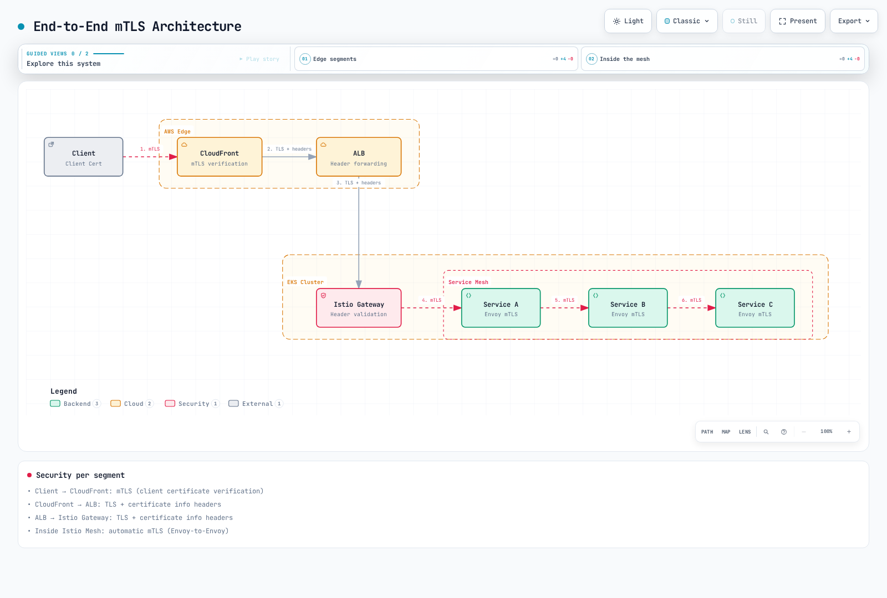

# mTLS

双向 TLS（mTLS）是 Istio 的核心安全功能，可自动加密并验证服务到服务的通信。

## 目录

1. [mTLS 概述](#mtls-overview)
2. [mTLS 模式](#mtls-modes)
3. [证书管理](#certificate-management)
4. [PeerAuthentication 配置](#peerauthentication-configuration)
5. [mTLS 与 AWS 服务集成](#mtls-integration-with-aws-services)
6. [mTLS 与外部服务](#mtls-with-external-services)
7. [迁移策略](#migration-strategy)
8. [常见问题与解决方案](#common-issues-and-solutions)
9. [性能与监控](#performance-and-monitoring)

## mTLS 概述 {#mtls-overview}

<p align="center">
  
</p>

自动 mTLS 会为兼容的网格对等端选择 TLS。在 sidecar 模式下，使用 `STRICT` 拒绝接收代理上的明文流量，并使用 AuthorizationPolicy 限制身份。仅使用自动 mTLS 并不能构成完整的零信任策略。下面的身份流说明的是 sidecar；ambient 使用 ztunnel 和可选的 waypoint。

### 基于身份的安全

Istio 使用 **SPIFFE（面向所有人的安全生产身份框架）** 标准，为每个工作负载分配强身份：

```
spiffe://cluster.local/ns/default/sa/productpage
  |         |           |     |      |    |
  |         |           |     |      |    +- ServiceAccount name
  |         |           |     |      +----- "sa" (ServiceAccount)
  |         |           |     +------------ Namespace name
  |         |           +------------------ "ns" (Namespace)
  |         +------------------------------ Trust Domain
  +---------------------------------------- Protocol
```

**身份配置流程**：
1. Kubernetes 创建 Pod 并分配 ServiceAccount
2. Istio Agent 在 Pod 内启动
3. Agent 向 Istiod 发送 CSR（证书签名请求）
4. Istiod 根据 SPIFFE ID 签发 X.509 证书
5. Agent 将证书交付给 Envoy（SDS 协议）
6. 自动续订证书（默认 TTL：24 小时）


[🔍 查看交互式图表](https://www.atomai.click/kubernetes-docs/archmaps/en-service-mesh-istio-security-01-mtls-0.html)

## mTLS 模式 {#mtls-modes}

以下示例互为替代方案。在网格根命名空间（通常为 `istio-system`）中不带 selector 的策略会作用于整个网格。Ambient 使用 HBONE 加密捕获到的网格流量；不支持 `DISABLE`，而 `STRICT` 会拒绝绕过流量。

### STRICT 模式（推荐）

```yaml
apiVersion: security.istio.io/v1
kind: PeerAuthentication
metadata:
  name: default
  namespace: istio-system
spec:
  mtls:
    mode: STRICT  # Only mTLS allowed
```

### PERMISSIVE 模式（用于迁移）

```yaml
apiVersion: security.istio.io/v1
kind: PeerAuthentication
metadata:
  name: default
  namespace: default
spec:
  mtls:
    mode: PERMISSIVE  # Both mTLS and plaintext allowed
```

### DISABLE 模式

```yaml
apiVersion: security.istio.io/v1
kind: PeerAuthentication
metadata:
  name: disable-mtls
  namespace: default
spec:
  mtls:
    mode: DISABLE  # mTLS disabled
```

## 证书管理 {#certificate-management}

### Istio 默认 CA 证书

默认情况下，istiod 会创建自签名根 CA，并直接用它为工作负载证书签名。在生产部署中，可以选择使用离线根 CA 和单独的中间签名 CA；默认情况下不会自动创建这样的层级结构。

默认情况下，Agent 会请求有效期为 **24 小时** 的工作负载证书，并在证书有效期约过半时安排续订，同时加入随机抖动。CA 可能会限制所请求的有效期。根证书和中间证书有各自独立的生命周期。请检查已签发的证书，确认其实际使用的算法和有效期。

### 证书验证

```bash
# 1. Check CA certificate
kubectl get secret istio-ca-secret -n istio-system -o jsonpath='{.data.ca-cert\.pem}' | \
  base64 -d | openssl x509 -noout -issuer -subject -dates

# 2. Check workload certificate
istioctl proxy-config secret <pod-name> -n <namespace>

# 3. Certificate details
istioctl proxy-config secret <pod-name> -n <namespace> -o json | \
  jq -r '.dynamicActiveSecrets[] | select(.secret.name == "default") | .secret.tlsCertificate.certificateChain.inlineBytes' | \
  base64 -d | openssl x509 -text -noout

# 4. Check certificate expiration date
istioctl proxy-config secret <pod-name> -n <namespace> -o json | \
  jq -r '.dynamicActiveSecrets[] | select(.secret.name == "default") | .secret.tlsCertificate.certificateChain.inlineBytes' | \
  base64 -d | openssl x509 -noout -dates
```

### 使用自定义 CA 证书

使用能够签发 SPIFFE URI SAN 的私有 PKI。公有 ACME 证书不适用于工作负载身份。此 OpenSSL 示例用于引导一个新的测试网格；安装 istiod 之前，请先创建 `istio-system` 和 `cacerts`。在生产环境中，应将根密钥离线妥善保管。

#### 步骤 1：生成 CA 证书和密钥

```bash
# 1. Generate Root CA
umask 077
openssl genrsa -out root-key.pem 4096

openssl req -new -x509 -days 3650 -key root-key.pem \
  -out root-cert.pem -addext "basicConstraints=critical,CA:TRUE" \
  -subj "/C=US/ST=California/L=San Francisco/O=MyOrg/OU=IT/CN=Root CA"

# 2. Generate Intermediate CA
openssl genrsa -out ca-key.pem 4096

openssl req -new -key ca-key.pem -out ca-cert.csr \
  -subj "/C=US/ST=California/L=San Francisco/O=MyOrg/OU=IT/CN=Intermediate CA"

# 3. Sign Intermediate CA with Root CA
cat > ca-extensions.txt <<EOF
basicConstraints=critical,CA:TRUE,pathlen:0
keyUsage=critical,keyCertSign,cRLSign
EOF

openssl x509 -req -days 1825 -in ca-cert.csr \
  -CA root-cert.pem -CAkey root-key.pem -CAcreateserial \
  -out ca-cert.pem -extfile ca-extensions.txt

# 4. Create Certificate Chain
cat ca-cert.pem root-cert.pem > cert-chain.pem
```

#### 步骤 2：创建 Kubernetes Secret

```bash
kubectl create secret generic cacerts -n istio-system \
  --from-file=ca-cert.pem=ca-cert.pem \
  --from-file=ca-key.pem=ca-key.pem \
  --from-file=root-cert.pem=root-cert.pem \
  --from-file=cert-chain.pem=cert-chain.pem
```

#### 步骤 3：安装新网格

创建 `cacerts` 后，使用[安装指南](../01-installation.md)安装兼容且固定版本的 Istio。不要使用此初始安装流程替换正在运行的网格根 CA。

#### 步骤 4：验证

```bash
# Verify CA certificate is loaded correctly
kubectl logs -l app=istiod -n istio-system | grep "Use plugged-in cert"

# Verify workload certificates are issued by new CA
istioctl proxy-config secret <pod-name> -n <namespace> -o json | \
  jq -r '.dynamicActiveSecrets[] | select(.secret.name == "default") | .secret.tlsCertificate.certificateChain.inlineBytes' | \
  base64 -d | openssl x509 -noout -issuer
```

### AWS Private CA 集成

使用 **cert-manager → AWS Private CA issuer → istio-csr** 为工作负载签名。准备一个未安装 Istio 的新集群、一个处于活动状态的 Private CA，以及为 issuer 的 ServiceAccount 授予限定在该 CA 范围内的 IAM 权限（`DescribeCertificateAuthority`、`GetCertificate`、`IssueCertificate`）。使用 EKS Pod Identity 或 IRSA。CA 必须允许 SPIFFE SAN 和所请求的有效期。

安装与 Kubernetes 兼容的 cert-manager 版本（1.21 支持 Kubernetes 1.33–1.36），然后安装 AWS Private CA issuer。将下面的 ARN 替换为选定的 CA；纯 YAML 不会展开 shell 变量。

```yaml
apiVersion: awspca.cert-manager.io/v1beta1
kind: AWSPCAClusterIssuer
metadata:
  name: istio-ca
spec:
  arn: arn:aws:acm-pca:us-west-2:123456789012:certificate-authority/REPLACE_WITH_CA_ID
  region: us-west-2
```

使用经过验证的公有根证书包（`ca.pem`）在 `cert-manager` 命名空间中创建 `istio-root-ca`，然后使用以下 Helm values 配置 istio-csr：

```yaml
# istio-csr Helm values fragment
app:
  certmanager:
    issuer:
      group: awspca.cert-manager.io
      kind: AWSPCAClusterIssuer
      name: istio-ca
  tls:
    rootCAFile: /var/run/secrets/istio-csr/ca.pem
volumeMounts:
- name: root-ca
  mountPath: /var/run/secrets/istio-csr
  readOnly: true
volumes:
- name: root-ca
  secret:
    secretName: istio-root-ca
```

请参阅[当前的 istio-csr 安装指南](https://cert-manager.io/docs/usage/istio-csr/installation/)，获取完整且版本兼容的 chart 和 Istio 安装清单。后者会禁用 istiod 的 CA（`ENABLE_CA_SERVER=false`）、将 CA 端点设置为 `cert-manager-istio-csr.cert-manager.svc:443`，并挂载已签发的 istiod 服务证书和固定的根证书。对该清单使用 `istioctl install -f`。Ambient 还需要在 istio-csr 中配置受信任的 ztunnel ServiceAccount。按照该指南，不支持在现有 Istio 安装之后再安装 istio-csr。

cert-manager `Certificate` 通常会创建 `tls.crt`、`tls.key`，并可能创建 `ca.crt`；将其 Secret 命名为 `cacerts` **并不会**生成 Istio 所需的 `ca-cert.pem`、`ca-key.pem`、`root-cert.pem` 和 `cert-chain.pem`。istio-csr 路径可以避免对这种不兼容的 Secret 结构作出假设。

### 证书续订策略

sidecar Agent 控制其请求的有效期和轮换时间窗口。以下内容是 `istioctl` 输入；请通过安装工作流应用它，并在更改引导配置时滚动重启选定的代理：

```yaml
# Input to istioctl install -f; not kubectl apply
apiVersion: install.istio.io/v1alpha1
kind: IstioOperator
spec:
  meshConfig:
    defaultConfig:
      proxyMetadata:
        SECRET_TTL: "24h"
        SECRET_GRACE_PERIOD_RATIO: "0.5"
```

`SECRET_TTL` 默认值为 24h，`SECRET_GRACE_PERIOD_RATIO` 默认值为 0.5；续订还会加入随机抖动。这些是 Agent 设置，并非已移除的 `CITADEL_CERT_TTL`/`CITADEL_GRACE_PERIOD` 示例。实际证书签发方可能会缩短有效期。

### 证书轮换

叶证书续订、同一根证书下的中间证书续订，以及根证书替换是不同的操作。更换根证书时：

1. 向每个受影响的工作负载、网关和集群分发同时包含**旧根证书和新根证书**的证书包；在更换签名方之前，验证当前信任状态。
2. 引入新的签名方，并在两个根证书仍受信任时签发新的叶证书。
3. 验证 SDS 状态、证书链、跨集群流量和剩余的旧叶证书；同时考虑断开连接的工作负载和长连接。
4. 只有在迁移完成且回滚窗口结束后，才移除旧根证书。

请使用所选 CA 提供商支持的轮换流程。一步覆盖 `cacerts` 并重启并不能保证服务不中断。不要为了强制续订而重启所有命名空间。

## PeerAuthentication 配置 {#peerauthentication-configuration}

### 全局配置

```yaml
apiVersion: security.istio.io/v1
kind: PeerAuthentication
metadata:
  name: default
  namespace: istio-system
spec:
  mtls:
    mode: STRICT
```

### 命名空间级配置

```yaml
apiVersion: security.istio.io/v1
kind: PeerAuthentication
metadata:
  name: namespace-policy
  namespace: production
spec:
  mtls:
    mode: STRICT
```

### 工作负载级配置

```yaml
apiVersion: security.istio.io/v1
kind: PeerAuthentication
metadata:
  name: workload-policy
  namespace: default
spec:
  selector:
    matchLabels:
      app: reviews
      version: v1
  mtls:
    mode: STRICT
```

### 端口级配置

```yaml
apiVersion: security.istio.io/v1
kind: PeerAuthentication
metadata:
  name: port-policy
  namespace: default
spec:
  selector:
    matchLabels:
      app: myapp
  mtls:
    mode: STRICT
  portLevelMtls:
    8080:
      mode: DISABLE  # mTLS disabled for port 8080
```

## mTLS 与 AWS 服务集成 {#mtls-integration-with-aws-services}

### AWS Application Load Balancer（ALB）和 mTLS

ALB 支持基于客户端证书的 mTLS。


[🔍 查看交互式图表](https://www.atomai.click/kubernetes-docs/archmaps/en-service-mesh-istio-security-01-mtls-2.html)

#### 配置 ALB Listener 和 Gateway

使用客户端 CA 证书包创建 ALB trust store，并在下方填写其名称。AWS Load Balancer Controller 管理此 Ingress 及其 listener 设置。Gateway Deployment 必须已存在，并带有标签 `istio: ingressgateway`；还必须有一个 `gateway-cert` TLS Secret，以及一个绑定到 `istio-system/public-gateway` 并将 `api.example.com` 路由到应用程序的 VirtualService。

```yaml
apiVersion: v1
kind: Service
metadata:
  name: istio-gateway
  namespace: istio-system
spec:
  type: ClusterIP
  selector:
    istio: ingressgateway
  ports:
  - name: https
    port: 443
    targetPort: 8443
  - name: status-port
    port: 15021
    targetPort: 15021
---
apiVersion: networking.k8s.io/v1
kind: Ingress
metadata:
  name: istio-edge
  namespace: istio-system
  annotations:
    alb.ingress.kubernetes.io/scheme: internet-facing
    alb.ingress.kubernetes.io/target-type: ip
    alb.ingress.kubernetes.io/listen-ports: '[{"HTTPS":443}]'
    alb.ingress.kubernetes.io/certificate-arn: arn:aws:acm:us-west-2:123456789012:certificate/REPLACE_WITH_CERT_ID
    alb.ingress.kubernetes.io/mutual-authentication: '[{"port":443,"mode":"verify","trustStore":"istio-client-trust-store","ignoreClientCertificateExpiry":false}]'
    alb.ingress.kubernetes.io/backend-protocol: HTTPS
    alb.ingress.kubernetes.io/healthcheck-protocol: HTTP
    alb.ingress.kubernetes.io/healthcheck-port: '15021'
    alb.ingress.kubernetes.io/healthcheck-path: /healthz/ready
spec:
  ingressClassName: alb
  rules:
  - host: api.example.com
    http:
      paths:
      - path: /
        pathType: Prefix
        backend:
          service:
            name: istio-gateway
            port:
              number: 443
---
apiVersion: networking.istio.io/v1
kind: Gateway
metadata:
  name: public-gateway
  namespace: istio-system
spec:
  selector:
    istio: ingressgateway
  servers:
  - port:
      number: 443
      name: https
      protocol: HTTPS
    tls:
      mode: SIMPLE
      credentialName: gateway-cert
    hosts:
    - api.example.com
```

ALB 的 `verify` 模式会在握手期间验证客户端证书。其 `passthrough` 模式会转发证书链，以便应用程序验证；但 TLS 仍会在 ALB 处终止。HTTPS target group 会加密 ALB 到 Gateway 的流量，但 **ALB 不会验证 target 证书**。将 target 流量限制为来自 ALB security group 的流量，并限制健康检查端口；仅使用 ClusterIP Service 并不能阻止其他集群 Pod 访问 Gateway。

ALB 会生成 `X-Amzn-Mtls-Clientcert-Serial-Number`、`-Subject`、`-Issuer`、`-Validity` 和 `-Leaf`。这些 HTTP header 是来自受信任边缘的身份声明，并非 Envoy 上的客户端 TLS 会话。应阻止对源站的直接访问，并清理与之冲突的客户端自带身份 header。在后端，要求 Gateway 具有经过身份验证的网格主体，然后针对已验证的声明执行应用程序授权。仅凭 header 存在或 Subject 字符串不足以进行验证。包含 Envoy bootstrap YAML 的任意 ConfigMap 并不能配置 Gateway。

### Amazon CloudFront 和 mTLS

CloudFront 原生支持 viewer mTLS。使用包含已批准客户端 CA 证书包的 CloudFront trust store，并设置 `ViewerMtlsConfig.Mode=required`，以要求提供有效证书。创建或更新 trust store 时会读取 S3 中的证书包；仅更改 S3 不会刷新 trust store。目前，viewer mTLS 要求使用 HTTP/2，而非 HTTP/3；每个 cache behavior 都必须拒绝或重定向 HTTP。

#### 更新选定的 Distribution

以下示例保留完整的现有配置并使用其 ETag。应用更改之前，请检查所选 distribution、origin HTTPS 设置、所有 cache behavior 和 trust store。请使用支持 viewer mTLS API 的最新版 AWS CLI。

```bash
# Existing distribution and trust store selected explicitly by the operator.
DIST_ID=REPLACE_WITH_DISTRIBUTION_ID
TRUST_STORE_ID=REPLACE_WITH_TRUST_STORE_ID
aws cloudfront get-distribution-config --id "$DIST_ID" --output json > dist-before.json
ETAG=$(jq -r '.ETag' dist-before.json)
jq --arg trust "$TRUST_STORE_ID" '
  .DistributionConfig
  | .HttpVersion = "http2"
  | .DefaultCacheBehavior.ViewerProtocolPolicy = "https-only"
  | (if .CacheBehaviors.Quantity > 0 then
       .CacheBehaviors.Items |= map(.ViewerProtocolPolicy = "https-only")
     else . end)
  | .ViewerMtlsConfig = {
      Mode: "required",
      TrustStoreConfig: {
        TrustStoreId: $trust,
        AdvertiseTrustStoreCaNames: true,
        IgnoreCertificateExpiry: false
      }
    }
' dist-before.json > dist-mtls.json
# Review the complete diff before applying to the selected distribution.
diff -u <(jq '.DistributionConfig' dist-before.json) dist-mtls.json || true
aws cloudfront update-distribution --id "$DIST_ID" --if-match "$ETAG" \
  --distribution-config file://dist-mtls.json
```

#### 转发并授权证书身份

使用 origin request policy，仅转发必需的 `CloudFront-Viewer-Cert-*` header：`Present`、`Sha256`、`Serial-Number`、`Issuer`、`Subject`，以及可选的 `Validity`/`Pem`。PEM header 仅对 origin 可用，对边缘函数不可用。对于特定用户的响应，应禁用缓存或使用适当的、区分身份的 cache key；origin request policy 不会更改 cache key。

在原生 mTLS 验证之后，可选用 viewer-request CloudFront Function 应用允许列表。指纹用于识别证书；序列号仅在同一签发方内唯一。客户端证书轮换时，请同步更新允许列表：

```javascript
// Additional authorization after native CloudFront viewer mTLS verification.
function handler(event) {
    var fingerprint = event.request.headers['cloudfront-viewer-cert-sha256'];
    var allowed = ['REPLACE_WITH_VERIFIED_CERT_SHA256'];
    if (!fingerprint || allowed.indexOf(fingerprint.value) === -1) {
        return {statusCode: 403, statusDescription: 'Forbidden'};
    }
    return event.request;
}
```

要求 origin 仅接受来自目标 distribution 的流量，并使用受支持的 origin access control/网络设计和 origin 身份验证。后端不得信任任意调用方提供的这些 header。Viewer 证书验证在 CloudFront 处结束；到 origin 的 HTTPS 是独立的 TLS 会话。请参阅 [CloudFront mTLS 配置](https://docs.aws.amazon.com/AmazonCloudFront/latest/DeveloperGuide/enable-mtls-distributions.html)和[证书 header](https://docs.aws.amazon.com/AmazonCloudFront/latest/DeveloperGuide/viewer-mtls-headers.html)。

### 多个 TLS 跳之间的安全性

下图使用多个独立的 TLS 会话。图中沿用的历史标题“端到端 mTLS”并不意味着 viewer 证书就是网格工作负载身份。CloudFront 到 ALB 以及 ALB 到 Gateway 是通过转发身份声明实现的服务器身份验证/加密跳，并非在每一跳中传递 viewer mTLS。



[🔍 查看交互式图表](https://www.atomai.click/kubernetes-docs/archmaps/en-service-mesh-istio-security-01-mtls-4.html)

**各区段的安全性**：
1. **客户端 -> CloudFront**：mTLS（客户端证书验证）
2. **CloudFront -> ALB**：TLS + 证书信息 header
3. **ALB -> Istio Gateway**：TLS + 证书信息 header
4. **Istio 网格内部**：自动 mTLS（Envoy 到 Envoy）

## mTLS 与外部服务 {#mtls-with-external-services}

### 与旧系统集成

对于支持普通 HTTPS 的旧服务器，可以让 sidecar 发起 TLS。应用程序发送 `http://legacy.external.com:80`；代理则连接到 443 端口。如果应用程序已发送 HTTPS，请保持其为 opaque 流量，不要再通过此规则叠加第二层 TLS。对于使用私有 CA 的服务器，需要显式提供受信任的 CA 证书包。

```yaml
apiVersion: networking.istio.io/v1
kind: ServiceEntry
metadata:
  name: legacy-system
  namespace: default
spec:
  hosts: [legacy.external.com]
  location: MESH_EXTERNAL
  resolution: DNS
  ports:
  - number: 80
    targetPort: 443
    name: http
    protocol: HTTP
---
apiVersion: networking.istio.io/v1
kind: DestinationRule
metadata:
  name: legacy-system
  namespace: default
spec:
  host: legacy.external.com
  trafficPolicy:
    tls:
      mode: SIMPLE
      sni: legacy.external.com
      subjectAltNames: [legacy.external.com]
```

### 外部 API 的 mTLS 客户端身份验证

对于 HTTP 到 mTLS 的发起模式，请将客户端证书链/密钥和服务器信任证书包放在**客户端代理的命名空间**中。此处 sidecar 的 `credentialName` 示例要求使用下面带有 workload selector 的 DestinationRule。证书 SAN 必须与 `api.external.com` 匹配。

```bash
kubectl create secret generic client-mtls-credential -n default \
  --from-file=tls.crt=client-chain.pem \
  --from-file=tls.key=client-key.pem \
  --from-file=ca.crt=server-ca.pem
```

```yaml
apiVersion: networking.istio.io/v1
kind: ServiceEntry
metadata:
  name: external-api
  namespace: default
spec:
  hosts: [api.external.com]
  location: MESH_EXTERNAL
  resolution: DNS
  ports:
  - number: 80
    targetPort: 443
    name: http
    protocol: HTTP
---
apiVersion: networking.istio.io/v1
kind: DestinationRule
metadata:
  name: external-api-mtls
  namespace: default
spec:
  host: api.external.com
  workloadSelector:
    matchLabels:
      app: external-api-client
  trafficPolicy:
    tls:
      mode: MUTUAL
      credentialName: client-mtls-credential
      sni: api.external.com
      subjectAltNames: [api.external.com]
```

被选中的工作负载发送 `http://api.external.com:80`；只有其代理会发起 mTLS。此方法和下面的 egress-gateway 方法互为替代方案。

### 通过 Egress Gateway 使用外部 mTLS

请使用 [egress 指南](../traffic-management/11-egress-control.md)安装 egress gateway。此示例假设存在 Service `istio-egressgateway.istio-system.svc.cluster.local`、服务端口 443，以及 Gateway Pod 标签 `istio: egressgateway`。保留前文中对两个命名空间都可见的 ServiceEntry，省略直接客户端 DestinationRule，并在 `istio-system` 中为 Gateway 创建客户端凭据 Secret。

```yaml
apiVersion: networking.istio.io/v1
kind: Gateway
metadata:
  name: egress-gateway
  namespace: istio-system
spec:
  selector:
    istio: egressgateway
  servers:
  - port:
      number: 443
      name: https
      protocol: HTTPS
    hosts: [api.external.com]
    tls:
      mode: ISTIO_MUTUAL
---
apiVersion: networking.istio.io/v1
kind: DestinationRule
metadata:
  name: to-egress-gateway
  namespace: default
spec:
  host: istio-egressgateway.istio-system.svc.cluster.local
  trafficPolicy:
    tls:
      mode: ISTIO_MUTUAL
      sni: api.external.com
---
apiVersion: networking.istio.io/v1
kind: VirtualService
metadata:
  name: external-api-through-egress
  namespace: default
spec:
  hosts: [api.external.com]
  gateways: [mesh, istio-system/egress-gateway]
  http:
  - match:
    - gateways: [mesh]
      port: 80
    route:
    - destination:
        host: istio-egressgateway.istio-system.svc.cluster.local
        port:
          number: 443
  - match:
    - gateways: [istio-system/egress-gateway]
      port: 443
    route:
    - destination:
        host: api.external.com
        port:
          number: 80
---
apiVersion: networking.istio.io/v1
kind: DestinationRule
metadata:
  name: external-api-from-egress
  namespace: istio-system
spec:
  host: api.external.com
  workloadSelector:
    matchLabels:
      istio: egressgateway
  trafficPolicy:
    tls:
      mode: MUTUAL
      credentialName: client-mtls-credential
      sni: api.external.com
      subjectAltNames: [api.external.com]
```

流量路径为应用程序 HTTP:80 → Gateway ISTIO_MUTUAL:443 → 外部 MUTUAL:443（ServiceEntry 端口 80 映射到 targetPort 443）。验证 Gateway SDS Secret、生成的 cluster、服务器 SAN 验证和测试流量。通过 Gateway 路由并不能阻止绕过；请另行使用适当的网络控制来强制执行 egress 限制。

## 迁移策略 {#migration-strategy}

### 步骤 1：检查当前状态

```bash
# Check current mTLS configuration
kubectl get peerauthentication -A

# Check mTLS status by service
istioctl proxy-config clusters <pod-name> -n <namespace> -o json
```

仅在计划好的迁移中使用此流程。将明文例外限制在确实需要它的最小命名空间/工作负载范围内；不要仅仅为了诊断故障而将已处于 STRICT 模式的网格降级。

### 步骤 2：切换到 PERMISSIVE 模式

```yaml
apiVersion: security.istio.io/v1
kind: PeerAuthentication
metadata:
  name: default
  namespace: istio-system
spec:
  mtls:
    mode: PERMISSIVE  # Allow both mTLS and plaintext
```

### 步骤 3：监控

使用按 `connection_security_policy` 分组的目的端报告指标 `istio_requests_total`/`istio_tcp_connections_opened_total`，查找观察到的明文流量。生成有代表性的流量，并检查生效的代理 cluster 和证书。指标缺失并不能证明没有明文调用方。

### 步骤 4：切换到 STRICT 模式

```yaml
apiVersion: security.istio.io/v1
kind: PeerAuthentication
metadata:
  name: default
  namespace: istio-system
spec:
  mtls:
    mode: STRICT  # Only mTLS allowed
```

## 常见问题与解决方案 {#common-issues-and-solutions}

### 1. mTLS 连接失败

**症状**：
```
upstream connect error or disconnect/reset before headers. reset reason: connection failure
```

**根因分析**：

```bash
# 1. Check PeerAuthentication
kubectl get peerauthentication -A

# 2. Check DestinationRule mTLS mode
kubectl get destinationrule -A -o yaml | grep -A 5 "trafficPolicy"

# 3. Check certificates
istioctl proxy-config secret <pod-name> -n <namespace>

# 4. Verify TLS connection
istioctl proxy-config clusters <source-pod> -n <namespace> --fqdn <dest-service> -o json

# 5. Check Envoy logs in detail
kubectl logs <pod-name> -c istio-proxy -n <namespace> | grep -E "(TLS|SSL|certificate)"
```

**解决方案**：

1. **PeerAuthentication 与 DestinationRule 不匹配**：
```yaml
# Problem: PeerAuthentication is STRICT, DestinationRule is DISABLE
# Solution: Change DestinationRule to ISTIO_MUTUAL
apiVersion: networking.istio.io/v1
kind: DestinationRule
metadata:
  name: fix-mtls
spec:
  host: myservice.default.svc.cluster.local
  trafficPolicy:
    tls:
      mode: ISTIO_MUTUAL  # Match STRICT mode
```

2. **Pod 未注入 sidecar**：
```bash
# Add istio-injection label to namespace
kubectl label namespace default istio-injection=enabled

# Restart pod
kubectl rollout restart deployment/<deployment-name> -n default
```

### 2. 证书过期问题

**症状**：
```
TLS error: Secret is not supplied by SDS
x509: certificate has expired
```

**检查证书过期时间**：

```bash
# Check workload certificate expiration date
istioctl proxy-config secret <pod-name> -n <namespace> -o json | \
  jq -r '.dynamicActiveSecrets[] | select(.secret.name == "default") | .secret.tlsCertificate.certificateChain.inlineBytes' | \
  base64 -d | openssl x509 -noout -dates

# Check CA certificate expiration
kubectl get secret istio-ca-secret -n istio-system -o json | \
  jq -r '.data."ca-cert.pem"' | base64 -d | openssl x509 -noout -dates

# Check certificate expiration for all workloads
for pod in $(kubectl get pods -n default -o jsonpath='{.items[*].metadata.name}'); do
  echo "Pod: $pod"
  istioctl proxy-config secret $pod -n default -o json 2>/dev/null | \
    jq -r '.dynamicActiveSecrets[] | select(.secret.name == "default") | .secret.tlsCertificate.certificateChain.inlineBytes' | \
    base64 -d 2>/dev/null | openssl x509 -noout -dates 2>/dev/null || echo "No cert found"
done
```

**解决方案**：

先恢复 CA 连通性、有效信任和节点时间；检查 Agent/istiod 日志以查找续订失败的原因。重启 istiod 本身无法修复已过期的 CA。如果修复原因后某个选定的工作负载仍无法恢复，请在遵守其 disruption budget 的前提下执行受控滚动重启。

### 3. 时钟偏差（时间同步问题）

`certificate is not valid yet` 或证书过期错误可能表明节点时钟存在问题。将 UTC 时间与证书的 `NotBefore`/`NotAfter` 进行比较；TLS 没有通用的 ±5 分钟容差。在受影响的 EC2 节点上检查 chrony，不要将 NTP 地址当作 HTTP 进行查询：

```bash
date -u
chronyc tracking
chronyc sources -v
# Amazon Time Sync NTP: 169.254.169.123 (not an HTTP metadata URL)
```

根据操作系统（`chronyd` 或 `chrony`）修复节点上配置的时间同步服务。不要虚构证书宽限期环境变量来绕过有效性检查。

### 4. 循环依赖

Service A → B → A 的调用循环本身不会导致 mTLS 失败。请检查分布式跟踪、应用程序截止时间、重试、连接错误和代理日志，以区分递归或资源耗尽与 TLS 协商问题。`istioctl analyze` 会检查配置；它不会还原运行时调用图。增加 TCP 连接超时时间并不能解决依赖循环。

### 5. 混合协议（mTLS + 明文）

`WRONG_VERSION_NUMBER` 通常表示 TLS/明文端口不匹配。请检查 Service 端口协议、应用程序使用的 scheme、PeerAuthentication、DestinationRule 和实际代理 cluster。移除不正确的显式 TLS 覆盖，或修正目标协议；普通网格对等端应使用自动 mTLS。范围受限的 PERMISSIVE 例外适用于有意进行的迁移，不是通用修复方法。

### 6. Headless Service 的 mTLS

Headless Service 同样支持自动 mTLS。首先检查 endpoint 发现和命名的 Service 端口。以下显式规则是可选的，无法修复缺失的 endpoint 元数据或应用程序协议不匹配问题。

**症状**：headless service 上的 mTLS 连接失败

**解决方案**：

```yaml
apiVersion: networking.istio.io/v1
kind: DestinationRule
metadata:
  name: headless-service-mtls
spec:
  host: headless-service.default.svc.cluster.local
  trafficPolicy:
    tls:
      mode: ISTIO_MUTUAL
    portLevelSettings:
    - port:
        number: 3306
      tls:
        mode: ISTIO_MUTUAL
```

### 7. mTLS 与 NetworkPolicy 冲突

sidecar mTLS 使用应用程序的目标端口；**15008 是 ambient HBONE 端口**，并非通用的 sidecar mTLS 端口。此 sidecar 示例允许 gateway → productpage:9080、productpage → reviews/details:9080、istiod:15012 和集群 DNS。应用此策略之前，请根据实际情况调整标签、所有真实依赖项、抓取/探针和 NodeLocal DNS。Ambient 需要单独处理 CNI/NetworkPolicy。

```yaml
apiVersion: networking.k8s.io/v1
kind: NetworkPolicy
metadata:
  name: productpage-sidecar
  namespace: default
spec:
  podSelector:
    matchLabels:
      app: productpage
  policyTypes: [Ingress, Egress]
  ingress:
  - from:
    - namespaceSelector:
        matchLabels:
          kubernetes.io/metadata.name: istio-system
      podSelector:
        matchLabels:
          istio: ingressgateway
    ports:
    - protocol: TCP
      port: 9080
  egress:
  - to:
    - podSelector:
        matchLabels:
          app: reviews
    - podSelector:
        matchLabels:
          app: details
    ports:
    - protocol: TCP
      port: 9080
  - to:
    - namespaceSelector:
        matchLabels:
          kubernetes.io/metadata.name: istio-system
      podSelector:
        matchLabels:
          app: istiod
    ports:
    - protocol: TCP
      port: 15012
  - to:
    - namespaceSelector:
        matchLabels:
          kubernetes.io/metadata.name: kube-system
      podSelector:
        matchLabels:
          k8s-app: kube-dns
    ports:
    - protocol: UDP
      port: 53
    - protocol: TCP
      port: 53
```

## 性能与监控 {#performance-and-monitoring}

### mTLS 性能影响：在 EKS 上测量

以下历史基准比较了完整的数据平面路径，包括加密和代理处理。以下数据由本指南在专用 EKS 集群上测得（Graviton m7g.xlarge，fortio 以 200 qps 运行 60s、使用 16 个连接；所有情况下 Code 200 均为 100%）：

| 场景（mTLS STRICT） | P50 | P90 | P99 | 相对于无网格的 P50 开销 |
|--------------------|-----|-----|-----|-------------------------|
| 无网格（明文基线） | 0.82ms | 1.73ms | 1.97ms | - |
| sidecar | 2.11ms | 2.89ms | 3.91ms | **+1.29ms** |
| ambient L4（仅 ztunnel） | 0.86ms | 1.74ms | 1.98ms | **+0.04ms（可忽略）** |
| ambient L7（waypoint） | 2.68ms | 3.63ms | 3.98ms | **+1.86ms** |

结论是：不存在适用于所有情况的“mTLS 开销 +20%”系数。本次测试中，ambient L4 的 P50 增加了 0.04ms。由于各场景在 L7 处理和代理路径方面有所不同，这些数据无法单独衡量 TLS 加密的开销，也不能证明该开销为零。有关方法、滚动更新期间的 503 比率和复现步骤，请参阅[sidecar 与 ambient 的实测对比](../comparison/03-sidecar-vs-ambient.md)。不同工作负载需要自行重新测量。

**优化方法**：

1. **采用适合架构的加密加速**：AES-NI 是 x86 扩展；Graviton 使用 Arm 加密扩展。请确认 CPU 功能，并针对实际使用的密码套件/工作负载进行基准测试。
```bash
lscpu
rg -m 1 "^(flags|Features)" /proc/cpuinfo
```

2. **使用 TLS 1.3**（握手更快）：
```yaml
apiVersion: install.istio.io/v1alpha1
kind: IstioOperator
spec:
  meshConfig:
    meshMTLS:
      minProtocolVersion: TLSV1_3
```

3. **连接池**：
```yaml
apiVersion: networking.istio.io/v1
kind: DestinationRule
metadata:
  name: connection-pool
spec:
  host: myservice.default.svc.cluster.local
  trafficPolicy:
    connectionPool:
      tcp:
        maxConnections: 100
        connectTimeout: 1s
      http:
        http1MaxPendingRequests: 1024
        http2MaxRequests: 1024
        maxRequestsPerConnection: 0  # No request-count cap; reuse connections
        idleTimeout: 900s
```

### Prometheus 指标

分别测量启用情况、应用程序错误、证书续订和 TLS 握手。以下 HTTP 指标需要 L7 遥测（sidecar 或 waypoint）；ztunnel L4 遥测无法报告 HTTP 状态。Agent 证书指标需要抓取 sidecar Agent 端点，通常为端口 15020 上的 `/stats/prometheus`；对于文件挂载或其他数据平面，这些指标可能不存在。请确认部署中实际使用的指标名称和标签。

```promql
# Observed HTTP request share protected by mTLS (destination reporter).
sum by (destination_service_name) (rate(istio_requests_total{reporter="destination",connection_security_policy="mutual_tls"}[5m]))
/
sum by (destination_service_name) (rate(istio_requests_total{reporter="destination"}[5m]))

# Remaining sidecar workload certificate lifetime in seconds.
istio_agent_cert_expiry_seconds{resource_name="default"}

# HTTP 5xx fraction on mTLS-protected requests; not TLS handshake failures.
sum by (destination_service_name) (rate(istio_requests_total{reporter="destination",response_code=~"5.*",connection_security_policy="mutual_tls"}[5m]))
/
sum by (destination_service_name) (rate(istio_requests_total{reporter="destination",connection_security_policy="mutual_tls"}[5m]))
```

加密流量/总流量比率描述的是**观测到的流量采用情况**，而非握手成功率。HTTP 5xx 可能是发生在完全有效的 TLS 连接上的应用程序故障。Envoy 会在 listener/cluster SSL 统计信息中公开 TLS `handshake`、`connection_error` 和 `fail_verify_*` 计数器；旧的 `ssl_connection_handshake_duration_bucket` 示例不是标准 Envoy 直方图。请先启用所需的代理统计信息，并检查实际导出的名称，然后再构建查询。

### Grafana Dashboard

创建面板以展示 mTLS 采用情况、工作负载证书剩余有效时间（秒）、mTLS 上的 HTTP 5xx，以及实际 TLS 验证计数器。使用上面的表达式和已配置的 Prometheus datasource。要进行配置加载，必须通过 Grafana dashboard provider 挂载 dashboard JSON（或配置 dashboard sidecar）；仅创建 ConfigMap 并不会加载 dashboard。已配置的文件必须包含 dashboard 对象本身，而不是 HTTP API 的 `{ "dashboard": ... }` 包装对象。

### 证书过期告警

以下示例假设 sidecar 叶证书有效期为 24 小时且会自动续订，并且 Prometheus Operator 会选取此 PrometheusRule。请根据签发的 TTL 和续订计划调整阈值。对于抓取失败/预期时间序列缺失，应单独设置告警：缺少证书指标并不意味着证书状态正常。Agent 的秒级 gauge 可能为负值；Envoy 以整天为单位的过期 gauge 不适用于针对 24 小时叶证书的七天告警，也无法可靠地表示已过期状态。

```yaml
apiVersion: monitoring.coreos.com/v1
kind: PrometheusRule
metadata:
  name: istio-cert-expiration-alert
  namespace: istio-system
spec:
  groups:
  - name: istio-certificates
    rules:
    - alert: IstioWorkloadCertificateExpiringSoon
      expr: istio_agent_cert_expiry_seconds{resource_name="default"} < 3600
      for: 5m
      labels:
        severity: warning
      annotations:
        summary: "Workload certificate has less than one hour remaining"
    - alert: IstioWorkloadCertificateExpired
      expr: istio_agent_cert_expiry_seconds{resource_name="default"} < 0
      for: 1m
      labels:
        severity: critical
      annotations:
        summary: "Workload certificate has expired"
    - alert: IstioHTTP5xxOverMTLS
      expr: |
        sum by (destination_service_name) (rate(istio_requests_total{reporter="destination",response_code=~"5.*",connection_security_policy="mutual_tls"}[5m]))
        /
        sum by (destination_service_name) (rate(istio_requests_total{reporter="destination",connection_security_policy="mutual_tls"}[5m])) > 0.05
      for: 5m
      labels:
        severity: warning
      annotations:
        summary: "HTTP 5xx fraction exceeds 5% on mTLS traffic"
```

### 日志记录与调试

```bash
# 1. Change Envoy log level dynamically
istioctl proxy-config log <pod-name> -n <namespace> --level connection:debug

# 2. Filter mTLS-related logs
kubectl logs <pod-name> -c istio-proxy -n <namespace> | grep -E "(TLS|SSL|certificate|handshake)"

# 3. Check certificates from Envoy Admin Interface
kubectl exec -it <pod-name> -c istio-proxy -n <namespace> -- \
  curl -s localhost:15000/certs | jq '.'

# 4. TLS connection statistics
kubectl exec -it <pod-name> -c istio-proxy -n <namespace> -- \
  curl -s localhost:15000/stats | grep ssl

# 5. Real-time mTLS traffic verification
istioctl dashboard envoy <pod-name>.<namespace>
# Check ssl metrics at http://localhost:15000/stats/prometheus
```

收集诊断信息后，请恢复之前的日志级别。精简版代理镜像中可能没有 curl；可以改用本地端口转发检查管理端点。

### 最佳实践

1. **生产环境**：
   - 使用 STRICT 模式
   - 使用自定义 CA 证书
   - 配置自动续订证书
   - 设置过期告警

2. **性能优化**：
   - 使用 TLS 1.3
   - 启用连接池
   - 使用适合 CPU 的加密加速

3. **监控**：
   - 跟踪证书过期情况
   - 分别监控 mTLS 采用情况和 TLS 验证错误
   - 跟踪实际握手计数器和证书续订

4. **安全性**：
   - 定期轮换 CA
   - 遵循最小权限原则
   - 配合 NetworkPolicy 使用

## 参考资料

- [Istio mTLS](https://istio.io/latest/docs/concepts/security/#mutual-tls-authentication)
- [PeerAuthentication 参考](https://istio.io/latest/docs/reference/config/security/peer_authentication/)
- [DestinationRule TLS](https://istio.io/latest/docs/reference/config/networking/destination-rule/#ClientTLSSettings)
- [Cert-Manager](https://cert-manager.io/docs/)
- [AWS Certificate Manager](https://docs.aws.amazon.com/acm/)
- [AWS ALB mTLS](https://docs.aws.amazon.com/elasticloadbalancing/latest/application/mutual-authentication.html)

- [插件 CA 前提条件](https://istio.io/latest/docs/tasks/security/cert-management/plugin-ca-cert/)
- [Agent 证书设置](https://istio.io/latest/docs/reference/commands/pilot-agent/)
- [AWS Load Balancer Controller 注解](https://kubernetes-sigs.github.io/aws-load-balancer-controller/latest/guide/ingress/annotations/)
- [Envoy TLS 统计信息](https://www.envoyproxy.io/docs/envoy/latest/configuration/upstream/cluster_manager/cluster_stats)
