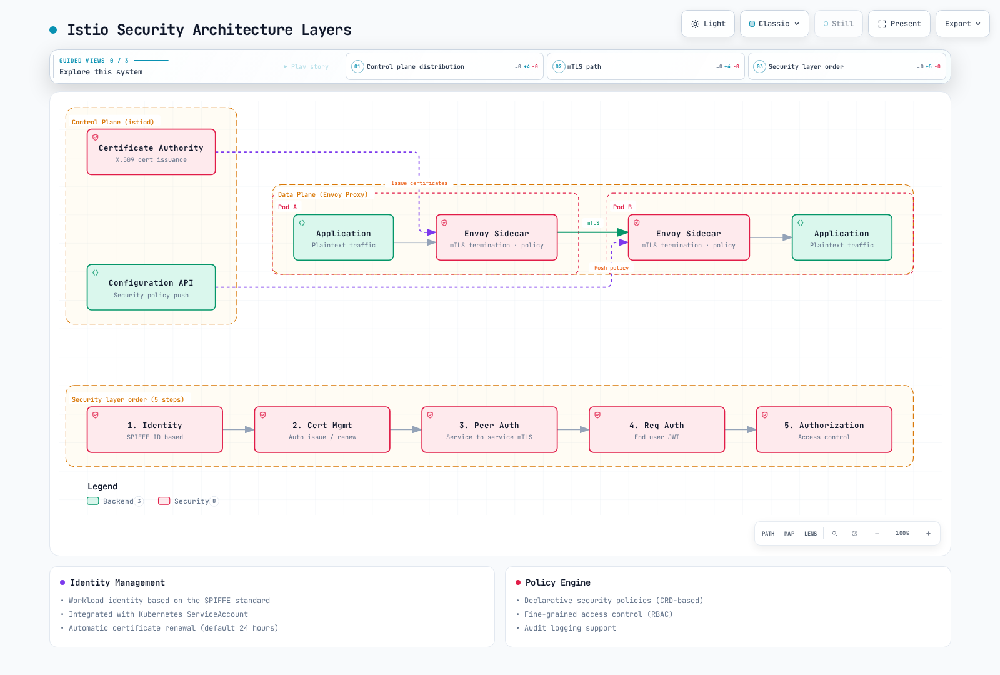

# 安全性

> **已审核版本**：Istio 1.31.0
> **最后更新**：2026 年 9 月 11 日

Istio 在服务网格中提供强大的安全功能。它基于 Zero Trust 安全模型，自动加密服务间通信，并提供细粒度的访问控制。

## 目录

1. [安全架构概述](#security-architecture-overview)
2. [核心安全功能](#core-security-features)
3. [安全组件](#security-components)
4. [详细文档](#next-steps)
5. [安全最佳实践](#security-best-practices)
6. [安全监控](#3-security-monitoring)

## 安全架构概述 {#security-architecture-overview}

<p align="center">
  
</p>

Istio 为已加入网格的流量实施 **Zero Trust 安全模型**。对于被排除的流量、使用明文的客户端以及不受支持的协议，仍需另行配置明确的控制措施。以下介绍主要的安全职责：

### 安全架构层



[🔍 查看交互式图表](https://www.atomai.click/kubernetes-docs/archmaps/en-service-mesh-istio-security-readme-0.html)

### 安全组件 {#security-components}

1. **控制平面（istiod）**
   - 证书颁发机构（CA）：签发和管理 X.509 证书
   - 配置 API：分发和管理安全策略
   - 服务发现：管理工作负载身份

2. **数据平面（Envoy sidecar 或 ambient ztunnel/waypoint）**
   - mTLS 终止点：在服务之间加密通信
   - 策略执行：应用身份验证和授权策略
   - 安全遥测：收集安全指标

3. **身份管理**
   - 基于 SPIFFE 标准实施强身份管理
   - 与 Kubernetes ServiceAccount 集成
   - 默认凭证有效期为 24 小时，并会在到期前轮换

4. **策略引擎**
   - 声明式安全策略（基于 CRD）
   - 细粒度访问控制（RBAC）
   - 支持审计日志

## 核心安全功能 {#core-security-features}

Istio 提供以下核心安全功能：

### 1. 通信安全（mTLS）

确认所有必需客户端都使用 mTLS 后，再将已加入网格的工作负载从 PERMISSIVE 迁移到 STRICT。

Auto mTLS 会加密已加入网格的对等端之间的通信；PERMISSIVE 模式也接受明文流量。对选定的入站工作负载使用 STRICT，可要求网格流量必须使用 mTLS。

```yaml
apiVersion: security.istio.io/v1
kind: PeerAuthentication
metadata:
  name: default
  namespace: istio-system
spec:
  mtls:
    mode: STRICT  # Production: STRICT, Migration: PERMISSIVE
```

**模式说明**：
- **STRICT**：只允许 mTLS（生产环境推荐）
- **PERMISSIVE**：同时接受 mTLS 和明文（用于迁移）
- **DISABLE**：在 sidecar 模式下禁用 Istio 传输层 mTLS；ambient 模式不支持此模式

以下策略示例使用 sidecar 选择器。ambient ztunnel 可执行 L4 安全策略；JWT 等其他 L7 策略需要适当的 waypoint，并通过 targetRefs 附加策略。

### 2. 身份验证

<p align="center">
  
</p>

Istio 提供两层身份验证：

- **对等身份验证（Peer Authentication）**：服务间身份验证（mTLS + SPIFFE ID）
- **请求身份验证（Request Authentication）**：验证受支持签发者的 JWT；登录和 OAuth 流程仍由外部系统处理

**示例**：
```yaml
# Request Authentication (JWT)
apiVersion: security.istio.io/v1
kind: RequestAuthentication
metadata:
  name: jwt-auth
  namespace: default
spec:
  jwtRules:
  - issuer: "https://accounts.google.com"
    jwksUri: "https://www.googleapis.com/oauth2/v3/certs"
    audiences: ["<your-google-client-id>"]
```

### 3. 授权

<p align="center">
  
</p>

Istio 会应用细粒度访问控制策略。AuthorizationPolicy 可根据以下信息进行控制：
- ServiceAccount / Namespace
- HTTP 方法 / 路径
- IP 地址
- JWT 声明

```yaml
apiVersion: security.istio.io/v1
kind: AuthorizationPolicy
metadata:
  name: allow-read
spec:
  action: ALLOW
  rules:
  - from:
    - source:
        principals: ["cluster.local/ns/default/sa/myapp"]
    to:
    - operation:
        methods: ["GET"]
        paths: ["/api/*"]
```

## 安全最佳实践 {#security-best-practices}

### 1. 深度防御

结合传输层身份、经过验证的请求凭证以及明确的授权规则。

在多个层面实施安全措施，以实现深度防御：

**网络层**：
```yaml
# 1. Enable mTLS STRICT mode
apiVersion: security.istio.io/v1
kind: PeerAuthentication
metadata:
  name: default
  namespace: istio-system
spec:
  mtls:
    mode: STRICT
```

**应用层**：
```yaml
# 2. Enable JWT authentication
apiVersion: security.istio.io/v1
kind: RequestAuthentication
metadata:
  name: require-jwt
  namespace: default
spec:
  jwtRules:
  - issuer: "https://your-auth-provider.com"
    jwksUri: "https://your-auth-provider.com/.well-known/jwks.json"
    audiences: ["<your-api-audience>"]
```

**访问控制层**：
```yaml
# 3. Default deny policy
apiVersion: security.istio.io/v1
kind: AuthorizationPolicy
metadata:
  name: deny-all
  namespace: default
spec:
  action: ALLOW
  rules: []
---
# 4. Allow only required access
apiVersion: security.istio.io/v1
kind: AuthorizationPolicy
metadata:
  name: allow-specific
  namespace: default
spec:
  action: ALLOW
  rules:
  - from:
    - source:
        principals: ["cluster.local/ns/frontend/sa/webapp"]
        requestPrincipals: ["*"]
    to:
    - operation:
        methods: ["GET", "POST"]
```

单独使用 RequestAuthentication 时，不带令牌的请求仍可通过。上方的 ALLOW 示例要求对等端和请求主体都已通过验证；空的 ALLOW 策略会建立默认拒绝规则。DENY-all 规则具有更高优先级，会阻止这些例外。这里的示例作用于命名空间中所有匹配的工作负载；应有意识地限定 selector/targetRefs 的范围。AUDIT 需要配置审计实现；访问日志也必须单独启用。

### 2. 最小权限原则

- 仅向每项服务授予所需的最低权限
- 按最小范围拆分 ServiceAccount
- 利用 Namespace 隔离

<span id="3-security-monitoring"></span>

### 3. 安全监控

- 启用 Istio 访问日志
- 使用 Prometheus 收集安全指标
- 使用 Kiali 监控 mTLS 状态

## 后续步骤 {#next-steps}

1. **[mTLS](01-mtls.md)**：服务间加密和身份管理
2. **[身份验证](02-authentication.md)**：JWT 和 OAuth/OIDC 集成
3. **[授权](03-authorization.md)**：细粒度访问控制策略

## 参考资料

### 官方文档
- [Istio 安全概念](https://istio.io/latest/docs/concepts/security/)
- [安全最佳实践](https://istio.io/latest/docs/ops/best-practices/security/)
- [安全参考](https://istio.io/latest/docs/reference/config/security/)

### 相关标准
- [SPIFFE 规范](https://github.com/spiffe/spiffe)
- [OAuth 2.0 / OIDC](https://oauth.net/2/)
- [JWT (RFC 7519)](https://datatracker.ietf.org/doc/html/rfc7519)

## 测验

要检验你对本章内容的掌握情况，请尝试[Istio 安全测验](../../../quizzes/service-mesh/istio/security.md)。
