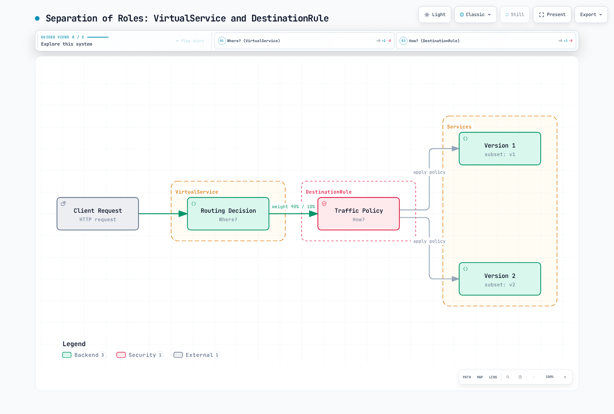
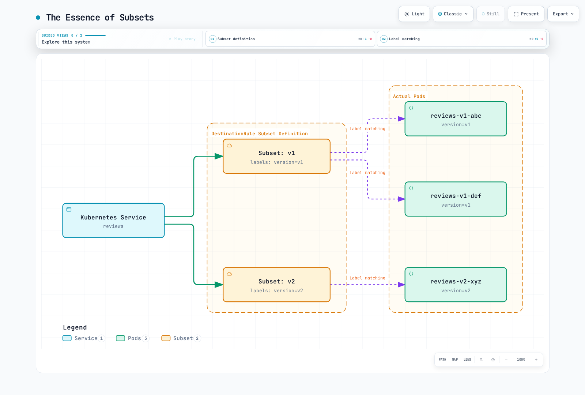
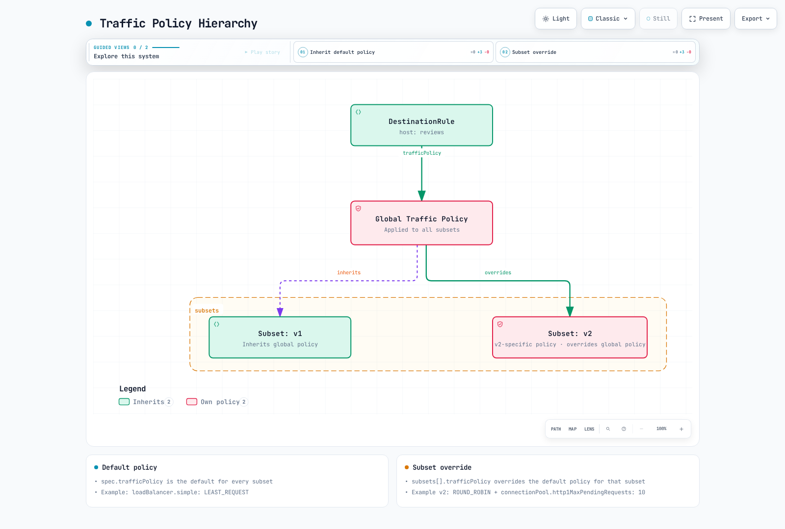

# DestinationRule

> **已审阅版本**：Istio 1.31.0
> **API 版本**：`networking.istio.io/v1`
> **最后更新**：2026 年 9 月 11 日

DestinationRule 是 Istio 的核心资源，用于定义 VirtualService 将流量路由到目标后应如何处理这些流量。

## 目录

1. [什么是 DestinationRule？](#what-is-destinationrule)
2. [VirtualService 与 DestinationRule](#virtualservice-vs-destinationrule)
3. [Subset 概念](#subset-concept)
4. [基本结构](#basic-structure)
5. [定义 Subset](#defining-subsets)
6. [流量策略概述](#traffic-policy-overview)
7. [与 VirtualService 配合使用](#using-with-virtualservice)
8. [实用示例](#practical-examples)
9. [最佳实践](#best-practices)
10. [故障排除](#troubleshooting)

## 什么是 DestinationRule？ {#what-is-destinationrule}

以下示例是彼此独立的 Sidecar 配置模式。DestinationRule 和 VirtualService 是由 istiod 编译的配置输入，不是逐个处理流量的网络跳点。即使没有 VirtualService，DestinationRule 也会生效。Subset 只能选择已发现的 Service 端点；它不会创建工作负载、隔离环境或分配流量百分比。请使用匹配的 Pod 模板标签，并显式配置指向 Subset 的路由。

DestinationRule 定义**路由后的流量策略**。如果 VirtualService 决定将流量发送到“哪里”，DestinationRule 则决定应“如何”处理流量。



[🔍 查看交互式图表](https://www.atomai.click/kubernetes-docs/archmaps/en-service-mesh-istio-traffic-management-03-destination-rule-0.html)

### DestinationRule 的主要作用

| 作用 | 说明 | 示例 |
|------|-------------|---------|
| **Subset 定义** | 按服务版本分组 | v1、v2、canary、stable |
| **负载均衡** | 选择负载分配算法 | ROUND_ROBIN、LEAST_REQUEST |
| **连接池** | 设置连接池行为 | 最大连接数、超时 |
| **熔断** | 隔离故障 | 异常实例检测 |
| **TLS 设置** | 定义加密策略 | mTLS、SIMPLE TLS |

## VirtualService 与 DestinationRule {#virtualservice-vs-destinationrule}

这两种资源协同工作，提供完整的流量管理。

### 角色对比


[🔍 查看交互式图表](https://www.atomai.click/kubernetes-docs/archmaps/en-service-mesh-istio-traffic-management-03-destination-rule-1.html)

### 职责分离

**VirtualService（发往哪里？）**：
```yaml
apiVersion: networking.istio.io/v1
kind: VirtualService
metadata:
  name: reviews
spec:
  hosts:
  - reviews
  http:
  - match:
    - headers:
        end-user:
          exact: jason
    route:
    - destination:
        host: reviews
        subset: v2  # ← References subset from DestinationRule
  - route:
    - destination:
        host: reviews
        subset: v1  # ← References subset from DestinationRule
```

**DestinationRule（如何处理？）**：
```yaml
apiVersion: networking.istio.io/v1
kind: DestinationRule
metadata:
  name: reviews
spec:
  host: reviews
  trafficPolicy:  # ← Default policy applied to all subsets
    loadBalancer:
      simple: LEAST_REQUEST
  subsets:  # ← Subset definitions referenced by VirtualService
  - name: v1
    labels:
      version: v1
  - name: v2
    labels:
      version: v2
    trafficPolicy:  # ← Policy applied only to v2
      loadBalancer:
        simple: ROUND_ROBIN
```

## Subset 概念 {#subset-concept}

Subset 是 Service 的一个**逻辑分组**，通常按版本、部署阶段、区域等属性区分。

### Subset 的本质



[🔍 查看交互式图表](https://www.atomai.click/kubernetes-docs/archmaps/en-service-mesh-istio-traffic-management-03-destination-rule-2.html)

### Subset 使用场景

#### 1. 按版本路由
```yaml
apiVersion: networking.istio.io/v1
kind: DestinationRule
metadata:
  name: reviews-versions
spec:
  host: reviews
  subsets:
  - name: v1
    labels:
      version: v1
  - name: v2
    labels:
      version: v2
  - name: v3
    labels:
      version: v3
```
```yaml
# Pod-template label excerpt
metadata:
  labels:
    app: reviews
    version: v1  # ← Matches Subset
```

#### 2. 按部署阶段隔离
```yaml
apiVersion: networking.istio.io/v1
kind: DestinationRule
metadata:
  name: reviews-deployment-stages
spec:
  host: reviews
  subsets:
  - name: stable
    labels:
      stage: stable
  - name: canary
    labels:
      stage: canary
  - name: test
    labels:
      stage: test
```

#### 3. 按区域隔离
```yaml
apiVersion: networking.istio.io/v1
kind: DestinationRule
metadata:
  name: api-regions
spec:
  host: api-service
  subsets:
  - name: us-west
    labels:
      region: us-west
  - name: us-east
    labels:
      region: us-east
  - name: eu-central
    labels:
      region: eu-central
```

#### 4. 按环境隔离
```yaml
apiVersion: networking.istio.io/v1
kind: DestinationRule
metadata:
  name: payment-environments
spec:
  host: payment-service
  subsets:
  - name: production
    labels:
      env: production
  - name: staging
    labels:
      env: staging
```

## 基本结构 {#basic-structure}

### 必填字段
```yaml
apiVersion: networking.istio.io/v1
kind: DestinationRule
metadata:
  name: my-destination-rule
  namespace: default
spec:
  host: my-service  # Required: Target service
  subsets:          # Optional: Subset definitions
  - name: v1
    labels:
      version: v1
  trafficPolicy:    # Optional: Traffic policy
    loadBalancer:
      simple: ROUND_ROBIN
```

### Host 的指定方式

**1. Service 名称（同一命名空间）**
```yaml
spec:
  host: reviews
```

**2. FQDN（不同命名空间）**
```yaml
spec:
  host: reviews.production.svc.cluster.local
```

**3. 通配符**
```yaml
spec:
  host: "*.example.com"
```

**4. 外部服务（搭配 ServiceEntry）**
```yaml
spec:
  host: api.external.com
```

## 定义 Subset {#defining-subsets}

### 简单 Subset
```yaml
apiVersion: networking.istio.io/v1
kind: DestinationRule
metadata:
  name: reviews-simple
spec:
  host: reviews
  subsets:
  - name: v1
    labels:
      version: v1
  - name: v2
    labels:
      version: v2
```

### Subset 专属策略
```yaml
apiVersion: networking.istio.io/v1
kind: DestinationRule
metadata:
  name: reviews-subset-policies
spec:
  host: reviews
  trafficPolicy:  # Default policy (all subsets)
    loadBalancer:
      simple: LEAST_REQUEST
  subsets:
  - name: v1
    labels:
      version: v1
    # v1 uses default policy

  - name: v2
    labels:
      version: v2
    trafficPolicy:  # v2-only policy (overrides default)
      loadBalancer:
        simple: ROUND_ROBIN
      connectionPool:
        http:
          http1MaxPendingRequests: 10
```

### 复杂标签匹配
```yaml
apiVersion: networking.istio.io/v1
kind: DestinationRule
metadata:
  name: api-complex
spec:
  host: api-service
  subsets:
  - name: us-west-v2
    labels:
      version: v2
      region: us-west
      tier: premium
  - name: us-east-v1
    labels:
      version: v1
      region: us-east
      tier: standard
```

## 流量策略概述 {#traffic-policy-overview}

DestinationRule 中的 `trafficPolicy` 提供多种流量控制功能。

### 流量策略层级



[🔍 查看交互式图表](https://www.atomai.click/kubernetes-docs/archmaps/en-service-mesh-istio-traffic-management-03-destination-rule-3.html)

### 流量策略的组成部分

#### 1. 负载均衡器
```yaml
trafficPolicy:
  loadBalancer:
    simple: ROUND_ROBIN  # LEAST_REQUEST, RANDOM, PASSTHROUGH
```

详见[负载均衡](06-load-balancing.md)。

#### 2. 连接池
```yaml
trafficPolicy:
  connectionPool:
    tcp:
      maxConnections: 100
    http:
      http1MaxPendingRequests: 50
      http2MaxRequests: 100
      maxRequestsPerConnection: 2
```

详见[熔断](07-circuit-breaker.md)。

#### 3. 异常实例检测
```yaml
trafficPolicy:
  outlierDetection:
    consecutive5xxErrors: 5
    interval: 30s
    baseEjectionTime: 30s
    maxEjectionPercent: 50
```

详见[熔断](07-circuit-breaker.md)。

#### 4. TLS 设置
```yaml
trafficPolicy:
  tls:
    mode: ISTIO_MUTUAL  # DISABLE, SIMPLE, MUTUAL
```

详见[安全](../security/01-mtls.md)。

#### 5. 端口级设置
```yaml
trafficPolicy:
  portLevelSettings:
  - port:
      number: 80
    loadBalancer:
      simple: ROUND_ROBIN
  - port:
      number: 443
    tls:
      mode: SIMPLE
```

## 与 VirtualService 配合使用 {#using-with-virtualservice}

VirtualService 和 DestinationRule 协同工作，实现完整的流量控制。

### 基本模式：金丝雀部署

进行线上发布时，应先应用 DestinationRule，确认新 Subset 已出现在代理的集群配置中，再更新 VirtualService。将多个文档放在同一次 apply 中并不能保证传播顺序。删除 Subset 前，先移除对它的路由引用。

```yaml
# DestinationRule: Subset definition
apiVersion: networking.istio.io/v1
kind: DestinationRule
metadata:
  name: reviews
spec:
  host: reviews
  subsets:
  - name: v1
    labels:
      version: v1
  - name: v2
    labels:
      version: v2
---
# VirtualService: Traffic distribution
apiVersion: networking.istio.io/v1
kind: VirtualService
metadata:
  name: reviews
spec:
  hosts:
  - reviews
  http:
  - route:
    - destination:
        host: reviews
        subset: v1  # ← References DestinationRule subset
      weight: 90
    - destination:
        host: reviews
        subset: v2  # ← References DestinationRule subset
      weight: 10
```

### 基于 Header 的路由
```yaml
# DestinationRule
apiVersion: networking.istio.io/v1
kind: DestinationRule
metadata:
  name: reviews
spec:
  host: reviews
  subsets:
  - name: v1
    labels:
      version: v1
  - name: v2
    labels:
      version: v2
---
# VirtualService
apiVersion: networking.istio.io/v1
kind: VirtualService
metadata:
  name: reviews
spec:
  hosts:
  - reviews
  http:
  # Developers use v2
  - match:
    - headers:
        x-dev-user:
          exact: "true"
    route:
    - destination:
        host: reviews
        subset: v2
  # Regular users use v1
  - route:
    - destination:
        host: reviews
        subset: v1
```

### 基于 URI 的路由与 Subset 专属策略
```yaml
# DestinationRule: Different policies per subset
apiVersion: networking.istio.io/v1
kind: DestinationRule
metadata:
  name: api-service
spec:
  host: api-service
  subsets:
  - name: v1
    labels:
      version: v1
    trafficPolicy:
      loadBalancer:
        simple: ROUND_ROBIN
  - name: v2
    labels:
      version: v2
    trafficPolicy:
      loadBalancer:
        simple: LEAST_REQUEST
      connectionPool:
        http:
          http1MaxPendingRequests: 10
---
# VirtualService: URI-based routing
apiVersion: networking.istio.io/v1
kind: VirtualService
metadata:
  name: api-service
spec:
  hosts:
  - api-service
  http:
  - match:
    - uri:
        prefix: "/api/v2"
    route:
    - destination:
        host: api-service
        subset: v2
  - route:
    - destination:
        host: api-service
        subset: v1
```

## 实用示例 {#practical-examples}

### 示例 1：管理微服务版本
```yaml
apiVersion: networking.istio.io/v1
kind: DestinationRule
metadata:
  name: reviews-versions
  namespace: production
spec:
  host: reviews
  trafficPolicy:
    loadBalancer:
      simple: LEAST_REQUEST
    connectionPool:
      tcp:
        maxConnections: 100
      http:
        http1MaxPendingRequests: 50
        maxRequestsPerConnection: 2
  subsets:
  - name: v1
    labels:
      version: v1
  - name: v2
    labels:
      version: v2
  - name: v3
    labels:
      version: v3
```

**使用场景**：
- v1：稳定版本（承载大部分流量）
- v2：金丝雀版本（承载 10% 流量）
- v3：测试版本（仅供开发人员使用）

### 示例 2：多区域部署

此示例假设网格已经能够发现并访问各区域端点。自定义 `region` Pod 标签用于选择 Subset；节点拓扑标签则另行向 Envoy 提供 locality 信息。区域 Subset 需要显式路由；locality 故障转移还要求配置异常实例检测，并且存在健康且可访问的容量。

```yaml
apiVersion: networking.istio.io/v1
kind: DestinationRule
metadata:
  name: api-multi-region
spec:
  host: api-service
  trafficPolicy:
    loadBalancer:
      simple: LEAST_REQUEST
      localityLbSetting:
        enabled: true
  subsets:
  - name: us-west
    labels:
      region: us-west
    trafficPolicy:
      connectionPool:
        tcp:
          maxConnections: 1000
  - name: us-east
    labels:
      region: us-east
    trafficPolicy:
      connectionPool:
        tcp:
          maxConnections: 1000
  - name: eu-central
    labels:
      region: eu-central
    trafficPolicy:
      connectionPool:
        tcp:
          maxConnections: 500
```

### 示例 3：部署阶段策略
```yaml
apiVersion: networking.istio.io/v1
kind: DestinationRule
metadata:
  name: payment-service-stages
spec:
  host: payment-service
  subsets:
  # Production: Strict policy
  - name: production
    labels:
      stage: production
    trafficPolicy:
      connectionPool:
        tcp:
          maxConnections: 100
        http:
          http1MaxPendingRequests: 10
          maxRequestsPerConnection: 1
      outlierDetection:
        consecutive5xxErrors: 3
        interval: 10s
        baseEjectionTime: 60s

  # Canary: Moderate policy
  - name: canary
    labels:
      stage: canary
    trafficPolicy:
      connectionPool:
        tcp:
          maxConnections: 50
        http:
          http1MaxPendingRequests: 20
      outlierDetection:
        consecutive5xxErrors: 5
        interval: 30s
        baseEjectionTime: 30s

  # Staging: Lenient policy
  - name: staging
    labels:
      stage: staging
    trafficPolicy:
      connectionPool:
        tcp:
          maxConnections: 200
        http:
          http1MaxPendingRequests: 100
      outlierDetection:
        consecutive5xxErrors: 10
        interval: 60s
        baseEjectionTime: 30s
```

### 示例 4：集成外部服务
```yaml
# ServiceEntry: Register external API
apiVersion: networking.istio.io/v1
kind: ServiceEntry
metadata:
  name: external-payment-api
spec:
  hosts:
  - api.payment-gateway.com
  ports:
  - number: 80
    name: http
    protocol: HTTP
    targetPort: 443
  location: MESH_EXTERNAL
  resolution: DNS
---
# DestinationRule: External API policy
apiVersion: networking.istio.io/v1
kind: DestinationRule
metadata:
  name: external-payment-api
spec:
  host: api.payment-gateway.com
  trafficPolicy:
    connectionPool:
      tcp:
        maxConnections: 10
      http:
        http1MaxPendingRequests: 5
        maxRequestsPerConnection: 1
    outlierDetection:
      consecutive5xxErrors: 3
      interval: 30s
      baseEjectionTime: 120s
    tls:
      mode: SIMPLE
      sni: api.payment-gateway.com
      subjectAltNames:
      - api.payment-gateway.com
```

此变体要求应用向已注册的 80 端口发送 HTTP；Sidecar 会向 443 端口发起并验证 TLS。请将示例主机名替换为实际端点。如果应用已发送 HTTPS，应为这条不透明 TLS 路径关闭 TLS 发起和仅适用于 HTTP 的策略设置，以免重复加密。

### 示例 5：数据库连接池
```yaml
apiVersion: networking.istio.io/v1
kind: DestinationRule
metadata:
  name: postgres-connection-pool
spec:
  host: postgres-primary
  trafficPolicy:
    connectionPool:
      tcp:
        maxConnections: 50  # DB connection limit
        connectTimeout: 5s
        tcpKeepalive:
          time: 7200s
          interval: 75s
    outlierDetection:
      consecutive5xxErrors: 3
      interval: 60s
      baseEjectionTime: 120s
  subsets:
  - name: primary
    labels:
      role: primary
  - name: replica
    labels:
      role: replica
    trafficPolicy:
      connectionPool:
        tcp:
          maxConnections: 100  # More for replicas
```

上面的 TCP 连接限制由每个代理分别执行，并不是全局的数据库连接预算。PostgreSQL 不使用 HTTP 连接设置。primary/replica 两个 Subset 都必须存在于所选 Service 端点中，并且应用必须正确选择读写目标。

## 最佳实践 {#best-practices}

### 1. Subset 命名约定
```yaml
# ✅ Good example: Meaningful names
subsets:
- name: v1
- name: v2
- name: stable
- name: canary
- name: us-west
- name: production
```
```yaml
# ❌ Bad example: Vague names
subsets:
- name: subset1
- name: test
- name: new
```

### 2. 默认策略与覆盖模式
```yaml
# ✅ Good example: Define default policy and override when needed
apiVersion: networking.istio.io/v1
kind: DestinationRule
metadata:
  name: reviews
spec:
  host: reviews
  trafficPolicy:  # Default policy
    loadBalancer:
      simple: LEAST_REQUEST
  subsets:
  - name: v1
    labels:
      version: v1
    # v1 uses default policy
  - name: v2
    labels:
      version: v2
    trafficPolicy:  # Override only for v2
      loadBalancer:
        simple: ROUND_ROBIN
```

### 3. 根据故障模型调整隔离策略
```yaml
# Tune outlierDetection for the service and failure model
apiVersion: networking.istio.io/v1
kind: DestinationRule
metadata:
  name: api-service
spec:
  host: api-service
  trafficPolicy:
    loadBalancer:
      simple: LEAST_REQUEST
    outlierDetection:  # Optional policy
      consecutive5xxErrors: 5
      interval: 30s
      baseEjectionTime: 30s
```

### 4. 连接池设置
```yaml
# ✅ Connection Pool appropriate for service characteristics
apiVersion: networking.istio.io/v1
kind: DestinationRule
metadata:
  name: high-traffic-service
spec:
  host: api-gateway
  trafficPolicy:
    connectionPool:
      tcp:
        maxConnections: 1000
      http:
        http2MaxRequests: 1000
        maxRequestsPerConnection: 100
```

### 5. 渐进式发布
```yaml
# ✅ Gradually increase canary ratio
# Step 1: 5%
apiVersion: networking.istio.io/v1
kind: VirtualService
metadata:
  name: reviews-canary-step1
spec:
  hosts:
  - reviews
  http:
  - route:
    - destination:
        host: reviews
        subset: v1
      weight: 95
    - destination:
        host: reviews
        subset: v2
      weight: 5

# Step 2: After monitoring, increase to 10%
# Step 3: 25% → 50% → 100%
```

### 6. 文档记录
```yaml
apiVersion: networking.istio.io/v1
kind: DestinationRule
metadata:
  name: payment-service
  annotations:
    description: "Payment service traffic management"
    owner: "payments-team"
    subset-purpose: |
      - production: Main production traffic
      - canary: New version testing (10%)
      - staging: Pre-production testing
spec:
  host: payment-service
  # ...
```

## 故障排除 {#troubleshooting}

### Subset 未生效

**症状**：
```bash
# VirtualService exists but traffic isn't routed
kubectl get virtualservice reviews -o yaml
```

**原因和解决方法**：
```bash
# 1. Check DestinationRule
kubectl get destinationrule reviews -o yaml

# 2. Verify subset names match
# VirtualService: subset: v2
# DestinationRule: name: v2

# 3. Check pod labels
kubectl get pods --show-labels | grep reviews

# 4. Verify pods have version=v2 label
kubectl get deployment reviews-v2 -o jsonpath='{.spec.template.metadata.labels}'
```

### 未应用流量策略
```bash
# Check Envoy configuration
istioctl proxy-config clusters <pod-name> --fqdn reviews.default.svc.cluster.local -o json

# Check Circuit Breaker settings
istioctl proxy-config clusters <pod-name> -o json | jq '.[] | select(.name=="outbound|9080||reviews.default.svc.cluster.local") | .circuitBreakers'
```

### Subset 冲突

Istio 可以合并同一主机适用的 DestinationRule 片段。下面两个不同的 Subset 本身不会发生冲突。若 Subset 名称重复，系统只会采用第一条定义而不会合并；多个顶层 trafficPolicy 也只会保留最先处理的一项。命名空间查找和可见性仍然重要；由一个负责人维护单条规则更易于理解和管理。

**问题**：
```yaml
# Same-host DestinationRule fragments can merge with restrictions
apiVersion: networking.istio.io/v1
kind: DestinationRule
metadata:
  name: reviews-1
spec:
  host: reviews
  subsets:
  - name: v1
    labels:
      version: v1
---
# Unique subset names can merge; duplicate names/policies are the problem
apiVersion: networking.istio.io/v1
kind: DestinationRule
metadata:
  name: reviews-2
spec:
  host: reviews
  subsets:
  - name: v2
    labels:
      version: v2
```

**解决方法**：
```yaml
# ✅ Define all subsets in one DestinationRule
apiVersion: networking.istio.io/v1
kind: DestinationRule
metadata:
  name: reviews
spec:
  host: reviews
  subsets:
  - name: v1
    labels:
      version: v1
  - name: v2
    labels:
      version: v2
```

### 使用 istioctl 分析
```bash
# Validate DestinationRule
istioctl analyze

# Specific namespace
istioctl analyze -n production

# Example output
# Inspect actual analyzer messages and confirm subset clusters in proxy-config output
```

## 后续步骤

了解 DestinationRule 后，可以继续学习以下主题：

1. **[流量拆分](04-traffic-splitting.md)**：金丝雀、蓝绿部署
2. **[负载均衡](06-load-balancing.md)**：各种算法和策略
3. **[熔断](07-circuit-breaker.md)**：故障隔离与弹性
4. **[重试和超时](05-retry-timeout.md)**：重试和超时设置

## 参考资料

- [Istio DestinationRule 参考](https://istio.io/latest/docs/reference/config/networking/destination-rule/)
- [Istio 流量管理](https://istio.io/latest/docs/concepts/traffic-management/)
- [Envoy 集群配置](https://www.envoyproxy.io/docs/envoy/latest/intro/arch_overview/upstream/upstream)

- [DestinationRule 合并与安全的 Subset 发布](https://istio.io/latest/docs/ops/best-practices/traffic-management/)
- [TLS 发起](https://istio.io/latest/docs/tasks/traffic-management/egress/egress-tls-origination/)
