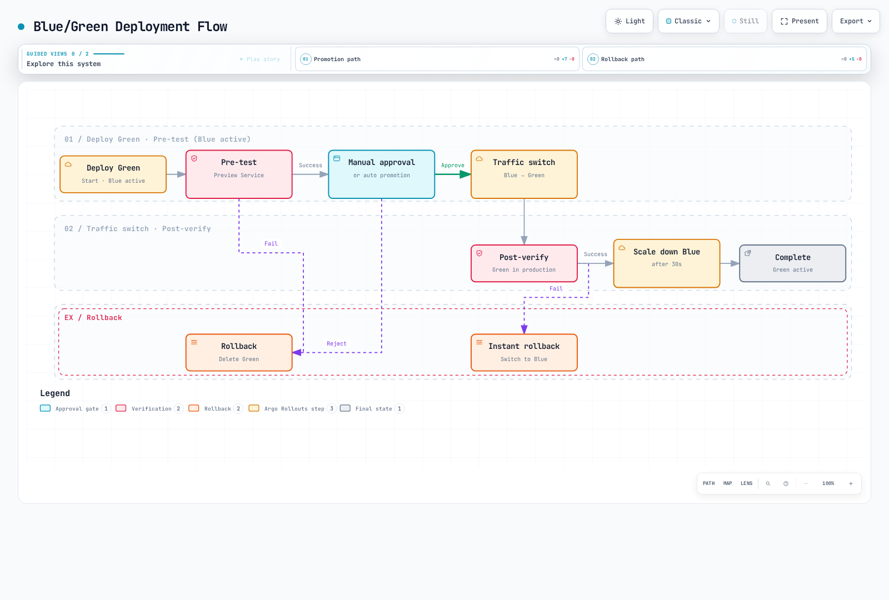
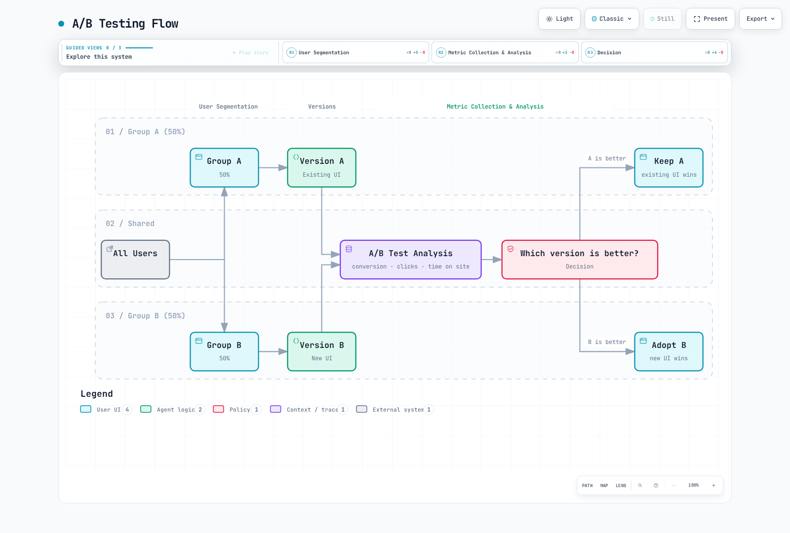

# 流量拆分

流量拆分是 Istio 最强大的功能之一，无需更改代码即可实现 Canary 部署、A/B 测试和 Blue/Green 部署。

## 目录

1. [流量拆分概述](#traffic-splitting-overview)
2. [Canary 部署](#canary-deployment)
3. [Blue/Green 部署](#bluegreen-deployment)
4. [A/B 测试](#ab-testing)
5. [渐进式发布](#progressive-rollout)
6. [与流量镜像配合使用](#using-with-traffic-mirroring)
7. [实用示例](#practical-examples)
8. [监控和回滚](#monitoring-and-rollback)
9. [故障排查](#troubleshooting)

## 流量拆分概述

已针对 Istio 1.31.0 和 Argo Rollouts 1.10.1 进行检查。以下示例适用于可随时销毁的测试命名空间；不要运行多个使用相同 selector 的 Rollout，也不要让手动脚本/GitOps 覆盖由 Rollouts 管理的权重和子集哈希。开始发布前，请先安装引用的 Services、DestinationRules、AnalysisTemplates、gateway 和 Prometheus。首次部署会建立一个稳定的 ReplicaSet；Canary 步骤/分析则用于检查后续更新。权重控制的是请求分配比例，而不是用户的稳定百分比。

流量拆分使用 VirtualService 中的 `weight` 字段，按比例在多个服务版本之间分配流量。


[🔍 查看交互式图表](https://www.atomai.click/kubernetes-docs/archmaps/en-service-mesh-istio-traffic-management-04-traffic-splitting-0.html)

### 基本结构

```yaml
apiVersion: networking.istio.io/v1
kind: VirtualService
metadata:
  name: reviews
spec:
  hosts:
  - reviews
  http:
  - route:
    - destination:
        host: reviews
        subset: v1
      weight: 90  # 90% of traffic
    - destination:
        host: reviews
        subset: v2
      weight: 10  # 10% of traffic
```

## Canary 部署

Canary 部署是一种安全验证新版本的策略：首先仅将新版本部署给一小部分用户。将 Argo Rollouts 与 Istio 配合使用，可以实现自动化渐进式部署，并根据指标自动回滚。

### Argo Rollouts + Istio 架构


[🔍 查看交互式图表](https://www.atomai.click/kubernetes-docs/archmaps/en-service-mesh-istio-traffic-management-04-traffic-splitting-1.html)

### Canary 部署流程


[🔍 查看交互式图表](https://www.atomai.click/kubernetes-docs/archmaps/en-service-mesh-istio-traffic-management-04-traffic-splitting-2.html)

### 步骤 1：安装 Argo Rollouts

```bash
# Install Argo Rollouts
kubectl create namespace argo-rollouts
kubectl apply -n argo-rollouts -f https://github.com/argoproj/argo-rollouts/releases/download/v1.10.1/install.yaml

# Install Argo Rollouts CLI (optional)
curl -LO https://github.com/argoproj/argo-rollouts/releases/download/v1.10.1/kubectl-argo-rollouts-linux-amd64
chmod +x kubectl-argo-rollouts-linux-amd64
sudo mv kubectl-argo-rollouts-linux-amd64 /usr/local/bin/kubectl-argo-rollouts

# Run Argo Rollouts Dashboard
kubectl argo rollouts dashboard
```

### 步骤 2：定义 Rollout 资源

```yaml
apiVersion: argoproj.io/v1alpha1
kind: Rollout
metadata:
  name: reviews
  namespace: default
spec:
  replicas: 5
  revisionHistoryLimit: 2
  selector:
    matchLabels:
      app: reviews
  template:
    metadata:
      labels:
        app: reviews
        sidecar.istio.io/inject: "true"
    spec:
      containers:
      - name: reviews
        image: docker.io/istio/examples-bookinfo-reviews-v2:1.20.3
        ports:
        - containerPort: 9080
        resources:
          requests:
            memory: "64Mi"
            cpu: "100m"
          limits:
            memory: "128Mi"
            cpu: "200m"

  # Canary Deployment Strategy
  strategy:
    canary:
      # Traffic Control via Istio VirtualService
      trafficRouting:
        istio:
          virtualService:
            name: reviews-vsvc
            routes:
            - primary
          destinationRule:
            name: reviews-destrule
            canarySubsetName: canary
            stableSubsetName: stable

      # Canary Steps Definition
      steps:
      - setWeight: 10    # 10% traffic to Canary
      - pause:
          duration: 2m   # Wait 2 minutes

      - analysis:
          templates:
          - templateName: success-rate
          - templateName: latency
          args:
          - name: service-name
            value: reviews
          - name: pod-template-hash
            valueFrom:
              podTemplateHashValue: Latest

      - setWeight: 25    # 25% traffic to Canary
      - pause:
          duration: 2m

      - analysis:
          templates:
          - templateName: success-rate
          - templateName: latency
          args:
          - name: service-name
            value: reviews
          - name: pod-template-hash
            valueFrom:
              podTemplateHashValue: Latest

      - setWeight: 50    # 50% traffic to Canary
      - pause:
          duration: 2m

      - analysis:
          templates:
          - templateName: success-rate
          - templateName: latency
          args:
          - name: service-name
            value: reviews
          - name: pod-template-hash
            valueFrom:
              podTemplateHashValue: Latest

      - setWeight: 75    # 75% traffic to Canary
      - pause:
          duration: 2m

      - analysis:
          templates:
          - templateName: success-rate
          - templateName: latency
          args:
          - name: service-name
            value: reviews
          - name: pod-template-hash
            valueFrom:
              podTemplateHashValue: Latest

```

### 步骤 3：创建 Service

首先，创建 Kubernetes Service：

```yaml
apiVersion: v1
kind: Service
metadata:
  name: reviews
  namespace: default
spec:
  ports:
  - port: 9080
    name: http
  selector:
    app: reviews  # Select all Pods from Rollout
```

### 步骤 4：定义 VirtualService

**重要**：Argo Rollouts 会更新所引用 VirtualService 路由的权重，但不会创建该 VirtualService；请先创建它。

```yaml
apiVersion: networking.istio.io/v1
kind: VirtualService
metadata:
  name: reviews-vsvc
  namespace: default
spec:
  hosts:
  - reviews
  http:
  - name: primary  # Route name referenced by Rollout (required)
    route:
    - destination:
        host: reviews
        subset: stable  # Stable version
      weight: 100
    - destination:
        host: reviews
        subset: canary  # Canary version
      weight: 0
```

**要点**：
- Rollout 中显式列出的路由需要匹配的 `http[].name` 值；如果恰好只有一条路由，则可以省略 routes 列表
- Rollout 只会自动更新此 VirtualService 的 `weight` 值
- 必须配置两个目标：stable 和 canary

### 步骤 5：定义 DestinationRule

**重要**：Argo Rollouts **不会**自动创建 DestinationRule。必须预先创建。

```yaml
apiVersion: networking.istio.io/v1
kind: DestinationRule
metadata:
  name: reviews-destrule
  namespace: default
spec:
  host: reviews
  subsets:
  - name: stable
    labels:
      app: reviews
  - name: canary
    labels:
      app: reviews
```

**要点**：
- 子集名称（`stable`、`canary`）必须与 Rollout 的 `stableSubsetName` 和 `canarySubsetName` 匹配
- Rollout 会自动向 Pod 添加 `rollouts-pod-template-hash` 标签
- DestinationRule 子集会根据此标签选择 Pod
- 如有需要，请保留稳定的应用标签；Rollout 会在每个子集中添加和更新 pod-template 哈希。发送流量前，请等待这些 selector 生效。

### 步骤 6：定义 AnalysisTemplate

使用这些 Canary 门禁前，请将以下 relabeling 规则添加到**采集工作负载 Istio 指标的 Prometheus Pod 抓取任务**中。确认抓取到的指标序列中包含 `rollout_hash` 和 `reporter="destination"`。它用于识别 `podTemplateHashValue: Latest` 传入的实际 Canary ReplicaSet；服务级平均值会掩盖小规模 Canary 中的故障。请提供有代表性的请求流量；测量值缺失或为 NaN 时，不得推进发布。

```yaml
# Add to the existing pod scrape job's relabel_configs
- source_labels: [__meta_kubernetes_pod_label_rollouts_pod_template_hash]
  target_label: rollout_hash
```

#### 成功率分析

```yaml
apiVersion: argoproj.io/v1alpha1
kind: AnalysisTemplate
metadata:
  name: success-rate
  namespace: default
spec:
  args:
  - name: service-name
  - name: pod-template-hash

  metrics:
  - name: success-rate
    interval: 30s
    count: 4  # Four measurements; interval is not total elapsed duration
    successCondition: len(result) == 1 && !isNaN(result[0]) && result[0] >= 0.95
    failureLimit: 0  # No failed measurement tolerated
    provider:
      prometheus:
        address: http://prometheus.istio-system:9090
        query: |
          sum(rate(
            istio_requests_total{
              destination_service_name="{{args.service-name}}",
              reporter="destination",
              rollout_hash="{{args.pod-template-hash}}",
              destination_workload_namespace="default",
              response_code!~"5.*"
            }[2m]
          ))
          /
          sum(rate(
            istio_requests_total{
              destination_service_name="{{args.service-name}}",
              reporter="destination",
              rollout_hash="{{args.pod-template-hash}}",
              destination_workload_namespace="default"
            }[2m]
          ))
```

#### 延迟分析

```yaml
apiVersion: argoproj.io/v1alpha1
kind: AnalysisTemplate
metadata:
  name: latency
  namespace: default
spec:
  args:
  - name: service-name
  - name: pod-template-hash

  metrics:
  - name: latency-p95
    interval: 30s
    count: 4
    successCondition: len(result) == 1 && !isNaN(result[0]) && result[0] <= 500
    failureLimit: 0
    provider:
      prometheus:
        address: http://prometheus.istio-system:9090
        query: |
          histogram_quantile(0.95,
            sum(rate(
              istio_request_duration_milliseconds_bucket{
                destination_service_name="{{args.service-name}}",
              reporter="destination",
              rollout_hash="{{args.pod-template-hash}}",
                destination_workload_namespace="default"
              }[2m]
            )) by (le)
          )
```

### 部署执行和监控

#### 部署新版本

```bash
# Start Canary deployment with image update
kubectl argo rollouts set image reviews \
  reviews=docker.io/istio/examples-bookinfo-reviews-v3:1.20.3

# Check Rollout status
kubectl argo rollouts get rollout reviews --watch

# Real-time dashboard
kubectl argo rollouts dashboard
```

#### 手动批准/拒绝

```bash
# Manual approval to proceed to next step
kubectl argo rollouts promote reviews

# Abort and rollback Canary deployment
kubectl argo rollouts abort reviews

# Rollback to specific revision
kubectl argo rollouts undo reviews
```

#### 监控部署进度

```bash
# Check Rollout status
kubectl argo rollouts status reviews

# Check analysis results
kubectl get analysisrun -w

# Check Canary vs Stable traffic distribution
kubectl get virtualservice reviews-vsvc -o yaml

# Check actual Pod status
kubectl get pods -l app=reviews --show-labels
```

### 高级配置：基于指标自动推进

将此策略合并到上面的完整 Rollout 中；保留其 selector/template。下方其他简化的 Rollout 示例也只是覆盖配置，并非独立清单。

```yaml
apiVersion: argoproj.io/v1alpha1
kind: Rollout
metadata:
  name: reviews-auto
spec:
  replicas: 5
  strategy:
    canary:
      trafficRouting:
        istio:
          virtualService:
            name: reviews-vsvc
            routes:
            - primary
          destinationRule:
            name: reviews-destrule
            canarySubsetName: canary
            stableSubsetName: stable

      steps:
      - setWeight: 10
      - pause:
          duration: 1m

      # Automatic Analysis - Automatically proceed to next step on success
      - analysis:
          templates:
          - templateName: success-rate
          - templateName: latency
          args:
          - name: service-name
            value: reviews
          - name: pod-template-hash
            valueFrom:
              podTemplateHashValue: Latest

      - setWeight: 25
      - pause:
          duration: 1m

      - analysis:
          templates:
          - templateName: success-rate
          - templateName: latency
          args:
          - name: service-name
            value: reviews
          - name: pod-template-hash
            valueFrom:
              podTemplateHashValue: Latest

      - setWeight: 50
      - pause:
          duration: 1m

      - analysis:
          templates:
          - templateName: success-rate
          - templateName: latency
          args:
          - name: service-name
            value: reviews
          - name: pod-template-hash
            valueFrom:
              podTemplateHashValue: Latest

      - setWeight: 75
      - pause:
          duration: 1m

      - analysis:
          templates:
          - templateName: success-rate
          - templateName: latency
          args:
          - name: service-name
            value: reviews
          - name: pod-template-hash
            valueFrom:
              podTemplateHashValue: Latest
```

### 关键注意事项

#### 1. 必须预先创建 VirtualService 和 DestinationRule

Argo Rollouts 不会创建这些资源。部署 Rollout 之前，必须先创建它们：

```bash
# Order is important
kubectl apply -f service.yaml
kubectl apply -f destination-rule.yaml
kubectl apply -f virtual-service.yaml
kubectl apply -f analysis-templates.yaml
kubectl apply -f rollout.yaml
```

#### 2. Rollout 管理的标签

Argo Rollouts 会自动添加/管理以下标签：

```yaml
# Labels automatically added by Rollout
rollouts-pod-template-hash: <hash>  # For ReplicaSet identification
```

这些标签用于在 DestinationRule 中选择子集。

#### 3. 必须设置 HTTP 路由名称

只有显式选中的路由才需要设置引用名称。未管理的 header 路由无需命名；此示例选择了 `primary`：

```yaml
# Wrong example
http:
- route:  # No name!
  - destination:
      host: reviews
```

```yaml
# Correct example
http:
- name: primary  # Required!
  route:
  - destination:
      host: reviews
```

#### 4. 启用 Istio 注入

必须将 Istio sidecar 注入 Rollout 的 Pod：

```bash
# Method 1: Namespace level
kubectl label namespace default istio-injection=enabled
```

```yaml
# Method 2: Pod level
template:
  metadata:
    labels:
      sidecar.istio.io/inject: "true"
```

### 与 VirtualService 匹配条件配合使用

如果 tester/region/tier header 会控制特权访问，则必须由可信层提供。始终选择 `canary` 的未管理路由不会因权重回滚而改变，因此可能继续指向已缩容的 Canary；中止/清理时应将其移除或调整。

Argo Rollouts 可与 VirtualService 匹配条件配合使用。这样可以只将满足特定条件的流量路由到 Canary。

#### 示例 1：基于 header 的 Canary（供内部测试人员使用）

```yaml
apiVersion: networking.istio.io/v1
kind: VirtualService
metadata:
  name: reviews-vsvc
spec:
  hosts:
  - reviews
  http:
  # Priority 1: Internal testers always go to Canary
  - match:
    - headers:
        x-canary-tester:
          exact: "true"
    route:
    - destination:
        host: reviews
        subset: canary

  # Priority 2: Normal traffic - Rollout manages this route's weight
  - name: primary
    route:
    - destination:
        host: reviews
        subset: stable
      weight: 100
    - destination:
        host: reviews
        subset: canary
      weight: 0
```

**使用场景**：
```bash
# Internal testers always access Canary version
curl -H "x-canary-tester: true" http://reviews:9080/

# Regular users are routed based on Rollout's weight
curl http://reviews:9080/
```

#### 示例 2：按区域分阶段部署

```yaml
apiVersion: networking.istio.io/v1
kind: VirtualService
metadata:
  name: reviews-vsvc
spec:
  hosts:
  - reviews
  http:
  # Priority 1: Dev environment always gets latest version
  - match:
    - headers:
        x-env:
          exact: "dev"
    route:
    - destination:
        host: reviews
        subset: canary

  # Priority 2: Only specific region for Canary test (e.g., Seoul)
  - match:
    - headers:
        x-region:
          exact: "ap-northeast-2"
    name: seoul-traffic
    route:
    - destination:
        host: reviews
        subset: stable
      weight: 100
    - destination:
        host: reviews
        subset: canary
      weight: 0

  # Priority 3: Other regions stay on stable version
  - name: other-regions
    route:
    - destination:
        host: reviews
        subset: stable
```

**Rollout 配置**：
```yaml
apiVersion: argoproj.io/v1alpha1
kind: Rollout
metadata:
  name: reviews
spec:
  # ... (same as before)
  strategy:
    canary:
      trafficRouting:
        istio:
          virtualService:
            name: reviews-vsvc
            routes:
            - seoul-traffic  # Only apply Canary to Seoul traffic
          destinationRule:
            name: reviews-destrule
            canarySubsetName: canary
            stableSubsetName: stable
      steps:
      - setWeight: 10
      - pause: {duration: 2m}
      - setWeight: 50
      - pause: {duration: 2m}
```

#### 示例 3：按用户级别部署

```yaml
apiVersion: networking.istio.io/v1
kind: VirtualService
metadata:
  name: reviews-vsvc
spec:
  hosts:
  - reviews
  http:
  # Priority 1: Beta program participants
  - match:
    - headers:
        x-user-tier:
          exact: "beta"
    route:
    - destination:
        host: reviews
        subset: canary

  # Priority 2: Only premium users for Canary test
  - match:
    - headers:
        x-user-tier:
          exact: "premium"
    name: premium-users
    route:
    - destination:
        host: reviews
        subset: stable
      weight: 100
    - destination:
        host: reviews
        subset: canary
      weight: 0

  # Priority 3: Free users get stable version
  - name: free-users
    route:
    - destination:
        host: reviews
        subset: stable
```

#### 示例 4：按移动应用版本部署

```yaml
apiVersion: networking.istio.io/v1
kind: VirtualService
metadata:
  name: reviews-vsvc
spec:
  hosts:
  - reviews
  http:
  # Priority 1: Only latest app version users get Canary
  - match:
    - headers:
        x-app-version:
          regex: "^3\\.([1-9][0-9]+)\\.[0-9]+$"  # 3.x.y with minor >= 10; not 4.x
    name: latest-app-version
    route:
    - destination:
        host: reviews
        subset: stable
      weight: 100
    - destination:
        host: reviews
        subset: canary
      weight: 0

  # Priority 2: Legacy app only gets stable version
  - name: legacy-app-version
    route:
    - destination:
        host: reviews
        subset: stable
```

### 完整部署示例

这是适用于全新实验环境安装的组合参考清单。对于现有部署，需要按顺序进行更改并检查传播情况；此 apply 操作并非原子操作：

```yaml
---
# Service
apiVersion: v1
kind: Service
metadata:
  name: reviews
spec:
  ports:
  - port: 9080
    name: http
  selector:
    app: reviews

---
# DestinationRule
apiVersion: networking.istio.io/v1
kind: DestinationRule
metadata:
  name: reviews-destrule
spec:
  host: reviews
  subsets:
  - name: stable
    labels: {app: reviews}  # Rollout adds the revision hash
  - name: canary
    labels: {app: reviews}  # Rollout adds the revision hash

---
# VirtualService
apiVersion: networking.istio.io/v1
kind: VirtualService
metadata:
  name: reviews-vsvc
spec:
  hosts:
  - reviews
  http:
  - name: primary
    route:
    - destination:
        host: reviews
        subset: stable
      weight: 100
    - destination:
        host: reviews
        subset: canary
      weight: 0

---
# Rollout
apiVersion: argoproj.io/v1alpha1
kind: Rollout
metadata:
  name: reviews
spec:
  replicas: 3
  selector:
    matchLabels:
      app: reviews
  template:
    metadata:
      labels:
        app: reviews
    spec:
      containers:
      - name: reviews
        image: istio/examples-bookinfo-reviews-v1:1.20.3
        ports:
        - containerPort: 9080

  strategy:
    canary:
      trafficRouting:
        istio:
          virtualService:
            name: reviews-vsvc
            routes:
            - primary
          destinationRule:
            name: reviews-destrule
            canarySubsetName: canary
            stableSubsetName: stable

      steps:
      - setWeight: 20
      - pause: {duration: 1m}
      - setWeight: 40
      - pause: {duration: 1m}
      - setWeight: 60
      - pause: {duration: 1m}
      - setWeight: 80
      - pause: {duration: 1m}
```

### 使用匹配条件时的注意事项

#### 1. 路由顺序很重要

VirtualService 中的 HTTP 路由**按顺序评估**。带有 match 的路由应放在由 Rollout 管理的路由之前：

```yaml
# Correct example
http:
- match:
    - headers:
        x-tester: {exact: "true"}
  route:
    - destination: {host: reviews, subset: canary}

- name: primary  # Managed by Rollout
  route:
    - destination: {host: reviews, subset: stable}
      weight: 100
    - destination: {host: reviews, subset: canary}
      weight: 0
```

```yaml
# Wrong example - match is ignored if primary comes first
http:
- name: primary
  route: [...]

- match: [...]  # Never reached!
  route: [...]
```

#### 2. Rollout 只管理指定的路由

Rollout 只会修改 `routes` 字段中指定路由的权重：

```yaml
strategy:
  canary:
    trafficRouting:
      istio:
        virtualService:
          name: reviews-vsvc
          routes:
          - primary  # Only modifies this route's weight
          # Other routes with match are not modified
```

#### 3. 同时管理多条路由

如有需要，可以同时管理多条路由：

```yaml
apiVersion: networking.istio.io/v1
kind: VirtualService
metadata:
  name: reviews-vsvc
spec:
  hosts:
  - reviews
  http:
  # Premium users route
  - match:
    - headers:
        x-user-tier: {exact: "premium"}
    name: premium-route
    route:
    - destination: {host: reviews, subset: stable}
      weight: 100
    - destination: {host: reviews, subset: canary}
      weight: 0

  # Standard users route
  - name: standard-route
    route:
    - destination: {host: reviews, subset: stable}
      weight: 100
    - destination: {host: reviews, subset: canary}
      weight: 0

---
apiVersion: argoproj.io/v1alpha1
kind: Rollout
metadata:
  name: reviews
spec:
  strategy:
    canary:
      trafficRouting:
        istio:
          virtualService:
            name: reviews-vsvc
            routes:
            - premium-route    # Manage both routes
            - standard-route
          destinationRule:
            name: reviews-destrule
            canarySubsetName: canary
            stableSubsetName: stable
      steps:
      - setWeight: 10
      - pause: {duration: 2m}
```

### 故障排查

#### Rollout 卡在 Progressing 状态

```bash
# Check Rollout status
kubectl argo rollouts get rollout reviews

# Check Events
kubectl describe rollout reviews

# Common causes:
# 1. VirtualService/DestinationRule doesn't exist
kubectl get virtualservice reviews-vsvc
kubectl get destinationrule reviews-destrule

# 2. HTTP route name is wrong
kubectl get virtualservice reviews-vsvc -o yaml | grep "name:"

# 3. Istio sidecar not injected
kubectl get pods -l app=reviews -o jsonpath='{.items[*].spec.containers[*].name}'
```

#### 流量没有进入 Canary

```bash
# Check VirtualService weight
kubectl get virtualservice reviews-vsvc -o yaml

# Check DestinationRule subsets
kubectl get destinationrule reviews-destrule -o yaml

# Check Pod labels
kubectl get pods -l app=reviews --show-labels

# Check Envoy configuration
istioctl proxy-config routes <pod-name>
```

#### 回滚 Rollout

```bash
# Rollback to previous revision
kubectl argo rollouts undo reviews

# Rollback to specific revision
kubectl argo rollouts undo reviews --to-revision=2

# Abort and rollback immediately
kubectl argo rollouts abort reviews
```

### 使用 Argo Rollouts 进行 Blue/Green 部署

Argo Rollouts 也支持 Blue/Green 策略：

```yaml
apiVersion: argoproj.io/v1alpha1
kind: Rollout
metadata:
  name: reviews-bluegreen
spec:
  replicas: 5
  selector:
    matchLabels:
      app: reviews
  template:
    metadata:
      labels:
        app: reviews
    spec:
      containers:
      - name: reviews
        image: docker.io/istio/examples-bookinfo-reviews-v2:1.20.3
        ports:
        - containerPort: 9080

  strategy:
    blueGreen:
      activeService: reviews-active
      previewService: reviews-preview
      autoPromotionEnabled: false  # Manual approval
      scaleDownDelaySeconds: 30
      prePromotionAnalysis:
        templates:
        - templateName: smoke-tests
        args:
        - name: service-name
          value: reviews-preview
        - name: pod-template-hash
          valueFrom:
            podTemplateHashValue: Latest
```

<span id="bluegreen-deployment"></span>

## Blue/Green 部署

Blue/Green 部署会维护两个完全相同的生产环境，并即时切换流量。将 Argo Rollouts 与 Istio 配合使用，可以安全地切换流量并自动回滚。

Service selector 的更改会异步传播，现有连接可能仍会继续使用旧的 ReplicaSet。手动暂停并不代表审批失败。推广前检查失败时，生产环境会继续使用旧版本；推广后分析可以在保留旧 ReplicaSet 的情况下切回旧版本。

### Argo Rollouts Blue/Green 架构


[🔍 查看交互式图表](https://www.atomai.click/kubernetes-docs/archmaps/en-service-mesh-istio-traffic-management-04-traffic-splitting-3.html)

### Blue/Green 部署流程



[🔍 查看交互式图表](https://www.atomai.click/kubernetes-docs/archmaps/en-service-mesh-istio-traffic-management-04-traffic-splitting-4.html)

### 步骤 1：定义 Services

Blue/Green 部署需要两个 Services：

```yaml
---
# Active Service - Production traffic
apiVersion: v1
kind: Service
metadata:
  name: reviews-active
spec:
  ports:
  - port: 9080
    name: http
  selector:
    app: reviews
    # Rollout automatically updates selector

---
# Preview Service - Test traffic
apiVersion: v1
kind: Service
metadata:
  name: reviews-preview
spec:
  ports:
  - port: 9080
    name: http
  selector:
    app: reviews
    # Rollout automatically updates selector
```

### 步骤 2：Istio Gateway 和 VirtualService

```yaml
---
# Gateway
apiVersion: networking.istio.io/v1
kind: Gateway
metadata:
  name: reviews-gateway
spec:
  selector:
    istio: ingressgateway
  servers:
  - port:
      number: 80
      name: http
      protocol: HTTP
    hosts:
    - reviews.example.com
    - reviews-preview.example.com

---
# VirtualService - Active Service
apiVersion: networking.istio.io/v1
kind: VirtualService
metadata:
  name: reviews-vsvc
spec:
  hosts:
  - reviews.example.com
  gateways:
  - reviews-gateway
  http:
  - route:
    - destination:
        host: reviews-active  # Route to Active Service
        port:
          number: 9080

---
# VirtualService - Preview Service (for testing)
apiVersion: networking.istio.io/v1
kind: VirtualService
metadata:
  name: reviews-preview-vsvc
spec:
  hosts:
  - reviews-preview.example.com
  gateways:
  - reviews-gateway
  http:
  - route:
    - destination:
        host: reviews-preview  # Route to Preview Service
        port:
          number: 9080
```

### 步骤 3：定义 Rollout 资源

```yaml
apiVersion: argoproj.io/v1alpha1
kind: Rollout
metadata:
  name: reviews
spec:
  replicas: 3
  revisionHistoryLimit: 2
  selector:
    matchLabels:
      app: reviews
  template:
    metadata:
      labels:
        app: reviews
    spec:
      containers:
      - name: reviews
        image: istio/examples-bookinfo-reviews-v1:1.20.3
        ports:
        - containerPort: 9080

  strategy:
    blueGreen:
      # Specify Active/Preview Services
      activeService: reviews-active
      previewService: reviews-preview

      # Auto-promotion settings
      autoPromotionEnabled: false  # false: manual approval, true: auto-approve
      autoPromotionSeconds: 30     # Ignored while autoPromotionEnabled=false

      # Blue environment retention time
      scaleDownDelaySeconds: 600   # Retain old capacity through the post-promotion checks
      scaleDownDelayRevisionLimit: 2  # Keep up to 2 previous versions

      # Pre-test (validate Preview before deployment)
      prePromotionAnalysis:
        templates:
        - templateName: smoke-tests
        args:
        - name: service-name
          value: reviews-preview
        - name: pod-template-hash
          valueFrom:
            podTemplateHashValue: Latest

      # Post-verification (validate Active after switch)
      postPromotionAnalysis:
        templates:
        - templateName: post-promotion-tests
        args:
        - name: service-name
          value: reviews-active
        - name: pod-template-hash
          valueFrom:
            podTemplateHashValue: Latest

      # Anti-affinity (deploy Blue/Green on different nodes)
      antiAffinity:
        requiredDuringSchedulingIgnoredDuringExecution: {}
```

### 步骤 4：定义 AnalysisTemplate

#### 预检（冒烟测试）

Job provider 在 Job 完成且退出代码为 0 时判定成功；它不会将打印出来的 HTTP 状态解析为 `result`。这些测试会访问 Bookinfo 的 `/health` 和 `/reviews/0` 端点。显式设置 native-sidecar 注解后，Job 可以在保留网格 mTLS 的同时完成；这需要 Kubernetes/Istio 支持 native sidecar 行为。请在所选 EKS 版本上测试。

```yaml
apiVersion: argoproj.io/v1alpha1
kind: AnalysisTemplate
metadata:
  name: smoke-tests
spec:
  args:
  - name: service-name
  - name: pod-template-hash

  metrics:
  # 1. HTTP status code check
  - name: http-status
    interval: 10s
    count: 5
    provider:
      job:
        spec:
          activeDeadlineSeconds: 60
          template:
            metadata:
              labels:
                sidecar.istio.io/inject: "true"
              annotations:
                sidecar.istio.io/nativeSidecar: "true"
            spec:
              containers:
              - name: curl
                image: curlimages/curl:8.16.0
                command:
                - sh
                - -c
                - |
                  test "$(curl -fsS -o /dev/null -w "%{http_code}" http://{{args.service-name}}:9080/health)" = 200
              restartPolicy: Never
          backoffLimit: 1

  # 2. Basic functional test
  - name: functional-test
    interval: 10s
    count: 3
    provider:
      job:
        spec:
          activeDeadlineSeconds: 60
          template:
            metadata:
              labels:
                sidecar.istio.io/inject: "true"
              annotations:
                sidecar.istio.io/nativeSidecar: "true"
            spec:
              containers:
              - name: test
                image: curlimages/curl:8.16.0
                command:
                - sh
                - -c
                - |
                  # API endpoint test
                  curl -fsS http://{{args.service-name}}:9080/reviews/0
              restartPolicy: Never
          backoffLimit: 1
```

#### 部署后验证测试

```yaml
apiVersion: argoproj.io/v1alpha1
kind: AnalysisTemplate
metadata:
  name: post-promotion-tests
spec:
  args:
  - name: service-name
  - name: pod-template-hash

  metrics:
  # Prometheus metric-based verification
  - name: error-rate
    interval: 30s
    count: 10
    successCondition: len(result) == 1 && !isNaN(result[0]) && result[0] < 0.05
    provider:
      prometheus:
        address: http://prometheus.istio-system:9090
        query: |
          sum(rate(
            istio_requests_total{
              destination_service_name="{{args.service-name}}",
              reporter="destination",
              rollout_hash="{{args.pod-template-hash}}",
              response_code=~"5.."
            }[1m]
          ))
          /
          sum(rate(
            istio_requests_total{
              destination_service_name="{{args.service-name}}",
              reporter="destination",
              rollout_hash="{{args.pod-template-hash}}"
            }[1m]
          ))

  - name: response-time
    interval: 30s
    count: 10
    successCondition: len(result) == 1 && !isNaN(result[0]) && result[0] < 500
    provider:
      prometheus:
        address: http://prometheus.istio-system:9090
        query: |
          histogram_quantile(0.95,
            sum(rate(
              istio_request_duration_milliseconds_bucket{
                destination_service_name="{{args.service-name}}",
              reporter="destination",
              rollout_hash="{{args.pod-template-hash}}"
              }[1m]
            )) by (le)
          )
```

### 部署执行和管理

#### 部署新版本

```bash
# Start Blue/Green deployment with image update
kubectl argo rollouts set image reviews \
  reviews=istio/examples-bookinfo-reviews-v2:1.20.3

# Check Rollout status
kubectl argo rollouts get rollout reviews --watch

# Test Preview environment
curl http://reviews-preview.example.com/
```

#### 手动批准（Promotion）

```bash
# Manually approve after pre-tests succeed
kubectl argo rollouts promote reviews

# Or approve from dashboard
kubectl argo rollouts dashboard
```

#### 查看状态

```bash
# Rollout status
kubectl argo rollouts status reviews

# Check Active/Preview Services
kubectl get svc reviews-active reviews-preview

# Check Pod status
kubectl get pods -l app=reviews --show-labels

# Check Analysis results
kubectl get analysisrun
```

#### 回滚

```bash
# Immediate rollback (switch to Blue)
kubectl argo rollouts abort reviews

# Rollback to previous version
kubectl argo rollouts undo reviews

# Rollback to specific revision
kubectl argo rollouts undo reviews --to-revision=3
```

<span id="ab-testing"></span>

## A/B 测试

A/B 测试会同时运行两个版本，并根据特定条件对用户进行分类，以衡量效果。



[🔍 查看交互式图表](https://www.atomai.click/kubernetes-docs/archmaps/en-service-mesh-istio-traffic-management-04-traffic-splitting-5.html)

### 基于 Cookie 的 A/B 测试

```yaml
apiVersion: networking.istio.io/v1
kind: VirtualService
metadata:
  name: myapp-ab-test
spec:
  hosts:
  - myapp.example.com
  http:
  # Group A (cookie value "a")
  - match:
    - headers:
        cookie:
          regex: "(^|.*;[ ]*)ab_test=a(;.*|$)"
    route:
    - destination:
        host: myapp
        subset: version-a

  # Group B (cookie value "b")
  - match:
    - headers:
        cookie:
          regex: "(^|.*;[ ]*)ab_test=b(;.*|$)"
    route:
    - destination:
        host: myapp
        subset: version-b

  # New users (no cookie) - 50/50 split
  - route:
    - destination:
        host: myapp
        subset: version-a
      weight: 50
      headers:
        response:
          add:
            set-cookie: "ab_test=a; Max-Age=2592000; Path=/; SameSite=Lax"
    - destination:
        host: myapp
        subset: version-b
      weight: 50
      headers:
        response:
          add:
            set-cookie: "ab_test=b; Max-Age=2592000; Path=/; SameSite=Lax"
```

### 基于 Header 的 A/B 测试

```yaml
apiVersion: networking.istio.io/v1
kind: VirtualService
metadata:
  name: myapp-ab-header
spec:
  hosts:
  - myapp
  http:
  # Mobile users -> Version B (new mobile UI)
  - match:
    - headers:
        user-agent:
          regex: ".*Mobile.*"
    route:
    - destination:
        host: myapp
        subset: version-b

  # Premium users -> Version B (new features)
  - match:
    - headers:
        x-user-tier:
          exact: "premium"
    route:
    - destination:
        host: myapp
        subset: version-b

  # Regular users -> Version A
  - route:
    - destination:
        host: myapp
        subset: version-a
```

### 基于地理位置的 A/B 测试

```yaml
apiVersion: networking.istio.io/v1
kind: VirtualService
metadata:
  name: myapp-ab-geo
spec:
  hosts:
  - myapp
  http:
  # Test new version only in specific regions
  - match:
    - headers:
        x-country-code:
          regex: "US|CA"  # USA, Canada
    route:
    - destination:
        host: myapp
        subset: version-b
      weight: 50
    - destination:
        host: myapp
        subset: version-a
      weight: 50

  # Other regions get existing version
  - route:
    - destination:
        host: myapp
        subset: version-a
```

## 渐进式发布

渐进式发布会随时间自动提高流量比例。使用 Argo Rollouts 的 Canary 策略，可以实现自动化渐进式部署。

### 手动渐进式发布

若要手动操作，请配置明确的暂停，并且只有在查看 AnalysisRun 和实际流量后才推进到下一阶段。定时器加上简单的计数器 grep 并不能作为错误率门禁。在此控制器管理的示例中，请使用：

```bash
kubectl argo rollouts get rollout reviews
kubectl get analysisruns
kubectl argo rollouts promote reviews
# If the active rollout fails validation:
kubectl argo rollouts abort reviews
```

## 与流量镜像配合使用

将流量拆分与镜像结合，可以让部署更加安全。

```yaml
apiVersion: networking.istio.io/v1
kind: VirtualService
metadata:
  name: myapp-canary-with-mirror
spec:
  hosts:
  - myapp
  http:
  - route:
    # Main traffic: 90% v1, 10% v2
    - destination:
        host: myapp
        subset: v1
      weight: 90
    - destination:
        host: myapp
        subset: v2
      weight: 10
    # Mirroring: duplicate all traffic to v3 (ignore response)
    mirror:
      host: myapp
      subset: v3
    mirrorPercentage:
      value: 100
```

## 实用示例

### 示例 1：按用户群体部署

```yaml
apiVersion: networking.istio.io/v1
kind: VirtualService
metadata:
  name: myapp-segmented-rollout
spec:
  hosts:
  - myapp.example.com
  http:
  # Internal employees - use new version first
  - match:
    - headers:
        x-employee:
          exact: "true"
    route:
    - destination:
        host: myapp
        subset: v2

  # Beta testers - next to use new version
  - match:
    - headers:
        x-beta-tester:
          exact: "true"
    route:
    - destination:
        host: myapp
        subset: v2

  # VIP customers - Canary 50%
  - match:
    - headers:
        x-user-tier:
          exact: "vip"
    route:
    - destination:
        host: myapp
        subset: v1
      weight: 50
    - destination:
        host: myapp
        subset: v2
      weight: 50

  # Regular customers - Canary 10%
  - route:
    - destination:
        host: myapp
        subset: v1
      weight: 90
    - destination:
        host: myapp
        subset: v2
      weight: 10
```

### 示例 2：按时间部署

```yaml
apiVersion: networking.istio.io/v1
kind: VirtualService
metadata:
  name: myapp-time-based
spec:
  hosts:
  - myapp
  http:
  # Korea daytime (KST 09:00-18:00) - stable version
  - match:
    - headers:
        x-country-code:
          exact: "KR"
        x-hour:
          regex: "0[9]|1[0-7]"  # 09-17 hours
    route:
    - destination:
        host: myapp
        subset: v1

  # Korea nighttime - Canary test
  - match:
    - headers:
        x-country-code:
          exact: "KR"
    route:
    - destination:
        host: myapp
        subset: v1
      weight: 80
    - destination:
        host: myapp
        subset: v2
      weight: 20

  # Other regions
  - route:
    - destination:
        host: myapp
        subset: v1
```

### 示例 3：微服务链 Canary

```yaml
# Frontend Canary
apiVersion: networking.istio.io/v1
kind: VirtualService
metadata:
  name: frontend-canary
spec:
  hosts:
  - frontend
  http:
  - route:
    - destination:
        host: frontend
        subset: v1
      weight: 90
    - destination:
        host: frontend
        subset: v2
      weight: 10
---
# Backend Canary (only used by Frontend v2)
apiVersion: networking.istio.io/v1
kind: VirtualService
metadata:
  name: backend-canary
spec:
  hosts:
  - backend
  http:
  # Only requests from Frontend v2 go to Backend v2
  - match:
    - sourceLabels:
        app: frontend
        version: v2
    route:
    - destination:
        host: backend
        subset: v2

  # Rest go to Backend v1
  - route:
    - destination:
        host: backend
        subset: v1
```

## 监控和回滚

### Prometheus 查询

```promql
# Requests per version
sum(rate(istio_requests_total{reporter="destination",destination_service="myapp.default.svc.cluster.local"}[5m])) by (destination_version)

# Error rate per version
sum(rate(istio_requests_total{reporter="destination",destination_service="myapp.default.svc.cluster.local",response_code=~"5.."}[5m])) by (destination_version)
/
sum(rate(istio_requests_total{reporter="destination",destination_service="myapp.default.svc.cluster.local"}[5m])) by (destination_version)

# Latency per version (P95)
histogram_quantile(0.95, sum(rate(istio_request_duration_milliseconds_bucket{reporter="destination",destination_service="myapp.default.svc.cluster.local"}[5m])) by (destination_version, le))

# Traffic split ratio
sum(rate(istio_requests_total{reporter="destination",destination_service="myapp.default.svc.cluster.local"}[5m])) by (destination_version)
/
scalar(sum(rate(istio_requests_total{reporter="destination",destination_service="myapp.default.svc.cluster.local"}[5m])))
```

### 自动回滚

使用上面的 AnalysisTemplates 作为 Rollout 门禁。Prometheus 计数器总数不是速率，查询结果为空/失败也不能证明系统正常。请检查最新 ReplicaSet 的测量值、最小流量和 AnalysisRun 阶段。让 Argo Rollouts 负责路由更改；不要应用会与之冲突的 VirtualService，也不要假定 `abort` 会将期望镜像改回去。`undo` 会还原期望模板，而 `abort` 会停止正在进行的 Rollout，并根据策略的稳定状态引导流量。完全推广后，请验证适用的 undo/重新部署路径。

```bash
kubectl get analysisruns
kubectl describe analysisrun <analysis-run>
kubectl argo rollouts get rollout reviews
```

## 故障排查

### 流量拆分未生效

```bash
# 1. Check DestinationRule
kubectl get destinationrule -A
kubectl describe destinationrule <name> -n <namespace>

# 2. Check subset labels
kubectl get pods -n <namespace> --show-labels

# 3. Check VirtualService configuration
istioctl proxy-config routes <pod-name> -n <namespace> -o json

# 4. Check actual traffic distribution
istioctl proxy-config routes <pod-name> -n <namespace> -o json
```

### 权重表现与预期不符

```bash
# Check Envoy cluster weights
istioctl proxy-config routes <pod-name> -n <namespace> -o json

# Check endpoint status
kubectl get endpointslices -n <namespace> -l kubernetes.io/service-name=<service-name> -o yaml

# Check Pod ready status
kubectl get pods -n <namespace> -l version=v2
```

## 最佳实践

### 1. 分阶段发布

```yaml
# Good example: Gradual increase
# 5% -> 10% -> 25% -> 50% -> 100%

# Bad example: Sudden increase
# 5% -> 100%
```

### 2. 准备回滚方案

```bash
# Prepare rollback YAML file in advance
cat > rollback-v1.yaml <<EOF
apiVersion: networking.istio.io/v1
kind: VirtualService
metadata:
  name: myapp
spec:
  hosts:
  - myapp
  http:
  - route:
    - destination:
        host: myapp
        subset: v1
      weight: 100
EOF

# Rollback command
kubectl apply -f rollback-v1.yaml
```

### 3. 监控至关重要

- **Golden Signals** 监控：延迟、流量、错误、饱和度
- **基于 SLO 的决策**：未达到目标 SLO 时自动回滚
- **实时告警**：通过 Slack、PagerDuty 等设置通知

### 4. 测试自动化

使用 Argo Rollouts 的 AnalysisTemplate 实现自动化测试和验证：

```yaml
# AnalysisTemplate for automated testing and verification
apiVersion: argoproj.io/v1alpha1
kind: AnalysisTemplate
metadata:
  name: success-rate
spec:
  args:
  - name: service-name
  - name: pod-template-hash
  metrics:
  - name: success-rate
    interval: 1m
    count: 10
    successCondition: len(result) == 1 && !isNaN(result[0]) && result[0] >= 0.95
    failureLimit: 3
    provider:
      prometheus:
        address: http://prometheus.istio-system:9090
        query: |
          sum(rate(
            istio_requests_total{
              destination_service_name="{{args.service-name}}",
              reporter="destination",
              rollout_hash="{{args.pod-template-hash}}",
              response_code!~"5.*"
            }[1m]
          ))
          /
          sum(rate(
            istio_requests_total{
              destination_service_name="{{args.service-name}}",
              reporter="destination",
              rollout_hash="{{args.pod-template-hash}}"
            }[1m]
          ))
---
# Using AnalysisTemplate in Rollout
apiVersion: argoproj.io/v1alpha1
kind: Rollout
metadata:
  name: myapp
spec:
  strategy:
    canary:
      steps:
      - setWeight: 10
      - pause: {duration: 1m}
      - analysis:
          templates:
          - templateName: success-rate
          args:
          - name: service-name
            value: myapp
          - name: pod-template-hash
            valueFrom:
              podTemplateHashValue: Latest
```

### 5. 文档

```yaml
# Annotation excerpt to merge into an existing VirtualService
metadata:
  name: myapp-canary
  annotations:
    description: "Canary deployment for myapp v2"
    owner: "platform-team"
    rollout-date: "2025-11-24"
    rollout-plan: "5% -> 10% -> 25% -> 50% -> 100%"
    monitoring-dashboard: "https://grafana.example.com/d/canary"
```

## 参考资料

### Istio 相关
- [Istio 流量切换](https://istio.io/latest/docs/tasks/traffic-management/traffic-shifting/)
- [Canary 部署](https://istio.io/latest/blog/2017/0.1-canary/)

### Argo Rollouts 相关
- [Argo Rollouts 官方文档](https://argo-rollouts.readthedocs.io/)
- [Istio 集成指南](https://argo-rollouts.readthedocs.io/en/stable/features/traffic-management/istio/)
- [Argo Rollouts GitHub](https://github.com/argoproj/argo-rollouts)
- [Argo Rollouts 示例](https://github.com/argoproj/argo-rollouts/tree/master/examples)

### 渐进式交付
- [渐进式交付](https://www.weave.works/blog/what-is-progressive-delivery-all-about)
- [Argo Rollouts 渐进式交付概念](https://github.com/argoproj/argo-rollouts/blob/v1.10.1/docs/concepts.md)

- [主要参考资料 1](https://raw.githubusercontent.com/argoproj/argo-rollouts/v1.10.1/docs/features/traffic-management/istio.md)
- [主要参考资料 2](https://raw.githubusercontent.com/argoproj/argo-rollouts/v1.10.1/docs/analysis/prometheus.md)
- [主要参考资料 3](https://raw.githubusercontent.com/argoproj/argo-rollouts/v1.10.1/docs/analysis/job.md)
- [主要参考资料 4](https://raw.githubusercontent.com/argoproj/argo-rollouts/v1.10.1/docs/features/analysis.md)
- [主要参考资料 5](https://raw.githubusercontent.com/argoproj/argo-rollouts/v1.10.1/docs/features/bluegreen.md)
- [主要参考资料 6](https://raw.githubusercontent.com/istio/istio/1.31.0/samples/bookinfo/platform/kube/bookinfo.yaml)
- [主要参考资料 7](https://raw.githubusercontent.com/istio/istio/1.31.0/samples/curl/curl.yaml)
- [主要参考资料 8](https://istio.io/latest/docs/reference/config/annotations/)
- [主要参考资料 9](https://istio.io/latest/docs/reference/config/networking/virtual-service/)
- [主要参考资料 10](https://prometheus.io/docs/prometheus/latest/configuration/configuration/)
