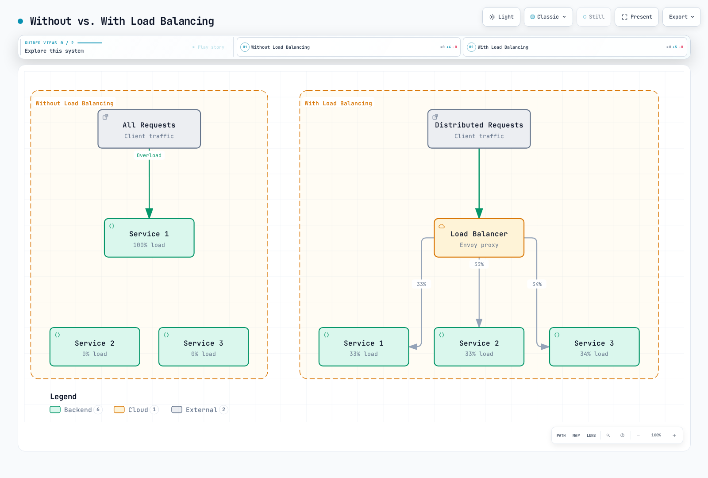
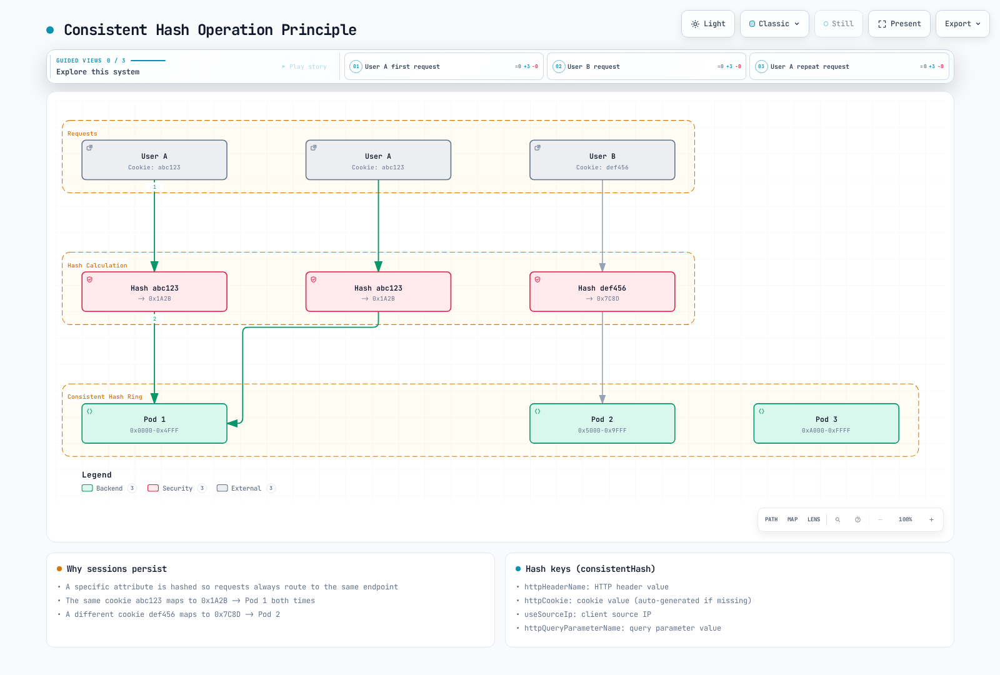
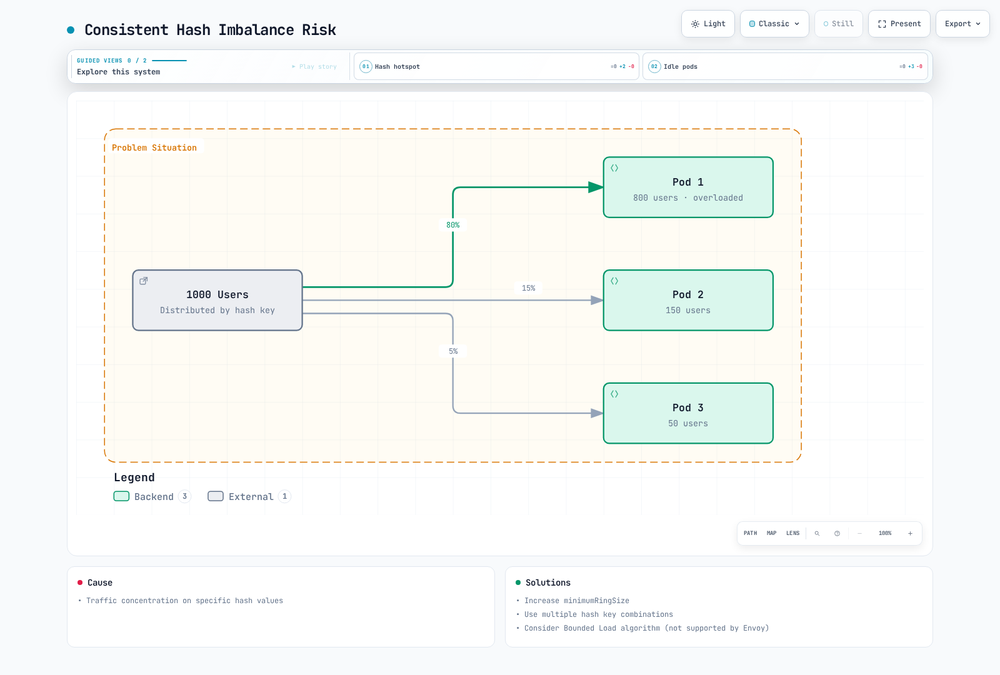

# 负载均衡

Istio 通过 Envoy 提供多种负载均衡算法，以有效分配流量。

## 目录

1. [为什么需要负载均衡？](#why-load-balancing)
2. [负载均衡概述](#load-balancing-overview)
3. [负载均衡算法](#load-balancing-algorithms)
4. [一致性哈希详解](#consistent-hash-details)
5. [基于位置的负载均衡](#locality-based-load-balancing)
6. [连接池设置](#connection-pool-settings)
7. [实践示例](#practical-examples)
8. [算法选择指南](#algorithm-selection-guide)
9. [最佳实践](#best-practices)
10. [故障排除](#troubleshooting)

## 为什么需要负载均衡？ {#why-load-balancing}

### 高效利用资源

负载均衡会将流量分配到多个实例，从而提高系统整体吞吐量和稳定性。



[🔍 查看交互式图示](https://www.atomai.click/kubernetes-docs/archmaps/en-service-mesh-istio-traffic-management-06-load-balancing-0.html)

### 主要优势

| 问题 | 不使用负载均衡 | 使用负载均衡 |
|---------|------------------------|---------------------|
| **可用性** | 单点故障（SPOF） | 故障时自动切换 |
| **性能** | 某个实例过载 | 均衡分配负载 |
| **可扩展性** | 难以水平扩展 | 易于横向扩容 |
| **响应时间** | 不稳定（0–1000ms+） | 响应时间较稳定 |
| **资源利用率** | 利用不充分 | 高效利用资源 |

## 负载均衡概述 {#load-balancing-overview}


[🔍 查看交互式图示](https://www.atomai.click/kubernetes-docs/archmaps/en-service-mesh-istio-traffic-management-06-load-balancing-1.html)

## 负载均衡算法 {#load-balancing-algorithms}

已发布的 Istio 1.31.0 默认算法为 LEAST_REQUEST。以下示例分别展示独立的 DestinationRule，不能合并为同一主机的一套配置。结果取决于端点健康状况、请求开销、连接复用和代理所在位置；没有任何算法能保证 CPU 负载完全相等或延迟恒定。`consistentHash` 是单独的配置分支，并不是 `simple: CONSISTENT_HASH` 这样的枚举值。

Istio 提供以下负载均衡算法。

### 算法对比

| 算法 | 说明 | 使用场景 | 优点 | 缺点 |
|-----------|-------------|-----------|------|------|
| **ROUND_ROBIN** | 按顺序分配（显式选项） | 无状态服务 | 简单、公平 | 可能出现负载不均 |
| **LEAST_REQUEST** | 选择活跃请求较少的端点 | 高性能 API、数据库连接 | 均衡负载 | 略有开销 |
| **RANDOM** | 随机分配 | 高流量 | 简单、快速 | 短期内可能不均 |
| **PASSTHROUGH** | 使用原始目标地址 | TCP 代理、SNI 路由 | 灵活 | 控制有限 |
| **CONSISTENT_HASH** | 基于哈希实现粘性路由 | 会话保持、缓存 | 粘性会话 | 可能不均 |

### 1. ROUND_ROBIN（轮询）

按顺序将请求分配给各个端点。


[🔍 查看交互式图示](https://www.atomai.click/kubernetes-docs/archmaps/en-service-mesh-istio-traffic-management-06-load-balancing-2.html)

**配置示例：**

```yaml
apiVersion: networking.istio.io/v1
kind: DestinationRule
metadata:
  name: reviews-round-robin
spec:
  host: reviews
  trafficPolicy:
    loadBalancer:
      simple: ROUND_ROBIN
```

**使用场景：**
- 无状态 REST API
- 性能相同的 Pod
- 默认设置已足够时

**优点：**
- 实现简单、可预测
- 分配公平

**缺点：**
- 不考虑各 Pod 的负载差异
- 耗时较长的请求可能造成负载不均

### 2. LEAST_REQUEST（默认）

对于权重相同的端点，Envoy 通常会从可用主机中随机抽取两个，并选择活跃请求较少的那个。它不会扫描所有 Pod，也不会测量 Pod 的 CPU 或数据库查询负载。端点权重不同时会使用另一种加权算法。

权重相同的 LEAST_REQUEST 默认会从两个随机候选端点中选择较空闲的一个。

**配置示例：**

```yaml
apiVersion: networking.istio.io/v1
kind: DestinationRule
metadata:
  name: api-least-request
spec:
  host: api-service
  trafficPolicy:
    loadBalancer:
      simple: LEAST_REQUEST
      warmup:
        duration: 60s  # 60 second warmup (optional)
```

**高级配置：**

```yaml
apiVersion: networking.istio.io/v1
kind: DestinationRule
metadata:
  name: api-least-request-advanced
spec:
  host: api-service
  trafficPolicy:
    loadBalancer:
      simple: LEAST_REQUEST
      warmup:
        duration: 120s  # New pod warmup
    connectionPool:
      http:
        http2MaxRequests: 100
        maxRequestsPerConnection: 10
```

**使用场景：**
- 响应时间不固定的 API
- 数据库连接池
- 处理负载较重的服务
- 需要根据实时请求负载进行分配时

**优点：**
- 能适应实时请求负载
- 提高响应时间的稳定性
- 能缓解 Pod 之间的性能差异

**缺点：**
- 略有额外开销（需跟踪活跃请求）

### 3. RANDOM（随机）

随机选择一个端点。

```yaml
apiVersion: networking.istio.io/v1
kind: DestinationRule
metadata:
  name: reviews-random
spec:
  host: reviews
  trafficPolicy:
    loadBalancer:
      simple: RANDOM
```

**使用场景：**
- 高流量（统计上趋于均匀）
- 需要简单、快速地选择端点时
- Pod 性能相同时

**优点：**
- 选择速度很快
- 实现简单
- 大规模时统计上较均匀

**缺点：**
- 短期内可能不均衡
- 结果不可预测

### 4. PASSTHROUGH（直通）

直接连接到客户端指定的原始目标地址。

```yaml
apiVersion: networking.istio.io/v1
kind: DestinationRule
metadata:
  name: tcp-passthrough
spec:
  host: "*.external-service.com"
  trafficPolicy:
    loadBalancer:
      simple: PASSTHROUGH
```

**使用场景：**
- TCP 代理
- 基于 SNI 的路由
- 直接连接外部服务
- TLS PASSTHROUGH 模式

**优点：**
- 保留原始目标地址
- 路由方式灵活

**缺点：**
- 负载均衡控制有限

DestinationRule 的 PASSTHROUGH 使用原始目标地址负载均衡。Gateway 的 `tls.mode: PASSTHROUGH` 控制 TLS 终止，两者是不同设置；按 SNI 路由还需要 TLS VirtualService 路由。

### 5. LEAST_CONN（已弃用，改用 LEAST_REQUEST）

**注意**：`LEAST_CONN` 已**弃用**，由 `LEAST_REQUEST` 取代。

**迁移：**
```yaml
# Old version (deprecated)
trafficPolicy:
  loadBalancer:
    simple: LEAST_CONN
```

```yaml
# New version
trafficPolicy:
  loadBalancer:
    simple: LEAST_REQUEST
```

## 一致性哈希详解 {#consistent-hash-details}

只要端点视图保持稳定，一致性哈希就能为相同键提供软亲和性。新增或移除端点、健康状态变化或本地性差异都可能导致请求重新映射；它不能替代持久化会话存储。

### 一致性哈希的工作原理



[🔍 查看交互式图示](https://www.atomai.click/kubernetes-docs/archmaps/en-service-mesh-istio-traffic-management-06-load-balancing-4.html)

### 1. 基于 HTTP Header

根据指定 HTTP header 的值计算哈希。

```yaml
apiVersion: networking.istio.io/v1
kind: DestinationRule
metadata:
  name: user-hash
spec:
  host: api-service
  trafficPolicy:
    loadBalancer:
      consistentHash:
        httpHeaderName: "x-user-id"
```

**使用场景：**
- 按用户保持会话亲和性
- 基于 API key 的路由
- 按租户键保持亲和性；隔离仍需单独实施

### 2. 基于 HTTP Cookie

根据 Cookie 值计算哈希；如果 Cookie 不存在，则自动生成一个。

```yaml
apiVersion: networking.istio.io/v1
kind: DestinationRule
metadata:
  name: cookie-hash
spec:
  host: web-service
  trafficPolicy:
    loadBalancer:
      consistentHash:
        httpCookie:
          name: "user-session"
          ttl: 3600s  # 1 hour TTL
```

**使用场景：**
- Web 应用会话保持
- 购物车状态保持
- 保持用户体验一致

### 3. 基于源 IP

根据客户端源 IP 地址计算哈希。

```yaml
apiVersion: networking.istio.io/v1
kind: DestinationRule
metadata:
  name: source-ip-hash
spec:
  host: api-service
  trafficPolicy:
    loadBalancer:
      consistentHash:
        useSourceIp: true
```

**使用场景：**
- 基于 IP 的会话亲和性
- 为外部按 IP 限流器提供亲和性；哈希本身不会执行限流
- 区域缓存

**注意事项：**
- NAT 后面的客户端可能都会被路由到同一个 Pod
- 使用代理时，应核实实际客户端 IP

### 4. 基于 HTTP 查询参数

根据查询参数的值计算哈希。

```yaml
apiVersion: networking.istio.io/v1
kind: DestinationRule
metadata:
  name: query-param-hash
spec:
  host: api-service
  trafficPolicy:
    loadBalancer:
      consistentHash:
        httpQueryParameterName: "user_id"
```

**使用场景：**
- RESTful API 中按资源 ID 路由
- 有利于缓存的路由
- 分片策略

### 5. 最小哈希环大小

调整哈希环中的虚拟节点数，以改善不同键之间的分布；这不能消除重新映射或热点键。

```yaml
apiVersion: networking.istio.io/v1
kind: DestinationRule
metadata:
  name: hash-with-ring-size
spec:
  host: cache-service
  trafficPolicy:
    loadBalancer:
      consistentHash:
        httpHeaderName: "x-cache-key"
        ringHash:
          minimumRingSize: 1024  # Default: 1024
```

**说明：**
- 增大哈希环可让不同键的分布更加均匀
- 端点变更时，不保证重新映射比例会下降
- 内存占用会略有增加

**供基准测试参考的示例值（不是通用容量阈值）：**
- 小规模（少于 10 个 Pod）：1024（默认值）
- 中等规模（10–50 个 Pod）：2048
- 大规模（50 个以上 Pod）：4096

### 一致性哈希组合示例

```yaml
apiVersion: networking.istio.io/v1
kind: DestinationRule
metadata:
  name: advanced-consistent-hash
spec:
  host: api-service
  trafficPolicy:
    loadBalancer:
      consistentHash:
        httpCookie:
          name: "session-id"
          path: "/api"
          ttl: 7200s  # 2 hours
        ringHash:
          minimumRingSize: 2048
    connectionPool:
      http:
        maxRequestsPerConnection: 100
        idleTimeout: 300s
```

### 一致性哈希注意事项

#### 1. 负载不均风险



[🔍 查看交互式图示](https://www.atomai.click/kubernetes-docs/archmaps/en-service-mesh-istio-traffic-management-06-load-balancing-5.html)

**原因**：流量集中在少数哈希值上。

**解决方案：**
- 只有不同键的分布不均时才增加 `ringHash.minimumRingSize`；单个热点键仍会映射到一台主机
- 组合多个哈希键
- Envoy 支持通过 hash_balance_factor 实现有界负载哈希；Istio DestinationRule 不直接暴露此参数

#### 2. 添加或移除 Pod 后的重新分配

```yaml
# On pod scale out
# - Before: Pod 1, Pod 2, Pod 3
# - After: Pod 1, Pod 2, Pod 3, Pod 4
# - Result: ~25% of sessions redistributed to different pods
```

**缓解措施：**
- 优雅关闭
- 使用外部会话存储（Redis、Memcached）
- 逐步扩缩容

## 基于位置的负载均衡 {#locality-based-load-balancing}

同一设置中应使用位置 `distribute` 百分比或显式 `failover`，不要同时配置两者。故障转移需要健康检测和可达的健康端点。Region/zone 标签描述拓扑，并非测得的距离；DestinationRule 也不会建立跨区域网络或服务发现。EKS 上应使用实际节点拓扑值。

基于位置的负载均衡优先选择地理位置更近的端点。

### 基本位置配置

```yaml
apiVersion: networking.istio.io/v1
kind: DestinationRule
metadata:
  name: locality-lb
spec:
  host: reviews
  trafficPolicy:
    loadBalancer:
      localityLbSetting:
        enabled: true
```

### 位置分配比例

```yaml
apiVersion: networking.istio.io/v1
kind: DestinationRule
metadata:
  name: locality-distribute
spec:
  host: reviews
  trafficPolicy:
    loadBalancer:
      localityLbSetting:
        enabled: true
        distribute:
        - from: us-west/zone-1/*
          to:
            "us-west/zone-1/*": 80  # 80% to same zone
            "us-west/zone-2/*": 20  # 20% to other zone
```

### 位置故障转移

某个区域发生故障时，自动切换到另一个区域。

```yaml
apiVersion: networking.istio.io/v1
kind: DestinationRule
metadata:
  name: locality-failover
spec:
  host: api-service
  trafficPolicy:
    loadBalancer:
      localityLbSetting:
        enabled: true
        failover:
        - from: us-west
          to: us-east
    outlierDetection:
      consecutive5xxErrors: 5
      interval: 5s
      baseEjectionTime: 30s
```

### 多区域示例

```yaml
apiVersion: networking.istio.io/v1
kind: DestinationRule
metadata:
  name: global-service-locality
spec:
  host: global-api
  trafficPolicy:
    loadBalancer:
      simple: LEAST_REQUEST
      localityLbSetting:
        enabled: true
        distribute:
        # US West clients
        - from: us-west/*
          to:
            "us-west/*": 90      # 90% local
            "us-east/*": 10      # 10% remote (DR)
        # US East clients
        - from: us-east/*
          to:
            "us-east/*": 90
            "us-west/*": 10
    outlierDetection:
      consecutive5xxErrors: 5
      interval: 30s
      baseEjectionTime: 30s
```

**使用场景：**
- 多区域部署
- 降低延迟
- 跨区域灾难恢复
- 优化成本（同一 AZ 内通信）

## 连接池设置 {#connection-pool-settings}

配合负载均衡配置连接池，以优化性能。

### HTTP/1.1 连接池

```yaml
apiVersion: networking.istio.io/v1
kind: DestinationRule
metadata:
  name: http1-connection-pool
spec:
  host: api-service
  trafficPolicy:
    loadBalancer:
      simple: LEAST_REQUEST
    connectionPool:
      tcp:
        maxConnections: 100        # Maximum connections
        connectTimeout: 3s         # Connection timeout
      http:
        http1MaxPendingRequests: 50  # Pending request count
        maxRequestsPerConnection: 100 # Max requests per connection
        idleTimeout: 300s             # Idle connection timeout
```

### HTTP/2 连接池

```yaml
apiVersion: networking.istio.io/v1
kind: DestinationRule
metadata:
  name: http2-connection-pool
spec:
  host: grpc-service
  trafficPolicy:
    loadBalancer:
      simple: LEAST_REQUEST
    connectionPool:
      tcp:
        maxConnections: 50
      http:
        http2MaxRequests: 1000     # HTTP/2 concurrent requests
        maxRequestsPerConnection: 0 # Unlimited (HTTP/2 multiplexing)
        h2UpgradePolicy: UPGRADE    # Allow HTTP/2 upgrade
```

## 实践示例 {#practical-examples}

### 示例 1：高性能 API 服务

```yaml
apiVersion: networking.istio.io/v1
kind: DestinationRule
metadata:
  name: api-high-performance
  namespace: production
spec:
  host: api-service
  trafficPolicy:
    loadBalancer:
      simple: LEAST_REQUEST
      warmup:
        duration: 60s  # New pod warmup
    connectionPool:
      tcp:
        maxConnections: 200
        connectTimeout: 5s
      http:
        http2MaxRequests: 500
        maxRequestsPerConnection: 100
        idleTimeout: 300s
    outlierDetection:
      consecutive5xxErrors: 5
      interval: 30s
      baseEjectionTime: 30s
      maxEjectionPercent: 50
```

**使用场景：**
- 高性能 REST API
- 响应时间不固定的请求
- Pod 性能存在差异的环境

### 示例 2：基于用户会话的路由

```yaml
apiVersion: networking.istio.io/v1
kind: DestinationRule
metadata:
  name: web-session-affinity
spec:
  host: web-frontend
  trafficPolicy:
    loadBalancer:
      consistentHash:
        httpCookie:
          name: "session-id"
          ttl: 7200s  # 2 hours
        ringHash:
          minimumRingSize: 2048
    connectionPool:
      tcp:
        maxConnections: 500
      http:
        http1MaxPendingRequests: 100
        maxRequestsPerConnection: 50
```

**使用场景：**
- Web 应用会话保持
- 购物车状态一致
- 提高按用户划分的缓存利用率

### 示例 3：多区域全局服务

```yaml
apiVersion: networking.istio.io/v1
kind: DestinationRule
metadata:
  name: global-api-multi-region
spec:
  host: global-api
  trafficPolicy:
    loadBalancer:
      simple: LEAST_REQUEST
      localityLbSetting:
        enabled: true
        distribute:
        # US West
        - from: us-west-1/*
          to:
            "us-west-1/*": 80
            "us-west-2/*": 15
            "us-east-1/*": 5
        # US East
        - from: us-east-1/*
          to:
            "us-east-1/*": 80
            "us-east-2/*": 15
            "us-west-1/*": 5
        # EU
        - from: eu-central-1/*
          to:
            "eu-central-1/*": 90
            "eu-west-1/*": 10
    connectionPool:
      tcp:
        maxConnections: 1000
      http:
        http2MaxRequests: 2000
    outlierDetection:
      consecutive5xxErrors: 5
      interval: 30s
      baseEjectionTime: 60s
```

**使用场景：**
- 全球 SaaS 服务
- 降低延迟
- 按区域进行灾难恢复
- 降低跨 AZ 流量成本

### 示例 4：缓存服务优化

此示例假定 HTTP 缓存服务接受 x-cache-key。原生 Redis 流量没有 HTTP header；Redis 键应使用支持 Redis 的客户端或集群分片机制。

```yaml
apiVersion: networking.istio.io/v1
kind: DestinationRule
metadata:
  name: cache-service-optimized
spec:
  host: http-cache
  trafficPolicy:
    loadBalancer:
      consistentHash:
        httpHeaderName: "x-cache-key"
        ringHash:
          minimumRingSize: 4096  # Large ring size to minimize redistribution
    connectionPool:
      tcp:
        maxConnections: 100
        connectTimeout: 1s
      http:
        http1MaxPendingRequests: 20
        maxRequestsPerConnection: 1000
        idleTimeout: 600s
    outlierDetection:
      consecutive5xxErrors: 3
      interval: 10s
      baseEjectionTime: 30s
```

**使用场景：**
- 尽量提高缓存命中率
- 按一致的缓存键路由
- 分片策略

### 示例 5：数据库连接池

```yaml
apiVersion: networking.istio.io/v1
kind: DestinationRule
metadata:
  name: database-connection-pool
spec:
  host: postgres-primary
  trafficPolicy:
    loadBalancer:
      simple: ROUND_ROBIN
    connectionPool:
      tcp:
        maxConnections: 50  # DB connection limit
        connectTimeout: 5s
    outlierDetection:
      consecutive5xxErrors: 3
      interval: 60s
      baseEjectionTime: 120s
```

**使用场景：**
- 管理数据库连接池
- 仅选择连接；已执行的 SQL 查询不会重新均衡
- 强制执行连接数限制

### 示例 6：高流量处理

```yaml
apiVersion: networking.istio.io/v1
kind: DestinationRule
metadata:
  name: high-traffic-service
spec:
  host: analytics-ingestion
  trafficPolicy:
    loadBalancer:
      simple: RANDOM  # Fast selection to minimize overhead
    connectionPool:
      tcp:
        maxConnections: 5000
        connectTimeout: 1s
      http:
        http2MaxRequests: 10000
        maxRequestsPerConnection: 1000
        idleTimeout: 60s
    outlierDetection:
      consecutive5xxErrors: 10
      interval: 30s
      baseEjectionTime: 30s
      maxEjectionPercent: 20  # Limited ejection at scale
```

**使用场景：**
- 事件收集（Analytics）
- 日志收集
- 大规模数据处理

## 算法选择指南 {#algorithm-selection-guide}

### 决策树

HTTP 流量可从 LEAST_REQUEST 开始；只有需要软亲和性时才选择一致性哈希，其他算法应在有代表性的负载下测量。

### 按服务类型推荐的算法

| 服务类型 | 推荐算法 | 原因 |
|-------------|----------------------|--------|
| **REST API** | LEAST_REQUEST | 响应时间更稳定 |
| **GraphQL API** | LEAST_REQUEST | 分配复杂查询 |
| **gRPC** | LEAST_REQUEST | 均衡流式负载 |
| **Web 前端** | CONSISTENT_HASH（cookie） | 会话保持 |
| **WebSocket** | 可选的重连亲和性 | 已建立的连接会继续使用其上游端点 |
| **缓存服务** | CONSISTENT_HASH（header） | 提高缓存命中率 |
| **Analytics/日志收集** | RANDOM | 大规模处理 |
| **数据库** | 数据库感知的客户端/连接池；按需使用 TCP 策略 | 保持主库/副本语义 |
| **静态内容** | ROUND_ROBIN | 简单且足够 |
| **消息队列** | Broker/客户端消费者分配 | HTTP 活跃请求数无法衡量队列负载 |
| **批处理** | LEAST_REQUEST | 分配作业 |

### 按流量模式选择

```yaml
# 1. Uniform small requests (< 10ms)
trafficPolicy:
  loadBalancer:
    simple: ROUND_ROBIN  # Simple and efficient
```

```yaml
# 2. Variable requests (10ms ~ 1s+)
trafficPolicy:
  loadBalancer:
    simple: LEAST_REQUEST  # Load adaptive
```

```yaml
# 3. Very high traffic (10,000+ RPS)
trafficPolicy:
  loadBalancer:
    simple: RANDOM  # Minimize overhead
```

```yaml
# 4. Session-based (user state)
trafficPolicy:
  loadBalancer:
    consistentHash:
      httpCookie:
        name: "session-id"
        ttl: 3600s
```

```yaml
# 5. Multi-region
trafficPolicy:
  loadBalancer:
    simple: LEAST_REQUEST
    localityLbSetting:
      enabled: true
```

## 最佳实践 {#best-practices}

### 1. 算法选择原则

**良好示例：**
```yaml
# API with variable response times
apiVersion: networking.istio.io/v1
kind: DestinationRule
metadata:
  name: api-service-best-practice
spec:
  host: api-service
  trafficPolicy:
    loadBalancer:
      simple: LEAST_REQUEST  # Load adaptive
      warmup:
        duration: 60s  # New pod warmup
```

**不佳示例：**
```yaml
# Using ROUND_ROBIN with variable response times
apiVersion: networking.istio.io/v1
kind: DestinationRule
metadata:
  name: api-service-bad-practice
spec:
  host: api-service
  trafficPolicy:
    loadBalancer:
      simple: ROUND_ROBIN  # Causes load imbalance
```

### 2. 调整连接池

根据实测需求调整可选的连接池上限；这些上限是逐代理设置，不是全局 Service 连接预算：

```yaml
apiVersion: networking.istio.io/v1
kind: DestinationRule
metadata:
  name: complete-lb-config
spec:
  host: api-service
  trafficPolicy:
    loadBalancer:
      simple: LEAST_REQUEST
    connectionPool:  # Optional tuning
      tcp:
        maxConnections: 100
      http:
        http1MaxPendingRequests: 50
        maxRequestsPerConnection: 100
```

### 3. 组合异常值检测

可结合 Circuit Breaker 使用，以移除持续失败的 Pod：

```yaml
apiVersion: networking.istio.io/v1
kind: DestinationRule
metadata:
  name: lb-with-outlier
spec:
  host: api-service
  trafficPolicy:
    loadBalancer:
      simple: LEAST_REQUEST
    outlierDetection:  # Health-based ejection
      consecutive5xxErrors: 5
      interval: 30s
      baseEjectionTime: 30s
```

### 4. 使用一致性哈希时的注意事项

```yaml
# Good example: Using session storage
apiVersion: networking.istio.io/v1
kind: DestinationRule
metadata:
  name: web-with-redis-session
  annotations:
    description: "Uses Redis for session storage"
spec:
  host: web-frontend
  trafficPolicy:
    loadBalancer:
      consistentHash:
        httpCookie:
          name: "session-id"
          ttl: 3600s
    # Using Redis session storage maintains
    # sessions even on pod restart
```

```yaml
# Caution: Local session only
apiVersion: networking.istio.io/v1
kind: DestinationRule
metadata:
  name: web-local-session-only
  annotations:
    warning: "No external session storage - sessions lost on pod restart"
spec:
  host: web-frontend
  trafficPolicy:
    loadBalancer:
      consistentHash:
        httpCookie:
          name: "session-id"
          ttl: 3600s
    # Warning: Sessions lost on pod restart
```

### 5. 多区域部署

```yaml
# Good example: Locality + Failover
apiVersion: networking.istio.io/v1
kind: DestinationRule
metadata:
  name: multi-region-best-practice
spec:
  host: global-service
  trafficPolicy:
    loadBalancer:
      simple: LEAST_REQUEST
      localityLbSetting:
        enabled: true
        failover:  # Required
        - from: us-west
          to: us-east
    outlierDetection:
      consecutive5xxErrors: 5
      interval: 5s
      baseEjectionTime: 30s
```

### 6. 监控与指标

监控负载均衡效果：

```promql
# Per-pod inbound request distribution (assumes scrape labels retain namespace/pod)
sum by (namespace, pod) (rate(istio_requests_total{reporter="destination"}[5m]))

# Per-pod inbound P95 latency
histogram_quantile(0.95,
  sum by (namespace, pod, le) (
    rate(istio_request_duration_milliseconds_bucket{reporter="destination"}[5m])
  )
)

# Raw Envoy connection statistics do not have Istio destination_workload labels
sum by (namespace, pod) (envoy_cluster_upstream_cx_active)
```

### 7. 逐步应用

从当前默认的 LEAST_REQUEST 开始。先测量有代表性的流量，再分别调整算法、连接池、预热和异常值检测。示例中的值仅为起点，并非性能保证阈值。

### 8. 文档

下面的注解值仅供示例。请用实际测量值替换示例中的延迟/负载数值；这些数值不是本次审计的基准测试结果。Redis 会话存储还需要应用集成，不能只靠 DestinationRule 注解实现。

```yaml
apiVersion: networking.istio.io/v1
kind: DestinationRule
metadata:
  name: api-service-lb
  annotations:
    # Configuration rationale
    purpose: "Distribute load based on active requests"

    # Algorithm selection basis
    algorithm-rationale: |
      - LEAST_REQUEST: Response times vary 10ms-500ms
      - warmup.duration: New pods need 60s to warm up cache

    # Test results
    test-results: |
      - Load test: 1000 RPS evenly distributed
      - P95 latency: 150ms (improved from 300ms with ROUND_ROBIN)
      - No pod overload observed

    # Monitoring
    monitoring: |
      - Dashboard: grafana.example.com/d/istio-workload
      - Alert: High P95 latency > 500ms
spec:
  host: api-service
```

## 故障排除 {#troubleshooting}

### 负载分配不均

**症状：**
```bash
# Check CPU usage per pod
kubectl top pods -n production

# Output:
# NAME                CPU    MEMORY
# api-pod-1           800m   2048Mi
# api-pod-2           200m   1024Mi
# api-pod-3           150m   1024Mi
```

**原因和解决方案：**

```yaml
# 1. Change ROUND_ROBIN -> LEAST_REQUEST
apiVersion: networking.istio.io/v1
kind: DestinationRule
metadata:
  name: api-service-fix
spec:
  host: api-service
  trafficPolicy:
    loadBalancer:
      simple: LEAST_REQUEST  # Changed

# 2. Add Warmup
      warmup:
        duration: 60s

# 3. Add Outlier Detection
    outlierDetection:
      consecutive5xxErrors: 5
      interval: 30s
      baseEjectionTime: 30s
```

### 一致性哈希分配不均

**症状：**
```bash
# Check Envoy metrics
kubectl exec -it pod-name -c istio-proxy -- \
  curl localhost:15000/stats/prometheus | grep upstream_rq_total

# Requests concentrated on specific pod
```

**解决方案：**

```yaml
apiVersion: networking.istio.io/v1
kind: DestinationRule
metadata:
  name: hash-fix
spec:
  host: api-service
  trafficPolicy:
    loadBalancer:
      consistentHash:
        httpHeaderName: "x-user-id"
        ringHash:
          minimumRingSize: 4096  # Increase 2048 -> 4096
```

### 基于位置的路由不起作用

检查工作负载所在节点的拓扑，以及 Envoy endpoint 配置中的位置。Kubernetes/EKS 通常会在 Node 上提供 region/zone 标签，而不是在应用 Pod 上提供。应修正实际节点/供应器配置；不要为了强制路由而虚构云 region/zone 标签。

```bash
kubectl get pods -o wide
kubectl get nodes -L topology.kubernetes.io/region,topology.kubernetes.io/zone
istioctl proxy-config endpoints <pod-name> -o json
istioctl proxy-config clusters <pod-name> --fqdn api-service.default.svc.cluster.local -o json
```

## 参考资料

- [Istio 负载均衡](https://istio.io/latest/docs/reference/config/networking/destination-rule/#LoadBalancerSettings)
- [Envoy 负载均衡](https://www.envoyproxy.io/docs/envoy/latest/intro/arch_overview/upstream/load_balancing/load_balancing)
- [一致性哈希](https://www.toptal.com/big-data/consistent-hashing)
- [位置负载均衡](https://istio.io/latest/docs/tasks/traffic-management/locality-load-balancing/)

- [主要参考资料 1](https://istio.io/latest/docs/reference/config/networking/destination-rule/)
- [主要参考资料 2](https://raw.githubusercontent.com/istio/istio/1.31.0/pilot/pkg/networking/core/cluster_traffic_policy.go)
- [主要参考资料 3](https://www.envoyproxy.io/docs/envoy/latest/intro/arch_overview/upstream/load_balancing/load_balancers)
- [主要参考资料 4](https://www.envoyproxy.io/docs/envoy/latest/api-v3/config/cluster/v3/cluster.proto)
- [主要参考资料 5](https://istio.io/latest/docs/tasks/traffic-management/locality-load-balancing/failover/)
- [主要参考资料 6](https://kubernetes.io/docs/reference/kubectl/generated/kubectl_top/kubectl_top_pod/)
