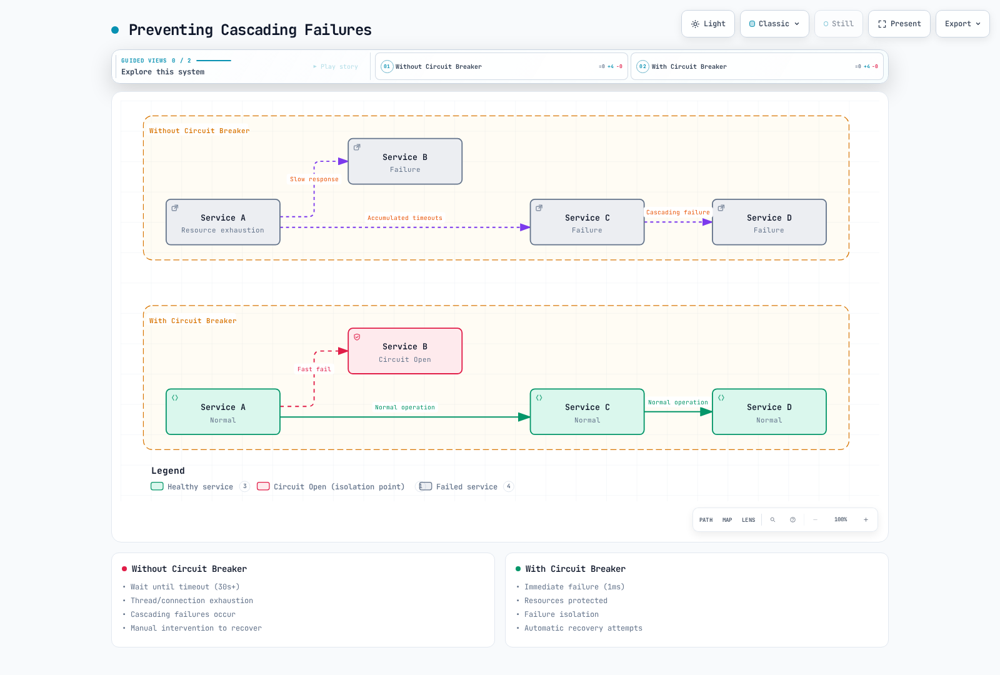
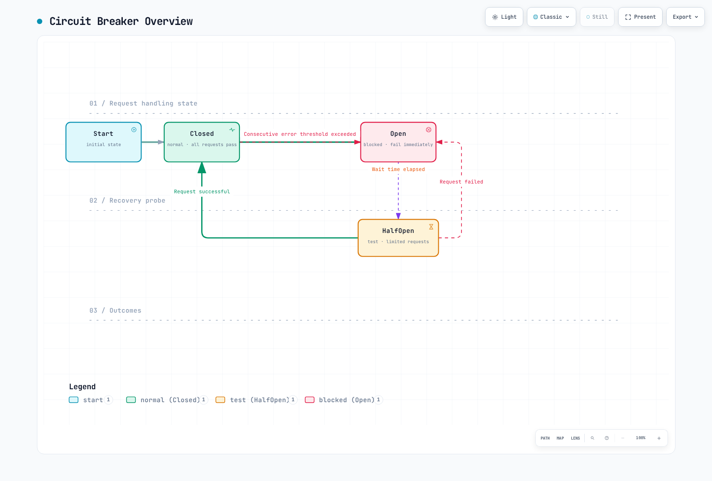
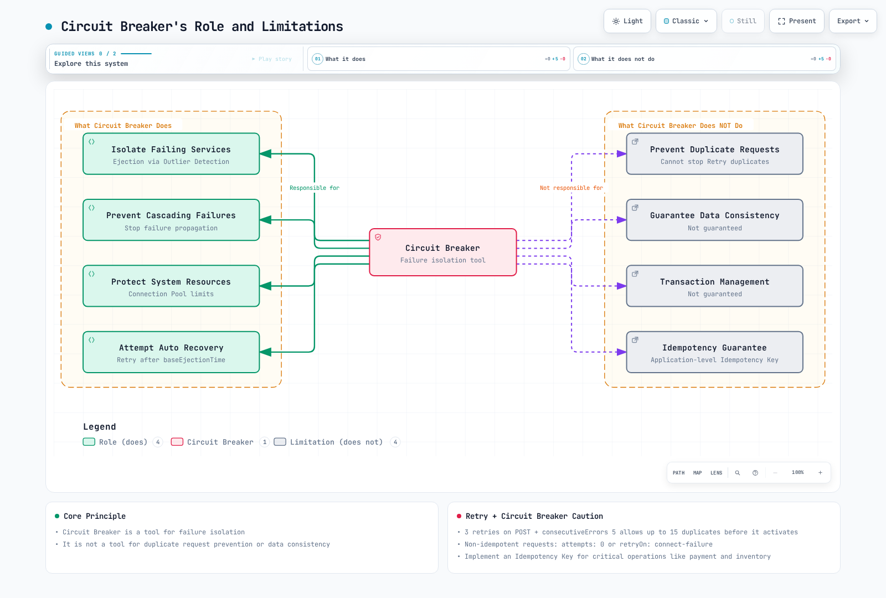
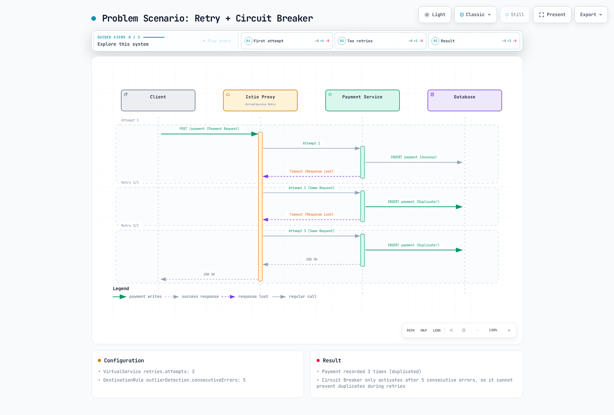

# 断路器

断路器会自动隔离故障服务，以防止故障级联。

## 目录

1. [为什么需要断路器？](#why-circuit-breaker)
2. [断路器概述](#circuit-breaker-overview)
3. [连接池设置](#connection-pool-settings)
4. [异常值检测](#outlier-detection)
5. [与重试策略结合](#combination-with-retry-policy)
6. [实践示例](#practical-examples)
7. [外部服务断路器](#external-service-circuit-breaker)
8. [监控与调试](#monitoring-and-debugging)
9. [重要注意事项](#important-considerations)
10. [最佳实践](#best-practices)

## 为什么需要断路器？ {#why-circuit-breaker}

### 防止故障级联

在微服务架构中，断路器可以防止一个服务的故障传播到其他服务。



[🔍 查看交互式图表](https://www.atomai.click/kubernetes-docs/archmaps/en-service-mesh-istio-traffic-management-07-circuit-breaker-0.html)

### 主要优点

| 问题 | 没有断路器 | 有断路器 |
|---------|------------------------|----------------------|
| **响应时间** | 等待超时（30 秒以上） | 达到配置的限制后快速拒绝 |
| **资源使用** | 线程/连接耗尽 | 保护资源 |
| **故障传播** | 发生级联故障 | 隔离故障 |
| **恢复时间** | 需要人工干预 | 自动尝试恢复 |

## 断路器概述 {#circuit-breaker-overview}

该图展示了通用的 Closed/Open/Half-Open 库模式。Istio 实现的是基于资源的连接池断路器和被动的逐端点异常值剔除；它并未提供一个适用于整个网格的单一三状态断路器。限制/健康状况观察结果仅对各个代理和上游集群/优先级本地有效，并且可能出现并发超量。异常值剔除会暂时将端点从选择范围中移除；它不会删除 Pod。以下示例是可选方案。



[🔍 查看交互式图表](https://www.atomai.click/kubernetes-docs/archmaps/en-service-mesh-istio-traffic-management-07-circuit-breaker-1.html)

## 连接池设置 {#connection-pool-settings}

```yaml
apiVersion: networking.istio.io/v1
kind: DestinationRule
metadata:
  name: reviews-circuit-breaker
spec:
  host: reviews
  trafficPolicy:
    connectionPool:
      tcp:
        maxConnections: 100
      http:
        http1MaxPendingRequests: 50
        http2MaxRequests: 100
        maxRequestsPerConnection: 2
```

## 异常值检测 {#outlier-detection}

异常值检测会在负载均衡时暂时排除不健康的端点，但会受到剔除限制和恐慌行为的影响。

```yaml
apiVersion: networking.istio.io/v1
kind: DestinationRule
metadata:
  name: reviews-outlier
spec:
  host: reviews
  trafficPolicy:
    outlierDetection:
      consecutive5xxErrors: 5        # 5 consecutive errors
      interval: 30s               # Check every 30 seconds
      baseEjectionTime: 30s       # Minimum; repeated ejection can last longer
      maxEjectionPercent: 50      # Remove up to 50%
      minHealthPercent: 40        # Below this, disable outlier isolation and use all hosts
```

### 高级异常值检测设置

基于连续错误的检测可以立即剔除端点；`interval` 控制定期扫描，不表示每次剔除前都必须等待该时长。`minHealthPercent` 是故障开放阈值，而不是预留健康容量的下限。`maxEjectionTime` 是 Envoy 字段，并未通过此 Istio DestinationRule API 暴露；不要将其写入这些清单。

```yaml
apiVersion: networking.istio.io/v1
kind: DestinationRule
metadata:
  name: advanced-outlier
spec:
  host: api-service
  trafficPolicy:
    outlierDetection:
      # Consecutive error based
      consecutiveGatewayErrors: 3    # HTTP 502/503/504
      consecutive5xxErrors: 5        # All HTTP 5xx

      # Time intervals
      interval: 10s                  # Check every 10 seconds
      baseEjectionTime: 30s          # First ejection time

      # Rate limits
      maxEjectionPercent: 50         # Remove up to 50%
      minHealthPercent: 30           # Fail-open/panic threshold, not a health guarantee

      # Separate local connection errors from upstream response errors
      splitExternalLocalOriginErrors: true
```

## 与重试策略结合 {#combination-with-retry-policy}

将断路器与重试结合使用，可以提高弹性。

### 基本组合

```yaml
apiVersion: networking.istio.io/v1
kind: VirtualService
metadata:
  name: reviews-retry
spec:
  hosts:
  - reviews
  http:
  - route:
    - destination:
        host: reviews
    retries:
      attempts: 3                    # 3 retries
      perTryTimeout: 2s              # 2 second timeout per attempt
      retryOn: 5xx,reset,connect-failure
---
apiVersion: networking.istio.io/v1
kind: DestinationRule
metadata:
  name: reviews-circuit-breaker
spec:
  host: reviews
  trafficPolicy:
    connectionPool:
      http:
        http1MaxPendingRequests: 10
        maxRequestsPerConnection: 2
    outlierDetection:
      consecutive5xxErrors: 5
      interval: 10s
      baseEjectionTime: 30s
```

### 重试预算模式

此预算会根据每个代理集群中的活动/待处理请求数量，限制并发重试；它不是每秒请求数限制。对重试安全的读取操作使用重试策略，而其他方法则明确禁用重试。

```yaml
apiVersion: networking.istio.io/v1
kind: VirtualService
metadata:
  name: payment-retry-budget
spec:
  hosts:
  - payment-service
  http:
  - match:
    - method:
        regex: "^(GET|HEAD)$"
    route:
    - destination:
        host: payment-service
    retries:
      attempts: 2                    # Minimize retries
      perTryTimeout: 1s              # Fast fail
      retryOn: connect-failure,refused-stream
  - route:
    - destination:
        host: payment-service
    retries:
      attempts: 0
---
apiVersion: networking.istio.io/v1
kind: DestinationRule
metadata:
  name: payment-circuit-breaker
spec:
  host: payment-service
  trafficPolicy:
    retryBudget:
      percent: 20
      minRetryConcurrency: 3
    connectionPool:
      http:
        http1MaxPendingRequests: 5   # Low queue
        maxRequestsPerConnection: 1  # 1 request per connection
    outlierDetection:
      consecutive5xxErrors: 3           # Fast blocking
      interval: 5s
      baseEjectionTime: 60s          # Long recovery time
```

## 实践示例 {#practical-examples}

### 1. 网格内部服务的断路器

#### 场景：保护数据库服务

```yaml
apiVersion: networking.istio.io/v1
kind: DestinationRule
metadata:
  name: database-service-circuit-breaker
  namespace: production
spec:
  host: database-service
  trafficPolicy:
    connectionPool:
      tcp:
        maxConnections: 100          # Maximum 100 connections
    outlierDetection:
      consecutive5xxErrors: 5
      interval: 30s
      baseEjectionTime: 30s
      maxEjectionPercent: 50
  subsets:
  - name: v1
    labels:
      version: v1
  - name: v2
    labels:
      version: v2
```

**适用场景**：
- 防止数据库连接池耗尽
- 阻止慢查询导致的级联故障
- 自动移除不健康的实例

对于原生数据库协议，此处仅使用 TCP 限制/故障观察。每个代理的连接限制并非数据库的全局连接池大小，也不会检查慢 SQL 查询。

### 2. maxConnections: 1 模式（单连接）

#### 场景：传统系统或资源受限的服务

```yaml
apiVersion: networking.istio.io/v1
kind: DestinationRule
metadata:
  name: legacy-system-protection
spec:
  host: legacy-api-service
  trafficPolicy:
    connectionPool:
      tcp:
        maxConnections: 1            # Limit to 1 connection
      http:
        http1MaxPendingRequests: 1   # 1 pending request
        maxRequestsPerConnection: 1  # 1 request per connection
        h2UpgradePolicy: DO_NOT_UPGRADE  # Prevent HTTP/2 upgrade
    outlierDetection:
      consecutive5xxErrors: 1           # Block immediately on 1 error
      interval: 10s
      baseEjectionTime: 60s
```

**适用场景**：
- 传统系统无法处理并发连接时
- 外部 API 的速率限制非常严格时
- 必须通过单个连接进行顺序处理时

`maxConnections: 1` 不会串行化整个网格，也不会强制执行外部 API 配额。每个代理都有自己的限制，HTTP/2 可以多路复用请求，而 `maxRequestsPerConnection: 1` 会禁用连接复用，并不能保证只执行一个请求。需要全局协调时，请使用应用队列/速率限制器。

### 3. 按子集配置断路器

#### 场景：为不同版本设置不同的断路器配置

```yaml
apiVersion: networking.istio.io/v1
kind: DestinationRule
metadata:
  name: reviews-subset-circuit-breaker
spec:
  host: reviews
  trafficPolicy:
    # Default policy (all subsets)
    connectionPool:
      http:
        http1MaxPendingRequests: 50
        maxRequestsPerConnection: 2
    outlierDetection:
      consecutive5xxErrors: 5
      interval: 30s
      baseEjectionTime: 30s
  subsets:
  - name: v1
    labels:
      version: v1
    # v1 uses default policy

  - name: v2
    labels:
      version: v2
    trafficPolicy:
      # v2 has stricter policy (new version testing)
      connectionPool:
        http:
          http1MaxPendingRequests: 10
          maxRequestsPerConnection: 1
      outlierDetection:
        consecutive5xxErrors: 3
        interval: 10s
        baseEjectionTime: 60s

  - name: v3-canary
    labels:
      version: v3
    trafficPolicy:
      # v3 Canary is very strict (initial deployment)
      connectionPool:
        http:
          http1MaxPendingRequests: 5
          maxRequestsPerConnection: 1
      outlierDetection:
        consecutive5xxErrors: 1
        interval: 5s
        baseEjectionTime: 120s
```

### 4. 高级连接池模式

#### 场景：高性能服务

```yaml
apiVersion: networking.istio.io/v1
kind: DestinationRule
metadata:
  name: high-performance-service
spec:
  host: api-gateway
  trafficPolicy:
    connectionPool:
      tcp:
        maxConnections: 1000         # High concurrent connections
        connectTimeout: 3s
        tcpKeepalive:
          time: 7200s
          interval: 75s
          probes: 9
      http:
        http1MaxPendingRequests: 500
        http2MaxRequests: 1000
        maxRequestsPerConnection: 100  # Connection reuse
        idleTimeout: 300s
        h2UpgradePolicy: UPGRADE       # Use HTTP/2
    outlierDetection:
      consecutive5xxErrors: 10          # Lenient setting
      interval: 60s
      baseEjectionTime: 30s
      maxEjectionPercent: 20         # Remove up to 20% only
```

### 5. 基于健康检查的断路器

```yaml
apiVersion: networking.istio.io/v1
kind: DestinationRule
metadata:
  name: health-check-circuit-breaker
spec:
  host: payment-service
  trafficPolicy:
    outlierDetection:
      # HTTP status code based
      consecutiveGatewayErrors: 5    # 502, 503, 504
      consecutive5xxErrors: 3        # 500~599

      # Performance based
      interval: 10s
      baseEjectionTime: 30s

      # Dynamic adjustment
      splitExternalLocalOriginErrors: true
      consecutiveLocalOriginFailures: 5
```

## 外部服务断路器 {#external-service-circuit-breaker}

以下 HTTP 示例假设应用通过明文 HTTP 向 sidecar 发送请求，而 sidecar 会通过经过验证的 TLS，使用 443 端口连接实际的外部主机。如果应用已使用 TLS，请避免重复 TLS，只使用该层可见的策略。原生 MongoDB 应用 TLS/身份验证仍是客户端/服务器的独立要求。

与 ServiceEntry 配合使用，以保护外部服务。

### 1. 外部 API 断路器

```yaml
# ServiceEntry: Register external API
apiVersion: networking.istio.io/v1
kind: ServiceEntry
metadata:
  name: external-payment-api
spec:
  hosts:
  - api.payment-provider.com
  ports:
  - number: 80
    name: http
    protocol: HTTP
    targetPort: 443
  location: MESH_EXTERNAL
  resolution: DNS
---
# DestinationRule: Apply Circuit Breaker
apiVersion: networking.istio.io/v1
kind: DestinationRule
metadata:
  name: external-payment-api-circuit-breaker
spec:
  host: api.payment-provider.com
  trafficPolicy:
    connectionPool:
      tcp:
        maxConnections: 10           # External API is limited
      http:
        http1MaxPendingRequests: 5
        maxRequestsPerConnection: 1  # Minimize connection reuse
    outlierDetection:
      consecutive5xxErrors: 3           # Fast blocking
      interval: 30s
      baseEjectionTime: 120s         # Long recovery time
      maxEjectionPercent: 100        # Can completely block
    tls:
      mode: SIMPLE
      sni: api.payment-provider.com
      subjectAltNames:
      - api.payment-provider.com
```

### 2. 外部数据库断路器

```yaml
apiVersion: networking.istio.io/v1
kind: ServiceEntry
metadata:
  name: external-mongodb
spec:
  hosts:
  - mongodb.external-cluster.com
  ports:
  - number: 27017
    name: tcp
    protocol: TCP
  location: MESH_EXTERNAL
  resolution: DNS
---
apiVersion: networking.istio.io/v1
kind: DestinationRule
metadata:
  name: external-mongodb-circuit-breaker
spec:
  host: mongodb.external-cluster.com
  trafficPolicy:
    connectionPool:
      tcp:
        maxConnections: 50
        connectTimeout: 5s
    outlierDetection:
      consecutive5xxErrors: 5
      interval: 60s
      baseEjectionTime: 60s
```

### 3. 受速率限制的外部服务

```yaml
apiVersion: networking.istio.io/v1
kind: ServiceEntry
metadata:
  name: rate-limited-api
spec:
  hosts:
  - api.rate-limited-service.com
  ports:
  - number: 80
    name: http
    protocol: HTTP
    targetPort: 443
  location: MESH_EXTERNAL
  resolution: DNS
---
apiVersion: networking.istio.io/v1
kind: DestinationRule
metadata:
  name: rate-limited-api-protection
spec:
  host: api.rate-limited-service.com
  trafficPolicy:
    connectionPool:
      http:
        http1MaxPendingRequests: 1   # Minimize queue
        maxRequestsPerConnection: 0  # Reuse connections; not a quota limiter
        idleTimeout: 1s              # Fast connection release
    outlierDetection:
      consecutive5xxErrors: 3           # Default HTTP 5xx detection; not 429
      interval: 60s
      baseEjectionTime: 30s          # Independent of provider Retry-After
    tls:
      mode: SIMPLE
      sni: api.rate-limited-service.com
      subjectAltNames:
      - api.rate-limited-service.com
---
# VirtualService: Retry settings
apiVersion: networking.istio.io/v1
kind: VirtualService
metadata:
  name: rate-limited-api-retry
spec:
  hosts:
  - api.rate-limited-service.com
  http:
  - route:
    - destination:
        host: api.rate-limited-service.com
    retries:
      attempts: 0                    # Disable retry (rate limit)
    timeout: 10s
```

HTTP 429 需要结合服务提供商进行限流，并处理 Retry-After。默认的 5xx 异常值检测和连接频繁重建既不能强制执行 API 配额，也无法推断配额重置时间。

## 监控与调试 {#monitoring-and-debugging}

### 检查 Envoy 指标

```bash
# Check Circuit Breaker status
kubectl exec -it <pod-name> -c istio-proxy -- \
  curl localhost:15000/stats/prometheus | grep circuit_breakers

# Outlier Detection status
kubectl exec -it <pod-name> -c istio-proxy -- \
  curl localhost:15000/stats/prometheus | grep outlier_detection

# Connection Pool status
kubectl exec -it <pod-name> -c istio-proxy -- \
  curl localhost:15000/stats/prometheus | grep upstream_rq
```

### 关键指标

```promql
# Prometheus queries
# Requests circuit-open gauge (0/1)
envoy_cluster_circuit_breakers_default_rq_open

# Pending-request circuit-open gauge (0/1)
envoy_cluster_circuit_breakers_default_rq_pending_open

# Outlier Detection Ejection
envoy_cluster_outlier_detection_ejections_active

# Connection pool overflow
envoy_cluster_upstream_rq_pending_overflow

# Retry count
envoy_cluster_upstream_rq_retry
```

### Grafana 仪表板

```yaml
# Circuit Breaker Dashboard
- expr: envoy_cluster_circuit_breakers_default_rq_open
  legend: "Circuit Breaker Open State"

- expr: envoy_cluster_outlier_detection_ejections_active
  legend: "Ejected Instances"

- expr: rate(envoy_cluster_upstream_rq_pending_overflow[5m])
  legend: "Connection Pool Overflow"
```

### istioctl 命令

```bash
# Check Proxy configuration
istioctl proxy-config clusters <pod-name> --fqdn reviews.default.svc.cluster.local

# Check Circuit Breaker settings
istioctl proxy-config clusters <pod-name> -o json | \
  jq '.[] | select(.name=="outbound|9080||reviews.default.svc.cluster.local") | .circuitBreakers'

# Check Outlier Detection settings
istioctl proxy-config clusters <pod-name> -o json | \
  jq '.[] | select(.name=="outbound|9080||reviews.default.svc.cluster.local") | .outlierDetection'
```

## 重要注意事项 {#important-considerations}

### 断路器不保证数据一致性

**核心原则**：断路器用于**故障隔离**，而不是用于**防止重复请求**或**保证数据一致性**。

#### 断路器的作用和局限性



[🔍 查看交互式图表](https://www.atomai.click/kubernetes-docs/archmaps/en-service-mesh-istio-traffic-management-07-circuit-breaker-2.html)

#### 问题场景：重试 + 断路器



[🔍 查看交互式图表](https://www.atomai.click/kubernetes-docs/archmaps/en-service-mesh-istio-traffic-management-07-circuit-breaker-3.html)

**问题**：在断路器激活之前（连续发生 5 次错误后），**已经出现了 3 笔重复付款**。

#### 错误用法示例

```yaml
# Dangerous: POST request + Retry + Circuit Breaker
apiVersion: networking.istio.io/v1
kind: VirtualService
metadata:
  name: payment-dangerous
spec:
  hosts:
  - payment-service
  http:
  - route:
    - destination:
        host: payment-service
    retries:
      attempts: 3  # 3 retries on POST
      perTryTimeout: 2s
      retryOn: 5xx,reset
---
apiVersion: networking.istio.io/v1
kind: DestinationRule
metadata:
  name: payment-circuit-breaker
spec:
  host: payment-service
  trafficPolicy:
    outlierDetection:
      consecutive5xxErrors: 5
      interval: 30s
      baseEjectionTime: 30s

# Result:
# - attempts: 3 allows up to 4 deliveries per original request; the ejection threshold is not a multiplier
# - Critical operations like payment, inventory deduction get duplicated
# - Data consistency destroyed
```

#### 正确的使用模式

**模式 1：对可安全重试的读取操作启用重试；写入操作不使用网格重试**

```yaml
# Safe: Read-only + Circuit Breaker
apiVersion: networking.istio.io/v1
kind: VirtualService
metadata:
  name: product-catalog-safe
spec:
  hosts:
  - product-catalog
  http:
  - match:
    - method:
        regex: "GET|HEAD|OPTIONS"  # Read-only only
    route:
    - destination:
        host: product-catalog
    retries:
      attempts: 3  # GET is safe
      perTryTimeout: 2s
      retryOn: 5xx,reset,connect-failure
---
apiVersion: networking.istio.io/v1
kind: DestinationRule
metadata:
  name: product-catalog-circuit-breaker
spec:
  host: product-catalog
  trafficPolicy:
    outlierDetection:
      consecutive5xxErrors: 5
      interval: 30s
      baseEjectionTime: 30s
```

```yaml
# Safe: Disable Retry for POST
apiVersion: networking.istio.io/v1
kind: VirtualService
metadata:
  name: payment-safe
spec:
  hosts:
  - payment-service
  http:
  - match:
    - method:
        exact: POST
    route:
    - destination:
        host: payment-service
    timeout: 10s
    retries:
      attempts: 0  # Disable Retry for POST
---
apiVersion: networking.istio.io/v1
kind: DestinationRule
metadata:
  name: payment-circuit-breaker
spec:
  host: payment-service
  trafficPolicy:
    outlierDetection:
      consecutive5xxErrors: 5
      interval: 30s
      baseEjectionTime: 30s
```

**模式 2：应用级幂等性 + 断路器**

幂等键必须绑定到经过身份验证的调用方和请求负载，并且必须与业务变更/结果原子地记录。先检查 Redis 中是否存在，再执行付款并单独写入缓存，这种做法存在竞态，并非安全的实现。必要时，请使用[原子幂等工作流](05-retry-timeout.md)以及下游幂等性约定/outbox。只有满足这些条件后，才使用以下重试策略；仅检查请求头是否存在并不足够。


```yaml
# Istio: Retry is safe when Idempotency is guaranteed
apiVersion: networking.istio.io/v1
kind: VirtualService
metadata:
  name: payment-with-idempotency
spec:
  hosts:
  - payment-service
  http:
  - match:
    - headers:
        x-idempotency-key:
          regex: ".+"  # Idempotency Key required
    route:
    - destination:
        host: payment-service
    retries:
      attempts: 3  # Safe with Idempotency
      perTryTimeout: 2s
      retryOn: 5xx,reset
  - route:  # Disable Retry without Idempotency Key
    - destination:
        host: payment-service
    retries:
      attempts: 0
```

#### 按服务类型制定安全策略

| 服务类型 | 重试 | 断路器 | 是否需要幂等性 |
|-------------|-------|----------------|---------------------|
| **商品目录** | 3 次 | 必须 | 不需要 |
| **购物车** | 默认仅读取操作 | 按需调整 | 可重试的变更操作需要 |
| **创建订单** | 0 次 | 必须 | 需要 |
| **付款** | 0 次 | 必须 | 需要 |
| **扣减库存** | 0 次 | 必须 | 需要 |
| **积分累积** | 0 次 | 必须 | 需要 |
| **发送通知** | 仅在进行投递去重时 | 按需调整 | 需要投递/消息幂等性 |

#### 连接池与数据一致性

连接池设置也**不能保证数据一致性**。它们只能限制并发连接数。

```yaml
# Misconception: Does maxConnections=1 prevent duplicates?
apiVersion: networking.istio.io/v1
kind: DestinationRule
metadata:
  name: payment-single-connection
spec:
  host: payment-service
  trafficPolicy:
    connectionPool:
      tcp:
        maxConnections: 1  # Does NOT prevent duplicates
      http:
        http1MaxPendingRequests: 1

# maxConnections=1:
# - Only limits concurrent connections
# - Cannot prevent duplicate requests from Retry
# - Retries after network timeout are separate connections
```

#### 实践检查清单

**部署前验证**：

- [ ] 检查 POST/PUT/DELETE/PATCH 请求的重试设置
- [ ] 对非幂等写入设置 `attempts: 0`，除非经验证的应用约定允许重试
- [ ] 检查组合使用断路器和重试时是否可能产生重复请求
- [ ] 为关键操作（付款、库存）实现幂等键
- [ ] 确认存在应用级验证逻辑
- [ ] 在测试环境中执行故障模拟

**监控**：

```bash
# Check Retry occurrence count
kubectl exec -n <namespace> <pod> -c istio-proxy -- \
  curl -s localhost:15000/stats/prometheus | grep upstream_rq_retry

# Check Circuit Breaker activation
kubectl exec -n <namespace> <pod> -c istio-proxy -- \
  curl -s localhost:15000/stats/prometheus | grep circuit_breakers

# Check logs for suspected duplicate requests
kubectl logs -n <namespace> <pod> | grep -i "duplicate\|idempotency"
```

## 最佳实践 {#best-practices}

### 1. 渐进式配置

```yaml
# Stage 1: Start with lenient settings
apiVersion: networking.istio.io/v1
kind: DestinationRule
metadata:
  name: service-circuit-breaker-stage1
spec:
  host: my-service
  trafficPolicy:
    connectionPool:
      http:
        http1MaxPendingRequests: 100
        maxRequestsPerConnection: 10
    outlierDetection:
      consecutive5xxErrors: 10        # Lenient
      interval: 60s
      baseEjectionTime: 30s
```

```yaml
# Stage 2: Adjust after monitoring
apiVersion: networking.istio.io/v1
kind: DestinationRule
metadata:
  name: service-circuit-breaker-stage2
spec:
  host: my-service
  trafficPolicy:
    connectionPool:
      http:
        http1MaxPendingRequests: 50
        maxRequestsPerConnection: 5
    outlierDetection:
      consecutive5xxErrors: 5         # Moderate
      interval: 30s
      baseEjectionTime: 30s
```

### 2. 按服务类型配置

```yaml
# Frontend service: Lenient
connectionPool:
  http:
    http1MaxPendingRequests: 100
    maxRequestsPerConnection: 10
outlierDetection:
  consecutive5xxErrors: 10
```

```yaml
# Backend service: Moderate
connectionPool:
  http:
    http1MaxPendingRequests: 50
    maxRequestsPerConnection: 5
outlierDetection:
  consecutive5xxErrors: 5
```

```yaml
# Native database/cache TCP example
connectionPool:
  tcp:
    maxConnections: 10
outlierDetection:
  consecutive5xxErrors: 3
```

```yaml
# External API: Very strict
connectionPool:
  http:
    http1MaxPendingRequests: 5
    maxRequestsPerConnection: 1
outlierDetection:
  consecutive5xxErrors: 1
```

### 3. 配置告警

```yaml
# Prometheus Alert Rules
groups:
- name: circuit-breaker
  rules:
  - alert: CircuitBreakerOpen
    expr: envoy_cluster_circuit_breakers_default_rq_open > 0
    for: 1m
    annotations:
      summary: "Circuit breaker is open"

  - alert: HighConnectionPoolOverflow
    expr: rate(envoy_cluster_upstream_rq_pending_overflow[5m]) > 10
    for: 2m
    annotations:
      summary: "Connection pool overflow rate is high"

  - alert: HighOutlierEjectionRate
    expr: rate(envoy_cluster_outlier_detection_ejections_enforced_total[5m]) > 5
    for: 3m
    annotations:
      summary: "High outlier ejection rate"
```

### 4. 测试场景

仅针对已准备好的测试服务运行负载测试，并单独观察实时指标：proxy-config 显示的是已配置的阈值，并不表示断路器当前是否处于打开状态。等待 30 秒并不能保证多次剔除后端点会恢复。

```bash
#!/bin/bash
# Circuit Breaker test

# 1. Normal traffic
echo "=== Normal Traffic ==="
for i in {1..10}; do
  curl -s http://service/api | jq .status
  sleep 0.1
done

# 2. Increased load
echo "=== Increased Load ==="
for i in {1..100}; do
  curl -s http://service/api &
done
wait

# 3. Check Circuit Breaker status
echo "=== Circuit Breaker Status ==="
istioctl proxy-config clusters <pod> -o json | jq '.[] | .circuitBreakers'

# 4. Wait for recovery
echo "=== Waiting for Recovery ==="
sleep 30

# 5. Verify recovery
echo "=== Recovery Check ==="
curl -s http://service/api | jq .status
```

### 5. 文档模板

请将这些用于说明的负载/恢复数据替换为实际测量值；它们并非 Istio 的固定保证。启用所需的 Envoy 统计信息；如果代理映像中没有 curl，请使用本地管理端口转发或 `istioctl dashboard envoy`。

```yaml
apiVersion: networking.istio.io/v1
kind: DestinationRule
metadata:
  name: my-service-circuit-breaker
  annotations:
    # Configuration purpose
    purpose: "Protect database connection pool"

    # Threshold rationale
    threshold-rationale: |
      - maxConnections: 100 (DB connection pool size)
      - consecutive5xxErrors: 5 (observed error pattern)
      - baseEjectionTime: 30s (average recovery time)

    # Test results
    test-results: |
      - Load test: 1000 RPS without overflow
      - Failure test: Circuit opens after 5 errors
      - Recovery test: Auto-recovery after 30s

    # Operations guide
    operations: |
      - Monitor: envoy_cluster_circuit_breakers_*
      - Alert: Circuit open > 1min
      - Rollback: restore the reviewed previous DestinationRule configuration
spec:
  host: my-service
```

## 参考资料

- [Istio 断路器](https://istio.io/latest/docs/tasks/traffic-management/circuit-breaking/)
- [Envoy 断路器](https://www.envoyproxy.io/docs/envoy/latest/intro/arch_overview/upstream/circuit_breaking)
- [Envoy 异常值检测](https://www.envoyproxy.io/docs/envoy/latest/intro/arch_overview/upstream/outlier)
- [Netflix Hystrix](https://github.com/Netflix/Hystrix/wiki/How-it-Works)

- [主要参考资料 1](https://istio.io/latest/docs/reference/config/networking/destination-rule/)
- [主要参考资料 2](https://www.envoyproxy.io/docs/envoy/latest/intro/arch_overview/upstream/circuit_breaking)
- [主要参考资料 3](https://www.envoyproxy.io/docs/envoy/latest/intro/arch_overview/upstream/outlier)
- [主要参考资料 4](https://www.envoyproxy.io/docs/envoy/latest/configuration/upstream/cluster_manager/cluster_stats)
- [主要参考资料 5](https://aws.amazon.com/builders-library/making-retries-safe-with-idempotent-APIs/)
- [主要参考资料 6](https://istio.io/latest/docs/tasks/traffic-management/egress/egress-tls-origination/)
