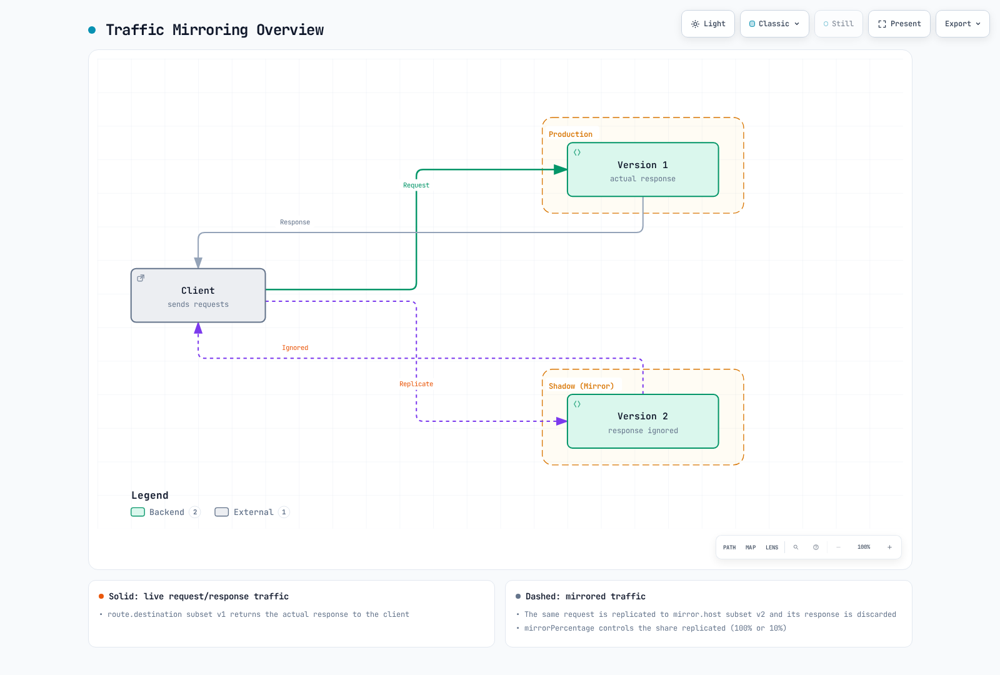

# 流量镜像

流量镜像（也称为 Shadow Traffic）是一种实时复制生产流量以测试新版本的技术。

## 目录

1. [流量镜像概述](#traffic-mirroring-overview)
2. [基本配置](#basic-configuration)
3. [部分镜像](#partial-mirroring)
4. [最佳实践](#best-practices)

<span id="traffic-mirroring-overview"></span>

## 流量镜像概述



[🔍 查看交互式图表](https://www.atomai.click/kubernetes-docs/archmaps/en-service-mesh-istio-traffic-management-09-traffic-mirror-0.html)

<span id="basic-configuration"></span>

## 基本配置

这些 sidecar 示例要求存在 `reviews` Service，以及与 Pod 标签匹配的 `v1`/`v2` DestinationRule subset。对于此 host，一次只应用一种可选的 VirtualService 配置。镜像流量不会分走主要 route 的权重，而是额外发送一份副本。

```yaml
apiVersion: networking.istio.io/v1
kind: VirtualService
metadata:
  name: reviews-mirror
spec:
  hosts:
  - reviews
  http:
  - route:
    - destination:
        host: reviews
        subset: v1
      weight: 100
    mirror:
      host: reviews
      subset: v2
    mirrorPercentage:
      value: 100  # 100% mirroring
```

<span id="partial-mirroring"></span>

## 部分镜像

```yaml
apiVersion: networking.istio.io/v1
kind: VirtualService
metadata:
  name: reviews-partial-mirror
spec:
  hosts:
  - reviews
  http:
  - route:
    - destination:
        host: reviews
        subset: v1
    mirror:
      host: reviews
      subset: v2
    mirrorPercentage:
      value: 10  # Mirror only 10%
```

<span id="best-practices"></span>

## 最佳实践

- 镜像请求的响应会被丢弃；这既不是故障转移，也不会自动比较响应。
- 写操作仍会在影子目标端执行。在镜像生产请求前，应隔离影子目标的数据库、队列及其他外部副作用。
- 从较小的百分比开始，同时监控主要路径延迟和影子端容量。镜像会增加流量和处理成本。
- 默认情况下，镜像请求的 Host/Authority 会添加 `-shadow` 后缀；请配置影子服务以接受该后缀。对于 ambient waypoint，请检查所选发行版的路由 API。

## 参考资料

- [Istio 流量镜像](https://istio.io/latest/docs/tasks/traffic-management/mirroring/)
