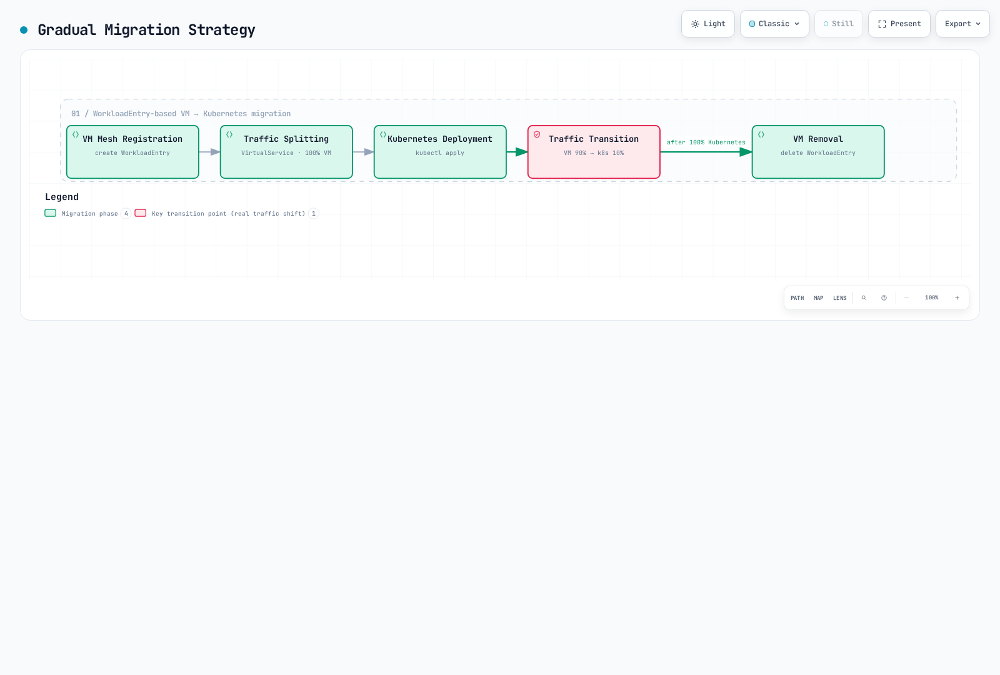

# WorkloadEntry

> **适用版本**：Istio 1.31.0
> **最近更新**：2026年9月11日

WorkloadEntry 是一种资源，用于将虚拟机（VM）或裸金属服务器注册到 Istio 服务网格中。这样，Kubernetes 之外的工作负载也能使用网格的流量管理、安全和可观测性功能。

## 目录

1. [概述](#overview)
2. [WorkloadEntry 与 Kubernetes Pod](#workloadentry-vs-kubernetes-pod)
3. [架构](#architecture)
4. [基本用法](#basic-usage)
5. [ServiceEntry 集成](#serviceentry-integration)
6. [VM 注册实战指南](#vm-registration-practical-guide)
7. [安全设置（mTLS）](#security-settings-mtls)
8. [健康检查和监控](#health-checks-and-monitoring)
9. [高级配置](#advanced-configuration)
10. [故障排除](#troubleshooting)
11. [最佳实践](#best-practices)

## 概述 {#overview}

WorkloadEntry 用于描述工作负载；创建它本身不会安装 Envoy、引导身份、建立网络连接或发布 DNS 记录。本章介绍 sidecar 模式下的 VM 集成。各示例彼此独立；请确保每个 ServiceEntry、所选 WorkloadEntry 和 ServiceAccount 都位于预期的命名空间中。图示表示注册与配置关系，不代表额外的网络跳点。

### 什么是 WorkloadEntry？

WorkloadEntry 是 Istio 的自定义资源定义（CRD），用于将网格外部的工作负载（VM、裸金属服务器）注册到 Istio 服务网格中。

### 使用场景


[🔍 查看交互式图示](https://www.atomai.click/kubernetes-docs/archmaps/en-service-mesh-istio-traffic-management-13-workload-entry-0.html)

**主要使用场景**：
1. **渐进式迁移**：逐步将旧版应用迁移到 Kubernetes。
2. **混合架构**：同时运行 VM 和容器。
3. **数据库集成**：将外部数据库纳入网格。
4. **高性能工作负载**：使用 GPU 服务器等专用硬件。

## WorkloadEntry 与 Kubernetes Pod {#workloadentry-vs-kubernetes-pod}

### 对比表

| 特性 | Kubernetes Pod | WorkloadEntry（VM） |
|----------------|---------------|-------------------|
| **部署位置** | 集群内 | 集群外 |
| **Envoy 注入** | 自动（sidecar） | 手动安装 |
| **服务发现** | 自动（Service） | 手动（WorkloadEntry） |
| **IP 管理** | Kubernetes CNI | 手动指定 |
| **mTLS** | 自动 | 自动（需要部署证书） |
| **健康检查** | 自动（Liveness/Readiness） | 手动配置 |
| **扩缩容** | HPA | 手动 |
| **运维复杂度** | 低 | 高 |
| **使用场景** | 云原生应用 | 旧版应用、专用硬件 |

### 流量流向对比


[🔍 查看交互式图示](https://www.atomai.click/kubernetes-docs/archmaps/en-service-mesh-istio-traffic-management-13-workload-entry-1.html)

## 架构 {#architecture}

### VM 工作负载架构


[🔍 查看交互式图示](https://www.atomai.click/kubernetes-docs/archmaps/en-service-mesh-istio-traffic-management-13-workload-entry-2.html)

### 关键组件

1. **WorkloadEntry**：登记 VM 信息（IP、端口、标签）。
2. **ServiceEntry**：定义 Service，并引用 WorkloadEntry。
3. **Envoy Proxy**：手动安装在 VM 上的 sidecar。
4. **istiod**：下发配置并管理证书。
5. **ServiceAccount**：用于 VM 身份认证。

## 基本用法 {#basic-usage}

### WorkloadEntry 资源定义

```yaml
apiVersion: networking.istio.io/v1
kind: WorkloadEntry
metadata:
  name: legacy-api-vm-1
  namespace: production
spec:
  # VM's IP address
  address: 192.168.1.100

  # Labels for service selection
  labels:
    app: legacy-api
    version: v1.0
    tier: backend

  # Service account for mTLS authentication
  serviceAccount: legacy-api-sa

  # Ports to expose
  ports:
    http: 8080
    https: 8443
    metrics: 9090

  # Locality information (optional)
  locality: us-west-2/us-west-2a

  # Weight (for load balancing, optional)
  weight: 100

  # Network (multi-network environment, optional)
  network: vm-network
```

### 必填字段说明

| 字段 | 描述 | 示例 |
|-------|-------------|---------|
| **address** | 端点地址（IP，或可解析 DNS 名称；对于已配置的远程网络，可以省略） | `192.168.1.100` |
| **labels** | 用于匹配 ServiceEntry 的标签 | `app: legacy-api` |
| **serviceAccount** | 用于 mTLS 认证的 SA | `legacy-api-sa` |
| **ports** | 要公开的端口映射 | `http: 8080` |

### 注册多个 VM

```yaml
# VM 1
apiVersion: networking.istio.io/v1
kind: WorkloadEntry
metadata:
  name: api-vm-1
  namespace: production
spec:
  address: 192.168.1.101
  labels:
    app: api-service
    version: v1
  serviceAccount: api-sa
  ports:
    http: 8080
---
# VM 2
apiVersion: networking.istio.io/v1
kind: WorkloadEntry
metadata:
  name: api-vm-2
  namespace: production
spec:
  address: 192.168.1.102
  labels:
    app: api-service
    version: v1
  serviceAccount: api-sa
  ports:
    http: 8080
---
# VM 3 (different version)
apiVersion: networking.istio.io/v1
kind: WorkloadEntry
metadata:
  name: api-vm-3
  namespace: production
spec:
  address: 192.168.1.103
  labels:
    app: api-service
    version: v2  # New version
  serviceAccount: api-sa
  ports:
    http: 8080
```

## ServiceEntry 集成 {#serviceentry-integration}

WorkloadEntry 始终与 ServiceEntry 配合使用。

### 基本集成模式

```yaml
# 1. Define service with ServiceEntry
apiVersion: networking.istio.io/v1
kind: ServiceEntry
metadata:
  name: legacy-api
  namespace: production
spec:
  hosts:
  - api.legacy.internal
  addresses:
  - 240.240.1.1  # Virtual IP
  ports:
  - number: 8080
    name: http
    protocol: HTTP
  location: MESH_INTERNAL
  resolution: STATIC
  workloadSelector:
    labels:
      app: legacy-api  # Match with WorkloadEntry labels
---
# 2. Register VM with WorkloadEntry
apiVersion: networking.istio.io/v1
kind: WorkloadEntry
metadata:
  name: legacy-api-vm-1
  namespace: production
spec:
  address: 192.168.1.100
  labels:
    app: legacy-api  # Match with ServiceEntry
    version: v1
  serviceAccount: legacy-api-sa
  ports:
    http: 8080
```

### 操作流程


[🔍 查看交互式图示](https://www.atomai.click/kubernetes-docs/archmaps/en-service-mesh-istio-traffic-management-13-workload-entry-3.html)

### 负载均衡

存在多个 WorkloadEntry 时会自动进行负载均衡：

```yaml
apiVersion: networking.istio.io/v1
kind: ServiceEntry
metadata:
  name: database-cluster
  namespace: vm-workloads
spec:
  hosts:
  - db.cluster.internal
  ports:
  - number: 5432
    name: postgresql
    protocol: TCP
  location: MESH_INTERNAL
  resolution: STATIC
  workloadSelector:
    labels:
      app: postgres
      tier: database
      role: primary
---
# Separate read-only replica service
apiVersion: networking.istio.io/v1
kind: ServiceEntry
metadata:
  name: database-replicas
  namespace: vm-workloads
spec:
  hosts:
  - db-replicas.cluster.internal
  ports:
  - number: 5432
    name: postgresql
    protocol: TCP
  location: MESH_INTERNAL
  resolution: STATIC
  workloadSelector:
    labels:
      app: postgres
      tier: database
      role: replica
---
# Primary DB
apiVersion: networking.istio.io/v1
kind: WorkloadEntry
metadata:
  name: postgres-primary
  namespace: vm-workloads
spec:
  serviceAccount: vm-postgres-sa
  address: 10.0.1.100
  labels:
    app: postgres
    tier: database
    role: primary
  weight: 100  # Weight
---
# Replica DB 1
apiVersion: networking.istio.io/v1
kind: WorkloadEntry
metadata:
  name: postgres-replica-1
  namespace: vm-workloads
spec:
  serviceAccount: vm-postgres-sa
  address: 10.0.1.101
  labels:
    app: postgres
    tier: database
    role: replica
  weight: 50
---
# Replica DB 2
apiVersion: networking.istio.io/v1
kind: WorkloadEntry
metadata:
  name: postgres-replica-2
  namespace: vm-workloads
spec:
  serviceAccount: vm-postgres-sa
  address: 10.0.1.102
  labels:
    app: postgres
    tier: database
    role: replica
  weight: 50
```

只有在应用能够容忍复制语义时，才将写入请求发送到主服务、将读取请求发送到副本。通用端点权重无法识别 PostgreSQL 角色。对于使用相同端口的服务，请配置 DNS 捕获或唯一 VIP，并使用指定的 ServiceAccount 引导每台 VM。

## VM 注册实战指南 {#vm-registration-practical-guide}

### 前提条件

1. **VM 要求**：
   - 网络：能够与 Kubernetes 集群通信。
   - 操作系统/CPU：使用所选 sidecar 软件包支持的 Linux 发行版和 CPU 架构；本示例使用 Debian 软件包。
   - 连通性：通过对 VM 开放的网关访问 istiod xDS/CA（通常为 15012），并按选定的拓扑路由工作负载流量。15017 是 Kubernetes webhook 端口，不是 VM 应用的要求。

2. **Kubernetes 准备工作**：
   - 已完成 Istio 安装。
   - 为 VM 创建命名空间。
   - 创建 ServiceAccount。

生成引导文件之前，请按照[官方 VM 安装流程](https://istio.io/latest/docs/setup/install/virtual-machine/)开放现有控制平面供 VM 访问。只有集群内可访问的 istiod Service 并不足够。本指南假定 Pod 与 VM 在同一逻辑网络中路由通信；若网络分离，请采用文档说明的东西向网关/网络配置。生成的集群 ID 必须与 istiod 的配置一致。

### 步骤 1：创建 ServiceAccount

```bash
# Create namespace
kubectl create namespace vm-workloads

# Create ServiceAccount
kubectl create serviceaccount vm-postgres-sa -n vm-workloads

# VM identity bootstrap does not require listing Kubernetes Secrets.
```

### 步骤 2：准备 WorkloadGroup 引导输入

WorkloadGroup 用作多个 WorkloadEntry 的模板：

```yaml
apiVersion: networking.istio.io/v1
kind: WorkloadGroup
metadata:
  name: postgres-vms
  namespace: vm-workloads
spec:
  metadata:
    labels:
      app: postgres
      version: v14
  template:
    serviceAccount: vm-postgres-sa
    network: ""  # Same logical network in this walkthrough
    ports:
      postgresql: 5432
      metrics: 9187
```

### 步骤 3：在 VM 上安装 Envoy

#### 生成自动安装脚本

```bash
# Generate VM registration files with istioctl
umask 077
istioctl x workload entry configure \
  -f workloadgroup.yaml \
  -o vm-postgres-1 \
  --clusterID Kubernetes

# Generated files:
# - cluster.env: Cluster information
# - istio-token: Authentication token
# - mesh.yaml: Mesh configuration
# - root-cert.pem: Root certificate
# - hosts: /etc/hosts entries
```

#### 在 VM 上执行安装

```bash
# Run on the administration workstation before entering the VM shell
ssh user@192.168.1.100 'install -d -m 700 "$HOME/istio-bootstrap"'
scp vm-postgres-1/* user@192.168.1.100:istio-bootstrap/
ssh user@192.168.1.100

# From this point, run on the VM
VM_BOOTSTRAP_DIR="$HOME/istio-bootstrap"
curl -fsSLo istio-sidecar.deb \
  https://blob.istio.io/istio-release/releases/1.31.0/deb/istio-sidecar.deb
sudo dpkg -i istio-sidecar.deb
sudo install -d -o istio-proxy -m 0750 \
  /etc/certs /var/run/secrets/tokens /var/lib/istio/envoy /etc/istio/config /etc/istio/proxy
sudo install -o istio-proxy -m 0644 "$VM_BOOTSTRAP_DIR/root-cert.pem" /etc/certs/root-cert.pem
sudo install -o istio-proxy -m 0600 "$VM_BOOTSTRAP_DIR/istio-token" /var/run/secrets/tokens/istio-token
sudo install -o istio-proxy -m 0600 "$VM_BOOTSTRAP_DIR/cluster.env" /var/lib/istio/envoy/cluster.env
sudo install -o istio-proxy -m 0600 "$VM_BOOTSTRAP_DIR/mesh.yaml" /etc/istio/config/mesh
# Review/merge once; replace stale istiod entries rather than appending duplicates
cat "$VM_BOOTSTRAP_DIR/hosts" | sudo tee -a /etc/hosts >/dev/null
sudo systemctl enable --now istio
sudo systemctl status istio
```

### 步骤 4：注册 WorkloadEntry

上面的命令采用手动注册。VM agent 完成引导后再应用此 WorkloadEntry；对于自动注册的 VM，不要再创建重复的手动条目：

```yaml
apiVersion: networking.istio.io/v1
kind: WorkloadEntry
metadata:
  name: postgres-vm-1
  namespace: vm-workloads
spec:
  address: 192.168.1.100
  labels:
    app: postgres
    version: v14
  serviceAccount: vm-postgres-sa
  ports:
    postgresql: 5432
    metrics: 9187
```

```bash
kubectl apply -f workloadentry.yaml
```

### 步骤 5：创建 ServiceEntry

```yaml
apiVersion: networking.istio.io/v1
kind: ServiceEntry
metadata:
  name: postgres-service
  namespace: vm-workloads
spec:
  hosts:
  - postgres.vm.internal
  addresses:
  - 240.240.2.1
  ports:
  - number: 5432
    name: postgresql
    protocol: TCP
  - number: 9187
    name: metrics
    protocol: HTTP
  location: MESH_INTERNAL
  resolution: STATIC
  workloadSelector:
    labels:
      app: postgres
```

```bash
kubectl apply -f serviceentry.yaml
```

### 步骤 6：测试连接

```yaml
apiVersion: v1
kind: Pod
metadata:
  name: pg-client
  namespace: vm-workloads
  labels:
    sidecar.istio.io/inject: "true"
  annotations:
    proxy.istio.io/config: |
      proxyMetadata:
        ISTIO_META_DNS_CAPTURE: "true"
spec:
  containers:
  - name: postgres
    image: postgres:14
    command: ["sleep", "infinity"]
```

```bash
kubectl apply -f pg-client.yaml
kubectl wait -n vm-workloads --for=condition=Ready pod/pg-client --timeout=120s
kubectl exec -it pg-client -n vm-workloads -c postgres -- \
  psql -h postgres.vm.internal -U dbuser -d mydb
```

将 Pod 清单保存为 pg-client.yaml。PostgreSQL 客户端版本只是应用示例，与 Istio 版本无关。请交互式提供有效的数据库凭证。应用下方限制性策略后，测试时要使用获准的 ServiceAccount；默认测试身份会被拒绝。完成后删除测试 Pod。

## 安全设置（mTLS） {#security-settings-mtls}

### 自动启用 mTLS

为所声明的 ServiceAccount 完成 VM agent 引导后，网格代理即可使用自动 mTLS。仅创建 WorkloadEntry 并不会让普通 VM 成为网格成员：

```yaml
# Force mTLS with PeerAuthentication
apiVersion: security.istio.io/v1
kind: PeerAuthentication
metadata:
  name: default
  namespace: vm-workloads
spec:
  mtls:
    mode: STRICT  # mTLS required for both VM and pod
```

### VM 身份验证

与 Pod sidecar 引导不同，VM 集成会将签发的证书/密钥持久保存在 /etc/certs，并使用现有 mTLS 身份续期。这些文件会在引导成功后出现。请妥善保密密钥；只有在已诊断的问题需要恢复时才重新生成引导材料，不要将凭证打印或复制到日志中。

```bash
# Check certificates on VM
sudo ls -la /etc/certs/
# cert-chain.pem: Certificate chain
# key.pem: Private key
# root-cert.pem: Root CA

# Check certificate contents
sudo openssl x509 -in /etc/certs/cert-chain.pem -text -noout

# Check Subject Alternative Name (SAN):
# spiffe://cluster.local/ns/vm-workloads/sa/vm-postgres-sa
```

### 访问控制（AuthorizationPolicy）

```yaml
# PostgreSQL access control
apiVersion: security.istio.io/v1
kind: AuthorizationPolicy
metadata:
  name: postgres-access
  namespace: vm-workloads
spec:
  selector:
    matchLabels:
      app: postgres  # WorkloadEntry labels
  action: ALLOW
  rules:
  # Allow only API service access
  - from:
    - source:
        principals:
        - cluster.local/ns/production/sa/api-service-sa
    to:
    - operation:
        ports: ["5432"]

  # Allow monitoring service access
  - from:
    - source:
        principals:
        - cluster.local/ns/istio-system/sa/prometheus
    to:
    - operation:
        ports: ["9187"]  # postgres_exporter
```

### mTLS 验证

```bash
# Use a PostgreSQL client in an authorized mesh workload; PostgreSQL is not HTTPS
kubectl exec -it <authorized-client-pod> -n production -c <app-container> -- \
  psql -h postgres.vm.internal -U dbuser -d mydb
# Inspect the client proxy's TLS transport and certificates separately
istioctl proxy-config clusters <authorized-client-pod> -n production --fqdn postgres.vm.internal -o json
istioctl proxy-config secret <authorized-client-pod> -n production
# On the VM, inspect public certificate information through its local admin interface
curl -fsS http://127.0.0.1:15000/certs
```

## 健康检查和监控 {#health-checks-and-monitoring}

### 健康检查配置

对于可选的自动化流程，相关控制平面标志为 `PILOT_ENABLE_WORKLOAD_ENTRY_AUTOREGISTRATION` 和 `PILOT_ENABLE_WORKLOAD_ENTRY_HEALTHCHECKS`；请按文档所述将其合并到现有安装设置中。

WorkloadGroup 支持 readiness probe。文档中的自动注册/健康检查流程需要先启用 istiod 标志、应用 WorkloadGroup，再使用 --autoregister 生成引导文件。这是一个可选启用的流程，与上面的手动方式不同。下方 DestinationRule 用于被动检测连接失败，不是主动健康探针：

```yaml
apiVersion: networking.istio.io/v1
kind: DestinationRule
metadata:
  name: postgres-healthcheck
  namespace: vm-workloads
spec:
  host: postgres.vm.internal
  trafficPolicy:
    connectionPool:
      tcp:
        maxConnections: 100
    outlierDetection:
      consecutive5xxErrors: 5  # Exclude after 5 consecutive failures
      interval: 30s         # Check every 30 seconds
      baseEjectionTime: 30s # Exclude for 30 seconds
      maxEjectionPercent: 50 # Exclude up to 50%
      minHealthPercent: 0    # Disable panic fail-open threshold
```

```yaml
# Optional WorkloadGroup probe fragment for the documented auto-registration workflow
spec:
  probe:
    initialDelaySeconds: 5
    periodSeconds: 5
    timeoutSeconds: 3
    tcpSocket:
      host: 127.0.0.1
      port: 5432
```

### VM 健康检查端点

为 VM 应用添加健康检查端点：

```python
# Python Flask example
from flask import Flask, jsonify
import psycopg2

app = Flask(__name__)

@app.route('/health', methods=['GET'])
def health():
    try:
        # Verify database connection
        conn = psycopg2.connect("dbname=mydb user=dbuser", connect_timeout=3)
        conn.close()
        return jsonify({"status": "healthy"}), 200
    except psycopg2.Error:
        return jsonify({"status": "unhealthy"}), 503

if __name__ == '__main__':
    app.run(host='127.0.0.1', port=8080)
```

### Prometheus 指标采集

ServiceMonitor 发现的是 Kubernetes Services/Endpoints，不会直接发现 WorkloadEntry 或 ServiceEntry。对于此 VM，请部署监听 9187 端口的 postgres_exporter，在 WorkloadEntry/ServiceEntry 中公开该命名端口，并在现有采集器配置中显式添加 scrape job。采集器必须能解析合成主机名、使用网格 mTLS，且其身份必须获准通过 exporter 的 AuthorizationPolicy。

```yaml
# Fragment for the existing Prometheus scrape_configs
- job_name: workloadentry-postgres
  scrape_interval: 30s
  metrics_path: /metrics
  static_configs:
  - targets: ["postgres.vm.internal:9187"]
```

### Grafana Dashboard 查询

```promql
# Native PostgreSQL traffic has TCP counters, not HTTP status/latency metrics
sum(rate(istio_tcp_connections_opened_total{reporter="source",destination_service="postgres.vm.internal"}[5m]))
sum(rate(istio_tcp_sent_bytes_total{reporter="source",destination_service="postgres.vm.internal"}[5m]))

# Collector/exporter health; inspect the actual emitted labels
up{job="workloadentry-postgres"}
pg_up{job="workloadentry-postgres"}
```

## 高级配置 {#advanced-configuration}

### 多网络环境

网络名称只用于标识拓扑。还需单独配置可达性/东西向网关和相匹配的网格网络数据；网络名称本身不会创建 VPC 路由、对等连接或网关。本地性由 region/zone/subzone 构成；请使用与客户端代理相符的实际值。

在不同网络中注册 VM：

```yaml
# VM in Network A
apiVersion: networking.istio.io/v1
kind: WorkloadEntry
metadata:
  name: api-vm-network-a
spec:
  address: 192.168.1.100
  labels:
    app: api-service
  serviceAccount: api-sa
  network: network-a
  ports:
    http: 8080
---
# VM in Network B
apiVersion: networking.istio.io/v1
kind: WorkloadEntry
metadata:
  name: api-vm-network-b
spec:
  address: 10.0.1.100
  labels:
    app: api-service
  serviceAccount: api-sa
  network: network-b
  ports:
    http: 8080
```

### 感知本地性的负载均衡

```yaml
apiVersion: networking.istio.io/v1
kind: WorkloadEntry
metadata:
  name: api-vm-us-west
spec:
  address: 192.168.1.100
  labels:
    app: api-service
  locality: us-west-2/us-west-2a
  weight: 100
---
apiVersion: networking.istio.io/v1
kind: WorkloadEntry
metadata:
  name: api-vm-us-east
spec:
  address: 10.0.1.100
  labels:
    app: api-service
  locality: us-east-1/us-east-1a
  weight: 100
---
# Locality-aware routing with DestinationRule
apiVersion: networking.istio.io/v1
kind: DestinationRule
metadata:
  name: api-locality-lb
spec:
  host: api.service.internal
  trafficPolicy:
    loadBalancer:
      localityLbSetting:
        enabled: true
        distribute:
        - from: us-west-2/*
          to:
            "us-west-2/*": 80
            "us-east-1/*": 20
        - from: us-east-1/*
          to:
            "us-east-1/*": 80
            "us-west-2/*": 20
```

### Canary 部署

WorkloadEntry 也可以采用 Canary 部署：

```yaml
# v1 version VM
apiVersion: networking.istio.io/v1
kind: WorkloadEntry
metadata:
  name: api-vm-v1
spec:
  address: 192.168.1.100
  labels:
    app: api-service
    version: v1
  serviceAccount: api-sa
---
# v2 version VM (Canary)
apiVersion: networking.istio.io/v1
kind: WorkloadEntry
metadata:
  name: api-vm-v2
spec:
  address: 192.168.1.101
  labels:
    app: api-service
    version: v2
  serviceAccount: api-sa
---
# Traffic splitting with VirtualService
apiVersion: networking.istio.io/v1
kind: VirtualService
metadata:
  name: api-service-canary
spec:
  hosts:
  - api.service.internal
  http:
  - route:
    - destination:
        host: api.service.internal
        subset: v1
      weight: 90
    - destination:
        host: api.service.internal
        subset: v2
      weight: 10
---
# Define subsets with DestinationRule
apiVersion: networking.istio.io/v1
kind: DestinationRule
metadata:
  name: api-service-subsets
spec:
  host: api.service.internal
  subsets:
  - name: v1
    labels:
      version: v1
  - name: v2
    labels:
      version: v2
```

## 故障排除 {#troubleshooting}

### WorkloadEntry 未注册

**症状**：资源在 `kubectl get workloadentry` 中可见，但流量未路由。

**验证**：

```bash
# 1. Check WorkloadEntry status
kubectl get workloadentry -n vm-workloads -o yaml

# 2. Check ServiceEntry's workloadSelector
kubectl get serviceentry -n vm-workloads -o yaml | grep -A 5 workloadSelector

# 3. Verify label matching
# WorkloadEntry labels:
#   app: postgres
# ServiceEntry workloadSelector:
#   labels:
#     app: postgres  # Must match

# 4. Check Envoy configuration
istioctl proxy-config endpoints <pod-name> -n production

# Output should include WorkloadEntry's IP:
# ENDPOINT            STATUS      CLUSTER
# 192.168.1.100:5432  HEALTHY     outbound|5432||postgres.vm.internal
```

**解决方法**：

```yaml
# Modify labels to match exactly
apiVersion: networking.istio.io/v1
kind: WorkloadEntry
metadata:
  name: postgres-vm-1
  namespace: vm-workloads
spec:
  address: 192.168.1.100
  serviceAccount: vm-postgres-sa
  labels:
    app: postgres  # Must be identical to ServiceEntry
    version: v14
```

### VM 上的 mTLS 连接失败

**症状**：出现 `connection refused` 或 `TLS handshake failed`。

**验证**：

```bash
# Check Envoy logs on VM
sudo journalctl -u istio -f | grep -i tls

# Check certificates
sudo ls -la /etc/certs/
sudo openssl x509 -in /etc/certs/cert-chain.pem -text -noout

# Check certificate expiration
sudo openssl x509 -in /etc/certs/cert-chain.pem -noout -dates

# Check ServiceAccount token
sudo ls -la /var/run/secrets/tokens/
sudo stat /var/run/secrets/tokens/istio-token
```

**解决方法**：

```bash
# Regenerate bootstrap inputs from the admin workstation; this command does not issue a certificate
umask 077
istioctl x workload entry configure \
  -f workloadgroup.yaml \
  -o vm-postgres-1 \
  --clusterID Kubernetes

# Copy to VM and restart Envoy
scp vm-postgres-1/* user@192.168.1.100:istio-bootstrap/
# Reapply all reviewed runtime files and permissions using the VM installation steps,
# including the token and mesh configuration; then restart istio. Do not replace only the root CA.
```

### 因健康检查失败而无法接收流量

**症状**：Envoy 将 WorkloadEntry 标记为 `UNHEALTHY`。

**验证**：

```bash
# Check Envoy endpoint status
istioctl proxy-config endpoints <pod-name> -n production | grep postgres

# Output:
# 192.168.1.100:5432  UNHEALTHY  outbound|5432||postgres.vm.internal

# Check DestinationRule's outlierDetection
kubectl get destinationrule -n vm-workloads -o yaml
```

**解决方法**：

```yaml
# Adjust OutlierDetection settings
apiVersion: networking.istio.io/v1
kind: DestinationRule
metadata:
  name: postgres-healthcheck
  namespace: vm-workloads
spec:
  host: postgres.vm.internal
  trafficPolicy:
    outlierDetection:
      consecutive5xxErrors: 10     # More lenient
      interval: 60s             # Increase check interval
      baseEjectionTime: 60s
      maxEjectionPercent: 50    # Bound ejection; 100 would allow excluding every endpoint
```

### DNS 查找失败

ServiceEntry VIP 本身不会创建 CoreDNS 记录。请在调用方 sidecar 上启用 DNS 捕获并重新创建 Pod，或提供真实 DNS 记录。VM 引导会启用 VM DNS 代理，但不会自动为每个 Kubernetes 客户端启用 DNS 捕获。

**症状**：从 Pod 查询 `postgres.vm.internal` 失败。

**验证**：

```bash
# Check ServiceEntry
kubectl get serviceentry -n vm-workloads

# DNS lookup test
kubectl exec pg-client -n vm-workloads -c postgres -- getent hosts postgres.vm.internal

# Check Istio DNS Proxy enablement
kubectl get pod <pod-name> -o yaml | grep ISTIO_META_DNS_CAPTURE
```

**解决方法**：

```yaml
# Add addresses to ServiceEntry
apiVersion: networking.istio.io/v1
kind: ServiceEntry
metadata:
  name: postgres-service
  namespace: vm-workloads
spec:
  hosts:
  - postgres.vm.internal
  addresses:
  - 240.240.2.1  # Specify virtual IP
  ports:
  - number: 5432
    name: postgresql
    protocol: TCP
  location: MESH_INTERNAL
  resolution: STATIC
  workloadSelector:
    labels:
      app: postgres
```

## 最佳实践 {#best-practices}

### 1. 命名约定

```text
# WorkloadEntry name: <app>-<role>-<id>
name: postgres-primary-1
name: postgres-replica-2
name: api-backend-vm-3

# ServiceEntry name: <app>-service
name: postgres-service
name: api-service

# ServiceAccount name: <app>-sa
name: postgres-sa
name: api-sa
```

### 2. 标签策略

```yaml
spec:
  labels:
    # Required labels
    app: postgres          # Application name
    version: v14           # Version

    # Optional labels
    tier: database         # Tier (frontend, backend, database)
    role: primary          # Role (primary, replica, canary)
    environment: production # Environment
    team: platform         # Team
```

### 3. ServiceAccount 管理

```bash
# Separate ServiceAccount by namespace
kubectl create sa db-sa -n databases
kubectl create sa api-sa -n applications
kubectl create sa cache-sa -n middleware

# Principle of least privilege
kubectl create role db-limited \
  --verb=get \
  --resource=configmaps \
  -n databases
```

### 4. 监控和告警

```yaml
apiVersion: monitoring.coreos.com/v1
kind: PrometheusRule
metadata:
  name: workloadentry-alerts
  namespace: vm-workloads
spec:
  groups:
  - name: workloadentry
    rules:
    - alert: VMExporterScrapeDown
      expr: up{job="workloadentry-postgres"} == 0 or absent(up{job="workloadentry-postgres"})
      for: 5m
      labels:
        severity: critical
      annotations:
        summary: "VM exporter scrape target is unavailable"
    - alert: PostgresExporterReportsDown
      expr: pg_up{job="workloadentry-postgres"} == 0
      for: 5m
      labels:
        severity: warning
```

### 5. 文档

为每个 WorkloadEntry 维护文档：

```yaml
apiVersion: networking.istio.io/v1
kind: WorkloadEntry
metadata:
  name: postgres-primary-1
  annotations:
    description: "Primary PostgreSQL database for production"
    owner: "platform-team@example.com"
    provisioned-date: "2025-11-26"
    os: "Ubuntu 22.04 LTS"
    location: "us-west-2a"
    runbook: "https://wiki.example.com/postgres-vm-runbook"
spec:
  address: 192.168.1.100
  labels:
    app: postgres
    version: v14
```

### 6. 备份和灾难恢复

分别保存原始的 WorkloadGroup/ServiceEntry/手动 WorkloadEntry 清单及网格版本，不要只依赖诊断导出。按需安全备份 VM 已持久化的身份。导出的对象包含服务端元数据/状态，恢复前必须检查；自动注册的条目应由其控制器重新创建，不要手动重复创建。先恢复命名空间/账户和控制平面连通性。

```bash
# Backup WorkloadEntry
kubectl get workloadentry -n vm-workloads -o yaml > workloadentries-backup.yaml

# Backup ServiceEntry
kubectl get serviceentry -n vm-workloads -o yaml > serviceentries-backup.yaml

# Restore
kubectl apply -f serviceentry.yaml
# Manual-registration path only: use the reviewed declarative source, not raw status snapshots
kubectl apply -f workloadentry.yaml
```

### 7. 渐进式迁移策略



[🔍 查看交互式图示](https://www.atomai.click/kubernetes-docs/archmaps/en-service-mesh-istio-traffic-management-13-workload-entry-4.html)

在开始这些阶段之前，先引导旧版 VM 身份，并创建下方的共享 ServiceEntry/subsets。Kubernetes Deployment 必须位于 vm-workloads 命名空间，带有 app=api 和 version=k8s，并且在切换流量前准备好其代理/DNS 配置。

```yaml
apiVersion: networking.istio.io/v1
kind: ServiceEntry
metadata:
  name: api-migration-service
  namespace: vm-workloads
spec:
  hosts: [api.internal]
  addresses: [240.240.4.1]
  ports:
  - number: 8080
    name: http
    protocol: HTTP
  location: MESH_INTERNAL
  resolution: STATIC
  workloadSelector:
    labels:
      app: api
---
apiVersion: networking.istio.io/v1
kind: DestinationRule
metadata:
  name: api-migration-subsets
  namespace: vm-workloads
spec:
  host: api.internal
  subsets:
  - name: legacy
    labels:
      version: legacy
  - name: k8s
    labels:
      version: k8s
```

**阶段 1：VM 网格注册**
```yaml
# Register WorkloadEntry
apiVersion: networking.istio.io/v1
kind: WorkloadEntry
metadata:
  name: legacy-api-vm
  namespace: vm-workloads
spec:
  serviceAccount: api-sa
  address: 192.168.1.100
  labels:
    app: api
    version: legacy
```

**阶段 2：流量拆分（100% VM）**
```yaml
apiVersion: networking.istio.io/v1
kind: VirtualService
metadata:
  name: api-migration
  namespace: vm-workloads
spec:
  hosts:
  - api.internal
  http:
  - route:
    - destination:
        host: api.internal
        subset: legacy
      weight: 100
```

**阶段 3：部署 Kubernetes 工作负载**
```bash
kubectl apply -n vm-workloads -f kubernetes-deployment.yaml
```

**阶段 4：逐步切换流量**
```yaml
# 10% Kubernetes
apiVersion: networking.istio.io/v1
kind: VirtualService
metadata:
  name: api-migration
  namespace: vm-workloads
spec:
  hosts:
  - api.internal
  http:
  - route:
    - destination:
        host: api.internal
        subset: legacy  # VM
      weight: 90
    - destination:
        host: api.internal
        subset: k8s     # Kubernetes
      weight: 10
```

**阶段 5：移除 VM**
```bash
# After transitioning 100% traffic to Kubernetes
kubectl delete workloadentry legacy-api-vm -n vm-workloads
```

## 参考资料

### 官方文档
- [WorkloadEntry 参考](https://istio.io/latest/docs/reference/config/networking/workload-entry/)
- [WorkloadGroup 参考](https://istio.io/latest/docs/reference/config/networking/workload-group/)
- [虚拟机安装](https://istio.io/latest/docs/setup/install/virtual-machine/)

### 相关文档
- [基本概念 - VM 工作负载注册](../02-basic-concepts.md#vm-workload-registration)
- [ServiceEntry](12-service-entry.md)
- [出口流量控制](11-egress-control.md)
- [安全 - mTLS](../security/01-mtls.md)

### 其他资源
- [Istio VM 集成指南](https://istio.io/latest/blog/2020/workload-entry/)
- [Envoy Proxy 文档](https://www.envoyproxy.io/docs/envoy/latest/)

- [主要参考资料 1](https://istio.io/latest/docs/setup/install/virtual-machine/)
- [主要参考资料 2](https://istio.io/latest/docs/ops/diagnostic-tools/virtual-machines/)
- [主要参考资料 3](https://istio.io/latest/docs/reference/config/networking/workload-entry/)
- [主要参考资料 4](https://istio.io/latest/docs/reference/config/networking/workload-group/)
- [主要参考资料 5](https://istio.io/latest/docs/reference/config/security/authorization-policy/)
- [主要参考资料 6](https://istio.io/latest/docs/ops/configuration/traffic-management/dns-proxy/)
- [主要参考资料 7](https://prometheus-operator.dev/docs/api-reference/api/)
- [主要参考资料 8](https://istio.io/latest/docs/reference/config/networking/destination-rule/)
