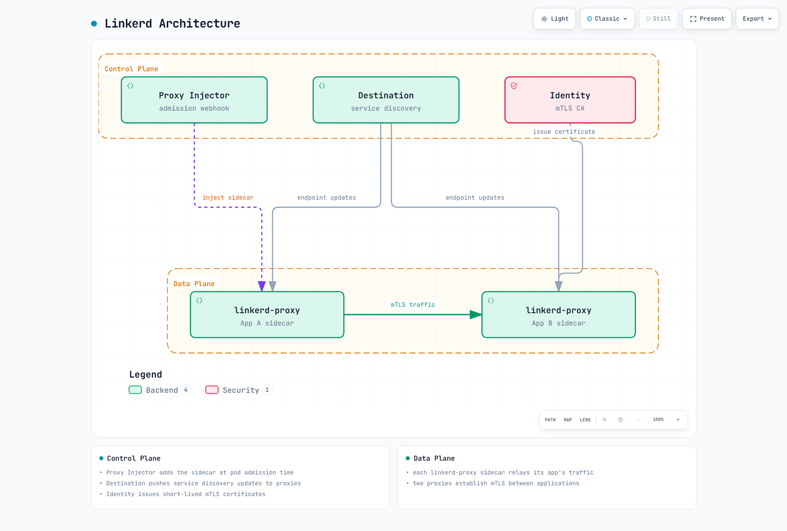
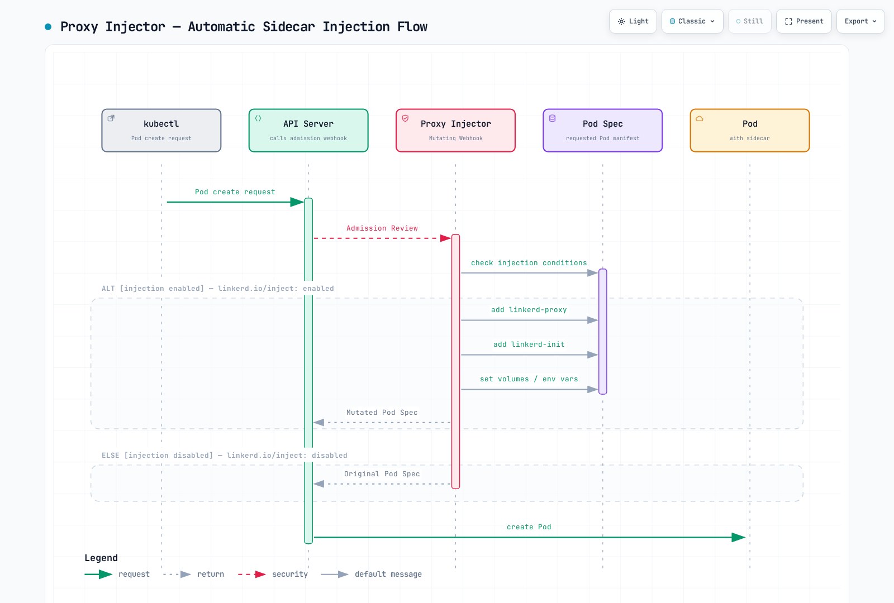
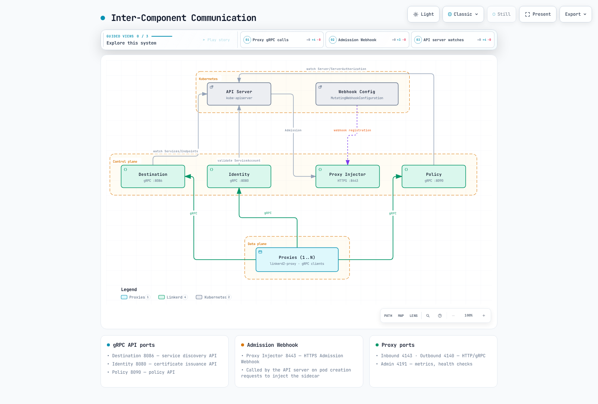

# Linkerd 架构

> **最后更新**：October 16, 2026 · Linkerd edge-26.10.1 / proxy release/v2.370.0

本章介绍当前各组件的职责、身份层级、流量捕获和注入生命周期。有关受支持的版本/集群组合及固定制品，请参阅[安装指南](01-installation.md)。以下示例用于说明配置；本次审计未执行实际部署或 CA 轮换。

## 整体架构



[查看交互式图表](https://www.atomai.click/kubernetes-docs/archmaps/en-service-mesh-linkerd-02-architecture-0.html)

默认的控制平面命名空间是 linkerd。固定版本的 chart 包含三个核心 Deployment：linkerd-destination、linkerd-identity 和 linkerd-proxy-injector。Destination 还包含策略容器和 ServiceProfile 验证器容器；逻辑控制器职责不等同于独立的 Deployment。可选的 Viz 和多集群组件有各自的生命周期。

数据平面在已纳入网格的应用旁运行 Rust 代理。此版本默认使用原生 sidecar。Identity Deployment 特意使用了一个禁用启动等待的常规代理，因此检查时必须同时考虑 containers 和 initContainers。

## 控制平面

### Destination 控制器

Destination 监视服务发现状态，并通过流式 API 提供端点地址、预期身份和配置文件信息。当前默认使用 EndpointSlices。ServiceProfiles 是较早的一种配置机制；Gateway API 路由和授权也涉及策略控制器。不要将当前 Linkerd 路由描述为仅使用 SMI TrafficSplit，也不要假设 Destination 会直接监视该旧扩展的资源。

| 职责 | 含义 |
|---|---|
| 服务发现 | 所请求 Service 的端点新增/删除信息及元数据 |
| 预期身份 | 出站代理用于验证所选对等端的信息 |
| 配置文件 | 用于指标、重试和超时的受支持路由/配置文件配置 |
| 负载均衡输入 | 端点及已配置的权重信息；运行时延迟观测以及请求/连接选择在代理中进行 |

这是 **Protocol Buffers 服务摘录**，不是 Go 源码。消息定义和导入内容位于固定版本的代理 API 中：

```protobuf
// Excerpt: message definitions/imports are in the linked API source.
service Destination {
  rpc Get(GetDestination) returns (stream Update) {}
  rpc GetProfile(GetDestination) returns (stream DestinationProfile) {}
}
```

Get 用于流式传输目标更新；GetProfile 用于流式传输配置文件更新。流或本地缓存都不能让配置变更即时生效，也不能免除处理端点不可用情况的需要。

### Identity 控制器

默认的 Kubernetes 身份流程如下：

1. 代理启动时建立本地私钥/CSR 材料。
2. Identity 客户端提交 CSR、请求的身份和 ServiceAccount 令牌。
3. Identity 使用 Kubernetes TokenReview 验证令牌，并推导出 DNS 格式的身份。
4. 已配置的**签发者签名凭据**（通常是中间签发者）为工作负载证书签名。
5. 客户端加载返回的证书/证书链，并在证书过期前续期。

信任锚是验证证书链的基础。Linkerd Identity 控制器不需要它的私钥；根证书不会作为在线签名者为每个工作负载 CSR 签名。

以下是供安装负责人使用的 **Helm values 片段**：

```yaml
identity:
  issuer:
    issuanceLifetime: 24h0m0s
    clockSkewAllowance: 20s
    scheme: linkerd.io/tls
```

linkerd.io/tls 是默认的签发者方案。kubernetes.io/tls 集成使用相应的外部管理 Secret 格式。除非凭据所有者和密钥配置相匹配，否则不要更改方案；也不要用不完整的 identity ConfigMap 覆盖 linkerd-config 的整个 values 条目。

### Proxy Injector



[查看交互式图表](https://www.atomai.click/kubernetes-docs/archmaps/en-service-mesh-linkerd-02-architecture-3.html)

Injector 是一个变更准入 webhook。它的响应描述了由 API server 应用的变更；图示是概念说明，不是线路格式示例。实际 webhook 选择、Pod 覆盖项和平台资格条件仍然适用。

为选定的命名空间启用注入：

```yaml
apiVersion: v1
kind: Namespace
metadata:
  name: my-app
  annotations:
    linkerd.io/inject: enabled
```

对于 Deployment，请将覆盖项放在其 **Pod 模板**中。此片段应放在现有工作负载定义内部：

```yaml
spec:
  template:
    metadata:
      annotations:
        linkerd.io/inject: enabled
        config.linkerd.io/proxy-cpu-request: 100m
        config.linkerd.io/proxy-memory-request: 64Mi
        config.linkerd.io/proxy-cpu-limit: '1'
        config.linkerd.io/proxy-memory-limit: 250Mi
        config.linkerd.io/proxy-log-level: warn,linkerd=info
```

请使用单个字面值 enabled 或 disabled，而不是 enabled|disabled。添加注解不会修改现有 Pod。已安装的 webhook 会排除指定的系统命名空间；明确设置的 Pod 覆盖项也可以禁用原本已启用的注入。

| 注入/配置项 | 作用 |
|---|---|
| linkerd-init | 未使用 Linkerd CNI 时设置 Pod 网络流量捕获 |
| linkerd-proxy | 数据平面代理；此版本中通常是可重启的 init container |
| 投射的身份令牌和本地身份存储 | 用于引导和工作负载证书；代理密钥不会作为共享工作负载 Secret 分发 |
| 环境变量/探针/资源 | 注入生成的特定版本运行时配置 |

### Policy 控制器

Policy 控制入站授权以及受支持的出站/请求路由行为。此示例选择带有 app:web 标签且声明了名为 http 的端口的 Pod，并授权 my-app 中已加入网格的 api-gateway ServiceAccount：

```yaml
apiVersion: policy.linkerd.io/v1beta3
kind: Server
metadata:
  name: web-http
  namespace: my-app
spec:
  podSelector:
    matchLabels:
      app: web
  port: http
  proxyProtocol: HTTP/1
  accessPolicy: deny
---
apiVersion: policy.linkerd.io/v1alpha1
kind: AuthorizationPolicy
metadata:
  name: web-api-gateway
  namespace: my-app
spec:
  targetRef:
    group: policy.linkerd.io
    kind: Server
    name: web-http
  requiredAuthenticationRefs:
  - kind: ServiceAccount
    name: api-gateway
```

Server 会选择现有的 Pod/端口组合；它不会创建应用、Service 或监听器。指定的端口必须存在。除非适用策略允许访问或明确选择了其他访问策略，否则选中的流量默认拒绝。强制执行前，应先分阶段测试策略范围。

AuthorizationPolicy 可以针对 Server 或受支持的路由。ServiceAccount 引用是便捷的身份验证要求；MeshTLSAuthentication 和 NetworkAuthentication 用于表达其他身份/网络集合。同一策略中的所有必需身份验证引用都必须匹配；还应检查可能同样授权流量的其他策略。

对于现有的 ServerAuthorization 工作流，以下是受支持的**替代方案**，而不是需要与前面的授权一并应用的额外要求：

```yaml
apiVersion: policy.linkerd.io/v1beta1
kind: ServerAuthorization
metadata:
  name: web-authz-legacy
  namespace: my-app
spec:
  server:
    name: web-http
  client:
    meshTLS:
      serviceAccounts:
      - name: api-gateway
        namespace: my-app
```

已发布的 CRD 提供的是 ServerAuthorization v1beta1，而不是原始示例中的 v1beta2。Server v1beta2 仍然提供；示例使用其当前存储版本 v1beta3。AuthorizationPolicy 是更灵活、优先推荐的接口。不要将这些 Linkerd 资源与另一个 API 组中名称相似的 Istio 资源混为一谈。

## 数据平面

### 代理行为和协议范围

linkerd2-proxy 使用 Rust 编写，是专为网格打造的代理。它支持 HTTP/1.1、HTTP/2、gRPC 和 TCP。HTTP 层级的路由/指标要求能够看到 HTTP 流量；应用发起的 TLS 流量是不透明的，而 UDP/QUIC 或被跳过的流量不在 TCP 代理路径的处理范围内。

对于符合条件且已加入网格的 TCP 对等端，Linkerd 提供传输层 mTLS。文档所述的网格传输使用 TLS 1.3；应用发起的 TLS 透传属于单独的层。未加入网格的对等端和明确绕过流量捕获的情况需要另行考虑。默认入站策略接受未加入网格的明文流量；自动 mTLS 并不等同于强制所有来源都经过身份验证后才能访问。

代理对 HTTP 请求使用延迟感知型负载均衡，对不透明 TCP 使用连接级负载均衡。端点权重和路由规则不同于运行时延迟估算。不要将 EWMA 解读为保证每个请求都发送到确定性意义上最快的端点。

不存在通用的 10MB 内存、<1ms p99 或固定二进制文件大小保证。测量结果取决于版本/构建、架构、连接数、策略/配置、工作负载和监控工具。

### 代理流量流向


[查看交互式图表](https://www.atomai.click/kubernetes-docs/archmaps/en-service-mesh-linkerd-02-architecture-5.html)

出站服务发现、路由/负载均衡、重试和超时，与入站授权有所不同。新连接可以执行服务发现和 mTLS 设置；现有连接和缓存的配置可以复用。安全的请求重试行为仍由应用/协议决定，尤其是写操作。

### 流量捕获：linkerd-init 或 CNI

请使用生成的 proxy-init 或 Linkerd CNI 配置。以下是概念性顺序，**不是可执行的主机 iptables 命令**：

```text
Inside the Pod network namespace:
  outbound TCP -> evaluate proxy-UID and configured bypass rules first
               -> redirect intercepted traffic to the outbound proxy (default 4140)
  inbound TCP  -> evaluate configured bypass rules
               -> redirect intercepted traffic to the inbound proxy (default 4143)

Linkerd CNI: installs the Linkerd-specific capture setup through the CNI chain.
linkerd-init: performs the setup at Pod startup when Linkerd CNI is not used.
```

之前的示例在针对所有 TCP 的 REDIRECT 规则之后才添加 proxy-UID 绕过规则，因此无法保护代理自身的出站流量。在主机命名空间中应用这类规则，也不是针对 Pod 的 Linkerd 配置。实际实现包含其他排除项/链，并支持已配置的 iptables 模式。

不透明端口会跳过协议检测，但仍保留代理传输处理。跳过端口会绕过代理及其网格功能。对于服务器先发送数据的流量，不要仅仅为了替代正确的不透明端口/协议配置而使用跳过端口。

### 检查生成的 Pod，而不是手动拼装代理

旧的手动拼装 Pod 示例缺少身份/引导材料，并假定存在无法获取的上游 stable-2.16.0 镜像。请使用选定的 CLI 和已安装的控制平面配置来生成或检查配置：

```bash
# The input is a complete, reviewed application manifest.
# Default mode adds the injection annotation for server-side admission.
linkerd inject web.yaml > web-annotated.yaml

# Manual mode materializes the proxy spec using the selected cluster configuration.
# Review/remove conflicting input config annotations before selecting CLI flags.
linkerd inject --manual --native-sidecar \
  --proxy-cpu-request 100m --proxy-memory-request 64Mi \
  --proxy-cpu-limit 1 --proxy-memory-limit 250Mi \
  web.yaml > web-manually-injected.yaml
```

默认的 inject 模式会转换注解。在 edge-26.9.1 中，手动生成也会读取现有输入配置注解：观测到 CPU 请求注解为 700m 时，其优先级高于 100m 的 CLI 标志；输入中的日志级别注解也会生效。请更新/移除冲突的输入，并检查生成的代理字段。手动生成的代理不会因之后修改注解而自动重新生成；请通过其所有者更新生成的工作负载，不要将精简后的容器复制出来当作完整安装配置。

```bash
: "${APP_POD:?Set an application Pod name in my-app}"
kubectl -n my-app get pod "$APP_POD" -o json |
  jq '{pod: .metadata.name, proxies: ([.spec.containers[]?, .spec.initContainers[]?] | map(select(.name == "linkerd-proxy") | {image, restartPolicy, resources, startupProbe, readinessProbe, livenessProbe}))}'
```

原生 sidecar 会显示在 initContainers 中，并带有 restartPolicy: Always。配置为使用 CNI 时，不会有 linkerd-init 容器。代理健康端点 /live 和 /ready 位于已配置的管理端口（默认 4191）；原生启动/就绪行为与应用就绪状态是两回事。

## 证书层级

| 材料 | 默认作用/存储位置 |
|---|---|
| 信任锚证书/证书包 | 公共信任基础；linkerd-identity-trust-roots ConfigMap，ca-bundle.crt |
| 根 CA 私钥 | PKI 所有者持有的材料；Linkerd 运行时不需要它 |
| 签发者证书/私钥 | linkerd-identity-issuer Secret；默认格式使用 crt.pem/key.pem |
| Kubernetes TLS 签发者集成 | 经明确配置的替代方案，使用 tls.crt/tls.key 和匹配的方案 |
| 工作负载密钥/证书 | 代理本地凭据材料；标称证书有效期为 24h，自动续期 |

签发者和信任锚的有效期取决于其配置的 PKI。默认由 CLI 生成的根证书/签发者有效期为一年；自定义的十年示例不是默认设置，也不是通用建议。请检查实际证书日期，不要照搬固定的示例时间戳。

### Kubernetes 工作负载身份

对于默认的 Kubernetes 身份机制，身份采用 DNS 格式：

```text
<service-account>.<namespace>.serviceaccount.identity.<linkerd-namespace>.<identity-trust-domain>

web-service.my-app.serviceaccount.identity.linkerd.cluster.local
```

使用同一 ServiceAccount 的多个 Pod 共享此身份，但各自持有本地凭据。身份信任域是一个可配置概念，不一定与已更改的 Kubernetes DNS 后缀相同。

原始的 spiffe://root.linkerd.cluster.local/ns/.../sa/... 字符串不是默认的 Kubernetes 身份格式。Linkerd 支持基于 SPIFFE/SPIRE 的身份，用于独立的[外部工作负载扩展网格流程](https://linkerd.io/docs/tasks/adding-non-kubernetes-workloads/)；不要用其身份/引导模型替代 Kubernetes TokenReview。

### 续期和轮换

在 proxy release/v2.370.0 中，身份客户端通常会在证书**剩余**有效期的 70% 时安排下一次证书申请，并受配置的最小/最大刷新间隔限制。错误/过期路径可能会采用最小延迟。这并不意味着每张证书都能保证在固定的绝对时间点刷新。

该客户端在请求续期证书时会复用已加载的密钥/CSR 文档。证书续期不等同于私钥轮换、签发者轮换或信任锚轮换。

```bash
set -euo pipefail
kubectl -n linkerd get configmap linkerd-identity-trust-roots \
  -o jsonpath='{.data.ca-bundle\.crt}' > trust-bundle.pem
openssl crl2pkcs7 -nocrl -certfile trust-bundle.pem |
  openssl pkcs7 -print_certs -text -noout
kubectl -n linkerd get secret linkerd-identity-issuer -o json |
  jq -er '.data["crt.pem"] // .data["tls.crt"]' |
  base64 -d | openssl x509 -noout -dates
```

完整的信任锚迁移包含多个阶段：

1. 清点当前有效的根证书、签发者、所有使用方，以及安装/PKI 所有者。
2. 通过所有者的配置，在旧根证书旁添加新根证书。确保受影响的代理/控制平面组件和多集群对等端确实加载了重叠证书包。
3. 将签发者轮换为由新根证书签名的凭据，并确认 Identity 服务已加载该凭据。
4. 根据配置来源续期/重新创建使用方；验证实际的新凭据，以及所有受影响路径上的 mTLS 流量。
5. 只有在没有必需的对等端依赖旧根证书时，才移除旧根证书；传播最终证书包并重新验证。

之前只更新 ConfigMap 并重启一个命名空间的做法，在签发者迁移和旧根证书移除之前就停止了，并非完整的轮换流程。避免直接修改与 Helm/cert-manager/trust-manager 的所有权管理相冲突。如果根证书已经过期，需要使用恢复流程，而不是常规的有效根证书轮换流程。

```bash
linkerd check
linkerd check --proxy
kubectl -n linkerd get events --field-selector reason=IssuerUpdated
# Inspect each affected namespace/workload and its actual proxy version/identity.
kubectl -n my-app get pods -o wide
```

IssuerUpdated 事件只是一个观测结果，并不能证明每个代理或远程集群都已完成迁移。cert-manager 可以自动执行签发者续期，trust-manager 可以分发证书包，但根证书切换仍需协调验证。请根据实际 PKI 设计，遵循[手动凭据流程](https://linkerd.io/docs/tasks/manually-rotating-control-plane-tls-credentials/)或[托管凭据流程](https://linkerd.io/docs/tasks/automatically-rotating-control-plane-tls-credentials/)；本章未执行任何轮换。

## Sidecar 注入详情


[查看交互式图表](https://www.atomai.click/kubernetes-docs/archmaps/en-service-mesh-linkerd-02-architecture-8.html)

对于控制器工作负载，请使用 Pod 模板注解并检查生成的 Pod。同一个 YAML 映射中的重复元数据键会发生覆盖/冲突；请将命名空间示例和工作负载示例作为独立资源/片段保留。

前文所示的资源/日志注解用于设置代理的预期 requests/limits 和日志配置，并非实际用量的测量值。不透明端口覆盖会替换默认端口列表，而不是简单地添加两个数据库端口；请保留所有必需端口。跳过端口覆盖会有意将流量排除在网格处理之外。

## 组件间通信



[查看交互式图表](https://www.atomai.click/kubernetes-docs/archmaps/en-service-mesh-linkerd-02-architecture-9.html)

| 组件/路径 | 默认端口 | 协议/用途 |
|---|---|---|
| Destination Service | 8086 | 流式服务发现/配置文件 gRPC |
| Identity Service | 8080 | 证书 API gRPC |
| Policy Service | 8090 | Policy gRPC |
| Proxy Injector | Service 443 → Pod 8443 | HTTPS 准入 webhook |
| Proxy inbound | 4143 | 被拦截的 TCP，包括 HTTP/gRPC 或不透明流量 |
| Proxy outbound | 4140 | 被拦截的出站 TCP |
| Proxy admin | 4191 | HTTP 指标和健康端点 |

这些端口可以配置，不能将其视为适用于所有情况的网络访问规则。管理端点不是 Envoy 风格的路由配置接口；策略/配置通过控制平面 API 下发。

## 与 Istio 架构的比较

| 方面 | Linkerd | Istio |
|---|---|---|
| 控制平面打包方式 | 此版本包含三个核心 Deployment 和若干逻辑控制器 | 主要控制功能由统一的 Istiod 提供，另有特定模式的组件 |
| 数据平面 | 专用 Rust 代理 | Envoy sidecar 或 ambient ztunnel，搭配选定的 waypoint |
| 配置 | Linkerd 流式 gRPC API 及其支持的资源 | Envoy 使用 xDS，并使用受支持的 Istio/Gateway API 配置 |
| 扩展 | 检查 Linkerd 支持的功能/API 范围 | 检查特定模式/版本的 Envoy/Wasm/Lua 支持和挂载方式 |
| 资源/性能比较 | 对匹配的工作负载和实际配置进行测量 | 对匹配的工作负载和实际配置进行测量 |

xDS 也通常使用 gRPC；协议名称本身并不能用来衡量复杂度高低。CRD 数量随版本和扩展而变化，不能衡量运行时开销。requests/limits 是配置的预留/上限，并非观测到的内存或延迟。做出选择前，请确保工作负载、流量、协议、策略和故障预算相同；另请参阅[持续维护的比较](../istio/comparison/README.md)。

## 后续步骤和来源

- [流量管理](03-traffic-management.md)、[安全](04-security.md)、[可观测性](05-observability.md)
- [架构测验](../../quizzes/service-mesh/linkerd/architecture.md)
- [官方架构](https://linkerd.io/docs/reference/architecture/)、[注入](https://linkerd.io/docs/features/proxy-injection/)和[策略参考](https://linkerd.io/docs/reference/authorization-policy/)
- [自动 mTLS](https://linkerd.io/docs/features/automatic-mtls/)、[协议处理](https://linkerd.io/docs/features/protocol-detection/)和[负载均衡](https://linkerd.io/docs/features/load-balancing/)
- [固定版本的 Destination API](https://github.com/linkerd/linkerd2-proxy-api/blob/v0.20.0/proto/destination.proto)
- [Kubernetes 令牌验证](https://github.com/linkerd/linkerd2/blob/edge-26.10.1/controller/identity/validator.go)和[身份格式](https://github.com/linkerd/linkerd2/blob/edge-26.10.1/controller/identity/domain.go)
- [固定版本的证书刷新实现](https://github.com/linkerd/linkerd2-proxy/blob/0cdcc078e66eb27c79b9dfc030fc660042716d31/linkerd/proxy/identity-client/src/certify.rs)
