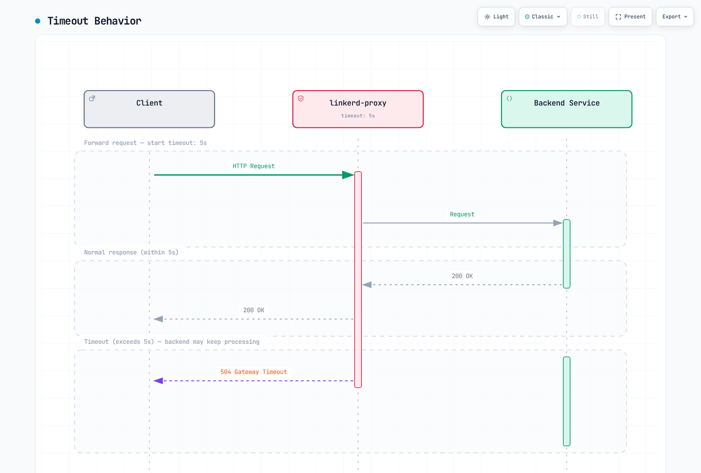

# Linkerd 流量管理

> **最后更新**：October 16, 2026 · Linkerd edge-26.10.1 · Gateway API 1.5.1 · Flagger 1.45.0

当前 Linkerd 路由使用 Gateway API 资源和受支持的注解。ServiceProfile 仍是兼容性接口，而 TrafficSplit/linkerd-smi 已弃用。这些路径不能互换：对于同一个 Service，现有的 ServiceProfile 优先于出站 HTTPRoutes，并会阻止较新的重试/超时/故障累积配置生效。

以下示例是针对现有且经过测试的应用工作负载的独立练习。它们假设已满足[安装先决条件](01-installation.md)、已将相应命名空间加入网格、已声明 Service/容器端口且端点就绪。本次审查未执行集群安装、流量切换或生产负载测试。

## 流量管理架构

| 策略路径 | 预期用途 | 重要边界 |
|---|---|---|
| Service-parent HTTPRoute | 从网格内调用方进行出站路由/可靠性管理 | 客户端必须加入网格且能够检查 HTTP |
| Server-parent HTTPRoute | 匹配入站授权 | 附加方式和策略用途不同 |
| ServiceProfile | 较早期的路由指标/重试/超时 | 对同一个 Service 覆盖较新的策略路径 |
| TrafficSplit | 旧版 SMI 加权路由 | 需要已弃用的扩展/CRD |

基于 Service 的策略依赖 Service 发现。直接 Pod-IP/headless 路径、未加入网格的调用方以及由应用发起的不透明 TLS，不会自动获得相同的 L7 行为。请将身份、授权和路由视为独立控制项。

## 当前 HTTPRoute 路由

### Services 和加权路由

本练习需要准备 stable 和 canary Deployment，标签为 app:web 和 version:stable/canary，监听 8080，并配置适合工作负载的就绪检查。以下命名空间会将新建的符合条件的 Pod 加入网格；它不会部署这些应用：

```yaml
apiVersion: v1
kind: Namespace
metadata:
  name: route-demo
  annotations:
    linkerd.io/inject: enabled
---
apiVersion: v1
kind: Service
metadata:
  name: web
  namespace: route-demo
spec:
  selector:
    app: web
    version: stable
  ports:
  - name: http
    port: 80
    targetPort: 8080
    appProtocol: http
---
apiVersion: v1
kind: Service
metadata:
  name: web-stable
  namespace: route-demo
spec:
  selector:
    app: web
    version: stable
  ports:
  - name: http
    port: 80
    targetPort: 8080
    appProtocol: http
---
apiVersion: v1
kind: Service
metadata:
  name: web-canary
  namespace: route-demo
spec:
  selector:
    app: web
    version: canary
  ports:
  - name: http
    port: 80
    targetPort: 8080
    appProtocol: http
```

顶层 Service 选择 stable Pod，供 Kubernetes/默认路由使用。它的选择器并非闲置：非网格流量或其他不受策略管理的流量仍需要明确的后端。HTTPRoute 会将符合条件的网格内客户端流量导向后端 Services：

```yaml
apiVersion: gateway.networking.k8s.io/v1
kind: HTTPRoute
metadata:
  name: web-route
  namespace: route-demo
spec:
  parentRefs:
  - group: ''
    kind: Service
    name: web
    port: 80
  rules:
  - backendRefs:
    - name: web-stable
      port: 80
      weight: 90
    - name: web-canary
      port: 80
      weight: 10
```

group:"" 是 Service 引用所用的规范核心 API 组。Linkerd 在某些路径中保留了一个旧版核心别名，但可移植的 Gateway API 资源应使用空组。引用的 80 是 Service 端口，不是容器的 8080。

权重是相对的非负值，且总和必须大于零。90/10 和 9/1 表示相同比例；总和不必为 100。权重是路由配置，不保证短时间内请求数精确符合比例、连接数相等或副本数对应。

```bash
kubectl -n route-demo get httproute web-route -o yaml
kubectl -n route-demo get endpointslices.discovery.k8s.io \
  -l kubernetes.io/service-name=web-stable -o yaml
linkerd diagnostics policy -n route-demo svc/web 80 -o json
linkerd viz stat deploy/client -n route-demo --to svc/web
linkerd viz stat pods -n route-demo
```

检查路由的 Accepted/ResolvedRefs 条件、控制器实际采用的策略以及真实客户端流量。控制器策略视图并不能证明每个代理都已应用该策略。

### 标头和路径

以下示例是 **替代配置**，用于替换 web-route；它会在加权默认规则之前添加一条 canary 群组标头规则：

```yaml
apiVersion: gateway.networking.k8s.io/v1
kind: HTTPRoute
metadata:
  name: web-route
  namespace: route-demo
spec:
  parentRefs:
  - group: ''
    kind: Service
    name: web
    port: 80
  rules:
  - matches:
    - headers:
      - name: x-release-track
        type: Exact
        value: canary
    backendRefs:
    - name: web-canary
      port: 80
  - backendRefs:
    - name: web-stable
      port: 80
      weight: 90
    - name: web-canary
      port: 80
      weight: 10
```

标头值不是经过身份验证的身份。不可信客户端可以设置 x-release-track 或 x-debug；对于有特权的/debug 后端，应使用单独的授权。对 Cookie:beta=true 进行精确匹配，只会匹配整个标头值，不会匹配与其他 cookie 键值对并存的 cookie。应规范化经过授权的群组信号，或有意实现 cookie 解析，不要声称精确标头匹配具有通用的 cookie 语义。

针对单独准备的 Services 的路径路由示例：

```yaml
apiVersion: gateway.networking.k8s.io/v1
kind: HTTPRoute
metadata:
  name: frontend-paths
  namespace: route-demo
spec:
  parentRefs:
  - group: ''
    kind: Service
    name: frontend
    port: 80
  rules:
  - matches:
    - path:
        type: PathPrefix
        value: /api
    backendRefs:
    - name: api-service
      port: 80
  - matches:
    - path:
        type: PathPrefix
        value: /static
    backendRefs:
    - name: static-service
      port: 80
  - backendRefs:
    - name: web-stable
      port: 80
```

同一条目内的匹配条件按 AND 组合；不同条目/规则以及相互竞争的路由遵循 Gateway API 优先级规则。不要认为仅凭文件顺序就能解决不同 HTTPRoute 对象之间的冲突。


## 重试和超时

重试是选择启用的出站行为，并不保证失败的请求会自动恢复。只有在实际操作可安全重放时才使用重试。连接重置/错误/超时可能导致无法确定写操作在服务器端是否已执行；应用幂等性和客户端重试需要分别控制。

对于 retry-demo 中现有的 Service api，以下这对配置仅为 GET /api/read 及其子路径配置重试，并为其他请求提供转发回退规则：

```yaml
apiVersion: gateway.networking.k8s.io/v1
kind: HTTPRoute
metadata:
  name: api-read
  namespace: retry-demo
  annotations:
    retry.linkerd.io/http: gateway-error
    retry.linkerd.io/limit: '2'
    retry.linkerd.io/timeout: 400ms
    timeout.linkerd.io/request: 2s
spec:
  parentRefs:
  - group: ''
    kind: Service
    name: api
    port: 80
  rules:
  - matches:
    - method: GET
      path:
        type: PathPrefix
        value: /api/read
    backendRefs:
    - name: api
      port: 80
---
apiVersion: gateway.networking.k8s.io/v1
kind: HTTPRoute
metadata:
  name: api-default
  namespace: retry-demo
spec:
  parentRefs:
  - group: ''
    kind: Service
    name: api
    port: 80
  rules:
  - matches:
    - path:
        type: PathPrefix
        value: /
    backendRefs:
    - name: api
      port: 80
```

此示例要求 **父 Service 上没有重试注解**、没有冲突的 ServiceProfile，且没有启用不可信的逐请求策略覆盖。否则回退规则可能继承重试策略。请检查生效的策略，并单独衡量写请求；转发写请求并不能证明每一层都已禁用重试。

这些注解配置最多重试两次（最多尝试三次）、400ms 的重试超时以及 2s 的整个请求超时。请求截止时间涵盖所有尝试的时间预算，可能会在全部重试完成前终止操作。在当前参考版本中，正文大于 64KiB 的请求不会重试。

**在 edge-26.10.1 中，不要将 retry.linkerd.io/limit:"0" 用作禁用开关。** 请参阅[已发布的解析器](https://github.com/linkerd/linkerd2/blob/edge-26.10.1/policy-controller/k8s/index/src/outbound/index/http.rs)。已发布的解析器会将零值过滤为未指定；存在重试条件时，它会回退为一次重试。空的 HTTP 重试条件字符串也不是受支持的禁用重试策略。混合方法的 Service 默认配置应保持不含重试配置，并且只将选择启用的策略附加到预期的读取路由上。

路由重试注解会整体覆盖 Service 重试配置，路由超时注解也会以同样方式覆盖 Service 超时注解。ServiceProfiles 的优先级高于这些注解。Linkerd 可选择在显式启用后接受 l5d-* 逐请求标头；不要接受来自不可信客户端的策略覆盖，也不要将这些标头视为身份验证。

### 截止时间范围

| 配置 | 范围 |
|---|---|
| timeout.linkerd.io/request | 整个请求/响应流 |
| timeout.linkerd.io/response | 后端响应进行中的持续时间 |
| timeout.linkerd.io/idle | 流不活动时间 |
| retry.linkerd.io/timeout | 可重试尝试的超时时间，受重试策略/次数限制 |
| ServiceProfile 路由超时 | 旧版路由的总等待时间，包括重试 |

常规请求/响应/空闲超时并非重试超时。发生超时并不能证明业务处理已取消。如果响应标头/正文已经开始传输，失败可能会终止/重置流，而不是生成新的 HTTP 错误响应。



[查看交互式图示](https://www.atomai.click/kubernetes-docs/archmaps/en-service-mesh-linkerd-03-traffic-management-2.html)

不要仅依据“同步”“异步”或“文件上传”等标签，规定 5/60/600 秒的值。应从应用端到端截止时间、预期处理/流式传输行为以及客户端/服务器取消语义入手。省略某个策略超时并不会移除其他应用、传输、代理或负载均衡器的限制。

## ServiceProfiles：受支持的兼容配置

ServiceProfiles 仍受支持，但对于新功能开发，Gateway API 配置已取而代之。以下独立的 profile-demo 练习展示了有效的旧版路由匹配和明确的写操作不可重试配置：

```yaml
apiVersion: linkerd.io/v1alpha2
kind: ServiceProfile
metadata:
  name: api.profile-demo.svc.cluster.local
  namespace: profile-demo
spec:
  routes:
  - name: read-users
    condition:
      all:
      - method: GET
      - pathRegex: ^/api/users(/.*)?$
    isRetryable: true
    timeout: 5s
  - name: write-api
    condition:
      all:
      - any:
        - method: POST
        - method: PUT
        - method: PATCH
        - method: DELETE
      - pathRegex: ^/api/.*$
    isRetryable: false
    timeout: 10s
  - name: health
    condition:
      all:
      - method: GET
      - pathRegex: ^/(health|ready|live)$
    isRetryable: false
    timeout: 1s
  - name: stream
    condition:
      all:
      - method: GET
      - pathRegex: ^/stream$
    isRetryable: false
  retryBudget:
    retryRatio: 0.2
    minRetriesPerSecond: 10
    ttl: 10s
```

method 是精确的 HTTP 方法，不是正则表达式。POST|PUT|DELETE 并不代表这些方法的并集。应使用明确的 any/all 条件或拆分路由，并在适当时包含 PATCH。路由选择和响应分类必须符合应用行为；可重试标志是运维人员作出的安全声明，并非自动证明操作具有幂等性。

isRetryable:false 会禁用此 ServiceProfile 机制对匹配路由的重试，但不会阻止 SDK、客户端或其他中间层重试。stream 路由省略了 profile 超时；这表示此字段不设置超时，并不表示端到端操作没有时间限制。

### 重试预算

retryRatio:0.2 会按比例增加重试额度。minRetriesPerSecond:10 会独立增加额度，因此在低流量时，这**不是严格的 20% 上限**。ttl 是用于计算预算的回溯/保留窗口，并非定期重置计时器。实际重试还取决于路由是否符合条件、响应分类、缓冲、截止时间和可用端点。


[查看交互式图示](https://www.atomai.click/kubernetes-docs/archmaps/en-service-mesh-linkerd-03-traffic-management-1.html)

应分别观察原始失败尝试、额外的上游投递和最终结果。图示只是一个重试成功的示例，并不承诺隐藏所有失败。

### 配置文件生成与观察

```bash
# SERVICE is the short Service name; the CLI adds the namespace/domain.
linkerd profile -n profile-demo --open-api swagger.yaml api > api-openapi-profile.yaml
linkerd profile -n profile-demo --proto service.proto api > api-proto-profile.yaml
# Requires actual Viz tap traffic; the final Service argument is mandatory.
linkerd viz profile -n profile-demo api --tap deploy/api --tap-duration 60s \
  > api-observed-profile.yaml
# For offline generation with default assumptions, use --ignore-cluster.
```

原生 CLI 要求使用短 Service 名称；它会拒绝原先的完全限定参数。tap 命令也要求提供最后一个 Service 参数。OpenAPI/protobuf/tap 输出需要审查：观测到的流量并不构成完整的路由清单，生成的路径还可能导致指标基数过高。生成配置并不能证明每个操作都可安全重试。

```bash
linkerd viz routes service/api -n profile-demo -o wide
linkerd viz routes deploy/client -n profile-demo --to svc/api -o wide
linkerd viz stat deploy/client -n profile-demo --to svc/api
```

viz routes 是面向 ServiceProfile 的路由视图。应使用相应版本的 wide/JSON 输出和文档所述指标；旧版杜撰的 [RETRIES] 行和猜测的顶层 .success_rate 字段都不是可靠的自动化接口。


## 负载均衡和故障累积

Linkerd 对 HTTP 请求采用感知延迟的 EWMA 行为；TCP 则按连接粒度进行负载均衡。这种方式会优先选择健康/快速的候选项，但并不意味着每个请求都会确定性地选择显示分数最低的候选项。Pod 级统计与来源到 Service 的统计采用不同的聚合方式。

### 选择启用的熔断

当前 HTTP 故障累积功能**默认禁用，必须在 Service 上进行配置才能启用**。它与该 Service 的 ServiceProfile 不兼容。以下示例适用于单独的 circuit-demo 命名空间中已准备好的 api 工作负载：

```yaml
apiVersion: v1
kind: Service
metadata:
  name: api
  namespace: circuit-demo
  annotations:
    balancer.linkerd.io/failure-accrual: consecutive
    balancer.linkerd.io/failure-accrual-consecutive-max-failures: '7'
    balancer.linkerd.io/failure-accrual-consecutive-min-penalty: 1s
    balancer.linkerd.io/failure-accrual-consecutive-max-penalty: 1m
spec:
  selector:
    app: api
  ports:
  - name: http
    port: 80
    targetPort: 8080
    appProtocol: http
```

consecutive 策略的默认阈值是 7，并非自动在五次连接失败后触发。它会跟踪受支持的 HTTP/gRPC 响应失败；这并不表示所有 TCP 连接错误都适用。选定版本还记录了一种支持成功率/速率限制处理的统一策略；使用前请查看其独立参数。

| 状态 | 含义 |
|---|---|
| Available | 负载均衡器可以选择该端点 |
| Unavailable | 在可能的情况下，普通请求会被导向其他位置 |
| Probation | 退避后允许真实应用请求测试是否已恢复 |

Probation 不会定期生成 Kubernetes 健康探测。如果没有符合条件的应用流量，仅有一次成功的 /ready 检查并不能恢复端点。退避包含已配置的时间间隔和抖动。如果所有可用端点都失败，请求仍可能失败，也可能选择其他已配置的后端。

```bash
linkerd diagnostics policy -n circuit-demo svc/api 80 -o json
linkerd viz stat pods -n circuit-demo
linkerd viz stat deploy/client -n circuit-demo --to svc/api
```

应检查实际策略和结果，而不只是 Pod 就绪状态或聚合成功率。outbound_http_balancer_endpoints 指标可区分就绪/待处理端点数量；待处理状态并非故障累积的专属诊断信号。

## 旧版 TrafficSplit 和 SMI

TrafficSplit 和 linkerd-smi 已弃用，并且需要各自独立的扩展/CRD。仅仅应用 TrafficSplit YAML，并不会让普通的当前 Linkerd 安装具备该工作流。新工作应优先采用受支持的 Gateway API 路由；现有 SMI 安装则应制定迁移计划。


[查看交互式图示](https://www.atomai.click/kubernetes-docs/archmaps/en-service-mesh-linkerd-03-traffic-management-4.html)

旧版资源的 service 字段用于指定顶层 Service，后端则带有相对权重。了解现有配置时，这种方式很有用，但上面的活动示例使用 HTTPRoute。对于未加入网格/回退流量，Service 选择器仍然重要；顶层选择器不得意外让流量策略之外的调用方访问 canary Pod。

对于渐进式手动变更，每次应针对真实流量/错误/延迟证据审查一个已配置阶段（例如 99/1、90/10 和 50/50）。不要在一个文件中应用多个同名资源，并以为它们会按定时计划逐步发布；最终应用的状态才会生效。

### 明确的手动回滚

以下内容**仅适用于手动管理的 route-demo 示例**。将其保存为 web-stable-only.yaml，以定义仅使用 stable 的状态：

```yaml
apiVersion: gateway.networking.k8s.io/v1
kind: HTTPRoute
metadata:
  name: web-route
  namespace: route-demo
spec:
  parentRefs:
  - group: ''
    kind: Service
    name: web
    port: 80
  rules:
  - backendRefs:
    - name: web-stable
      port: 80
      weight: 100
    - name: web-canary
      port: 80
      weight: 0
```

```bash
# Review the target context and this manually owned route before applying.
kubectl apply -f web-stable-only.yaml
kubectl -n route-demo get httproute web-route -o yaml
```

变更后，请验证控制器是否接受配置、stable 端点是否就绪以及实际客户端结果。旧的 shell 循环会打印“Rolling back”，随后只跳出循环；它从未恢复权重。它也缺乏可靠的无数据/错误处理。自动化应使用真正的交付控制器，不要在 Flagger 拥有某个路由时绕过该控制器并手动覆盖它。

## Flagger 渐进式交付

### 版本化控制器和所有权

此蓝图使用 Flagger/chart 1.45.0、选定的 Linkerd/Gateway API 安装，以及现有的 Linkerd Viz Prometheus。已发布的 factory 仍会将 meshProvider:linkerd 映射到 SMI router。当前 HTTPRoute router 应使用 **gatewayapi:v1**；仅使用一个无关或不匹配的 provider 字符串并不等效。

保存为 flagger-values.yaml：

```yaml
image:
  tag: 1.45.0
meshProvider: gatewayapi:v1
metricsServer: http://prometheus.linkerd-viz.svc.cluster.local:9090
crd:
  create: true
prometheus:
  install: false
podAnnotations:
  linkerd.io/inject: enabled
linkerdAuthPolicy:
  create: true
  namespace: linkerd-viz
```

```bash
helm repo add flagger https://flagger.app
helm repo update flagger
helm template flagger flagger/flagger --version 1.45.0 \
  -n flagger-system -f flagger-values.yaml > flagger-rendered.yaml
# Review existing CRD ownership, RBAC, injection and Prometheus access first.
helm upgrade --install flagger flagger/flagger --version 1.45.0 \
  -n flagger-system --create-namespace -f flagger-values.yaml \
  --wait --timeout 10m
```

只有在请求时，chart 才会创建 Flagger CRD。启用 crd.create 前，请检查现有资源的所有权。控制器 Pod 已加入网格，Linkerd 授权策略通过控制器 ServiceAccount 授权对现有 Viz prometheus-admin Server 的访问。外部 Prometheus 部署需要自行设计抓取、身份验证/身份认证和授权。

### 应用和分析蓝图

在 progressive-demo 中准备一个现有的 Deployment web，声明 8080 HTTP 端口，配置正常工作的就绪检查，使用经过测试的镜像，并确保容量充足。应用 Canary 后，Flagger 会接管 Deployment/Service 生命周期：它会创建一个 primary Deployment 和 apex/primary/canary Services，并且可能在分析间隔期间将原始目标缩容至零。这与前文手动管理的 stable/canary Deployment 不同。

调用方必须加入网格，才能通过 Service-parent HTTPRoute 验证流量。应使用受控流量访问 apex，以验证路由。直接向 canary-Service 发送负载有助于测试该版本，但会绕过加权 apex 决策。

```yaml
apiVersion: v1
kind: Namespace
metadata:
  name: progressive-demo
  annotations:
    linkerd.io/inject: enabled
---
apiVersion: flagger.app/v1beta1
kind: Canary
metadata:
  name: web
  namespace: progressive-demo
spec:
  provider: gatewayapi:v1
  targetRef:
    apiVersion: apps/v1
    kind: Deployment
    name: web
  progressDeadlineSeconds: 600
  service:
    port: 80
    targetPort: 8080
    gatewayRefs:
    - group: ''
      kind: Service
      name: web
      namespace: progressive-demo
      port: 80
  analysis:
    interval: 30s
    threshold: 5
    maxWeight: 50
    stepWeight: 10
    metrics:
    - name: linkerd-completed-responses
      templateRef:
        name: completed-responses
        namespace: progressive-demo
      thresholdRange:
        min: 20
      interval: 1m
    - name: linkerd-http-availability
      templateRef:
        name: http-availability
        namespace: progressive-demo
      thresholdRange:
        min: 99
        max: 100
      interval: 1m
    - name: linkerd-ttfb-p99-ms
      templateRef:
        name: ttfb-p99-ms
        namespace: progressive-demo
      thresholdRange:
        min: 0
        max: 500
      interval: 1m
```

gatewayRefs 特意指向一个 Service，控制器的 v1 router 会保留该 parent 引用。不能让 ServiceProfile 覆盖这些生成的路由。不要让其他控制器或手动循环同时管理同一个 HTTPRoute。

threshold:5 是失败检查的截止阈值，maxWeight:50 是分析期间 canary 流量的上限，stepWeight:10 是以百分点为单位的增量。它们分别不代表必须成功检查五次或允许失败 50 次。达到记录的失败截止阈值或出现其他失败条件后，系统会通过协调触发回滚；这并不保证回滚立即发生。


### 明确的 Linkerd 指标模板

启用 Canary 分析前，请创建以下 MetricTemplate。自定义指标名称可避免使用特定于内置 provider 的 request-success-rate/request-duration 观察器；这些观察器不能与此 Gateway API router 配置互换。

```yaml
apiVersion: flagger.app/v1beta1
kind: MetricTemplate
metadata:
  name: completed-responses
  namespace: progressive-demo
spec:
  provider:
    type: prometheus
    address: http://prometheus.linkerd-viz.svc.cluster.local:9090
  query: sum(increase(response_total{namespace="{{ namespace }}",deployment="{{ target }}",direction="inbound"}[{{
    interval }}]))
---
apiVersion: flagger.app/v1beta1
kind: MetricTemplate
metadata:
  name: http-availability
  namespace: progressive-demo
spec:
  provider:
    type: prometheus
    address: http://prometheus.linkerd-viz.svc.cluster.local:9090
  query: |-
    (100 * (sum(rate(response_total{namespace="{{ namespace }}",deployment="{{ target }}",direction="inbound",classification="success"}[{{ interval }}])) or vector(0)) / sum(rate(response_total{namespace="{{ namespace }}",deployment="{{ target }}",direction="inbound"}[{{ interval }}])))
    and on() (sum(rate(response_total{namespace="{{ namespace }}",deployment="{{ target }}",direction="inbound"}[{{ interval }}])) > 0)
---
apiVersion: flagger.app/v1beta1
kind: MetricTemplate
metadata:
  name: ttfb-p99-ms
  namespace: progressive-demo
spec:
  provider:
    type: prometheus
    address: http://prometheus.linkerd-viz.svc.cluster.local:9090
  query: |-
    histogram_quantile(0.99,
      sum by (le) (rate(response_latency_ms_bucket{namespace="{{ namespace }}",deployment="{{ target }}",direction="inbound"}[{{ interval }}]))
    )
```

这些查询假设 Viz 抓取配置提供 namespace/deployment 标签，并特意选择目标 Deployment 的入站已完成响应。请在实际 Prometheus 中确认这些标签和时间序列。共享/联邦后端需要设置适当的集群范围并进行去重；否则，名称相同的工作负载可能会被合并。

这些检查用途各不相同：

- completed-responses 要求回溯窗口内至少有 20 个已完成的响应。increase 是经过外推的计数器估值，并非精确的审计日志计数。该计数器包含最终确定的/错误观测值；它不代表成功业务操作的数量，也不代表唯一用户请求的数量。
- 即使窗口内没有成功序列，http-availability 在全部失败时也会返回 0。它要求总量为正数，因此流量缺失/空闲不会被视为 100% 健康。
- ttfb-p99-ms 使用 response_latency_ms，即 Linkerd 的首字节时间直方图，单位为**毫秒**。它不是完整的响应持续时间。已发布的代理会在第一个可用的响应正文帧处记录延迟；如果正文被丢弃，则会使用回退方式。它通常不会等待整个流结束。最终响应分类/计数是独立处理的，因此直方图样本和响应计数器样本不一定会同时出现。

每个查询都会聚合为一个结果。已发布的 Prometheus provider 会拒绝空结果和 NaN 结果；availability 和 latency 上明确设置的下限/上限也会防止无限值通过检查。这些示例并不保证单个查询可以识别所有类型的遥测缺失或过时情况：应分别验证数据时效性、抓取健康状况、目标标签和样本窗口。

### 流量、钩子和观察

持续且具有代表性的流量是进行有效分析的前提。此示例不会安装负载生成器或应用。可选的发布前验收和发布负载测试 webhook 需要单独部署兼容的私有端点，并定义身份验证/网络策略、执行边界和测试语义。不要粘贴一个从未创建过的 Service 的 webhook URL。

```bash
kubectl -n progressive-demo get canary web
kubectl -n progressive-demo describe canary web
kubectl -n progressive-demo get httproute web -o yaml
kubectl -n progressive-demo get deployments,services
kubectl -n flagger-system logs deployment/flagger --tail=200
kubectl -n progressive-demo get events \
  --field-selector involvedObject.kind=Canary
```

检查生成的 web-primary/web-canary Services、apex HTTPRoute、实时端点、控制器事件和实际指标值。直接 canary 测试通过并不能证明 apex 流量遵循预期的拆分比例。

回滚会改变后续路由和 Deployment 状态；它无法撤销已提交的写操作，也不能证明正在处理的请求已停止。应单独为应用数据和副作用制定恢复流程。

## 运维检查清单

- 明确路由所有权：手动 HTTPRoute、Flagger 或旧版 SMI 控制器。
- 排查看似未生效的 HTTPRoute 注解时，先检查 ServiceProfile 的优先级。
- 仅对已验证可安全重放的操作选择启用重试，并设置截止时间、收集额外尝试的证据。
- 同时验证控制器接受的策略和网格内调用方观察到的结果。
- 一并监控端点就绪状态、延迟、原始失败、最终结果和遥测可用性。
- 将容量、负载生成、应用镜像和回滚行为视为特定于环境的先决条件，而不是本文已在生产环境中验证的保证。

## 参考资料

- [Linkerd HTTPRoute 参考](https://linkerd.io/docs/reference/httproute/)
- [重试](https://linkerd.io/docs/reference/retries/)和[超时](https://linkerd.io/docs/reference/timeouts/)
- [ServiceProfiles](https://linkerd.io/docs/reference/service-profiles/)
- [熔断](https://linkerd.io/docs/reference/circuit-breaking/)
- [负载均衡](https://linkerd.io/docs/features/load-balancing/)
- [流量拆分和 SMI 弃用](https://linkerd.io/docs/features/traffic-split/)
- [代理指标](https://linkerd.io/docs/reference/proxy-metrics/)
- [已发布的响应指标计时实现](https://github.com/linkerd/linkerd2-proxy/blob/a66af8117769df060adda6233302a2d1c4142229/linkerd/http/metrics/src/requests/service.rs)
- [Flagger 1.45.0 Gateway API router](https://github.com/fluxcd/flagger/blob/v1.45.0/pkg/router/gateway_api.go)
- [Flagger 1.45.0 provider 选择](https://github.com/fluxcd/flagger/blob/v1.45.0/pkg/router/factory.go)
- [Flagger 1.45.0 指标评估](https://github.com/fluxcd/flagger/blob/v1.45.0/pkg/controller/scheduler_metrics.go)
- [流量管理测验](../../quizzes/service-mesh/linkerd/traffic-management.md)
