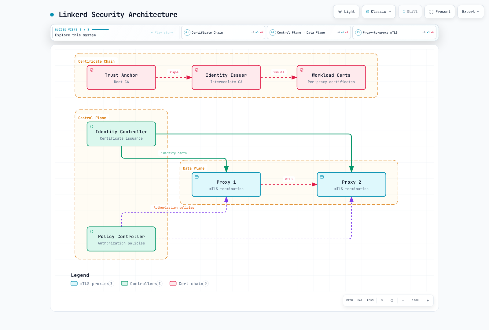

# Linkerd 安全

> **最后更新**：October 16, 2026 · Linkerd edge-26.10.1 · cert-manager 示例已根据 1.21.2 检查

Linkerd 为其代理处理的流量提供工作负载身份验证、传输加密和入站授权。注册、策略、证书生命周期和应用安全仍需要明确设计。请使用[安装指南](01-installation.md)中受支持的 Kubernetes/Gateway API 组合；此处的示例假设已完成该安装，并且已有应用工作负载。

## 安全架构



[查看交互式图表](https://www.atomai.click/kubernetes-docs/archmaps/en-service-mesh-linkerd-04-security-0.html)

## 自动 mTLS

Linkerd 会自动对网格内 Pod 之间符合条件的 TCP 流量使用 mTLS。两个代理都必须参与、信任证书链并接收流量。跳过的端口会绕过代理；UDP 不属于此 TCP 机制。流量发往或来自网格外端点时，不会仅仅因为其中一个端点有代理就获得 Linkerd mTLS。

对于使用普通 HTTP 通信的应用，出站代理会对目标代理进行身份验证并加密网络跃点；接收方代理会对调用方进行身份验证，然后将 HTTP 转发给其本地应用。应用发起的 TLS 可以在网格中保持加密：Linkerd 不会自动解密每个外部或不透明的 TLS 流。

| 属性 | 含义和边界 |
|---|---|
| 透明加密 | 符合条件的代理到代理跃点无需应用实现 TLS |
| 双向身份验证 | 代理验证的是工作负载身份，而非最终用户 |
| TLS 1.3 | 所选版本的网格 TLS 协议 |
| 自动叶证书续期 | 代理通常会续期其短期工作负载证书 |
| 根证书/颁发者生命周期 | 独立的凭据，仍需轮换和监控 |

默认情况下，Linkerd 接受来自网格外来源的明文流量。授权策略可以拒绝此类流量。因此，“已启用 mTLS”并不等同于“所有入站访问都要求经过身份验证的网格身份”。网络策略和准入控制也必须覆盖绕过或不使用代理的路径。

### 观察加密和身份

```bash
linkerd check --proxy
linkerd viz edges deploy -n production
linkerd viz tap deploy/api -n production --method GET
linkerd identity -n production -l app=api
kubectl -n production get pods -l app=api \
  -o custom-columns=NAME:.metadata.name,SERVICEACCOUNT:.spec.serviceAccountName
```

`viz edges` 报告观察到的资源边及其安全状态；它并非所有可能或空闲连接的清单。`tap` 显示支持的已观察流量，并非完整的数据包/安全审计。其显示内容与 Prometheus TLS 标签值并非同一接口。请使用预期的客户端身份，分别检查允许和有意拒绝的流量。

`linkerd identity` 通过端口转发从选定的 Pod 获取公共证书。请检查其 SAN、颁发者和有效期。这样可以避免假设已颁发的叶证书可在代理镜像中的某个固定文件路径下找到。

## 工作负载身份

对于标准 Kubernetes 身份路径，Linkerd 使用以下 DNS 格式的身份：

```text
<service-account>.<namespace>.serviceaccount.identity.<control-plane-namespace>.<trust-domain>

web.production.serviceaccount.identity.linkerd.cluster.local
api.production.serviceaccount.identity.linkerd.cluster.local
```

示例使用控制平面命名空间 `linkerd` 和信任域 `cluster.local`。根证书的通用名称本身并不是工作负载信任域设置。这不是此前在此处展示过的 Istio 风格 `spiffe://.../ns/.../sa/...` URI。具有相同 ServiceAccount 的多个 Pod 共享一个授权身份，但它们的私钥/证书各不相同。

代理会生成自己的密钥和 CSR，并将 CSR 与其投射的 ServiceAccount 令牌一起发送给 Identity。Identity 使用 Kubernetes TokenReview 验证令牌，检查请求的身份，并使用**颁发者**的密钥进行签名。根证书对颁发者签名；它不会为每个代理请求签名。私钥不是从 ServiceAccount 令牌派生的。

默认工作负载证书的有效期约为 24 小时，并会在到期前刷新。证书请求不会创建新的 Kubernetes ServiceAccount，续期也不能证明每次刷新都会轮换所有密钥。有关生命周期，请参阅[架构指南](02-architecture.md)。

## 授权策略

这些资源属于 Linkerd 的 `policy.linkerd.io` API。`AuthorizationPolicy` 不是 Gateway API 资源；它是在 Linkerd 2.12 中引入的。它可以针对使用 Gateway API 定义的路由。

| 资源 | 作用 |
|---|---|
| Server | 选择其命名空间中匹配 Pod 上已声明的入站端口 |
| 附加到 Server 的 HTTPRoute/GRPCRoute | 选择一部分入站请求 |
| MeshTLSAuthentication | 描述允许的网格身份 |
| NetworkAuthentication | 描述允许的客户端 IP 网络；不提供 mTLS |
| AuthorizationPolicy | 当身份验证要求匹配时，授予对目标的访问权限 |
| ServerAuthorization | 仅适用于 Server 的旧版授权资源；在所选 CRD 中以 `v1beta1` 受支持 |

`ServerAuthorization` 和 `AuthorizationPolicy` 是可选的授权机制，并非顺序执行的流水线。多个授权规则可能扩大访问范围；一个 AuthorizationPolicy 中的多个 `requiredAuthenticationRefs` 必须**全部**匹配。以命名空间为目标的 AuthorizationPolicy 覆盖该命名空间中定义的策略目标，并不会自动为每个未声明的端口应用策略。

Server 不得选择重叠的 Pod/端口组合。请在 Pod 规范中声明应用端口。即使命名空间的默认策略是宽松的，Server 仍会默认拒绝不匹配的流量。`accessPolicy: audit` 有助于在准备阶段观察不匹配的流量，但它会允许这些流量，因此并非强制执行。

### 默认策略

此注解用于配置已加入网格的命名空间中新建的代理：

```yaml
apiVersion: v1
kind: Namespace
metadata:
  name: production
  annotations:
    linkerd.io/inject: enabled
    config.linkerd.io/default-inbound-policy: deny
```

更改命名空间注解不会将初始化后的默认值追溯应用到现有代理。请协调特定工作负载的滚动更新并验证就绪状态。动态策略 CRD 是独立机制，可在不替换每个 Pod 的情况下更新策略。

集群范围的 Helm 值是 `proxy.defaultInboundPolicy`，而不是 `policyController.defaultPolicy`。请将其合并到完整的安装值中，同时保留 CA 配置和发布所有权：

```yaml
proxy:
  defaultInboundPolicy: deny
```

| 默认值 | 含义 |
|---|---|
| all-unauthenticated | 允许无需网格身份验证的流量；安装默认值 |
| all-authenticated | 要求客户端通过网格身份验证，包括获得适当信任的多集群客户端 |
| cluster-authenticated | 要求来自同一集群的客户端通过身份验证 |
| cluster-unauthenticated | 允许配置的集群网络范围内的客户端访问，但不要求网格身份验证 |
| deny | 拒绝不匹配的流量，但明确策略和文档所述的探测处理除外 |
| audit | 允许不匹配的流量，同时记录审计证据 |

集群范围既不是最终用户身份，也不是应用授权边界。请验证已配置的网络以及代理可见的源地址。

### 微服务示例

对于这些彼此独立的示例资源，请在 `production` 中准备已加入网格的 frontend/API/PostgreSQL 工作负载，并设置 `app: frontend/api/postgres`、下方声明的端口以及相应的 ServiceAccount。在 `ingress` 命名空间中准备一个已加入网格的入口工作负载，其 ServiceAccount 为 `edge-gateway`；仅有此名称并不会安装或验证网关身份。

```yaml
apiVersion: policy.linkerd.io/v1beta3
kind: Server
metadata:
  name: frontend-http
  namespace: production
spec:
  podSelector:
    matchLabels:
      app: frontend
  port: 8080
  proxyProtocol: HTTP/1
  accessPolicy: deny
---
apiVersion: policy.linkerd.io/v1alpha1
kind: AuthorizationPolicy
metadata:
  name: frontend-from-gateway
  namespace: production
spec:
  targetRef:
    group: policy.linkerd.io
    kind: Server
    name: frontend-http
  requiredAuthenticationRefs:
  - kind: ServiceAccount
    name: edge-gateway
    namespace: ingress
---
apiVersion: policy.linkerd.io/v1beta3
kind: Server
metadata:
  name: api-http
  namespace: production
spec:
  podSelector:
    matchLabels:
      app: api
  port: 8080
  proxyProtocol: HTTP/1
  accessPolicy: deny
---
apiVersion: policy.linkerd.io/v1alpha1
kind: AuthorizationPolicy
metadata:
  name: api-from-frontend
  namespace: production
spec:
  targetRef:
    group: policy.linkerd.io
    kind: Server
    name: api-http
  requiredAuthenticationRefs:
  - kind: ServiceAccount
    name: frontend
    namespace: production
---
apiVersion: policy.linkerd.io/v1beta3
kind: Server
metadata:
  name: database-tcp
  namespace: production
spec:
  podSelector:
    matchLabels:
      app: postgres
  port: 5432
  proxyProtocol: opaque
  accessPolicy: deny
---
apiVersion: policy.linkerd.io/v1alpha1
kind: AuthorizationPolicy
metadata:
  name: database-from-api
  namespace: production
spec:
  targetRef:
    group: policy.linkerd.io
    kind: Server
    name: database-tcp
  requiredAuthenticationRefs:
  - kind: ServiceAccount
    name: api
    namespace: production
```

预期调用链为 gateway → frontend → API → database。YAML 中的 ServiceAccount 名称本身并不足够：调用方必须出示该账户经过身份验证的身份。请确认没有更宽泛的命名空间/Server 授权规则允许不需要的调用方。

如果没有显式路由附加到 Server，Linkerd 通常会为已声明的 HTTP 健康/就绪探测添加授权。一旦附加了 HTTPRoute/GRPCRoute 资源，就不会创建这些默认探测授权；请明确建模所需的探测路由及其有限访问权限。不要为了让某一个探测成功而授予对整个业务端口的未验证访问权限。

作为参考，以下**旧版替代授权规则**等同于 API 对 frontend 客户端的授权。无需将它与上面的 AuthorizationPolicy 组合使用：

```yaml
apiVersion: policy.linkerd.io/v1beta1
kind: ServerAuthorization
metadata:
  name: api-from-frontend-legacy
  namespace: production
spec:
  server:
    name: api-http
  client:
    meshTLS:
      serviceAccounts:
      - name: frontend
        namespace: production
```

所选版本不提供 `ServerAuthorization/v1beta2`；不要根据 Server 的版本推断某个资源的 API 版本。`client.unauthenticated:true` 会允许未经过网格身份验证的客户端，而 `meshTLS.identities:["*"]` 仍要求客户端具有网格身份，但授权范围非常广。

### 指标端口和验证

对于 API Pod 上显式声明的**应用指标端口 9091**，授权示例如下：

```yaml
apiVersion: policy.linkerd.io/v1beta3
kind: Server
metadata:
  name: api-app-metrics
  namespace: production
spec:
  podSelector:
    matchLabels:
      app: api
  port: 9091
  proxyProtocol: HTTP/1
  accessPolicy: deny
---
apiVersion: policy.linkerd.io/v1alpha1
kind: AuthorizationPolicy
metadata:
  name: metrics-from-prometheus
  namespace: production
spec:
  targetRef:
    group: policy.linkerd.io
    kind: Server
    name: api-app-metrics
  requiredAuthenticationRefs:
  - kind: ServiceAccount
    name: prometheus
    namespace: monitoring
```

这与代理自己的管理端口不同，后者通常为 **4191**。proxy-init 配置会将管理/控制端口排除在普通入站拦截之外。因此，在 4191 上创建 Server 并不会使该端点成为受 mTLS 保护的应用端口。请使用实际的集群/网络控制措施和受限访问路径来保护管理端点。

```bash
kubectl -n production get servers,authorizationpolicies,serverauthorizations
kubectl -n production get server api-http -o yaml
# Set this to an actual selected API Pod.
api_pod=api-example-pod
linkerd diagnostics policy -n production "pod/$api_pod" 8080 -o json
linkerd viz authz deploy/api -n production
```

已知的 HTTP 策略拒绝通常会返回 HTTP 403；不透明/TCP 流量可能在连接层面被拒绝。策略变更可能会中断现有连接。Kubernetes `Forbidden` 事件不会自动记录代理授权对每个请求的拒绝情况。请使用策略诊断以及适当的 HTTP/TCP 授权指标。


## 证书管理

| 凭据 | 用途 | 默认值/手动管理注意事项 |
|---|---|---|
| 信任锚证书包 | 网格接受的公共根证书 | 通常为 ConfigMap `linkerd-identity-trust-roots`，键为 `ca-bundle.crt` |
| Identity 颁发者证书/密钥 | Identity 用于为工作负载证书签名的中间 CA | Secret `linkerd-identity-issuer`；键名取决于颁发者方案 |
| 工作负载证书/密钥 | 每个代理的 TLS 凭据 | 短期叶证书，由代理自动刷新 |

默认情况下，通过 CLI 生成的根证书和颁发者证书会在一年后过期；工作负载叶证书通常有效期为 24 小时。可以手动选择十年有效期的根证书，但这并非通用建议，也不是安装默认值。请根据 CA 策略和恢复流程选择有效期及续期提前量，并跟踪证书链中的每张证书。

Linkerd 提供的根证书/颁发者凭据要求使用 **ECDSA P-256**。[安装指南](01-installation.md)包含明确的生成参数以及本地私钥处理说明。请将根签名密钥与公共信任包分开；公共 ConfigMap 绝不能包含该密钥。

### 查看有效的公共凭据

```bash
set -euo pipefail
umask 077
# Public trust bundle: ConfigMap data is not base64-encoded.
kubectl -n linkerd get configmap linkerd-identity-trust-roots -o json \
  | jq -er '.data["ca-bundle.crt"] | select(length > 0)' > current-trust.pem
# Select only public certificate data from the issuer Secret, never its key.
kubectl -n linkerd get secret linkerd-identity-issuer -o json \
  | jq -er '(.data["tls.crt"] // .data["crt.pem"]) | select(length > 0)' \
  | base64 -d > current-issuer.pem

# Show every certificate in a multi-root bundle, not only its first entry.
openssl crl2pkcs7 -nocrl -certfile current-trust.pem \
  | openssl pkcs7 -print_certs -text -noout
openssl x509 -in current-issuer.pem -noout -subject -issuer -dates
# Nonzero exit means expiration is within this window or parsing failed.
openssl x509 -in current-issuer.pem -noout -checkend 86400
```

在默认的 `linkerd.io/tls` 方案下，颁发者 Secret 使用 `crt.pem`/`key.pem`；`kubernetes.io/tls` 使用 `tls.crt`/`tls.key`。该命令只选择公共证书数据。更改任何内容之前，请检查已配置的方案和资源所有者。

请检查证书包中的每张根证书。单独使用 `openssl x509` 只会检查第一张证书；它不能完成多根证书过期审计。除了日期之外，还要根据预期信任锚验证颁发者证书链，并在链需要时提供中间证书。解析或 API 读取失败必须报告为失败，而不能报告为“证书正常”。

### 在信任锚不变的情况下续期颁发者

请通过其所有者更新颁发者：对于由 Linkerd 管理的 Secret，使用完整的 Helm/CLI 证书值；对于受管理的 Secret，使用证书控制器。Identity 会监视其挂载的颁发者文件、验证替换后的证书并重新加载有效颁发者；并非每次续期都必须统一重启 Identity Deployment。

```bash
kubectl -n linkerd get events --field-selector reason=IssuerUpdated
kubectl -n linkerd get events --field-selector reason=IssuerUpdateSkipped
kubectl -n linkerd logs deployment/linkerd-identity -c identity --tail=100
linkerd check --proxy
linkerd identity -n production -l app=api
```

`IssuerUpdated` 表示 Identity 已接受更新。请调查 `IssuerUpdateSkipped` 或验证错误。现有代理叶证书可能会一直由先前的颁发者签署，直到正常刷新；只要两条证书链都有效，这是预期行为。立即替换每张叶证书属于需要另行协调的工作负载操作。

### 信任锚轮换

替换根证书需要分阶段过渡。健康根证书的轮换流程并非对已过期根证书的可靠恢复方法。

1. 清点当前根证书包、颁发者证书链、受管理资源和所有使用方，包括控制平面代理、工作负载、外部工作负载和关联集群。确认计划中的滚动更新具备足够容量并能保持就绪状态。
2. 生成新根证书并保留**新旧根证书的公共证书包**。通过实际所有者更新该证书包。
3. 在切换颁发者之前，将该重叠证书包分发给所有使用方。代理通过安装/注入配置获得信任；仅写入 ConfigMap 并不能证明现有进程已重新加载它。
4. 使用 `linkerd check --proxy` 和工作负载/跨集群检查验证分发情况。然后签发并加载由新根证书签署的颁发者证书。
5. 等待叶证书续期，或有计划地协调续期，并验证所有相关客户端/服务器都使用新证书链。仅等待固定时间或确认控制器滚动更新成功都不够。
6. 通过证书包所有者移除旧根证书，将最终证书包传播给所有使用方，并再次验证连接和信任状态。

保留回滚材料并监控每个阶段。仅重启经过审核的、已加入网格的工作负载控制器，并采用适合工作负载的就绪/中断处理方式；遍历所有命名空间的 Deployment 会遗漏其他工作负载类型，还可能干扰无关工作负载。本文档不保证未经测试的轮换可以实现零停机。

## 外部证书管理

### cert-manager 颁发者续期

此示例假设 `linkerd` 命名空间中的 `linkerd-trust-anchor` Secret 已包含经过验证的 CA 证书和 ECDSA P-256 签名密钥。cert-manager CA Issuer 会将该签名密钥保留在集群中；如果这不符合信任模型，请选择其他 CA 集成方式。所选 cert-manager 版本必须支持集群的 Kubernetes 版本。

```yaml
apiVersion: cert-manager.io/v1
kind: Issuer
metadata:
  name: linkerd-trust-anchor
  namespace: linkerd
spec:
  ca:
    secretName: linkerd-trust-anchor
---
apiVersion: cert-manager.io/v1
kind: Certificate
metadata:
  name: linkerd-identity-issuer
  namespace: linkerd
spec:
  secretName: linkerd-identity-issuer
  duration: 8760h
  renewBefore: 720h
  issuerRef:
    name: linkerd-trust-anchor
    kind: Issuer
    group: cert-manager.io
  commonName: identity.linkerd.cluster.local
  isCA: true
  privateKey:
    algorithm: ECDSA
    size: 256
    rotationPolicy: Always
  usages:
  - cert sign
  - crl sign
  - server auth
  - client auth
```

颁发者是 CA，因为它会为工作负载叶证书签名。`rotationPolicy: Always` 会明确启用密钥轮换。这里的 8760h 为 365 天，`renewBefore:720h` 表示**在到期前 30 天续期**，而不是每 30 天续期一次。请确保父 CA 的有效期足够长：CA Issuer 不会自动强制执行每项证书链有效期/路径长度限制，更新其 CA Secret 也不会自动重新签发所有依赖证书。

```bash
kubectl -n linkerd get issuer linkerd-trust-anchor
kubectl -n linkerd get certificate linkerd-identity-issuer
kubectl -n linkerd describe certificate linkerd-identity-issuer
# Inspect public certificate contents and effective issuer loading as above.
```

Certificate 必须处于 Ready 状态，其 Secret 必须包含预期的键/证书链，并且 Identity 必须接受该证书；满足这些条件后，这项集成才可正常工作。

### 明确选择信任包所有权

**选项 A：cert-manager 管理颁发者；Helm 管理公共信任包。**将以下内容保存为 `managed-issuer-values.yaml`，并通过完整且经过审核的 chart 值提供根证书包：

```yaml
identity:
  externalCA: false
  issuer:
    scheme: kubernetes.io/tls
```

```bash
# Merge into the complete reviewed values from the installation guide.
# In this option, Helm owns the public trust bundle; cert-manager owns the issuer.
helm template linkerd-control-plane linkerd-edge/linkerd-control-plane \
  --version 2026.10.1 -n linkerd \
  -f reviewed-values.yaml -f managed-issuer-values.yaml \
  --set-file identityTrustAnchorsPEM=ca.crt > reviewed-control-plane.yaml
```

使用 `kubernetes.io/tls` 时，chart 预期颁发者 Secret 已存在，而不是由 chart 创建一个 Linkerd 格式的 Secret。使用 `externalCA:false` 时，Helm 仍会创建公共信任 ConfigMap。通过安装工作流进行部署之前，请检查渲染后的对象和现有所有权。

**选项 B：外部控制器也管理信任 ConfigMap。**在这种不同的所有权模式下：

```yaml
identity:
  externalCA: true
  issuer:
    scheme: kubernetes.io/tls
```

`identity.externalCA:true` 表示 chart **不会**创建 `linkerd-identity-trust-roots`。trust-manager 等外部控制器必须在控制平面命名空间中提供该 ConfigMap，并设置 `ca-bundle.crt`。仅传递 `identityTrustAnchorsPEM` 而不提供外部 ConfigMap，并不能完成此配置。

对于受管理根证书的轮换，请在重叠证书包中保留先前根证书的**公共证书**，协调颁发者续期和使用方滚动更新，然后再将其退役。不要仅为保留公共证书而复制整个 CA Secret。cert-manager/trust-manager 不会自动完成所有工作负载重启和信任过渡。

### Vault 集成边界

Vault 可以参与 CA 设计，但普通 PKI `sign/<role>` 叶证书签名方案并不是完整的 Linkerd 颁发者工作流。Linkerd 需要实际的中间 CA 证书；仅在 Certificate 资源中设置 `isCA:true` 并不能证明 Vault 端点授予了这种能力。

请验证所选集成的签名端点以及请求/响应映射。Vault 文档介绍了权限较高的 `root/sign-intermediate` 和特定颁发者的中间证书签名端点；允许使用这些端点就意味着授予 CA 签发能力，因此需要有意限制相应的角色/策略。此外，还要验证 ECDSA P-256、返回的证书链、颁发者有效期、Vault 服务器信任和续期行为。

对于 cert-manager 身份验证，在适当情况下，优先使用文档所述的短期 ServiceAccount 令牌流程，并配置所需的 TokenRequest RBAC、Vault Kubernetes/JWT 身份验证配置和受众。仅创建名为 `vault-token` 的 Secret 并不足够。先前的 YAML 未包含这些前提条件，也未提供经过验证的中间 CA 签发路径，因此这里不将其作为经过测试的部署方案。

## 应用安全和监控

| 职责 | Linkerd 的作用 | 其他控制措施 |
|---|---|---|
| 网络跃点 | 符合条件的代理到代理 mTLS | 其他跃点的 TLS、网络限制和端点暴露控制 |
| 工作负载身份验证 | 从 ServiceAccount 派生的网格身份 | 最终用户/API 客户端身份验证和令牌验证 |
| 服务访问 | 入站授权策略 | 应用角色、租户和对象授权 |
| 数据处理 | 不验证业务输入 | 输入验证、输出处理和数据保护 |

允许 frontend 身份访问，并不能证明其调用方是管理员。除了验证输入外，应用还必须验证用户凭据和业务权限。

### 有实际意义的安全告警

以下规则要求使用 Prometheus Operator、选择此 PrometheusRule 的 Prometheus，以及能够保留所示 namespace/deployment 和代理 TLS 身份标签的抓取配置。对于共享后端，请检查目标范围和集群范围。

```yaml
apiVersion: monitoring.coreos.com/v1
kind: PrometheusRule
metadata:
  name: linkerd-security-alerts
  namespace: monitoring
spec:
  groups:
  - name: linkerd-security
    rules:
    - alert: LinkerdWorkloadCertificateExpiring
      expr: identity_cert_expiration_timestamp_seconds{namespace="production"} - time() < 3600
      for: 10m
      labels:
        severity: warning
      annotations:
        summary: Proxy workload certificate has less than one hour remaining
    - alert: LinkerdIssuerCertificateExpiring
      expr: issuer_cert_ttl_seconds{job="linkerd-controller",component="identity"} < 86400
      for: 10m
      labels:
        severity: warning
      annotations:
        summary: Identity issuer has less than one day remaining
    - alert: LinkerdInboundHTTPWithoutMeshIdentity
      expr: |-
        ((sum(rate(response_total{namespace="production",deployment="api",direction="inbound"}[5m])) - (sum(rate(response_total{namespace="production",deployment="api",direction="inbound",tls="true",client_id!=""}[5m])) or vector(0))) / sum(rate(response_total{namespace="production",deployment="api",direction="inbound"}[5m])) > 0.10)
        and on() (sum(rate(response_total{namespace="production",deployment="api",direction="inbound"}[5m])) > 0)
      for: 5m
      labels:
        severity: warning
      annotations:
        summary: More than 10% of observed API HTTP responses lack authenticated mesh client identity
    - alert: LinkerdInboundHTTPAuthorizationDenied
      expr: sum(rate(inbound_http_authz_deny_total{namespace="production",deployment="api"}[5m])) > 0
      for: 5m
      labels:
        severity: warning
      annotations:
        summary: API inbound HTTP authorization denials observed
```

`identity_cert_expiration_timestamp_seconds` 衡量的是**代理叶证书的绝对过期时间**。七天的告警阈值会始终匹配有效期默认只有 24 小时的健康叶证书。控制器的 `issuer_cert_ttl_seconds` 已经是剩余时长；不要从中减去 `time()`。其选择器使用默认 Viz controller 的 job/component 标签；该抓取不会添加 namespace 标签。如果自定义采集器更改了这些标签，请调整选择器。请根据配置的凭据有效期和预期刷新间隔调整阈值，并单独监控公共根证书和抓取可用性。

对于所选代理，TLS 标签包括 `true`、`no_identity`、`disabled` 和 `opaque`；原来的 `tls="false"` 查询并不能匹配预期序列。仅有 `tls="true"` 也可能缺少客户端身份。该示例使用速率和正流量保护条件，对比已完成的入站 API HTTP 响应，以及同时具有 TLS 和非空已验证 `client_id` 的响应。

此比率**并不代表所有网络字节或所有明文流量的百分比**。它不覆盖绕过代理的路径或不透明 TCP，并且依赖身份标签得以保留。预期探测或有意允许未验证访问的路由需要单独定义范围/基准。对于所有流量均需身份验证且不存在未验证流量序列的情况，底层比率为零，此告警不会触发。没有流量或缺少数据并不能证明安全。

HTTP 授权拒绝计数器与应用登录失败是不同的。对于不透明连接，请使用 TCP 授权计数器；抓取数据缺失时，不要据此推断“没有拒绝”。审计模式的日志/指标记录的是被允许的不匹配流量，而非强制拒绝。

## 后续步骤和参考资料

- [可观测性](05-observability.md)、[多集群](06-multi-cluster.md)、[最佳实践](07-best-practices.md)、[安全测验](../../quizzes/service-mesh/linkerd/security.md)
- [自动 mTLS](https://linkerd.io/docs/features/automatic-mtls/)
- [授权行为](https://linkerd.io/docs/features/server-policy/)和 [API 参考](https://linkerd.io/docs/reference/authorization-policy/)
- [Identity CLI](https://linkerd.io/docs/reference/cli/identity/)
- [手动轮换凭据](https://linkerd.io/docs/tasks/manually-rotating-control-plane-tls-credentials/)
- [受管理的凭据轮换](https://linkerd.io/docs/tasks/automatically-rotating-control-plane-tls-credentials/)
- [代理指标](https://linkerd.io/docs/reference/proxy-metrics/)
- [已发布的 Identity 重新加载/颁发者指标实现](https://github.com/linkerd/linkerd2/blob/edge-26.10.1/pkg/identity/service.go)
- [已发布的 chart 凭据所有权配置](https://github.com/linkerd/linkerd2/blob/edge-26.10.1/charts/linkerd-control-plane/templates/identity.yaml)
- [cert-manager CA Issuer](https://cert-manager.io/docs/configuration/ca/)和 [Vault 身份验证](https://cert-manager.io/docs/configuration/vault/)
- [Vault 中间证书签名](https://developer.hashicorp.com/vault/api-docs/secret/pki#sign-intermediate)
