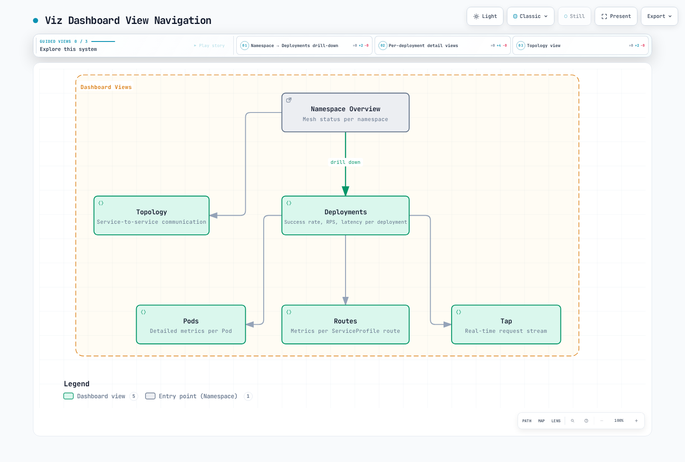

# 可观测性

> **最后更新**：October 16, 2026 · Linkerd edge-26.10.1 / charts 2026.10.1 · Prometheus Operator 示例已根据 0.94.1 检查

Linkerd 暴露代理和协议指标；Viz 添加 Prometheus、metrics-api、tap、tap-injector 和 Web 仪表板。当前 Viz chart **不会**安装 Grafana。分布式跟踪还需要配置好的收集器/后端、跟踪上下文和采样；安装指标仪表板并不会启用分布式跟踪。

这些示例假设你已按照[安装指南](01-installation.md)完成安装，已有网格化的 `web`/`api` 工作负载，并且 `my-app` 中有实际流量。请根据你的安装配置正确的命名空间、工作负载/Service 名称、端口和身份。opaque TCP 数据库不会自动生成 HTTP 成功率/延迟测量值。

## 指标含义

| 指标 | 含义 |
|---|---|
| response_total | 最终响应分类，包括错误/流结束处理 |
| request_total | 观察到的请求；不代表成功业务操作的计数 |
| response_latency_ms_bucket | 首字节时间直方图，单位为毫秒 |
| tcp_open_connections | 当前打开的传输连接 |
| tcp_open_total | 累计打开的连接数，而非当前活动连接数 |

常见的服务指标包括成功率、请求速率和延迟。根据需要添加容量/饱和度、应用和 Kubernetes 指标。HTTP 默认代理分类会将服务器错误视为失败；HTTP 400 可能计为成功。gRPC 状态和配置的响应策略可能会改变分类。这并不会自动成为业务成功 SLI。

延迟并不代表整个响应流持续时间。已发布的代理会在首个可用响应正文帧到达时记录延迟；如果正文被丢弃，则使用备用记录时机。该记录独立于最终响应分类。因此，直方图和响应计数器的观测值可能在不同时间变为可用。不要对未暴露分类信息的直方图应用成功/失败分类标签。

### CLI 统计信息和实时检查

```bash
linkerd viz stat deploy -n my-app
linkerd viz stat deploy/web -n my-app --to deploy/api
linkerd viz stat deploy/api -n my-app --from deploy/web
linkerd viz stat pods -n my-app
linkerd viz stat namespaces
linkerd viz stat deploy -n my-app --time-window 10m -o wide
linkerd viz stat deploy -n my-app -o json
```

表格包含 MESHED、SUCCESS、RPS、延迟百分位数和 TCP_CONN。宽格式输出会添加传输字节速率；它不是代理版本清单。Pod/Deployment 视图和 Service 视图的观测点不同：Service 统计信息使用出站客户端指标，并且不包含未网格化的调用方。比较总数时请注意这一区别。

```bash
linkerd viz top deploy/web -n my-app --hide-sources=false
linkerd viz tap deploy/web -n my-app --method GET --path /api
linkerd viz tap deploy/web -n my-app --to deploy/api --max-rps 20
linkerd viz tap deploy/web -n my-app -o json
linkerd viz edges deploy -n my-app
linkerd viz edges pods -n my-app
```

`top` 汇总 tap 获取的实时流量。`--hide-sources=false` 会显示来源列，而不是 HTTP 标头。`tap --path` 是路径前缀筛选器；`--max-rps` 限制 tap 观察到的请求速率，而非应用请求总数。当前的 tap 既没有 `--from`，也没有 `--show-headers`。请对来源工作负载执行 tap 并使用 `--to`，或使用受支持的统计筛选器。

Tap 是经过采样/限制的观测流，不是数据包捕获，也不是完整审计。请限制对其 API 的访问，因为路径和请求元数据可能包含敏感信息。Edges 显示观察到的连接；视图为空并不能证明没有流量或所有连接都已加密。

## Viz 仪表板和存储

```bash
linkerd viz dashboard --address 127.0.0.1 --port 8084 --show url
```

打开显示的本地 URL。请确保此本地访问路径绑定到环回地址；对外发布的仪表板需要单独设计身份验证和访问控制。绑定地址或 Host 标头检查并不等于用户身份验证。



[查看交互式图表](https://www.atomai.click/kubernetes-docs/archmaps/en-service-mesh-linkerd-05-observability-1.html)

默认捆绑的 Prometheus 保留数据六小时，并使用临时存储。所选 chart 固定使用自己的 Prometheus 镜像；不要悄然替换为新的主版本。可按安装指南所述配置持久化，而长期/高可用存储则需要单独设计。

```bash
kubectl -n linkerd-viz port-forward --address 127.0.0.1 svc/prometheus 9090:9090
# In another terminal:
curl --fail --get --data-urlencode 'query=up{job="linkerd-proxy"}' \
  http://127.0.0.1:9090/api/v1/query
```

## 外部 Prometheus

请有意识地选择直接抓取、联邦或适当的 remote-write 管道。如果未进行去重便通过多个路径采集相同序列，可能会导致结果重复计数。

### 直接抓取配置

将此配置合并到现有 Prometheus 配置中。它遵循所选 Viz chart 的 jobs/标签映射，并为控制器目标显式添加命名空间/Pod 标签：

```yaml
scrape_configs:
- job_name: linkerd-controller
  kubernetes_sd_configs:
  - role: pod
    namespaces:
      names:
      - linkerd
      - linkerd-viz
  relabel_configs:
  - source_labels:
    - __meta_kubernetes_pod_container_port_name
    action: keep
    regex: .*admin$
  - source_labels:
    - __meta_kubernetes_pod_container_port_name
    action: drop
    regex: linkerd-admin
  - source_labels:
    - __meta_kubernetes_pod_container_name
    action: replace
    target_label: component
  - source_labels:
    - __meta_kubernetes_namespace
    target_label: namespace
  - source_labels:
    - __meta_kubernetes_pod_name
    target_label: pod
- job_name: linkerd-proxy
  kubernetes_sd_configs:
  - role: pod
  relabel_configs:
  - source_labels:
    - __meta_kubernetes_pod_phase
    regex: (Pending|Running)
    action: keep
  - source_labels:
    - __meta_kubernetes_pod_container_name
    - __meta_kubernetes_pod_container_port_name
    - __meta_kubernetes_pod_label_linkerd_io_control_plane_ns
    action: keep
    regex: ^linkerd-proxy;linkerd-admin;linkerd$
  - source_labels:
    - __meta_kubernetes_namespace
    action: replace
    target_label: namespace
  - source_labels:
    - __meta_kubernetes_pod_name
    action: replace
    target_label: pod
  - source_labels:
    - __meta_kubernetes_pod_label_linkerd_io_proxy_job
    action: replace
    target_label: k8s_job
  - action: labeldrop
    regex: __meta_kubernetes_pod_label_linkerd_io_proxy_job
  - action: labelmap
    regex: __meta_kubernetes_pod_label_linkerd_io_proxy_(.+)
  - action: labeldrop
    regex: __meta_kubernetes_pod_label_linkerd_io_proxy_(.+)
  - action: labelmap
    regex: __meta_kubernetes_pod_label_linkerd_io_(.+)
  - action: labelmap
    regex: __meta_kubernetes_pod_label_(.+)
    replacement: __tmp_pod_label_$1
  - action: labelmap
    regex: __tmp_pod_label_linkerd_io_(.+)
    replacement: __tmp_pod_label_$1
  - action: labeldrop
    regex: __tmp_pod_label_linkerd_io_(.+)
  - action: labelmap
    regex: __tmp_pod_label_(.+)
```

旧的 `admin-http` 控制器端口筛选器会漏掉 `dest-admin` 和 `ident-admin` 等当前端口。代理筛选器会为目标控制平面保留名为 `linkerd-proxy`/`linkerd-admin` 的目标。Kubernetes Pod 发现会包含 init 容器，因此不要仅因 `__meta_kubernetes_pod_container_init` 为 true 就丢弃目标：默认的原生 sidecar 就位于其中。

这些标签支持所示的工作负载查询。请保留其他 Viz 查询和仪表板所需的标签；检查映射的应用标签，避免基数过高或包含敏感数据。配置 Kubernetes 发现 RBAC、API 访问权限以及到指标端口的网络可达性。YAML 文件有效并不能证明发现或抓取成功。

### Prometheus Operator 方案

Prometheus 资源必须同时选择这些 monitor 及其所在的命名空间。示例元数据假设其选择器接受 `release: monitoring`；请根据实际安装调整该标签。

```yaml
apiVersion: monitoring.coreos.com/v1
kind: PodMonitor
metadata:
  name: linkerd-proxies
  namespace: monitoring
  labels:
    release: monitoring
spec:
  namespaceSelector:
    any: true
  selector:
    matchLabels:
      linkerd.io/control-plane-ns: linkerd
  podMetricsEndpoints:
  - port: linkerd-admin
    path: /metrics
    interval: 10s
    relabelings:
    - sourceLabels:
      - __meta_kubernetes_pod_phase
      regex: (Pending|Running)
      action: keep
    - sourceLabels:
      - __meta_kubernetes_pod_container_name
      - __meta_kubernetes_pod_container_port_name
      - __meta_kubernetes_pod_label_linkerd_io_control_plane_ns
      action: keep
      regex: ^linkerd-proxy;linkerd-admin;linkerd$
    - sourceLabels:
      - __meta_kubernetes_namespace
      action: replace
      targetLabel: namespace
    - sourceLabels:
      - __meta_kubernetes_pod_name
      action: replace
      targetLabel: pod
    - sourceLabels:
      - __meta_kubernetes_pod_label_linkerd_io_proxy_job
      action: replace
      targetLabel: k8s_job
    - action: labeldrop
      regex: __meta_kubernetes_pod_label_linkerd_io_proxy_job
    - action: labelmap
      regex: __meta_kubernetes_pod_label_linkerd_io_proxy_(.+)
    - action: labeldrop
      regex: __meta_kubernetes_pod_label_linkerd_io_proxy_(.+)
    - action: labelmap
      regex: __meta_kubernetes_pod_label_linkerd_io_(.+)
    - action: labelmap
      regex: __meta_kubernetes_pod_label_(.+)
      replacement: __tmp_pod_label_$1
    - action: labelmap
      regex: __tmp_pod_label_linkerd_io_(.+)
      replacement: __tmp_pod_label_$1
    - action: labeldrop
      regex: __tmp_pod_label_linkerd_io_(.+)
    - action: labelmap
      regex: __tmp_pod_label_(.+)
    - targetLabel: job
      replacement: linkerd-proxy
---
apiVersion: monitoring.coreos.com/v1
kind: PodMonitor
metadata:
  name: linkerd-destination
  namespace: monitoring
  labels:
    release: monitoring
spec:
  namespaceSelector:
    matchNames:
    - linkerd
  selector:
    matchLabels:
      linkerd.io/control-plane-component: destination
  podMetricsEndpoints:
  - port: dest-admin
    path: /metrics
    interval: 10s
    relabelings:
    - sourceLabels:
      - __meta_kubernetes_pod_container_name
      targetLabel: component
    - targetLabel: job
      replacement: linkerd-controller
  - port: spval-admin
    path: /metrics
    interval: 10s
    relabelings:
    - sourceLabels:
      - __meta_kubernetes_pod_container_name
      targetLabel: component
    - targetLabel: job
      replacement: linkerd-controller
  - port: policy-admin
    path: /metrics
    interval: 10s
    relabelings:
    - sourceLabels:
      - __meta_kubernetes_pod_container_name
      targetLabel: component
    - targetLabel: job
      replacement: linkerd-controller
```

第二个 PodMonitor 涵盖 **destination Deployment** 中的三个指标端点。它并不涵盖所有控制器。对于其他组件，请使用它们实际声明的端口：

| 组件 | 命名指标端口 |
|---|---|
| Identity | ident-admin |
| Proxy injector | injector-admin |
| Viz components | admin |

destination Service 不会暴露 `admin-http` Service 端口，因此选择该不存在端口的 ServiceMonitor 不会发现任何此类端点。请对已声明的容器端口使用 PodMonitor，或有意配置适当的 Service。不要为同一目标同时配置重复的原始抓取和 PodMonitor。

联邦也是一种选择。对于所选 Viz chart，Prometheus 的 Service 端口名为 **admin**，端点为 `/federate`。请保留导出的标签、选择目标 jobs，并授权调用方网格化 ServiceAccount 访问 Viz 的 `prometheus-admin` Server。通用上游示例中使用的 `admin-http` 与此 chart 不匹配。

### 让 Viz 查询现有 Prometheus

对于单独配置且可访问、并保留所需 Linkerd 数据的 Prometheus：

```yaml
prometheus:
  enabled: false
prometheusUrl: http://prometheus.monitoring.svc.cluster.local:9090
```

将这些值合并到所选 Viz release 的完整配置中。在禁用本地 Prometheus 之前，请验证查询 API 行为、抓取标签、保留时间、身份验证和授权。此 URL 不会安装 Prometheus，也不会授予访问权限。

## 明确范围的查询

以下查询只选择一次入站 API 观测值。请根据实际情况调整命名空间/Deployment；对于共享后端，还应添加集群范围。

成功率：

```promql
((sum(rate(response_total{namespace="my-app",deployment="api",direction="inbound",classification="success"}[5m])) or vector(0)) / sum(rate(response_total{namespace="my-app",deployment="api",direction="inbound"}[5m])))
and on() (sum(rate(response_total{namespace="my-app",deployment="api",direction="inbound"}[5m])) > 0)
```

当所有观测到的响应均失败且不存在成功序列时，分子会回退为零。正总量条件会让缺失/空闲流量不产生成功率结果；它不会将缺失数据显示为 100%。

请求速率：

```promql
sum(rate(request_total{namespace="my-app",deployment="api",direction="inbound"}[5m]))
```

首字节时间百分位数，单位为毫秒：

```promql
histogram_quantile(0.5, sum by (le) (rate(response_latency_ms_bucket{namespace="my-app",deployment="api",direction="inbound"}[5m])))

histogram_quantile(0.95, sum by (le) (rate(response_latency_ms_bucket{namespace="my-app",deployment="api",direction="inbound"}[5m])))

histogram_quantile(0.99, sum by (le) (rate(response_latency_ms_bucket{namespace="my-app",deployment="api",direction="inbound"}[5m])))
```

入站源端的活动 TCP 连接数：

```promql
sum(tcp_open_connections{namespace="my-app",deployment="api",direction="inbound",peer="src"})
```

`peer="src"` 可避免将代理单独的本地应用连接计入该数量。要获取每秒打开的连接数，请对 `tcp_open_total` 应用 rate，并使用相同的目标观测范围。

request_total 上没有通用的 `retry="true"` 标签。对于 ServiceProfiles，请在相同范围和时间窗口内检查 route_actual_request_total、route_request_total 和 route_retryable_total。可重试响应并不等同于实际发送的重试；无预算序列是其子集。当前策略指标和应用尝试证据需要分别解读。请参阅[流量管理](03-traffic-management.md)。


## Grafana

自 Linkerd 2.12 起，Grafana 就需要单独安装。当前默认 Viz 安装中没有可供 port-forward 的捆绑 `svc/grafana`，而 `grafana.enabled:false` 也不会配置受支持的集成方式。

请使用已有的 Grafana，并配置包含所需指标的 Prometheus 数据源。对于以命名空间 `monitoring` 中的 ServiceAccount `grafana` 身份运行的网格化 Grafana，以下配置允许其访问现有的 Viz Prometheus：

```yaml
apiVersion: policy.linkerd.io/v1alpha1
kind: AuthorizationPolicy
metadata:
  name: prometheus-admin-grafana
  namespace: linkerd-viz
spec:
  targetRef:
    group: policy.linkerd.io
    kind: Server
    name: prometheus-admin
  requiredAuthenticationRefs:
  - kind: ServiceAccount
    name: grafana
    namespace: monitoring
```

如果 Grafana 使用其他身份或外部 Prometheus，请在相应位置配置适当的访问权限。ServiceAccount 授权要求调用方实际使用该网格身份。

若要将 Viz 链接到可从外部访问的 Grafana：

```yaml
grafana:
  externalUrl: https://grafana.example.com/
```

受支持的方案包括：使用 `grafana.externalUrl` 配置面向浏览器的完整 URL；使用 `grafana.url` 配置集群内反向代理集成。后一种方案还需要配置 Grafana 的根路径/子路径。`grafana.uidPrefix` 用于区分导入的仪表板 UID；它不是租户授权控制项。

已发布的仪表板集合包括健康状况、顶层指标、命名空间/工作负载、Service、路由、authority 和多集群视图。**Authority 指 HTTP host/:authority，而不是授权权限。**请从经过审核的 release 导入仪表板，并验证其数据源、标签、单位和 UID 链接。

### 简易仪表板示例

此经典仪表板 JSON 包含数据源导入输入、常量命名空间/Deployment 变量以及面板单位。导入时请选择数据源并调整常量。已检查查询和 JSON；未执行 Grafana server 导入。

```json
{
  "__inputs": [
    {
      "name": "DS_PROMETHEUS",
      "label": "Prometheus",
      "type": "datasource",
      "pluginId": "prometheus",
      "pluginName": "Prometheus"
    }
  ],
  "id": null,
  "uid": "linkerd-api-overview",
  "title": "Linkerd API Overview",
  "schemaVersion": 39,
  "version": 1,
  "time": {
    "from": "now-1h",
    "to": "now"
  },
  "templating": {
    "list": [
      {
        "name": "namespace",
        "type": "constant",
        "query": "my-app",
        "current": {
          "text": "my-app",
          "value": "my-app"
        }
      },
      {
        "name": "deployment",
        "type": "constant",
        "query": "api",
        "current": {
          "text": "api",
          "value": "api"
        }
      }
    ]
  },
  "panels": [
    {
      "id": 1,
      "title": "Proxy-classified Success Rate",
      "type": "gauge",
      "datasource": {
        "type": "prometheus",
        "uid": "${DS_PROMETHEUS}"
      },
      "gridPos": {
        "x": 0,
        "y": 0,
        "w": 8,
        "h": 8
      },
      "fieldConfig": {
        "defaults": {
          "unit": "percent"
        },
        "overrides": []
      },
      "targets": [
        {
          "refId": "A",
          "datasource": {
            "type": "prometheus",
            "uid": "${DS_PROMETHEUS}"
          },
          "expr": "100 * (((sum(rate(response_total{namespace=\"$namespace\",deployment=\"$deployment\",direction=\"inbound\",classification=\"success\"}[5m])) or vector(0)) / sum(rate(response_total{namespace=\"$namespace\",deployment=\"$deployment\",direction=\"inbound\"}[5m])))\nand on() (sum(rate(response_total{namespace=\"$namespace\",deployment=\"$deployment\",direction=\"inbound\"}[5m])) > 0))",
          "legendFormat": "success"
        }
      ]
    },
    {
      "id": 2,
      "title": "Request Rate",
      "type": "timeseries",
      "datasource": {
        "type": "prometheus",
        "uid": "${DS_PROMETHEUS}"
      },
      "gridPos": {
        "x": 8,
        "y": 0,
        "w": 8,
        "h": 8
      },
      "fieldConfig": {
        "defaults": {
          "unit": "reqps"
        },
        "overrides": []
      },
      "targets": [
        {
          "refId": "A",
          "datasource": {
            "type": "prometheus",
            "uid": "${DS_PROMETHEUS}"
          },
          "expr": "sum(rate(request_total{namespace=\"$namespace\",deployment=\"$deployment\",direction=\"inbound\"}[5m]))",
          "legendFormat": "requests/s"
        }
      ]
    },
    {
      "id": 3,
      "title": "Time to First Byte",
      "type": "timeseries",
      "datasource": {
        "type": "prometheus",
        "uid": "${DS_PROMETHEUS}"
      },
      "gridPos": {
        "x": 16,
        "y": 0,
        "w": 8,
        "h": 8
      },
      "fieldConfig": {
        "defaults": {
          "unit": "ms"
        },
        "overrides": []
      },
      "targets": [
        {
          "refId": "A",
          "datasource": {
            "type": "prometheus",
            "uid": "${DS_PROMETHEUS}"
          },
          "expr": "histogram_quantile(0.5, sum by (le) (rate(response_latency_ms_bucket{namespace=\"$namespace\",deployment=\"$deployment\",direction=\"inbound\"}[5m])))",
          "legendFormat": "p50"
        },
        {
          "refId": "B",
          "datasource": {
            "type": "prometheus",
            "uid": "${DS_PROMETHEUS}"
          },
          "expr": "histogram_quantile(0.95, sum by (le) (rate(response_latency_ms_bucket{namespace=\"$namespace\",deployment=\"$deployment\",direction=\"inbound\"}[5m])))",
          "legendFormat": "p95"
        },
        {
          "refId": "C",
          "datasource": {
            "type": "prometheus",
            "uid": "${DS_PROMETHEUS}"
          },
          "expr": "histogram_quantile(0.99, sum by (le) (rate(response_latency_ms_bucket{namespace=\"$namespace\",deployment=\"$deployment\",direction=\"inbound\"}[5m])))",
          "legendFormat": "p99"
        }
      ]
    }
  ]
}
```

## 分布式跟踪

Linkerd-Jaeger 扩展已在 Linkerd 2.19 中移除。当前跟踪功能使用单独管理的、兼容 OpenTelemetry 的收集器/后端；旧的 `linkerd jaeger` 命令、扩展 webhook 地址和任意的 `linkerd-jaeger-config` ConfigMap 都无法完成配置。

对于现有的、经过网格化且使用端口 4317 的 OTLP/gRPC 收集器（以命名空间 `tracing` 中的 ServiceAccount `collector` 身份运行），请将以下值合并到完整的 Linkerd 配置中：

```yaml
proxy:
  tracing:
    enabled: true
    collector:
      endpoint: collector.tracing.svc.cluster.local:4317
      meshIdentity:
        serviceAccountName: collector
        namespace: tracing
```

所选 chart 要求配置收集器端点和两个 meshIdentity 字段，并据此推导预期的收集器 DNS 身份。仅仅在网格外运行 OTLP 接收器并不能满足此配置。请验证其 Service 端口、接收管道、网络/授权访问、存储和采样的 spans。通过安装过程中的工作负载所属控制器更新工作负载，使其代理接收跟踪配置。

Linkerd 支持 W3C 跟踪上下文和 B3 跟踪；两者同时出现时，优先使用 W3C。`x-request-id` 是关联 ID，并非必需的跟踪上下文格式。入口流量/应用或测试生成器必须建立上下文并进行采样，应用还必须在自身调用间传递上下文。

### 应用上下文传递示例

对于经过验证的提取、子 span 创建、采样和导出，优先使用合适的 OpenTelemetry 库。以下简单的 **GET 适配器仅传递 W3C 上下文**；它们不会创建应用 span、验证用户身份，也不是通用反向代理。请从可信的部署设置中配置后端 URL。

Python（本地检查使用 Flask 3.1.3 / Requests 2.32.5）：

```python
from flask import Flask, Response, request
import requests

app = Flask(__name__)
BACKEND_URL = "http://backend-service/api/backend"  # Trusted configuration.
MAX_RESPONSE_BYTES = 1024 * 1024
app.config["DOWNSTREAM_TIMEOUT"] = (2, 5)  # Connect/read inactivity, not total time.


@app.get("/api/data")
def get_data():
    headers = {}
    if request.headers.get("traceparent"):
        for name in ("traceparent", "tracestate"):
            if request.headers.get(name):
                headers[name] = request.headers[name]
    try:
        with requests.get(
            BACKEND_URL,
            headers=headers,
            timeout=app.config["DOWNSTREAM_TIMEOUT"],
            allow_redirects=False,
            stream=True,
        ) as upstream:
            # This small API adapter does not follow or relay redirects.
            if 300 <= upstream.status_code < 400:
                return Response("Unexpected upstream redirect\n", status=502)
            body = bytearray()
            for chunk in upstream.iter_content(chunk_size=16384):
                body.extend(chunk)
                if len(body) > MAX_RESPONSE_BYTES:
                    return Response("Upstream response too large\n", status=502)
            return Response(
                bytes(body),
                status=upstream.status_code,
                content_type=upstream.headers.get(
                    "Content-Type", "application/octet-stream"
                ),
            )
    except requests.Timeout:
        return Response("Upstream timeout\n", status=504)
    except requests.RequestException:
        return Response("Upstream request failed\n", status=502)
```

连接/读取超时限制连接等待和读取空闲时间，而不是端到端总耗时。对于持续缓慢传输的响应或调用方取消操作，需要在此同步示例之外设计应用/服务器截止时间。响应缓冲区设有上限，并且会显式拒绝重定向。

现有 HTTP server 的 Go handler：

```go
package main

import (
	"errors"
	"io"
	"net"
	"net/http"
	"time"
)

var backendURL = "http://backend-service/api/backend" // Trusted configuration.
var downstreamClient = &http.Client{
	Timeout: 5 * time.Second,
	CheckRedirect: func(req *http.Request, via []*http.Request) error {
		return http.ErrUseLastResponse
	},
}

const maxResponseBytes = 1024 * 1024

func handler(w http.ResponseWriter, r *http.Request) {
	if r.Method != http.MethodGet {
		w.Header().Set("Allow", http.MethodGet)
		http.Error(w, "Method not allowed", http.StatusMethodNotAllowed)
		return
	}
	req, err := http.NewRequestWithContext(r.Context(), http.MethodGet, backendURL, nil)
	if err != nil {
		http.Error(w, "Invalid backend configuration", http.StatusInternalServerError)
		return
	}
	if r.Header.Get("traceparent") != "" {
		for _, name := range []string{"traceparent", "tracestate"} {
			if value := r.Header.Get(name); value != "" {
				req.Header.Set(name, value)
			}
		}
	}
	resp, err := downstreamClient.Do(req)
	if err != nil {
		status := http.StatusBadGateway
		var networkError net.Error
		if errors.As(err, &networkError) && networkError.Timeout() {
			status = http.StatusGatewayTimeout
		}
		http.Error(w, "Upstream request failed", status)
		return
	}
	defer resp.Body.Close()
	if resp.StatusCode >= 300 && resp.StatusCode < 400 {
		http.Error(w, "Unexpected upstream redirect", http.StatusBadGateway)
		return
	}
	body, err := io.ReadAll(io.LimitReader(resp.Body, maxResponseBytes+1))
	if err != nil || len(body) > maxResponseBytes {
		http.Error(w, "Invalid or oversized upstream response", http.StatusBadGateway)
		return
	}
	contentType := resp.Header.Get("Content-Type")
	if contentType == "" {
		contentType = "application/octet-stream"
	}
	w.Header().Set("Content-Type", contentType)
	w.WriteHeader(resp.StatusCode)
	_, _ = w.Write(body)
}
```

此示例会传递请求取消信号、限制客户端调用、在使用响应前检查错误，并转发后端状态/正文。两个示例都会有意拒绝重定向和超大响应。本地测试会覆盖这些路径，但不能证明生产环境中的跟踪、数据接收、采样或负载行为。

请确认已知的采样跟踪到达后端，并包含预期的代理/应用 spans。跟踪仪表板能够正常打开，并不能证明上下文传递、采样正确或跟踪完整。

## 诊断日志和访问日志

代理诊断日志级别/格式与 HTTP 访问日志是不同的设置。请将此**现有网格化 Deployment 的合并补丁**保存为 `proxy-logging-patch.yaml`；它不是独立的 Deployment 清单：

```yaml
spec:
  template:
    metadata:
      labels:
        mesh-required: 'true'
      annotations:
        config.linkerd.io/access-log: json
        config.linkerd.io/proxy-log-format: json
        config.linkerd.io/proxy-log-level: warn,linkerd=info
```

```bash
# This changes the existing workload's Pod template and triggers its rollout.
kubectl -n my-app patch deployment/api --type merge --patch-file proxy-logging-patch.yaml
kubectl -n my-app rollout status deployment/api --timeout=5m
kubectl -n my-app logs deployment/api -c linkerd-proxy --tail=100
```

`config.linkerd.io/access-log:json` 会启用 HTTP 访问记录。`proxy-log-format:json` 只会改变诊断日志格式。避免不加区分地记录 debug/trace 级别日志或标头；应根据调查范围控制诊断数据的收集和处理。这些设置不会将 opaque TCP 流量变成 HTTP 请求日志。

`mesh-required:true` Pod 标签表示该工作负载有意要求代理保持健康，以供下方警报使用；它不会执行注入。加入网格仍须遵循安装/命名空间策略。

## ServiceProfile 和策略路由指标

ServiceProfiles 仍受支持，以保持兼容性。添加 ServiceProfile 可能会覆盖该 Service 当前的出站 HTTPRoute 可靠性设置；不要仅为让仪表板显示数据而添加冲突的 profile。

对于针对现有 api-service 的独立旧版指标练习，此 profile 会添加路由名称，但不会启用重试：

```yaml
apiVersion: linkerd.io/v1alpha2
kind: ServiceProfile
metadata:
  name: api-service.my-app.svc.cluster.local
  namespace: my-app
spec:
  routes:
  - name: GET /api/users
    condition:
      all:
      - method: GET
      - pathRegex: ^/api/users$
    isRetryable: false
  - name: POST /api/orders
    condition:
      all:
      - method: POST
      - pathRegex: ^/api/orders$
    isRetryable: false
  - name: GET /health
    condition:
      all:
      - method: GET
      - pathRegex: ^/health$
    isRetryable: false
```

显式的 all 条件可清楚地指定方法/路径匹配。Profile 路由、HTTPRoute 策略指标和任意应用路径是不同的视图：

```bash
linkerd viz routes service/api-service -n my-app
linkerd viz routes deploy/web -n my-app --to svc/api-service --time-window 10m
linkerd viz stat httproute/api-inbound -n my-app
linkerd viz authz deploy/api -n my-app
```

HTTPRoute 示例假设存在关联到 Server 的入站路由。`viz routes` 显示的是 ServiceProfile 视图；它不是所有 Gateway API 路由的通用列表。

聚合 `web` 的出站调用时，请保留目标和路由标签：

```promql
(sum by (dst, rt_route) (rate(route_response_total{namespace="my-app",deployment="web",direction="outbound",classification="success"}[5m]))
 or on(dst, rt_route) (0 * sum by (dst, rt_route) (rate(route_response_total{namespace="my-app",deployment="web",direction="outbound"}[5m])))) / sum by (dst, rt_route) (rate(route_response_total{namespace="my-app",deployment="web",direction="outbound"}[5m]))
and on(dst, rt_route) (sum by (dst, rt_route) (rate(route_response_total{namespace="my-app",deployment="web",direction="outbound"}[5m])) > 0)
```

```promql
histogram_quantile(0.99, sum by (le, dst, rt_route) (rate(route_response_latency_ms_bucket{namespace="my-app",deployment="web",direction="outbound"}[5m])))
```

```promql
sum by (dst, rt_route) (rate(route_request_total{namespace="my-app",deployment="web",direction="outbound"}[5m]))
```

对齐后的零分子可保留全部失败的路由，而不会将其丢弃。仅按路由名称分组可能会将具有相同路由标签的不同 Service 合并。

## 警报和调查

以下 PrometheusRule 假设其选择器标签已获接受、所示的 Linkerd jobs 正在被抓取，并且 kube-state-metrics 暴露 Pod 标签以及常规/init 容器运行指标。请在其指标标签允许列表中启用 `mesh-required` Pod 标签；否则，预期 Pod 选择器将没有数据。

```yaml
apiVersion: monitoring.coreos.com/v1
kind: PrometheusRule
metadata:
  name: linkerd-alerts
  namespace: monitoring
  labels:
    release: monitoring
spec:
  groups:
  - name: linkerd
    rules:
    - alert: LinkerdAPIHighErrorRate
      expr: |-
        (((sum(rate(response_total{namespace="my-app",deployment="api",direction="inbound",classification="failure"}[5m])) or vector(0)) / sum(rate(response_total{namespace="my-app",deployment="api",direction="inbound"}[5m])))
        and on() (sum(rate(response_total{namespace="my-app",deployment="api",direction="inbound"}[5m])) > 0)) > 0.05
      for: 5m
      labels:
        severity: warning
      annotations:
        summary: API proxy-classified response error ratio exceeds 5%
    - alert: LinkerdAPIHighTTFB
      expr: histogram_quantile(0.99, sum by (le) (rate(response_latency_ms_bucket{namespace="my-app",deployment="api",direction="inbound"}[5m])))
        > 1000
      for: 5m
      labels:
        severity: warning
      annotations:
        summary: API p99 time-to-first-byte exceeds 1000ms
    - alert: LinkerdExpectedProxyNotRunning
      expr: |-
        max by (namespace, pod) (
          (kube_pod_status_phase{namespace="my-app",phase="Running"} == 1)
          and on(namespace, pod) kube_pod_labels{namespace="my-app",label_mesh_required="true"}
        )
        unless on(namespace, pod) max by (namespace, pod) (
          (kube_pod_container_status_running{namespace="my-app",container="linkerd-proxy"} == 1)
          or (kube_pod_init_container_status_running{namespace="my-app",container="linkerd-proxy"} == 1)
        )
      for: 10m
      labels:
        severity: warning
      annotations:
        summary: Expected proxy is not running for {{ $labels.namespace }}/{{ $labels.pod }}
    - alert: LinkerdScrapeTargetDown
      expr: up{job=~"linkerd-proxy|linkerd-controller"} == 0
      for: 5m
      labels:
        severity: warning
      annotations:
        summary: A discovered Linkerd metrics target cannot be scraped
```

代理警报检查的是**预期运行但没有运行代理的 Pods**，而不仅仅是是否存在注入。它同时适用于常规 sidecar 和原生 init sidecar，并忽略未标记为需要网格的 Pods。如果缺少 kube-state-metrics 抓取，预期清单仍可能丢失；请单独监控采集健康状况。

延迟阈值为 1000ms 的 TTFB，而不是请求总耗时。基于分类的错误阈值必须符合你的 SLI。`up == 0` 能检测抓取失败的已发现目标，而非发现中缺失的所有目标。

开始调查时，先验证抓取健康状况和所选流量范围。然后比较工作负载/Service 统计信息、检查相关路由、使用有界的 Tap/日志观测，并在有需要时检查身份/策略。诊断并修复原因后，重新发起请求并验证恢复情况。仅按顺序执行一组诊断命令并不能解决事件。

## 参考资料和后续步骤

- [多集群](06-multi-cluster.md)、[最佳实践](07-best-practices.md)、[可观测性测验](../../quizzes/service-mesh/linkerd/observability.md)
- [仪表板](https://linkerd.io/docs/features/dashboard/)、[导出指标](https://linkerd.io/docs/tasks/exporting-metrics/)、[Grafana](https://linkerd.io/docs/tasks/grafana/)
- [代理指标](https://linkerd.io/docs/reference/proxy-metrics/)和[代理配置](https://linkerd.io/docs/reference/proxy-configuration/)
- [跟踪](https://linkerd.io/docs/tasks/distributed-tracing/)
- [已发布的指标计时实现](https://github.com/linkerd/linkerd2-proxy/blob/a66af8117769df060adda6233302a2d1c4142229/linkerd/http/metrics/src/requests/service.rs)
- [已发布的 Viz 抓取配置](https://github.com/linkerd/linkerd2/blob/edge-26.10.1/viz/charts/linkerd-viz/templates/prometheus.yaml)
- [已发布的 Grafana 仪表板集合](https://github.com/linkerd/linkerd2/tree/edge-26.10.1/grafana/dashboards)
- [kube-state-metrics Pod 指标](https://github.com/kubernetes/kube-state-metrics/blob/main/docs/metrics/workload/pod-metrics.md)
- [W3C 跟踪上下文](https://www.w3.org/TR/trace-context/)
