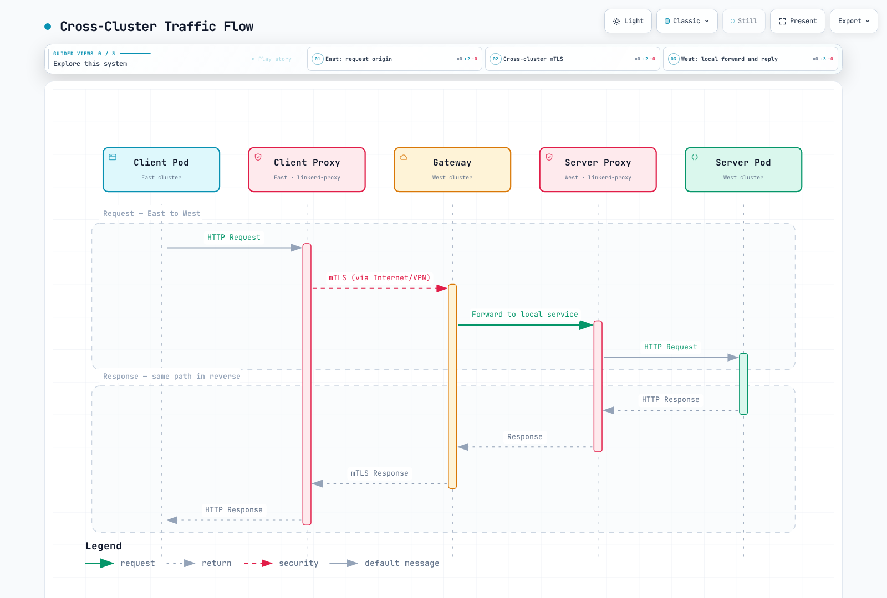
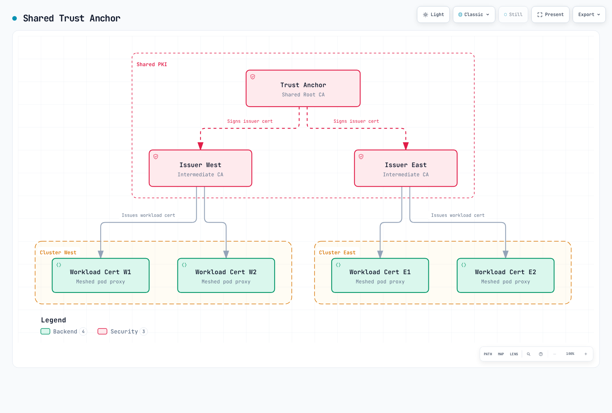

# Linkerd 多集群

> **最后更新**：2026 年 10 月 16 日 · Linkerd edge-26.10.1 / charts 2026.10.1 · Gateway API 1.5.1

Linkerd 会跨集群边界镜像选定的 Service 信息。这需要可用的控制平面发现路径和适当的数据平面网络路径。它不会合并集群、复制应用程序数据，也不会为影子测试复制每个请求。

## 通信模式

| 模式 | 发现/Service 选择 | 数据路径和身份 |
|---|---|---|
| 层级模式 | 默认使用 `mirror.linkerd.io/exported=true` | 源客户端代理 → 目标集群网关 → 服务器；原始调用方身份会在网关处丢失 |
| 扁平 / 远程发现 | `mirror.linkerd.io/exported=remote-discovery` | 跨集群直接连接 Pod；保留原始工作负载身份 |
| 联合 Service | `mirror.linkerd.io/federated=member` | 在扁平网络上联合同名/同命名空间的 Service；需要网格化客户端 |

源集群的镜像控制器监视的是**目标 Kubernetes API**，而不是另一个镜像控制器。镜像 Service 是 Kubernetes 发现对象，并非执行 TLS 的进程。它在对应命名空间中的常见名称是 `<service>-<Link cluster name>`。



[查看交互式图表](https://www.atomai.click/kubernetes-docs/archmaps/en-service-mesh-linkerd-06-multi-cluster-2.html)

层级模式要求目标网关可被源客户端访问。扁平/联合模式还要求集群之间具备直接且无歧义的 Pod-IP 路由，并使用相同的 Linkerd 控制平面命名空间。内部负载均衡器或 VPC 端点本身并不能建立这种扁平网络。

## 先决条件和共享信任

准备好两个集群，并明确使用 kubeconfig context `west` 和 `east`。这些只是本地别名，不能证明它们所属的 AWS 账户或区域。请使用[安装指南](01-installation.md)中兼容的 Kubernetes/Gateway API 版本、Linux 工作节点/CNI 配置和固定版本 CLI；不要将最新 Kubernetes 版本等同于 Linkerd 兼容版本。

两个 Linkerd 安装都必须信任相关的签发者证书链。使用一个通用公共根证书是最简单的配置；也支持包含多个适用根证书的共享 bundle。集群不必共享签发者私钥或工作负载证书。



[查看交互式图表](https://www.atomai.click/kubernetes-docs/archmaps/en-service-mesh-linkerd-06-multi-cluster-3.html)

**仅适用于全新隔离实验环境**，以下命令会创建一个通用根证书和独立的 ECDSA P-256 签发者。十年根证书有效期只是示例，并非 CLI 默认值或通用建议：

```bash
set -euo pipefail
umask 077
# New lab PKI only. The chosen root lifetime is an example, not a default.
step certificate create root.linkerd.cluster.local ca.crt ca.key \
  --profile root-ca --kty EC --curve P-256 \
  --not-after 87600h --no-password --insecure
step certificate create identity.linkerd.cluster.local issuer-west.crt issuer-west.key \
  --profile intermediate-ca --kty EC --curve P-256 \
  --ca ca.crt --ca-key ca.key --not-after 8760h --no-password --insecure
step certificate create identity.linkerd.cluster.local issuer-east.crt issuer-east.key \
  --profile intermediate-ca --kty EC --curve P-256 \
  --ca ca.crt --ca-key ca.key --not-after 8760h --no-password --insecure
cp ca.crt shared-roots.pem
```

`--no-password --insecure` 会生成未加密的私钥文件。请将其保存在受保护的工作目录中，并且只分发公共信任 bundle 和每个集群所需的签发者材料。对于现有网格，请使用分阶段的[信任轮换流程](04-security.md)；不要仅为了照搬新安装示例而替换根证书。

### 使用明确的 context 安装核心组件

以下是完成安装指南中两个集群的 Gateway API/CNI 先决条件后，由 CLI 管理核心组件的安装流程。对于由 Helm 管理的核心组件，请继续由 Helm 管理，并通过经过审核的 values 传入相应的每集群凭据。

这些命令展示了在兼容 Linux 工作节点上使用默认 proxy-init 的路径。使用 Linkerd CNI 安装时，也必须通过所选安装配置传入 `cniEnabled:true`。

```bash
set -euo pipefail
# New CLI-owned installations only; complete Gateway API/CNI prerequisites first.
linkerd --context west install --crds | kubectl --context west apply -f -
linkerd --context west install \
  --identity-trust-anchors-file shared-roots.pem \
  --identity-issuer-certificate-file issuer-west.crt \
  --identity-issuer-key-file issuer-west.key | kubectl --context west apply -f -

linkerd --context east install --crds | kubectl --context east apply -f -
linkerd --context east install \
  --identity-trust-anchors-file shared-roots.pem \
  --identity-issuer-certificate-file issuer-east.crt \
  --identity-issuer-key-file issuer-east.key | kubectl --context east apply -f -
linkerd --context west check
linkerd --context east check
```

如果需要流量统计，请单独安装 Viz。多集群扩展自身的检查并不等同于对应用程序/业务的验证。

## 扩展和单向连接

本练习使用 Helm 管理多集群扩展及其对等控制器。所选 CLI 中旧的 `multicluster link` 已弃用；请使用 `link-gen` 生成 Link 和凭据 Secret，并配合 chart 的 `controllers` 列表。

### 基础安装

对于**已安装 AWS Load Balancer Controller 的 EKS**，将以下内容保存为 `mc-base-values.yaml`。它会请求一个内部 TCP NLB；请确保已设计好对等路由、DNS、安全组和所需端口。其他平台需要使用其各自支持的负载均衡器配置。

```yaml
gateway:
  enabled: true
  serviceType: LoadBalancer
  loadBalancerClass: service.k8s.aws/nlb
  serviceAnnotations:
    service.beta.kubernetes.io/aws-load-balancer-scheme: internal
    service.beta.kubernetes.io/aws-load-balancer-nlb-target-type: ip
    service.beta.kubernetes.io/aws-load-balancer-attributes: load_balancing.cross_zone.enabled=true
```

```bash
helm repo add linkerd-edge https://helm.linkerd.io/edge
helm repo update linkerd-edge
# Initially install gateway/remote-access prerequisites, without peer controllers.
helm --kube-context west upgrade --install linkerd-multicluster \
  linkerd-edge/linkerd-multicluster --version 2026.10.1 \
  -n linkerd-multicluster --create-namespace -f mc-base-values.yaml \
  --wait --timeout 10m
helm --kube-context east upgrade --install linkerd-multicluster \
  linkerd-edge/linkerd-multicluster --version 2026.10.1 \
  -n linkerd-multicluster --create-namespace -f mc-base-values.yaml \
  --wait --timeout 10m
kubectl --context west -n linkerd-multicluster get svc linkerd-gateway -o yaml
kubectl --context east -n linkerd-multicluster get svc linkerd-gateway -o yaml
```

基于网关生成 Link 前，目标 Service 必须有 ingress IP **或主机名**。AWS NLB 通常会公开一个主机名，`link-gen` 可以接受该主机名。网关数据流量端口默认为 4143；网关就绪探测端口默认为 4191。这两个端口可访问，都不能证明远程 Kubernetes API 或每个应用程序运行正常。

### East 使用 West

将所需的控制器列表保存为 `mc-east-links.yaml`：

```yaml
controllers:
- link:
    ref:
      name: west
```

```bash
set -euo pipefail
umask 077
# Read West's configuration; install the generated credentials/Link into East.
linkerd --context west multicluster link-gen --cluster-name west > west-link.yaml
# Review public metadata and target endpoint without printing credential values.
kubectl --context east apply -f west-link.yaml
helm --kube-context east upgrade linkerd-multicluster \
  linkerd-edge/linkerd-multicluster --version 2026.10.1 \
  -n linkerd-multicluster -f mc-base-values.yaml -f mc-east-links.yaml \
  --wait --timeout 10m
kubectl --context east -n linkerd-multicluster get links.multicluster.linkerd.io
linkerd --context east multicluster check
linkerd --context east multicluster gateways
```

`link-gen` 会读取 West 的 API 地址/CA 以及所选远程访问 ServiceAccount token。它会生成一个 Link 和两个凭据 Secret，分别用于 `linkerd-multicluster` 和控制平面命名空间 `linkerd`。它本身不会安装网络路由或源镜像控制器。

请将生成的文件视为凭据：限制其访问权限，不要提交该文件，也不要将其内容打印到日志中。生成的 kubeconfig 必须可供控制器使用，包括自包含的 API CA 数据，以及可访问且证书有效的服务器地址。如果工作站的端点不合适，请使用受支持的 `--api-server-address` 覆盖项，指定控制器可访问的实际 API 端点。

Link 具有方向性：在 West 上生成并应用到 East 后，会启用 **East 发现 West**。更新已建立的安装时，请在所需的 Helm 控制器列表中保留所有现有对等项；如果用这个只有一个条目的示例替换整个数组，可能会移除其他控制器。

### 可选的反向连接

保存 `mc-west-links.yaml`：

```yaml
controllers:
- link:
    ref:
      name: east
```

```bash
set -euo pipefail
umask 077
linkerd --context east multicluster link-gen --cluster-name east > east-link.yaml
kubectl --context west apply -f east-link.yaml
helm --kube-context west upgrade linkerd-multicluster \
  linkerd-edge/linkerd-multicluster --version 2026.10.1 \
  -n linkerd-multicluster -f mc-base-values.yaml -f mc-west-links.yaml \
  --wait --timeout 10m
linkerd --context west multicluster check
```

为每个对等方使用不同的远程访问 ServiceAccount，可实现更有针对性的撤销。请协调其 RBAC 和凭据续期；这些是 Kubernetes API 凭据，与网格工作负载证书相互独立。

## 导出并使用 Service

在两个集群中准备应用程序命名空间。默认情况下，该 chart 不会创建缺失的镜像命名空间。

保存为 `mc-namespace.yaml`：

```yaml
apiVersion: v1
kind: Namespace
metadata:
  name: mc-demo
  annotations:
    linkerd.io/inject: enabled
```

请使用经过测试且已网格化的 `web` 工作负载（监听端口 8080，标签为 `app:web`），并使用现有的网格化 `client` 工作负载执行请求检查。本页不会部署未指定的 `client:latest` 镜像，也不会声称不完整的 Deployment 是有效配置。

将此 **West** Service 保存为 `west-web-service.yaml`：

```yaml
apiVersion: v1
kind: Service
metadata:
  name: web
  namespace: mc-demo
  labels:
    mirror.linkerd.io/exported: 'true'
spec:
  selector:
    app: web
  ports:
  - name: http
    port: 80
    targetPort: 8080
    appProtocol: http
```

```bash
# Apply the Namespace manifest to both contexts before creating workloads/mirrors.
kubectl --context west apply -f mc-namespace.yaml
kubectl --context east apply -f mc-namespace.yaml
kubectl --context west apply -f west-web-service.yaml
# Alternative for an existing West Service:
kubectl --context west -n mc-demo label service/web mirror.linkerd.io/exported=true --overwrite
kubectl --context east -n mc-demo get service web-west
# Hierarchical mode: current service-mirror still manages legacy Endpoints.
kubectl --context east -n mc-demo get endpoints web-west -o yaml
kubectl --context east -n mc-demo get endpointslices.discovery.k8s.io \
  -l kubernetes.io/service-name=web-west -o yaml
# Existing meshed client with curl installed and the expected app endpoint.
kubectl --context east -n mc-demo exec deployment/client -c client -- \
  curl --fail --show-error --retry 0 --max-time 10 http://web-west.mc-demo.svc.cluster.local/
```

对于新建的 Service，请在创建命名空间并准备好工作负载后应用其清单。标签命令是对现有 Service 的替代做法。导出标签用于选择发现对象；它们不是访问控制边界，并且只会影响 Link 选择器/RBAC 匹配的对等方。

所选的 service-mirror 实现仍会为层级镜像维护旧版 `Endpoints`。如有 EndpointSlices，也请检查，但不要误以为更改诊断命令就迁移了控制器。在远程发现模式下，本地 Endpoints 可以有意缺失：目标组件会改为查询远程端点。

## 显式本地/远程路由

对于 **East** 的本地 web 工作负载，将以下 apex/本地后端 Service 保存为 `east-web-services.yaml`：

```yaml
apiVersion: v1
kind: Service
metadata:
  name: web
  namespace: mc-demo
spec:
  selector:
    app: web
  ports:
  - name: http
    port: 80
    targetPort: 8080
    appProtocol: http
---
apiVersion: v1
kind: Service
metadata:
  name: web-local
  namespace: mc-demo
spec:
  selector:
    app: web
  ports:
  - name: http
    port: 80
    targetPort: 8080
    appProtocol: http
```

将 `east-web-route.yaml` 保存为以下内容，以便在符合条件的网格化客户端流量中，将请求分配给本地后端和导入的 Service：

```yaml
apiVersion: gateway.networking.k8s.io/v1
kind: HTTPRoute
metadata:
  name: web-cluster-route
  namespace: mc-demo
spec:
  parentRefs:
  - group: ''
    kind: Service
    name: web
    port: 80
  rules:
  - backendRefs:
    - name: web-local
      port: 80
      weight: 80
    - name: web-west
      port: 80
      weight: 20
```

```bash
kubectl --context east apply -f east-web-services.yaml
kubectl --context east apply -f east-web-route.yaml
kubectl --context east -n mc-demo get httproute web-cluster-route -o yaml
linkerd --context east diagnostics policy -n mc-demo service/web 80 -o json
```

请使用核心 Service group `""` 和 Service 端口 80。确认本地和远程路径已就绪、路由已接受且客户端策略生效。冲突的 ServiceProfile 可能会覆盖当前出站策略；请参阅[流量管理](03-traffic-management.md)。

### 手动切换与自动故障转移

100/0 配置不会自动将权重为零的后端切换为活动备用后端。对于此手动管理的路由，经过明确审核的仅远程状态如下：

```yaml
apiVersion: gateway.networking.k8s.io/v1
kind: HTTPRoute
metadata:
  name: web-cluster-route
  namespace: mc-demo
spec:
  parentRefs:
  - group: ''
    kind: Service
    name: web
    port: 80
  rules:
  - backendRefs:
    - name: web-local
      port: 80
      weight: 0
    - name: web-west
      port: 80
      weight: 100
```

请有意识地应用选定状态，并在将其视为恢复方案前验证应用程序结果、远程容量和数据一致性。现有请求和写入的结果可能不确定；更改路由不会复制数据库，也不会撤销已提交的操作。

先前的 Flagger 回滚 webhook 引用了未部署/未经验证的 `/failover` Service，并修改了另一个独立命名的 TrafficSplit。它并未建立可靠的区域级故障转移。Flagger 渐进式交付将在流量指南中单独介绍。

SMI TrafficSplit 和 Linkerd Failover 扩展已弃用。官方迁移方向是在可用扁平网络的情况下使用联合 Service；联合并非适用于所有层级网络或严格本地优先要求的自动替代方案。


## 扁平网络和联合 Service

对于单独的**仅扁平网络配置**，基础 values 中不包含网关。保存为 `flat-base-values.yaml`：

```yaml
gateway:
  enabled: false
```

East 的对等控制器 values `flat-east-links.yaml` 也不包含网关探测：

```yaml
controllers:
- link:
    ref:
      name: west
  gateway:
    enabled: false
```

按相同的基础安装 → Link/Secret → Helm 控制器顺序操作，并在 Link 生成时使用这些文件和 `--gateway=false`。请先准备好两个集群的 Pod 路由、命名空间和信任配置。迁移现有安装时，请保留网关，直到最后一个层级模式使用方完成迁移。

```bash
set -euo pipefail
umask 077
# Separate flat-network setup: both base installs omit the gateway.
# Use flat-base-values.yaml plus the corresponding flat controller values.
linkerd --context west multicluster link-gen --cluster-name west \
  --gateway=false > west-flat-link.yaml
kubectl --context east apply -f west-flat-link.yaml
helm --kube-context east upgrade linkerd-multicluster \
  linkerd-edge/linkerd-multicluster --version 2026.10.1 \
  -n linkerd-multicluster -f flat-base-values.yaml -f flat-east-links.yaml \
  --wait --timeout 10m
kubectl --context west -n mc-demo label service/web \
  mirror.linkerd.io/exported=remote-discovery --overwrite
linkerd --context east diagnostics endpoints web-west.mc-demo.svc.cluster.local:80
```

远程发现会改变端点查询的位置；它不会创建 Pod 路由、安全组规则或远程 API 访问。相应的控制平面凭据也必须能从目标组件正常使用。

### 联合 Service 成员

同名且位于同一命名空间的 Service 可以加入联合 Service；在此示例中，其名称通常为 `web-federated`：

```bash
# Flat connectivity, matching namespaces and the required directional Links first.
kubectl --context west -n mc-demo label service/web mirror.linkerd.io/federated=member --overwrite
kubectl --context east -n mc-demo label service/web mirror.linkerd.io/federated=member --overwrite
kubectl --context east -n mc-demo get service web-federated
kubectl --context east -n linkerd-multicluster get link west -o yaml
linkerd --context east diagnostics endpoints web-federated.mc-demo.svc.cluster.local:80
```

联合 Service 会存在于已配置相关单向 Link/控制器的位置。网格化客户端会直接在已发现的成员端点之间进行负载均衡，不经过网关。这为增强韧性提供了基础，但不能保证立即恢复、严格的本地优先顺序或应用程序/数据可用性。

请检查端点就绪状态、故障累积设置、网络分区、发现信息的时效性和客户端重试语义。成员 Service 不同时，联合 Service 的元数据/端口选择也很重要；不要假设所有冲突注解都会按预期合并。

无头 Service 镜像是另一项可选控制器功能（对应控制器设置中的 `enableHeadlessServices`）。它要求使用合适的命名主机，并且端点行为不同；无头 Service 不能加入联合 Service。

## 跨集群授权

层级网关会对传入的网格连接进行身份验证，并创建单独的出站连接。最终服务器无法通过该网关使用原始远程客户端身份来区分调用方。

对于**扁平/联合流量**，West 中的此策略允许保留的 `client.mc-demo.serviceaccount.identity.linkerd.cluster.local` 身份：

```yaml
apiVersion: policy.linkerd.io/v1beta3
kind: Server
metadata:
  name: web-http
  namespace: mc-demo
spec:
  podSelector:
    matchLabels:
      app: web
  port: 8080
  proxyProtocol: HTTP/1
  accessPolicy: deny
---
apiVersion: policy.linkerd.io/v1alpha1
kind: AuthorizationPolicy
metadata:
  name: web-from-client
  namespace: mc-demo
spec:
  targetRef:
    group: policy.linkerd.io
    kind: Server
    name: web-http
  requiredAuthenticationRefs:
  - kind: ServiceAccount
    name: client
    namespace: mc-demo
```

该 API 是使用 Server `v1beta3` 的 Linkerd AuthorizationPolicy，而不是不存在的 ServerAuthorization `v1beta2`。标准 Kubernetes 身份采用 DNS 格式，而不是之前展示的 Istio 风格 SPIFFE URI。

相同的 ServiceAccount/命名空间/信任域组合在多个集群中可能具有相同身份。不同的签发者密钥不会隐式引入加密集群 ID。此策略允许该工作负载身份，但不能证明它是“仅限 East”。如有需要，请设计不同的身份和信任边界，并评估每个实施点实际可见的身份。

对于网关模式部署，请考虑最终服务器处的网关身份，以及网关/网络边界处的控制措施。导出标签和内部负载均衡器都不能替代授权。

## EKS 连接和所有权

上述基础 values 假设使用 **AWS Load Balancer Controller**、`service.k8s.aws/nlb`、IP 目标和内部 NLB。它们使用当前的负载均衡器属性注解，而不是已弃用的跨区注解。EKS Auto Mode 使用不同的所有者/类别 `eks.amazonaws.com/nlb`，必须另行检查其支持的注解。

请保持 Linkerd TCP/mTLS 路径完整；ALB 的 HTTP 路由或 TLS 终止不能作为等价的网关传输方式。请分别考虑源到网关的数据端口 4143、镜像控制器到网关的探测端口 4191，以及源控制平面对目标 Kubernetes API 的访问。请根据实际路由/SNAT/安全组设计限制允许的来源。

| 连接方式 | 提供的能力 |
|---|---|
| VPC 对等连接 / 合适的 Transit Gateway 路由 | 配置好路由、地址、DNS 和安全控制后，可提供私有网络连接 |
| AWS PrivateLink | 通过端点访问选定的服务/资源；它不是 VPC 对等连接，也不会自动提供任意 Pod 到 Pod 路由 |
| EKS 私有 Kubernetes API 端点 | 可从该集群的 VPC/适当连接的网络访问该集群的 Kubernetes API |
| EKS 接口 VPC 端点 | 私有访问 AWS EKS 管理 API；它不是 Kubernetes API 端点 |

对于扁平模式，请确保 Pod 地址不冲突且可直接访问；仅有网关连接并不足够。对于层级模式，即使无法进行任意远程 Pod 路由，也要设计好网关和远程 API 的可访问性。

请通过经过审核的基础设施工作流程预置集群和网络连接，并选择预期的 AWS 账户/配置文件及兼容版本。给两条 `eksctl create cluster` 命令指定不同名称，并不会让它们属于不同账户。本次审计未执行集群创建、网关预置或真实的跨区域流量测试。

管理 AWS 资源的操作员/控制器需要 AWS IAM 权限。Linkerd 生成的镜像凭据使用 Kubernetes ServiceAccount token 和 RBAC 进行身份验证；并非每个运行时 Link 都要求通用的跨账户 IAM 角色。请将这些信任关系分开管理。

## 可观测性和联合

`multicluster gateways` 报告的是目标网关探测结果，并非每个导出应用程序的端到端健康状况。探测指标属于源镜像控制器：例如 `gateway_alive` 和 `gateway_probe_latency_ms`，并带有 `target_cluster_name` 标签。它们不是本地网关代理的普通指标。

对于中央 Prometheus，以下是一个**客户端配置示例，适用于已部署的、启用 Basic 身份验证的私有 HTTPS 端点**。请提供实际 DNS、CA/密码文件、服务器端身份验证、可访问性和抓取授权。默认 Viz 不会自动公开这些端点。

```yaml
scrape_configs:
- job_name: federate-west
  scheme: https
  honor_labels: true
  metrics_path: /federate
  params:
    match[]:
    - '{job=~"linkerd-proxy|linkerd-controller"}'
  static_configs:
  - targets:
    - prometheus-west.internal.example.com:443
  tls_config:
    ca_file: /etc/prometheus/federation/ca.crt
  basic_auth:
    username: federation-reader
    password_file: /etc/prometheus/federation/west/password
  metric_relabel_configs:
  - target_label: origin_cluster
    replacement: west
- job_name: federate-east
  scheme: https
  honor_labels: true
  metrics_path: /federate
  params:
    match[]:
    - '{job=~"linkerd-proxy|linkerd-controller"}'
  static_configs:
  - targets:
    - prometheus-east.internal.example.com:443
  tls_config:
    ca_file: /etc/prometheus/federation/ca.crt
  basic_auth:
    username: federation-reader
    password_file: /etc/prometheus/federation/east/password
  metric_relabel_configs:
  - target_label: origin_cluster
    replacement: east
```

`honor_labels:true` 会保留源指标标签；仅使用 target relabel 无法可靠覆盖冲突的导出标签。此处的指标重标记会在抓取后分配由采集器控制的 `origin_cluster`。聚合时请保留该来源标签，并避免重复的采集路径。

按指标来源统计后端成功率：

```promql
(sum by (origin_cluster) (rate(response_total{namespace="mc-demo",deployment="web",direction="inbound",classification="success"}[5m]))
 or on(origin_cluster) (0 * sum by (origin_cluster) (rate(response_total{namespace="mc-demo",deployment="web",direction="inbound"}[5m])))) / sum by (origin_cluster) (rate(response_total{namespace="mc-demo",deployment="web",direction="inbound"}[5m]))
and on(origin_cluster) (sum by (origin_cluster) (rate(response_total{namespace="mc-demo",deployment="web",direction="inbound"}[5m])) > 0)
```

按指标来源统计客户端观测到的 TTFB：

```promql
histogram_quantile(0.99,
  sum by (le, origin_cluster) (rate(response_latency_ms_bucket{namespace="mc-demo",deployment="client",direction="outbound"}[5m]))
)
```

要让第二个查询反映该路径，演示客户端必须发送预期的远程流量。该指标包含应用程序/代理/网络耗时，并非纯粹的跨区域 RTT。此配置不会保证添加 `src_cluster` 和 `dst_cluster` 标签。在创建更具体的跨集群维度前，请检查实际的时间序列。

缺失的成功序列会按每个集群的总量对齐；空闲/缺失总量不会被报告为 100% 成功。有关分类、单位、抓取健康状态和仪表板先决条件，请参阅[可观测性指南](05-observability.md)。

## 故障排查

```bash
linkerd --context east multicluster check
linkerd --context east multicluster gateways
kubectl --context east -n linkerd-multicluster get link west -o yaml
kubectl --context east -n linkerd-multicluster logs deployment/controller-west -c controller --tail=100
kubectl --context west -n linkerd-multicluster logs deployment/linkerd-gateway -c linkerd-proxy --tail=100
linkerd --context east viz stat deployment/client -n mc-demo --to service/web-west
linkerd --context west check --proxy
linkerd --context east check --proxy
```

检查 Link 状态和控制器日志，排查远程 API/RBAC/命名空间问题。对于网关问题，请检查**目标** Service 的 ingress 地址、探测路径/端口和网络路径。探测正常并不能验证数据端口或业务逻辑。对于扁平模式，请使用目标端点诊断和直接 Pod 连接检查，而不要期待网关统计信息。

读取实际的公共信任 bundle：

```bash
set -euo pipefail
# Public bundle data, not private keys or the generated Link kubeconfig.
kubectl --context west -n linkerd get configmap linkerd-identity-trust-roots -o json \
  | jq -er '.data["ca-bundle.crt"] | select(length > 0)' > west-trust.pem
kubectl --context east -n linkerd get configmap linkerd-identity-trust-roots -o json \
  | jq -er '.data["ca-bundle.crt"] | select(length > 0)' > east-trust.pem
openssl crl2pkcs7 -nocrl -certfile west-trust.pem | openssl pkcs7 -print_certs -text -noout
openssl crl2pkcs7 -nocrl -certfile east-trust.pem | openssl pkcs7 -print_certs -text -noout
```

检查每张证书及其有效期/签发者证书链。仅检查 PEM 顺序/格式不能验证信任是否等效，只 grep 旧配置字段也不算完整验证。修改时请使用安全指南中的分阶段轮换流程。

## 参考资料和后续步骤

- [最佳实践](07-best-practices.md)、[多集群测验](../../quizzes/service-mesh/linkerd/multi-cluster.md)
- [多集群参考文档](https://linkerd.io/docs/reference/multicluster/)和[安装指南](https://linkerd.io/docs/tasks/installing-multicluster/)
- [Pod 到 Pod 模式](https://linkerd.io/docs/tasks/pod-to-pod-multicluster/)和[联合 Service](https://linkerd.io/docs/tasks/federated-services/)
- [已弃用的故障转移扩展](https://linkerd.io/docs/tasks/automatic-failover/)
- [已发布的 link-gen 实现](https://github.com/linkerd/linkerd2/blob/edge-26.10.1/multicluster/cmd/link-gen.go)
- [已发布的 service-mirror 端点处理实现](https://github.com/linkerd/linkerd2/blob/edge-26.10.1/multicluster/service-mirror/cluster_watcher.go)
- [AWS Load Balancer Controller 注解](https://kubernetes-sigs.github.io/aws-load-balancer-controller/latest/guide/service/annotations/)
- [EKS Auto Mode NLB](https://docs.aws.amazon.com/eks/latest/userguide/auto-configure-nlb.html)
- [VPC 对等连接](https://docs.aws.amazon.com/vpc/latest/peering/what-is-vpc-peering.html)和[AWS PrivateLink](https://docs.aws.amazon.com/vpc/latest/privatelink/what-is-privatelink.html)
- [EKS Kubernetes API 端点](https://docs.aws.amazon.com/eks/latest/userguide/cluster-endpoint.html)和[EKS 接口端点](https://docs.aws.amazon.com/eks/latest/userguide/vpc-interface-endpoints.html)
