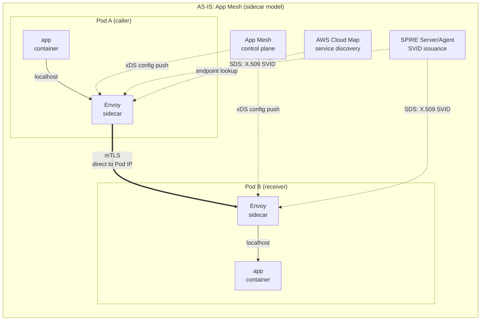
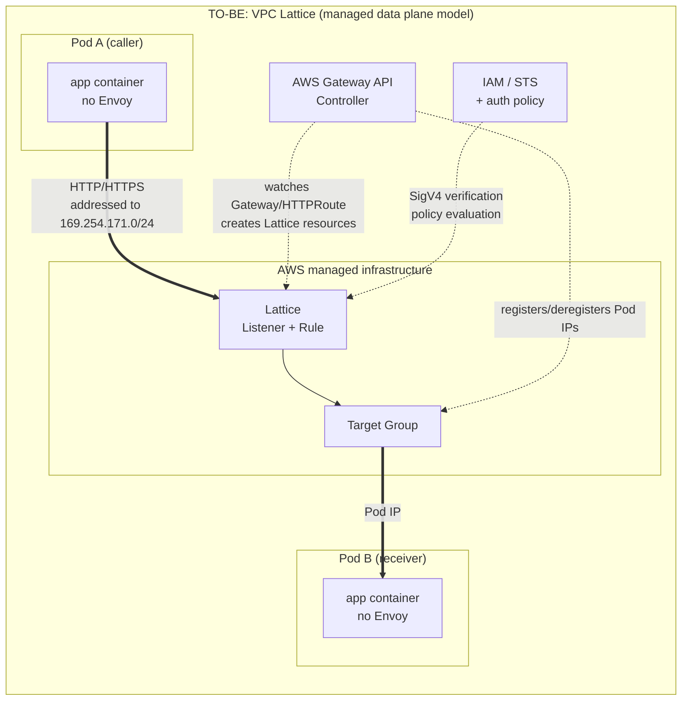

# App Mesh 与 VPC Lattice 架构

> **范围**：VPC Lattice 服务 / 资源 API 和 AWS Gateway API Controller；请核实所选发行版本及已安装的 CRD。
> **最后更新**：2026 年 10 月 16 日

## 本文涵盖内容

- 每种模型（sidecar 和托管数据平面）旨在解决什么问题
- App Mesh 资源如何映射到 Lattice 资源，以及为何两者并非一一对应
- 非一一对应带来的功能差异，以及 AWS Gateway API Controller 在其中发挥的作用

## 两种模型为何采用不同设计

### Sidecar 模型：在应用旁边放置代理

App Mesh 和 Istio 会在 Pod 内运行 Envoy，因为**有些决策需要应用的上下文**。

调用方侧的代理可以维护连接池、观测上游故障并应用配置的重试。具体控制能力取决于产品及其 API；Envoy 具备某种能力，并不代表 App Mesh 自动提供该功能。托管服务也可以维护状态，因此仅凭代理的位置，不能证明某个功能无法实现。

客户负责运维注入的 Envoy 工作负载，以及任何独立部署的 SPIRE 基础设施。**AWS 负责运维 App Mesh 控制平面（支持于 2026 年 9 月 30 日结束**）。代理升级和资源消耗仍属于客户的工作负载责任；不要把 App Mesh 描述成完全由客户自运维控制平面。

### 托管数据平面模型：将代理移入基础设施

Lattice 采用了另一种方式：它将代理从 Pod 中移出，并放入**由 AWS 运维的基础设施**。客户端 Pod 只发送普通 HTTP 请求，并不需要了解 Lattice；当请求发往 Lattice 服务时，由基础设施拦截并处理。

此设计解决的是规模和异构性问题。由于没有 sidecar，代理数量不会随着 Pod 数量增长；EKS、ECS、EC2 和 Lambda 也都可以**以相同方式**加入服务网络。不能将 Envoy 放入 Lambda 函数，但基础设施层的代理同样可以为 Lambda 服务。VPC 和账户边界（包括 IP 地址范围重叠）由基础设施处理。

移除 Envoy 会改变韧性和遥测功能的实现位置。应比较 **App Mesh 提供的能力与 Lattice 当前公开的 API**，然后确定哪些控制需要移到应用或其他代理中。不要仅根据概念拓扑推断 AWS 内部状态的存放位置或永久的功能限制。

## AS-IS / TO-BE 架构

有三项显著区别。

1. **经过代理的次数**：AS-IS 会经过**两个**代理：调用方 Envoy 和接收方 Envoy。TO-BE 只经过 **Lattice 一次**。
2. **谁拥有控制平面**：AS-IS 中，App Mesh 控制平面通过 xDS 向各 Envoy 下发配置，SPIRE 负责签发证书。TO-BE 中，这些职责转入 AWS 托管域；客户集群中只保留单个 Gateway API Controller Deployment。
3. **连接终止在哪里**：AS-IS 中，调用方 Envoy 会**直接连接到接收方 Pod IP**。TO-BE 中，它连接到 Lattice 地址，由 Lattice 管理 Pod IP 信息。

## 资源映射

| App Mesh | VPC Lattice | 对应关系 |
|---|---|---|
| **Mesh** | **Service Network** | 两者都是逻辑边界。App Mesh mesh 并非只能用于 Kubernetes；Lattice service network 会关联服务和 VPC，而资源连通性是单独的能力。 |
| **VirtualService** | **Lattice Service** | 逻辑服务名称。每个 Lattice Service 都有自己的 DNS 名称 |
| **VirtualRouter** + **Route** | **Listener** + **Listener Rule** | Listener 承接 VirtualRouter 按协议路由的职责；Listener Rule 承接 Route 的匹配 / 操作职责 |
| **VirtualNode** | **Target Group** | VirtualNode 将“此工作负载的身份 + 后端配置 + 侦听器配置”整合到一个资源中；Target Group 只表示**后端目标集合** |
| **AWS Cloud Map** | **不需要** | Lattice 内置服务发现，因此不再需要 Cloud Map namespace / service 管理 |
| **Envoy sidecar** | **移除** | 从 Pod 中移除；数据平面转移到 AWS 基础设施 |
| **VirtualGateway** | **Lattice Service + Listener**（或 ALB / NLB） | 南北向流量不在 Gateway API Controller 的范围内，属于 AWS Load Balancer Controller 的职责 |

### 为什么不能把此表理解为一一映射

**问题出在 VirtualNode 这一行**。App Mesh VirtualNode 同时表达了三件事：此工作负载是谁（身份，包括后端 TLS 设置）、它要连接到哪里（后端），以及它在哪里接收流量（侦听器、运行状况检查、连接池、异常目标检测）。在 Lattice 中，这三部分分散在不同位置。

- 只有**部分“在哪里接收”**（目标集合、运行状况检查）会映射为 Target Group。
- “**要连接到哪里**”不再是资源，而是**授权策略和 IAM 权限**问题。
- “**它是谁**”会成为 **IAM Role**，而不是 SVID（见[文档 05](./05-spiffe-to-iam.md)）。
- **连接池和异常目标检测**则**完全没有对应资源**。

也就是说，即使右侧列出了对应项，左侧资源包含的属性也不一定全部迁移过去。**此表映射的是资源名称，而非功能能力。**

## 功能差异

这些是**迁移检查项**，并不能证明托管数据平面永远无法实现某项功能。App Mesh、Istio 和原始 Envoy 提供的配置面各不相同；选择替代方案前，应先确认实际源产品使用了哪些功能。

| 能力 | 迁移检查 |
|---|---|
| 连接限制、重试和异常目标处理 | 清点实际源产品公开的控制项。Lattice 运行状况检查不能复现所有 Envoy 客户端侧策略；应验证应用韧性和重试预算。 |
| 故障注入和流量镜像 | 不要把所有 Envoy / Istio 能力都称为 App Mesh 功能。确有需要时，设计单独且经过审查的测试 / 镜像流量路径。 |
| 运行状况检查 | Target Group 运行状况检查会主动探测目标；它不是基于每个请求的被动异常目标检测。 |
| 客户端证书身份 | HTTPS 服务侦听器与 TLS passthrough 中端点间的 mTLS 是不同的信任边界。参见[网络基础](./04-networking-basics.md)。 |
| 指标和追踪 | 保留应用 OpenTelemetry span。Lattice access log 和 CloudWatch 指标会增加请求 / 目标耗时及关联信息，但不会提供原生 Lattice trace span。 |

### 实际如何看待这些差异

重要的迁移工作之一是**可观测性**：清点现有各组件提供的指标、访问日志和追踪上下文，并端到端验证替代路径。

断路器和重试有一个明显的替代方案（“在应用中添加库”），其成本也可以估算。可观测性似乎也有明确替代方案，但这是另一种工作。在 AS-IS 中，Envoy 可以自动生成 span，**不需要修改应用代码**。要在 TO-BE 中获得相同程度的追踪，就需要为每项服务添加 OpenTelemetry 埋点，这将成为应用团队的工作项。

客户端 span 通常会包围下游服务器 span，因此用接收方 span 的开始时间减去调用方 span 的结束时间，不能测出网络延迟。应将应用 span 与 Lattice 日志字段关联，例如 `requestId`、`duration`、`requestToTargetDuration` 和 `responseFromTargetDuration`；时钟偏差、埋点边界和网络时间都会限制因果归属。Lattice 会为 HTTP 关联添加 `x-amzn-requestid`；它不是 OpenTelemetry span。

## AWS Gateway API Controller 的作用

可以直接通过 CLI 或控制台创建 Lattice 资源，但在 EKS 上通常使用 **AWS Gateway API Controller**。它会监视集群中的 Kubernetes Gateway API 资源，并创建 / 删除对应的 Lattice 资源。

| Kubernetes 资源 | 创建的 Lattice 资源 |
|---|---|
| `GatewayClass`（`amazon-vpc-lattice`） | 无（声明 Lattice 为数据平面） |
| `Gateway` | 指向 **Service Network**。Gateway 名称（不含 namespace）与 Service Network 名称相对应；多个同名 Gateway 会指向同一个 Service Network |
| `HTTPRoute` / `GRPCRoute` | **Lattice Service** + **Listener Rule**。每个 Route 都**有自己的域名** |
| `TLSRoute` | TLS Passthrough 的 Lattice Service（见[文档 04](./04-networking-basics.md)） |
| `backendRefs` 引用的 Service | 该 Service 对应的 **Target Group** 及其中的 **Targets** |
| `TargetGroupPolicy` | Target Group 协议和运行状况检查设置 |
| `IAMAuthPolicy` | Service network auth policy 或 service auth policy，取决于附加目标（见[文档 03](./03-auth-flow.md)） |

### 为什么此 Controller 是弥合差异的关键

在 App Mesh 中，Cloud Map 和 Envoy 负责跟踪 Pod IP。在 Lattice 中，Controller 承担该职责。

Controller 会监视 `backendRefs` 所引用 Kubernetes Service 的**端点变化**。Deployment 扩容新增 Pod，或滚动更新改变 Pod IP 时，Controller 会检测变化，并在 Lattice Target Group 中**注册和注销** Targets。保持 Kubernetes 声明状态与 Lattice 实际目标列表同步，是此 Controller 的核心职责。

这会带来两个实际影响。

**第一，Controller 停止时，路由目标会过期**。Lattice 会继续转发流量，但新启动的 Pod 不会被注册为 Target，失效 Pod 也不会被注销。Controller Deployment 的可用性和 IAM 权限直接关系到数据路径的可靠性。

**第二，可以使用 Pod readiness gate**。可以让 Pod 在其 Lattice Target Group 健康状态变为 `Healthy` 之前一直保持未就绪，这样滚动更新就会**等到 Lattice 认为新 Pod 健康后才终止旧 Pod**。这是迁移期间实现零停机的重要机制。

### Controller 的范围限制

Gateway API 的设计目标同时包括南北向（Ingress）和东西向（Mesh）流量，但**AWS Gateway API Controller 目前只通过 Lattice 支持东西向流量**。不要期待它提供类似 ALB / NLB 的南北向功能；这属于 AWS Load Balancer Controller 的职责。

这对同时运行 ingress-nginx 的环境尤其重要。ingress-nginx 处理的南北向入口流量不在此次迁移范围内；只有东西向流量会转移到 Lattice。两条路径并存是常见的结果。

## 总结

- 应比较产品 API 和已配置能力；代理迁移会改变职责，但这并不能证明功能差异永远无法消除。
- 资源映射表只映射名称。VirtualNode 原本包含的属性要么分散到多个位置，要么不再存在。
- 最容易被低估的差异是可观测性。Envoy 自动提供的 span 会变成需要实施埋点的工作。
- AWS Gateway API Controller 会将 Kubernetes 端点变化反映到 Lattice Targets，其可用性关系到数据路径可靠性。

下一篇：[延迟影响分析](./02-latency.md)将分析代理跳数减少与额外 VPC 路径相互影响的情况。

## 参考资料

- [从 AWS App Mesh 迁移到 Amazon VPC Lattice（AWS Containers Blog）](https://aws.amazon.com/blogs/containers/migrating-from-aws-app-mesh-to-amazon-vpc-lattice/)
- [aws-samples/migrating-from-aws-app-mesh-to-amazon-vpc-lattice](https://github.com/aws-samples/migrating-from-aws-app-mesh-to-amazon-vpc-lattice)
- [AWS Gateway API Controller：理解 Gateway API Controller](https://www.gateway-api-controller.eks.aws.dev/latest/concepts/overview/)
- [AWS Gateway API Controller：Gateway API 参考](https://www.gateway-api-controller.eks.aws.dev/latest/api-types/gateway/)
- [Amazon VPC Lattice 用户指南](https://docs.aws.amazon.com/vpc-lattice/latest/ug/what-is-vpc-lattice.html)
- [App Mesh 文档历史](https://docs.aws.amazon.com/app-mesh/latest/userguide/doc-history.html)
