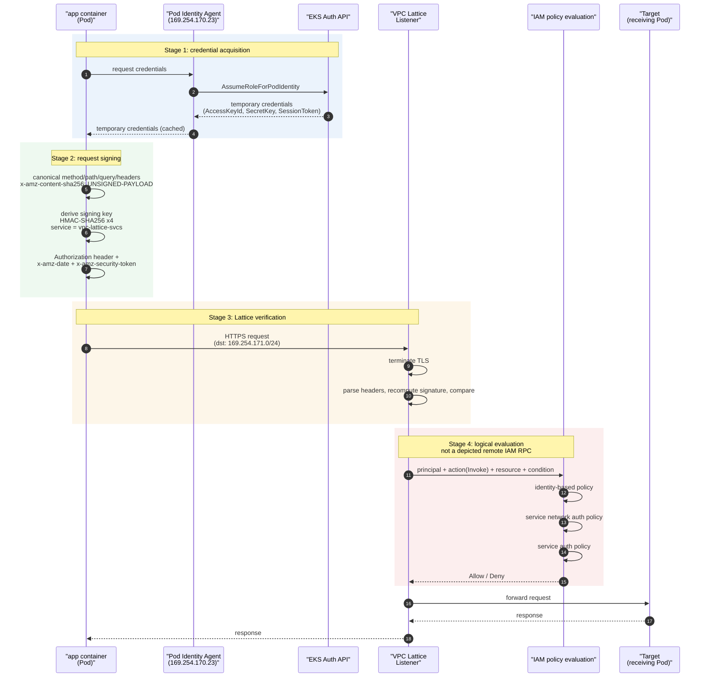
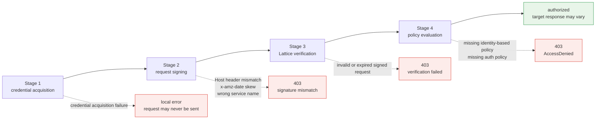

# IAM 身份验证流程详解

> **范围**：VPC Lattice 服务/资源 API 和 AWS Gateway API Controller；请核对所选版本及已安装的 CRD。
> **最后更新**：2026 年 9 月 13 日

## 本文涵盖内容

- Lattice IAM Auth 请求经过的四个阶段：获取凭证、请求签名、Lattice 验证、策略评估
- 根据证据区分凭证、签名、策略和网络故障；本文未对故障发生频率进行排序
- 从按连接执行的双向身份验证，转变为**按请求验证签名**意味着什么

## 为什么要对每个请求签名？

App Mesh 的 mTLS 会在连接建立时对双方的证书各检查**一次**，之后信任该连接。身份与连接绑定。

Lattice 选择了不同方式：**对每个请求签名，并验证每个请求**。理解这一点，后续限制就容易理解了。

IAM 请求签名是 AWS 计算客户端共享的一种有文档说明的身份机制。Lambda 也可以使用证书，只要适当地处理密钥和轮换，因此不要声称在那里无法使用客户端证书，也不要以此解释未公开说明的 AWS 设计决策。

因此，Lattice 选择复用“每个 AWS 计算平台都已有的身份系统”，而该系统以**API 请求**为单位运行，而不是以连接为单位。本文其他内容都由此决定。

## 四阶段流程



各阶段可能产生 403 的位置示意：



## 阶段 1：获取凭证

SigV4 签名需要访问密钥、秘密密钥和会话令牌。Pod 可以通过以下两种方式之一取得这些凭证。

### EKS Pod Identity 与 IRSA

| 项目 | EKS Pod Identity（推荐） | IRSA |
|---|---|---|
| **信任关系设置** | 由 EKS Auth API 中介；角色信任策略引用 `pods.eks.amazonaws.com` 服务主体 | 在 IAM 中为每个集群注册 OIDC 提供者，并将 OIDC 条件写入角色信任策略 |
| **每增加一个集群的工作量** | 角色可以重复使用 | 每个集群都要注册 OIDC 提供者并修改信任策略 |
| **凭证交付路径** | Pod Identity Agent（节点 DaemonSet）通过链路本地地址提供凭证 | 投射的 ServiceAccount 令牌 → SDK 调用 `AssumeRoleWithWebIdentity` |
| **绑定机制** | 通过 EKS API 管理 `ServiceAccount` ↔ 角色关联 | `ServiceAccount` 注解 `eks.amazonaws.com/role-arn` |
| **会话标签** | 可传递 Pod/集群上下文作为会话标签 → 可用于条件授权 | 有限支持 |
| **先决条件** | 已安装 Pod Identity Agent 插件 + 节点角色具有 `AssumeRoleForPodIdentity` | 已关联 OIDC 提供者 |

**实际选择 Pod Identity 的主要原因是便于多集群使用**。采用 Lattice 的一个主要动机就是跨集群通信，而 IRSA 要为每个集群注册 OIDC 提供者，并为所有集群管理角色信任策略。Pod Identity 不需要承担这项工作。

### 对 STS 临时凭证的依赖

两种方式最终都会取得 **STS 签发的临时凭证**。这是架构的一项重要属性。

- 凭证会**过期**。SDK 会缓存凭证并在过期前刷新，但刷新路径必须可用。
- 如果配置的凭证提供者无法刷新，签名可能会在本地失败；已经签名但过期的请求也可能被拒绝。IRSA 使用 STS；Pod Identity 则经由 Agent/EKS Auth 路径获取凭证。
- 换言之，**STS 成为东西向数据路径的一项依赖**。这与现状（AS-IS）中的 SPIRE Server 所处位置类似，但所有者从客户转为 AWS（参见文档 [05](./05-spiffe-to-iam.md) 和 [06](./06-constraints.md)）。

[文档 02](./02-latency.md)讨论过延迟影响：如果凭证刷新阻塞请求路径，它就会反映在 p99 长尾延迟中。

## 阶段 2：请求签名

### 规范请求 → 签名密钥 → Authorization 标头

SigV4 签名分为三个步骤。

**第一步，构造规范请求**。规范化方法、路径、查询参数和已签名标头。对 Lattice，应包含 **`x-amz-content-sha256: UNSIGNED-PAYLOAD`**；不支持对负载进行签名。使用 HTTPS 保护传输中的正文，并在需要时添加应用层完整性保护。

**第二步，派生签名密钥**。从秘密密钥开始，依次应用四次 HMAC-SHA256：日期 → 区域 → **服务名称** → 终止字符串。Lattice 的服务名称是 **`vpc-lattice-svcs`**。

服务名称本身是签名输入，因此**填错后签名将无法验证**。它很容易与 `vpc-lattice`（Lattice 控制平面 API 的服务名称）混淆，但数据平面请求必须使用 `vpc-lattice-svcs` 签名。这也与服务 DNS 名称格式一致：`<service>-<id>.<hash>.vpc-lattice-svcs.<region>.on.aws`。

**第三步，附加标头。**`Authorization` 标头包含算法、凭证范围、已签名标头列表（`SignedHeaders`）和签名值；`x-amz-date` 携带请求时间；使用临时凭证时，`x-amz-security-token` 携带会话令牌。

### 三个实际陷阱

#### ① Host 标头参与签名：使用自定义域名时要小心

在 SigV4 中，`Host` 标头**始终会纳入签名**。请求发往哪个主机也会绑定到签名中。

使用**自定义域名**时就会出现问题。如果将客户域名（`api.internal.example.com`）关联到 Lattice 服务，客户端会向该域名发送请求，因此签名中使用的 `Host` 是 `api.internal.example.com`。如果验证端预期的值与此不同，签名就不匹配。反过来，如果使用 Lattice 生成的域名签名，但实际请求的 Host 是自定义域名，也会不匹配。

**核心规则：签名时使用的 Host 值必须与实际请求的 Host 标头一致**。引入自定义域名时，应明确确认签名逻辑使用哪个值。问题会在**关联自定义域名时**出现，而不是迁移开始时，所以很容易漏掉。

#### ② x-amz-date 时钟偏差

AWS 通用 SigV4 指南指出，请求**在大多数情况下**必须在时间戳之后五分钟内到达。保持时钟同步，并检查实际过期/偏差错误；这不是 Lattice 特有、经过单独测量的保证。

因此，**节点时钟同步是身份验证的先决条件**。运行 Amazon Time Sync Service 的 EC2/EKS 节点通常不会有此问题，但以下情况可能造成问题：

- 节点或混合主机的时间同步配置错误
- 应用使用错误的时间戳或时区签名
- 主机恢复运行时出现时钟漂移

此故障具有**间歇性，且范围局限于节点**，因此难以排查。如果“只有某个节点上的 Pod 出现 403”，应先检查时钟同步。

#### ③ 中间代理修改标头：在最后一跳签名

由于签名与请求内容绑定，**如果签名后有任何组件修改了已签名的元素，验证就会失败**。

确实会导致此问题的情况包括：

- 代理更改已签名路径或实际 `Host` 值
- 代理添加/删除查询参数或更改参数值/编码；仅调整等效参数的顺序并不一定会改变规范查询字符串
- 使用必需的 `UNSIGNED-PAYLOAD` 时，Lattice SigV4 不会检测正文修改；应使用 TLS 和应用控制保护正文

**规则：在到达 Lattice 之前的最后一跳签名**。签名与 Lattice 之间不得放置会修改请求的层。

使用出口代理进行签名时，这一点尤其重要。aws-samples 参考实现展示了一种模式：监听 8080 端口的 `sigv4proxy` sidecar，以及使用 iptables 将**仅发往 `169.254.171.0/24`（Lattice 地址范围）的流量重定向到本地** 8080 端口的 init 容器。代理完成签名后，请求直接发往 Lattice，中间没有其他组件修改请求。避免先签名、随后又交给另一个代理处理的配置。

## 阶段 3：Lattice 验证

对于 HTTPS 监听器，Lattice 会**终止 TLS、解析标头**，重新计算 `Authorization` 标头中的签名并进行比较。

此架构中最重要的限制就藏在这里。

> **验证签名需要读取标头，而读取标头需要终止 TLS。**

**TLS Passthrough 不会终止 TLS，因此 Lattice 看不到 `Authorization` 标头**，也就无法验证调用方的 SigV4 请求签名。文档 [06](./06-constraints.md)讨论了这项限制。这并不禁止所有身份验证策略：TLS 监听器支持仅限匿名主体的策略，但此类策略不能建立经过身份验证的调用方身份。

Controller 文档列出了对 Gateway、HTTPRoute 和 GRPCRoute 的策略附件支持；请检查已安装的 CRD，确认支持哪些附件目标。**Controller 的此限制不代表所有 VPC Lattice TLS 身份验证策略都会被拒绝。**

::: tip 有文档说明的 TLS 行为
AWS 允许为 TLS Passthrough 使用基于**匿名主体**的身份验证策略，但不会提供经过身份验证的 SigV4 身份，也不会检查 HTTP 标头/路径。TLS 监听器要求自定义域名与明文 SNI 匹配，并使用 TCP 目标组；不支持 ECH/ESNI。本仓库不建议使用通配主体策略示例。请参阅 [TLS 监听器参考](https://docs.aws.amazon.com/vpc-lattice/latest/ug/tls-listeners.html)。
:::

经过身份验证的请求签名和匿名网络上下文授权是不同的控制措施。应明确设计端点身份验证以及适用的服务/服务网络策略。

另一个陷阱：**只有当 `authType` 为 `AWS_IAM` 时，身份验证策略才会生效**。设为 `NONE` 时，已附加的策略不起作用。这是“我附加了策略，但任何人仍可访问”最常见的原因。

## 阶段 4：策略评估

对于已经验证身份的主体，评估调用方权限和每个适用的 Lattice 资源策略。**只有配置为 `AWS_IAM` 的资源才会执行其身份验证策略；`NONE` 会跳过该资源策略。显式拒绝和其他** IAM 控制仍然适用。不要将三策略示意图当成适用于匿名请求或其他配置请求的通用规则。

| 策略 | 附加到 | 回答的问题 | 所有者 | Gateway API 资源 |
|---|---|---|---|---|
| **基于身份的策略** | 调用方的 IAM Role | “此 Role 是否有权执行 `vpc-lattice-svcs:Invoke`？” | 应用/平台团队 | 无（直接在 IAM 中配置） |
| **服务网络身份验证策略** | Service Network | “此主体是否获准进入此服务网络？”（粗粒度） | 网络/云管理员 | `IAMAuthPolicy` → `Gateway` |
| **服务身份验证策略** | Lattice Service | “此主体是否获准调用此服务？”（细粒度） | 服务所有者团队 | `IAMAuthPolicy` → `HTTPRoute`/`GRPCRoute` |

对于**服务调用身份验证策略**，操作为 `vpc-lattice-svcs:Invoke`。资源配置使用单独的访问模型，不会继承服务网络身份验证策略。

### 可用的条件键

以下键可以用作身份验证策略的条件。求值时实际有哪些键，取决于协议以及请求是否使用 SigV4 签名。

| 条件键 | 筛选依据 |
|---|---|
| `vpc-lattice-svcs:Port` | 请求所访问的服务端口 |
| `vpc-lattice-svcs:RequestMethod` | 请求方法 |
| `vpc-lattice-svcs:RequestPath` | 请求 URL 的路径部分 |
| `vpc-lattice-svcs:RequestHeader/<header-name>` | 请求中的标头名称和值 |
| `vpc-lattice-svcs:RequestQueryString/<key-name>` | 请求 URL 中的查询字符串键和值 |
| `vpc-lattice-svcs:ServiceArn` | 目标 Lattice 服务的 ARN |
| `vpc-lattice-svcs:ServiceNetworkArn` | 服务网络的 ARN |
| `vpc-lattice-svcs:SourceVpc` | 请求来源 VPC |
| `vpc-lattice-svcs:SourceVpcOwnerAccount` | 拥有源 VPC 的账户 |

也可以配合使用 `aws:PrincipalOrgID` 和 `aws:PrincipalTag/<key>` 等 IAM 全局条件键。

::: warning 需要核实
上面的列表根据[服务授权参考](https://docs.aws.amazon.com/service-authorization/latest/reference/list_vpc-lattice-svcs.html)和 Gateway API Controller 文档中的策略示例汇总。Lattice 会持续增加功能，因此**定稿设计前请确认该参考资料中的当前列表**。
:::

路径、方法和标头条件在实际中很有用：你可以在应用代码之外实施类似“只有这些 Role 可以对支付服务调用 `POST /refund`”的规则。不过，**将基于路径的授权放入身份验证策略，意味着 API 变更会触发策略变更**，因此应有意识地决定由哪一层表达授权。

### 最常见的 403 故障模式

缺少 `vpc-lattice-svcs:Invoke` 权限是**有文档记录的一种**经身份验证请求失败原因。本文没有事件频率数据集，因此不会将其排名为最常见原因。

它很常见，是因为这一点违反直觉。人们自然会以为“服务身份验证策略允许这个 Role，就搞定了”，但**调用方 Role 本身也需要 Invoke 权限**。仅有资源策略并不足以通过授权。

以下是参考实现中的实际错误消息：

```text
AccessDeniedException: User: arn:aws:sts::111122223333:assumed-role/eksctl-...-Role1-yz1hNJittmXj/1726632845600682009
is not authorized to perform: vpc-lattice-svcs:Invoke
on resource: arn:aws:vpc-lattice:us-west-2:111122223333:service/svc-0b13d4b53748cbdc7/catalogdetail
because no identity-based policy allows the vpc-lattice-svcs:Invoke action
```

最后一句 **`because no identity-based policy allows...`** 是诊断关键。消息会告诉你缺少哪种策略，因此遇到 403 时应先读错误消息。

### 403 排查顺序

| 顺序 | 检查内容 | 方法 |
|---|---|---|
| 1 | 错误消息的最后一句 | `no identity-based policy` → 检查调用方 Role 权限；否则 → 检查身份验证策略 |
| 2 | Lattice 访问日志和返回的错误 | 关联请求 ID、调用方日志、策略和网络证据 |
| 3 | 请求是否实际签名？ | 未签名请求与签名失败是不同问题。检查出口代理日志 |
| 4 | `authType` 是否为 `AWS_IAM`？ | 值为 `NONE` 时，策略不起作用 |
| 5 | 节点时钟 | 如果只有一个节点失败，应怀疑 `x-amz-date` 时钟偏差 |
| 6 | Host 标头 | 如果刚引入自定义域名，从这里开始排查 |

### 容易漏掉的陷阱：直接调用 k8s Service DNS 会绕过授权

AWS Gateway API Controller 文档明确指出：

> `IAMAuthPolicy` 只能对经过 **Gateways、HTTPRoutes 和 GRPCRoutes** 的流量执行授权。如果客户端直接向 k8s Service DNS 发送流量，授权不会生效。

直接调用 `http://proddetail.prodcatalog-ns.svc.cluster.local` **会绕过 Lattice 数据路径**，因此该请求不会经过其身份验证策略求值。这是设计边界，并非对事件原因频率的测量排名。

迁移窗口期间，现状路径（直接集群内调用）和目标路径（经由 Lattice）同时存在时，**授权有时生效、有时不生效的路径会并存**。你需要使用 NetworkPolicy 等补偿控制阻止集群内的直接调用，并将其纳入迁移计划。

## AS-IS 对比

| 项目 | AS-IS：App Mesh + SPIRE mTLS | TO-BE：Lattice IAM Auth |
|---|---|---|
| **身份验证范围** | **连接**（连接建立时验证一次） | **请求**（每个请求都验证） |
| **方向性** | **双向身份验证**（客户端和服务器都证明身份） | **单向**：客户端证明自身身份；服务器只通过 TLS 服务器证书证明自身身份 |
| **身份形式** | X.509 SVID 中的 SPIFFE ID（URI） | IAM Role ARN / assumed-role 会话 ARN |
| **证明方式** | 短期 X.509 证书（证明持有私钥） | SigV4 签名（证明持有秘密密钥） |
| **验证方** | 对端工作负载的 Envoy | Lattice（AWS 托管基础设施） |
| **信任根** | 客户运维的 SPIRE Server CA | AWS IAM / STS |
| **授权发生位置** | 接收端 Envoy 的授权过滤器 | Lattice 的三重策略评估 |
| **TLS 终止位置** | 接收 Pod 的 Envoy | Lattice（HTTPS 监听器） |
| **凭证过期时** | SPIRE Agent 自动续订 SVID | SDK 自动刷新 STS 凭证 |
| **可观测性** | Envoy 指标和日志 | Lattice 访问日志（无 spans） |

### 最重要的两行

“**方向性**”这一行是评审委员会问题的核心。mTLS 也要求服务器证明身份。使用 Lattice IAM Auth 时，服务器端身份仅由 TLS 服务器证书证明；工作负载身份系统中没有一个步骤能确认“这确实是由那个团队运维的服务”。详情参见[文档 05](./05-spiffe-to-iam.md)。

客户端到 Lattice 的 HTTPS 连接会在 Lattice 处终止。目标协议是单独的设置：该链路上的 HTTP 是明文，HTTPS 则增加加密，但 Lattice 不会验证目标端证书。通过 Passthrough 使用端点 TLS/mTLS 会改变信任边界，而且无法向 Lattice 暴露加密 HTTP 中的 SigV4 身份。

## 总结

- Lattice 选择请求签名，以复用 **EKS、ECS、EC2 和 Lambda 已共享的 IAM/STS 基础**。该系统以请求而不是连接为单位运行。
- 签名使用的服务名称是 **`vpc-lattice-svcs`**；它是签名输入之一，填错后就会验证失败。
- 三个实际陷阱：**Host 标头参与签名**（自定义域名要小心）、**x-amz-date 有五分钟时钟偏差窗口**（同步节点时钟），以及**在最后一跳签名**（中间不得有会修改请求的代理）。
- TLS Passthrough 无法验证加密 HTTP 中的 SigV4 标头，但 AWS 支持该路径上的匿名网络上下文身份验证策略。
- 缺少 Invoke 权限是 403 的一种可能原因；应依据返回原因和关联日志排查，不要根据没有证据支持的频率排名推断。
- **直接调用 k8s Service DNS 会绕过身份验证策略求值**。迁移期间需要补偿控制。

下一步：[基础知识：链路本地地址与 SNI](./04-networking-basics.md)将深入一层，解释“为什么必须终止 TLS 才能读取标头”。

## 参考资料

- [使用身份验证策略控制对 VPC Lattice 服务的访问](https://docs.aws.amazon.com/vpc-lattice/latest/ug/auth-policies.html)
- [Amazon VPC Lattice Services 的操作、资源和条件键](https://docs.aws.amazon.com/service-authorization/latest/reference/list_vpc-lattice-svcs.html)
- [AWS Gateway API Controller：IAMAuthPolicy API 参考](https://www.gateway-api-controller.eks.aws.dev/latest/api-types/iam-auth-policy/)
- [aws-samples：保护网络并实施 AWS IAM 身份验证](https://github.com/aws-samples/migrating-from-aws-app-mesh-to-amazon-vpc-lattice/blob/main/vpc-lattice-config/IAMAUTH.md)
- [使用 Amazon VPC Lattice 和 Amazon EKS 实施 AWS IAM 身份验证](https://aws.amazon.com/blogs/containers/implement-aws-iam-authentication-with-amazon-vpc-lattice-and-amazon-eks/)
- [EKS Pod Identity](https://docs.aws.amazon.com/eks/latest/userguide/pod-identities.html) / [IAM Roles for Service Accounts](https://docs.aws.amazon.com/eks/latest/userguide/iam-roles-for-service-accounts.html)
- [签署 AWS API 请求（SigV4）](https://docs.aws.amazon.com/IAM/latest/UserGuide/reference_sigv.html)

- [Lattice SigV4 身份验证请求](https://docs.aws.amazon.com/vpc-lattice/latest/ug/sigv4-authenticated-requests.html)：必需的 unsigned payload 标头和有效时间窗口
