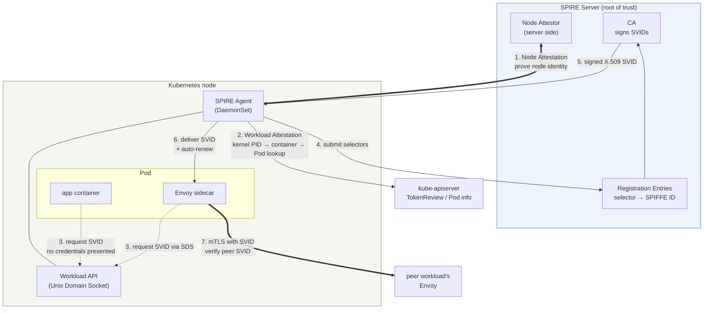

# 工作负载身份迁移：从 SPIFFE 到 IAM

> **范围**：VPC Lattice 服务/资源 API 和 AWS Gateway API Controller；请核对所选版本及已安装的 CRD。
> **最后更新**：2026 年 9 月 13 日

## 本文涵盖内容

- SPIFFE/SPIRE 如何解决工作负载身份问题，尤其是证明机制如何解决引导难题
- SPIFFE 双向 TLS 与 Lattice IAM Auth 之间的相似之处（短期凭证加平台证明），以及**两个决定性的差异**
- 为什么这些差异会成为金融行业安全评审的核心问题

## 起始问题：工作负载如何证明自己的身份？

服务 A 调用服务 B 时，B 需要知道“这个请求确实来自 A 吗？”之所以难以解决，是因为**首先要考虑如何向工作负载交付用于证明身份的机密**。

要向工作负载交付机密（例如证书或 API 密钥），你必须先确认它确实是该工作负载；而要确认这一点，又需要机密。这就是**引导难题**，传统的权宜做法只是把问题转移到别处。

| 权宜做法 | 问题转移到何处 |
|---|---|
| 将证书烘焙进镜像 | 镜像泄漏就等于身份泄漏；续订需要重新构建镜像 |
| 作为 Secret 挂载 | 任何能读取该 Secret 的人都可以伪造对应身份 |
| 在部署时注入 | CI/CD 系统掌握了所有身份的主密钥 |

SPIFFE/SPIRE 和 Lattice IAM Auth **都通过让平台为工作负载背书来解决此问题**。这就是两者结构非常相似的原因。正因为相似，评审的重点才会放在**两者具体有哪些差异**上。

## SPIFFE 的三个组成部分

SPIFFE（Secure Production Identity Framework For Everyone）是工作负载身份的**标准**：它是一份规范，而不是一种实现。

### ① SPIFFE ID：身份名称

使用 URI 标识一个工作负载。

```text
spiffe://<trust-domain>/<workload-path>

e.g.: spiffe://finance.example.com/ns/prodcatalog/sa/prodcatalog-sa
```

`trust-domain` 是**信任边界的名称**。同一信任域中的工作负载共享共同的信任根（同一个 CA）。路径部分由组织自行设计；在 Kubernetes 环境中，通常体现命名空间和 ServiceAccount。

值得注意的是，名称中**不包含任何网络信息**：没有 IP、主机名或端口。这是有意的设计：工作负载无论调度到哪里、IP 如何变化，身份都保持不变。[文档 04](./04-networking-basics.md)中提到的“从基于 IP 的控制转向基于身份的控制”由此开始。

### ② SVID：证明身份的凭证

**SPIFFE 可验证身份文档（SPIFFE Verifiable Identity Document）**。它以两种形式之一，在可验证文档中携带 SPIFFE ID。

| 形式 | 内容 | 主要用途 |
|---|---|---|
| **X.509-SVID** | 含有 SAN URI 格式 SPIFFE ID 的 X.509 证书及私钥 | mTLS 双向身份验证 |
| **JWT-SVID** | 在 `sub` 声明中包含 SPIFFE ID 的 JWT | 在 HTTP 标头中传递身份、执行 L7 授权 |

**其关键特性是有效期较短**。SVID 通常签发后有效几十分钟到几小时，并会自动续订。短有效期很重要，因为它能**绕开吊销难题**。CRL 和 OCSP 在运维上较为棘手；如果凭证很快就会过期，即使没有任何吊销机制，凭证泄漏可被利用的时间也会受到限制。

### ③ Workload API：身份交付通道

工作负载通过此接口获取 SVID。最关键的是，**该接口通过 Unix 域套接字（UDS）暴露**。

UDS 是这种设计的核心：**工作负载连接套接字时不需要出示任何凭证**。相反，内核会可靠地提供对端进程的信息（PID、UID、GID），SPIRE Agent 会据此**直接调查**对端的身份。

换句话说，这不是“出示机密以证明身份”，而是“由平台观察并判定身份”。引导难题正是在这里得到解决。

## SPIRE 组件

SPIRE 是 SPIFFE 的参考实现。



| 组件 | 作用 |
|---|---|
| **SPIRE Server** | **信任根**。持有 CA 并签发 SVID。管理 Registration Entry，指定哪些选择器会获得哪些 SPIFFE ID |
| **SPIRE Agent**（DaemonSet） | 在每个节点上运行。向 Server 证明节点自身身份，再调查该节点上的工作负载，并代表它们获取、交付和续订 SVID |
| **Attestation** | 身份判定流程，分为 Node Attestation 和 Workload Attestation 两个阶段 |
| **Envoy SDS 集成** | Envoy 通过 **Secret Discovery Service** 协议从 Agent 接收证书；应用代码无需了解 mTLS |

### 证明如何解决引导难题

这是 SPIRE 的核心，也是与 IAM 进行比较时的参照点。

**Node Attestation**：Agent 向 Server 证明“我是这个节点”。使用的证据**不是预先植入的机密，而是平台签发的证明**。在 AWS 上，证据可以是 EC2 实例签名后的 IMDS 文档或实例身份文档。Server 可以向 AWS 验证该证据，因此不需要在节点上预先放置共享机密。

**Workload Attestation**：Agent 会调查节点上的工作负载：

1. 工作负载在**没有凭证**的情况下连接 UDS
2. Agent 从内核获取对端进程 PID（**不可伪造**）；这是内核报告的事实
3. Agent 根据 PID 读取 cgroup，以确定这是哪个容器
4. Agent 查询 kubelet/kube-apiserver，确认该容器对应的 Pod、命名空间、ServiceAccount 和标签
5. Agent 将这些属性组合为**选择器**并提交给 Server
6. Server 在 Registration Entry 中查找匹配的 SPIFFE ID 并签发 SVID

**第 2 步正是引导难题消解之处**。工作负载不必声称自己是谁；它无须这样做。内核报告一个事实，再由平台（Kubernetes）的记录交叉验证。**要伪造该事实，就必须攻陷内核或 Kubernetes API server；一旦达到这种攻陷程度，其他一切都已经沦陷。**

一句话概括：**身份不是由工作负载出示的，而是由平台观察并判定的。**

## 与 IAM Auth 比较

Lattice IAM Auth 的流程见[文档 03](./03-auth-flow.md)。逐项比较如下：

| 项目 | SPIFFE/SPIRE（现状） | Lattice IAM Auth（目标状态） |
|---|---|---|
| **身份名称** | SPIFFE ID（`spiffe://<trust-domain>/ns/<ns>/sa/<sa>`） | IAM Role ARN / 假定角色会话 ARN |
| **凭证形式** | X.509-SVID 或 JWT-SVID | STS 临时凭证（Access Key ID + Secret Access Key + 会话令牌） |
| **证明方式** | 证明持有证书私钥（TLS 握手） | SigV4 请求签名（证明持有秘密访问密钥） |
| **证明范围** | **连接**（建立时一次） | **请求**（每个请求都验证） |
| **由谁进行证明** | SPIRE Agent（节点）+ SPIRE Server | EKS Pod Identity Agent + EKS Auth API |
| **证明证据** | 内核 PID → cgroup → Pod/ServiceAccount 查询 | `ServiceAccount` ↔ Role 关联（EKS Auth API）或 OIDC 令牌（IRSA） |
| **验证方式** | 对端 Envoy 根据信任包验证 SVID 证书链 | Lattice 重新计算/比较签名，然后评估三项策略 |
| **信任根** | **由客户运行的 SPIRE Server CA** | **AWS IAM / STS** |
| **凭证有效期** | 几十分钟到几小时，自动续订 | STS 临时凭证，自动刷新 |
| **授权表达方式** | 基于 SPIFFE ID 的 Envoy 授权过滤器 | 三项 IAM 策略（基于身份 + 服务网络 + 服务） |
| **可观测性** | Envoy 指标/日志（按 SPIFFE ID） | Lattice 访问日志（按主体，不包含 spans） |
| **运维负担** | **高**：SPIRE Server 高可用、CA 密钥管理、CA 轮换、Registration Entry 管理、Agent 部署/升级、信任包分发 | **低**：Pod Identity Agent 附加组件和 ServiceAccount↔Role 关联。无 CA 或密钥管理 |
| **多集群** | 需要设计信任域和联合关系 | 通过 Pod Identity 重用角色，每个集群的单独配置较少 |
| **AWS 之外的工作负载** | 配置合适的 SPIRE attestor 后可以支持 | 需要合适的 IAM 凭证提供程序及受支持的 Lattice 连接方式；IAM 本身并不禁止此场景 |

## 相似点：为什么可以迁移

对比表看起来像在比较完全不同的系统，但**从结构上看它们采用相同模式**。这正是迁移过程能够保持逻辑一致的原因。

### ① 两者都使用短期凭证

SVID 和 STS 临时凭证的有效期都较短，并会自动续订。两者采用这种设计的原因相同：**在没有吊销机制的情况下，限制凭证泄漏后可被利用的时间**。

两种方式都可以避免分发长期有效的应用机密，但评审仍须覆盖凭证有效期、续订、泄漏响应和授权。有效期较短不能免除吊销或紧急拒绝访问的要求。

### ② 两者都基于平台证明

工作负载不会事先持有机密；由平台为它背书。

| 阶段 | SPIRE | EKS Pod Identity |
|---|---|---|
| 节点身份 | Node Attestation（EC2 身份文档等） | 节点 Role 的 `AssumeRoleForPodIdentity` 权限 |
| 工作负载判定 | 内核 PID → cgroup → Pod/SA | Pod 的 ServiceAccount ↔ Role 关联 |
| 凭证交付 | Workload API（UDS） | Pod Identity Agent（链路本地地址） |
| 凭证续订 | Agent 续订 SVID | SDK 刷新凭证 |

两种方式都使用平台证据，但选择器、令牌验证、凭证暴露方式和信任边界各不相同。请验证实际的 attestor 或凭证提供程序，不要直接宣称两种模型等同。

**未预置长期有效的机密，不代表运行时不使用机密**。交付 X.509-SVID 时会包含私钥材料；临时 IAM 凭证也包含秘密访问密钥/会话令牌。应保护 Agent 套接字/端点、内存、日志和凭证缓存；证明机制的强度取决于其配置的信任假设。

## 两个决定性差异

既然两者有很多相似之处，评审时真正会讨论的是**它们在哪些方面不同**。以下两项属于结构性差异，不能仅靠运维便利性来消除。

### 差异（a）：双向相互身份验证，变为单向 TLS 身份验证加请求身份验证

**现状是双向验证。**

在 mTLS 握手中，客户端和服务器都会验证**彼此的** SVID。客户端根据 SPIFFE ID 确认“我连接的对端确实是 payments 服务吗”，服务器则确认“连接到我的对端确实是 orders 服务吗”。双方都在工作负载身份系统内证明自己。

**目标状态是不对称的。**

| 方向 | 现状 | 目标状态 |
|---|---|---|
| 客户端 → 服务器（客户端证明身份） | SVID 双向身份验证 | **SigV4 请求签名**（每个请求一次，粒度更细） |
| 服务器 → 客户端（服务器证明身份） | SVID 双向身份验证 | **TLS 服务器证书**（普通 TLS 层级） |

SigV4 会验证每个请求中签名覆盖的字段，而 mTLS 会验证 TLS 对端；两种设计都可以另行执行请求级授权。任何一种都不能在所有情况下被称为更强。Lattice 要求 `UNSIGNED-PAYLOAD`，因此应通过 TLS 保护载荷，并明确考虑重放和凭证盗窃风险。

**问题在于服务器身份的证明**。客户端只能确认“该 TLS 证书有效，且域名匹配”。**在工作负载身份系统中，没有任何步骤可以确认“这确实是由那个团队运营的服务”。**

评审时实际会提出的问题是：

> 对 DNS、证书、服务关联或目标注册的未授权更改，是否可能重定向此工作负载的流量？应与端点身份验证一起审查这些控制平面权限。仅有相同的显示名称，并不会将现有自动生成的服务 DNS 身份转移到另一服务。

坦诚的回答是：“**不能在工作负载身份系统内部解决；必须通过 IAM 控制服务网络和 Lattice 资源来预防**。”换句话说，**防线从工作负载之间的相互身份验证转移到对资源创建权限的控制**。

这并不是一个糟糕的答案。通过 IAM 严格限制谁能创建 Lattice Service、控制服务网络关联，并使用 CloudTrail 监控资源创建，可以管理实际风险。但**如果评审文档写的是“相互身份验证”，就必须重写该项，并在另一个控制层说明依据**。迁移后期才发现这个问题，会严重拖延计划。

### 差异（b）：信任根的所有权

**这对金融行业的评审影响更大。**

| 项目 | 现状 | 目标状态 |
|---|---|---|
| **信任根** | 客户运营的 SPIRE Server CA | AWS IAM / STS |
| **CA 私钥所有权** | 客户或配置的上游 CA | 客户不管理 Lattice CA；但 IAM 临时秘密凭证仍然存在 |
| **由谁签发身份** | 客户自有 CA 根据客户定义的 Registration Entry 签发 | AWS STS |
| **由谁决定签发规则** | 完全由客户控制 | 客户通过 IAM 控制；AWS 执行 |
| **审计记录** | SPIRE Server 日志（由客户持有） | CloudTrail（AWS 服务） |
| **由谁决定 CA 轮换** | 客户 | （不适用） |
| **能否在 AWS 之外工作** | 取决于 attestor 和连接情况 | 配置适当的凭证提供程序并使用受支持的私有连接后可以；Pod Identity 不会自动提供此能力 |
| **运维负担** | 由客户承担 | 由 AWS 承担 |

这种权衡十分明确：**你将信任根的所有权交给 AWS，以换取 AWS 承担运维负担。**

由于监管和评审惯例，这一项在金融行业尤其重要。许多组织的安全标准明确规定“**身份验证系统的信任根必须由我们自己控制**”，或包含可被如此解读的条款。自行运行 CA 曾是最直接的合规方式；采用 SPIRE 很可能正是通过了这项评审的结果。

迁移到 Lattice IAM Auth 意味着必须重新构建合规论证。可采用的依据包括：

| 论据 | 内容 |
|---|---|
| **共同责任模型** | IAM/STS 是 AWS 已根据多个认证监管框架运营的控制措施 |
| **保留策略权限** | 谁能调用什么，仍由客户通过 IAM 策略完整定义 |
| **确保审计记录** | CloudTrail 提供凭证签发和 API 调用历史；Lattice 访问日志提供数据路径历史 |
| **减少 CA 运维** | AWS 负责其服务 PKI，但客户仍须保护临时凭证、角色、令牌和端点密钥 |
| **保留有效期和证明能力** | 仍满足前述两项相似点 |

**但这只能论证“控制方式不同”，不能论证“二者等同**”。评审方是否接受前者取决于组织标准，这不是技术能够解决的问题。

### 作为金融行业评审事项的立场

总结相关评审问题：

| 项目 | 评审状态 | 依据 |
|---|---|---|
| 避免将长期有效机密烘焙进镜像 | 验证配置 | 两者都能使用自动续订的短期凭证 |
| 运行时机密暴露 | 需要评审 | 仍须保护短期私钥/令牌 |
| 按请求授权 | 比较已配置的策略 | mTLS 身份也能用于请求级授权；SigV4 并非唯一方式 |
| 客户端身份验证 | 机制发生变化 | TLS 对端证明与请求签名的覆盖范围和威胁假设不同 |
| **服务器身份验证** | ⚠️ **减弱：需要补偿性控制** | 从工作负载身份系统下沉到 TLS 服务器证书层；防线转移到通过 IAM 控制资源创建 |
| **信任根所有权** | ⚠️ **转移：需要重写论证** | 客户 CA → AWS IAM/STS |
| 端到端加密 | 选择信任边界 | HTTPS 在 Lattice 终止；Passthrough 保留端点 TLS，但无法提供已验证的 HTTP SigV4 身份 |
| 可观测性（追踪） | ⚠️ **减弱** | Envoy spans 会消失；需要应用程序埋点（参见[文档 01](./01-appmesh-vs-lattice.md)） |
| AWS 之外的工作负载 | 单独设计 | 评估凭证和受支持的网络访问，不要假设一定不可能 |

与负责的安全团队一起审查信任边界和运维边界的变化。端点 mTLS、Lattice 已身份验证的 HTTP 和基于匿名网络上下文的策略提供不同控制；应根据实际要求选择，不要声称某种配置能满足所有组织的评审标准。

### 保留 SPIRE 的选项

迁移并不一定意味着停用 SPIRE。

- 对于 AWS 之外的工作负载，SPIRE 可能仍有价值；也可以评估其他凭证/身份方案。
- **如果选择 TLS Passthrough 配置**，端点必须自行执行 mTLS，SPIRE 可以继续为其提供证书。
- 这会形成 **App Mesh 已移除但 SPIRE 仍保留**的架构；应对 App Mesh 结束支持和保留 SPIRE 是两个不同的决定。

如果迁移目标之一是免去 SPIRE 的运维负担，请先确认上述情况是否会与该目标冲突。

## 总结

- SPIFFE 的三个组成部分是 **SPIFFE ID**（URI 格式的名称）、**SVID**（短期 X.509/JWT 凭证）和 **Workload API**（通过 UDS 提供）。
- SPIRE 通过证明解决引导难题，因为**身份不是由工作负载出示，而是由平台观察并判定**。内核报告的 PID 无法伪造。
- 两者都可以使用短期凭证和平台证据；运行时机密和策略差异仍需评审。
- 两个决定性差异是：**（a）双向相互身份验证变为单向 TLS 身份验证加请求身份验证，导致服务器身份验证减弱；（b）信任根从客户 CA 转移到 AWS IAM/STS。**
- 技术无法解决这两项问题，都需要组织层面的判断。**开始之前应先与安全评审人员讨论，因为结论会改变架构。**

下一篇：[约束与决策点](./06-constraints.md)将汇总完成设计前必须确定的事项。

## 参考资料

- [SPIFFE 文档](https://spiffe.io/docs/latest/spiffe-about/overview/)
- [SPIFFE ID 规范](https://github.com/spiffe/spiffe/blob/main/standards/SPIFFE-ID.md) / [X.509-SVID 规范](https://github.com/spiffe/spiffe/blob/main/standards/X509-SVID.md)
- [SPIRE 概念：Attestation](https://spiffe.io/docs/latest/spire-about/spire-concepts/)
- [EKS Pod Identity](https://docs.aws.amazon.com/eks/latest/userguide/pod-identities.html)
- [使用 VPC Lattice 和 Pod Identity IAM Session Tags 在 EKS 中安全地进行跨集群通信](https://aws.amazon.com/blogs/containers/secure-cross-cluster-communication-in-eks-with-vpc-lattice-and-pod-identity-iam-session-tags/)
- [Istio 安全：mTLS](../istio/security/01-mtls.md)：基于 Sidecar 的双向身份验证如何工作
