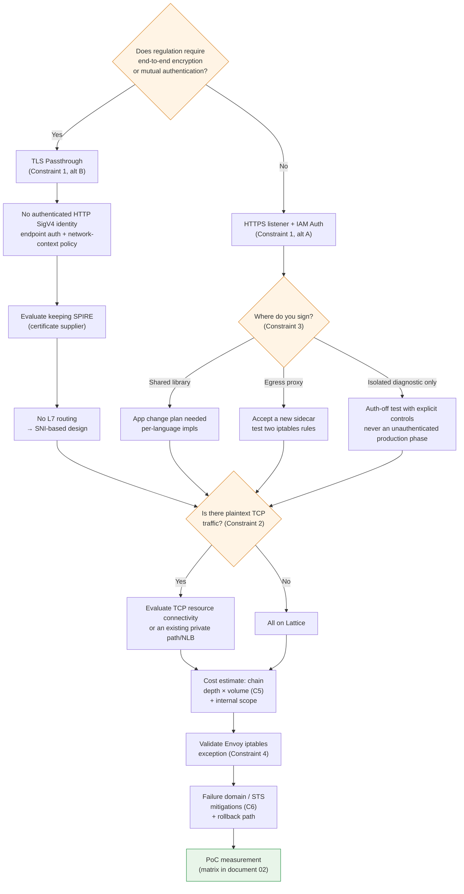

# 约束与决策要点

> **范围**：VPC Lattice 服务/资源 API 和 AWS Gateway API Controller；请核对所选版本及已安装的 CRD。
> **最后更新**：2026 年 10 月 16 日

## 本文涵盖内容

- 定稿设计前必须回答的六项约束，以及每项约束对应的选项
- 这些约束共同形成的决策树：一个选择如何排除其他选择
- 迁移前检查表

## 约束摘要

| # | 约束 | 性质 | 是否有替代方案 | 决策时机 |
|---|---|---|---|---|
| 1 | TLS Passthrough 无法验证经过身份认证的 HTTP SigV4 身份 | 当前有文档说明的服务行为 | 端点身份验证；匿名网络上下文策略 | 最先 |
| 2 | 原始 TCP 不是服务监听器 | 区分 TCP 资源连接方式 | 资源网关或现有私有路径/NLB | 前期 |
| 3 | SigV4 签名对应用的影响 | 实施选择 | 三种方案 | 前期 |
| 4 | Mesh 共存期间的路由/签名验证 | 取决于配置 | 明确绕过或配置转发 | 迁移前 |
| 5 | 每跳请求和数据费用 | 结构性 | 调整架构 | 设计期间 |
| 6 | 故障域集中 + STS 依赖 | 结构性 | 只能缓解 | 设计期间 |

约束 1 和 2 是**当前能力与信任边界方面的选择**，并不是预测 AWS 永远不会增加功能。应区分服务监听器、资源连接和 Controller 支持范围。

## 约束 1：TLS Passthrough 与经过身份验证的 HTTP 身份

### 原则

文档 [03](./03-auth-flow.md) 和 [04](./04-networking-basics.md) 中的两个事实共同形成这项约束：

1. SigV4 验证必须读取 `Authorization` 标头。
2. 读取标头需要终止 TLS。

按定义，TLS Passthrough 不会终止 TLS。因此，**Lattice 看不到签名标头，也无法执行基于请求签名的身份验证**。

Controller 策略附件支持范围与 AWS 服务能力是两回事。TLSRoute 不在已文档说明的 IAMAuthPolicy 附件目标中；但 AWS TLS 监听器支持基于匿名主体和网络上下文的策略。

::: note 已确认的限制
TLS Passthrough 无法评估加密的 HTTP SigV4 身份，也无法检查 HTTP 路径/标头条件。匿名主体策略受到支持；请参阅 [TLS 监听器参考](https://docs.aws.amazon.com/vpc-lattice/latest/ug/tls-listeners.html)，不要臆测所有策略都会被拒绝或忽略。
:::

### 两种替代方案

| 方案 | 配置 | 可获得的能力 | 失去的能力 |
|---|---|---|---|
| **A. HTTPS 监听器 + IAM Auth** | Lattice 终止 TLS、验证 SigV4 并评估三种策略 | 基于 IAM 的授权、路径/方法/标头条件、L7 路由、详细访问日志 | 端到端加密（在 Lattice 终止一次）、端点自身的 mTLS |
| **B. TLS Passthrough + 端点 mTLS** | 自定义域名 SNI 选择服务；端点执行 TLS 身份验证 | 端点加密和证书身份 | 没有经过身份验证的 HTTP SigV4 身份或 HTTP L7 检查；匿名网络上下文策略是另一种控制 |

### 如何选择

**这是迁移中最重要的分支点**。其他大多数决策都取决于它。

判断标准是：**法规是否要求端到端加密或工作负载间相互身份验证。**

- **如果不要求，选择 A**。IAM Auth 在授权粒度和可观测性方面有明显优势，这也是 Lattice 的设计使用方式。
- **如果要求，选择 B**。但选择 B 就意味着必须重新设计授权的表达位置。Lattice 只能看到 SNI，因此授权必须在应用中执行，或由端点进行 mTLS 证书验证。并且如[文档 05](./05-spiffe-to-iam.md)所述，**SPIRE 可能仍然不可或缺**。

也可以混合使用。**可以按服务分别选择 A 或 B**：受法规约束的服务使用 B，其他服务使用 A。代价是需要同时运维两套授权模型。

## 约束 2：选择 Service 或 Resource 连接方式

### 原则

没有原始 TCP 服务监听器，并不代表不能使用 TCP 资源：Lattice 资源配置/资源网关提供了另一种访问模型。对于服务 TLS Passthrough，客户端必须先发起 TLS，并发送所配置的自定义域名 SNI。

应检查协议要求和当前 Controller 支持范围，不要把它当成整个产品永久存在的限制。

### 确定受影响的流量

规划早期就要**找出所有使用明文 TCP 的东西向通信**。常见情况包括：

梳理明文数据库、缓存和自定义 TCP 协议。不要把基于 HTTP/2 的 gRPC（h2c）也归入同一不支持类别；应针对其确切的 HTTP 监听器/路由/目标配置进行验证。

### 替代方案：混合配置

| 流量类型 | 路径 |
|---|---|
| HTTP / HTTPS / gRPC | **VPC Lattice** |
| 使用 TLS 的 TCP | Lattice **TLS Passthrough**（前提是 SNI 路由可行） |
| 明文 TCP | 评估 Lattice TCP 资源连接、现有私有连接或 NLB；服务 L7 功能不会自动延续到这些路径 |

推荐此方案的原因很简单：**试图把所有流量都迁到 Lattice，是造成迁移延误的最常见原因**。如果把“为明文 TCP 服务引入 TLS”也纳入迁移范围，就需要修改应用，进度也会脱离你的掌控。

App Mesh 也支持 TCP 路由。请盘点**所有实际依赖 App Mesh 的流量**，而不只是 HTTP，并逐一替换。App Mesh 支持已于 2026 年 9 月 30 日结束。

## 约束 3：SigV4 签名对应用的影响

如果选择 IAM Auth（约束 1 的方案 A），**就必须有人为请求添加签名**。由谁负责，是对应用团队影响最直接的选择。

| 方案 | 实施方式 | 优点 | 缺点 |
|---|---|---|---|
| **① 共享库** | 在每个服务的 HTTP 客户端中使用 AWS SDK 签名或按语言选用的库实现 SigV4 | 不增加跳点 → 延迟最低；凭证管理交由 SDK | **每个服务都要改代码**；按语言分别实现；需要管理签名逻辑版本 |
| **② 出口代理 sidecar** | 使用 `sigv4proxy` sidecar 和 iptables，只重定向 Lattice 地址范围 | **不需要修改应用代码**；与语言无关；已有参考实现 | sidecar 再次出现（部分抵消移除 Envoy 的收益）；增加一个跳点；需要运维/升级 sidecar |
| **③ 不使用 IAM Auth** | `authType` 设为 `NONE`；在其他层授权 | 不需要改应用，没有额外开销 | **Lattice 层没有授权**；服务网络中的任何人都可以调用，难以通过审核 |

### 实际建议

**如果语言种类多或应用团队人力有限，可以从方案 ② 开始**。aws-samples 参考实现提供了经过验证的清单：监听 8080 的 `sigv4proxy` sidecar，以及只将发往 `169.254.171.0/24` 的流量重定向到代理的 init 容器。

方案 ② 的讽刺之处显而易见：**迁移是为了移除 Envoy sidecar，结果又引入了签名 sidecar**。不过，`sigv4proxy` 比 Envoy 轻得多，没有 xDS 控制平面，且使用静态配置。如果“消除 sidecar”才是核心目标，就需要采用方案 ①，并据此制定应用改造计划。

关闭身份验证的对比，只能在隔离且明确批准的测试路径上进行，并且不得承载业务流量，还必须有补偿性的网络/应用控制。不要仅为简化迁移或基准测试而禁用生产环境授权。

**无论采用哪种方案，都要检查[文档 03](./03-auth-flow.md)中的三个陷阱：Host 标头、x-amz-date 时钟，以及在最后一跳签名。**

## 约束 4：共存期间 Envoy iptables 的例外规则

在选择排除规则或明确配置代理路径前，先验证已安装的 Mesh 策略和实际转发行为。并非每种 Envoy 配置都会拒绝未知目标。

Mesh iptables 规则可能会拦截发往 Lattice 的流量。它是转发、失败还是修改已签名字段，取决于出站策略和路由配置。检查实际规则和日志，然后验证所选 IPv4/IPv6 签名路径。

| 项目 | 值 |
|---|---|
| 需排除的范围（IPv4） | `169.254.171.0/24` |
| 需排除的范围（IPv6） | `fd00:ec2:80::/64` |
| App Mesh 设置位置 | init 容器的 egress-ignore CIDR 列表 |
| Istio 设置位置 | `traffic.sidecar.istio.io/excludeOutboundIPRanges` 注解 |

### 容易漏掉的事项

- **如果使用 IPv6，也必须排除 IPv6 范围**。双栈集群只排除 IPv4 会造成间歇性故障。
- **Pod 级别注解只对新建 Pod 生效**。现有 Pod 必须重启。
- **与约束 3 的方案 ② 一起使用时，会有两条 iptables 规则**。既要避免 App Mesh 拦截 Lattice 范围，又要同时将 Lattice 范围重定向到签名代理。务必测试两条规则的顺序和交互。

应在迁移**开始前**验证此设置。这是首次调用 Lattice 失败的首要原因。

## 约束 5：逐跳费用主要由调用链深度决定

### 计费结构

VPC Lattice 定价有三个维度。

| 维度 | 性质 |
|---|---|
| **服务预置** | 按小时计费，与服务数量成正比 |
| **数据处理** | 按 GB 计费，**已包含跨 AZ 费用**（没有单独的跨 AZ 费用） |
| **请求/连接** | HTTP/HTTPS 监听器按**请求数**计费；TLS 监听器按 **TCP 连接数**计费 |

::: warning 需要核实
单价因区域和时间而异，并且存在免费套餐。**定稿前，请直接在 [VPC Lattice 定价页面](https://aws.amazon.com/vpc/lattice/pricing/)检查你所在区域当前的单价。本文不列出单价**。
:::

### 为什么调用链深度对成本影响最大

关键在于费用是**按跳点计算的**。

如果一条简单的调用链包含四次调用，并且每条边各经过一次 Lattice 请求，那么一次用户操作会产生四次服务请求。实际费用还包括扇出、重试、轮询、负载量和预置小时数；仅调用链深度不是完整的成本模型。

AS-IS（App Mesh）的结构不同。App Mesh 本身没有按请求计费；费用体现在 Envoy 消耗的计算资源上。**计费模型从“计算资源”转为“请求数”**，是这次迁移的财务特征。

### 实际影响

| 影响 | 应对方式 |
|---|---|
| **频繁调用的服务成本高** | 将每个请求触发多次调用的模式合并为批量/聚合调用 |
| **调用链越深成本越高** | 减少调用链深度，同时改善成本和延迟（见[文档 02](./02-latency.md)） |
| **所有通信都迁到 Lattice 可能导致成本激增** | **让集群内部通信绕过 Lattice**可能更合理 |
| **客户端轮询会产生流量** | 统计实际经过计费监听器的调用；核实定价前，不要把客户端探测与 Lattice 托管的目标健康检查混为一谈 |

**最后两项最重要**。Lattice 的优势在于跨集群、VPC 和账户通信；对于同一集群内的流量，它带来的收益不大，却会增加成本和延迟。**只让跨边界流量经过 Lattice，让集群内流量留在 ClusterIP 上**，往往更符合成本和性能要求。

但这里会遇到[文档 03](./03-auth-flow.md)中的限制：**在集群内直接调用 k8s Service DNS 会绕过身份验证策略求值**。因此，如果选择“内部流量不经过 Lattice”，就必须通过 NetworkPolicy 或应用层**单独设计内部流量授权**。这正是成本优化与授权一致性产生冲突的地方。

### 成本估算所需的数据

迁移前先收集以下数据；否则无法估算成本。

| 项目 | 收集方式 |
|---|---|
| 迁移到 Lattice 的服务数量 | 根据迁移范围定义统计 |
| 每对服务的请求速率（RPS） | 使用 App Mesh Envoy 指标或应用指标 |
| **平均调用链深度** | 迁移前后进行应用跟踪；与 Lattice 请求 ID/日志关联 |
| 每对服务的数据传输量 | 使用 Envoy 指标或流量日志 |
| 健康检查/轮询频率 | 查看各服务的配置 |

迁移期间应保留或增加应用跟踪。Lattice 不会创建原生 span，但这不代表不能使用应用跟踪，也不代表无法分析调用链。

## 约束 6：故障域集中和 STS 依赖

### 故障域更加集中

AS-IS 和 TO-BE 的故障特征不同。

| 方面 | Sidecar 路径 | Lattice 路径 |
|---|---|---|
| 故障范围 | 代理可能在本地发生故障；共享配置、身份和网络依赖也可能造成广泛故障 | 取决于受影响的服务、AZ、策略和底层依赖；不一定影响所有东西向流量 |
| 恢复处理 | 回滚工作负载/配置、调整容量、使用获批的备用路径 | 客户处理策略/目标/Controller，加上适用时 AWS 侧恢复 |
| 责任 | 客户负责工作负载和共享基础设施 | AWS 托管服务，以及客户负责 IAM、目标、Controller 和应用 |

本文没有测量任何模型的故障概率。应针对具体依赖构建故障模型并测试获批的恢复路径；托管服务并不意味着客户无需承担恢复责任。

### STS 依赖

使用 IAM Auth 时，**凭证获取和刷新依赖所配置的凭证提供者**（见[文档 03](./03-auth-flow.md)）。IRSA 使用 STS；EKS Pod Identity 使用节点 Agent 和 EKS Auth。缓存中的有效凭证可避免每次服务调用都远程获取凭证。

- 临时凭证会过期，凭证提供者必须获取替代凭证。
- 如果刷新失败且已无有效凭证，客户端可能在发送请求前失败，也可能发出被 Lattice 拒绝的请求；应区分这两种结果，不要假设所有故障都会返回 HTTP 403。
- 实际凭证交付路径发生故障后，等有效缓存凭证耗尽，服务调用就可能中断；不要退回到未签名请求。

AS-IS 中，这一位置由 SPIRE Server 占据。**依赖本身并非新出现的；变化的是所有者从客户转为 AWS**（与[文档 05](./05-spiffe-to-iam.md)中的差异 (b) 相同）。

### 缓解措施

无法消除这项约束，只能缓解。

| 缓解措施 | 内容 |
|---|---|
| **确认凭证缓存期限** | 记录所选提供者的凭证过期时间、刷新时间、缓存和故障行为；有效缓存凭证的余量决定交付路径中断时可继续运行多久 |
| **测试刷新失败行为** | 在获批的隔离测试中中断实际提供者路径：IRSA 测 STS；Pod Identity 测 Agent/EKS Auth 路径。观察至凭证过期，区分本地获取失败与 Lattice 响应，记录重试行为，然后恢复路径。仅阻断 Pod 直接访问 STS 并不是通用测试 |
| **关键路径冗余** | 考虑为关键程度最高的通信保留备用路径（直接调用、NLB） |
| **分阶段迁移** | 不要一次迁移所有流量；从关键程度较低的流量开始，并保留回滚路径 |
| **重新计算 RTO/RPO** | 故障特征已经改变，因此应重新审视现有目标的依据 |
| **集成 AWS Health / 状态通知** | 由于你无法直接恢复 AWS 服务，及时发现故障是响应的核心 |

**“关键路径冗余”和“分阶段迁移”在实践中最有效**，尤其是保留回滚路径。App Mesh 支持已于 2026 年 9 月 30 日结束，因此不能假设可以回滚到 App Mesh；在验证窗口中，应能回滚到直接调用或 NLB 等备用路径。

## 尚未确认的事项

::: warning 需要核实
以下内容无法通过官方文档确认。如果它们会影响你的设计，请直接核实。

**① API Gateway 桥接**：确认确切的 REST/HTTP API 集成类型。不要假设 Lattice 服务网络 ARN 是 VPC Link 目标，也不要假设 ALB/NLB 可以直接指向 Lattice 链路本地地址。桥接设计需要明确实现的代理/消费者和受支持的私有连接，并且要有自己的身份验证与故障行为。

**② 配额**：在[当前配额参考](https://docs.aws.amazon.com/general/latest/gr/vpc-lattice-service.html)以及对应账户/区域中，核实所需的资源数、目标数、带宽、连接和请求限制。不要把旧默认值或可调性视为普遍规律。

**③ AZ 行为**：AWS 记录了客户端侧 DNS AZ 亲和性，但后端目标可能分布在多个 AZ。不要根据 DNS 行为推断会选择同 AZ 目标；应针对所选目标和客户端路径进行测量。

**④ TLS 策略行为**（已确认）：支持匿名主体策略，但不支持经身份验证的 HTTP SigV4 身份。参见约束 1。

**⑤ ECH/ESNI**：AWS 明确说明 TLS 监听器不支持这些功能；参见[文档 04](./04-networking-basics.md)。
:::

**以下内容则已确认**：链路本地地址范围（`169.254.171.0/24`、`fd00:ec2:80::/64`）、SigV4 服务名称（`vpc-lattice-svcs`）、三种监听器协议（HTTP/HTTPS/TLS_PASSTHROUGH）、条件键列表、App Mesh 支持终止日期（2026 年 9 月 30 日）、跨 AZ 费用已计入数据处理费，以及不支持跟踪 span。

## 决策树

由于各项约束相互影响，**决策顺序很重要**。较早的决策会排除之后的选项。

**第一个分支（法规要求）决定其余所有事项**。这项决策取决于组织的审核标准，而非技术，因此**应先取出[文档 05](./05-spiffe-to-iam.md)中的审核问题表，并先与安全团队达成一致**。如果之后才确认，就必须推翻此前的所有设计决策。

## 迁移前检查表

| 类别 | 项目 |
|---|---|
| **审核** | 与安全审核人员一起审查[文档 05](./05-spiffe-to-iam.md)问题表中的 ⚠️/❌ 项 |
| **审核** | 就减弱的服务器身份验证制定补偿控制（IAM 对资源创建的控制、CloudTrail 监控） |
| **审核** | 重新梳理信任根转移的论据（客户 CA → AWS IAM/STS） |
| **设计** | 决定约束 1 的分支（HTTPS 监听器 + IAM Auth / TLS Passthrough） |
| **设计** | 列出明文 TCP 流量；明确混合方案的范围 |
| **设计** | 决定签名方式（库 / 出口代理 / 分阶段） |
| **设计** | 决定 Lattice 覆盖范围（仅跨边界 / 包含内部流量）以及内部流量的授权方案 |
| **数据** | 保留应用跟踪，并对比迁移前后的调用链行为 |
| **数据** | 收集每对服务的 RPS 和数据传输量 |
| **数据** | 测量 AS-IS 延迟基线（参见[文档 02](./02-latency.md)中的矩阵，包括 Envoy CPU 用量） |
| **配置** | 验证 Envoy iptables 例外 CIDR（IPv4 + IPv6） |
| **配置** | 允许节点 SG 入站访问来自 Lattice 托管前缀列表的流量 |
| **配置** | 启用 Lattice 访问日志，并将请求 ID 与客户端/服务器日志关联 |
| **配置** | 评估 Pod readiness gate（零停机滚动更新） |
| **验证** | 对照当前官方文档确认尚未确认的事项 ①–⑤ |
| **验证** | 确认所在区域当前的配额值和单价 |
| **运维** | 制定可观测性方案：如何应对缺少 Lattice span（应用 OpenTelemetry 埋点） |
| **运维** | 确保存在回滚路径；定义分阶段迁移顺序 |
| **运维** | 测试 STS 刷新失败时的行为 |
| **运维** | 重新计算 RTO/RPO |

## 总结

- 区分 TLS 身份验证身份与匿名策略，以及服务监听器与 TCP 资源连接。
- **第一个决策决定一切**。法规是否要求端到端加密或相互身份验证，将决定后续设计，因此应在开始技术工作前先与安全审核人员达成一致。
- **不要试图把所有流量都迁到 Lattice**。在混合方案中，明文 TCP 走 NLB、集群内流量走 ClusterIP，往往更符合成本、延迟和进度要求。但必须单独设计内部流量授权。
- **计费模型从计算资源转为请求数**。费用与请求数 × 调用链深度成正比，因此频繁通信和较深调用链成本较高。
- 保留应用跟踪；没有原生 Lattice span 并不妨碍测量调用链。
- 无法消除故障域集中和 STS 依赖；**通过分阶段迁移并确保回滚路径来缓解**。

## 参考资料

- [Amazon VPC Lattice 定价](https://aws.amazon.com/vpc/lattice/pricing/)
- [Amazon VPC Lattice 端点和配额](https://docs.aws.amazon.com/general/latest/gr/vpc-lattice-service.html)
- [使用身份验证策略控制对 VPC Lattice 服务的访问](https://docs.aws.amazon.com/vpc-lattice/latest/ug/auth-policies.html)
- [AWS Gateway API Controller：IAMAuthPolicy](https://www.gateway-api-controller.eks.aws.dev/latest/api-types/iam-auth-policy/)
- [AWS Gateway API Controller：Pod Readiness Gate](https://www.gateway-api-controller.eks.aws.dev/latest/guides/pod-readiness-gates/)
- [aws-samples/migrating-from-aws-app-mesh-to-amazon-vpc-lattice](https://github.com/aws-samples/migrating-from-aws-app-mesh-to-amazon-vpc-lattice)
- [使用 Amazon VPC Lattice 比较常见网络架构模式的成本](https://repost.aws/articles/AR9Tt9m6kKR6mF5Ohj5K-3Og/comparing-the-costs-of-common-network-architecture-patterns-with-amazon-vpc-lattice)
- [App Mesh 文档历史](https://docs.aws.amazon.com/app-mesh/latest/userguide/doc-history.html)
