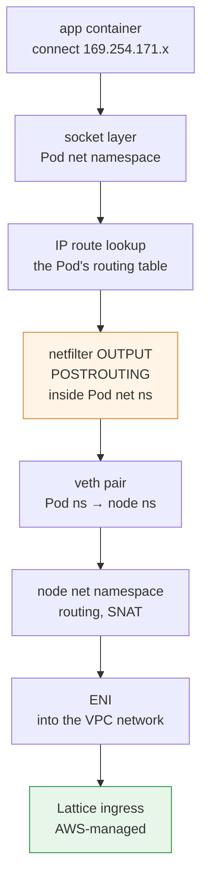
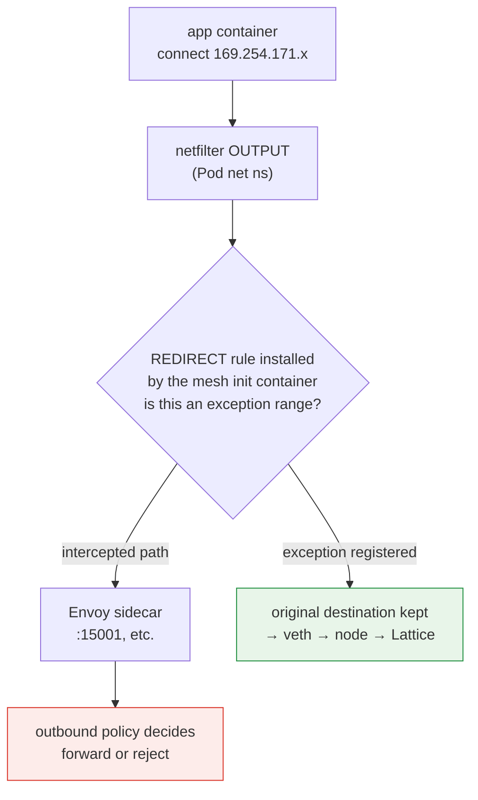
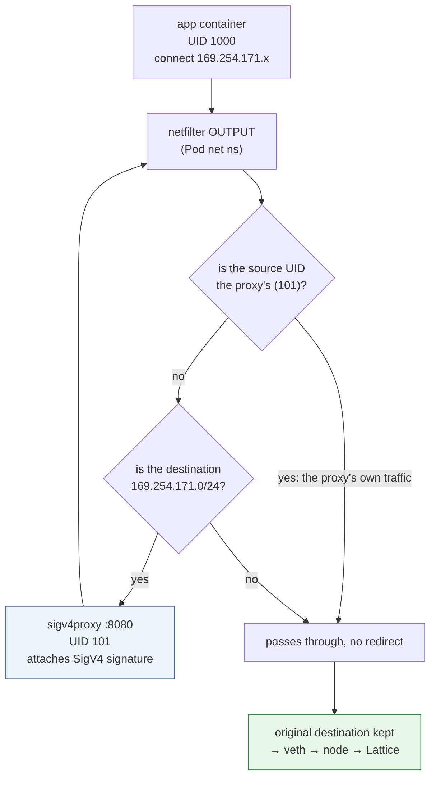

# 内核数据路径：链路本地拦截的实际工作方式

> **范围**：VPC Lattice service/resource API 和 AWS Gateway API Controller；应核实所选发行版及已安装 CRD。
> **最后更新**：2026 年 10 月 12 日

## 本文内容

- Pod 发往 Lattice 地址的数据包在内核中的实际路径
- Sidecar mesh 的 iptables 拦截在内核中的具体哪个位置会与 Lattice 流量冲突
- conntrack 在此配置下的行为，以及为什么出口代理方式容易受到规则顺序影响

## 编写本文的原因

[文档 04](./04-networking-basics.md) 解释过，链路本地地址是一个标记，表示“由基础设施处理此数据包”。从概念上理解这点已经足够，但**迁移过程中实际导致故障的问题都发生在内核层**。

| 生产环境症状 | 内核层的实际情况 |
|---|---|
| “所有 Lattice 调用都失败了” | Envoy 的 iptables REDIRECT 也拦截了 Lattice 地址范围 |
| “我添加了例外 CIDR，还是失败” | 规则顺序有误，或缺少 IPv6 地址范围 |
| “加了出口代理后，现在陷入循环” | 代理自己的流量再次被重定向 |
| “连接间歇性断开” | conntrack 耗尽或超时 |
| “只有部分节点失败” | 各节点规则状态不一致，或时钟同步问题 |

本文连接了[文档 04](./04-networking-basics.md)和 [Linux 内核部分](../../kernel/README.md)。通用内核概念见[容器背后的内核功能](../../kernel/01-container-primitives.md)和[内核网络栈](../../kernel/02-network-stack.md)；此处只介绍**Lattice 配置特有的内容**。

## 数据包的路径：没有 Sidecar 时

先看理想的目标状态：不使用 Envoy，由应用直接签名。



需要注意三点：

**① IP 栈使用普通连接。** 身份验证是另外一回事：应用或签名代理仍须实现所选的 Lattice 请求身份验证路径。

**② 路由查找在 Pod 路由表中进行。** 网络命名空间就是 Pod 边界（参见[容器内核功能](../../kernel/01-container-primitives.md)），因此由 Pod 内的 `ip route` 决定路由。使用 VPC CNI 时，Pod 的默认路由通过 veth 到达节点，链路本地地址范围也跟随此默认路由。

> 此图是 VPC CNI 路由概念图，并不声称描述未公开的 AWS 内部实现。普通链路本地/ULA 地址范围与 AWS 特定服务的路由行为是两回事。应在目标环境中检查实际路由及受支持的连接方式。

**③ netfilter hook 在 Pod 网络命名空间内求值。** 这正是下一节中会发生冲突的原因。

## 冲突：Envoy 的 iptables 拦截

### Sidecar mesh 安装的内容

App Mesh 和 Istio 的 init container 会在 Pod 网络命名空间内安装 iptables 规则。其基本结构很简单。

```text
# Conceptual form (real rules are more complex)
OUTPUT  → jump to a custom chain
custom chain:
  - traffic from Envoy's own UID → RETURN (prevents an infinite loop)
  - exception ranges → RETURN
  - everything else → REDIRECT to Envoy's port
```

`REDIRECT` 是 netfilter 中 DNAT 系列的目标，**会将目的地址改写为本地端口**。应用仍然以为自己正在连接原始地址，但数据包实际上会发往 Envoy。

### 冲突具体发生在哪里



Mesh 拦截可能发生在 **Pod-netns OUTPUT**。被拦截的请求是继续转发、失败，还是签名字段被修改，取决于 Envoy 的出站策略和配置的目的地址。在 Envoy 中记录到请求只能证明请求经过了它；单凭这一点无法证明拦截是失败的原因。

### 根据代理配置解读证据

受限代理可能会对未知目的地返回错误；允许所有流量/直通策略则可以转发请求。应验证路由和返回的错误，而不要假定每个缺失的例外都会立即造成 503。

**诊断路径**：Lattice 调用失败时，检查 Envoy sidecar 日志是否包含发往 `169.254.171.x` 的受影响请求。这可以证明请求经过了代理。应结合返回的错误、路由/出站策略以及任何签名字段变更进行分析，再判断是否由拦截导致失败；已配置的代理也可能成功转发请求。

### 注册例外：内容和位置

| Mesh | 设置 |
|---|---|
| App Mesh | 将 Lattice 地址范围添加到 init container 的 egress-ignore CIDR 列表 |
| Istio | 使用 `traffic.sidecar.istio.io/excludeOutboundIPRanges` 注解 |

要排除的范围：

| 地址范围 | 是否必需 |
|---|---|
| `169.254.171.0/24` | **必需** |
| `fd00:ec2:80::/64` | **双栈集群中必需** |

### 四个常见实际问题

**① 缺少 IPv6 例外**：只排除 IPv4 会导致双栈集群间歇性失败。如果客户端收到 AAAA 记录并通过 IPv6 连接，该路径仍会被拦截。**表现为“偶尔失败”时很难诊断**，因为结果取决于 DNS 响应顺序和客户端如何选择地址。

**② 注解只对新 Pod 生效**：Pod 级注解会在 Pod 创建时由 init container 读取。必须重启已有 Pod。

**③ 规则顺序**：netfilter 从**上到下**检查链中的规则，并对第一个匹配项采取操作。例外的 `RETURN` 规则必须位于 `REDIRECT` 规则**之前**。标准 mesh init container 会正确设置此顺序；但如果自己添加规则，必须验证顺序。

**④ 与其他链路本地服务混淆**：Pod Identity Agent 的地址为 `169.254.170.23`，IMDS 为 `169.254.169.254`。Lattice 的地址范围为 `169.254.171.0/24`。**它们是同一个 `169.254.0.0/16` 中不同的范围**；因此，从 mesh 拦截中排除整个 `169.254.0.0/16` 也会排除 IMDS 和 Pod Identity 流量。这可能正是你想要的（通常这些流量也不应该被拦截），但**应明确说明意图并作出有意识的决定**。

### 验证

```bash
# Required, explicit test target; these are diagnostic reads.
: "${LATTICE_CONTEXT:?}" "${LATTICE_NAMESPACE:?}" "${LATTICE_POD:?}"
: "${LATTICE_DIAG_CONTAINER:?}" "${LATTICE_APP_CONTAINER:?}" "${LATTICE_URL:?}"
kubectl --context "$LATTICE_CONTEXT" -n "$LATTICE_NAMESPACE" \
  exec "$LATTICE_POD" -c "$LATTICE_DIAG_CONTAINER" -- iptables -t nat -L -n -v

# Unsigned connectivity observation: AWS_IAM may reject it.
kubectl --context "$LATTICE_CONTEXT" -n "$LATTICE_NAMESPACE" \
  exec "$LATTICE_POD" -c "$LATTICE_APP_CONTAINER" -- \
  curl -sv --max-time 5 "$LATTICE_URL"

# Inspect the configured proxy container only when present.
kubectl --context "$LATTICE_CONTEXT" -n "$LATTICE_NAMESPACE" \
  logs "$LATTICE_POD" -c "$LATTICE_DIAG_CONTAINER" --tail=50
```

应在启动迁移**之前**完成此验证。这是[文档 06](./06-constraints.md)中的约束 4。

## 出口代理方式的内核层行为

[文档 03](./03-auth-flow.md)中的签名方式②（出口代理）会**将相同的 iptables 机制用于相反的目的**。

### 结构



这是 aws-samples 参考实现的结构：init container 使用 iptables 将**仅发往 `169.254.171.0/24`** 的流量重定向到本地端口 8080，代理则在流量发出时附加 SigV4 签名。

### 为什么必须设置基于 UID 的例外

该图中的第一个分支是**阻止无限循环的机制**。

代理发出的已签名数据包同样发往 `169.254.171.x`。如果没有 UID 例外，它会再次匹配该规则并被重定向到自身，从而形成循环。

应为代理使用**专用 UID**，并设置匹配的 owner 例外。图中的 UID 101 只是示例；请核实实际示例/已安装清单，不要假定各发行版都使用固定 UID。代理的权限应与应用分开。

**实际影响**：代理容器的 `runAsUser` 必须与 iptables 规则中的 UID **一致**。只改其中一处就可能导致循环或丢失签名功能。这是自定义清单时最脆弱的连接点。

### 两组 iptables 规则共存时

迁移期间，单个 Pod 可能同时包含**mesh 拦截例外和签名代理重定向**。这正是[文档 06](./06-constraints.md)中约束 4 所说“始终测试两条规则的顺序和交互”的原因。

逻辑上所需的顺序如下：

| 顺序 | 规则 | 目的 |
|---|---|---|
| 1 | proxy UID → `RETURN` | 防止循环（最高优先级） |
| 2 | Lattice 地址范围 → `REDIRECT` 到签名代理 | 添加签名 |
| 3 | mesh 的其他例外范围 → `RETURN` | 排除 mesh 拦截 |
| 4 | 其他所有流量 → `REDIRECT` 到 Envoy | Mesh 拦截 |

为了让 Lattice 流量到达签名代理而不是 Envoy，**规则 2 必须位于规则 4 之前**。两个 init container 分别安装规则时，顺序取决于它们的执行顺序。

幸运的是，可以验证 mesh 一侧；下文通过源码确认了 Istio 的行为。

### Istio 的实际规则顺序（已从源码确认）

Istio 的 `istio-iptables`（`tools/istio-iptables/pkg/capture/run.go`）向 `ISTIO_OUTPUT` 链**追加**规则时的顺序如下：

| 顺序 | 规则 | 目的 |
|---|---|---|
| 1 | 基于端口的例外 → `RETURN` | 源代码注释：“必须在将回连自身的连接重定向之前应用” |
| 2 | loopback/自调用处理 | 处理 `appN => Envoy => Envoy => appN` 路径 |
| 3 | **`-m owner --uid-owner <proxy-uid>` → `RETURN`** | **防止循环。** 源代码注释：“避免无限循环。不要将 Envoy 流量直接重定向回 Envoy” |
| 4 | **排除的 CIDR（`excludeOutboundIPRanges`）→ `RETURN`** | 排除拦截 |
| 5 | 包含端口的处理 | |
| 6 | **`-j ISTIO_REDIRECT`（通配兜底规则）** | 其他所有流量都转到 Envoy |

**关键发现**：排除 CIDR 的 `RETURN`（4）位于兜底 `REDIRECT`（6）**之前**。因此，仅将 Lattice 地址范围加入 Istio 的 `traffic.sidecar.istio.io/excludeOutboundIPRanges` 注解就能正确工作，无需调整规则顺序。

而且**代理 UID 的 `RETURN`（3）甚至位于排除 CIDR 之前**，这说明 Istio 本身也使用了本文介绍的基于 UID 的防循环机制。

::: warning 需要验证
上文的规则顺序已从 **Istio** 源码确认。**尚未验证 App Mesh init container 安装的实际规则顺序**；它是另一种实现方式，且 App Mesh 已于 2026 年 9 月 30 日结束支持。

此外，若配置**添加了签名代理 init container**，就有两个 init container 分别安装规则，顺序取决于 `initContainers` 数组顺序。对于这种组合，应在目标环境中使用 `iptables -t nat -L -n -v` 转储真实规则并验证。
:::

## 此配置中的 conntrack 行为

### Lattice 流量会在 conntrack 中留下什么

如[容器内核功能](../../kernel/01-container-primitives.md)中所述，NAT 会创建 conntrack 项。此配置中需要检查的条目如下：

| 配置 | 要检查的跟踪项 |
|---|---|
| 应用直接签名 | 即使没有 NAT，也可能存在 Pod/节点跟踪项；应检查实际 CNI 路径和任何 SNAT |
| 出口签名代理 | 应用到代理、代理到服务的连接，以及已配置的 NAT；连接池会影响条目数量 |
| 与 Mesh 共存 | 会产生额外路径和命名空间；不要只根据代理数量推断固定倍数 |

出口代理会分别创建应用到代理、代理到服务的连接。其跟踪成本取决于命名空间、连接复用和 NAT 设置；不要只根据代理数量推断节点表中会固定增加多少条目。

应在有代表性的负载下测量 Pod/节点 conntrack 以及任何 eBPF map 占用。代理可能会复用上游连接，同时增加本地连接链路；应评估实际权衡，而不是假定所有情况都遵循同一个倍数。

### 诊断

如[内核部分](../../kernel/03-eks-node-tuning.md)所述，conntrack 耗尽会**静默丢弃连接**。在 Lattice 配置中，“连接间歇性断开”是一个值得调查的线索。

```bash
# Correlate insertion/drop signals with count/max and kernel logs.
conntrack -S | grep -E "insert_failed|drop"

# Check entries toward the Lattice range
conntrack -L | grep 169.254.171 | head

# Utilization
echo "$(cat /proc/sys/net/netfilter/nf_conntrack_count) / $(cat /proc/sys/net/netfilter/nf_conntrack_max)"
```

部分故障并不能排除 conntrack 压力：命名空间、区域、表、连接复用和分组时序可能各不相同。应关联受影响路径中的数量/上限、丢弃/插入计数器和日志；不要仅凭其他目的地是否正常工作来诊断。

## 安全组与内核

[文档 04](./04-networking-basics.md)介绍过通过前缀列表开放安全组。这里补充一点内核视角的信息。

**安全组不是内核的 netfilter。** 它是 AWS 在 VPC 层应用于 ENI 的有状态防火墙，由实例外部的虚拟机管理程序/网络基础设施实施。

这意味着：

- 节点的 iptables 列表中没有 AWS 安全组规则。
- 入站分组如果在送达之前就被拒绝，不会出现在接收节点的抓包位置。
- 出站分组可能先在发送方内部被抓取，然后再被外部安全组丢弃。应按接口、命名空间和方向解读 `tcpdump`；没有响应并不能唯一证明安全组有问题。

诊断顺序可以参考：

| 观测结果 | 可能原因 |
|---|---|
| `tcpdump` 未显示出站分组 | Pod 内部：路由、拦截、DNS |
| 可见出站分组，但没有响应 | 安全组（检查两个方向）、路由、Lattice 一侧 |
| 收到响应，但应用未收到 | Socket 缓冲区，或拦截路径上的问题 |
| 丢弃计数上升 | conntrack 或 qdisc（参见[内核网络栈](../../kernel/02-network-stack.md)） |

## 节点间状态不一致：“只有部分节点失败”

这种症状可以将可能原因缩小到少数几项。

| 原因 | 检查内容 |
|---|---|
| **节点安全组不同** | 前缀列表入站规则是否应用到每个节点组 |
| **内核版本不同** | 使用 `kernel-default` AMI 时，替换时机不同可能导致 6.1 和 6.18 并存（参见[内核调优](../../kernel/03-eks-node-tuning.md)） |
| **conntrack 设置不同** | 启动时 ConfigMap 的状态可能不同 |
| **时钟同步问题** | `x-amz-date` 偏差 5 分钟：只有特定节点返回 403（参见[文档 03](./03-auth-flow.md)） |
| **Pod 是否已重启** | 旧 Pod 未应用注解变更 |

**“只有部分节点”这一模式本身就是诊断信息。** 全面故障指向配置或身份验证问题；仅特定节点故障则指向节点状态不一致。

## 总结

- 发往 Lattice 的分组是**普通 IPv4/IPv6 连接**。特殊处理发生在基础设施侧，而不是应用中。
- 应区分 IPv4 链路本地地址、IPv6 ULA 和文档描述的 AWS 特定服务路径；不要仅根据地址前缀推断内部路由。
- 检查 Pod-netns OUTPUT、出站策略和实际代理日志；经过拦截并不必然意味着失败。
- 例外配置的常见问题：**遗漏 IPv6**（表现为间歇性失败）、注解只影响新 Pod、**规则顺序**，以及排除整个 `169.254.0.0/16` 也会覆盖 IMDS 和 Pod Identity。
- 出口代理方式需要**基于 UID 的防循环机制**，代理的 `runAsUser` 必须与 iptables UID 一致。它还会**新增 conntrack 项**。
- 两组 iptables 规则共存时，**转储实际规则是唯一可靠的验证方法**。
- 安全组和 netfilter 属于不同层；抓包能否看到分组取决于方向和抓取位置。

## 参考资料

- [Linux 内核概述](../../kernel/README.md)：本文的一般背景知识
- [容器背后的内核功能](../../kernel/01-container-primitives.md)：命名空间、netfilter、conntrack
- [内核网络栈](../../kernel/02-network-stack.md)：分组路径和观测点
- [EKS 节点内核调优](../../kernel/03-eks-node-tuning.md)：conntrack 配置路径
- [aws-samples：使用 VPC Lattice 和 EKS 进行 IAM 身份验证](https://github.com/aws-samples/migrating-from-aws-app-mesh-to-amazon-vpc-lattice/blob/main/vpc-lattice-config/IAMAUTH.md)
- [AWS Gateway API Controller：部署控制器](https://www.gateway-api-controller.eks.aws.dev/latest/guides/deploy/)
- [iptables-extensions(8)：owner 匹配](https://man7.org/linux/man-pages/man8/iptables-extensions.8.html)
- [istio/istio：tools/istio-iptables/pkg/capture/run.go](https://github.com/istio/istio/blob/master/tools/istio-iptables/pkg/capture/run.go)：规则顺序的一手来源

诊断命令需要在所选容器/网络命名空间中安装相应工具并具备所需权限。未签名 HTTP 请求被拒绝并不能证明 IAM 配置失败。应使用已审查的签名路径执行授权测试，并从详细日志中删除凭证信息。
