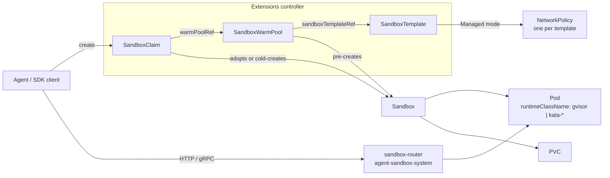

# Agent Sandbox on EKS: Isolated, Stateful Runtimes for AI Agents

> **Supported Versions**: Agent Sandbox v1.0.6 (API `v1beta1`), Python SDK `k8s-agent-sandbox` 1.0.6, Karpenter v1.13.0+ for `cpuOptions.nestedVirtualization`
> **Last Updated**: October 16, 2026

[Agent Sandbox](https://github.com/kubernetes-sigs/agent-sandbox) (`kubernetes-sigs/agent-sandbox`) is a Kubernetes SIG Apps subproject that adds a `Sandbox` custom resource and controller for **isolated, stateful, singleton workloads**. A Sandbox is one Pod with a stable identity, optional persistent storage and lifecycle controls (expiry, suspend and resume) that Deployments and StatefulSets do not model directly. The typical consumers are AI agents that execute LLM-generated code, reinforcement learning (RL) rollouts, notebooks and per-user development environments.

This chapter explains the API as it exists at tag `v1.0.6` and what changes when you run it on Amazon EKS: runtime isolation options, how the default NetworkPolicy behaves under the Amazon VPC CNI, private exposure of the router, and IAM.

> Facts in this chapter come from the upstream source at tag `v1.0.6` (CRD types, controllers, release notes, threat model), AWS documentation and the Karpenter source. The manifests were not run on an EKS cluster for this chapter; treat them as starting points and test them on your own node and network configuration.

---

## 1. Why a New Workload API

| Need | Deployment | StatefulSet (replicas: 1) + Service + PVC | Sandbox |
|------|------------|------------------------------------------|---------|
| Exactly one Pod with a stable name | No (random suffix) | Yes (`name-0`) | Yes (Pod name = Sandbox name) |
| Per-instance storage that survives Pod restarts | No | Yes | Yes (`volumeClaimTemplates`) |
| Stop compute but keep the object and volumes | Scale to 0 (all replicas) | Scale to 0 | `operatingMode: Suspended` |
| Absolute expiry time | No | No | `shutdownTime` + `shutdownPolicy` |
| Pre-warmed instances handed out on demand | No | No | `SandboxWarmPool` + `SandboxClaim` |
| Secure defaults for untrusted code | No | No | `SandboxTemplate` (no SA token, managed NetworkPolicy) |

An agent platform usually needs thousands of these short-lived or idle-most-of-the-time environments, each owned by one session or user. Modelling each as a StatefulSet of size 1 plus a Service and PVC works but leaves expiry, warm pools, claim latency and isolation defaults to custom code.

### Project status (October 16, 2026)

| Item | Value |
|------|-------|
| Repository created | August 12, 2025 |
| v1.0.0 | August 28, 2026: `v1alpha1` and the conversion webhook removed; all CRDs serve only `v1beta1` |
| Latest release | v1.0.7 (October 15, 2026); patch releases have shipped weekly since v1.0.0. This chapter is based on v1.0.6 |
| API groups | `agents.x-k8s.io/v1beta1` (core), `extensions.agents.x-k8s.io/v1beta1` (extensions) |
| Controller namespace | `agent-sandbox-system` |
| SDKs | Python (`k8s-agent-sandbox`, Python ≥ 3.11), Go (`sigs.k8s.io/agent-sandbox/clients/go/sandbox`), TypeScript |
| Isolation | Delegated to the Pod's `RuntimeClass` (for example gVisor or Kata Containers) |

The project's version is 1.0, but its API version is still `v1beta1`. Pin releases and read each release's "Breaking Changes / Action Required" section; several patch releases (v1.0.2, v1.0.5, v1.0.6, v1.0.7) contain action items.

---

## 2. Architecture



| Kind | Group | Short name | Role |
|------|-------|-----------|------|
| `Sandbox` | `agents.x-k8s.io` | `sandbox` | One Pod with stable identity, optional PVCs and headless Service, lifecycle and suspend |
| `SandboxTemplate` | `extensions.agents.x-k8s.io` | `sandboxtemplate` | Reusable blueprint plus platform policy (NetworkPolicy, env and volume injection rules) |
| `SandboxWarmPool` | `extensions.agents.x-k8s.io` | `swp` | Keeps N unclaimed Sandboxes ready from a template; has a scale subresource for HPA |
| `SandboxClaim` | `extensions.agents.x-k8s.io` | `sandboxclaim` | A request for a Sandbox from a warm pool; owns the Sandbox after adoption |

Supporting components:

- **sandbox-router** (optional): a Go HTTP reverse proxy (`registry.k8s.io/agent-sandbox/sandbox-router-go`) that routes by `X-Sandbox-ID` headers or, with `--path-routing-prefix`, by URL path. Since v1.0.2 its manifests live in `agent-sandbox-system`, and it supports Ed25519 scoped tokens (v2) bound to the Sandbox UID, port, method and path.
- **sandboxd**: an in-sandbox runtime daemon (REST filesystem on `:8080`, gRPC `ProcessService` on `:9090`) that the SDKs can use for commands, files and interactive processes.

---

## 3. The Core `Sandbox` Resource

```yaml
apiVersion: agents.x-k8s.io/v1beta1
kind: Sandbox
metadata:
  name: py-session-42           # also the Pod name; ≤ 63 chars when spec.service is true
  namespace: agents
spec:
  podTemplate:
    metadata:
      labels:
        team.example.com/owner: data-science
    spec:
      runtimeClassName: gvisor   # isolation comes from the runtime, not from Agent Sandbox
      automountServiceAccountToken: false
      containers:
      - name: runtime
        image: <your-registry>/python-runtime:<tag>
        ports:
        - containerPort: 8888
        resources:
          requests: { cpu: 250m, memory: 512Mi }
          limits:   { cpu: "1",  memory: 1Gi }
  volumeClaimTemplates:          # immutable after creation
  - metadata:
      name: workspace
    spec:
      accessModes: [ReadWriteOnce]
      storageClassName: gp3
      resources:
        requests:
          storage: 5Gi
  service: true                  # create a headless Service named after the Sandbox
  operatingMode: Running         # or Suspended
  shutdownTime: "2026-10-14T00:00:00Z"
  shutdownPolicy: Delete         # default Retain
```

Field behavior in `v1beta1`:

| Field | Behavior |
|-------|----------|
| `podTemplate` | Required. Labels and annotations are propagated to the Pod, except system-reserved keys under `agents.x-k8s.io/` and `extensions.agents.x-k8s.io/`, which the controller filters out. |
| `volumeClaimTemplates` | PVCs created per Sandbox. Immutable (CEL rule). |
| `service` | Unset: no new Service is created (existing ones are kept for backward compatibility). `true`: headless Service named after the Sandbox. `false`: Service removed. |
| `operatingMode` | `Running` (default) keeps a Pod; `Suspended` deletes the Pod but keeps the Sandbox object and its PVCs. |
| `shutdownTime` | Absolute expiry. At that time the Pod and Service are deleted. |
| `shutdownPolicy` | `Retain` (default) keeps the Sandbox object with `Ready=False, reason=SandboxExpired`; `Delete` removes it. |

Status conditions follow Gateway API conventions:

| Condition | Meaning |
|-----------|---------|
| `Ready` | True only when the Pod is Running and Ready with an IP (and the Service exists, if required). False reasons include `DependenciesNotReady`, `SandboxSuspended`, `SandboxExpired`, `InvalidConfiguration`, `ReconcilerError`. |
| `Suspended` | Progress of a suspension: `PodTerminating`, then `PodTerminated`; `NotSuspended` once running again. |
| `PodScheduled` | Mirrors the Pod's `PodScheduled` condition (for example `Unschedulable`), so you do not need to read the Pod. |
| `Finished` | Set when the Pod reaches `Succeeded` or `Failed`. |

`status` also carries `serviceFQDN`, `podIPs` and `nodeName`.

> **v1.0.6 action item**: a CEL rule now rejects a Sandbox whose name exceeds 63 characters while `spec.service` is `true` (a Service name is a DNS-1035 label). Existing objects are not exempt, so such a Sandbox fails every update, including status updates, until you unset `spec.service` or recreate it with a shorter name.

---

## 4. Extensions: Template, Warm Pool and Claim

### SandboxTemplate: where platform policy lives

```yaml
apiVersion: extensions.agents.x-k8s.io/v1beta1
kind: SandboxTemplate
metadata:
  name: python-gvisor
  namespace: agents
spec:
  podTemplate:
    metadata:
      annotations:
        karpenter.sh/do-not-disrupt: "true"   # optional: keep consolidation away from live sessions
    spec:
      runtimeClassName: gvisor
      containers:
      - name: python-runtime
        image: <your-registry>/python-runtime-sandbox:<tag>
        ports:
        - containerPort: 8888
        readinessProbe:
          httpGet: { path: "/", port: 8888 }
          periodSeconds: 1
        resources:
          requests: { cpu: 250m, memory: 512Mi, ephemeral-storage: 512Mi }
          limits:   { cpu: "1",  memory: 1Gi }
  networkPolicyManagement: Managed      # default
  # networkPolicy: omitted -> controller applies its secure default (section 6)
  envVarsInjectionPolicy: Disallowed    # default; Allowed | Overrides
  volumeClaimTemplatesPolicy: Disallowed  # default; Allowed | Overrides
```

Secure defaults that apply to Sandboxes created through a template (by a warm pool or claim):

- If the PodSpec does not set `automountServiceAccountToken`, the controller sets it to `false`.
- With `networkPolicyManagement: Managed` (the default), the controller creates **one shared NetworkPolicy per template**. Editing its rules changes enforcement for every existing and future Sandbox from that template.
- Claims cannot inject environment variables or volume templates unless the template allows it.

A bare `Sandbox` gets none of these defaults. Use admission control (ValidatingAdmissionPolicy, Kyverno or Gatekeeper) if users may create `Sandbox` objects directly, or grant them RBAC only for `SandboxClaim`.

### SandboxWarmPool: pre-created capacity

```yaml
apiVersion: extensions.agents.x-k8s.io/v1beta1
kind: SandboxWarmPool
metadata:
  name: python-gvisor-pool
  namespace: agents
spec:
  replicas: 10                 # default 1; scale subresource, so an HPA can own it
  sandboxTemplateRef:
    name: python-gvisor
  updateStrategy:
    type: OnReplenish          # default; Recreate replaces stale unclaimed Sandboxes at once
```

When the template's blueprint changes, unclaimed Sandboxes become stale. `OnReplenish` replaces them only as they are claimed or deleted; `Recreate` deletes them immediately. Sandboxes already claimed are never touched, because ownership moves to the claim.

### SandboxClaim: what an agent session asks for

```yaml
apiVersion: extensions.agents.x-k8s.io/v1beta1
kind: SandboxClaim
metadata:
  name: session-7f3a
  namespace: agents
spec:
  warmPoolRef:
    name: python-gvisor-pool
  lifecycle:
    shutdownTime: "2026-10-13T12:00:00Z"
    shutdownPolicy: Delete       # Delete | DeleteForeground | Retain (default)
    ttlSecondsAfterFinished: 600
```

- The claim adopts a ready Sandbox from the pool. If no warm candidate reports a Pod IP within `--sandbox-claim-warm-candidate-grace-period` (default `2s`, added in v1.0.6), it falls back to creating one cold.
- Setting `spec.env` or `spec.volumeClaimTemplates` always forces a cold start, because those values must exist before the Pod is created.
- `additionalPodMetadata` labels must use an allowed domain (default `sandbox.users.io`, configurable through the `agent-sandbox-config` ConfigMap).
- `status.sandbox` reports the bound Sandbox's `name`, `podIPs` and `serviceFQDN`.

---

## 5. Isolation on EKS: Choosing a RuntimeClass

Agent Sandbox is an orchestrator. Its threat model says container escape is mitigated by running Pods under a stronger runtime selected by `runtimeClassName`, preferably set in a `SandboxTemplate` so users cannot drop it. With the default `runc`, LLM-generated code shares the node's kernel with every other Pod on the node.

| Option on EKS | Isolation boundary | Node requirements | Notes |
|---------------|-------------------|-------------------|-------|
| `runc` (default) | Linux namespaces and cgroups | Any | Not sufficient for untrusted code on shared nodes |
| gVisor (`runsc`) | User-space application kernel | Install `runsc` and `containerd-shim-runsc-v1`, register handler `runsc` in containerd | Works on ordinary virtualized instances; some syscalls and workloads behave differently, so test them |
| Kata Containers | Lightweight VM per Pod | Hardware virtualization: bare-metal (`*.metal`) instances or instances with nested virtualization | Strongest boundary of these options; higher per-Pod overhead |
| Dedicated nodes per tenant | EC2 instance | Taints, tolerations and node selectors | Can be combined with gVisor or Kata |

EKS-specific points:

- **EKS Auto Mode**: AWS chooses the AMI and is responsible for the container runtime, and the instances are not accessible over SSH, so you cannot add `runsc` or Kata there. Use managed node groups, self-managed nodes or Karpenter with a custom AMI or user data for sandbox node pools.
- **gVisor**: install the binaries in a custom AMI or at boot, and register the runtime handler. On AL2023, nodeadm's `NodeConfig` accepts inline TOML in `spec.containerd.config`. containerd 1.x uses config version 2 (`plugins."io.containerd.grpc.v1.cri"`), while 2.x uses version 3 (`plugins."io.containerd.cri.v1.runtime"`), so check `containerd --version` on your AMI before writing the runtime section.
- **Kata and nested virtualization**: EC2 supports nested virtualization (KVM or Hyper-V as L1) on M7i, M7i-flex, M8i, M8id, M8i-flex, C7i, C7i-flex, C8i, C8id, C8i-flex, R7i, R7iz, R8i, R8id, R8i-flex, X8i, I7i and I7ie, enabled with the CPU option `NestedVirtualization=enabled`. AWS recommends bare metal for performance-sensitive workloads.
  - Karpenter v1.13.0 and later expose `spec.cpuOptions.nestedVirtualization: enabled` on `EC2NodeClass`, and filter instance types to those reporting `nested-virtualization`.
  - For managed node groups, the containers-roadmap request ([#2784](https://github.com/aws/containers-roadmap/issues/2784)) was closed as completed on October 12, 2026, after users reported that the launch-template setting is respected. Confirm it on a test node (`grep -cE 'vmx|svm' /proc/cpuinfo`) before relying on it.
- **Fargate** runs each Pod in its own VM, but the VPC CNI cannot apply network policies to Fargate Pods, so the template's managed NetworkPolicy would not be enforced there. Check the Fargate considerations before you choose it.

Bind the RuntimeClass to the prepared nodes so a sandbox Pod can never land on a node without the handler:

```yaml
apiVersion: node.k8s.io/v1
kind: RuntimeClass
metadata:
  name: gvisor
handler: runsc
scheduling:
  nodeSelector:
    sandbox.example.com/runtime: gvisor
  tolerations:
  - key: sandbox.example.com/untrusted
    operator: Exists
    effect: NoSchedule
---
# Karpenter: a NodeClass for Kata nodes on nested-virtualization instances
apiVersion: karpenter.k8s.aws/v1
kind: EC2NodeClass
metadata:
  name: kata-nested
spec:
  cpuOptions:
    nestedVirtualization: enabled   # Karpenter >= v1.13.0
  # amiSelectorTerms, role, subnetSelectorTerms, securityGroupSelectorTerms,
  # and user data that installs Kata are omitted here.
```

---

## 6. Networking on EKS

### What the managed default policy does

When a template sets no `networkPolicy` and keeps `Managed` mode, the controller generates this policy (from `buildDefaultNetworkPolicySpec` in v1.0.6):

| Direction | Rule |
|-----------|------|
| Ingress | Only from Pods labeled `app: sandbox-router` in namespace `agent-sandbox-system` |
| Egress (IPv4) | `0.0.0.0/0` except `10.0.0.0/8`, `172.16.0.0/12`, `192.168.0.0/16`, `169.254.0.0/16` |
| Egress (IPv6) | `::/0` except `fc00::/7`, `fe80::/10` |
| DNS | Not allowed: CoreDNS has a private IP, and the code comment says this is intentional to prevent internal service discovery |

Consequences on EKS:

1. **Enforcement needs a policy engine.** Enable network policy in the Amazon VPC CNI add-on (version 1.21.0 or later, `enableNetworkPolicy: "true"`). On Auto Mode, set `enable-network-policy-controller: "true"` in the `amazon-vpc-cni` ConfigMap in `kube-system`; a NodeClass `networkPolicy` setting is optional. Without enforcement the NetworkPolicy object exists but blocks nothing.
2. **Public hostnames do not resolve by default.** Agents that `pip install` or call public APIs by name fail until you allow DNS or give the Pod a different resolver.
3. **The private-range list is not your VPC's address plan.** Check what the default leaves reachable:
   - VPC CIDRs outside RFC1918 (for example `100.64.0.0/10` secondary CIDRs used for VPC CNI custom networking) are **not** excluded.
   - In an IPv4 cluster, IMDS (`169.254.169.254`) and the Route 53 Resolver (`169.254.169.253`) are blocked, which is intended. The EKS Pod Identity Agent (`169.254.170.23`) is blocked too, so Pod Identity credentials do not work under the default policy.
   - In an **IPv6 cluster**, the VPC CNI ignores IPv4 rules and enforces only IPv6 ones. The IPv6 addresses of IMDS, the Resolver and the Pod Identity Agent (`fd00:ec2::254`, `fd00:ec2::253`, `fd00:ec2::23`) fall in `fc00::/7` and are blocked. Pod and node addresses, however, are global unicast addresses from the VPC's IPv6 CIDR, which the `::/0` rule allows.
   - Also in an IPv6 cluster, the VPC CNI applies policies only to the Pod's primary interface (`eth0`). With IPv4 egress enabled (`ENABLE_V4_EGRESS=true`), IPv4 traffic leaves through an extra interface that no policy filters, including traffic to `169.254.169.254` and RFC1918 addresses. Disable IPv4 egress for sandbox nodes if you do not need it, and keep the IMDS hop limit at 1.
   - VPC interface endpoints have private IPs and are blocked. AWS API calls, if any, leave through NAT to public endpoints.
4. **Direct in-cluster connections are blocked.** Ingress allows only the router, so an agent Pod that uses an SDK in-cluster mode (Service DNS or Pod IP) needs an explicit ingress rule for its namespace.

A custom policy for an IPv4 cluster whose VPC uses `10.0.0.0/16` plus a `100.64.0.0/16` pod CIDR might look like this. It allows DNS only to CoreDNS, allows the agent namespace to connect directly, and excludes every VPC range from public egress:

```yaml
spec:
  networkPolicyManagement: Managed
  networkPolicy:
    ingress:
    - from:
      - namespaceSelector:
          matchLabels: { kubernetes.io/metadata.name: agent-sandbox-system }
        podSelector:
          matchLabels: { app: sandbox-router }
      - namespaceSelector:
          matchLabels: { kubernetes.io/metadata.name: agent-orchestrator }
      ports:
      - { protocol: TCP, port: 8888 }
    egress:
    - to:
      - namespaceSelector:
          matchLabels: { kubernetes.io/metadata.name: kube-system }
        podSelector:
          matchLabels: { k8s-app: kube-dns }
      ports:
      - { protocol: UDP, port: 53 }
      - { protocol: TCP, port: 53 }
    - to:
      - ipBlock:
          cidr: 0.0.0.0/0
          except: [10.0.0.0/8, 172.16.0.0/12, 192.168.0.0/16, 169.254.0.0/16, 100.64.0.0/10]
```

Allowing CoreDNS lets a sandbox resolve internal Service names. If that matters, keep DNS blocked and give the Pod an explicit resolver (`dnsPolicy: None` with `dnsConfig.nameservers` set to a resolver you control that is reachable under the egress rules). For FQDN-level egress allow-lists, use a CNI or proxy that supports them; Kubernetes NetworkPolicy matches only IP blocks and selectors. The VPC CNI counts at most 24 port/protocol combinations per CIDR across all policies.

### Exposing the router

The upstream SDK examples include a "Gateway mode" that sends traffic through a public cloud load balancer. On EKS, keep the data plane private:

| Caller | Path |
|--------|------|
| Agents in the same cluster | SDK in-cluster mode straight to the Pod (add the ingress rule above), or the `sandbox-router-svc` ClusterIP Service on port 8080 |
| Developer laptop or CI | SDK tunnel mode (`kubectl port-forward` to the router Service) |
| Browser or external clients | CloudFront → CloudFront VPC origin → **internal** ALB → router Service. The internal ALB's security group admits only the CloudFront VPC-origin security group or the CloudFront managed prefix list; nothing in the path is internet-facing except CloudFront. |

The router's default authorizer is `AllowAll`. Its threat model notes that, without a configured authorizer, rejecting local and metadata IP literals in `X-Sandbox-Pod-IP` is the only SSRF defense. Before you expose the router beyond the cluster, enable scoped-token v2 authorization (Ed25519, bound to Sandbox UID, port, method and path; Pod-IP overrides are rejected under v2) and enforce rate and connection limits at the ALB or Envoy tier, which the router itself does not do for WebSockets.

---

## 7. IAM and Credentials

- Leave `automountServiceAccountToken: false` (the template default). An agent that can reach the Kubernetes API with a token can try to escalate.
- Do not give sandbox Pods AWS credentials by default. In an IPv4 cluster the managed policy already blocks IMDS and the Pod Identity Agent, but that does not hold for IPv4 egress from IPv6 clusters (section 6); keep IMDSv2 required with a hop limit of 1 on sandbox nodes as a second barrier.
- If a sandbox must call AWS, use a dedicated ServiceAccount with the narrowest role you can, scope it to one namespace, and change the NetworkPolicy deliberately (Pod Identity needs port 80 on `169.254.170.23/32`, or `fd00:ec2::23/128` in an IPv6 cluster; IRSA needs the regional STS endpoint). Record this as a policy exception.
- Give end users RBAC only for `SandboxClaim` in their namespace. Platform teams own `SandboxTemplate` and `SandboxWarmPool`.

---

## 8. Installing and Upgrading

```bash
export VERSION=v1.0.6
# Core + extensions (recommended; works with Argo CD / Flux as plain manifests)
kubectl apply -f "https://github.com/kubernetes-sigs/agent-sandbox/releases/download/${VERSION}/sandbox-with-extensions.yaml"

kubectl get crd sandboxes.agents.x-k8s.io \
  sandboxclaims.extensions.agents.x-k8s.io \
  sandboxtemplates.extensions.agents.x-k8s.io \
  sandboxwarmpools.extensions.agents.x-k8s.io
kubectl -n agent-sandbox-system get deploy agent-sandbox-controller

# Optional router: apply the manifests from sandbox-router/deploy/ at the same tag,
# and pin the image to registry.k8s.io/agent-sandbox/sandbox-router-go:${VERSION}
```

- Release assets per tag: `sandbox.yaml` (core), `extensions.yaml`, `sandbox-with-extensions.yaml`. Controller and router images are published to `registry.k8s.io/agent-sandbox/` with matching `v1.0.x` tags.
- A Helm chart exists in the repository (`helm/`, chart version 0.1.2 at v1.0.6) and is installed from a checkout (`helm install agent-sandbox ./helm/`). No chart repository is published.
- **From earlier than v0.5.0**: direct upgrades to v1.x are not supported. Upgrade to v0.5.2 or later, migrate stored objects to `v1beta1`, confirm every CRD's `status.storedVersions` lists only `v1beta1`, then upgrade. Helm users apply `helm/crds/` before `helm upgrade`.
- Other action items since v1.0.0:
  - v1.0.0 stopped writing the `agents.x-k8s.io/pod-name` annotation; use `.metadata.name`.
  - v1.0.2 moved the router manifests from `default` to `agent-sandbox-system` and changed the Go `Authorizer` interface.
  - v1.0.6 added the 63-character name rule and changed the scoped-token v2 and `proxy.Lookup` contracts.
- Uninstall: deleting the CRDs cascade-deletes every Sandbox, claim, template and pool in the cluster. List them first.

---

## 9. Using the Python SDK

```bash
pip install k8s-agent-sandbox==1.0.6
```

```python
from k8s_agent_sandbox import SandboxClient
from k8s_agent_sandbox.models import SandboxLocalTunnelConnectionConfig

# Tunnel mode: port-forward to sandbox-router-svc in agent-sandbox-system
client = SandboxClient(connection_config=SandboxLocalTunnelConnectionConfig())

sandbox = client.create_sandbox(warmpool="python-gvisor-pool", namespace="agents")
try:
    result = sandbox.commands.run("python -c 'print(2 + 2)'")
    print(result.stdout)
finally:
    sandbox.terminate()
```

- `create_sandbox` creates a `SandboxClaim` against the named warm pool. Passing `env=` forces a cold start.
- For retry-safe workflows, pass a stable `claim_name` with `adopt_existing=True`; a `409 Conflict` then adopts the existing claim. `shutdown_after_seconds` sets an expiry so a crashed client does not leak sandboxes.
- Other connection configs: `SandboxInClusterConnectionConfig` (legacy runtime; Pod IP first, then cluster DNS), `SandboxdInClusterConnectionConfig` (modes `in-cluster-service` and `in-cluster-pod-ip` since v1.0.6), `SandboxDirectConnectionConfig` (explicit URL, optional mTLS), and `AsyncSandboxClient` for asyncio.
- Integrations in the repository include LangChain, OpenAI Agents, Deep Agents, NVIDIA NeMo Gym, Gymnasium and Ray RLlib examples, plus an MCP server.

---

## 10. Operating at Scale

| Concern | What to do |
|---------|-----------|
| Claim latency | Size warm pools from demand; watch `agent_sandbox_claim_controller_startup_latency_ms` by `launch_type` (warm vs cold). If cold fallbacks spike on clusters with slow IPAM, raise `--sandbox-claim-warm-candidate-grace-period`. |
| Pool sizing | `agent_sandbox_warmpool_size` (by pool and readiness) and `agent_sandboxes` gauges. The pool's scale subresource lets an HPA or KEDA drive `replicas`. |
| API server load | Burst refills compete with claims. The project documents APF `FlowSchema`/`PriorityLevelConfiguration` manifests and controller flags (`--api-connections`, `--sandbox-warm-pool-replenish-delay`, write-behind windows) exposed under `controller.*` in the Helm chart. |
| Node consolidation | Karpenter may consolidate nodes that hold idle warm Pods or live sessions. Add `karpenter.sh/do-not-disrupt: "true"` in the template's Pod metadata for session Pods, and use a separate NodePool for sandbox nodes. |
| Suspend and resume | `Suspended` deletes the Pod and keeps PVCs. EBS volumes are zonal, so a resumed Pod must schedule in the volume's AZ; keep capacity there or use a storage class that matches your resume pattern. |
| Cleanup | Always set `shutdownTime` (or `shutdown_after_seconds` in the SDK) and `ttlSecondsAfterFinished` on claims; `Retain` leaves objects behind for inspection. |
| Resource abuse | Set requests and limits in the template, and a `LimitRange` and `ResourceQuota` per tenant namespace. |

---

## 11. When to Use It

| Situation | Recommendation |
|-----------|----------------|
| Self-hosted agent platform on EKS that runs untrusted code per session | Agent Sandbox with templates, gVisor or Kata nodes, private router |
| RL or evaluation rollouts needing thousands of short-lived isolated environments | Agent Sandbox warm pools; follow the project's performance-tuning and APF guides |
| A few long-lived single-Pod services with stable names | A StatefulSet may be simpler; Agent Sandbox helps once you need expiry or suspend |
| You do not want to operate runtimes and nodes for code execution | Consider a managed code-execution service (for example Amazon Bedrock AgentCore Code Interpreter) and compare its isolation, network and data-residency model with your requirements |

### Pre-production checklist

- [ ] Release pinned (`v1.0.6`), and each release's action items reviewed before upgrading
- [ ] Every template sets `runtimeClassName`; the RuntimeClass carries `scheduling` for prepared nodes
- [ ] Users have RBAC for `SandboxClaim` only; bare `Sandbox` creation restricted or validated by admission policy
- [ ] VPC CNI network policy enforcement enabled and tested with a probe Pod (DNS, IMDS, VPC CIDRs, other sandboxes); in IPv6 clusters, the IPv4 egress path checked too
- [ ] Egress exceptions cover every VPC CIDR, including non-RFC1918 and IPv6 ranges
- [ ] Router reachable only privately; scoped-token v2 authorization enabled
- [ ] `shutdownTime` or SDK expiry on every claim; quotas per namespace
- [ ] Controller and warm-pool metrics scraped and alerted

---

## References

- [kubernetes-sigs/agent-sandbox](https://github.com/kubernetes-sigs/agent-sandbox) and [documentation site](https://agent-sandbox.sigs.k8s.io/docs/)
- [Release v1.0.6](https://github.com/kubernetes-sigs/agent-sandbox/releases/tag/v1.0.6) · [Release v1.0.0](https://github.com/kubernetes-sigs/agent-sandbox/releases/tag/v1.0.0) · [Roadmap](https://github.com/kubernetes-sigs/agent-sandbox/blob/main/roadmap.md)
- [Threat model (v1.0.6)](https://github.com/kubernetes-sigs/agent-sandbox/blob/v1.0.6/docs/security/threat_model.md)
- [CRD types: Sandbox](https://github.com/kubernetes-sigs/agent-sandbox/blob/v1.0.6/api/v1beta1/sandbox_types.go) · [extensions](https://github.com/kubernetes-sigs/agent-sandbox/tree/v1.0.6/extensions/api/v1beta1) · [default NetworkPolicy](https://github.com/kubernetes-sigs/agent-sandbox/blob/v1.0.6/extensions/controllers/sandboxtemplate_controller.go)
- [Python SDK README (v1.0.6)](https://github.com/kubernetes-sigs/agent-sandbox/blob/v1.0.6/clients/python/agentic-sandbox-client/README.md) · [Metrics](https://github.com/kubernetes-sigs/agent-sandbox/blob/v1.0.6/docs/metrics.md)
- [Amazon EC2 nested virtualization](https://docs.aws.amazon.com/AWSEC2/latest/UserGuide/amazon-ec2-nested-virtualization.html)
- [Limit Pod traffic with Kubernetes network policies (Amazon EKS)](https://docs.aws.amazon.com/eks/latest/userguide/cni-network-policy.html)
- [gVisor installation](https://gvisor.dev/docs/user_guide/install/) · [Kata Containers](https://katacontainers.io/)
- Related chapters: [Agentic AI Platform on EKS](03-agentic-ai-platform.md) · [LLM Gateway](08-llm-gateway.md) · [Pod Security Standards](../security/03-pod-security-standards.md)
