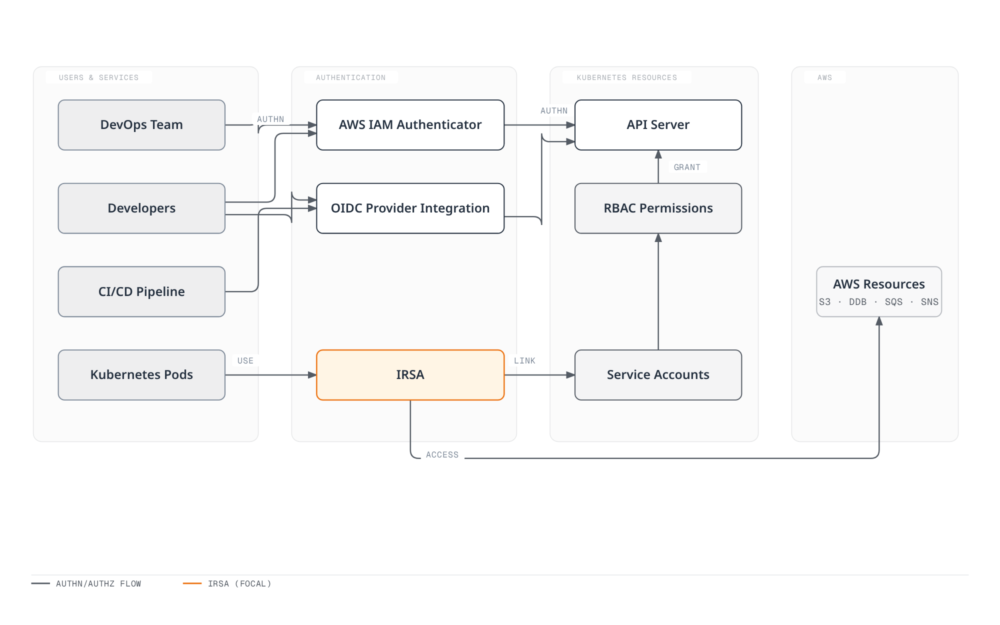

# EKS Cluster Access Authentication: IAM and Access Entries

> **Last Updated**: November 21, 2026

This page is the detailed split-out of the "IAM and Authentication" section of [Amazon EKS Security](./05-eks-security.md). It covers how human and automation IAM principals authenticate to the Kubernetes API and receive permissions, the EKS cluster role and the provisioning caller's permissions, and access entries with namespace-scoped RBAC and access policies. How workloads (Pods) receive AWS credentials continues in [IRSA and the OIDC Provider](./05-eks-security-irsa-oidc.md) and [EKS Pod Identity](./05-eks-security-pod-identity.md); their examples reuse the `security-demo` namespace prepared here.

## Table of Contents

1. [Identities and Authorization Layers](#identities-and-authorization-layers)
2. [Cluster Role and Provisioning Caller](#cluster-role-and-provisioning-caller)
3. [Access Entries and Namespace Authorization](#access-entries-and-namespace-authorization)

## Identities and Authorization Layers

| Identity/control | Purpose |
|---|---|
| Human/automation IAM principal | Authenticate cluster access through the configured IAM mapping/access-entry path |
| Kubernetes RBAC and EKS access policies | Authorize Kubernetes operations; allows are additive |
| External OIDC identity provider | Separately configured Kubernetes API user login with client/claim settings |
| EKS cluster IAM role | Allows the EKS service to call AWS APIs for the cluster |
| EC2 node IAM role | Supports bootstrap and required node-agent AWS operations |
| IRSA or EKS Pod Identity role | Gives an application temporary AWS credentials |
| Kubernetes ServiceAccount token | Authenticates a Pod to Kubernetes APIs under its RBAC permissions |

The IAM OIDC provider used for IRSA is distinct from an external OIDC provider associated for Kubernetes user login. Application AWS permissions do not automatically grant Kubernetes API permissions.

<!-- Diagram repair pending: IRSA/Pod Identity give workload AWS credentials; the ordinary Pod-to-Kubernetes API path uses its Kubernetes ServiceAccount token/RBAC.


[🔍 View interactive diagram](https://www.atomai.click/kubernetes-docs/archmaps/en-eks-05-eks-security-2.html)
-->

## Cluster Role and Provisioning Caller

A standard EKS cluster role trusts the EKS service. This is its trust relationship, not the human developer’s permissions policy:

```json
{
  "Version": "2012-10-17",
  "Statement": [
    {
      "Effect": "Allow",
      "Principal": {
        "Service": "eks.amazonaws.com"
      },
      "Action": "sts:AssumeRole"
    }
  ]
}
```

The role needs AmazonEKSClusterPolicy or a supported custom policy for its service operations. Auto Mode has additional role/policy requirements. The provisioning caller separately needs the actions required by the selected configuration and permission to pass the intended role. The current authorization reference lists CreateCluster without resource-ARN scoping, so use supported request conditions there; scope actions/PassRole that support resource ARNs. Attaching AmazonEKSClusterPolicy to a developer role does not grant Kubernetes application access.

## Access Entries and Namespace Authorization

Prefer the supported access-entry API for IAM cluster access. Inspect the current mode and preserve existing administrator/node mappings before migration. Moving from CONFIG_MAP to API_AND_CONFIG_MAP/API is not a freely reversible switch. Do not overwrite aws-auth with a short sample that omits node roles. Review all identities, policies, nodes and a recovery path before choosing API-only mode.

```bash
set -euo pipefail
: "${CLUSTER_NAME:?Set the existing cluster name}"
: "${AWS_REGION:?Set its Region}"
aws eks describe-cluster --name "$CLUSTER_NAME" --region "$AWS_REGION" \
  --query 'cluster.{Name:name,Status:status,Endpoint:endpoint,Access:accessConfig}' --output json
```

The following example assumes a prepared approved IAM developer role, a cluster that already supports access entries, and the platform operator’s permissions. Prepare the dedicated namespace through its owner. Its Pod Security Admission version matches the reviewed EKS 1.36 example; select the appropriate version for the target cluster:

```yaml
apiVersion: v1
kind: Namespace
metadata:
  name: security-demo
  labels:
    pod-security.kubernetes.io/enforce: restricted
    pod-security.kubernetes.io/enforce-version: v1.36
```

```bash
set -euo pipefail
: "${CLUSTER_NAME:?Set the verified cluster name}"
: "${AWS_REGION:?Set its Region}"
: "${DEVELOPER_ROLE_ARN:?Set a prepared IAM role ARN, not an STS session ARN}"
MODE=$(aws eks describe-cluster --name "$CLUSTER_NAME" --region "$AWS_REGION" \
  --query cluster.accessConfig.authenticationMode --output text)
case "$MODE" in
  API|API_AND_CONFIG_MAP) ;;
  *) echo "Access entries are not enabled; review the migration first"; exit 1 ;;
esac
aws eks list-access-entries --cluster-name "$CLUSTER_NAME" --region "$AWS_REGION" \
  --output json > security-access-entries.json
python3 - "$DEVELOPER_ROLE_ARN" <<'PY'
import json, sys
with open("security-access-entries.json") as stream:
    existing = json.load(stream)["accessEntries"]
if sys.argv[1] in existing:
    raise SystemExit("Entry already exists; inspect its groups/policies instead of overwriting")
PY
aws eks create-access-entry --cluster-name "$CLUSTER_NAME" --region "$AWS_REGION" \
  --principal-arn "$DEVELOPER_ROLE_ARN" --type STANDARD \
  --kubernetes-groups security-demo-developers
```

```yaml
apiVersion: rbac.authorization.k8s.io/v1
kind: Role
metadata:
  name: developer
  namespace: security-demo
rules:
- apiGroups:
  - ''
  resources:
  - pods
  verbs:
  - get
  - list
  - watch
- apiGroups:
  - apps
  resources:
  - deployments
  verbs:
  - get
  - list
  - watch
  - create
  - update
  - patch
- apiGroups:
  - batch
  resources:
  - jobs
  verbs:
  - get
  - list
  - watch
  - create
  - update
  - patch
---
apiVersion: rbac.authorization.k8s.io/v1
kind: RoleBinding
metadata:
  name: developer
  namespace: security-demo
subjects:
- kind: Group
  name: security-demo-developers
  apiGroup: rbac.authorization.k8s.io
roleRef:
  kind: Role
  name: developer
  apiGroup: rbac.authorization.k8s.io
```

The entry maps the IAM principal to a group, and a RoleBinding gives that group the shown namespace permissions. Group names alone do not establish namespace boundaries. Permission to create workload controllers can produce Pods that use ServiceAccounts, Secrets and PVCs in the namespace. Separate tenants and constrain workload/service-account use through appropriate admission and ownership controls.

For a separately reviewed viewer entry, an EKS access policy is an alternative to custom RBAC. Inspect the entry’s current groups and associated policies before adding this namespace view grant:

```bash
set -euo pipefail
: "${CLUSTER_NAME:?Set the verified cluster name}"
: "${AWS_REGION:?Set its Region}"
: "${VIEWER_ROLE_ARN:?Set the IAM principal of a prepared, reviewed access entry}"
aws eks list-associated-access-policies --cluster-name "$CLUSTER_NAME" --region "$AWS_REGION" \
  --principal-arn "$VIEWER_ROLE_ARN"
aws eks associate-access-policy --cluster-name "$CLUSTER_NAME" --region "$AWS_REGION" \
  --principal-arn "$VIEWER_ROLE_ARN" \
  --policy-arn arn:aws:eks::aws:cluster-access-policy/AmazonEKSViewPolicy \
  --access-scope type=namespace,namespaces=security-demo
```

Adding View does not revoke broader RBAC/access-policy grants. Updates can take time to propagate. Test with the actual intended IAM login; kubectl --as tests Kubernetes impersonation/RBAC rather than proving the IAM access-policy path. A kubeconfig points the client to a cluster and credential mechanism; it grants no permissions by itself.

IAM eks:DescribeCluster/ListClusters support AWS management/discovery operations. eks:AccessKubernetesApi is a console-view permission. The eks:namespaces condition filters access-policy association requests; it is not a general namespace filter on kubectl API calls.

## References

- [EKS access entries](https://docs.aws.amazon.com/eks/latest/userguide/access-entries.html)
- [EKS access policies](https://docs.aws.amazon.com/eks/latest/userguide/access-policies.html)
- [Kubernetes RBAC](https://kubernetes.io/docs/reference/access-authn-authz/rbac/)

## Next Steps

- Next: [IRSA and the OIDC Provider](./05-eks-security-irsa-oidc.md)
- Related: [EKS Pod Identity](./05-eks-security-pod-identity.md)
- Back to the overview: [Amazon EKS Security](./05-eks-security.md)

## Quiz

To test what you learned in this chapter, try the [topic quiz](../quizzes/eks/05-eks-security-cluster-access-quiz.md).
